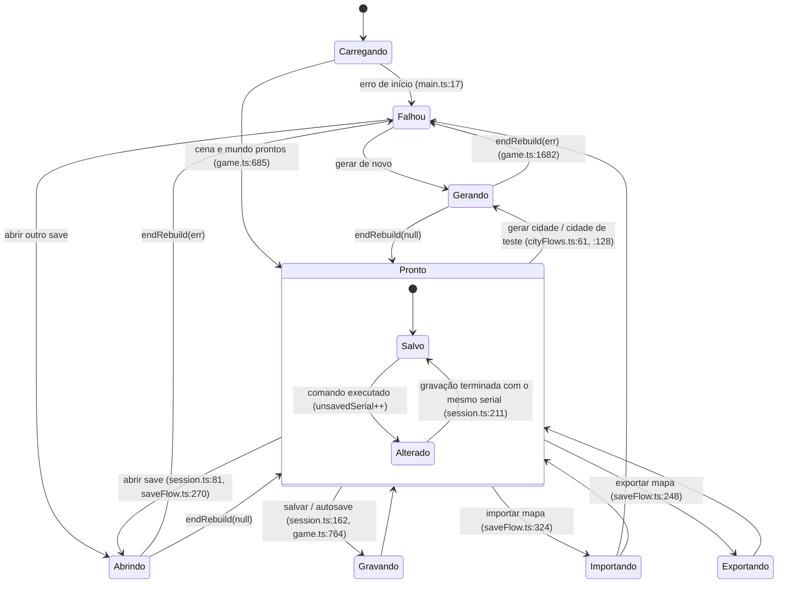
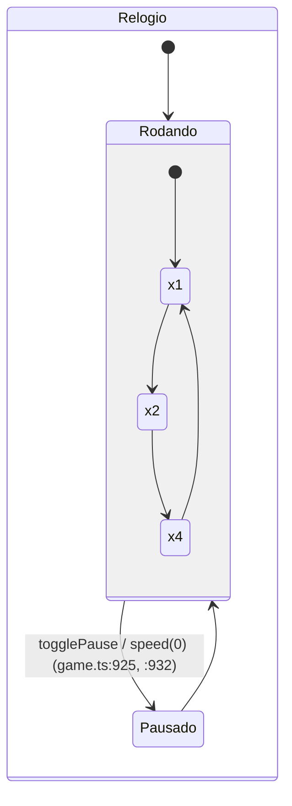
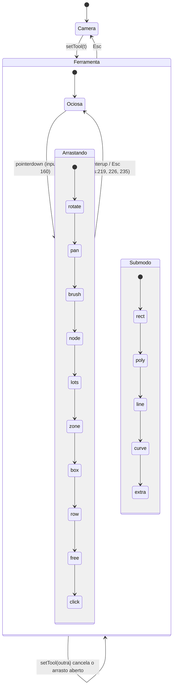

# Auditoria de arquitetura do Roadcraft 5 — 2026-10-30

Worktree `lab/roadcraft-novo-port`, branch `port/roadcraft-features`, **commit auditado `fae9836`** (cópia congelada por
`git archive`, porque outra sessão está mexendo no worktree: `src/game.ts` modificado, `src/app/saveFlow.ts` e
`tools/prune-imports.mjs` novos, `CLAUDE.md` apagado, sem commit). Só análise: nenhum código foi alterado.

**Depois de `fae9836`, enquanto esta auditoria corria, a outra sessão empurrou três commits** (lidos pelo título, pelo
`--stat` e, no caso do D1, pelo código):

| Commit | O que fez | Relação com este relatório |
|---|---|---|
| `244847b` | Gravar e abrir saem do `game.ts` para `src/app/saveFlow.ts` | Faz parte do passo M1.3 (destino diferente do proposto: `app/` em vez de `features/save/`). |
| `f24bef7` | Cidade gerada e de teste para `src/app/cityFlows.ts`; uma limpeza única `clearPage()` para nova cidade e mapa aberto | Corrige o defeito D1 (conferido: `game.ts:1635–1647` em `c58034f` chama `demolition.clear()`) e a duplicação U1, **sem o teste que falha antes** (o commit não tem arquivo de teste). |
| `c58034f` | `roads/build.ts` dividido em `src/roads/construction/` (8 arquivos) | Faz parte do passo M4.3. |

Os números, linhas e vereditos abaixo são de `fae9836`. Quem executar o plano confere cada passo contra o código do
momento.

**Etapa 2 (mesmo dia): base `43b095c`.** Revisão da frente A (§10), código copiado do 4.0 (§11), medidas reais (§12), estado, máquinas de estados e API (§13), decisões do dono (§14) e o que ficou sem verificar (§15). A tabela do §2 foi refeita em `43b095c` com quatro colunas novas, o §6 foi trocado pelo plano único de 25 passos, e o §7 vai até D76. Prova de cobertura das duas etapas no §9.

Legenda das fontes de cada afirmação, usada no relatório inteiro:

- **(a)** lido no código. **(a-c)** lido pelo coordenador linha a linha. **(a-l)** lido por um leitor de lote (agente
  que leu o arquivo inteiro) e não reconferido linha a linha pelo coordenador; as afirmações (a-l) que viraram
  veredito diferente de MANTER ou defeito foram reabertas pelo coordenador nas linhas citadas (lista em §1.4).
- **(b)** medido por script (inventário, grafo, alcance, exports mortos, superfície usada pelas ferramentas).
- **(c)** inferência.

## 1. Resumo

### 1.1 Cobertura (b)

| Medida | Número |
|---|---:|
| Arquivos rastreados no commit `fae9836` | 762 |
| Fora do escopo (vendor, regra da tarefa) | 6 |
| **Arquivos no inventário** | **756** |
| **Arquivos auditados neste relatório (com veredito e seção própria)** | **756** |
| … de código, teste, ferramenta, script, electron e configuração, lidos inteiros | 426 |
| … documentos (lidos pelo cabeçalho e propósito, não linha a linha) | 30 |
| … dados, imagens, modelos e assets cozidos (binários ou gerados; veredito pela função) | 299 |
| … gerado e não lido (`package-lock.json`) | 1 |

A prova de cobertura (script que compara a lista do inventário com os arquivos citados no relatório) está no §9.

Fora do escopo, por quê:

| Arquivo | Motivo |
|---|---|
| `src/vendor/LICENSE-earcut`, `src/vendor/LICENSE-polygon-clipping.md`, `src/vendor/earcut.d.ts`, `src/vendor/earcut.js`, `src/vendor/polygonClipping.d.ts`, `src/vendor/polygonClipping.js` | Código de terceiros (regra da tarefa). |
| `node_modules/`, `dist/`, `test-results/` | Não rastreados (junção e saídas geradas). |
| `reports/`, `src/app/saveFlow.ts`, `tools/prune-imports.mjs` | Não existem no commit `fae9836` (trabalho sem commit de outra sessão). |

### 1.2 Totais por veredito (b, sobre os vereditos do coordenador)

| Veredito | Código/teste/config | Outros | Total |
|---|---:|---:|---:|
| MANTER | 182 | 193 | 375 |
| DIVIDIR | 77 | 0 | 77 |
| JUNTAR | 52 | 4 | 56 |
| MOVER | 64 | 124 | 188 |
| RENOMEAR | 26 | 8 | 34 |
| APAGAR | 25 | 1 | 26 |

"MANTER" quer dizer que o arquivo fica onde está com a mesma responsabilidade; muitos MANTER ainda têm defeitos ou
alocações listados na seção do arquivo.

### 1.3 Os 10 maiores problemas, por impacto

1. **`src/game.ts` é o arquivo-deus e as ferramentas dependem das entranhas dele (a-c, b).** 2.090 linhas, 121 KB,
   ≥17 responsabilidades, ~85 campos espalhados pelo arquivo, **8 objetos host** que só repassam getters/setters
   (`game.ts:323–349`, `1025–1087`, `1239–1270`, `1497–1504`, `1818–1846`, `2079–2085`). O estado dos lotes, do pincel e
   da ferramenta mora no `Game` e é usado por `app/lotEditing.ts`, `app/input.ts`, `app/tools.ts`. Pior: **as
   ferramentas e scripts usam 95 membros do `Game` por nome** via `window.__cidade.game` (muitos privados: `rig`,
   `roadTool`, `drag`, `lotStroke`, `autosaveAt`, `busy`…), sem checagem de tipo — conascência de nome atravessando o
   processo. Qualquer extração quebra ferramentas em silêncio, como já aconteceu: `tools/check-interface.mjs:307` lê
   `g.waterCtl`, que não existe mais.
2. **Dois geradores de prédio rodando juntos (a-c).** O caminho de produção é o do 4.0 (`src/r40` via
   `jobs/building40.ts`), mas o gerador genérico antigo continua: na passada de peças, **cada prédio do 4.0 roda também
   o corpo `house/tower/block` antigo com a saída desligada** (`jobs/buildingGen.ts:178–189`), e quatro arquivos de
   teste (`buildingDefects`, `buildingFinishes`, `buildingLook`, `defects`) testam o gerador antigo
   (`buildBuildingsLegacy`, `buildingGen.ts:101–104, 212–215`), não o de produção. Do mesmo par saem duplicatas:
   dois `roofPlant`, dois `lotPlan` (um deles sem nenhum uso no jogo), dois `Rng`, duas bibliotecas de polígono, dois
   tipos `Zone`, duas grades espaciais além do índice único.
3. **`src/r40` (85 arquivos) é cópia do 4.0 e carrega muito código que nunca roda (a-c, b).** DECISIONS registra 77% de
   linhas idênticas ao 4.0. `createBuildingKit` (`r40/render/buildings/kit.ts:485`) **não tem chamador**: todos os
   materiais em GLSL por `onBeforeCompile` do `WebGLRenderer` (kit, `massingMaterial`, `facadeLevel`, `finishes`,
   `glassRoom`, `thinParts`, `depthConvention`, `lightLevels`, `furnitureKit` material) só existem para ele; `wind.ts`,
   `shadowCasters.ts`, `flagLayer.createFlagLayer`, `recordTable.ts`, `aabb.ts` só são importados como tipo (script de
   alcance); `buildingMesh.ts` tem 31 exports mortos (a montagem de malhas na thread principal). No total, **622 nomes
   exportados nunca importados em 140 arquivos** (b).
4. **Trabalho que cresce com o tamanho da cidade, por passo ou por edição (a-c, regra 5/6 do Forbidden).**
   `sim/traffic/regions.ts:50–61` percorre todos os segmentos a cada 4 s; `sim/advisor.ts:52–58` fatia todos os nós do
   mapa, 64 por passo (amortizar); `sim/traffic.ts:1149–1152` visita todo nó semaforizado a cada passo;
   `sim/peds.ts:1198–1214` processa eventos da população inteira; `render/cellLayer.ts` tem um objeto por célula do
   mapa e visita todas as placas a cada quadro com mudança (`:294`); `render/terrain.ts:977–987` visita todas as raízes
   do mapa a cada quadro; `render/transit.ts:125–211` reconstrói todas as paradas da cidade a cada edição perto de uma;
   `render/props.ts:752` envia a textura de estado de todos os semáforos a cada 250 ms; `roads/junction.ts:122–123`
   descarta o cache de bulbos a cada edição em qualquer ponto.
5. **Trabalho pesado na thread principal na carga (a-c).** `render/surfaceBake.ts:151–153` calcula ~1,4 milhão de
   texels de ruído na importação do módulo; `render/city.ts:30–84` e `render/cookedSurfaces.ts:10–45` também enchem
   arrays grandes na importação; `jobs/buildingGen/heights.ts:28–41` (importado pela página em `game.ts:12` e
   `features/demolition/bomb.ts:14`) refaz um prédio 4.0 inteiro na thread principal numa falta de cache.
6. **O portão de verificação prova menos do que diz (a-c).** `scripts/verificacao/*.js` (rodados por
   `tools/verificar.mjs`, portão de "pronto" do CLAUDE.md) têm **27 verificações que devolvem `true` sem medir o
   efeito**; `plantTree` usa `>=` (sempre verdadeiro); "idioma inglês" só confere que a palavra portuguesa "Câmera" está
   na tela. Testes conferem regex no texto da fonte (`render-defects.test.ts:749–753`, `render-terrain.test.ts:148–149`).
   Ferramentas quebradas sem ninguém perceber: `check-interface.mjs:307`, `shadercheck/mats.mjs:37–40`, `shot.sh:7`,
   cinco ferramentas de foto que tiram a foto 01 duas vezes.
7. **Três sistemas de tradução e muito texto do jogador fora deles (a-c).** `shared/i18n/lang/engine.*.ts` (chaves,
   o único que o CLAUDE.md admite), `data/textos-roadcraft/` (segundo sistema completo com `t()` próprio) e
   `shared/i18n/lang/legacy.ts` (traduz **pelo texto português exato** escrito nos chamadores). Textos do jogador em
   português fixo em `features/roads/roadTool.ts`, `features/streetscape/itemTool.ts`, `ui/creator.ts`,
   `roads/build.ts`, `world/transit.ts`, `world/ground.ts`, `world/arch.ts`, `roads/control.ts`, `roads/zones.ts`,
   `roads/streetNames.ts`, `render/propMeshes.ts` ('PARE'). E a **identidade por nome em português**: perfis de via
   achados pelo nome exibido em `jobs/cityGen.ts:302–306`, `roads/build.ts:1509, 1518`, `roads/roadVariant.ts:110–117`,
   `ui/drawers.ts:588, 606` e em ~15 testes.
8. **Comportamento escolhido por texto (a-c).** O som de cada comando é escolhido pelo começo do rótulo português do
   desfazer (`game.ts:502–503`); o estado da página para as ferramentas é `'carregando'/'pronto'/'falhou'`; clima por
   `'chuva'/'tempestade'/'limpo'`; céu por `'dia'/'noite'/'ciclo'`; demanda por `'baixa'/'pico'`; pastas do save por
   prefixo `'anterior-'`/`'quarentena-'` fatiado como texto (`platform/mapFile.ts:198, 210`).
9. **Alocações no caminho quente (a-c).** `sim/traffic/micro.ts:90, 97` copia dois `Set` em arrays novos a cada passo;
   `render/terrain.ts:961` e `render/velocity.ts:20` criam `Matrix4` a cada quadro; `render/props.ts:756, 759`
   closures a cada quadro; `render/people/crowd.ts:344` array por LOD por quadro; `render/cameraRig.ts:251, 254` dois
   objetos por quadro; `render/scene.ts:237` `Vector3` por `setSun`; `shared/contracts/poses.ts:77` um `subarray` por
   registro publicado; `sim/manoeuvres.ts:55–62` objeto e arrays por pose.
10. **Defeitos de comportamento achados no caminho (§7).** Os mais graves: abrir um save não limpa os escombros da
    bomba (`game.ts:1855–1868`); `Peds.clear()` deixa passageiros de ônibus da cidade anterior (`sim/peds.ts:1622–1626`);
    a cidade gerada nunca zoneia indústria pela regra da via expressa (`jobs/cityGen.ts:80, 281–286, 336`); o balcão da
    boate recebe `cx` como y (`r40/world/buildings/interior.ts:506`); o texto do jogador diz que demolir devolve metade
    e o código devolve 25% (`shared/i18n/lang/legacy.ts:22` × `roads/tuning.ts:13`); o detalhe adaptativo baixa a
    qualidade em jogo contra a regra do CLAUDE.md (`game.ts:1195–1207`).

### 1.4 Afirmações de leitores reabertas pelo coordenador

Abri nas linhas citadas, antes de usar: `render/terrain.ts:961`, `render/velocity.ts:20`, `render/traa.ts:1–3` (cópia do
`TRAANode.js` do three, 641 linhas no node_modules), `sim/peds.ts:1620–1627, 380–385`, `sim/traffic.ts:1147–1153`,
`sim/traffic/micro.ts:88–98`, `sim/traffic/regions.ts:45–64`, `sim/advisor.ts:10–14, 52–58`, `ui/drawers.ts:1–5, 94–100`,
`ui/creator.ts:58–66`, `ui/roadCatalog.ts:526`, `roads/tuning.ts:13`, `shared/i18n/lang/legacy.ts:22, 226`,
`roads/profiles.ts:294–299`, `roads/profileWork.ts:99–104`, `world/transit.ts:9` (e o uso de `MODE_NAMES`),
`platform/mapExtra.ts:16, 41`, `test/props.test.ts:26–30`, `test/building40.test.ts:112–116`, `jobs/props.ts:70, 75`,
`render/props.ts:604`, `test/simCity.ts:10–40`, `test/streetNames.test.ts:70–80`, `render/surfaceBake.ts:148–156`,
`render/roads.ts:380–400`, `render/cameraRig.ts:24–29, 322–330`, `jobs/ktxParse.d.ts`, `render/ktx-parse.d.ts`,
`r40/world/buildings/interior.ts:498–510`, `r40/render/buildings/kit.ts:405–596, 679, 689`, `r40/api.ts`, as importações
do `r40` fora do `r40`, `jobs/pool.ts:138–160`, `jobs/cityGen.ts:16, 80, 215, 276–288, 331–336`,
`jobs/buildingGen.ts:98–106, 178–192, 210–220`, os importadores de `buildBuildingsLegacy`,
`scripts/verificacao/1-ferramentas-e-acoes.js:80–92`, `2-vias-cruzamentos-lotes-ceu.js:97–99`,
`3-inspetor-opcoes-detalhes.js:44–47`, `tools/shadercheck/mats.mjs:36–41`, `tools/shot.sh`, `electron/main.mjs:118–128`,
`tools/fotos-carro.mjs:10–28`, `app/input.ts:178–196`, `tools/check-interface.mjs:300–312` e `tools/check-vias.mjs`
inteiro (o leitor do lote 17 declarou 17 de 17 mas não escreveu a seção desse arquivo).

Duas alegações de leitores **não procedem** e foram descartadas: "os terminais de transporte não são gravados"
(`world/transit.ts`) — são gravados por `platform/mapExtra.ts:16, 41`; "os junctions não entram no save"
(`roads/network.ts:389–404`) — entram no meta, lidos em `game.ts:1957`.

### 1.5 Método e fontes

#### 1.5.1 Pesquisa (passo 0)

| Fonte | O que foi usado |
|---|---|
| J. Ousterhout, *A Philosophy of Software Design* — resumos: https://blog.pragmaticengineer.com/a-philosophy-of-software-design-review/ , https://freshman.tech/philosophy-of-software-design-summary | Módulos profundos × rasos; vazamento de informação (o mesmo conhecimento em dois lugares; a correção é juntar num dono); decomposição temporal como causa de vazamento. Critério para "juntar arquivos de uma função" e para os hosts que só repassam. |
| Conascência (Meilir Page-Jones) — https://en.wikipedia.org/wiki/Connascence | Força (nome < tipo < significado < posição < algoritmo) e localidade. Usado para as strings mágicas (conascência de significado entre arquivos), para os layouts binários redeclarados nas ferramentas (conascência de posição) e para as ferramentas que usam membros privados do `Game` por nome. |
| Métricas de pacote de R. C. Martin (Ca, Ce, instabilidade) — https://en.wikipedia.org/wiki/Software_package_metrics | Fan-in e fan-out da tabela do inventário (Ca/Ce por arquivo). |
| LCOM4 (Hitz e Montazeri) — https://aivosto.com/project/help/pm-oo-cohesion.html | Componentes conexos de métodos que compartilham estado = responsabilidades separáveis; usado para contar responsabilidades de `game.ts`, `sim/peds.ts`, `sim/traffic.ts`, `roads/build.ts`. |
| Vertical slice (J. Bogard) — https://jimmybogard.com/vertical-slice-architecture/ ; https://milanjovanovic.tech/blog/vertical-slice-architecture | "Minimizar o acoplamento entre fatias e maximizar dentro da fatia": base do mapa por recurso (§4) e da regra do CLAUDE.md "cada recurso concentrado na pasta da sua categoria". |
| Ferramentas do projeto: `tools/arch-audit.mjs`, `tools/arch-baseline.json`, `tools/quick-check.mjs` (lidos inteiros) | Regras de camada (`allowed`, `arch-audit.mjs:131–147`), portão de tamanho e ciclos; achados sobre a própria ferramenta em §5.5. |

#### 1.5.2 Inventário por script (passo 1)

Script `inventory.mjs` (TypeScript compiler API sobre a cópia congelada): para cada arquivo rastreado, bytes, linhas,
camada, exports, imports estáticos, `export … from`, `import()` dinâmico e `new URL('./x.ts', import.meta.url)` (entradas
de worker); grafo de dependências; ciclos de runtime e de tipo (Tarjan); vazamentos de camada pelas regras
`allowed` do `tools/arch-audit.mjs`, aplicadas também a imports só de tipo; órfãos; exports nunca importados. Script
`reach.mjs`: arquivos alcançáveis a partir de `src/main.ts` (por valor e por tipo). Script `surface.mjs`: membros do
`Game` usados por `tools/**` e `scripts/**`.

#### 1.5.3 Leitura (passo 2)

`src/game.ts` e `tools/check-vias.mjs` lidos pelo coordenador. Os outros 424 arquivos de código foram lidos inteiros
por 19 leitores de lote (cada um com a lista exata de arquivos e um formato fixo de saída: responsabilidades com
faixa de linhas, estado, etiquetas de recurso, achados com arquivo:linha). **Os vereditos são todos do coordenador.**
Cobertura dos lotes conferida por script (uma seção por arquivo da lista).

## 2. Tabela do inventário (b)

770 arquivos em `43b095c` (a etapa 1 tinha 756 em `fae9836`; os 14 novos estão na §3.3). Fan-in = arquivos que importam este (src, test e ferramentas); fan-out = arquivos que este importa. Camada pela pasta (`app(root)` = `src/game.ts` e `src/main.ts`). Veredito: o da etapa 1, trocado pelo da etapa 2 onde a §3.3 ou a §10.3 dizem.

Colunas novas da etapa 2:
- **% de semelhança com o 4.0** (b, `tools/copy-check.mjs`): o maior entre a fração das impressões normalizadas e a fração das linhas significativas vindas do melhor arquivo do 4.0. "n/a" = fora do escopo do detector (documento, imagem, modelo, dado binário).
- **Arquivo inteiro copiado** (b): ≥ 90% das linhas significativas de um só arquivo do 4.0.
- **Roda no jogo** (b, `reach2.mjs`, §11.3): "sim" = alguma função ou classe alcançada a partir de `main.ts` e dos workers; "só tipos e constantes"; "só carregado (nada chamado)"; "não".
- **Estado mutável que guarda** (b, `stateinv2.mjs` + `classify.mjs`, §13): quantos estados o arquivo declara, por classe; lista completa na §13.9.

| Arquivo | Bytes | Linhas | Camada | Fan-in | Fan-out | Veredito | % de semelhança com o 4.0 | Arquivo inteiro copiado | Roda no jogo | Estado mutável que guarda |
|---|---:|---:|---|---:|---:|---|---:|---|---|---|
| `.gitignore` | 58 | 7 | .gitignore | 0 | 0 | MANTER | n/a | n/a | n/a | 0 |
| `.npmrc` | 40 | 2 | .npmrc | 0 | 0 | MANTER | n/a | n/a | n/a | 0 |
| `bomb/00-abertura.jpg` | 34486 | 0 | bomb | 0 | 0 | MOVER | n/a | n/a | n/a | 0 |
| `bomb/01-tela-inicial.jpg` | 242140 | 0 | bomb | 0 | 0 | MOVER | n/a | n/a | n/a | 0 |
| `bomb/02-mapa-vazio.jpg` | 429686 | 0 | bomb | 0 | 0 | MOVER | n/a | n/a | n/a | 0 |
| `bomb/03-construir.jpg` | 398939 | 0 | bomb | 0 | 0 | MOVER | n/a | n/a | n/a | 0 |
| `bomb/04-predio-cursor.jpg` | 401818 | 0 | bomb | 0 | 0 | MOVER | n/a | n/a | n/a | 0 |
| `bomb/05-predio-colocado.jpg` | 389148 | 0 | bomb | 0 | 0 | MOVER | n/a | n/a | n/a | 0 |
| `bomb/06-predio-perto.jpg` | 458544 | 0 | bomb | 0 | 0 | MOVER | n/a | n/a | n/a | 0 |
| `bomb/07-demolir.jpg` | 455532 | 0 | bomb | 0 | 0 | MOVER | n/a | n/a | n/a | 0 |
| `bomb/08-bomba-ferramenta.jpg` | 454642 | 0 | bomb | 0 | 0 | MOVER | n/a | n/a | n/a | 0 |
| `bomb/10-b1f5-0_1s.jpg` | 429898 | 0 | bomb | 0 | 0 | MOVER | n/a | n/a | n/a | 0 |
| `bomb/10-b1f5-0_3s.jpg` | 445049 | 0 | bomb | 0 | 0 | MOVER | n/a | n/a | n/a | 0 |
| `bomb/10-b1f5-0_6s.jpg` | 441301 | 0 | bomb | 0 | 0 | MOVER | n/a | n/a | n/a | 0 |
| `bomb/10-b1f5-1_5s.jpg` | 437538 | 0 | bomb | 0 | 0 | MOVER | n/a | n/a | n/a | 0 |
| `bomb/10-b1f5-12s.jpg` | 436952 | 0 | bomb | 0 | 0 | MOVER | n/a | n/a | n/a | 0 |
| `bomb/10-b1f5-1s.jpg` | 439198 | 0 | bomb | 0 | 0 | MOVER | n/a | n/a | n/a | 0 |
| `bomb/10-b1f5-2_5s.jpg` | 435915 | 0 | bomb | 0 | 0 | MOVER | n/a | n/a | n/a | 0 |
| `bomb/10-b1f5-4s.jpg` | 435480 | 0 | bomb | 0 | 0 | MOVER | n/a | n/a | n/a | 0 |
| `bomb/10-b1f5-6s.jpg` | 435155 | 0 | bomb | 0 | 0 | MOVER | n/a | n/a | n/a | 0 |
| `bomb/10-b1f5-9s.jpg` | 435932 | 0 | bomb | 0 | 0 | MOVER | n/a | n/a | n/a | 0 |
| `bomb/11-b1-rombo-perto.jpg` | 455343 | 0 | bomb | 0 | 0 | MOVER | n/a | n/a | n/a | 0 |
| `bomb/12-b1-outro-lado.jpg` | 442657 | 0 | bomb | 0 | 0 | MOVER | n/a | n/a | n/a | 0 |
| `bomb/13-b1-de-cima.jpg` | 452910 | 0 | bomb | 0 | 0 | MOVER | n/a | n/a | n/a | 0 |
| `bomb/20-antes-b2.jpg` | 445906 | 0 | bomb | 0 | 0 | MOVER | n/a | n/a | n/a | 0 |
| `bomb/21-b2f5-0_1s.jpg` | 445813 | 0 | bomb | 0 | 0 | MOVER | n/a | n/a | n/a | 0 |
| `bomb/21-b2f5-0_3s.jpg` | 451604 | 0 | bomb | 0 | 0 | MOVER | n/a | n/a | n/a | 0 |
| `bomb/21-b2f5-0_6s.jpg` | 446357 | 0 | bomb | 0 | 0 | MOVER | n/a | n/a | n/a | 0 |
| `bomb/21-b2f5-1_5s.jpg` | 443652 | 0 | bomb | 0 | 0 | MOVER | n/a | n/a | n/a | 0 |
| `bomb/21-b2f5-12s.jpg` | 440677 | 0 | bomb | 0 | 0 | MOVER | n/a | n/a | n/a | 0 |
| `bomb/21-b2f5-1s.jpg` | 444834 | 0 | bomb | 0 | 0 | MOVER | n/a | n/a | n/a | 0 |
| `bomb/21-b2f5-2_5s.jpg` | 442435 | 0 | bomb | 0 | 0 | MOVER | n/a | n/a | n/a | 0 |
| `bomb/21-b2f5-4s.jpg` | 441913 | 0 | bomb | 0 | 0 | MOVER | n/a | n/a | n/a | 0 |
| `bomb/21-b2f5-6s.jpg` | 441356 | 0 | bomb | 0 | 0 | MOVER | n/a | n/a | n/a | 0 |
| `bomb/21-b2f5-9s.jpg` | 440876 | 0 | bomb | 0 | 0 | MOVER | n/a | n/a | n/a | 0 |
| `bomb/30-forca10.jpg` | 441405 | 0 | bomb | 0 | 0 | MOVER | n/a | n/a | n/a | 0 |
| `bomb/31-b3f10-0_1s.jpg` | 440485 | 0 | bomb | 0 | 0 | MOVER | n/a | n/a | n/a | 0 |
| `bomb/31-b3f10-0_3s.jpg` | 450133 | 0 | bomb | 0 | 0 | MOVER | n/a | n/a | n/a | 0 |
| `bomb/31-b3f10-0_6s.jpg` | 443695 | 0 | bomb | 0 | 0 | MOVER | n/a | n/a | n/a | 0 |
| `bomb/31-b3f10-1_5s.jpg` | 440834 | 0 | bomb | 0 | 0 | MOVER | n/a | n/a | n/a | 0 |
| `bomb/31-b3f10-12s.jpg` | 439107 | 0 | bomb | 0 | 0 | MOVER | n/a | n/a | n/a | 0 |
| `bomb/31-b3f10-1s.jpg` | 441654 | 0 | bomb | 0 | 0 | MOVER | n/a | n/a | n/a | 0 |
| `bomb/31-b3f10-2_5s.jpg` | 439744 | 0 | bomb | 0 | 0 | MOVER | n/a | n/a | n/a | 0 |
| `bomb/31-b3f10-4s.jpg` | 438575 | 0 | bomb | 0 | 0 | MOVER | n/a | n/a | n/a | 0 |
| `bomb/31-b3f10-6s.jpg` | 439414 | 0 | bomb | 0 | 0 | MOVER | n/a | n/a | n/a | 0 |
| `bomb/31-b3f10-9s.jpg` | 438872 | 0 | bomb | 0 | 0 | MOVER | n/a | n/a | n/a | 0 |
| `bomb/41-b4f10-0_1s.jpg` | 469322 | 0 | bomb | 0 | 0 | MOVER | n/a | n/a | n/a | 0 |
| `bomb/41-b4f10-0_3s.jpg` | 447963 | 0 | bomb | 0 | 0 | MOVER | n/a | n/a | n/a | 0 |
| `bomb/41-b4f10-0_6s.jpg` | 447267 | 0 | bomb | 0 | 0 | MOVER | n/a | n/a | n/a | 0 |
| `bomb/41-b4f10-1_5s.jpg` | 446050 | 0 | bomb | 0 | 0 | MOVER | n/a | n/a | n/a | 0 |
| `bomb/41-b4f10-12s.jpg` | 447721 | 0 | bomb | 0 | 0 | MOVER | n/a | n/a | n/a | 0 |
| `bomb/41-b4f10-1s.jpg` | 446877 | 0 | bomb | 0 | 0 | MOVER | n/a | n/a | n/a | 0 |
| `bomb/41-b4f10-2_5s.jpg` | 443250 | 0 | bomb | 0 | 0 | MOVER | n/a | n/a | n/a | 0 |
| `bomb/41-b4f10-4s.jpg` | 444861 | 0 | bomb | 0 | 0 | MOVER | n/a | n/a | n/a | 0 |
| `bomb/41-b4f10-6s.jpg` | 446041 | 0 | bomb | 0 | 0 | MOVER | n/a | n/a | n/a | 0 |
| `bomb/41-b4f10-9s.jpg` | 446134 | 0 | bomb | 0 | 0 | MOVER | n/a | n/a | n/a | 0 |
| `bomb/51-b5f20-0_1s.jpg` | 447980 | 0 | bomb | 0 | 0 | MOVER | n/a | n/a | n/a | 0 |
| `bomb/51-b5f20-0_3s.jpg` | 439994 | 0 | bomb | 0 | 0 | MOVER | n/a | n/a | n/a | 0 |
| `bomb/51-b5f20-0_6s.jpg` | 431456 | 0 | bomb | 0 | 0 | MOVER | n/a | n/a | n/a | 0 |
| `bomb/51-b5f20-1_5s.jpg` | 425774 | 0 | bomb | 0 | 0 | MOVER | n/a | n/a | n/a | 0 |
| `bomb/51-b5f20-12s.jpg` | 404371 | 0 | bomb | 0 | 0 | MOVER | n/a | n/a | n/a | 0 |
| `bomb/51-b5f20-1s.jpg` | 430790 | 0 | bomb | 0 | 0 | MOVER | n/a | n/a | n/a | 0 |
| `bomb/51-b5f20-2_5s.jpg` | 418097 | 0 | bomb | 0 | 0 | MOVER | n/a | n/a | n/a | 0 |
| `bomb/51-b5f20-4s.jpg` | 409760 | 0 | bomb | 0 | 0 | MOVER | n/a | n/a | n/a | 0 |
| `bomb/51-b5f20-6s.jpg` | 405364 | 0 | bomb | 0 | 0 | MOVER | n/a | n/a | n/a | 0 |
| `bomb/51-b5f20-9s.jpg` | 403154 | 0 | bomb | 0 | 0 | MOVER | n/a | n/a | n/a | 0 |
| `bomb/52-monte-perto.jpg` | 449180 | 0 | bomb | 0 | 0 | MOVER | n/a | n/a | n/a | 0 |
| `bomb/53-monte-de-cima.jpg` | 483984 | 0 | bomb | 0 | 0 | MOVER | n/a | n/a | n/a | 0 |
| `bomb/60-predio2-forca50.jpg` | 440219 | 0 | bomb | 0 | 0 | MOVER | n/a | n/a | n/a | 0 |
| `bomb/61-p2-b1f50-0_1s.jpg` | 439712 | 0 | bomb | 0 | 0 | MOVER | n/a | n/a | n/a | 0 |
| `bomb/61-p2-b1f50-0_3s.jpg` | 394646 | 0 | bomb | 0 | 0 | MOVER | n/a | n/a | n/a | 0 |
| `bomb/61-p2-b1f50-0_6s.jpg` | 386779 | 0 | bomb | 0 | 0 | MOVER | n/a | n/a | n/a | 0 |
| `bomb/61-p2-b1f50-1_5s.jpg` | 374181 | 0 | bomb | 0 | 0 | MOVER | n/a | n/a | n/a | 0 |
| `bomb/61-p2-b1f50-12s.jpg` | 344104 | 0 | bomb | 0 | 0 | MOVER | n/a | n/a | n/a | 0 |
| `bomb/61-p2-b1f50-1s.jpg` | 384391 | 0 | bomb | 0 | 0 | MOVER | n/a | n/a | n/a | 0 |
| `bomb/61-p2-b1f50-2_5s.jpg` | 363273 | 0 | bomb | 0 | 0 | MOVER | n/a | n/a | n/a | 0 |
| `bomb/61-p2-b1f50-4s.jpg` | 350748 | 0 | bomb | 0 | 0 | MOVER | n/a | n/a | n/a | 0 |
| `bomb/61-p2-b1f50-6s.jpg` | 343936 | 0 | bomb | 0 | 0 | MOVER | n/a | n/a | n/a | 0 |
| `bomb/61-p2-b1f50-9s.jpg` | 341259 | 0 | bomb | 0 | 0 | MOVER | n/a | n/a | n/a | 0 |
| `bomb/62-p2-assentado.jpg` | 458465 | 0 | bomb | 0 | 0 | MOVER | n/a | n/a | n/a | 0 |
| `bomb/70-chao-f5-0_1s.jpg` | 440685 | 0 | bomb | 0 | 0 | MOVER | n/a | n/a | n/a | 0 |
| `bomb/70-chao-f5-0_3s.jpg` | 439746 | 0 | bomb | 0 | 0 | MOVER | n/a | n/a | n/a | 0 |
| `bomb/70-chao-f5-0_6s.jpg` | 441839 | 0 | bomb | 0 | 0 | MOVER | n/a | n/a | n/a | 0 |
| `bomb/70-chao-f5-1_5s.jpg` | 437947 | 0 | bomb | 0 | 0 | MOVER | n/a | n/a | n/a | 0 |
| `bomb/70-chao-f5-12s.jpg` | 434305 | 0 | bomb | 0 | 0 | MOVER | n/a | n/a | n/a | 0 |
| `bomb/70-chao-f5-1s.jpg` | 438267 | 0 | bomb | 0 | 0 | MOVER | n/a | n/a | n/a | 0 |
| `bomb/70-chao-f5-2_5s.jpg` | 437379 | 0 | bomb | 0 | 0 | MOVER | n/a | n/a | n/a | 0 |
| `bomb/70-chao-f5-4s.jpg` | 436195 | 0 | bomb | 0 | 0 | MOVER | n/a | n/a | n/a | 0 |
| `bomb/70-chao-f5-6s.jpg` | 435441 | 0 | bomb | 0 | 0 | MOVER | n/a | n/a | n/a | 0 |
| `bomb/70-chao-f5-9s.jpg` | 435025 | 0 | bomb | 0 | 0 | MOVER | n/a | n/a | n/a | 0 |
| `bomb/ANALISE.md` | 16777 | 160 | bomb | 0 | 0 | MOVER | n/a | n/a | n/a | 0 |
| `bomb/folhas/10-b1f5.jpg` | 710251 | 0 | bomb | 0 | 0 | MOVER | n/a | n/a | n/a | 0 |
| `bomb/folhas/21-b2f5.jpg` | 725099 | 0 | bomb | 0 | 0 | MOVER | n/a | n/a | n/a | 0 |
| `bomb/folhas/31-b3f10.jpg` | 728734 | 0 | bomb | 0 | 0 | MOVER | n/a | n/a | n/a | 0 |
| `bomb/folhas/41-b4f10.jpg` | 745156 | 0 | bomb | 0 | 0 | MOVER | n/a | n/a | n/a | 0 |
| `bomb/folhas/51-b5f20.jpg` | 712791 | 0 | bomb | 0 | 0 | MOVER | n/a | n/a | n/a | 0 |
| `bomb/folhas/61-p2-b1f50.jpg` | 640713 | 0 | bomb | 0 | 0 | MOVER | n/a | n/a | n/a | 0 |
| `bomb/folhas/70-chao-f5.jpg` | 701669 | 0 | bomb | 0 | 0 | MOVER | n/a | n/a | n/a | 0 |
| `CLAUDE.md` | 5140 | 62 | CLAUDE.md | 0 | 0 | MANTER | n/a | n/a | n/a | 0 |
| `data/lots-roadcraft/artDeco.json` | 21074 | 0 | data | 0 | 0 | MANTER | n/a | n/a | n/a (não é código; sem importador vivo) | 0 |
| `data/lots-roadcraft/balconyMid.json` | 21783 | 0 | data | 0 | 0 | MANTER | n/a | n/a | n/a (não é código; sem importador vivo) | 0 |
| `data/lots-roadcraft/bank.json` | 15430 | 0 | data | 0 | 0 | MANTER | n/a | n/a | n/a (não é código; sem importador vivo) | 0 |
| `data/lots-roadcraft/beauxArts.json` | 3516 | 0 | data | 0 | 0 | MANTER | n/a | n/a | n/a (não é código; sem importador vivo) | 0 |
| `data/lots-roadcraft/beigeClassic.json` | 24528 | 0 | data | 0 | 0 | MANTER | n/a | n/a | n/a (não é código; sem importador vivo) | 0 |
| `data/lots-roadcraft/brickFrame.json` | 36159 | 0 | data | 0 | 0 | MANTER | n/a | n/a | n/a (não é código; sem importador vivo) | 0 |
| `data/lots-roadcraft/cemetery.json` | 20701 | 0 | data | 0 | 0 | MANTER | n/a | n/a | n/a (não é código; sem importador vivo) | 0 |
| `data/lots-roadcraft/church.json` | 18561 | 0 | data | 0 | 0 | MANTER | n/a | n/a | n/a (não é código; sem importador vivo) | 0 |
| `data/lots-roadcraft/cityHallBrick.json` | 17141 | 0 | data | 0 | 0 | MANTER | n/a | n/a | n/a (não é código; sem importador vivo) | 0 |
| `data/lots-roadcraft/cityHallWhite.json` | 18314 | 0 | data | 0 | 0 | MANTER | n/a | n/a | n/a (não é código; sem importador vivo) | 0 |
| `data/lots-roadcraft/cubeBalcony.json` | 20096 | 0 | data | 0 | 0 | MANTER | n/a | n/a | n/a (não é código; sem importador vivo) | 0 |
| `data/lots-roadcraft/darkGlass.json` | 20465 | 0 | data | 0 | 0 | MANTER | n/a | n/a | n/a (não é código; sem importador vivo) | 0 |
| `data/lots-roadcraft/darkGrid.json` | 25781 | 0 | data | 0 | 0 | MANTER | n/a | n/a | n/a (não é código; sem importador vivo) | 0 |
| `data/lots-roadcraft/decoSpire.json` | 23286 | 0 | data | 0 | 0 | MANTER | n/a | n/a | n/a (não é código; sem importador vivo) | 0 |
| `data/lots-roadcraft/decoTower.json` | 5423 | 0 | data | 0 | 0 | MANTER | n/a | n/a | n/a (não é código; sem importador vivo) | 0 |
| `data/lots-roadcraft/fireStation.json` | 17788 | 0 | data | 0 | 0 | MANTER | n/a | n/a | n/a (não é código; sem importador vivo) | 0 |
| `data/lots-roadcraft/forum.json` | 17054 | 0 | data | 0 | 0 | MANTER | n/a | n/a | n/a (não é código; sem importador vivo) | 0 |
| `data/lots-roadcraft/glassBalcony.json` | 29253 | 0 | data | 0 | 0 | MANTER | n/a | n/a | n/a (não é código; sem importador vivo) | 0 |
| `data/lots-roadcraft/glassOffice.json` | 32109 | 0 | data | 0 | 0 | MANTER | n/a | n/a | n/a (não é código; sem importador vivo) | 0 |
| `data/lots-roadcraft/glassSpire.json` | 5573 | 0 | data | 0 | 0 | MANTER | n/a | n/a | n/a (não é código; sem importador vivo) | 0 |
| `data/lots-roadcraft/hexTerracotta.json` | 22028 | 0 | data | 0 | 0 | MANTER | n/a | n/a | n/a (não é código; sem importador vivo) | 0 |
| `data/lots-roadcraft/hospitalA.json` | 20656 | 0 | data | 0 | 0 | MANTER | n/a | n/a | n/a (não é código; sem importador vivo) | 0 |
| `data/lots-roadcraft/hospitalB.json` | 20121 | 0 | data | 0 | 0 | MANTER | n/a | n/a | n/a (não é código; sem importador vivo) | 0 |
| `data/lots-roadcraft/loftBrick.json` | 17166 | 0 | data | 0 | 0 | MANTER | n/a | n/a | n/a (não é código; sem importador vivo) | 0 |
| `data/lots-roadcraft/modernOffice.json` | 4548 | 0 | data | 0 | 0 | MANTER | n/a | n/a | n/a (não é código; sem importador vivo) | 0 |
| `data/lots-roadcraft/octCopper.json` | 19796 | 0 | data | 0 | 0 | MANTER | n/a | n/a | n/a (não é código; sem importador vivo) | 0 |
| `data/lots-roadcraft/pack.mjs` | 7025 | 104 | data | 0 | 1 | MOVER | 2.9 | não | não (ferramenta de dados) | 0 |
| `data/lots-roadcraft/pinkCorner.json` | 17095 | 0 | data | 0 | 0 | MANTER | n/a | n/a | n/a (não é código; sem importador vivo) | 0 |
| `data/lots-roadcraft/police.json` | 17470 | 0 | data | 0 | 0 | MANTER | n/a | n/a | n/a (não é código; sem importador vivo) | 0 |
| `data/lots-roadcraft/residentialTerrace.json` | 5297 | 0 | data | 0 | 0 | MANTER | n/a | n/a | n/a (não é código; sem importador vivo) | 0 |
| `data/lots-roadcraft/roundGlass.json` | 27244 | 0 | data | 0 | 0 | MANTER | n/a | n/a | n/a (não é código; sem importador vivo) | 0 |
| `data/lots-roadcraft/school.json` | 20316 | 0 | data | 0 | 0 | MANTER | n/a | n/a | n/a (não é código; sem importador vivo) | 0 |
| `data/lots-roadcraft/stackedBlocks.json` | 22761 | 0 | data | 0 | 0 | MANTER | n/a | n/a | n/a (não é código; sem importador vivo) | 0 |
| `data/lots-roadcraft/stepGarden.json` | 21880 | 0 | data | 0 | 0 | MANTER | n/a | n/a | n/a (não é código; sem importador vivo) | 0 |
| `data/lots-roadcraft/triangleDark.json` | 20446 | 0 | data | 0 | 0 | MANTER | n/a | n/a | n/a (não é código; sem importador vivo) | 0 |
| `data/lots-roadcraft/twinNavy.json` | 21242 | 0 | data | 0 | 0 | MANTER | n/a | n/a | n/a (não é código; sem importador vivo) | 0 |
| `data/lots-roadcraft/twistGreen.json` | 22549 | 0 | data | 0 | 0 | MANTER | n/a | n/a | n/a (não é código; sem importador vivo) | 0 |
| `data/lots-roadcraft/waveWhite.json` | 21241 | 0 | data | 0 | 0 | MANTER | n/a | n/a | n/a (não é código; sem importador vivo) | 0 |
| `data/lots-roadcraft/whiteBalcony.json` | 32895 | 0 | data | 0 | 0 | MANTER | n/a | n/a | n/a (não é código; sem importador vivo) | 0 |
| `data/textos-roadcraft/en.ts` | 88982 | 1772 | data | 2 | 1 | JUNTAR | 99.7 | sim | sim | 0 |
| `data/textos-roadcraft/index.ts` | 5438 | 142 | data | 2 | 2 | APAGAR | 100 | sim | só tipos e constantes | 0 |
| `data/textos-roadcraft/pt-BR.ts` | 92636 | 1762 | data | 2 | 1 | JUNTAR | 99.7 | sim | sim | 0 |
| `docs/ARCHITECTURE-AUDIT-2026-10-30.md` | 806316 | 6925 | docs | 0 | 0 | MANTER | n/a | n/a | n/a | 0 |
| `docs/ARQUITETURA.md` | 6792 | 79 | docs | 0 | 0 | JUNTAR | n/a | n/a | n/a | 0 |
| `docs/AUDIT-2026-10-30.md` | 6583 | 56 | docs | 0 | 0 | MOVER | n/a | n/a | n/a | 0 |
| `docs/AUDIT-PORT.md` | 7904 | 126 | docs | 0 | 0 | MOVER | n/a | n/a | n/a | 0 |
| `docs/ESTADO.md` | 21461 | 133 | docs | 0 | 0 | APAGAR | n/a | n/a | n/a | 0 |
| `docs/ESTRUTURA.md` | 6665 | 92 | docs | 0 | 0 | JUNTAR | n/a | n/a | n/a | 0 |
| `docs/FOLD-EVALUATION-2026-10-30.md` | 3809 | 32 | docs | 0 | 0 | MOVER | n/a | n/a | n/a | 0 |
| `docs/historico-defeitos-roadcraft-4.md` | 4584 | 34 | docs | 0 | 0 | MOVER | n/a | n/a | n/a | 0 |
| `docs/historico-OTIMIZACAO-roadcraft-2.md` | 42453 | 137 | docs | 0 | 0 | MOVER | n/a | n/a | n/a | 0 |
| `docs/historico-PROBLEMAS-roadcraft-1.md` | 221003 | 351 | docs | 0 | 0 | MOVER | n/a | n/a | n/a | 0 |
| `docs/historico-PROBLEMAS-roadcraft-2.md` | 23411 | 109 | docs | 0 | 0 | MOVER | n/a | n/a | n/a | 0 |
| `docs/LICOES.md` | 10322 | 106 | docs | 0 | 0 | RENOMEAR | n/a | n/a | n/a | 0 |
| `docs/OPTIMIZATION.md` | 5013 | 65 | docs | 0 | 0 | MANTER | n/a | n/a | n/a | 0 |
| `docs/ORGANIZACAO.md` | 18367 | 254 | docs | 0 | 0 | JUNTAR | n/a | n/a | n/a | 0 |
| `docs/PARIDADE-roadcraft-3.md` | 29627 | 240 | docs | 0 | 0 | MOVER | n/a | n/a | n/a | 0 |
| `docs/PESQUISA-CIDADE-GRANDE.md` | 64112 | 898 | docs | 0 | 0 | MOVER | n/a | n/a | n/a | 0 |
| `docs/PESQUISA-PREDIOS.md` | 55089 | 461 | docs | 0 | 0 | MOVER | n/a | n/a | n/a | 0 |
| `docs/PESQUISA-WEB-2026-10-18.md` | 59933 | 264 | docs | 0 | 0 | MOVER | n/a | n/a | n/a | 0 |
| `docs/RECURSOS.md` | 11130 | 112 | docs | 0 | 0 | RENOMEAR | n/a | n/a | n/a | 0 |
| `docs/referencia-visual/motor-rua-dia.png` | 1524263 | 0 | docs | 0 | 0 | RENOMEAR | n/a | n/a | n/a | 0 |
| `docs/referencia-visual/motor-rua-noite.png` | 1297967 | 0 | docs | 0 | 0 | RENOMEAR | n/a | n/a | n/a | 0 |
| `docs/referencia-visual/roadcraft-bairro.png` | 4176302 | 0 | docs | 0 | 0 | RENOMEAR | n/a | n/a | n/a | 0 |
| `docs/referencia-visual/roadcraft-rua-dia.png` | 3393055 | 0 | docs | 0 | 0 | RENOMEAR | n/a | n/a | n/a | 0 |
| `docs/referencia-visual/roadcraft-rua-noite.png` | 2617569 | 0 | docs | 0 | 0 | RENOMEAR | n/a | n/a | n/a | 0 |
| `docs/referencia-visual/roadcraft-rua-transversal.png` | 3028337 | 0 | docs | 0 | 0 | RENOMEAR | n/a | n/a | n/a | 0 |
| `docs/STATE-OWNERSHIP.md` | 5368 | 67 | docs | 0 | 0 | JUNTAR | n/a | n/a | n/a | 0 |
| `docs/VERIFY-PORT.md` | 4874 | 26 | docs | 0 | 0 | MOVER | n/a | n/a | n/a | 0 |
| `docs/VISUAL-QA.md` | 4573 | 78 | docs | 0 | 0 | MANTER | n/a | n/a | n/a | 0 |
| `electron/files.mjs` | 3896 | 82 | electron | 1 | 0 | MANTER | 3 | não | sim (casca desktop) | 0 |
| `electron/icon.ico` | 13572 | 0 | electron | 0 | 0 | MANTER | n/a | n/a | sim (casca desktop) | 0 |
| `electron/icon.png` | 6357 | 0 | electron | 0 | 0 | MANTER | n/a | n/a | sim (casca desktop) | 0 |
| `electron/main.mjs` | 12361 | 213 | electron | 0 | 2 | DIVIDIR | 9.6 | não | sim (casca desktop) | 0 |
| `electron/preload.cjs` | 1467 | 24 | electron | 0 | 0 | MANTER | 7 | não | sim (casca desktop) | 0 |
| `electron/steam.mjs` | 1629 | 44 | electron | 1 | 0 | MANTER | 0 | não | sim (casca desktop) | 0 |
| `index.html` | 682 | 18 | index.html | 0 | 0 | MANTER | n/a | n/a | sim (página) | 0 |
| `jogar.bat` | 372 | 12 | jogar.bat | 0 | 0 | MANTER | n/a | n/a | n/a | 0 |
| `jogar.sh` | 304 | 9 | jogar.sh | 0 | 0 | MANTER | n/a | n/a | n/a | 0 |
| `package-lock.json` | 55128 | 1616 | package-lock.json | 0 | 0 | MANTER | n/a | n/a | n/a | 0 |
| `package.json` | 1571 | 44 | package.json | 0 | 0 | MANTER | n/a | n/a | n/a | 0 |
| `postes/00-mapa-vazio.jpg` | 35721 | 0 | postes | 0 | 0 | MOVER | n/a | n/a | n/a | 0 |
| `postes/01-novo-mapa.jpg` | 420199 | 0 | postes | 0 | 0 | MOVER | n/a | n/a | n/a | 0 |
| `postes/02-gaveta-vias.jpg` | 399129 | 0 | postes | 0 | 0 | MOVER | n/a | n/a | n/a | 0 |
| `postes/03-rua-desenhada.jpg` | 421579 | 0 | postes | 0 | 0 | MOVER | n/a | n/a | n/a | 0 |
| `postes/04-rua-perto.jpg` | 420853 | 0 | postes | 0 | 0 | MOVER | n/a | n/a | n/a | 0 |
| `postes/05-linha-urbana.jpg` | 408094 | 0 | postes | 0 | 0 | MOVER | n/a | n/a | n/a | 0 |
| `postes/06-topo-transformador.jpg` | 469304 | 0 | postes | 0 | 0 | MOVER | n/a | n/a | n/a | 0 |
| `postes/07-poste-lampada.jpg` | 488744 | 0 | postes | 0 | 0 | MOVER | n/a | n/a | n/a | 0 |
| `postes/08-poste-cruzeta-costas.jpg` | 523248 | 0 | postes | 0 | 0 | MOVER | n/a | n/a | n/a | 0 |
| `postes/09-rural.jpg` | 498579 | 0 | postes | 0 | 0 | MOVER | n/a | n/a | n/a | 0 |
| `postes/10-de-cima.jpg` | 419401 | 0 | postes | 0 | 0 | MOVER | n/a | n/a | n/a | 0 |
| `postes/11-noite.jpg` | 216288 | 0 | postes | 0 | 0 | MOVER | n/a | n/a | n/a | 0 |
| `postes/ESTUDO.md` | 3154 | 36 | postes | 0 | 0 | MOVER | n/a | n/a | n/a | 0 |
| `PROMPT-ANALISE.md` | 6190 | 90 | PROMPT-ANALISE.md | 0 | 0 | MOVER | n/a | n/a | n/a | 0 |
| `PROMPT-CONTINUAR.md` | 8729 | 103 | PROMPT-CONTINUAR.md | 0 | 0 | MOVER | n/a | n/a | n/a | 0 |
| `public/cooked/people/people.bin` | 29533184 | 0 | public | 0 | 0 | MANTER | n/a | n/a | n/a (arquivo servido) | 0 |
| `public/cooked/people/people.json` | 19589 | 0 | public | 1 | 0 | MANTER | n/a | n/a | n/a (arquivo servido) | 0 |
| `public/cooked/surfaces/asphalt.detail-normal.ktx2` | 591337 | 0 | public | 0 | 0 | MANTER | n/a | n/a | n/a (arquivo servido) | 0 |
| `public/cooked/surfaces/asphalt.detail.ktx2` | 249777 | 0 | public | 0 | 0 | MANTER | n/a | n/a | n/a (arquivo servido) | 0 |
| `public/cooked/surfaces/asphalt.map.ktx2` | 381167 | 0 | public | 0 | 0 | MANTER | n/a | n/a | n/a (arquivo servido) | 0 |
| `public/cooked/surfaces/asphalt.normal.ktx2` | 801199 | 0 | public | 0 | 0 | MANTER | n/a | n/a | n/a (arquivo servido) | 0 |
| `public/cooked/surfaces/asphalt.rough.ktx2` | 190029 | 0 | public | 0 | 0 | MANTER | n/a | n/a | n/a (arquivo servido) | 0 |
| `public/cooked/surfaces/building-finishes.map.ktx2` | 1024651 | 0 | public | 0 | 0 | MANTER | n/a | n/a | n/a (arquivo servido) | 0 |
| `public/cooked/surfaces/building-finishes.normal.ktx2` | 1582699 | 0 | public | 0 | 0 | MANTER | n/a | n/a | n/a (arquivo servido) | 0 |
| `public/cooked/surfaces/building-finishes.rough.ktx2` | 42956 | 0 | public | 0 | 0 | MANTER | n/a | n/a | n/a (arquivo servido) | 0 |
| `public/cooked/surfaces/concrete.detail-normal.ktx2` | 836509 | 0 | public | 0 | 0 | MANTER | n/a | n/a | n/a (arquivo servido) | 0 |
| `public/cooked/surfaces/concrete.detail.ktx2` | 256443 | 0 | public | 0 | 0 | MANTER | n/a | n/a | n/a (arquivo servido) | 0 |
| `public/cooked/surfaces/footway.map.ktx2` | 1293846 | 0 | public | 0 | 0 | MANTER | n/a | n/a | n/a (arquivo servido) | 0 |
| `public/cooked/surfaces/footway.normal.ktx2` | 1636273 | 0 | public | 0 | 0 | MANTER | n/a | n/a | n/a (arquivo servido) | 0 |
| `public/cooked/surfaces/footway.rough.ktx2` | 727133 | 0 | public | 0 | 0 | MANTER | n/a | n/a | n/a (arquivo servido) | 0 |
| `public/cooked/surfaces/kerb.map.ktx2` | 89335 | 0 | public | 0 | 0 | MANTER | n/a | n/a | n/a (arquivo servido) | 0 |
| `public/cooked/surfaces/kerb.normal.ktx2` | 83934 | 0 | public | 0 | 0 | MANTER | n/a | n/a | n/a (arquivo servido) | 0 |
| `public/cooked/surfaces/kerb.rough.ktx2` | 36010 | 0 | public | 0 | 0 | MANTER | n/a | n/a | n/a (arquivo servido) | 0 |
| `public/cooked/surfaces/terrain-grass.map.ktx2` | 2097856 | 0 | public | 0 | 0 | MANTER | n/a | n/a | n/a (arquivo servido) | 0 |
| `public/cooked/surfaces/terrain-grass.normal.ktx2` | 2911211 | 0 | public | 0 | 0 | MANTER | n/a | n/a | n/a (arquivo servido) | 0 |
| `public/cooked/surfaces/terrain-land.map.ktx2` | 3700918 | 0 | public | 0 | 0 | MANTER | n/a | n/a | n/a (arquivo servido) | 0 |
| `public/cooked/surfaces/terrain-land.normal.ktx2` | 5475353 | 0 | public | 0 | 0 | MANTER | n/a | n/a | n/a (arquivo servido) | 0 |
| `public/cooked/surfaces/verge.map.ktx2` | 384532 | 0 | public | 0 | 0 | MANTER | n/a | n/a | n/a (arquivo servido) | 0 |
| `public/cooked/surfaces/verge.normal.ktx2` | 675248 | 0 | public | 0 | 0 | MANTER | n/a | n/a | n/a (arquivo servido) | 0 |
| `public/models/citizens/LICENSE-ANIMATIONS.txt` | 329 | 12 | public | 0 | 0 | MANTER | n/a | n/a | n/a (arquivo servido) | 0 |
| `public/models/citizens/LICENSE-MICROSOFT.txt` | 1087 | 22 | public | 0 | 0 | MANTER | n/a | n/a | n/a (arquivo servido) | 0 |
| `public/models/citizens/rocketboxFemale.json` | 6659464 | 0 | public | 0 | 0 | MANTER | n/a | n/a | n/a (arquivo servido) | 0 |
| `public/models/citizens/rocketboxMale.json` | 7703181 | 0 | public | 0 | 0 | MANTER | n/a | n/a | n/a (arquivo servido) | 0 |
| `public/models/citizens/walkFemale.json` | 113592 | 0 | public | 0 | 0 | MANTER | n/a | n/a | n/a (arquivo servido) | 0 |
| `public/models/citizens/walkMale.json` | 99742 | 0 | public | 0 | 0 | MANTER | n/a | n/a | n/a (arquivo servido) | 0 |
| `public/models/people/base.bin` | 711736 | 0 | public | 0 | 0 | MANTER | n/a | n/a | n/a (arquivo servido) | 0 |
| `public/models/people/base.json` | 28832 | 0 | public | 0 | 0 | MANTER | n/a | n/a | n/a (arquivo servido) | 0 |
| `public/models/people/LICENSE-MakeHuman-CC0.txt` | 7629 | 50 | public | 0 | 0 | MANTER | n/a | n/a | n/a (arquivo servido) | 0 |
| `public/models/people/LICENSES.json` | 680286 | 0 | public | 0 | 0 | MANTER | n/a | n/a | n/a (arquivo servido) | 0 |
| `public/models/people/modifiers.json` | 83066 | 0 | public | 0 | 0 | MANTER | n/a | n/a | n/a (arquivo servido) | 0 |
| `public/models/people/proxies/afro01.bin` | 126448 | 0 | public | 0 | 0 | MANTER | n/a | n/a | n/a (arquivo servido) | 0 |
| `public/models/people/proxies/afro01.json` | 689 | 0 | public | 0 | 0 | MANTER | n/a | n/a | n/a (arquivo servido) | 0 |
| `public/models/people/proxies/afro01.webp` | 134328 | 0 | public | 0 | 0 | MANTER | n/a | n/a | n/a (arquivo servido) | 0 |
| `public/models/people/proxies/bob01.bin` | 363972 | 0 | public | 0 | 0 | MANTER | n/a | n/a | n/a (arquivo servido) | 0 |
| `public/models/people/proxies/bob01.json` | 692 | 0 | public | 0 | 0 | MANTER | n/a | n/a | n/a (arquivo servido) | 0 |
| `public/models/people/proxies/bob01.webp` | 45736 | 0 | public | 0 | 0 | MANTER | n/a | n/a | n/a (arquivo servido) | 0 |
| `public/models/people/proxies/bob02.bin` | 104372 | 0 | public | 0 | 0 | MANTER | n/a | n/a | n/a (arquivo servido) | 0 |
| `public/models/people/proxies/bob02.json` | 684 | 0 | public | 0 | 0 | MANTER | n/a | n/a | n/a (arquivo servido) | 0 |
| `public/models/people/proxies/bob02.webp` | 45036 | 0 | public | 0 | 0 | MANTER | n/a | n/a | n/a (arquivo servido) | 0 |
| `public/models/people/proxies/braid01.bin` | 276140 | 0 | public | 0 | 0 | MANTER | n/a | n/a | n/a (arquivo servido) | 0 |
| `public/models/people/proxies/braid01.json` | 697 | 0 | public | 0 | 0 | MANTER | n/a | n/a | n/a (arquivo servido) | 0 |
| `public/models/people/proxies/braid01.webp` | 18138 | 0 | public | 0 | 0 | MANTER | n/a | n/a | n/a (arquivo servido) | 0 |
| `public/models/people/proxies/fedora01.bin` | 45816 | 0 | public | 0 | 0 | MANTER | n/a | n/a | n/a (arquivo servido) | 0 |
| `public/models/people/proxies/fedora01.json` | 697 | 0 | public | 0 | 0 | MANTER | n/a | n/a | n/a (arquivo servido) | 0 |
| `public/models/people/proxies/fedora01.webp` | 68278 | 0 | public | 0 | 0 | MANTER | n/a | n/a | n/a (arquivo servido) | 0 |
| `public/models/people/proxies/female_casualsuit01.bin` | 178184 | 0 | public | 0 | 0 | MANTER | n/a | n/a | n/a (arquivo servido) | 0 |
| `public/models/people/proxies/female_casualsuit01.json` | 739 | 0 | public | 0 | 0 | MANTER | n/a | n/a | n/a (arquivo servido) | 0 |
| `public/models/people/proxies/female_casualsuit01.webp` | 30844 | 0 | public | 0 | 0 | MANTER | n/a | n/a | n/a (arquivo servido) | 0 |
| `public/models/people/proxies/female_casualsuit02.bin` | 217696 | 0 | public | 0 | 0 | MANTER | n/a | n/a | n/a (arquivo servido) | 0 |
| `public/models/people/proxies/female_casualsuit02.json` | 740 | 0 | public | 0 | 0 | MANTER | n/a | n/a | n/a (arquivo servido) | 0 |
| `public/models/people/proxies/female_casualsuit02.webp` | 47864 | 0 | public | 0 | 0 | MANTER | n/a | n/a | n/a (arquivo servido) | 0 |
| `public/models/people/proxies/female_elegantsuit01.bin` | 174472 | 0 | public | 0 | 0 | MANTER | n/a | n/a | n/a (arquivo servido) | 0 |
| `public/models/people/proxies/female_elegantsuit01.json` | 742 | 0 | public | 0 | 0 | MANTER | n/a | n/a | n/a (arquivo servido) | 0 |
| `public/models/people/proxies/female_elegantsuit01.webp` | 29398 | 0 | public | 0 | 0 | MANTER | n/a | n/a | n/a (arquivo servido) | 0 |
| `public/models/people/proxies/female_sportsuit01.bin` | 147328 | 0 | public | 0 | 0 | MANTER | n/a | n/a | n/a (arquivo servido) | 0 |
| `public/models/people/proxies/female_sportsuit01.json` | 735 | 0 | public | 0 | 0 | MANTER | n/a | n/a | n/a (arquivo servido) | 0 |
| `public/models/people/proxies/female_sportsuit01.webp` | 16696 | 0 | public | 0 | 0 | MANTER | n/a | n/a | n/a (arquivo servido) | 0 |
| `public/models/people/proxies/index.json` | 6531 | 0 | public | 0 | 0 | MANTER | n/a | n/a | n/a (arquivo servido) | 0 |
| `public/models/people/proxies/long01.bin` | 195112 | 0 | public | 0 | 0 | MANTER | n/a | n/a | n/a (arquivo servido) | 0 |
| `public/models/people/proxies/long01.json` | 690 | 0 | public | 0 | 0 | MANTER | n/a | n/a | n/a (arquivo servido) | 0 |
| `public/models/people/proxies/long01.webp` | 37658 | 0 | public | 0 | 0 | MANTER | n/a | n/a | n/a (arquivo servido) | 0 |
| `public/models/people/proxies/male_casualsuit01.bin` | 629080 | 0 | public | 0 | 0 | MANTER | n/a | n/a | n/a (arquivo servido) | 0 |
| `public/models/people/proxies/male_casualsuit01.json` | 741 | 0 | public | 0 | 0 | MANTER | n/a | n/a | n/a (arquivo servido) | 0 |
| `public/models/people/proxies/male_casualsuit01.webp` | 21942 | 0 | public | 0 | 0 | MANTER | n/a | n/a | n/a (arquivo servido) | 0 |
| `public/models/people/proxies/male_casualsuit02.bin` | 177028 | 0 | public | 0 | 0 | MANTER | n/a | n/a | n/a (arquivo servido) | 0 |
| `public/models/people/proxies/male_casualsuit02.json` | 733 | 0 | public | 0 | 0 | MANTER | n/a | n/a | n/a (arquivo servido) | 0 |
| `public/models/people/proxies/male_casualsuit02.webp` | 23946 | 0 | public | 0 | 0 | MANTER | n/a | n/a | n/a (arquivo servido) | 0 |
| `public/models/people/proxies/male_casualsuit03.bin` | 204856 | 0 | public | 0 | 0 | MANTER | n/a | n/a | n/a (arquivo servido) | 0 |
| `public/models/people/proxies/male_casualsuit03.json` | 734 | 0 | public | 0 | 0 | MANTER | n/a | n/a | n/a (arquivo servido) | 0 |
| `public/models/people/proxies/male_casualsuit03.webp` | 50876 | 0 | public | 0 | 0 | MANTER | n/a | n/a | n/a (arquivo servido) | 0 |
| `public/models/people/proxies/male_casualsuit04.bin` | 142012 | 0 | public | 0 | 0 | MANTER | n/a | n/a | n/a (arquivo servido) | 0 |
| `public/models/people/proxies/male_casualsuit04.json` | 731 | 0 | public | 0 | 0 | MANTER | n/a | n/a | n/a (arquivo servido) | 0 |
| `public/models/people/proxies/male_casualsuit04.webp` | 23952 | 0 | public | 0 | 0 | MANTER | n/a | n/a | n/a (arquivo servido) | 0 |
| `public/models/people/proxies/male_casualsuit05.bin` | 266508 | 0 | public | 0 | 0 | MANTER | n/a | n/a | n/a (arquivo servido) | 0 |
| `public/models/people/proxies/male_casualsuit05.json` | 737 | 0 | public | 0 | 0 | MANTER | n/a | n/a | n/a (arquivo servido) | 0 |
| `public/models/people/proxies/male_casualsuit05.webp` | 26588 | 0 | public | 0 | 0 | MANTER | n/a | n/a | n/a (arquivo servido) | 0 |
| `public/models/people/proxies/male_casualsuit06.bin` | 283660 | 0 | public | 0 | 0 | MANTER | n/a | n/a | n/a (arquivo servido) | 0 |
| `public/models/people/proxies/male_casualsuit06.json` | 737 | 0 | public | 0 | 0 | MANTER | n/a | n/a | n/a (arquivo servido) | 0 |
| `public/models/people/proxies/male_casualsuit06.webp` | 18566 | 0 | public | 0 | 0 | MANTER | n/a | n/a | n/a (arquivo servido) | 0 |
| `public/models/people/proxies/male_elegantsuit01.bin` | 580080 | 0 | public | 0 | 0 | MANTER | n/a | n/a | n/a (arquivo servido) | 0 |
| `public/models/people/proxies/male_elegantsuit01.json` | 744 | 0 | public | 0 | 0 | MANTER | n/a | n/a | n/a (arquivo servido) | 0 |
| `public/models/people/proxies/male_elegantsuit01.webp` | 6840 | 0 | public | 0 | 0 | MANTER | n/a | n/a | n/a (arquivo servido) | 0 |
| `public/models/people/proxies/male_worksuit01.bin` | 278608 | 0 | public | 0 | 0 | MANTER | n/a | n/a | n/a (arquivo servido) | 0 |
| `public/models/people/proxies/male_worksuit01.json` | 732 | 0 | public | 0 | 0 | MANTER | n/a | n/a | n/a (arquivo servido) | 0 |
| `public/models/people/proxies/male_worksuit01.webp` | 33532 | 0 | public | 0 | 0 | MANTER | n/a | n/a | n/a (arquivo servido) | 0 |
| `public/models/people/proxies/ponytail01.bin` | 242380 | 0 | public | 0 | 0 | MANTER | n/a | n/a | n/a (arquivo servido) | 0 |
| `public/models/people/proxies/ponytail01.json` | 705 | 0 | public | 0 | 0 | MANTER | n/a | n/a | n/a (arquivo servido) | 0 |
| `public/models/people/proxies/ponytail01.webp` | 81772 | 0 | public | 0 | 0 | MANTER | n/a | n/a | n/a (arquivo servido) | 0 |
| `public/models/people/proxies/shoes01.bin` | 136440 | 0 | public | 0 | 0 | MANTER | n/a | n/a | n/a (arquivo servido) | 0 |
| `public/models/people/proxies/shoes01.json` | 708 | 0 | public | 0 | 0 | MANTER | n/a | n/a | n/a (arquivo servido) | 0 |
| `public/models/people/proxies/shoes01.webp` | 32632 | 0 | public | 0 | 0 | MANTER | n/a | n/a | n/a (arquivo servido) | 0 |
| `public/models/people/proxies/shoes02.bin` | 126328 | 0 | public | 0 | 0 | MANTER | n/a | n/a | n/a (arquivo servido) | 0 |
| `public/models/people/proxies/shoes02.json` | 708 | 0 | public | 0 | 0 | MANTER | n/a | n/a | n/a (arquivo servido) | 0 |
| `public/models/people/proxies/shoes02.webp` | 32084 | 0 | public | 0 | 0 | MANTER | n/a | n/a | n/a (arquivo servido) | 0 |
| `public/models/people/proxies/shoes03.bin` | 174208 | 0 | public | 0 | 0 | MANTER | n/a | n/a | n/a (arquivo servido) | 0 |
| `public/models/people/proxies/shoes03.json` | 710 | 0 | public | 0 | 0 | MANTER | n/a | n/a | n/a (arquivo servido) | 0 |
| `public/models/people/proxies/shoes03.webp` | 8266 | 0 | public | 0 | 0 | MANTER | n/a | n/a | n/a (arquivo servido) | 0 |
| `public/models/people/proxies/shoes04.bin` | 136440 | 0 | public | 0 | 0 | MANTER | n/a | n/a | n/a (arquivo servido) | 0 |
| `public/models/people/proxies/shoes04.json` | 708 | 0 | public | 0 | 0 | MANTER | n/a | n/a | n/a (arquivo servido) | 0 |
| `public/models/people/proxies/shoes04.webp` | 19556 | 0 | public | 0 | 0 | MANTER | n/a | n/a | n/a (arquivo servido) | 0 |
| `public/models/people/proxies/shoes05.bin` | 126328 | 0 | public | 0 | 0 | MANTER | n/a | n/a | n/a (arquivo servido) | 0 |
| `public/models/people/proxies/shoes05.json` | 708 | 0 | public | 0 | 0 | MANTER | n/a | n/a | n/a (arquivo servido) | 0 |
| `public/models/people/proxies/shoes05.webp` | 33654 | 0 | public | 0 | 0 | MANTER | n/a | n/a | n/a (arquivo servido) | 0 |
| `public/models/people/proxies/shoes06.bin` | 126328 | 0 | public | 0 | 0 | MANTER | n/a | n/a | n/a (arquivo servido) | 0 |
| `public/models/people/proxies/shoes06.json` | 708 | 0 | public | 0 | 0 | MANTER | n/a | n/a | n/a (arquivo servido) | 0 |
| `public/models/people/proxies/shoes06.webp` | 44288 | 0 | public | 0 | 0 | MANTER | n/a | n/a | n/a (arquivo servido) | 0 |
| `public/models/people/proxies/short01.bin` | 183924 | 0 | public | 0 | 0 | MANTER | n/a | n/a | n/a (arquivo servido) | 0 |
| `public/models/people/proxies/short01.json` | 694 | 0 | public | 0 | 0 | MANTER | n/a | n/a | n/a (arquivo servido) | 0 |
| `public/models/people/proxies/short01.webp` | 103364 | 0 | public | 0 | 0 | MANTER | n/a | n/a | n/a (arquivo servido) | 0 |
| `public/models/people/proxies/short02.bin` | 130812 | 0 | public | 0 | 0 | MANTER | n/a | n/a | n/a (arquivo servido) | 0 |
| `public/models/people/proxies/short02.json` | 691 | 0 | public | 0 | 0 | MANTER | n/a | n/a | n/a (arquivo servido) | 0 |
| `public/models/people/proxies/short02.webp` | 40190 | 0 | public | 0 | 0 | MANTER | n/a | n/a | n/a (arquivo servido) | 0 |
| `public/models/people/proxies/short03.bin` | 70188 | 0 | public | 0 | 0 | MANTER | n/a | n/a | n/a (arquivo servido) | 0 |
| `public/models/people/proxies/short03.json` | 689 | 0 | public | 0 | 0 | MANTER | n/a | n/a | n/a (arquivo servido) | 0 |
| `public/models/people/proxies/short03.webp` | 32718 | 0 | public | 0 | 0 | MANTER | n/a | n/a | n/a (arquivo servido) | 0 |
| `public/models/people/proxies/short04.bin` | 56204 | 0 | public | 0 | 0 | MANTER | n/a | n/a | n/a (arquivo servido) | 0 |
| `public/models/people/proxies/short04.json` | 687 | 0 | public | 0 | 0 | MANTER | n/a | n/a | n/a (arquivo servido) | 0 |
| `public/models/people/proxies/short04.webp` | 62274 | 0 | public | 0 | 0 | MANTER | n/a | n/a | n/a (arquivo servido) | 0 |
| `public/models/people/skeleton-game-engine.json` | 21903 | 0 | public | 0 | 0 | MANTER | n/a | n/a | n/a (arquivo servido) | 0 |
| `public/models/people/skins/index.json` | 9382 | 0 | public | 0 | 0 | MANTER | n/a | n/a | n/a (arquivo servido) | 0 |
| `public/models/people/skins/middleage_african_female.webp` | 40158 | 0 | public | 0 | 0 | MANTER | n/a | n/a | n/a (arquivo servido) | 0 |
| `public/models/people/skins/middleage_african_male.webp` | 50500 | 0 | public | 0 | 0 | MANTER | n/a | n/a | n/a (arquivo servido) | 0 |
| `public/models/people/skins/middleage_asian_female.webp` | 55886 | 0 | public | 0 | 0 | MANTER | n/a | n/a | n/a (arquivo servido) | 0 |
| `public/models/people/skins/middleage_asian_male.webp` | 77554 | 0 | public | 0 | 0 | MANTER | n/a | n/a | n/a (arquivo servido) | 0 |
| `public/models/people/skins/middleage_caucasian_female.webp` | 66502 | 0 | public | 0 | 0 | MANTER | n/a | n/a | n/a (arquivo servido) | 0 |
| `public/models/people/skins/middleage_caucasian_male.webp` | 72282 | 0 | public | 0 | 0 | MANTER | n/a | n/a | n/a (arquivo servido) | 0 |
| `public/models/people/skins/old_african_female.webp` | 42660 | 0 | public | 0 | 0 | MANTER | n/a | n/a | n/a (arquivo servido) | 0 |
| `public/models/people/skins/old_african_male.webp` | 67112 | 0 | public | 0 | 0 | MANTER | n/a | n/a | n/a (arquivo servido) | 0 |
| `public/models/people/skins/old_asian_female.webp` | 99406 | 0 | public | 0 | 0 | MANTER | n/a | n/a | n/a (arquivo servido) | 0 |
| `public/models/people/skins/old_asian_male.webp` | 100546 | 0 | public | 0 | 0 | MANTER | n/a | n/a | n/a (arquivo servido) | 0 |
| `public/models/people/skins/old_caucasian_female.webp` | 95124 | 0 | public | 0 | 0 | MANTER | n/a | n/a | n/a (arquivo servido) | 0 |
| `public/models/people/skins/old_caucasian_male.webp` | 128004 | 0 | public | 0 | 0 | MANTER | n/a | n/a | n/a (arquivo servido) | 0 |
| `public/models/people/skins/young_african_female.webp` | 44018 | 0 | public | 0 | 0 | MANTER | n/a | n/a | n/a (arquivo servido) | 0 |
| `public/models/people/skins/young_african_male.webp` | 45016 | 0 | public | 0 | 0 | MANTER | n/a | n/a | n/a (arquivo servido) | 0 |
| `public/models/people/skins/young_asian_female.webp` | 63384 | 0 | public | 0 | 0 | MANTER | n/a | n/a | n/a (arquivo servido) | 0 |
| `public/models/people/skins/young_asian_male.webp` | 65254 | 0 | public | 0 | 0 | MANTER | n/a | n/a | n/a (arquivo servido) | 0 |
| `public/models/people/skins/young_caucasian_female.webp` | 77904 | 0 | public | 0 | 0 | MANTER | n/a | n/a | n/a (arquivo servido) | 0 |
| `public/models/people/skins/young_caucasian_male.webp` | 72238 | 0 | public | 0 | 0 | MANTER | n/a | n/a | n/a (arquivo servido) | 0 |
| `public/models/people/targets-local.bin` | 6641856 | 0 | public | 0 | 0 | MANTER | n/a | n/a | n/a (arquivo servido) | 0 |
| `public/models/people/targets-local.json` | 140920 | 0 | public | 0 | 0 | MANTER | n/a | n/a | n/a (arquivo servido) | 0 |
| `public/models/people/targets-macro-pca.bin` | 10541002 | 0 | public | 0 | 0 | MANTER | n/a | n/a | n/a (arquivo servido) | 0 |
| `public/models/people/targets-macro-pca.json` | 65651 | 0 | public | 0 | 0 | MANTER | n/a | n/a | n/a (arquivo servido) | 0 |
| `public/models/people/weights-game-engine.bin` | 229896 | 0 | public | 0 | 0 | MANTER | n/a | n/a | n/a (arquivo servido) | 0 |
| `scripts/fotos/crescimento.js` | 854 | 14 | scripts | 0 | 0 | JUNTAR | 0 | não | não (ferramenta) | 0 |
| `scripts/fotos/desgaste.js` | 935 | 13 | scripts | 0 | 0 | JUNTAR | 0 | não | não (ferramenta) | 0 |
| `scripts/fotos/economia.js` | 976 | 19 | scripts | 0 | 0 | JUNTAR | 0 | não | não (ferramenta) | 0 |
| `scripts/fotos/lote-poligono.js` | 1564 | 24 | scripts | 0 | 0 | JUNTAR | 3.8 | não | não (ferramenta) | 0 |
| `scripts/fotos/manobras.js` | 1809 | 27 | scripts | 0 | 0 | JUNTAR | 1.1 | não | não (ferramenta) | 0 |
| `scripts/fotos/nos-impossiveis.js` | 649 | 9 | scripts | 0 | 0 | JUNTAR | 5.9 | não | não (ferramenta) | 0 |
| `scripts/fotos/quarentena.js` | 1112 | 14 | scripts | 0 | 0 | JUNTAR | 5 | não | não (ferramenta) | 0 |
| `scripts/fotos/reparo.js` | 1048 | 17 | scripts | 0 | 0 | JUNTAR | 3.8 | não | não (ferramenta) | 0 |
| `scripts/fotos/transporte.js` | 1682 | 25 | scripts | 0 | 0 | JUNTAR | 2.1 | não | não (ferramenta) | 0 |
| `scripts/lotes.ts` | 2942 | 48 | scripts | 0 | 6 | MOVER | 3 | não | não (ferramenta) | 0 |
| `scripts/transito.ts` | 13250 | 186 | scripts | 0 | 5 | MOVER | 2.3 | não | não (ferramenta) | 0 |
| `scripts/verificacao/1-ferramentas-e-acoes.js` | 10674 | 140 | scripts | 0 | 0 | DIVIDIR | 2.2 | não | não (ferramenta) | 0 |
| `scripts/verificacao/2-vias-cruzamentos-lotes-ceu.js` | 13594 | 118 | scripts | 0 | 0 | DIVIDIR | 1.8 | não | não (ferramenta) | 0 |
| `scripts/verificacao/3-inspetor-opcoes-detalhes.js` | 6355 | 51 | scripts | 0 | 0 | DIVIDIR | 4.5 | não | não (ferramenta) | 0 |
| `src/app/buildings.ts` | 2216 | 44 | app | 1 | 7 | JUNTAR | 1.2 | não | sim | 0 |
| `src/app/cityFlows.ts` | 8500 | 163 | app | 1 | 13 | DIVIDIR | 2.5 | não | sim | 1 (Sessão 1) |
| `src/app/clicks.ts` | 3284 | 62 | app | 2 | 8 | MANTER | 6.6 | não | sim | 0 |
| `src/app/featureActions.ts` | 2402 | 36 | app | 2 | 0 | JUNTAR | 10.5 | não | só tipos e constantes | 0 |
| `src/app/input.ts` | 15064 | 298 | app | 1 | 25 | DIVIDIR | 1.1 | não | sim | 0 |
| `src/app/insertBoxes.ts` | 730 | 15 | app | 1 | 2 | JUNTAR | 6.7 | não | sim | 0 |
| `src/app/lotEditing.ts` | 20106 | 390 | app | 1 | 18 | MOVER | 0.5 | não | sim | 0 |
| `src/app/photoHooks.ts` | 1800 | 35 | app | 1 | 2 | MANTER | 7.1 | não | sim | 0 |
| `src/app/saveFlow.ts` | 18626 | 357 | app | 1 | 19 | DIVIDIR | 2 | não | sim | 4 (Sessão 4) |
| `src/app/session.ts` | 12032 | 224 | app | 2 | 19 | MOVER | 5.7 | não | sim | 1 (Sessão 1) |
| `src/app/tools.ts` | 4568 | 90 | app | 1 | 14 | MANTER | 2.8 | não | sim | 0 |
| `src/config.ts` | 2426 | 61 | shared | 58 | 0 | MANTER | 0 | não | sim | 1 (Sessão 1) |
| `src/core/commands.ts` | 3988 | 104 | core | 26 | 0 | MANTER | 1.6 | não | sim | 7 (Sessão 7) |
| `src/core/grid.ts` | 8987 | 259 | core | 43 | 1 | MANTER | 2.9 | não | sim | 11 (Derivado 11) |
| `src/core/rng.ts` | 2406 | 63 | core | 24 | 0 | MANTER | 9.2 | não | sim | 2 (Derivado 2) |
| `src/core/table.ts` | 3869 | 112 | core | 13 | 0 | MANTER | 5.5 | não | sim | 8 (Derivado 8) |
| `src/features/demolition/blast/blast.ts` | 14026 | 261 | features | 2 | 4 | MANTER | 3 | não | sim | 11 (Derivado 11) |
| `src/features/demolition/blast/debris.ts` | 16698 | 334 | features | 2 | 0 | MANTER | 3.3 | não | sim | 57 (Derivado 57) |
| `src/features/demolition/blast/marks.ts` | 9612 | 202 | features | 1 | 0 | MANTER | 36.6 | não | sim | 10 (Derivado 10) |
| `src/features/demolition/blast/thrown.ts` | 7432 | 120 | features | 1 | 4 | MANTER | 6.8 | não | sim | 1 (Derivado 1) |
| `src/features/demolition/bomb.ts` | 10591 | 185 | features | 1 | 9 | DIVIDIR | 2 | não | sim | 1 (Derivado 1) |
| `src/features/demolition/demolish.ts` | 4628 | 88 | features | 4 | 6 | MANTER | 2.8 | não | sim | 0 |
| `src/features/demolition/demolition.ts` | 3746 | 79 | features | 1 | 9 | MANTER | 1.4 | não | sim | 1 (Derivado 1) |
| `src/features/demolition/ruin/fracture.ts` | 18057 | 312 | features | 3 | 3 | MANTER | 6.6 | não | sim | 9 (Derivado 9) |
| `src/features/demolition/ruin/ruinMesh.ts` | 8911 | 172 | features | 1 | 5 | MANTER | 0.5 | não | sim | 12 (Derivado 12) |
| `src/features/demolition/ruin/ruins.ts` | 19831 | 384 | features | 1 | 8 | MANTER | 1.8 | não | sim | 24 (Derivado 24) |
| `src/features/demolition/ruin/worker.ts` | 1668 | 30 | features | 1 | 3 | MANTER | 5 | não | sim | 1 (Derivado 1) |
| `src/features/roads/roadTool.ts` | 19588 | 389 | features | 4 | 13 | DIVIDIR | 2.5 | não | sim | 24 (Sessão 24) |
| `src/features/sky/clouds.ts` | 4851 | 100 | features | 1 | 5 | MANTER | 1.8 | não | sim | 4 (Sessão 3, Mundo 1) |
| `src/features/sky/weatherControl.ts` | 2378 | 53 | features | 1 | 2 | MANTER | 2.8 | não | sim | 2 (Sessão 2) |
| `src/features/streetscape/itemTool.ts` | 14564 | 269 | features | 5 | 14 | DIVIDIR | 3.3 | não | sim | 18 (Sessão 18) |
| `src/features/terrain/riverTool.ts` | 2305 | 54 | features | 1 | 6 | MOVER | 1.3 | não | sim | 3 (Sessão 3) |
| `src/features/transit/transitTool.ts` | 7099 | 152 | features | 1 | 7 | MANTER | 1.5 | não | sim | 8 (Sessão 8) |
| `src/features/water/waterControl.ts` | 854 | 23 | features | 1 | 1 | MANTER | 3.8 | não | sim | 3 (Sessão 3) |
| `src/features/zones/zoneTool.ts` | 7107 | 158 | features | 5 | 6 | DIVIDIR | 1.6 | não | sim | 7 (Sessão 7) |
| `src/game.ts` | 99988 | 1700 | app(root) | 1 | 76 | DIVIDIR | 1.3 | não | sim | 124 (Sessão 53, Referência 43, Derivado 24, Preferências 2, Mundo 2) |
| `src/jobs/blockLots.ts` | 10235 | 171 | jobs | 1 | 4 | MANTER | 7 | não | sim | 1 (Derivado 1) |
| `src/jobs/boxMesh.ts` | 4615 | 112 | jobs | 3 | 2 | MANTER | 4.8 | não | sim | 1 (Derivado 1) |
| `src/jobs/building40.ts` | 22047 | 367 | jobs | 3 | 3 | DIVIDIR | 3 | não | sim | 7 (Derivado 7) |
| `src/jobs/buildingFinishes.ts` | 4725 | 73 | jobs | 12 | 0 | MANTER | 4.1 | não | sim | 7 (Derivado 7) |
| `src/jobs/buildingFinishWorker.ts` | 1445 | 27 | jobs | 1 | 1 | MANTER | 4.2 | não | sim | 0 |
| `src/jobs/buildingGen.ts` | 15742 | 265 | jobs | 16 | 24 | DIVIDIR | 0.9 | não | sim | 2 (Derivado 2) |
| `src/jobs/buildingGen/catalog.ts` | 22784 | 316 | jobs | 1 | 16 | DIVIDIR | 0.6 | não | sim | 0 |
| `src/jobs/buildingGen/civic.ts` | 14555 | 235 | jobs | 1 | 12 | MANTER | 1.1 | não | sim | 0 |
| `src/jobs/buildingGen/context.ts` | 856 | 19 | jobs | 6 | 4 | MANTER | 26.7 | não | só tipos e constantes | 0 |
| `src/jobs/buildingGen/finishes.ts` | 4400 | 68 | jobs | 2 | 7 | MANTER | 0.7 | não | sim | 6 (Derivado 6) |
| `src/jobs/buildingGen/geometry.ts` | 9646 | 159 | jobs | 9 | 3 | MANTER | 2.4 | não | sim | 1 (Derivado 1) |
| `src/jobs/buildingGen/heights.ts` | 5008 | 73 | jobs | 2 | 5 | MOVER | 3.4 | não | sim | 3 (Derivado 3) |
| `src/jobs/buildingGen/lot.ts` | 20285 | 344 | jobs | 5 | 8 | DIVIDIR | 1.6 | não | sim | 5 (Derivado 5) |
| `src/jobs/buildingGen/materials.ts` | 519 | 6 | jobs | 10 | 0 | MANTER | 21.4 | não | sim | 2 (Derivado 2) |
| `src/jobs/buildingGen/outputs.ts` | 1511 | 30 | jobs | 3 | 1 | MANTER | 5.6 | não | sim | 0 |
| `src/jobs/buildingGen/plan.ts` | 6404 | 113 | jobs | 3 | 8 | MANTER | 3.6 | não | sim | 1 (Derivado 1) |
| `src/jobs/buildingGen/plans.ts` | 27757 | 423 | jobs | 4 | 14 | DIVIDIR | 1.3 | não | sim | 3 (Derivado 3) |
| `src/jobs/buildingGen/plans2.ts` | 22356 | 355 | jobs | 2 | 16 | RENOMEAR | 2.3 | não | sim | 0 |
| `src/jobs/buildingGen/polygon.ts` | 3763 | 70 | jobs | 6 | 1 | JUNTAR | 5.9 | não | sim | 0 |
| `src/jobs/buildingGen/shell.ts` | 16048 | 248 | jobs | 6 | 9 | MANTER | 1.7 | não | sim | 1 (Derivado 1) |
| `src/jobs/buildingGen/windows.ts` | 12933 | 174 | jobs | 7 | 4 | MANTER | 1.1 | não | sim | 1 (Derivado 1) |
| `src/jobs/cityField.ts` | 1783 | 33 | jobs | 1 | 0 | JUNTAR | 23.5 | não | sim | 0 |
| `src/jobs/cityGen.ts` | 25288 | 482 | jobs | 7 | 7 | DIVIDIR | 1.3 | não | sim | 1 (Derivado 1) |
| `src/jobs/conform.ts` | 4314 | 83 | jobs | 1 | 3 | JUNTAR | 2.8 | não | sim | 0 |
| `src/jobs/debugCity.ts` | 8646 | 179 | jobs | 3 | 8 | MOVER | 1.2 | não | sim | 1 (Derivado 1) |
| `src/jobs/ktxParse.d.ts` | 593 | 18 | jobs | 0 | 0 | JUNTAR | n/a | n/a | só tipos | 0 |
| `src/jobs/lots.ts` | 18951 | 331 | jobs | 7 | 11 | MANTER | 1.5 | não | sim | 5 (Derivado 5) |
| `src/jobs/meshBuilder.ts` | 8117 | 167 | jobs | 19 | 2 | MANTER | 3 | não | sim | 17 (Derivado 17) |
| `src/jobs/parts40.ts` | 4787 | 67 | jobs | 3 | 0 | MOVER | 1.3 | não | sim | 6 (Derivado 6) |
| `src/jobs/pool.ts` | 10029 | 241 | jobs | 14 | 3 | MANTER | 2.8 | não | sim | 10 (Derivado 10) |
| `src/jobs/props.ts` | 35657 | 604 | jobs | 8 | 15 | DIVIDIR | 1.4 | não | sim | 11 (Derivado 11) |
| `src/jobs/roadMesh.ts` | 45062 | 768 | jobs | 9 | 12 | DIVIDIR | 1.7 | não | sim | 6 (Derivado 6) |
| `src/jobs/roadPaint.ts` | 4460 | 91 | jobs | 2 | 7 | MANTER | 5.2 | não | sim | 1 (Derivado 1) |
| `src/jobs/storage.ts` | 7804 | 151 | jobs | 8 | 4 | MANTER | 5.3 | não | sim | 0 |
| `src/jobs/terrainGen.ts` | 17344 | 323 | jobs | 10 | 4 | DIVIDIR | 3 | não | sim | 3 (Derivado 3) |
| `src/jobs/terrainSeams.ts` | 13175 | 212 | jobs | 4 | 5 | MANTER | 1.8 | não | sim | 0 |
| `src/jobs/worker.ts` | 6673 | 124 | jobs | 1 | 15 | MANTER | 1.5 | não | sim | 4 (Derivado 4) |
| `src/main.ts` | 938 | 22 | app(root) | 0 | 3 | MANTER | 0 | não | sim | 0 |
| `src/platform/audio.ts` | 7970 | 165 | platform | 3 | 0 | MANTER | 2.2 | não | sim | 11 (Derivado 11) |
| `src/platform/mapExtra.ts` | 2895 | 49 | platform | 4 | 0 | MANTER | 1.8 | não | sim | 0 |
| `src/platform/mapFile.ts` | 12580 | 228 | platform | 4 | 3 | DIVIDIR | 0.9 | não | sim | 0 |
| `src/platform/save.ts` | 5947 | 128 | platform | 7 | 2 | MANTER | 0 | não | sim | 0 |
| `src/platform/saveFiles.ts` | 29082 | 546 | platform | 4 | 2 | DIVIDIR | 0.4 | não | sim | 5 (Sessão 5) |
| `src/platform/steam.ts` | 755 | 19 | platform | 3 | 0 | MANTER | 0 | não | sim | 1 (Sessão 1) |
| `src/r40/api.ts` | 1592 | 22 | r40 | 3 | 15 | APAGAR | 3.3 | não | só carregado (nada chamado) | 0 |
| `src/r40/core/aabb.ts` | 1193 | 47 | r40 | 1 | 1 | APAGAR | 54 | não | só tipos e constantes | 0 |
| `src/r40/core/forkMap.ts` | 5921 | 177 | r40 | 1 | 0 | MOVER | 97.1 | sim | só carregado (nada chamado) | 4 (Derivado 4) |
| `src/r40/core/hypot.ts` | 2301 | 49 | r40 | 4 | 0 | JUNTAR | 100 | sim | sim | 0 |
| `src/r40/core/identityMemo.ts` | 606 | 17 | r40 | 7 | 0 | DIVIDIR | 80 | não | sim | 0 |
| `src/r40/core/intersect.ts` | 2066 | 69 | r40 | 1 | 2 | JUNTAR | 100 | sim | sim | 0 |
| `src/r40/core/minMax.ts` | 746 | 10 | r40 | 1 | 0 | JUNTAR | 100 | não | só carregado (nada chamado) | 0 |
| `src/r40/core/polygon.ts` | 3460 | 91 | r40 | 6 | 2 | JUNTAR | 100 | sim | sim | 0 |
| `src/r40/core/rng.ts` | 3598 | 119 | r40 | 5 | 1 | JUNTAR | 95.8 | sim | sim | 4 (Derivado 4) |
| `src/r40/core/scalar.ts` | 2712 | 73 | r40 | 7 | 1 | DIVIDIR | 100 | sim | sim | 0 |
| `src/r40/core/units.ts` | 1057 | 20 | r40 | 2 | 0 | APAGAR | 100 | sim | sim | 0 |
| `src/r40/core/vec2.ts` | 1654 | 47 | r40 | 19 | 1 | JUNTAR | 100 | sim | sim | 0 |
| `src/r40/render/bake/finishRecipes.ts` | 13687 | 383 | r40 | 1 | 3 | MOVER | 100 | sim | só carregado (nada chamado) | 1 (Derivado 1) |
| `src/r40/render/buildings/buildingMesh.ts` | 44025 | 773 | r40 | 1 | 31 | DIVIDIR | 86.2 | não | sim | 4 (Derivado 4) |
| `src/r40/render/buildings/cellArrays.ts` | 34752 | 588 | r40 | 8 | 10 | DIVIDIR | 94.5 | sim | sim | 3 (Derivado 3) |
| `src/r40/render/buildings/chunk.ts` | 5593 | 116 | r40 | 8 | 5 | MOVER | 97.1 | sim | só tipos e constantes | 0 |
| `src/r40/render/buildings/elementMesh.ts` | 38169 | 822 | r40 | 2 | 11 | DIVIDIR | 86.6 | não | sim | 1 (Derivado 1) |
| `src/r40/render/buildings/facadeEmit.ts` | 27461 | 521 | r40 | 1 | 12 | MOVER | 83.8 | não | sim | 2 (Derivado 2) |
| `src/r40/render/buildings/facadeKit.ts` | 22742 | 451 | r40 | 1 | 0 | MOVER | 100 | sim | sim | 1 (Derivado 1) |
| `src/r40/render/buildings/facadeLevel.ts` | 12034 | 202 | r40 | 3 | 3 | APAGAR | 87.3 | não | sim | 2 (Derivado 2) |
| `src/r40/render/buildings/facadePropModels.ts` | 14544 | 328 | r40 | 1 | 2 | MOVER | 84.7 | não | sim | 0 |
| `src/r40/render/buildings/facadeProps.ts` | 10622 | 193 | r40 | 5 | 2 | MOVER | 100 | sim | sim | 12 (Derivado 12) |
| `src/r40/render/buildings/fade.ts` | 2085 | 44 | r40 | 1 | 3 | APAGAR | 95.5 | sim | só carregado (nada chamado) | 0 |
| `src/r40/render/buildings/finishes.ts` | 13952 | 249 | r40 | 1 | 5 | DIVIDIR | 82.2 | não | só carregado (nada chamado) | 0 |
| `src/r40/render/buildings/flagLayer.ts` | 6802 | 171 | r40 | 3 | 3 | DIVIDIR | 100 | sim | só tipos e constantes | 0 |
| `src/r40/render/buildings/furnitureKit.ts` | 18341 | 346 | r40 | 2 | 2 | DIVIDIR | 64.4 | não | sim | 2 (Derivado 2) |
| `src/r40/render/buildings/glassRoom.ts` | 13520 | 256 | r40 | 1 | 2 | APAGAR | 95.1 | sim | só carregado (nada chamado) | 0 |
| `src/r40/render/buildings/interiorMesh.ts` | 7755 | 141 | r40 | 1 | 8 | MOVER | 83.5 | não | sim | 0 |
| `src/r40/render/buildings/kit.ts` | 36639 | 706 | r40 | 6 | 19 | DIVIDIR | 77.6 | não | sim | 10 (Derivado 10) |
| `src/r40/render/buildings/landmarks.ts` | 27669 | 422 | r40 | 1 | 1 | MOVER | 99.6 | sim | sim | 1 (Derivado 1) |
| `src/r40/render/buildings/lawnGround.ts` | 2523 | 63 | r40 | 1 | 0 | JUNTAR | 100 | sim | sim | 0 |
| `src/r40/render/buildings/lightSlots.ts` | 1557 | 30 | r40 | 1 | 0 | RENOMEAR | 100 | sim | sim | 1 (Derivado 1) |
| `src/r40/render/buildings/lotMesh.ts` | 14025 | 267 | r40 | 1 | 16 | MOVER | 91 | sim | sim | 2 (Derivado 2) |
| `src/r40/render/buildings/massBoxes.ts` | 3276 | 57 | r40 | 1 | 2 | APAGAR | 17.3 | não | só carregado (nada chamado) | 0 |
| `src/r40/render/buildings/massing.ts` | 38618 | 657 | r40 | 3 | 11 | DIVIDIR | 26 | não | sim | 11 (Derivado 11) |
| `src/r40/render/buildings/massingMaterial.ts` | 8196 | 136 | r40 | 2 | 1 | APAGAR | 34.3 | não | só tipos e constantes | 0 |
| `src/r40/render/buildings/meshCore.ts` | 39362 | 886 | r40 | 6 | 19 | DIVIDIR | 77.5 | não | sim | 31 (Derivado 31) |
| `src/r40/render/buildings/partFiling.ts` | 11593 | 208 | r40 | 1 | 6 | MOVER | 92.6 | sim | sim | 0 |
| `src/r40/render/buildings/partPose.ts` | 6089 | 99 | r40 | 6 | 0 | DIVIDIR | 98.1 | sim | só tipos e constantes | 0 |
| `src/r40/render/buildings/partyWalls.ts` | 7088 | 121 | r40 | 1 | 9 | MOVER | 88.5 | não | sim | 2 (Derivado 2) |
| `src/r40/render/buildings/roofMesh.ts` | 37699 | 681 | r40 | 2 | 8 | DIVIDIR | 89.9 | não | sim | 2 (Derivado 2) |
| `src/r40/render/buildings/roofPlan.ts` | 4454 | 84 | r40 | 4 | 3 | MOVER | 100 | sim | sim | 2 (Derivado 2) |
| `src/r40/render/buildings/roomBehind.ts` | 8617 | 171 | r40 | 4 | 4 | MOVER | 98.9 | sim | sim | 6 (Derivado 6) |
| `src/r40/render/buildings/roomLamps.ts` | 2971 | 63 | r40 | 3 | 0 | DIVIDIR | 100 | sim | só carregado (nada chamado) | 3 (Derivado 3) |
| `src/r40/render/buildings/shellParts.ts` | 9909 | 165 | r40 | 10 | 2 | DIVIDIR | 97.7 | sim | sim | 1 (Derivado 1) |
| `src/r40/render/buildings/signature.ts` | 108069 | 1781 | r40 | 2 | 5 | DIVIDIR | 98.7 | sim | sim | 6 (Derivado 6) |
| `src/r40/render/buildings/thinParts.ts` | 3976 | 69 | r40 | 1 | 0 | APAGAR | 85.8 | não | só carregado (nada chamado) | 0 |
| `src/r40/render/depthConvention.ts` | 1702 | 37 | r40 | 1 | 0 | APAGAR | 100 | sim | só carregado (nada chamado) | 0 |
| `src/r40/render/lightLevels.ts` | 2508 | 62 | r40 | 1 | 0 | APAGAR | 100 | sim | só carregado (nada chamado) | 1 (Derivado 1) |
| `src/r40/render/mesh/gpuOnly.ts` | 2739 | 57 | r40 | 2 | 0 | MOVER | 100 | sim | só carregado (nada chamado) | 0 |
| `src/r40/render/mesh/textureBaker.ts` | 5699 | 142 | r40 | 1 | 0 | MOVER | 100 | sim | só carregado (nada chamado) | 0 |
| `src/r40/render/mesh/weld.ts` | 3941 | 81 | r40 | 3 | 0 | MOVER | 97.6 | sim | sim | 0 |
| `src/r40/render/shadowCasters.ts` | 1418 | 29 | r40 | 1 | 0 | APAGAR | 72.7 | não | não | 1 (Derivado 1) |
| `src/r40/render/surfaceTextures.ts` | 4814 | 105 | r40 | 1 | 0 | MOVER | 92.3 | sim | só carregado (nada chamado) | 3 (Derivado 3) |
| `src/r40/render/terrainGrid.ts` | 673 | 13 | r40 | 1 | 1 | JUNTAR | 100 | não | sim | 0 |
| `src/r40/render/wind.ts` | 9577 | 194 | r40 | 1 | 1 | APAGAR | 93.2 | sim | não | 2 (Derivado 2) |
| `src/r40/world/bounds.ts` | 4510 | 94 | r40 | 1 | 4 | APAGAR | 91.2 | sim | sim | 0 |
| `src/r40/world/buildings/architecture.ts` | 17780 | 326 | r40 | 1 | 7 | MOVER | 100 | sim | sim | 3 (Derivado 3) |
| `src/r40/world/buildings/blocks.ts` | 6644 | 134 | r40 | 4 | 6 | MOVER | 98.6 | sim | sim | 0 |
| `src/r40/world/buildings/blueprints.ts` | 13470 | 331 | r40 | 3 | 5 | JUNTAR | 100 | sim | sim | 3 (Derivado 3) |
| `src/r40/world/buildings/cityBuildings.ts` | 21000 | 345 | r40 | 5 | 4 | JUNTAR | 98.3 | sim | sim | 7 (Derivado 7) |
| `src/r40/world/buildings/elements.ts` | 23989 | 503 | r40 | 5 | 8 | DIVIDIR | 99.6 | sim | sim | 10 (Derivado 10) |
| `src/r40/world/buildings/flags.ts` | 2084 | 39 | r40 | 4 | 0 | MOVER | 100 | sim | sim | 3 (Derivado 3) |
| `src/r40/world/buildings/footprints.ts` | 10029 | 182 | r40 | 17 | 6 | MOVER | 100 | sim | sim | 0 |
| `src/r40/world/buildings/foundation.ts` | 15000 | 341 | r40 | 10 | 5 | MOVER | 100 | sim | sim | 1 (Derivado 1) |
| `src/r40/world/buildings/geometry.ts` | 36170 | 798 | r40 | 20 | 7 | MOVER | 100 | sim | sim | 4 (Derivado 4) |
| `src/r40/world/buildings/interior.ts` | 44863 | 921 | r40 | 9 | 9 | DIVIDIR | 99.8 | sim | sim | 7 (Derivado 7) |
| `src/r40/world/buildings/intern.ts` | 5336 | 113 | r40 | 1 | 0 | MOVER | 100 | sim | só carregado (nada chamado) | 5 (Derivado 5) |
| `src/r40/world/buildings/lots.ts` | 4353 | 86 | r40 | 4 | 4 | JUNTAR | 93.2 | sim | sim | 0 |
| `src/r40/world/buildings/materials.ts` | 12424 | 275 | r40 | 15 | 3 | DIVIDIR | 98.6 | sim | sim | 4 (Derivado 4) |
| `src/r40/world/buildings/materialTypes.ts` | 1013 | 25 | r40 | 2 | 0 | MANTER | 70 | não | sim | 2 (Derivado 2) |
| `src/r40/world/buildings/pads.ts` | 17255 | 352 | r40 | 1 | 7 | MOVER | 82.6 | não | sim | 5 (Derivado 5) |
| `src/r40/world/buildings/procedural.ts` | 41755 | 706 | r40 | 2 | 9 | MOVER | 99.5 | sim | sim | 7 (Derivado 7) |
| `src/r40/world/buildings/recordTable.ts` | 18270 | 376 | r40 | 1 | 1 | MOVER | 77.9 | não | não | 6 (Derivado 6) |
| `src/r40/world/buildings/roofPlant.ts` | 7320 | 146 | r40 | 1 | 2 | JUNTAR | 100 | sim | sim | 1 (Derivado 1) |
| `src/r40/world/buildings/spaces.ts` | 6279 | 150 | r40 | 3 | 4 | MOVER | 100 | sim | sim | 1 (Derivado 1) |
| `src/r40/world/buildings/towerKit.ts` | 1340 | 22 | r40 | 1 | 0 | JUNTAR | 100 | sim | sim | 1 (Derivado 1) |
| `src/r40/world/buildings/types.ts` | 19190 | 470 | r40 | 31 | 5 | DIVIDIR | 100 | sim | sim | 13 (Derivado 13) |
| `src/r40/world/cells.ts` | 9062 | 211 | r40 | 3 | 3 | APAGAR | 69.5 | não | sim | 5 (Derivado 5) |
| `src/r40/world/growth/lotBoundaryRuns.ts` | 2674 | 59 | r40 | 1 | 0 | MOVER | 100 | sim | sim | 0 |
| `src/r40/world/growth/lotPlan.ts` | 70231 | 1093 | r40 | 1 | 11 | DIVIDIR | 99.8 | sim | sim | 2 (Derivado 2) |
| `src/r40/world/lotRings.ts` | 3395 | 67 | r40 | 1 | 1 | MANTER | 100 | sim | só carregado (nada chamado) | 0 |
| `src/r40/world/tiles.ts` | 6064 | 103 | r40 | 1 | 3 | APAGAR | 57.1 | não | só carregado (nada chamado) | 1 (Derivado 1) |
| `src/r40/world/units.ts` | 227 | 3 | r40 | 37 | 1 | APAGAR | 0 | não | só carregado (nada chamado) | 0 |
| `src/r40/world/zones.ts` | 1418 | 37 | r40 | 1 | 0 | APAGAR | 100 | sim | sim | 2 (Derivado 2) |
| `src/render/cameraRig.ts` | 19701 | 426 | render | 6 | 3 | DIVIDIR | 8.4 | não | sim | 28 (Derivado 28) |
| `src/render/carBody.ts` | 63466 | 1170 | render | 5 | 0 | DIVIDIR | 60.6 | não | sim | 4 (Derivado 4) |
| `src/render/cellLayer.ts` | 29285 | 548 | render | 6 | 4 | DIVIDIR | 1 | não | sim | 36 (Derivado 36) |
| `src/render/city.ts` | 37357 | 492 | render | 3 | 15 | DIVIDIR | 2.3 | não | sim | 9 (Derivado 9) |
| `src/render/cloudPuffs.ts` | 4465 | 90 | render | 2 | 4 | JUNTAR | 2.4 | não | sim | 3 (Derivado 3) |
| `src/render/cloudShadow.ts` | 2871 | 56 | render | 2 | 2 | MANTER | 0.9 | não | sim | 2 (Derivado 2) |
| `src/render/cookedSurfaces.ts` | 3982 | 74 | render | 3 | 1 | MANTER | 2.4 | não | sim | 7 (Derivado 7) |
| `src/render/cookedWorker.ts` | 1619 | 29 | render | 1 | 0 | MANTER | 11.5 | não | sim | 0 |
| `src/render/ecology.ts` | 6056 | 93 | render | 3 | 2 | MOVER | 2.4 | não | sim | 0 |
| `src/render/ecologyWorker.ts` | 1011 | 15 | render | 1 | 1 | MOVER | 3.6 | não | sim | 1 (Derivado 1) |
| `src/render/heavyBody.ts` | 27598 | 525 | render | 1 | 1 | DIVIDIR | 88.8 | não | sim | 0 |
| `src/render/impostor.ts` | 7776 | 152 | render | 3 | 1 | MANTER | 2.2 | não | sim | 0 |
| `src/render/inside.ts` | 12635 | 234 | render | 7 | 4 | DIVIDIR | 0.9 | não | sim | 10 (Derivado 10) |
| `src/render/ktx-parse.d.ts` | 534 | 8 | render | 0 | 0 | JUNTAR | n/a | n/a | só tipos | 0 |
| `src/render/particles.ts` | 13786 | 235 | render | 5 | 11 | DIVIDIR | 0.7 | não | sim | 15 (Derivado 15) |
| `src/render/people/creator.ts` | 8346 | 153 | render | 3 | 3 | MOVER | 1.3 | não | sim | 5 (Derivado 5) |
| `src/render/people/crowd.ts` | 22201 | 360 | render | 2 | 6 | DIVIDIR | 6.6 | não | sim | 17 (Derivado 17) |
| `src/render/people/format.ts` | 3659 | 54 | render | 5 | 0 | MANTER | 7.1 | não | sim | 3 (Derivado 3) |
| `src/render/people/looks.ts` | 3401 | 77 | render | 4 | 1 | MOVER | 3.8 | não | sim | 0 |
| `src/render/people/occupants.ts` | 2138 | 44 | render | 1 | 1 | MANTER | 1.8 | não | sim | 4 (Derivado 4) |
| `src/render/post.ts` | 19599 | 353 | render | 3 | 6 | DIVIDIR | 1.1 | não | sim | 22 (Derivado 22) |
| `src/render/preview.ts` | 5395 | 118 | render | 8 | 2 | MANTER | 2.3 | não | sim | 7 (Derivado 7) |
| `src/render/propBlocks.ts` | 4546 | 112 | render | 2 | 0 | MANTER | 2.5 | não | sim | 6 (Derivado 6) |
| `src/render/propMeshes.ts` | 39867 | 713 | render | 2 | 7 | DIVIDIR | 1.7 | não | sim | 7 (Derivado 7) |
| `src/render/props.ts` | 47341 | 799 | render | 2 | 16 | DIVIDIR | 0.6 | não | sim | 58 (Derivado 58) |
| `src/render/roads.ts` | 34213 | 526 | render | 5 | 16 | DIVIDIR | 2.1 | não | sim | 7 (Sessão 2, Derivado 5) |
| `src/render/scene.ts` | 17583 | 329 | render | 14 | 3 | DIVIDIR | 1.1 | não | sim | 23 (Derivado 21, Mundo 2) |
| `src/render/sun.ts` | 1223 | 25 | render | 9 | 0 | MANTER | 0 | não | sim | 0 |
| `src/render/surfaceBake.ts` | 12886 | 238 | render | 3 | 0 | MOVER | 9.5 | não | sim | 0 |
| `src/render/terrain.ts` | 66020 | 1086 | render | 4 | 15 | DIVIDIR | 0.7 | não | sim | 38 (Sessão 1, Derivado 37) |
| `src/render/terrainSeams.ts` | 3454 | 54 | render | 1 | 8 | MANTER | 3 | não | sim | 0 |
| `src/render/textSigns.ts` | 4175 | 97 | render | 2 | 3 | MOVER | 6.4 | não | sim | 9 (Derivado 9) |
| `src/render/traa.ts` | 23198 | 707 | render | 2 | 0 | MANTER | 1.1 | não | sim | 2 (Derivado 2) |
| `src/render/transit.ts` | 11745 | 223 | render | 3 | 9 | MOVER | 1.8 | não | sim | 13 (Derivado 13) |
| `src/render/treeMeshes.ts` | 21034 | 355 | render | 2 | 0 | MANTER | 32.8 | não | sim | 10 (Derivado 10) |
| `src/render/tsl.ts` | 3289 | 67 | render | 19 | 0 | MANTER | 2.1 | não | sim | 0 |
| `src/render/vehicles.ts` | 53191 | 849 | render | 5 | 8 | DIVIDIR | 0.9 | não | sim | 26 (Derivado 26) |
| `src/render/velocity.ts` | 2918 | 53 | render | 2 | 1 | MANTER | 2.9 | não | sim | 4 (Derivado 4) |
| `src/render/weather.ts` | 18313 | 324 | render | 12 | 2 | DIVIDIR | 0.6 | não | sim | 25 (Derivado 25) |
| `src/roads/build.ts` | 1423 | 21 | roads | 32 | 10 | RENOMEAR | 5.9 | não | só carregado (nada chamado) | 0 |
| `src/roads/construction/execute.ts` | 17105 | 319 | roads | 4 | 18 | DIVIDIR | 1.2 | não | sim | 0 |
| `src/roads/construction/grade.ts` | 8280 | 169 | roads | 4 | 5 | MANTER | 3.6 | não | sim | 3 (Derivado 3) |
| `src/roads/construction/journal.ts` | 15361 | 326 | roads | 5 | 12 | DIVIDIR | 0.8 | não | sim | 8 (Derivado 8) |
| `src/roads/construction/plan.ts` | 9227 | 178 | roads | 3 | 10 | MANTER | 1.1 | não | sim | 0 |
| `src/roads/construction/roundabout.ts` | 9792 | 203 | roads | 1 | 11 | MANTER | 1.7 | não | sim | 0 |
| `src/roads/construction/segmentEdits.ts` | 14816 | 278 | roads | 1 | 15 | MANTER | 0.8 | não | sim | 1 (Derivado 1) |
| `src/roads/construction/snap.ts` | 1366 | 37 | roads | 4 | 2 | MANTER | 6.7 | não | sim | 0 |
| `src/roads/construction/streetEdits.ts` | 6402 | 132 | roads | 1 | 7 | MANTER | 1.6 | não | sim | 0 |
| `src/roads/control.ts` | 11829 | 228 | roads | 24 | 3 | MANTER | 2.2 | não | sim | 7 (Derivado 7) |
| `src/roads/dash.ts` | 2154 | 49 | roads | 3 | 0 | MANTER | 8.8 | não | sim | 0 |
| `src/roads/economy.ts` | 3049 | 58 | roads | 7 | 3 | MANTER | 4 | não | sim | 2 (Derivado 2) |
| `src/roads/flags.ts` | 658 | 16 | roads | 17 | 0 | JUNTAR | 33.3 | não | sim | 1 (Derivado 1) |
| `src/roads/geometry.ts` | 7806 | 180 | roads | 37 | 0 | MANTER | 3.2 | não | sim | 1 (Derivado 1) |
| `src/roads/ground.ts` | 2464 | 46 | roads | 3 | 4 | MANTER | 2.2 | não | sim | 4 (Derivado 4) |
| `src/roads/impossible.ts` | 3302 | 76 | roads | 3 | 2 | MANTER | 2.9 | não | sim | 5 (Derivado 5) |
| `src/roads/junction.ts` | 8267 | 153 | roads | 15 | 3 | MANTER | 1.3 | não | sim | 3 (Derivado 3) |
| `src/roads/kerb.ts` | 2760 | 48 | roads | 8 | 2 | DIVIDIR | 1.5 | não | sim | 2 (Derivado 2) |
| `src/roads/laneLinks.ts` | 4316 | 90 | roads | 5 | 4 | MANTER | 1.6 | não | sim | 0 |
| `src/roads/markings.ts` | 7481 | 133 | roads | 1 | 0 | APAGAR | 34.8 | não | não | 3 (Derivado 3) |
| `src/roads/network.ts` | 19830 | 435 | roads | 31 | 10 | MANTER | 0.8 | não | sim | 29 (Mundo 27, Derivado 2) |
| `src/roads/networkView.ts` | 1185 | 35 | roads | 2 | 1 | MANTER | 6.3 | não | só tipos e constantes | 0 |
| `src/roads/profiles.ts` | 26904 | 446 | roads | 73 | 1 | DIVIDIR | 0.8 | não | sim | 15 (Mundo 15) |
| `src/roads/profileWork.ts` | 5778 | 104 | roads | 3 | 1 | MANTER | 26.4 | não | sim | 1 (Derivado 1) |
| `src/roads/repair.ts` | 2819 | 55 | roads | 3 | 4 | MANTER | 1.5 | não | sim | 0 |
| `src/roads/roadVariant.ts` | 7017 | 119 | roads | 5 | 2 | MANTER | 1 | não | sim | 3 (Derivado 3) |
| `src/roads/signRule.ts` | 3049 | 53 | roads | 4 | 4 | MANTER | 1 | não | sim | 0 |
| `src/roads/streetNames.ts` | 8846 | 151 | roads | 5 | 7 | MOVER | 5 | não | sim | 2 (Derivado 2) |
| `src/roads/tuning.ts` | 2208 | 36 | roads | 10 | 0 | MANTER | 80 | não | sim | 2 (Derivado 2) |
| `src/roads/zones.ts` | 873 | 11 | roads | 36 | 0 | MOVER | 16.1 | não | sim | 5 (Derivado 5) |
| `src/shared/contracts/bomb.ts` | 669 | 16 | shared | 4 | 0 | MANTER | 0 | não | sim | 0 |
| `src/shared/contracts/people.ts` | 1110 | 28 | shared | 5 | 0 | MANTER | 9.1 | não | sim | 1 (Derivado 1) |
| `src/shared/contracts/poses.ts` | 5920 | 130 | shared | 5 | 0 | MANTER | 3.4 | não | sim | 4 (Derivado 4) |
| `src/shared/contracts/worker.ts` | 10476 | 221 | shared | 42 | 1 | MANTER | 10.4 | não | sim | 0 |
| `src/shared/errors.ts` | 153 | 3 | shared | 2 | 0 | MANTER | 0 | não | sim | 0 |
| `src/shared/i18n/index.ts` | 6821 | 150 | shared | 34 | 5 | DIVIDIR | 2.5 | não | sim | 7 (Preferências 7) |
| `src/shared/i18n/lang/engine.en.ts` | 33107 | 541 | shared | 2 | 0 | MANTER | 0.2 | não | sim | 1 (Preferências 1) |
| `src/shared/i18n/lang/engine.pt-BR.ts` | 34339 | 541 | shared | 2 | 0 | MANTER | 0.2 | não | sim | 1 (Preferências 1) |
| `src/shared/i18n/lang/legacy.ts` | 46170 | 327 | shared | 1 | 0 | APAGAR | 0.2 | não | sim | 2 (Preferências 2) |
| `src/shared/vehiclePaints.ts` | 510 | 9 | shared | 4 | 0 | MANTER | 42.9 | não | sim | 1 (Derivado 1) |
| `src/sim/advisor.ts` | 4456 | 96 | sim | 3 | 2 | MANTER | 4.9 | não | sim | 9 (Sessão 9) |
| `src/sim/drivers.ts` | 9028 | 155 | sim | 7 | 0 | MANTER | 1.9 | não | sim | 2 (Sessão 2) |
| `src/sim/lanes.ts` | 31251 | 594 | sim | 23 | 8 | MANTER | 0.9 | não | sim | 55 (Derivado 38, Sessão 17) |
| `src/sim/manoeuvres.ts` | 4443 | 94 | sim | 2 | 2 | MANTER | 0.5 | não | sim | 24 (Sessão 24) |
| `src/sim/peds.ts` | 90606 | 1628 | sim | 4 | 12 | DIVIDIR | 0.6 | não | sim | 117 (Sessão 117) |
| `src/sim/probe.ts` | 1778 | 36 | sim | 2 | 3 | MANTER | 3 | não | sim | 4 (Sessão 4) |
| `src/sim/reedsShepp.ts` | 6433 | 142 | sim | 2 | 0 | MANTER | 3.9 | não | sim | 1 (Sessão 1) |
| `src/sim/routing.ts` | 13086 | 265 | sim | 6 | 4 | MANTER | 3.8 | não | sim | 19 (Sessão 19) |
| `src/sim/signals.ts` | 15180 | 307 | sim | 3 | 2 | MANTER | 1.4 | não | sim | 22 (Sessão 22) |
| `src/sim/traffic.ts` | 89346 | 1727 | sim | 10 | 26 | DIVIDIR | 1.8 | não | sim | 65 (Sessão 65) |
| `src/sim/traffic/buses.ts` | 12865 | 271 | sim | 3 | 8 | MANTER | 0.8 | não | sim | 5 (Sessão 5) |
| `src/sim/traffic/grow.ts` | 399 | 10 | sim | 2 | 0 | JUNTAR | 0 | não | sim | 0 |
| `src/sim/traffic/junctions.ts` | 27262 | 463 | sim | 2 | 9 | MANTER | 0.9 | não | sim | 7 (Sessão 7) |
| `src/sim/traffic/laneChanges.ts` | 5937 | 132 | sim | 2 | 3 | MANTER | 2.5 | não | sim | 0 |
| `src/sim/traffic/lines.ts` | 6416 | 111 | sim | 7 | 5 | MANTER | 1.8 | não | sim | 0 |
| `src/sim/traffic/measure.ts` | 4369 | 85 | sim | 1 | 2 | MANTER | 2 | não | sim | 4 (Sessão 4) |
| `src/sim/traffic/meso.ts` | 14644 | 305 | sim | 2 | 10 | MANTER | 2.4 | não | sim | 10 (Sessão 10) |
| `src/sim/traffic/micro.ts` | 29320 | 510 | sim | 1 | 12 | MANTER | 0.6 | não | sim | 3 (Sessão 3) |
| `src/sim/traffic/regions.ts` | 3100 | 71 | sim | 2 | 3 | MANTER | 1.8 | não | sim | 9 (Sessão 9) |
| `src/sim/traffic/state.ts` | 5595 | 91 | sim | 6 | 1 | MANTER | 3.4 | não | sim | 53 (Sessão 53) |
| `src/sim/traffic/stops.ts` | 4381 | 80 | sim | 2 | 2 | MANTER | 2.9 | não | sim | 4 (Sessão 4) |
| `src/sim/worker.ts` | 12410 | 226 | sim | 4 | 6 | MANTER | 1.7 | não | sim | 15 (Sessão 15) |
| `src/ui/about.ts` | 6089 | 130 | ui | 1 | 3 | MANTER | 1.8 | não | sim | 4 (Derivado 4) |
| `src/ui/boot.ts` | 1103 | 28 | ui | 2 | 1 | MANTER | 0 | não | sim | 0 |
| `src/ui/compass.ts` | 2805 | 71 | ui | 1 | 1 | MANTER | 55.6 | não | sim | 0 |
| `src/ui/creator.ts` | 7884 | 152 | ui | 3 | 1 | MOVER | 3.2 | não | sim | 8 (Derivado 8) |
| `src/ui/css.d.ts` | 97 | 3 | ui | 0 | 0 | MANTER | n/a | n/a | só tipos | 0 |
| `src/ui/dom.ts` | 10872 | 224 | ui | 9 | 1 | MANTER | 36.2 | não | sim | 1 (Derivado 1) |
| `src/ui/drawers.ts` | 47687 | 677 | ui | 2 | 18 | DIVIDIR | 5.2 | não | sim | 57 (Derivado 57) |
| `src/ui/engine.css` | 15114 | 162 | ui | 1 | 0 | JUNTAR | n/a | n/a | sim (carregado por código que roda) | 0 |
| `src/ui/health.ts` | 7084 | 144 | ui | 3 | 2 | MANTER | 2.5 | não | sim | 8 (Derivado 8) |
| `src/ui/hud.ts` | 45853 | 810 | ui | 10 | 15 | DIVIDIR | 9.7 | não | sim | 60 (Derivado 60) |
| `src/ui/hudActions.ts` | 6040 | 134 | ui | 11 | 3 | DIVIDIR | 8.2 | não | só tipos e constantes | 0 |
| `src/ui/icons.ts` | 22328 | 217 | ui | 7 | 0 | MANTER | 86.7 | não | sim | 1 (Derivado 1) |
| `src/ui/inspector.ts` | 47810 | 797 | ui | 4 | 13 | DIVIDIR | 3.1 | não | sim | 13 (Derivado 13) |
| `src/ui/keys.ts` | 10621 | 189 | ui | 5 | 2 | MANTER | 3.6 | não | sim | 4 (Derivado 4) |
| `src/ui/menu.ts` | 4106 | 81 | ui | 2 | 4 | MANTER | 2.2 | não | sim | 2 (Derivado 2) |
| `src/ui/options.ts` | 13964 | 235 | ui | 4 | 2 | DIVIDIR | 1.9 | não | sim | 27 (Preferências 27) |
| `src/ui/panelParts.ts` | 605 | 15 | ui | 2 | 1 | MANTER | 25 | não | sim | 0 |
| `src/ui/peoplePanel.ts` | 6294 | 104 | ui | 1 | 6 | MOVER | 4.3 | não | sim | 0 |
| `src/ui/readouts.ts` | 940 | 18 | ui | 3 | 0 | DIVIDIR | 0 | não | sim | 0 |
| `src/ui/roadCatalog.ts` | 60976 | 1001 | ui | 3 | 5 | DIVIDIR | 11.5 | não | sim | 27 (Derivado 26, Preferências 1) |
| `src/ui/roadKeysPanel.ts` | 4620 | 106 | ui | 2 | 3 | JUNTAR | 64.9 | não | sim | 3 (Derivado 3) |
| `src/ui/shell.css` | 49724 | 614 | ui | 1 | 0 | MANTER | n/a | n/a | sim (carregado por código que roda) | 0 |
| `src/ui/touch.ts` | 2563 | 57 | ui | 1 | 0 | MANTER | 9.7 | não | sim | 0 |
| `src/ui/transitNames.ts` | 652 | 10 | ui | 2 | 0 | MOVER | 0 | não | sim | 0 |
| `src/world/arch.ts` | 8680 | 143 | world | 22 | 4 | DIVIDIR | 4.5 | não | sim | 6 (Mundo 6) |
| `src/world/archData.ts` | 6354 | 85 | world | 2 | 0 | MOVER | 1.4 | não | sim | 4 (Mundo 4) |
| `src/world/brush.ts` | 11718 | 231 | world | 5 | 6 | MOVER | 3.1 | não | sim | 22 (Mundo 22) |
| `src/world/catalog.ts` | 755 | 19 | world | 7 | 2 | JUNTAR | 26.3 | não | sim | 1 (Mundo 1) |
| `src/world/catalogData.json` | 88876 | 0 | world | 1 | 0 | MANTER | n/a | n/a | só tipos e constantes | 0 |
| `src/world/catalogFacade.ts` | 6024 | 96 | world | 3 | 2 | MOVER | 2 | não | sim | 1 (Mundo 1) |
| `src/world/catalogFormat.ts` | 8606 | 128 | world | 2 | 0 | JUNTAR | 7.1 | não | sim | 10 (Mundo 10) |
| `src/world/decay.ts` | 2969 | 77 | world | 5 | 0 | MOVER | 14.8 | não | sim | 3 (Mundo 3) |
| `src/world/design.ts` | 7950 | 108 | world | 13 | 0 | MOVER | 2.2 | não | sim | 12 (Mundo 12) |
| `src/world/ground.ts` | 13138 | 252 | world | 23 | 4 | DIVIDIR | 3 | não | sim | 20 (Mundo 20) |
| `src/world/growth.ts` | 14526 | 321 | world | 6 | 11 | MOVER | 1.9 | não | sim | 10 (Mundo 10) |
| `src/world/heights.ts` | 3734 | 78 | world | 49 | 2 | MANTER | 2.9 | não | sim | 0 |
| `src/world/items.ts` | 9955 | 214 | world | 15 | 4 | MANTER | 3.9 | não | sim | 16 (Mundo 16) |
| `src/world/lotEdit.ts` | 28734 | 542 | world | 10 | 9 | DIVIDIR | 1.7 | não | sim | 0 |
| `src/world/lotPlan.ts` | 10085 | 166 | world | 1 | 2 | JUNTAR | 65.6 | não | não | 0 |
| `src/world/roofPlant.ts` | 7096 | 130 | world | 2 | 0 | MOVER | 75.1 | não | sim | 4 (Mundo 4) |
| `src/world/transit.ts` | 7138 | 171 | world | 9 | 1 | DIVIDIR | 2.7 | não | sim | 7 (Mundo 6, Derivado 1) |
| `src/world/world.ts` | 19406 | 420 | world | 76 | 12 | DIVIDIR | 1.4 | não | sim | 45 (Mundo 38, Derivado 7) |
| `test/blockLots.test.ts` | 2307 | 38 | test | 0 | 5 | MANTER | 5.3 | não | não (teste) | 0 |
| `test/building40.test.ts` | 7394 | 130 | test | 0 | 8 | MANTER | 3.5 | não | não (teste) | 0 |
| `test/buildingDefects.test.ts` | 48938 | 761 | test | 0 | 19 | DIVIDIR | 2.4 | não | não (teste) | 0 |
| `test/buildingDesign.test.ts` | 3825 | 72 | test | 0 | 10 | RENOMEAR | 1.8 | não | não (teste) | 0 |
| `test/buildingFinishes.test.ts` | 4995 | 80 | test | 0 | 6 | RENOMEAR | 3.7 | não | não (teste) | 0 |
| `test/buildingLook.test.ts` | 17475 | 279 | test | 0 | 8 | RENOMEAR | 1.1 | não | não (teste) | 0 |
| `test/buildings.test.ts` | 1904 | 41 | test | 0 | 5 | RENOMEAR | 1.1 | não | não (teste) | 0 |
| `test/bulbsRoundabouts.test.ts` | 3189 | 65 | test | 0 | 3 | MANTER | 1.9 | não | não (teste) | 0 |
| `test/citygen.test.ts` | 2581 | 50 | test | 0 | 4 | RENOMEAR | 6.9 | não | não (teste) | 0 |
| `test/citySpurs.test.ts` | 1107 | 21 | test | 0 | 1 | MANTER | 4.3 | não | não (teste) | 0 |
| `test/cityStyles.test.ts` | 1937 | 42 | test | 0 | 2 | RENOMEAR | 1.7 | não | não (teste) | 0 |
| `test/core.test.ts` | 2861 | 84 | test | 0 | 4 | RENOMEAR | 2.3 | não | não (teste) | 0 |
| `test/decay.test.ts` | 3063 | 68 | test | 0 | 3 | RENOMEAR | 4.9 | não | não (teste) | 0 |
| `test/defects.test.ts` | 10421 | 195 | test | 0 | 11 | RENOMEAR | 0.8 | não | não (teste) | 0 |
| `test/economy.test.ts` | 3668 | 87 | test | 0 | 5 | RENOMEAR | 1.9 | não | não (teste) | 0 |
| `test/gradeLine.test.ts` | 2812 | 56 | test | 0 | 1 | MANTER | 1.2 | não | não (teste) | 0 |
| `test/growth.test.ts` | 5272 | 109 | test | 0 | 9 | RENOMEAR | 3.6 | não | não (teste) | 0 |
| `test/i18n.test.ts` | 637 | 14 | test | 0 | 1 | MANTER | 0 | não | não (teste) | 0 |
| `test/impossible.test.ts` | 1105 | 24 | test | 0 | 1 | RENOMEAR | 2.8 | não | não (teste) | 0 |
| `test/inspectorRoad.test.ts` | 3163 | 67 | test | 0 | 4 | MANTER | 2.4 | não | não (teste) | 0 |
| `test/interface.test.ts` | 10555 | 173 | test | 0 | 9 | DIVIDIR | 1 | não | não (teste) | 0 |
| `test/junctionCorners.test.ts` | 3230 | 55 | test | 0 | 3 | MANTER | 1.5 | não | não (teste) | 0 |
| `test/kerbs.test.ts` | 6648 | 107 | test | 0 | 4 | MANTER | 4.9 | não | não (teste) | 0 |
| `test/lotEditsShared.test.ts` | 2991 | 65 | test | 0 | 3 | MANTER | 3 | não | não (teste) | 0 |
| `test/lotPlan.test.ts` | 2505 | 44 | test | 0 | 3 | MANTER | 1.5 | não | não (teste) | 0 |
| `test/lots.test.ts` | 5901 | 133 | test | 0 | 6 | RENOMEAR | 3 | não | não (teste) | 0 |
| `test/lotsShortSide.test.ts` | 1631 | 25 | test | 0 | 4 | MANTER | 1.4 | não | não (teste) | 0 |
| `test/manoeuvres.test.ts` | 5425 | 101 | test | 0 | 8 | RENOMEAR | 1.7 | não | não (teste) | 0 |
| `test/mapExtra.test.ts` | 1560 | 34 | test | 0 | 1 | MANTER | 1.5 | não | não (teste) | 0 |
| `test/markings.test.ts` | 2260 | 43 | test | 0 | 1 | MANTER | 7.7 | não | não (teste) | 0 |
| `test/people-creator.test.ts` | 2568 | 56 | test | 0 | 3 | RENOMEAR | 3 | não | não (teste) | 0 |
| `test/people.test.ts` | 1732 | 32 | test | 0 | 2 | MANTER | 0 | não | não (teste) | 0 |
| `test/polygonLots.test.ts` | 7536 | 145 | test | 0 | 5 | RENOMEAR | 0 | não | não (teste) | 0 |
| `test/profileChecks.test.ts` | 1933 | 28 | test | 0 | 1 | MANTER | 0 | não | não (teste) | 0 |
| `test/profileEditor.test.ts` | 3102 | 56 | test | 0 | 2 | MANTER | 1.6 | não | não (teste) | 0 |
| `test/profileLimit.test.ts` | 2451 | 48 | test | 0 | 4 | MANTER | 4.3 | não | não (teste) | 0 |
| `test/props.test.ts` | 2624 | 52 | test | 0 | 6 | RENOMEAR | 3.7 | não | não (teste) | 0 |
| `test/reedsShepp.test.ts` | 2147 | 46 | test | 0 | 1 | RENOMEAR | 10.3 | não | não (teste) | 0 |
| `test/render-defects.test.ts` | 61276 | 973 | test | 0 | 25 | DIVIDIR | 1 | não | não (teste) | 0 |
| `test/render-terrain.test.ts` | 10263 | 163 | test | 0 | 9 | MANTER | 2.8 | não | não (teste) | 0 |
| `test/repair.test.ts` | 1546 | 33 | test | 0 | 2 | JUNTAR | 3.8 | não | não (teste) | 0 |
| `test/roadContinuity.test.ts` | 3444 | 65 | test | 0 | 5 | MANTER | 5.1 | não | não (teste) | 0 |
| `test/roadDefects.test.ts` | 59637 | 1031 | test | 0 | 26 | DIVIDIR | 1.2 | não | não (teste) | 0 |
| `test/roadEdits.test.ts` | 3538 | 90 | test | 0 | 3 | RENOMEAR | 3.1 | não | não (teste) | 0 |
| `test/roadGround.test.ts` | 3108 | 57 | test | 0 | 5 | MANTER | 0.7 | não | não (teste) | 0 |
| `test/roads.test.ts` | 12609 | 275 | test | 0 | 10 | DIVIDIR | 0.7 | não | não (teste) | 0 |
| `test/roadVariant.test.ts` | 3151 | 54 | test | 0 | 2 | MANTER | 2.9 | não | não (teste) | 0 |
| `test/save.test.ts` | 1039 | 22 | test | 0 | 2 | JUNTAR | 4.3 | não | não (teste) | 0 |
| `test/saving.test.ts` | 16527 | 264 | test | 0 | 6 | DIVIDIR | 1.9 | não | não (teste) | 0 |
| `test/simCity.ts` | 3211 | 74 | test | 3 | 5 | MOVER | 2.9 | não | não (teste) | 0 |
| `test/simDefects.test.ts` | 59483 | 1032 | test | 0 | 12 | DIVIDIR | 0.8 | não | não (teste) | 0 |
| `test/simMotion.test.ts` | 17579 | 300 | test | 0 | 3 | MANTER | 1 | não | não (teste) | 0 |
| `test/simPort.test.ts` | 9862 | 174 | test | 0 | 4 | MANTER | 0.9 | não | não (teste) | 0 |
| `test/simWorker.test.ts` | 10419 | 176 | test | 0 | 7 | DIVIDIR | 1 | não | não (teste) | 0 |
| `test/streetNames.test.ts` | 4195 | 90 | test | 0 | 6 | RENOMEAR | 3.1 | não | não (teste) | 0 |
| `test/structures.test.ts` | 1662 | 25 | test | 0 | 1 | MANTER | 3.3 | não | não (teste) | 0 |
| `test/terrain-gen.test.ts` | 6908 | 125 | test | 0 | 5 | RENOMEAR | 2.8 | não | não (teste) | 0 |
| `test/terrainSeams.test.ts` | 7055 | 115 | test | 0 | 8 | MANTER | 1.8 | não | não (teste) | 0 |
| `test/texts.test.ts` | 4048 | 56 | test | 0 | 0 | MANTER | 6.3 | não | não (teste) | 0 |
| `test/traffic.test.ts` | 24691 | 515 | test | 0 | 10 | RENOMEAR | 1.4 | não | não (teste) | 0 |
| `test/transit.test.ts` | 4783 | 98 | test | 0 | 8 | RENOMEAR | 1.1 | não | não (teste) | 0 |
| `test/world.test.ts` | 7734 | 164 | test | 0 | 13 | DIVIDIR | 3.2 | não | não (teste) | 0 |
| `tools/arch-audit.mjs` | 12928 | 230 | tools | 0 | 0 | MANTER | 1.5 | não | não (ferramenta) | 0 |
| `tools/arch-baseline.json` | 7022 | 355 | tools | 0 | 0 | MANTER | n/a | n/a | não (ferramenta) | 0 |
| `tools/budget.json` | 1147 | 63 | tools | 0 | 0 | MANTER | n/a | n/a | não (ferramenta) | 0 |
| `tools/budget.mjs` | 5443 | 103 | tools | 0 | 0 | MANTER | 10.3 | não | não (ferramenta) | 0 |
| `tools/check-interface.mjs` | 66555 | 877 | tools | 0 | 0 | DIVIDIR | 4.3 | não | não (ferramenta) | 0 |
| `tools/check-reload-keys.mjs` | 6766 | 98 | tools | 0 | 0 | JUNTAR | 3.4 | não | não (ferramenta) | 0 |
| `tools/check-render.mjs` | 13124 | 237 | tools | 0 | 0 | MOVER | 6.3 | não | não (ferramenta) | 0 |
| `tools/check-save.mjs` | 46000 | 683 | tools | 0 | 0 | DIVIDIR | 1.4 | não | não (ferramenta) | 0 |
| `tools/check-sim.mjs` | 24274 | 376 | tools | 0 | 0 | MOVER | 0.9 | não | não (ferramenta) | 0 |
| `tools/check-user-data.mjs` | 3287 | 55 | tools | 0 | 0 | MOVER | 9.3 | não | não (ferramenta) | 0 |
| `tools/check-vias.mjs` | 17796 | 260 | tools | 0 | 0 | MANTER | 10 | não | não (ferramenta) | 0 |
| `tools/cook-people-decode.cjs` | 2170 | 42 | tools | 0 | 0 | MOVER | 7.1 | não | não (ferramenta) | 0 |
| `tools/cook-people.mjs` | 54532 | 914 | tools | 1 | 0 | DIVIDIR | 2.1 | não | não (ferramenta) | 0 |
| `tools/foto-seguir.mjs` | 1046 | 19 | tools | 0 | 0 | JUNTAR | 18.5 | não | não (ferramenta) | 0 |
| `tools/fotos-carro.mjs` | 1680 | 28 | tools | 0 | 0 | JUNTAR | 16.1 | não | não (ferramenta) | 0 |
| `tools/fotos-carros-qa.mjs` | 2043 | 32 | tools | 0 | 0 | JUNTAR | 11.9 | não | não (ferramenta) | 0 |
| `tools/fotos-interface.mjs` | 9884 | 76 | tools | 0 | 0 | MOVER | 1.7 | não | não (ferramenta) | 0 |
| `tools/fotos-onibus-curva.mjs` | 1812 | 32 | tools | 0 | 0 | JUNTAR | 11.4 | não | não (ferramenta) | 0 |
| `tools/fotos-onibus-qa.mjs` | 3078 | 69 | tools | 0 | 0 | JUNTAR | 4.2 | não | não (ferramenta) | 0 |
| `tools/fotos-pacote.mjs` | 7025 | 99 | tools | 0 | 0 | DIVIDIR | 4.1 | não | não (ferramenta) | 0 |
| `tools/fotos-pessoas-qa.mjs` | 1869 | 29 | tools | 0 | 0 | JUNTAR | 11.1 | não | não (ferramenta) | 0 |
| `tools/fotos-survey.mjs` | 2533 | 38 | tools | 0 | 0 | JUNTAR | 17.9 | não | não (ferramenta) | 0 |
| `tools/fotos-testemunho.mjs` | 1892 | 31 | tools | 0 | 0 | JUNTAR | 17.9 | não | não (ferramenta) | 0 |
| `tools/fotos.mjs` | 1735 | 34 | tools | 0 | 0 | MANTER | 16.1 | não | não (ferramenta) | 0 |
| `tools/make-icon.mjs` | 4884 | 89 | tools | 0 | 0 | MOVER | 1.8 | não | não (ferramenta) | 0 |
| `tools/move-modules.mjs` | 2029 | 35 | tools | 0 | 0 | APAGAR | 6.3 | não | não (ferramenta) | 0 |
| `tools/package-web.mjs` | 3671 | 63 | tools | 0 | 0 | JUNTAR | 3 | não | não (ferramenta) | 0 |
| `tools/package.mjs` | 4061 | 70 | tools | 0 | 0 | JUNTAR | 1.3 | não | não (ferramenta) | 0 |
| `tools/prune-imports.mjs` | 1912 | 36 | tools | 0 | 0 | APAGAR | 5.7 | não | não (ferramenta) | 0 |
| `tools/quick-check.mjs` | 1171 | 22 | tools | 0 | 0 | MANTER | 12.1 | não | não (ferramenta) | 0 |
| `tools/serve.mjs` | 3661 | 64 | tools | 0 | 0 | MANTER | 4.3 | não | não (ferramenta) | 0 |
| `tools/shadercheck/check.mjs` | 1320 | 29 | tools | 0 | 0 | MANTER | 3.9 | não | não (ferramenta) | 0 |
| `tools/shadercheck/mats.mjs` | 3295 | 63 | tools | 0 | 7 | MANTER | 5.1 | não | não (ferramenta) | 0 |
| `tools/shot.mjs` | 1780 | 33 | tools | 0 | 0 | MANTER | 6.3 | não | não (ferramenta) | 0 |
| `tools/shot.sh` | 657 | 8 | tools | 0 | 0 | APAGAR | n/a | n/a | não (ferramenta) | 0 |
| `tools/simdefect-sweep.sh` | 510 | 13 | tools | 0 | 0 | APAGAR | n/a | n/a | não (ferramenta) | 0 |
| `tools/split-module.mjs` | 4440 | 63 | tools | 0 | 0 | APAGAR | 5.1 | não | não (ferramenta) | 0 |
| `tools/test-sweep.sh` | 399 | 14 | tools | 0 | 0 | APAGAR | n/a | n/a | não (ferramenta) | 0 |
| `tools/textos.mjs` | 4696 | 54 | tools | 0 | 0 | RENOMEAR | 5.6 | não | não (ferramenta) | 0 |
| `tools/verificar.mjs` | 2476 | 38 | tools | 0 | 0 | MANTER | 7.8 | não | não (ferramenta) | 0 |
| `tsconfig.json` | 590 | 28 | tsconfig.json | 0 | 0 | MANTER | n/a | n/a | n/a | 0 |
| `tunel/ANALISE.md` | 4923 | 63 | tunel | 0 | 0 | MOVER | n/a | n/a | n/a | 0 |
| `vite.config.ts` | 1002 | 27 | vite.config.ts | 0 | 0 | MANTER | 8.3 | não | não (build) | 0 |

## 3. Achados por arquivo

Cada seção: veredito e destino (coordenador); evidência e regra (coordenador; "conferido" = linha reaberta pelo coordenador); responsabilidades com faixa de linhas e achados do leitor (a-l, etiquetas do formato do leitor: [OBJ] objeto por entidade, [ALLOC] alocação em caminho quente, [OMAP] trabalho O(mapa), [MAIN] trabalho pesado na thread principal, [DEV] código só de desenvolvimento, [TEXT] acoplamento por texto, [DUP] duplicação, [HOST] host/estado em dois lugares, [MIX] responsabilidades misturadas, [DEAD] código morto, [SMALL] arquivo pequeno, [NAME] nome, [LAYER] camada, [BUG] defeito provável, [R40COPY] origem no 4.0); exports nunca importados (b).

### 3.1 Código, testes, ferramentas, scripts, electron e configuração (lidos inteiros)

#### `.gitignore`

- **Veredito: MANTER** → —
- **Evidência e regra (coordenador):** Ignora node_modules, dist, out, logs, build, test-results; reports/ (sem rastreio no worktree) não está nele.
- **Responsabilidades (a-l):** L1–6 ignores node_modules, dist, out, logs, build, test-results
- **Superfície pública:** n/a

#### `.npmrc`

- **Veredito: MANTER** → —
- **Evidência e regra (coordenador):** Registro do npm.
- **Responsabilidades (a-l):** L1 registry set to registry.yarnpkg.com
- **Achados do leitor (a-l):**
  - [SMALL] .npmrc:1 — mirror registry (CLAUDE.md says the npm registry is blocked on this machine; this is the workaround).
- **Superfície pública:** n/a

#### `data/lots-roadcraft/pack.mjs`

- **Veredito: MOVER** → tools/pack-lot-catalog.mjs
- **Evidência e regra (coordenador):** Lido inteiro: empacotador dos 38 projetos de lote do 4.0 em src/world/catalogData.json (ferramenta de build, não dado).
- **Responsabilidades (a-c):** lido inteiro pelo coordenador; ver evidência acima.

#### `data/textos-roadcraft/en.ts`

- **Veredito: JUNTAR** → src/shared/i18n/lang/engine.en.ts (um dicionário por idioma, só com as chaves usadas)
- **Evidência e regra (coordenador):** Dicionário do 4.0 trazido inteiro (1.730 chaves) e usado como base por src/shared/i18n/index.ts:7–8; 781 chaves não aparecem em src (busca de texto); roadKeys.heightUp/Down existem nos dois sistemas com valores diferentes (1 m aqui, 4 m em engine.*); 55 chaves do engine repetem o texto de uma chave daqui.
- **Responsabilidades (a-l):** `L1` type import of `Dictionary` from `./index`; `L4–1771` one flat `EN` record, 1730 keys, grouped by comment headers: zoning/lots L5–59, roundabout/section L60–83, shell/camera/help/gfx L84–224, tools/streetscape/poles L226–283, sim L285–295, palette/road classes L297–339, terrain/elements/weather/trees/gullies/clouds/fog/paint/landforms L341–488, inspector/junction/control L490–623, hints/rules/catalog/profile editor/connectors/economy L625–844, minimap (empty) L847, statusbar/health/gestures L849–930, quality L932–937, buildings/creator L939–1009, Builder workspace L1011–1737, transit L1738–1769, `map.loading` L1770.
- **Achados do leitor (a-l):**
  - `[DUP]` data/textos-roadcraft/en.ts:1 — this is a SECOND dictionary system. `src/shared/i18n/index.ts:7-8,19-22` merges it as `{ ...RC_EN, ...ENGINE_EN }`. CLAUDE.md says player text lives only in `src/shared/i18n/lang/engine.en.ts`/`engine.pt-BR.ts`; this file (outside `src/` and outside any layer) holds 1730 keys vs 533 in engine.en.ts.
  - `[DEAD]` en.ts:1 — `Dictionary` comes from `data/textos-roadcraft/index.ts` (141 lines), which carries a whole parallel i18n runtime (`detect()`, `t()`, `LANGUAGES`, listeners, same storage key `roadcraft.language`, EN fallback). Only `src/shared/i18n/index.ts`, `test/texts.test.ts` and `tools/textos.mjs` reference `data/textos-roadcraft`, and only the `en.ts`/`pt-BR.ts` files; nothing imports `index.ts` at runtime (grep). Fallback rules also differ: shared t() falls back to pt-BR (`src/shared/i18n/index.ts:59`), data/index t() falls back to EN.
  - `[DUP]` keys present in BOTH systems: 2 — `roadKeys.heightUp` (en.ts:650 'Raise the road 1 m') and `roadKeys.heightDown` (en.ts:651) are overridden by engine.en.ts:538-539 ('… 4 m'). The data values are dead and contradict the engine's.
  - `[BUG]` en.ts:799-800 `hint.road.curve` / `hint.road.free` say "height ±1 m" while the engine override says the key step is 4 m (engine.en.ts:538) — player is told two different step sizes (text-level inconsistency; which one the code uses not verified here).
  - `[DUP]` same meaning under different keys across systems: 55 engine.en keys have exactly the EN value of a data key, e.g. `ui.cat.roads`=`v2.dock.roads` "Roads", `ui.floors.one/other`=`building.floors.one/other`, `ui.cat.demolish`=`inspector.demolish`/`v2.dock.demolish`, `ui.about.title`=`about.title`, `zone.name.1..3`=`zone.residential/commercial/industrial`, `ui.cat.transit`=`tool.transit`. Also `hint.transit` (en.ts:828) vs engine `game.hint.transit` (engine.en.ts:370, the one used at src/app/tools.ts:70).
  - `[DEAD]` usage heuristic over src/ (+index.html), dictionaries excluded: 598 keys appear as a quoted literal (or plural base), 351 more have their family prefix quoted (possible dynamic build), **781 keys have no trace at all**. Biggest families with no trace: `hint.builder.*` 189, `builder.tool.*` 172, `builder.lot.*` 38, `builder.section.*` 28, `hint.terrain.*` 17, `builder.flagColour.*` 16, `builder.flagPattern.*` 14, `building.finish.*` 13, `building.problem.*` 12, `hint.lot.*` 10, `builder.help.*`/`builder.snap.*` 10 each, `health.system.*` 9, `creator.pattern.*` 9, all 22 `gesture.*`, `app.title/region/canvas` L85-87, `confirm.newMap/newWorld/clearTerrain` L222-224. (Heuristic: a key built from variables without its prefix quoted would be missed.)
  - `[R40COPY]` en.ts:4-1771 — the file is Roadcraft 4.0's dictionary carried whole (header comment of src/shared/i18n/index.ts:1 "keyed like Roadcraft's (data/textos-roadcraft)"; `v2.*` namespace = 4.0's "v2" shell, L27,33,1215-1301); explains the ~780 untraced keys (the 4.0 Builder workspace L1011-1737 alone is ~720 lines).
  - `[TEXT]` numbers duplicated in prose instead of placeholders/constants: 25° (L524, L629), 32–128 m roundabout radius (L62), 12.8 m U-turn (L553), 1.20 m clear walk (L202), 24 clouds (L435), 0.5 m junction step (L583-584), 10 km × 10 km (L91, L224), 30 s health window (L884-886), key lists `'1 Z H T O B I'` (L1265), `'1 – 6'` (L1264), `R`, `PageUp`, `Ctrl+…` in many hints. Each must stay in sync with code by hand.
  - `[TEXT]` en.ts:897-898 `health.msg.webglLost/webglRestored` speak of a WebGL context; the renderer is WebGPU (CLAUDE.md goal) — stale wording (inference: maybe meant for the WebGL2 fallback backend).
  - `[DEAD]` en.ts:847 empty "minimap" section header with no keys.
  - `[DUP]` 142 EN values shared by several keys in this file, e.g. the 8 identical `hint.builder.prim*` (L1388-1395), `hint.builder.turnBlockLeft/Right` (L1442-1443), `hint.builder.offset`=`pushpull` (L1612-1613), `hint.builder.draw.new`=`sketch` (L1603,1607).
  - `[NAME]` en.ts:1011 header comment "builder The Builder Workspace" garbled; en.ts:1335 "put down: tv" lowercase (generated-looking template text).
- **Superfície pública:** `EN` — English dictionary, merged under the engine's in `src/shared/i18n/index.ts`.

#### `data/textos-roadcraft/index.ts`

- **Veredito: APAGAR** → —
- **Evidência e regra (coordenador):** Lido inteiro: segundo sistema de i18n completo (t, plural, setLanguage, applyTranslations, chave roadcraft.language, recai no inglês) que nenhum arquivo importa (inventário: fan-in 0); src/shared/i18n/index.ts importa só en.ts e pt-BR.ts.
- **Responsabilidades (a-c):** lido inteiro pelo coordenador; ver evidência acima.

#### `data/textos-roadcraft/pt-BR.ts`

- **Veredito: JUNTAR** → src/shared/i18n/lang/engine.pt-BR.ts
- **Evidência e regra (coordenador):** O mesmo de en.ts: 1.730 chaves, 781 sem uso; as dicas hint.road.curve e hint.road.free dizem 'altura ±1 m' (L792–793, conferido) enquanto a tecla sobe 4 m (game.ts:1117–1118).
- **Responsabilidades (a-l):** `L1` type import; `L4–1761` flat `PT_BR` record, 1730 keys, same order and grouping as en.ts (section header comments mostly dropped).
- **Achados do leitor (a-l):**
  - `[DUP]` pt-BR.ts:643-644 `roadKeys.heightUp/Down` 'Subir/Descer a via 1 m' shadowed by engine.pt-BR.ts:538-539 '… 4 m' (same 2 overlap keys as EN; overlap total = 2).
  - `[BUG]` pt-BR.ts:792-793 "altura ±1 m" vs engine '4 m' — same contradiction as en.ts:799-800.
  - `[TEXT]` pt-BR.ts:788 `economy.money` 'R$ {value}' vs en.ts:795 '$ {value}' — the currency symbol changes with the interface language for the same game money (inference: intended localisation, but the unit is not a translation).
  - `[NAME]` non-English comments in a source file (CLAUDE.md: comments in English): pt-BR.ts:929 `// edifícios`, pt-BR.ts:1227 `// Nomes curtos das linhas de opções…`, pt-BR.ts:1267 `// Uma palavra ao lado da barra…`.
  - `[TEXT]` untranslated English in Portuguese strings: pt-BR.ts:1016 "Builder", pt-BR.ts:1601 "handle".
  - 49 keys have the same value in both languages; all checked by eye are legitimate (proper names, key caps, units: e.g. `paint.kind.cerrado`, `help.key.esc`, `v2.key.tools`, `catalog.meta`, `build.stamp`).
  - `[DEAD]`/`[R40COPY]` same 781 untraced keys as en.ts (mirrored).
- **Superfície pública:** `PT_BR` — Brazilian Portuguese dictionary, merged under `ENGINE_PT`.

#### `electron/files.mjs`

- **Veredito: MANTER** → —
- **Evidência e regra (coordenador):** Arquivos do save no desktop.
- **Responsabilidades (a-l):** L8–12 name validation; L17–24 rename with retry on Windows busy errors; L29–81 file store (read/write atomic tmp+fsync+rename, list, remove, folders, removeFolder)
- **Achados do leitor (a-l):**
  - files.mjs:68 — `list` stats files one by one sequentially (await in loop); fine for save folders of ~hundreds of tiles.
- **Superfície pública:** `fileStore(root)` — save-file store used by main.mjs IPC.

#### `electron/main.mjs`

- **Veredito: DIVIDIR** → electron/main.mjs (janela, protocolo, menu) + electron/shotHarness.mjs (laço de captura, CIDADE_SEQ, diferença de pixels, test:key)
- **Evidência e regra (coordenador):** O laço de fotos e a diferença de pixels moram no processo principal do jogo (L113–155); IPC test:key só em execução de foto (L170–190); variáveis CIDADE_* e host app://cidade em português.
- **Responsabilidades (a-l):** L18–41 Chromium switches (Linux WebGPU, shot, novsync, software); L43–57 single instance + per-run userData for shots; L59–67 app:// scheme + COOP/COEP; L69–156 window creation, keys, close-saves handshake, screenshot/sequence/diff harness; L158–166 Steam + file IPC + quit; L170–190 test-only key press IPC; L192–209 protocol handler serving dist/; L211–212 lifecycle
- **Achados do leitor (a-l):**
  - [MIX] main.mjs:113–155 — the photo/diff test harness (capture loop, CIDADE_SEQ, pixel diff L136–150) lives in the product shell next to window creation.
  - [DEV] main.mjs:170–190 — `test:key` IPC (menu accelerator matching) registered only when CIDADE_SHOT; test-only code shipped in the product entry.
  - [TEXT] main.mjs:119–120 — readiness polled through `window.__cidade?.status` with Portuguese status strings 'carregando'/'pronto'/'falhou' shared with the page.
  - [NAME] main.mjs:14–16,29,34,48 — env vars `CIDADE_*` (Portuguese) and protocol host `app://cidade` (L82).
  - [MAIN] main.mjs:140–146 — per-pixel diff in JS in the Electron main process (tooling only, shot runs).
- **Superfície pública:** none (Electron entry).

#### `electron/preload.cjs`

- **Veredito: MANTER** → —
- **Evidência e regra (coordenador):** Ponte da página; testKey exposto a toda página (L12–13); globais 'cidadeSteam' e 'roadcraftApp' com dois esquemas de nome.
- **Responsabilidades (a-l):** L3–6 Steam bridge; L8–23 app bridge (closing handshake, quit, testKey, files IPC)
- **Achados do leitor (a-l):**
  - [DEV] preload.cjs:12–13 — `testKey` exposed to every page, although its handler exists only in shot runs (main.mjs:170); in normal play the invoke just rejects.
  - [NAME] preload.cjs:3 — global `cidadeSteam` (Portuguese) next to `roadcraftApp` (L8): two naming schemes.
- **Superfície pública:** `window.cidadeSteam{info,unlock}`, `window.roadcraftApp{onClosing,canClose,quit,testKey,files}`.

#### `electron/steam.mjs`

- **Veredito: MANTER** → —
- **Evidência e regra (coordenador):** Steam no processo principal.
- **Responsabilidades (a-l):** L12–28 init steamworks.js (appId file or 480); L31–33 overlay; L35–38 player name; L40–43 achievement unlock
- **Superfície pública:** `initSteam`, `enableOverlay`, `steamInfo`, `unlock`.

#### `index.html`

- **Veredito: MANTER** → —
- **Evidência e regra (coordenador):** Página de entrada.
- **Responsabilidades (a-l):** L1–17 page shell: canvas#view, #hud, #loading, module entry src/main.ts
- **Achados do leitor (a-l):**
  - index.html:12 — `aria-describedby="v2Hint"` refers to an id not in this file (inference: created by the HUD later). index.html:2 — `lang="pt-BR"` fixed while the UI is localized (en/pt-BR).
- **Superfície pública:** n/a

#### `jogar.bat`

- **Veredito: MANTER** → —
- **Evidência e regra (coordenador):** Atalho do jogador no Windows.
- **Responsabilidades (a-l):** L1–11 Windows launcher: checks node, runs tools/serve.mjs --abrir
- **Achados do leitor (a-l):**
  - [NAME] jogar.bat — file name, comment (L2) and flag `--abrir` in Portuguese (CLAUDE.md: everything but player text in English; the echo lines are player-facing).
- **Superfície pública:** n/a

#### `jogar.sh`

- **Veredito: MANTER** → —
- **Evidência e regra (coordenador):** Atalho no Linux.
- **Responsabilidades (a-l):** L1–8 POSIX launcher, same as jogar.bat
- **Achados do leitor (a-l):**
  - [NAME] jogar.sh — Portuguese name/comment/flag. [DUP] same logic as jogar.bat.
- **Superfície pública:** n/a

#### `package.json`

- **Veredito: MANTER** → —
- **Evidência e regra (coordenador):** Configuração; `shaders` usa prefixo POSIX `WHICH=glsl` que não roda no cmd do Windows (L16) e `shot` aponta para tools/shot.sh (L18); descrição e nomes de script em português.
- **Responsabilidades (a-l):** L1–7 metadata; L8–28 scripts; L29–40 deps
- **Achados do leitor (a-l):**
  - [BUG] package.json:16 — `shaders` uses `WHICH=glsl node ...` (POSIX env prefix), fails under Windows cmd, the owner's platform.
  - [BUG] package.json:18 — `shot` runs `tools/shot.sh` (shell script) — not runnable from npm on Windows cmd (inference).
  - [NAME] package.json:5,22,26–27 — Portuguese description and script names (`fotos`, `fotos:pacote`, `fotos:navegador`).
  - package.json:15 — `npm test` = `node --test test/*.test.ts` (glob expanded by the shell; on Windows cmd node receives the literal pattern; inference: node ≥21 resolves globs itself).
- **Superfície pública:** n/a

#### `scripts/fotos/crescimento.js`

- **Veredito: JUNTAR** → tools/photos/scenes/ (um arquivo de cenas com nome em inglês)
- **Evidência e regra (coordenador):** Cena de foto de uma linha de script injetado; nove arquivos minúsculos do mesmo tipo.
- **Responsabilidades (a-l):** L3–13 photo script: road + zones, growth at 2/s for 7 s, prints building order, sets view
- **Achados do leitor (a-l):**
  - [NAME] crescimento.js — Portuguese file name, comments, output keys. [DEV] crescimento.js:6,9 — drives `g.growth.rate` directly (internal field). crescimento.js:10 — scans every building id (tooling only).
- **Superfície pública:** none (eval'd script).

#### `scripts/fotos/desgaste.js`

- **Veredito: JUNTAR** → tools/photos/scenes/
- **Evidência e regra (coordenador):** Cena de foto pequena.
- **Responsabilidades (a-l):** L2–12 decay photo: road, zones, grow, pass 25 days, renovate left half, select one
- **Achados do leitor (a-l):**
  - [NAME] Portuguese name/comments/keys. desgaste.js:10 — reads `w.decayChanges` (internal counter).
- **Superfície pública:** none

#### `scripts/fotos/economia.js`

- **Veredito: JUNTAR** → tools/photos/scenes/
- **Evidência e regra (coordenador):** Cena de foto pequena.
- **Responsabilidades (a-l):** L3–18 economy photo: ground vs bridge cost, demolish refund, refusal without money
- **Achados do leitor (a-l):**
  - [NAME] Portuguese. economia.js:12,15 — writes `w.money` directly (bypasses commands; test setup). [DUP] same scenario as scripts/verificacao/2-vias-cruzamentos-lotes-ceu.js:58–65.
- **Superfície pública:** none

#### `scripts/fotos/lote-poligono.js`

- **Veredito: JUNTAR** → tools/photos/scenes/
- **Evidência e regra (coordenador):** Cena de foto pequena.
- **Responsabilidades (a-l):** L3–24 polygon/split/curved lot photo; L6–14 outlines each lot with wall items
- **Achados do leitor (a-l):**
  - [NAME] Portuguese. lote-poligono.js:12 — adds items straight to `w.items.add` (no command), so the outline cannot be undone (test-only). lote-poligono.js:12 — item type 21 as a magic number [TEXT].
- **Superfície pública:** none

#### `scripts/fotos/manobras.js`

- **Veredito: JUNTAR** → tools/photos/scenes/
- **Evidência e regra (coordenador):** Cena de foto pequena.
- **Responsabilidades (a-l):** L4–27 manoeuvre photos: builds district once, polls `a.manoeuvres()` up to 120 s for a manoeuvre type, aims camera
- **Achados do leitor (a-l):**
  - [NAME] Portuguese. manobras.js:17 — `globalThis.MANOBRA` global as parameter [TEXT]; manoeuvre codes 1–4 magic.
- **Superfície pública:** none

#### `scripts/fotos/nos-impossiveis.js`

- **Veredito: JUNTAR** → tools/photos/scenes/
- **Evidência e regra (coordenador):** Cena de foto pequena.
- **Responsabilidades (a-l):** L3–9 counts impossible nodes, aims camera, toasts
- **Achados do leitor (a-l):**
  - [NAME] Portuguese; [TEXT] nos-impossiveis.js:7 — hard-coded Portuguese toast via `g.hud.toast` (not i18n; photo-only).
- **Superfície pública:** none

#### `scripts/fotos/quarentena.js`

- **Veredito: JUNTAR** → tools/photos/scenes/
- **Evidência e regra (coordenador):** Cena de foto pequena.
- **Responsabilidades (a-l):** L3–14 corrupts one tile in OPFS save, reloads, lists quarantine folders
- **Achados do leitor (a-l):**
  - [BUG] quarentena.js:8 — hard-coded `tile_0066.bin` assumes the 10 km map and slot `cidade-1`; on any other map size it corrupts a tile away from the scene (comment admits it). [NAME] Portuguese. quarentena.js:6 — uses OPFS directly, not the Electron file store (browser-only path).
- **Superfície pública:** none

#### `scripts/fotos/reparo.js`

- **Veredito: JUNTAR** → tools/photos/scenes/
- **Evidência e regra (coordenador):** Cena de foto pequena.
- **Responsabilidades (a-l):** L3–17 creates a dangling road end via raw `net.addNode/addSeg`, saves, loads, checks repair
- **Achados do leitor (a-l):**
  - [NAME] Portuguese. reparo.js:7–8 — bypasses commands on purpose to mimic an old save (intentional).
- **Superfície pública:** none

#### `scripts/fotos/transporte.js`

- **Veredito: JUNTAR** → tools/photos/scenes/
- **Evidência e regra (coordenador):** Cena de foto pequena.
- **Responsabilidades (a-l):** L4–25 rail crossing + bus line photo; polls signals SAB and crossings
- **Achados do leitor (a-l):**
  - [NAME] Portuguese. [TEXT] transporte.js:19 — reads bit 128 of `g.signalsSab` per node (layout of a shared buffer known by a script).
- **Superfície pública:** none

#### `scripts/lotes.ts`

- **Veredito: MOVER** → tools/probes/lots.ts
- **Evidência e regra (coordenador):** Sonda de linha de comando; carregamento da cidade no World igual a scripts/transito.ts:19–29 (L17–26).
- **Responsabilidades (a-l):** L6–8 args, worker-name map size; L10–26 load generated city into a World; L27–45 build lots per cell near centre, sum areas; L46–47 print coverage
- **Achados do leitor (a-l):**
  - [DUP] lotes.ts:17–26 — city-into-World loading identical to scripts/transito.ts:19–29.
  - lotes.ts:31 — `z0 = cellOriginX(j)` uses the X helper for Z (correct only because the grid is symmetric; there is no cellOriginZ).
  - [NAME] Portuguese comments/output.
- **Superfície pública:** none

#### `scripts/transito.ts`

- **Veredito: MOVER** → tools/probes/traffic.ts
- **Evidência e regra (coordenador):** Sonda de tráfego que troca métodos privados de Traffic por `as any` (L47, L82–100) e rededuz as causas de parada dos campos privados (L51–78).
- **Responsabilidades (a-l):** L7–17 args/imports; L18–44 build city, SimNet, Traffic, env options; L51–78 `cause()` stop-reason classifier; L80–100 monkey-patches Traffic internals for counters/experiments; L103–185 per-minute simulation loop + report
- **Achados do leitor (a-l):**
  - [DEV] transito.ts:47,82–89,95–100 — `tr as any`, replaces private methods (`reconsider`, `jamRelease`, `addMicro`, `mesoEnter`…) to switch off parts and count; diagnostic tightly coupled to Traffic internals.
  - [DUP] transito.ts:51–78 — re-derives Traffic's stop causes from its private fields (nextSeg, exitRoom, stageGreen, gateRules); drifts silently if Traffic changes.
  - transito.ts:137,161 — scans all segments × 16 lanes and all vehicles each simulated minute (tooling, whole-map OK here).
  - transito.ts:173 — region grid constants R=400 and centring recomputed here (duplicates Traffic's region layout; inference).
  - [NAME] Portuguese comments, env vars (RELOGIO, JANELA, FLUXO_X, SEM, QUENTE, CENTRO), output.
- **Superfície pública:** none

#### `scripts/verificacao/1-ferramentas-e-acoes.js`

- **Veredito: DIVIDIR** → tools/checks/verify/tools.mjs com verificações que medem o efeito; o arnês comum (L2–19) em tools/checks/verify/harness.mjs
- **Evidência e regra (coordenador):** 11 verificações devolvem true sem conferir o efeito (pintar chão, floresta, 9 relevos, rio, bioma, raio, seguir, noite e dia: L82–92, conferido); `btn` calculado e não usado (L42).
- **Responsabilidades (a-l):** L2–26 harness (error capture, check()); L28–51 every tool clicked; L53–65 roads; L67–74 zones/lots/creator; L76–92 transit, items, terrain, weather, camera; L94–124 people, pistol, bomb; L126–136 save/load/export/undo-all
- **Achados do leitor (a-l):**
  - [DEAD] 1-ferramentas-e-acoes.js:42 — `btn` computed with `.find((b) => b.onclick || true)` and never used: the "button" part of the check is not tested.
  - [BUG] 1-ferramentas-e-acoes.js:82–88,90–92 — checks return `true` unconditionally (paint, forest, terrain ×9, river, biome, strike, follow, night/day): pass unless the console errors; prove nothing about the result.
  - 1-ferramentas-e-acoes.js:61–63 — accepts `'recusado'` as pass.
  - [DUP] lines 2–19 harness copied in files 2 and 3.
  - [NAME] Portuguese file name/strings.
- **Superfície pública:** none

#### `scripts/verificacao/2-vias-cruzamentos-lotes-ceu.js`

- **Veredito: DIVIDIR** → tools/checks/verify/roadsLotsSky.mjs com verificações que medem o efeito
- **Evidência e regra (coordenador):** 7 verificações devolvem true sem conferir (L80–111); árvore conferida com `>=`, sempre verdadeiro (L98, conferido); painel achado por texto em português (L109).
- **Responsabilidades (a-l):** L2–32 harness; L34–65 drawing modes, bridge/tunnel/cut, profile, roundabout, furniture, rules, economy; L67–74 junction control; L76–81 sim/transit; L83–92 zones/lots/buildings/inside; L94–99 effects, walls, tree, flatten; L101–105 sky/weather; L107–114 panels, F9, autosave
- **Achados do leitor (a-l):**
  - [BUG] 2-vias…:98 — `items() >= n` is always true (tree check proves nothing).
  - [DEAD] 2-vias…:74 — `y0` read and unused; check accepts 'recusado' — node height not verified.
  - [BUG] 2-vias…:80,89,99,103,105,111 — return `true` unconditionally (terminal, lot front, flatten, weather, fog, grid/north/views).
  - [TEXT] 2-vias…:109 — panel detected by Portuguese text regex /Gráficos|Qualidade|Opções/ (fails under English UI).
  - [DUP] harness L2–19 = file 1.
- **Superfície pública:** none

#### `scripts/verificacao/3-inspetor-opcoes-detalhes.js`

- **Veredito: DIVIDIR** → tools/checks/verify/inspectorOptions.mjs com verificações que medem o efeito
- **Evidência e regra (coordenador):** 9 verificações devolvem true sem conferir (L32–47); 'idioma inglês' só confere que 'Câmera' (português) está na página e nunca troca o idioma (L46, conferido); `return true` inalcançável (L33).
- **Responsabilidades (a-l):** L2–26 harness; L27–29 setup; L31–47 eyedropper, catalog, section editor, inspector, parking, lane links, settings, lot corner, zones, poles, water, landscaping, language, new map
- **Achados do leitor (a-l):**
  - [BUG] 3-inspetor…:46 — "idioma inglês" (English language) only checks that Portuguese 'Câmera' is on the page; never switches to English.
  - [DEAD] 3-inspetor…:33 — unreachable `return true` after the return.
  - [BUG] 3-inspetor…:32,37–40,42,44,47 — unconditional `return true` checks.
  - [TEXT] 3-inspetor…:33,35 — finds controls by Portuguese text/aria-label (/Personalizar/, /à direita/).
- **Superfície pública:** none

#### `src/app/buildings.ts`

- **Veredito: JUNTAR** → src/features/buildings/selection.ts (com o estado de seleção que hoje fica em game.ts)
- **Evidência e regra (coordenador):** Seleção de prédio por host (game.ts:1497–1504); convenção style ≥ 128 = arquitetura escolhida repetida em lotEditing.ts (L33).
- **Responsabilidades (a-l):** L11–19 SelectionHost; L22–34 select a building, fill panel and creator; L37–43 selection circle
- **Achados do leitor (a-l):**
  - [TEXT] buildings.ts:33 — style ≥128 means "chosen architecture" (bit convention also in lotEditing.ts:105,209,318,331).
  - buildings.ts:27,32 — writes `creator.el.style.display` directly (same in tools.ts:74).
- **Superfície pública:** `SelectionHost`, `selectBuilding`, `showSelection`.

#### `src/app/clicks.ts`

- **Veredito: MANTER** → src/app/clicks.ts
- **Evidência e regra (coordenador):** Despacho de cliques por ferramenta; ROAD_TOOLS de ui/hud e Tool de ui/hudActions (L3, L7).
- **Responsabilidades (a-l):** L14–36 ClickHost; L39–61 click dispatch by tool
- **Achados do leitor (a-l):**
  - [TEXT] clicks.ts:40–60 — dispatch on tool name strings (Tool union, typed).
  - [LAYER] clicks.ts:3 — imports value `ROAD_TOOLS` from ui/hud while the Tool type comes from ui/hudActions (L7): app depends on two UI modules for one concept.
- **Superfície pública:** `ClickHost`, `clickTool`.

#### `src/app/featureActions.ts`

- **Veredito: JUNTAR** → src/features/buildings/actions.ts (contrato das ações de lote)
- **Evidência e regra (coordenador):** Contrato só de tipos (o script de alcance mostra: só importado como tipo) das ações de lote/transporte/vias; deve morar com cada recurso.
- **Responsabilidades (a-l):** L5–32 interface of gameplay actions exposed via hudActions; L35 subset for lot editing
- **Achados do leitor (a-l):**
  - [SMALL] types only (implemented by lotEditing.ts:235–258 and the transit tool). [MIX] featureActions.ts:6–31 — lot modes, decay, address, street names, paint style, line colour, impossible nodes in one bag.
- **Superfície pública:** `FeatureActions`, `LotFeatureActions`.

#### `src/app/input.ts`

- **Veredito: MANTER** → src/app/input.ts (InputHost reduzido quando o estado sair do Game)
- **Evidência e regra (coordenador):** Entrada de ponteiro e teclado; InputHost expõe ~60 campos do Game, muitos graváveis (L32–95); monta o comando relevo+rocha inline (L183–186), terceira cópia da combinação (game.ts:773–779, :1348–1355); toast 'Apagado.' fixo (L194–195).
- **Responsabilidades (a-l):** L32–95 InputHost (≈60 members); L97–146 pointerdown → drag mode per tool; L147–171 pointermove; L172–227 drag finish per mode (strokes, lots delete, free road, row, box demolish, node drops, click dispatch); L229–243 dblclick, cancel, wheel; L246–296 key table wiring
- **Achados do leitor (a-l):**
  - [HOST] input.ts:32–95 — InputHost exposes ~60 fields/methods of Game, many writable (`drag`, `stroke`, `lotStroke`, `cornerDrag`…): drag state lives in Game but is driven only here.
  - [TEXT] input.ts:194–195,185 — Portuguese hard-coded toast 'Apagado.' and command label 'relevo' (not i18n); refusal strings capitalised `r[0].toUpperCase() + r.slice(1) + '.'` — same idiom in lotEditing.ts:99,196,206,275 [DUP].
  - [MIX] input.ts:183–186 — builds a composite command (terrain + rock) inline in the input layer.
  - input.ts:7 — Tool types from ui/hud while clicks.ts uses ui/hudActions.
  - input.ts:114–128 — `new BrushStroke/GroundStroke/ElementStroke` per pointerdown (per stroke, not per frame; fine).
- **Superfície pública:** `InputHost`, `bindInput`.
- **Exports nunca importados (b):** `InputHost`

#### `src/app/lotEditing.ts`

- **Veredito: MOVER** → src/features/buildings/lotEditing.ts (dono do estado dos lotes que hoje mora em game.ts:195–206, 1602–1603)
- **Evidência e regra (coordenador):** Edição de lotes e prédios; o estado mora no Game e chega por 14 pares get/set (game.ts:323–349); mapPaint muda o estilo de pintura das vias dentro do módulo de lote (L253); registro do prédio novo montado duas vezes (L102–106, L209).
- **Responsabilidades (a-l):** L25–55 LotEditHost; L62–113 rectangle lot (geometry, hover, click); L115–134 lot modes/hints; L137–179 lot hover previews; L181–212 split/delete/front/join/poly; L214–233 corner drag; L235–258 feature actions (address, street name, map paint, impossible nodes); L261–278 split-by-line/curve; L281–292 renovate; L294–323 building pick/build on free lot; L326–341 edit floors/style/fn; L344–361 inside view; L364–378 creator design; L380–387 demolish selected
- **Achados do leitor (a-l):**
  - [MIX] lotEditing.ts:253 — `mapPaint` sets road paint style (render/roads setPaintStyle) and settings inside the lot module; L254–256 impossible road nodes; L344–361 inside view: unrelated to lot editing.
  - [BUG] (inference) lotEditing.ts:286–290,335–339,372–376 — closure commands keyed by building id guarded only by `alive[id]`; Table.alloc reuses freed ids (core/table.ts:61), so if the building is removed by a path outside this history (growth, bomb collapse) and the id is reused, undo/redo edits a different building.
  - [TEXT] lotEditing.ts:107,208,287,315,336,373,383 — Portuguese command labels ('lote desenhado', 'reformar prédio'…), not English identifiers.
  - [TEXT] lotEditing.ts:243 — decay /10 magic scale; L105,209,318,331 style 128+arch convention.
  - [DUP] lotEditing.ts:102–106 vs 209 — the same new-building record built twice (rect and poly).
  - [LAYER] lotEditing.ts:13–16 — value imports of render classes (`RoadPreview`, `CameraRig`, `InsideView`) used only as types.
- **Superfície pública:** `LotEditHost`, `LotEditing` (lotRect, hoverLot, clickLot, setLotMode, showLot, hoverLotTool, clickLotTool, finishPoly, grabCorner, dropCorner, featureActions, clickLotExtra, renovate, clickBuilding, editSelected, insideCmd, applyDesign, demolishSelected).
- **Exports nunca importados (b):** `LotEditHost`

#### `src/app/photoHooks.ts`

- **Veredito: MANTER** → —
- **Evidência e regra (coordenador):** Ganchos de foto (view, settle) usados pela API de automação.
- **Responsabilidades (a-l):** L6–15 camera placement for photo scripts; L22–31 wait for pool idle + steady frames; L34 limit
- **Achados do leitor (a-l):**
  - [DEV] photoHooks.ts — helpers only for photos/checks, in the app layer. photoHooks.ts:29 vs 34 — const used before its declaration line (works at runtime: called later). photoHooks.ts:11 — Float64Array per call (not hot).
- **Superfície pública:** `photoView`, `settlePool`.

#### `src/app/session.ts`

- **Veredito: MOVER** → src/features/save/session.ts
- **Evidência e regra (coordenador):** Fluxos de gravar/abrir/novo mapa por hosts; chave 'cidade.mapa' e parâmetro 'carregar' compartilhados com config.ts:21 (L27, L93).
- **Responsabilidades (a-l):** L26–29 reload with map size; L34–61 new map; L64–123 open save (generation fallback, quarantine, reports); L126–146 SaveHost; L155–223 save a generation (dirty tiles packed in workers, meta, commit)
- **Achados do leitor (a-l):**
  - session.ts:189–192 — per dirty tile, `gatherBoxes`, `saveTile`, `slice` of ground/water run on the main thread (copy proportional to dirty tiles, not map).
  - session.ts:197 — `JSON.stringify([...w.roads.junctions])` and all sign texts/street names serialised every save (grows with city; per save, not per frame).
  - [TEXT] session.ts:27,93 — `cidade.mapa` storage key and `carregar` URL flag shared with config.ts:21 and the start-up code.
  - session.ts:54 — new map marks every cell of every tile Terrain-dirty (one-shot full-map rebuild on new map).
- **Superfície pública:** `SaveWater`, `reloadWithMap`, `LoadReport`, `NewMapHost`, `newMapSession`, `LoadHost`, `loadSession`, `SaveHost`, `saveSession`.
- **Exports nunca importados (b):** `SaveWater`, `LoadReport`

#### `src/app/tools.ts`

- **Veredito: MANTER** → —
- **Evidência e regra (coordenador):** Troca de ferramenta; recebe zoneLayer, landformMode e lotMode copiados por valor pelo toolHost (game.ts:1244).
- **Responsabilidades (a-l):** L20–43 ToolHost; L46–80 switching tool (cancel previous, hints, overlays, cursor); L83–89 sky hint
- **Achados do leitor (a-l):**
  - [NAME] tools.ts:78 — Portuguese `ferramenta ${tool}` written to the health panel context.
  - tools.ts:54–70 — chain of `if (tool === …) setHint` (a table would do; minor).
  - tools.ts:50 — writes render uniform `zoneOverlayU` from the app layer.
- **Superfície pública:** `ToolHost`, `setTool`, `skyHint`.

#### `src/config.ts`

- **Veredito: MANTER** → —
- **Evidência e regra (coordenador):** Constantes do mapa, fan-in 52; tamanho do mapa por 'mapa=' e chave 'cidade.mapa' em português (L17–30).
- **Responsabilidades (a-l):** L4–6 tile size, map sizes; L13–25 map size from URL/localStorage/worker name; L28–60 derived grid, height and save constants
- **Achados do leitor (a-l):**
  - [TEXT] config.ts:17,19,21,30 — map size passed by Portuguese tags `mapa=` (worker name, URL) and key `cidade.mapa`, also in session.ts:27 and scripts/*.ts:8.
  - config.ts:6 — 4 km size offered (test-only per comment).
- **Superfície pública:** `TILE_SIZE`, `MAP_SIZES`, `MAP_TILES`, `MAP_TAG`, `MAP_SIZE`, `MAP_HALF`, `PLATE_SIZE`, `CELL_SIZE`, `SUBCELL_SIZE`, `CELLS_PER_TILE`, `MAP_CELLS`, `MAP_SUBCELLS`, `MAP_PLATES`, `HEIGHT_*`, `TERRAIN_*`, `SEA_LEVEL`, `SAVE_VERSION`.

#### `src/core/commands.ts`

- **Veredito: MANTER** → —
- **Evidência e regra (coordenador):** Pilha de comandos com inverso, fan-in 26.
- **Responsabilidades (a-l):** L4–13 Command interface; L16 history byte budget; L18–103 CommandStack (run/push/merge groups, hold, undo/redo with error, clear)
- **Achados do leitor (a-l):**
  - commands.ts:49–51 — every push re-sums `bytes` over the whole history (≤500 entries) and `shift()` is O(n); bounded, not per frame.
- **Superfície pública:** `Command`, `HISTORY_BYTES`, `CommandStack`.
- **Exports nunca importados (b):** `HISTORY_BYTES`

#### `src/core/grid.ts`

- **Veredito: MANTER** → —
- **Evidência e regra (coordenador):** Índice espacial único, fan-in 41; cabeçalho diz 'chaves Morton' mas os ids são por linha (L2 × L46–47); ajudantes Morton sem uso (L28–33).
- **Responsabilidades (a-l):** L9–33 Morton encode/decode; L36–53 grid index helpers; L56–70 tile/cell mapping; L77–154 SpatialIndex (intrusive lists per subcell); L157–166 Dirty kinds; L169–193 DirtyReader; L200–258 DirtyCells
- **Achados do leitor (a-l):**
  - [NAME] grid.ts:2 — header says "Keys are Morton codes" but cell/tile ids are row-major (L46–47); Morton helpers L28–33 not used in this file (inference: possibly unused elsewhere).
  - [ALLOC] grid.ts:255 — `pending()` for reader kinds allocates via `map` + spread each call (if polled per frame).
  - grid.ts:64–70 — `cellsOfTile` allocates an array per call (used per save tile, per new map).
- **Superfície pública:** `morton`, `mortonX/Z`, `gridIndex`, `cellX`, `subcellX`, `tileX`, `cellId`, `tileId`, `CELL_COUNT`, `TILE_COUNT`, `SUBCELL_COUNT`, `cellOriginX`, `tileOriginX`, `tileOfCell`, `cellsOfTile`, `SpatialIndex`, `Dirty`, `DirtyKind`, `DirtyReader`, `DirtyCells`.

#### `src/core/rng.ts`

- **Veredito: MANTER** → src/core/rng.ts (recebe o Rng do r40)
- **Evidência e regra (coordenador):** Gerador do jogo, fan-in 24.
- **Responsabilidades (a-l):** L4–15 hashes; L18–31 mulberry32 Rng; L33–51 gradient noise; L53–62 fBm
- **Superfície pública:** `hash32`, `hash2`, `Rng`, `noise2`, `fbm`.
- **Exports nunca importados (b):** `hash32`, `noise2`

#### `src/core/table.ts`

- **Veredito: MANTER** → —
- **Evidência e regra (coordenador):** Tabelas SoA com free list, fan-in 13.
- **Responsabilidades (a-l):** L4–11 schema types; L13–111 SoA Table (alloc with free list, allocAt for undo, release, grow listeners, clear)
- **Achados do leitor (a-l):**
  - table.ts:59–62 — `alloc()` reuses freed ids by default; only `fresh` avoids it (see lotEditing id-reuse risk).
- **Superfície pública:** `Schema`, `Columns`, `Table`.

#### `src/features/demolition/blast/blast.ts`

- **Veredito: MANTER** → —
- **Evidência e regra (coordenador):** Explosão; importa render/tsl e render/particles (L8, L11).
- **Responsabilidades (a-l):** L16–19 debris colours; L27–224 Blast: ring shockwave, shake, lasting fires table, explode (bursts, shrapnel), crater (rim slabs, heaved plates), soot, update, clear, warm; L227–237 centre vehicle body; L243–260 carcass TSL material
- **Achados do leitor (a-l):**
  - blast.ts:101–102,138,144–145 — arrays/Color/Quaternion/Vector3 allocated per explosion and per plate (event path, not per frame).
  - [R40COPY] blast.ts:1–2,86,240 — port notes cite 4.0 render/blast.ts, playEffects.ts (values ported; code reimplemented).
  - [LAYER] blast.ts:8,11 — feature imports render/tsl and render/particles (Puff enum).
- **Superfície pública:** `Kind`, `BlastGround`, `Blast`.
- **Exports nunca importados (b):** `BlastGround`

#### `src/features/demolition/blast/debris.ts`

- **Veredito: MANTER** → —
- **Evidência e regra (coordenador):** Destroços; array alocado por malha a cada quadro com destroços ativos (L281).
- **Responsabilidades (a-l):** L10–18 limits/shapes; L21–46 PieceSpec (reusable input); L50–300 Debris: SoA rows, add/victim, stillNear, fixed-step rigid physics with ground contact, instanced draw, warm; L303–333 wreck, slab, shell geometries
- **Achados do leitor (a-l):**
  - [ALLOC] debris.ts:281 — `for (const a of [mesh.instanceMatrix, …])` allocates an array per mesh on every draw (every frame while a piece moves).
  - debris.ts:107–110 — `moving()` scans all pieces; called per frame by Blast.active and Blast.moving (bounded 1400).
  - debris.ts:263 — shapes over their batch capacity (WRECKS 48) are silently skipped while still simulated.
  - [R40COPY] debris.ts:2,129,180 — cites 4.0 stepPiece/COLORS.
- **Superfície pública:** `MAX_PIECES`, `Shape`, `PieceSpec`, `Debris`.
- **Exports nunca importados (b):** `MAX_PIECES`

#### `src/features/demolition/blast/marks.ts`

- **Veredito: MANTER** → —
- **Evidência e regra (coordenador):** Marcas de explosão; 30% de linhas iguais ao 4.0 (DECISIONS 2026-10-30: reescrever).
- **Responsabilidades (a-l):** L9–15 limits; L18–81 MarkBatch (ring buffer of ground grids, partial uploads); L83–108 Marks (road/earth craters, soot); L111–180 crater canvas texture; L183–201 soot texture
- **Achados do leitor (a-l):**
  - marks.ts:62 — array literal per `lay` (event path).
  - marks.ts:85–86 — two crater batches share name 'blast-craters' (3 draws when all visible).
  - [R40COPY] marks.ts:2,110,146,152 — 4.0 texture recipe noted.
- **Superfície pública:** `Marks`.

#### `src/features/demolition/blast/thrown.ts`

- **Veredito: MANTER** → —
- **Evidência e regra (coordenador):** Objetos arremessados; model === 5 = moto, índice mágico de render/vehicles (L98).
- **Responsabilidades (a-l):** L14–19 radial push; L25–85 item pieces by type (tree, bush, lamp, hydrant, misc); L88–90 which items are struck; L96–119 vehicle wreck + wheels
- **Achados do leitor (a-l):**
  - [TEXT] thrown.ts:98 — `model === 5` means motorbike (magic model index from render/vehicles).
  - thrown.ts:89 — "struck" set relies on Item enum ordering (`type <= Item.Sign`).
  - [R40COPY] thrown.ts:1,14,69 — 4.0 references (GEYSER_SECONDS 45).
- **Superfície pública:** `away`, `throwItem`, `struckItem`, `throwVehicle`.
- **Exports nunca importados (b):** `away`

#### `src/features/demolition/bomb.ts`

- **Veredito: MANTER** → —
- **Evidência e regra (coordenador):** Bomba; registro lido por índices numéricos rec[1..11] (L111–115); importa wallsHeightOf de jobs/buildingGen e ToSim de sim/worker (L14, L17).
- **Responsabilidades (a-l):** L19–55 ports (blast, ruins, throw, context); L61–90 ray-walk first building (8 m steps, index queries, slab test); L93–99 footprint distance; L105–118 building down → empty lot + rubble items command; L123–184 drop bomb (effects, strike buildings in reach, wrecks, items struck, soot, sim hit, toast)
- **Achados do leitor (a-l):**
  - [BUG] (inference) bomb.ts:183 with demolition.ts:45 — a strike that brings a building down synchronously fires `down()` (toast bombDown) and then dropBomb toasts bombDown again: two identical toasts.
  - [TEXT] bomb.ts:111,114–115 — `buildingRec` read by numeric indices rec[1..11]; command labels 'bomba', 'entulho' Portuguese (L107–108,117,162,173).
  - [LAYER] bomb.ts:14,17 — feature imports jobs/buildingGen value `wallsHeightOf` and sim/worker type `ToSim`.
  - bomb.ts:65 — Set per ray (event).
- **Superfície pública:** `BombBlast`, `BombRuins`, `BombThrow`, `BombContext`, `buildingDown`, `dropBomb`.
- **Exports nunca importados (b):** `BombBlast`, `BombRuins`, `BombThrow`, `BombContext`

#### `src/features/demolition/demolish.ts`

- **Veredito: MANTER** → —
- **Evidência e regra (coordenador):** Demolir por retângulo; idioma de comando combinado também em bomb.ts:117 e features/streetscape/itemTool.ts:27.
- **Responsabilidades (a-l):** L14–22 target under cursor; L28–46 remove items (sign rules too); L49–52 combine commands; L55–62 demolish target; L64–68 remove seg + orphan nodes; L71–87 demolish rectangle
- **Achados do leitor (a-l):**
  - [TEXT] demolish.ts:56–57,81,85–86 — Portuguese command labels.
  - [DUP] demolish.ts:49–52 — journal+items combined-command idiom also in bomb.ts:117.
- **Superfície pública:** `Target`, `targetAt`, `demolishTarget`, `demolishBox`.

#### `src/features/demolition/demolition.ts`

- **Veredito: MANTER** → —
- **Evidência e regra (coordenador):** Fachada da demolição; clear() existe mas game.ts openGeneration não o chama (defeito D1).
- **Responsabilidades (a-l):** L16–27 host; L29–77 Demolition entry: builds Blast + Ruins, bomb wiring, update, shake/active/moving, clear, warm
- **Superfície pública:** `DemolitionHost`, `Demolition`.
- **Exports nunca importados (b):** `DemolitionHost`

#### `src/features/demolition/ruin/fracture.ts`

- **Veredito: MANTER** → —
- **Evidência e regra (coordenador):** Fratura no worker; um objeto Tri por triângulo (L72–169, transitório); limite de 480 é estimativa por área (L55, L127).
- **Responsabilidades (a-l):** L14–39 RuinData/attached formats; L42–49 attach sink; L51–64 constants; L66–67 transfer list; L78–95 subdivide; L98–119 triangles of a MeshBuilder; L122–260 Voronoi fracture (cells, faces, wall backs, cut sides, reach/low, adjacency, attached → fragment); L263–311 packed vertex Writer
- **Achados do leitor (a-l):**
  - [OBJ] fracture.ts:72,103,116,169 — one JS object (`Tri` + Float64Array) per triangle and per subdivided triangle (worker, transient, up to 200 000 at L85).
  - fracture.ts:190,201 — string keys built per vertex/edge (`vkey`, `ek`) in Maps: heavy GC in the worker.
  - [BUG] (inference) fracture.ts:55,127 — MOST_FRAGMENTS 480 is only an area estimate; Voronoi cells over 3D surfaces can exceed it, and ruins.ts:164 then drops a ruin with more than SLOT (512) fragments silently (no error), so that building can never be broken.
  - fracture.ts:215–226 — every solid triangle gets a back face and every cut edge 2 triangles (thickness is visible after destruction).
  - [R40COPY] fracture.ts:1,51,56,59 — 4.0 fractureData values.
- **Superfície pública:** `RuinData`, `Attached`, `ATTACHED`, `ATTACH`, `gather`, `PART_GROUP`, `ruinTransfer`, `fractureBuilding`.
- **Exports nunca importados (b):** `ATTACHED`, `PART_GROUP`

#### `src/features/demolition/ruin/ruinMesh.ts`

- **Veredito: MANTER** → —
- **Evidência e regra (coordenador):** Malha das ruínas; 512 literal igual a MAX_FRAGMENTS/MAX_RUINS (L65); importa render/city, r40/api e jobs/building40 (L9–11).
- **Responsabilidades (a-l):** L15–19 limits; L24–27 TSL quaternion rotate; L29–157 RuinDraw: pose storage buffer, 32 shell meshes on building material with pose offsets, BatchedMesh of kit parts/furniture, show/hide, attached instances, partial upload, warm; L160–169 model normaliser
- **Achados do leitor (a-l):**
  - [DUP] ruinMesh.ts:65 — literal `512` per-ruin fragment base duplicates `MAX_FRAGMENTS / MAX_RUINS` (L16; ruins.ts:18 SLOT).
  - [LAYER] ruinMesh.ts:9–11 — feature imports render/city (material), r40/api (geometries) and jobs/building40 (`partBase`).
  - ruinMesh.ts:61–68 — 32 separate shell meshes (one draw per visible ruin).
  - ruinMesh.ts:86–92 — new BufferGeometry per ruin shown (event).
- **Superfície pública:** `MAX_RUINS`, `MAX_FRAGMENTS`, `RuinDraw`, `POSE_ROWS`.

#### `src/features/demolition/ruin/ruins.ts`

- **Veredito: MANTER** → —
- **Evidência e regra (coordenador):** Ruínas; uma ruína com mais fragmentos que SLOT é descartada sem registro (L164–167).
- **Responsabilidades (a-l):** L18–29 constants; L31–59 Ruin record and host; L61–93 tables + worker; L102–122 strike (claim slot, request ruin, queue blows); L125–156 clear/forget/claim/free; L159–190 ruin made (poses, attach, hide building by tag, waiting blows); L193–212 attached instances by fragment; L215–281 blow (target fragment, release, collapse); L284–305 unsupported fall (flood fill); L308–319 release; L322–360 per-frame flight; L363–375 attached follow; L378–383 empty record
- **Achados do leitor (a-l):**
  - ruins.ts:65,89,155,378–383 — one object per ruin (bounded 32), reallocated by `emptyRuin()` on every free/fail.
  - [BUG] (inference) ruins.ts:164–167 — fragmentCount > SLOT discards the ruin with no log (msg.error unset) and the queued blows are lost; the bomb reported 'pending'.
  - ruins.ts:109 — `gatherBoxes` of the building's whole cell on the main thread per first strike to find one box.
  - ruins.ts:103,129,160 — `findIndex` closures per strike/message (event).
  - ruins.ts:173 — `[0, 1, 3]` array per fragment in `made` (event path).
  - [R40COPY] ruins.ts:1–5,20–23 — 4.0 COLLAPSE_BELOW, strike formulas.
- **Superfície pública:** `Struck`, `RuinHost`, `Ruins` (moving, strike, clear, forget, update, draw).
- **Exports nunca importados (b):** `Struck`, `RuinHost`

#### `src/features/demolition/ruin/worker.ts`

- **Veredito: MANTER** → —
- **Evidência e regra (coordenador):** Worker da fratura.
- **Responsabilidades (a-l):** L8–9 message types; L13–29 worker: init heights SAB, build building for ruin, fracture, post with transfer
- **Superfície pública:** `ToRuinWorker`, `FromRuinWorker`.

#### `src/features/roads/roadTool.ts`

- **Veredito: DIVIDIR** → src/features/roads/roadTool.ts (desenhar) + src/features/demolition/bulldozeTool.ts (modo demolir)
- **Evidência e regra (coordenador):** O modo demolir (alvo, comando, toast de reembolso) mora na ferramenta de via (L133–146, L194–205); dicas e toasts em português fixo (L80–89, L202…L254) e dinheiro formatado à mão com pt-BR (L202, L252, L254) enquanto L178 usa money(); new Float64Array(2) a cada hover (L128) com rascunho p2 existente (L19).
- **Responsabilidades (a-l):** L21–59 tool state (mode, profile/base/options, elevation, ring radius, snap, furniture, cut walls, block grid, node move); L61–91 mode switch/cancel/hint text per mode; L101–179 hover preview for every mode (blocks, move, split, bulldoze, upgrade, roundabout, road/curve + live price); L182–189 eyedropper; L191–246 click per mode (bulldoze, blocks, split, upgrade, roundabout, road/curve continue-from-end); L249–256 commit/charge; L262–271 angle/grid snapping; L274–320 free-hand drawing (drag points → midpoint Béziers, one journal); L323–340 block-grid builder; L343–362 node move grab/drop; L365–387 profile/variant/elevation/ring setters.
- **Achados do leitor (a-l):**
  - [MIX] roadTool.ts:133–146,194–205 — the bulldoze mode (target preview for items/buildings, demolish command, refund toast) lives in the road tool although demolition has its own folder (`features/demolition/demolish.ts`); the file also owns block-grid generation (L323–340), free drawing (L274–320), node move and split: nine tools in one class.
  - [TEXT] roadTool.ts:80–89 — every hint is a hard-coded Portuguese literal, not `t()`; same for toasts L202, L210, L229, L237, L252, L254, L316, L336, L339, L360. Only L178 uses `t('road.preview.cost')`. Player text outside `engine.*.ts`.
  - [DUP] roadTool.ts:202,252,254 — money formatted by hand `R$ ${x.toLocaleString('pt-BR')}` while L178 uses `money()` from i18n; locale hard-coded.
  - [NAME] roadTool.ts:303,331,337 — journal labels in Portuguese ('construir via', 'quarteirões') — identifiers/labels must be English.
  - [TEXT] roadTool.ts:185 — `flags & 1` magic bit instead of a named `SegFlag` (other places use `SegFlag.Ring`).
  - [ALLOC] roadTool.ts:128 — `new Float64Array(2)` on every hover in split mode (pointer-move path) although module scratch `p2` exists (L19).
  - [ALLOC] roadTool.ts:171,264,270 — object spreads `{ ...a, ... }` and `planRoad` result per hover (pointer move); bounded, per pointer event.
  - [ALLOC] roadTool.ts:304–312 — free drawing builds tuple arrays (fine, per release).
  - (inference) [BUG] roadTool.ts:243 — after a successful segment the next start is snapped with radius 1.5 m; if `buildRoad` merged into an existing node farther than 1.5 m (snap radius `snapRadius()` ≥ 8 m) the next piece starts on a free point instead of the node. Not verified.
- **Superfície pública:** `RoadTool` (hover/click/pick/freeBegin/freeMove/freeEnd/grab/drop/setProfile/setOptions/setElevation/ringBy/segFlags/cancel/setMode/busy).

#### `src/features/sky/clouds.ts`

- **Veredito: MANTER** → src/features/sky/clouds.ts (+ a loja de nuvens hoje em render/cloudShadow.ts)
- **Evidência e regra (coordenador):** Dono das nuvens do jogador; cópia profunda da lista inteira duas vezes por edição (L83); tipo da ferramenta definido em ui/hudActions.ts (L9).
- **Responsabilidades (a-l):** L11–20 host interface; L22–37 cloud list + view + tool state + load; L40–52 click add/remove/edit; L55–64 drag grab/drop; L67–76 scatter around camera; L79 clear; L82–86 replace-list command (undo = previous list); L89–96 nearest cloud; L98 ground height.
- **Achados do leitor (a-l):**
  - [OBJ] clouds.ts:25 — one JS object per cloud (`Cloud[]`), bounded by `MAX_CLOUDS`; small but not SoA.
  - [ALLOC] clouds.ts:83 — every edit deep-copies the whole list twice (before/after snapshots); O(clouds) per edit, bounded by MAX_CLOUDS.
  - [LAYER] clouds.ts:9 — feature imports a type (`SkyToolState`) from `ui/hudActions.ts`; tool state shape is defined in the UI layer.
- **Superfície pública:** `CloudHost`, `Clouds` (list, grabbed, load, click, grab, drop, scatter, clear, view, tool).
- **Exports nunca importados (b):** `CloudHost`

#### `src/features/sky/weatherControl.ts`

- **Veredito: MANTER** → —
- **Evidência e regra (coordenador):** Controle do clima; chaves 'chuva'/'tempestade'/'limpo' compartilhadas com game.ts:532 e options.ts (L11); escreve windDirU global de render/weather.ts (L46).
- **Responsabilidades (a-l):** L10–12 preset name → fixed weather; L14–21 host interface; L23–51 manual weather set/reset, writes Weather fields and global wind-direction uniform; L51 option change.
- **Achados do leitor (a-l):**
  - [TEXT][NAME] weatherControl.ts:11 — preset keys are Portuguese strings ('chuva', 'tempestade', 'limpo'), matched as magic strings shared with URL params and the option (comment L2–3, L9 says persisted).
  - [HOST] weatherControl.ts:46 — writes the module-global uniform `windDirU` of `render/weather.ts` directly; wind direction state lives in a render global, not in the owner.
  - (inference) [BUG] weatherControl.ts:37–40 — returning to automatic weather resets windFixed/lightning/thunder but not `windDirU`; the last manual direction stays unless `render/weather.ts` rewrites it each frame (not visible here).
  - [LAYER] weatherControl.ts:7 — imports type `WeatherCtl` from `ui/hudActions.ts`.
  - magic coefficients L42–43 (0.6+0.4·rain, 0.85, 0.25, wind/20) without source.
- **Superfície pública:** `weatherPreset`, `WeatherHost`, `WeatherControl`.
- **Exports nunca importados (b):** `WeatherHost`

#### `src/features/streetscape/itemTool.ts`

- **Veredito: DIVIDIR** → src/features/streetscape/itemTool.ts (mobiliário e placas) + src/features/streetscape/barrierTool.ts (muros, fileiras) + src/features/streetscape/poleLineTool.ts + catálogos para i18n
- **Evidência e regra (coordenador):** Mobiliário, barreiras, linhas de postes, placas de regra e texto de rua numa ferramenta; catálogos com rótulos em português exportados (L31–45); placePoleLine muda mode/barrier/poleLights da ferramenta como efeito colateral (L217–218); both() igual a features/demolition/demolish.ts:49 (L27).
- **Responsabilidades (a-l):** L27–29 composite command helper; L31–45 player-facing catalogues (items, sign types, barrier kinds); L89–112 snap to sidewalk (curb or back); L114–124 hover preview; L126–189 click: shift-remove (with sign rule), place item/sign (+sign rule, sign text), barrier/pole-line runs; L192–196 row spacing table; L199–214 pole ground/water validation; L217–225 pole run API; L228–230 carriageway rejection; L233–246 rows; L249–253 row preview; L259–267 Backspace undo of last run.
- **Achados do leitor (a-l):**
  - [TEXT] itemTool.ts:31–45 — exported catalogues with Portuguese labels ('Árvore', 'Pare', 'Cerca'…) — player-facing text not in `engine.*.ts`.
  - [TEXT] itemTool.ts:84–85,150,200,202,244 — hard-coded Portuguese hints/toasts; only L143 uses `t()`.
  - [NAME] itemTool.ts:133,144,173,180,221,237 — command labels Portuguese ('remover item', 'pôr item', 'muro', 'fileira'…).
  - [TEXT] itemTool.ts:40,155 — sign kinds as bare numbers (4 = Stop, 2 = street sign) ; `this.sign === 2` magic.
  - [DUP] itemTool.ts:27 `both(a,b)` composite command — same idea as `features/demolition/demolish.ts:49 both(label, j, items)`; probably belongs in `core/commands.ts`.
  - [ALLOC] itemTool.ts:193 — `spacing()` builds a Record literal on every call (per row; minor).
  - [BUG] itemTool.ts:217–218 — `placePoleLine` ("from the page/tests") overwrites the tool's `mode`, `barrier` and `poleLights` as a side effect: an API call changes what the player's tool will place next.
  - [MIX] itemTool.ts — streetscape objects, barriers, pole lines, signs-as-junction-rules and street-name text in one tool.
- **Superfície pública:** `STREET_ITEMS`, `SIGN_TYPES`, `BARRIER_KINDS`, `ItemTool` (hover/click/row/hoverRow/back/placePoleLine/cancel/hint/setMode/onText).

#### `src/features/terrain/riverTool.ts`

- **Veredito: MOVER** → src/features/water/riverTool.ts
- **Evidência e regra (coordenador):** Rio é água; a aparência da água mora em features/water e a ferramenta em features/terrain.
- **Responsabilidades (a-l):** L12–17 host interface; L19–25 points + width; L28–34 hover preview; L37–44 lay as `RiverCommand`; L47–52 API lay.
- **Achados do leitor (a-l):**
  - L39 depth formula `min(4, 1.2 + width/12)` without source (magic).
  - [NAME] folder: river tool lives under `features/terrain` while water look lives in `features/water` (category split).
- **Superfície pública:** `RiverHost`, `RiverTool`.
- **Exports nunca importados (b):** `RiverHost`

#### `src/features/transit/transitTool.ts`

- **Veredito: MANTER** → —
- **Evidência e regra (coordenador):** Ferramenta de linhas; chave tr.version*100000+roadsVersion colide depois de 100.000 versões (L135); cada edição de via reenvia todas as linhas com cópia das paradas (L136–138); LineRow importado de ui/drawers.ts (L12).
- **Responsabilidades (a-l):** L15 sim stat type; L17–28 host interface; L44–80 line create/mode/buses/color/loop/delete; L83–126 map click: terminal toggle, stop remove, stop add (rail centre line / bus on sidewalk); L133–150 sync lines to sim and panel.
- **Achados do leitor (a-l):**
  - [BUG] transitTool.ts:135 — change key `tr.version * 100000 + roadsVersion`: once `roadsVersion` reaches 100000 different (version, roadsVersion) pairs collide (e.g. (1,0) vs (0,100000)) and the lines are not resent to the sim.
  - [OMAP] transitTool.ts:136–138 — every road edit (roadsVersion change) re-sends every line with a copy of every stop array; grows with lines/stops, not with the edit.
  - [ALLOC] transitTool.ts:146–148 — rebuilds all rows with `stats.find` per line (O(lines×stats)) whenever stats object changes (sim stats arrive periodically).
  - [OBJ] transitTool.ts:58,138 — lines are JS objects (`tr.lines[i]`, world/transit.ts) with `stops` number arrays; few, but not SoA.
  - (inference) [BUG] transitTool.ts:104,112/124 — first click with no line runs `newLine()` (one command) then `addStop` (second command): one click needs two undos.
  - [LAYER] transitTool.ts:12 — imports type `LineRow` from `ui/drawers.ts`.
- **Superfície pública:** `LineStat`, `TransitHost`, `TransitTool`.
- **Exports nunca importados (b):** `LineStat`, `TransitHost`

#### `src/features/water/waterControl.ts`

- **Veredito: MANTER** → —
- **Evidência e regra (coordenador):** Controle da água; escreve globais waveU/foamU/currentU de render/scene.ts (L20).
- **Responsabilidades (a-l):** L5–6 water look type/defaults; L8–21 set/get, writes render uniforms.
- **Achados do leitor (a-l):**
  - [SMALL] 23 lines, one setter; writes globals `waveU/foamU/currentU` of `render/scene.ts` (L20) — [HOST] state mirrored in render-global uniforms.
  - Not a command: water look edits are not undoable (record only sets `changed`).
- **Superfície pública:** `WaterCtl`, `DEFAULT_WATER`, `WaterControl`.
- **Exports nunca importados (b):** `WaterCtl`

#### `src/features/zones/zoneTool.ts`

- **Veredito: MANTER** → —
- **Evidência e regra (coordenador):** Pincel de zona; 'não é quadra fechada' só detectado no passo 299 (L95–121); mensagens em português e 'ok' mágico como sucesso (L85–125); array por segmento a cada pincelada (L52, L59).
- **Responsabilidades (a-l):** L17–20 zonable profile test; L22–44 stroke begin/end (one journal per stroke); L47–76 brush dab: segments near brush, side hit test, set zone; L82–126 fill block by walking the face; L129–156 knock down buildings of other zone facing a segment side.
- **Achados do leitor (a-l):**
  - [ALLOC] zoneTool.ts:52,59 — `hits` array and `[0, 1]` literal per segment on every dab (pointer move while painting).
  - [BUG] zoneTool.ts:95–121 — "not a closed block" is only detected at `step === 299` (L121), and the dead-end branch `continue` (L119) skips that check. A face walk around an open street tree terminates via `done.has(key)` (L98) and commits zoning of every side it walked (possibly a large outer face) instead of refusing.
  - (inference) [BUG] zoneTool.ts:34–37 — `begin()` called while a stroke is open replaces `this.stroke` without pushing it: the old stroke's applied zone changes become un-undoable.
  - [TEXT] zoneTool.ts:85,121,123,125 — returns Portuguese user messages and the magic string `'ok'` as the success signal; L36,92 Portuguese journal labels.
  - L10–12 constant declared between imports; `LOW_DENSITY_FLOORS = 4` duplicates `world/growth.ts floorsFor` (comment L10) — [DUP].
  - L142–147 16-sample projection per building in `clearSide` (approximate nearest point).
- **Superfície pública:** `zonable`, `ZoneTool`.

#### `src/game.ts`

- **Veredito: DIVIDIR** → ver plano de migração (app/simLink.ts, app/saveSlot.ts, app/scriptApi.ts, features/*/actions.ts, features/terrain/brushTool.ts, app/lotState dentro de LotEditing, render/layers.ts, render/warmup.ts, app/launchParams.ts, app/frameGate.ts, app/clock.ts, app/healthFeed.ts, world/greenness.ts, world/doors.ts, world/buildingTop.ts)
- **Evidência e regra (coordenador):** Arquivo-deus: ≥17 responsabilidades (L246–2087), ~85 campos, 8 objetos host que só repassam getters/setters (L323–349, L1025–1087, L1239–1270, L1497–1504, L1818–1846, L2079–2085).
- **Responsabilidades (a-c):** L1–89 imports (FLASH_COLOR declared inside imports L8); L91–100 constants + global debug handle `__cidade` (status, game, setLang); L102–245 ~85 fields (tools, brush, lot state, sim timers, clock, save state); L246–522 constructor: features construction L252–263, camera solid query L265–275, layer creation L276–287, sim worker + message switch L289–303, profile broadcast L306–310, network listeners (sim ops, arrows) L312–321, LotEditing host 14 getter/setter pairs L323–349, HUD action object ~125 entries L350–477, tools/inspector L478–497, command hooks (log, sound by Portuguese label prefix) L498–513, language/close hooks L514–521; L524–661 start(): URL params, scene, warmup/compile, settings, panels, launch flow; L664–680 stats/view/settle (tool API); L684–695 generateTerrain; L700–836 frame loop (clock, weather, hover per tool, brush dabs incl. landform+rock L773–779, redraw gate L795–800, layers/growth/terrain/sim/vehicles/props/post, ?perf log); L838–896 traffic view, trips/min, greenAt (80 m query), updateInfo; L899–1016 sim link: pause/speed, resyncSim (whole network), syncSim (ops, occupancy, demand, camera, doors), sendDoors (450 m query), updateArrows, processRoadPaint; L1018–1137 input: bindInput host (~45 getters/setters), removePole, toolKey, bindResize; L1140–1184 applySettings, warmPost; L1186–1227 adaptDetail/fixDetail/updatePixelScale; L1230–1270 history, toolHost, clickHost; L1273–1411 `api` for tools (people, paint, item, lot, road, zone, line, grow, edit, packMap, terrain, elements, crossing, uturn, demolish, bomb, junction, lotPoly, lotLine, lotCurve, renovate, manoeuvres, address, passTime); L1413–1488 person/shoot/bomb/onHit/plantTree/setBiome/setElevation/setRadius/setView; L1492–1504 selection host; L1511–1541 start screen, gpuName; L1544–1567 health panel feeds; L1570–1603 follow + 16 one-line forwarders to LotEditing; L1608–1629 resetCity; L1635–1661 saveBlocked, saveBeforeClose, discardOk, endRebuild; L1665–1733 generatedCity (incl. per-tile conform packing L1685–1717); L1738–1785 testCity, insertBoxes; L1790–1807 save store/lock; L1816–1848 save/load hosts; L1855–1977 openGeneration; L1980–2087 export/import/keepSlot/previous cities/newMap.
- **Achados (a-c):**
  - [MIX] god file: ≥17 responsibilities above; arch-baseline lists it (160,779 B at baseline; 121,234 B now).
  - [HOST] L323–349 LotEditing host forwards 14 lot fields as getters/setters; L1025–1087 bindInput host forwards the same lot fields again (lotExtra, lotExtraPts, joinFirst, cornerDrag) plus stroke/drag state; L1239–1251 toolHost; L1254–1270 clickHost; L1497–1504 selectionHost; L1818–1827 SaveHost; L1840–1846 LoadHost; L2079–2085 NewMapHost. State lives in Game but is used by app/lotEditing.ts, app/input.ts, app/tools.ts, app/clicks.ts, app/buildings.ts, app/session.ts.
  - [TEXT] L502–503 the command sound is chosen by the Portuguese undo label prefix ('demolir', 'remover', 'tirar', 'apagar', 'construir', 'rotatória', 'trocar', 'lote desenhado', 'muro').
  - [DUP] L1348–1355 api.terrain repeats the landform+rock combination of the frame loop L773–779, and they differ: the tool paints rock at radius×0.6 for 'gully' (L778), the API always at radius×0.95 (L1353).
  - [DUP] L1309–1319 api.road repeats snap→plan→build→settle→push of features/roads/roadTool.ts with its own refusal strings in Portuguese ('dinheiro insuficiente: custa R$ …', 'nada aqui', 'recusado', 'sem via', 'não criou').
  - [DUP] L1608–1629 resetCity and L1856–1868 openGeneration each list what is cleared; they diverge (openGeneration lacks demolition.clear(), clouds before ex, signs ok, tileInSave handled later).
  - [BUG] openGeneration L1855–1868 never calls this.demolition.clear(): wrecks, craters and soot of the city on screen survive a Load (resetCity L1619 clears them).
  - [BUG?] L1689–1691 generatedCity drops a segment whose addSeg throws (`catch { continue; }`) silently: hides the cause.
  - [RULE] L1195–1207 adaptDetail lowers detail (×0.85 down to 0.35) in play when p90 > 20 ms: CLAUDE.md "Never pass the budget with quality tricks: adaptive detail…" and "maximum quality". Decision on the feature is the owner's (not mine to remove), recorded as open.
  - [OMAP] L1472 setBiome marks every cell Dirty.Props (CELL_COUNT loop) — whole-map change by nature (all tree species change); L1955 marks every tile's RoadPaint on load; L917–929 resyncSim sends the whole network (failure path only).
  - [ALLOC] L828 `this.layers.some((l) => …)` closure per frame; L725 fine (reuses shakeOffset); L878 array of 5 arrays per call (2/s); L1783 insertBoxes builds one object + Array per building at load (World.addBuilding takes an object).
  - [DEV] L144–148 developer flag also true on the Vite dev server (`import.meta.env.DEV`); L624–625 developer-only options (worst case, unlimited money); L99–100 global `__cidade` handle (the automation interface used by tools/*.mjs: justified); L609 + L835 ?perf log; L605–615 photo URL parameters.
  - [NAME] SLOT = 'cidade-1', file name `cidade-<seed>.cidade`, status values 'carregando'/'pronto', console messages in Portuguese (L537, L928, L1671 phases 'relevo', 'malha viária'…): not English (CLAUDE.md Language). 'carregando'/'pronto' are read by tools (check before renaming).
  - [LAYER] imports jobs/debugCity.lineProfile (L77) and jobs/buildingGen.wallsHeightOf (L12) into app: allowed by the arch rule (app may import jobs) but means main thread links worker modules.
  - Prior analysis (WORKLOG "game.ts split analysis", e84f206) checked: "clearGround() called twice in openGeneration (1860 and 1870)" was true at e84f206 and is already fixed at fae9836 (only L1860). "openGeneration does not call demolition.clear()" — confirmed. "sound by Portuguese label prefix" — confirmed L502–503. "api.terrain duplicates landform+rock" — confirmed and they diverge (gully radius). "adaptDetail lowers detail in play" — confirmed. Line ranges of the prior table are within ±2 lines of fae9836.
- **Superfície pública:** Game (world, pool, commands, hud, hudActions, perfLog, transit, api, stats, view, settle, fixDetail, clickLotTool, generatedCity, togglePause, saveStore, green), OCCUPANCY_SEGS, status.
- **Exports nunca importados (b):** `OCCUPANCY_SEGS`

#### `src/jobs/blockLots.ts`

- **Veredito: MANTER** → —
- **Evidência e regra (coordenador):** Lotes por quadra no worker; rasteriza todos os segmentos do grafo por chamada (L43–49).
- **Responsabilidades (a-l):** L13–20 constants and lot type; L28–78 raster the streets (1 m) round a cell, flood-fill land pieces, skip open/small; L80–131 cut a block: hull → min-area box → rows/columns → lots facing the street; L133–136 paved test; L140–148 convex hull; L151–170 min-area rectangle.
- **Achados do leitor (a-l):**
  - [R40COPY] blockLots.ts:1–5,13,81,93,105 — mechanism and constants cited from 4.0 `world/lots.ts` line ranges (values ported; code reimplemented).
  - [OMAP] blockLots.ts:43–49 — rasterises EVERY segment of the graph `g` (`for s < g.segCount`), with ~len/1 m disc stamps each; cost bounded by what the cell graph contains (comment L6 "the cell's graph reaches MARGIN past it"), not by the raster; segments far outside still stamp (cheap clipping by i0/i1 only).
  - [ALLOC] blockLots.ts:31,54 — W×W Uint8 + Int32 per call (W = 256+2·margin at 1 m), Map×2 + tuple arrays per block (L82–90), `corners` spread arrays (L119); runs in worker, per cell rebuild.
  - [OBJ] blockLots.ts:118 — returns one object per lot (`BlockLot[]`) — worker output, transient.
- **Superfície pública:** `BlockLot`, `blockLots`.
- **Exports nunca importados (b):** `BlockLot`

#### `src/jobs/boxMesh.ts`

- **Veredito: MANTER** → src/jobs/boxMesh.ts (comentários em inglês)
- **Evidência e regra (coordenador):** Malha de caixas; shade igual a buildingGen/geometry.ts:44 shadeHex.
- **Responsabilidades (a-l):** L8–17 octahedral normal encode; L19–20 material ids; L24–106 packed mesh of generic boxes (4 walls + roof, foundation sunk 1.5 m); L108–111 shade.
- **Achados do leitor (a-l):**
  - [NAME] boxMesh.ts:1–2,7,33,46,75,81,86,93 — comments in Portuguese (language rule: English).
  - [ALLOC] boxMesh.ts:76–77 — four JS arrays (`px,pz,wx,wz`) per box in the meshing loop (worker).
  - boxMesh.ts:46 — 1.5 m buried foundation: wall area below ground is drawn but hidden (small invisible geometry; intended to avoid gaps on slopes).
  - (inference) [DUP] `octEncode` (L8) — octahedral encoding likely also exists in other mesh builders (search `octEncode`).
- **Superfície pública:** `octEncode`, `MAT_WALL`, `MAT_ROOF`, `buildBoxMesh`.
- **Exports nunca importados (b):** `MAT_WALL`, `MAT_ROOF`

#### `src/jobs/building40.ts`

- **Veredito: DIVIDIR** → src/jobs/buildingGen/r40Lot.ts (layLot40 e plano) + src/jobs/buildingGen/r40Parts.ts + src/jobs/buildingGen/r40Ruin.ts
- **Evidência e regra (coordenador):** Constrói, instancia, arruína e faz a massa dos prédios 4.0 num arquivo; refaz plano + sob medida + mobília a cada chamada building40(lot) (L105, L127, L151, L335); MAT redeclara BMAT (L13); ramo `glass ? Plain : Plain` (L161); fonte de ruína global ligada/desligada em volta da chamada (L47–49).
- **Responsabilidades (a-l):** L12–36 material ids, 4.0 finish/part look tables, coarse/skipped part sets; L38–53 lazy part models cache and ruin sink hook; L56–76 half-float, sRGB, octahedral helpers; L78–97 lot/output/sink types; L105–121 run the 4.0 pipeline for a lot (planLot → madeToMeasure → furnishLot) into a 4.0 `Building`; L125–148 4.0 volumes as engine layout; L150–299 lay a lot: shell faces, far-level runs, parts to pool, coarse parts (glass/water) as geometry, ruin attach, lot ground, footprints; L305–326 ruin interior (slabs + furniture); L334–366 far massing (L2/L3).
- **Achados do leitor (a-l):**
  - [HOST] building40.ts:47–49 — the ruin sink is a module-global set/cleared around a call (`setRuinSource`, used by `buildingGen.ts:69–73`): an implicit parameter; any re-entrant or interleaved call sees the wrong sink.
  - [DUP] building40.ts:105, 127, 151, 335 — `building40(lot)` re-runs the whole 4.0 plan + made-to-measure + furnish for every call; `volumes40`, `layLot40` (L0, far, parts pass) and `massLot40` each regenerate the same building per level/pass.
  - [DEAD] building40.ts:161 — `(finish === 'glass' ? MAT.Plain : MAT.Plain)`: both branches identical.
  - [DEAD] building40.ts:217 — `for (const parts of [shell])` loop over a one-element array (only a disguised `if (shell)`).
  - [NAME] building40.ts:99–104 — two stacked doc comments: the `layLot40` doc sits above `building40()` (L105), `layLot40` (L150) has none.
  - [DUP] building40.ts:13 — `MAT` re-declares `BMAT` ids of `buildingGen/materials.ts:3` (comment L12 says so).
  - [TEXT] building40.ts:246 `kind.startsWith('lot')`, L324 `'f:' + kind` string prefix protocol with the ruin sink, L34/L36 part kinds as strings.
  - [ALLOC] building40.ts:132 (array literals per volume corner), 294–297 (tuple per footprint), 314 (corners arrays), 324 (string concat per furniture instance) — worker meshing path, per building.
  - [R40COPY] building40.ts:22–28 — PART_LOOK copied from 4.0 `kit.ts createBuildingKit` values; whole file drives the 4.0 code via `r40/api.ts` (layer `r40`, allowed).
  - [LAYER] building40.ts:8 — `three` `BufferGeometry` (type) and `partGeometries()` build three geometries inside a jobs/worker module.
  - (inference) building40.ts:154 `letGoEmitted(b)` is called right after emitChunk while `b` is still used at L287 (layInside) and L294 (volumes); safe only if letGo frees emitted buffers only.
  - [MIX] one file: 4.0 building build, near shell, far runs, part instancing, ruin parts/interiors, massing LOD.
- **Superfície pública:** `COARSE_PARTS`, `AttachSink`, `setRuinSource`, `partBase`, `Lot40`, `Laid40`, `PartSink`, `Volume40`, `volumes40`, `layLot40`, `massLot40`.
- **Exports nunca importados (b):** `COARSE_PARTS`, `Laid40`, `Volume40`

#### `src/jobs/buildingFinishes.ts`

- **Veredito: MANTER** → —
- **Evidência e regra (coordenador):** Tabela de acabamentos; FINISH_BY_MAT posicional por índice de BMAT (L45).
- **Responsabilidades (a-l):** L6–17 finish ids/keys/cooked layer order; L19–42 finish looks from 4.0 recipes; L45 finish by material; L48 cooked file names; L55–72 pack three cooked arrays into two.
- **Achados do leitor (a-l):**
  - [R40COPY] buildingFinishes.ts:31–38 — table of 4.0 `bake/finishRecipes.ts LOOKS` values (values with source; fine).
  - [TEXT] buildingFinishes.ts:45 — `FINISH_BY_MAT` positional array keyed by BMAT index (magic order coupled to another file's enum).
- **Superfície pública:** `FIN`, `FINISH_COUNT`, `FINISH_SIZE`, `FINISH_KEYS`, `COOKED_FINISHES`, `FinishLook`, `FINISH_LOOKS`, `FINISH_BY_MAT`, `COOKED_FILES`, `packFinishes`.

#### `src/jobs/buildingFinishWorker.ts`

- **Veredito: MANTER** → —
- **Evidência e regra (coordenador):** Entrada do worker de acabamentos; decodificação fora da thread principal.
- **Responsabilidades (a-l):** L9–26 worker entry: fetch 3 KTX2, zstd decode, pack, transfer back.
- **Achados do leitor (a-l):**
  - [SMALL] worker entry, 27 lines. [OK] heavy decode off the main thread, transfers buffers.
  - buildingFinishWorker.ts:11–12 — new ZSTDDecoder per message (expected once).
- **Superfície pública:** none (worker `onmessage`).

#### `src/jobs/buildingGen.ts`

- **Veredito: DIVIDIR** → src/jobs/buildingGen/index.ts (despacho) + parking.ts + ruinEntry.ts; os geradores legados só para teste (buildBuildingsLegacy, buildBuildingPartsLegacy) saem com os testes que só os exercitam
- **Evidência e regra (coordenador):** Na passada de peças cada prédio 4.0 roda também o corpo genérico house/tower/block com a saída desligada (L178–189, conferido): trabalho jogado fora por prédio; geradores legados existem só para testes (L101–104, L212–215; conferido em buildingDefects/buildingFinishes/buildingLook/defects.test.ts) — esses testes não provam o caminho de produção; saídas por globais de módulo (L204–219).
- **Responsabilidades (a-l):** L9–38 imports and re-export barrel of buildingGen/*; L40 version; L45–51 no-op MeshBuilder singleton; L57–61 one building's layout volumes; L67–75 one building for a ruin; L81–83 vertex tag; L89–104 cell buildings mesh (+ legacy entry); L107–112 Lot40 from a record; L115–195 per-building dispatcher (empty lot, catalog, design, open lot, civic design, civic, industrial, 4.0 at L1/L2+/L0/parts/layout, generic house/tower/block, finishes); L202–219 parts pass with module-global sinks; L222–228 footprint test; L235–260 lot parking rows.
- **Achados do leitor (a-l):**
  - [HOST] buildingGen.ts:204–208, 217–219 — parts-pass outputs passed through module globals (`grounds40Out`, `parts40Out`) instead of `GenOutputs`; contradicts outputs.ts header "no output lives at module scope".
  - [DUP] buildingGen.ts:185 — in the parts pass (lod −2) every 4.0 R/C/M building also runs the old generic `house/tower/block` body into NO_MESH (comment L170): a second whole generator per building per parts job; its `captureFoot` footprints are of a building that is not drawn (yard props avoid it) — (inference) [BUG] props kept off a phantom footprint.
  - [DEV] buildingGen.ts:101–104, 212–215 — `buildBuildingsLegacy` / `buildBuildingPartsLegacy` exist "for its regression tests"; production code paths kept only for tests.
  - [DUP] buildingGen.ts:109–110 — use/density from zone duplicated in `buildingGen/heights.ts:35–36`.
  - [DUP] buildingGen.ts:237–240 — `lotParking` repeats the house/tower/block arch selection of `genOne` L134,189–191 (pickArch + same thresholds).
  - [DEAD] buildingGen.ts:85, 87, 264 — orphan doc comments with no declaration (one Portuguese, one at EOF "A hip roof").
  - [NAME] buildingGen.ts:1–7, 197–199, 230–234, 246, 252 — Portuguese comments.
  - [MIX] dispatcher + barrel re-exports (L30–38) + parking + footprint test + ruin entry + layout query in one file.
  - [MAIN] (from callers) `buildingVolumes` (L57) is imported by `src/render/inside.ts:10` and `buildingTag` by `features/demolition/ruin/ruins.ts:11`: `buildingVolumes` runs `planCells(b)` over every box passed plus a full generator pass on the page (inference: main thread).
  - Mixed generators: polygon lots (`shapeN`) and `legacy` skip the 4.0 path (L159,163,167) and use the old generic house/block — two different building generators for the same zone depending on lot shape.
- **Superfície pública:** `GEN_VERSION`, `buildingVolumes`, `buildingForRuin`, `buildingTag`, `buildBuildings`, `buildBuildingsLegacy`, `LotGround40`, `buildBuildingParts`, `buildBuildingPartsLegacy`, `inFootprints`, `lotParking` + re-exports (groundRange, hip, FRAME_BAR, WIN_REVEAL*, PART, BMAT, Facade, finishTable, catalogLevels, wallsHeight*, HeightRec, PartEmit, Volume).

#### `src/jobs/buildingGen/catalog.ts`

- **Veredito: MANTER** → src/jobs/buildingGen/catalog.ts
- **Evidência e regra (coordenador):** Projetos do catálogo; imports vazios (L1, L7) e comentário órfão no fim (L315).
- **Responsabilidades (a-l):** L17 catalog finish map; L19–26 storeys resized to drawn height; L29–50 one facade wall (or its window detail); L61–193 catalog project building: ground, volumes, faces in fill bands, balconies, doors, piers, roof caps/parapets, machine room, elements; L196–217 catalog balcony; L223–254 parapets on uncovered edges; L257–312 catalog element by kind (props, walls, gates, slabs, pavements, parking).
- **Achados do leitor (a-l):**
  - [DEAD] catalog.ts:1, 7 — empty imports `import {  } from ...`; L315 orphan doc comment at EOF ("Side garden of a corner lot") with no function.
  - (inference) [BUG] catalog.ts:140–145 — doors are filtered per face but drawn only when `face === 0`; doors the project puts on side/back faces are silently dropped.
  - catalog.ts:173, 185–187, 272, 290 — coplanarity offsets (2 cm per volume, 3.874 m machine room, 1.2 cm lift by index mod 5, 2.5 cm on z runs) to avoid z-fighting: data-driven nudges instead of fixing coplanar input (note for the rule "hide a symptom").
  - catalog.ts:178–190 — "machine room and units on the highest roof" not cited to 4.0 (possible invention; unverified).
  - [ALLOC] catalog.ts:74, 76, 97–98, 118–119, 164–165, 174, 200, 229, 232, 241 — arrays/objects per volume/face/edge in the worker; [OMAP-local] L86, 127, 131, 156 `boxes.findIndex/some` per bay×storey (bounded by one building).
  - [TEXT] catalog.ts:17 finish names capitalised into `FIN` keys by string; L82, 268, 277–310 behaviour by kind strings ('grass', 'asphalt', 'tree', 'wall'…).
  - [LAYER-local] catalog.ts:15–16 — imports prop ids (`P_*`, `F_*`) from `plans.ts` and `polyPrism/wallSeg` from `plans2.ts`: sibling plan files used as libraries.
  - No file header comment.
- **Superfície pública:** `catalogBuilding`.

#### `src/jobs/buildingGen/civic.ts`

- **Veredito: MANTER** → src/jobs/buildingGen/civic.ts (comentários em inglês)
- **Evidência e regra (coordenador):** Prédios cívicos; imports vazios (L1, L2, L5); ramos idênticos `mall ? 7 : 7` (L148); comentário de outra função (L200).
- **Responsabilidades (a-l):** L13–198 civic buildings by function (school, church, hospital/clinic, square/park, sports court, gas station, supermarket/mall, city hall, police/fire station, default block); L201–233 open lots (cemetery, playground).
- **Achados do leitor (a-l):**
  - [DEAD] civic.ts:1, 2, 5 — empty imports.
  - [DEAD] civic.ts:148 — `mall ? 7 : 7` identical branches; L22 `mat === BMAT.Plain ? BMAT.Plain : mat` is just `mat`.
  - [NAME] civic.ts:200 — doc "Torre de escritórios: pódio de lojas…" sits above `openLot` (wrong doc); Portuguese comments L28, 50, 74, 79, 88, 130, 133, 151, 160, 185, 189, 210, 217, 223.
  - civic.ts:133–134, 189–190 — offsets added because "the two colours/windows flickered" in the same plane (z-fighting patched by nudging geometry).
  - (inference) [R40COPY-absent] no 4.0 source cited for any civic shape or size (hard-coded dimensions/colours throughout); `heights.ts:14–18 CIVIC_TOP` must be kept in sync by hand ([DUP]).
  - [ALLOC] civic.ts:44, 81, 93, 125–126, 135, 137, 209 — array literals in loops (worker, per building).
- **Superfície pública:** `civic`, `openLot`.

#### `src/jobs/buildingGen/context.ts`

- **Veredito: MANTER** → —
- **Evidência e regra (coordenador):** Contrato só de tipos do gerador.
- **Responsabilidades (a-l):** L9–18 `GenContext` type (builder, frame, size, storeys, style, rng, lod, parking rows, pattern, free sides).
- **Achados do leitor (a-l):**
  - [SMALL] type-only contract; [OK] documented.
  - [NAME] context.ts:12 — Portuguese doc ("Vagas do estacionamento").
- **Superfície pública:** `GenContext`.

#### `src/jobs/buildingGen/finishes.ts`

- **Veredito: MANTER** → —
- **Evidência e regra (coordenador):** Devolve um buffer mutável compartilhado (L13, L38); `!ds` sempre verdadeiro (L59); regra do 'plain' escrita duas vezes (L47, L56).
- **Responsabilidades (a-l):** L13 shared finish table; L16–29 wall finishes by style; L32–35 creator finish → finish/arch/roof sets; L38–61 finish table for one building; L64–67 write finish nibble on vertices.
- **Achados do leitor (a-l):**
  - [HOST] finishes.ts:13,38 — returns a shared mutable buffer; a second call before `applyFinishes` overwrites the first result (caller buildingGen.ts:194 uses it immediately).
  - [DEAD] finishes.ts:59 — `!ds` always true (the `ds` branch returned at L51).
  - [DUP] finishes.ts:47 and 56 — same "plain follows wall unless brick/ceramic/wood/panel" rule twice.
  - [TEXT] finishes.ts:35 — creator finish indices as bare numbers (`[6, 8]`, `[2, 3, 4, 9]`); also used as `ds.finish === 2` (glass) in plans2.ts:212 and heights.ts:52.
- **Superfície pública:** `DESIGN_ARCH`, `DESIGN_SLATE`, `DESIGN_METAL_ROOF`, `finishTable`, `applyFinishes`.

#### `src/jobs/buildingGen/geometry.ts`

- **Veredito: MANTER** → —
- **Evidência e regra (coordenador):** Geometria do gerador; shadeHex igual a boxMesh.ts:108 shade (L44).
- **Responsabilidades (a-l):** L8–17 lot frame and local→world transforms; L20–25 frame part bits, blank wall; L28–42 4.0 coping/parapet/eaves constants; L44–47 shade; L56–121 4.0 pitched roof (hip/gable, fascia, soffit, ridge cap, LOD); L125–128 gable; L132 awning colours; L139–157 shop awning.
- **Achados do leitor (a-l):**
  - [DUP] geometry.ts:44 `shadeHex` = `boxMesh.ts:108 shade` (same code).
  - [ALLOC] geometry.ts:61 (frame spread per recursion), 72–84 closure + `pts.map` per face, 88–118 nested array literals per face (worker).
  - [R40COPY] geometry.ts:131–136 — awning colours and shape from 4.0 `procedural.ts`/`kit.ts` (values).
- **Superfície pública:** `Frame`, `wx`, `wz`, `nx`, `nz`, `FR_*`, `blank`, `copingOf`, `GOURMET_OUT`, `PARAPET_H`, `PARAPET_T`, `EAVES`, `ROOF_THICK`, `shadeHex`, `pitchedRoof`, `gable`, `AWNINGS`, `awning`.

#### `src/jobs/buildingGen/heights.ts`

- **Veredito: MANTER** → —
- **Evidência e regra (coordenador):** Altura das paredes; importado na página por game.ts:12 e features/demolition/bomb.ts:14: numa falta de cache refaz o prédio 4.0 na thread principal (L28–41); cache esvaziado inteiro acima de 4096 (L39).
- **Responsabilidades (a-l):** L11 4.0 zones set; L14–18 civic wall heights; L25 record type; L26–45 wall height from the 4.0 volumes (cached by string key) or estimate; L47–61 estimate by design/civic/industrial/style; L67–72 catalog level arithmetic.
- **Achados do leitor (a-l):**
  - [MAIN] heights.ts:28–41 — `wallsHeightOf` is imported by `src/game.ts:12` and `src/features/demolition/bomb.ts:14` (page side); on a cache miss it runs `volumes40` → the whole 4.0 planLot + madeToMeasure + furnishLot on the main thread (comment L22–23: "camera and collapse, which ask every frame or for many buildings").
  - [OMAP] heights.ts:39 — cache is cleared wholesale above 4096 entries: a city with more buildings than that thrashes and regenerates 4.0 buildings repeatedly.
  - [ALLOC] heights.ts:31 string key concatenation per call (per frame per asked building); L38 `Math.max(0, ...map)` array + spread.
  - [DUP] heights.ts:35–36 — use/density of `buildingGen.ts:109–110`; L14–18 CIVIC_TOP hand-synced with civic.ts shapes (e.g. Church spire reaches y0+28.4 at civic.ts:60 but CIVIC_TOP is 20).
  - [TEXT] heights.ts:52,54 — `ds.finish === 2` (glass) magic.
- **Superfície pública:** `R40_ZONES`, `HeightRec`, `wallsHeightOf`, `wallsHeight`, `catalogLevels`.

#### `src/jobs/buildingGen/lot.ts`

- **Veredito: DIVIDIR** → src/jobs/buildingGen/lot.ts (estado do lote) + earClip/clipLeft para src/core/polygon.ts
- **Evidência e regra (coordenador):** Estado do lote em globais de módulo entre beginLot/endLot e endLot só limpa lotPoly (L22–33); algoritmos genéricos de polígono no arquivo (L180, L204); docs duplicados por função (L35–328).
- **Responsabilidades (a-l):** L14–19 untagged draw wrapper; L22–33 per-lot module state (polygon, grid, fence styles, gate) with begin/end; L37–64 ground-following wall; L67–94 lot relief grid; L98–111 yard; L118–132 walkway; L135–154 lot wall/gate (polygon-aware); L157–177 polygon walls; L180–213 ear clipping and half-plane clip; L219–239 polygon yard; L241–250 ground range; L254–277 parking floor/stripes; L279–286 legacy box; L289–307 empty lot curb; L311–325 ground patch; L329–343 gate.
- **Achados do leitor (a-l):**
  - [HOST] lot.ts:22–33 — lot state in module globals between `beginLot`/`endLot`; `endLot` (L33) clears only `lotPoly` (others left stale until next `beginLot`).
  - [DEAD] lot.ts:35–36, 96–97, 113–117, 252–253, 309–310, 327–328 — two stacked doc comments per function (old Portuguese + new wrapper doc).
  - [DEAD] lot.ts:46 `const g: Frame = f;` useless alias; L282–283 `mb.curBase = f.base; mb.curBase = hi;` first write dead.
  - [ALLOC] lot.ts:61, 128, 230, 234 — arrays per wall segment / walkway step / grid cell (worker).
  - lot.ts:82–89 — `at()` calls `hAt` 3× and each `hAt` calls `heightAt` (no grid cache): every ground query re-samples the terrain 3 times.
  - lot.ts:53 — wall sides extend 0.4 m under ground (hidden geometry, small).
  - [MIX] lot state + generic polygon algorithms (earClip L180, clipLeft L204) + parking + legacy box + empty lot + gate in one file.
  - [NAME] Portuguese comments L35, 47, 83, 87, 96, 113–115, 252, 261, 273, 288.
- **Superfície pública:** `untagged`, `beginLot`, `endLot`, `wall`, `yardGrid`, `yard`, `walkway`, `lotWall`, `lotGate`, `polyWalls`, `groundRange`, `parkingLots`, `legacyBox`, `emptyLot`, `groundPatch`, `gate`.
- **Exports nunca importados (b):** `untagged`

#### `src/jobs/buildingGen/materials.ts`

- **Veredito: MANTER** → —
- **Evidência e regra (coordenador):** Ids de material; redeclarados como MAT em building40.ts:13.
- **Responsabilidades (a-l):** L3 building material ids; L5 facade kinds.
- **Achados do leitor (a-l):**
  - [SMALL] 6 lines, two constant objects; [DUP] re-declared as `MAT` in building40.ts:13.
  - L1–2 two stacked doc comments (the second documents only `Indoor`).
- **Superfície pública:** `BMAT`, `Facade`.

#### `src/jobs/buildingGen/outputs.ts`

- **Veredito: MANTER** → —
- **Evidência e regra (coordenador):** Saídas do gerador; o cabeçalho diz que nada mora no escopo do módulo, contradito por buildingGen.ts:217–219 e building40.ts:47 (L2–3).
- **Responsabilidades (a-l):** L12 volume layout type; L15 part sink type; L17–25 outputs holder; L27–29 factory.
- **Achados do leitor (a-l):**
  - [SMALL] data holder. Header L2–3 claims "no output lives at module scope", contradicted by `buildingGen.ts:217–219` and `building40.ts:47`.
  - [OBJ] outputs.ts:20 — `foot: number[][]` one JS array per building.
- **Superfície pública:** `Volume`, `PartEmit`, `GenOutputs`, `newOutputs`.

#### `src/jobs/buildingGen/plan.ts`

- **Veredito: MANTER** → —
- **Evidência e regra (coordenador):** Plano do prédio; seleção casa/torre/bloco repetida de buildingGen.ts:134, 185–190 (L47–50).
- **Responsabilidades (a-l):** L13–20 landmark list cache and constants; L31–81 cell plan: group by cell, landmark pick with 2×2 colouring, facade pattern by neighbour signature; L84–88 catalog extent; L94–112 free (corner) sides.
- **Achados do leitor (a-l):**
  - [ALLOC] plan.ts:53 — `TOWER_CATALOG().filter(...)` per tower per call.
  - plan.ts:58, 69 — O(n²) over `done` per cell (bounded by buildings of one cell).
  - [DUP] plan.ts:47–50 — pickArch + house/tower thresholds again (same as buildingGen.ts:134,185–190, lotParking).
- **Superfície pública:** `CellPlan`, `planCells`, `catalogExtent`.

#### `src/jobs/buildingGen/plans.ts`

- **Veredito: MANTER** → src/jobs/buildingGen/plans.ts (ids de props para buildingGen/props.ts)
- **Evidência e regra (coordenador):** Planos; ids e paletas de props compartilhados exportados de um arquivo de plano (L15–19); import vazio (L8); comentários de outra função (L380, L422).
- **Responsabilidades (a-l):** L15–19 prop ids and palettes; L26–90 4.0 roof plant; L93–95 hip; L98 facade setter; L100–188 generic house (body, roof, porch, garage, tank, pool, yard, walls, hillside); L191–369 generic apartment/mixed block (arcade, setbacks, crown, piers, bands, relief, awnings, balconies, ACs, roof plant, yard/parking/walls, corner garden); L376–378 lot tree as prop; L381–390 side garden; L396–420 hillside garage/wing/retaining wall.
- **Achados do leitor (a-l):**
  - [DEAD] plans.ts:8 empty import; L380 doc "Prédios especiais (escola, igreja…)" sits on `sideGarden`; L422 orphan doc at EOF ("Loading docks"); L376 `treeGeo(_mb, …, _r)` unused params.
  - [TEXT] plans.ts:292 — `(r.next(), trim)` comma expression only to consume an RNG draw.
  - plans.ts:126–128, 168–170 — geometry nudged 5 cm / 4 cm because surfaces "flickered" in the same plane (z-fighting patched by offset).
  - [MIX] plans.ts:15–19 — shared prop ids/palettes exported from a plan file and imported by catalog.ts, civic.ts, plans2.ts.
  - [NAME] plans.ts:97 doc typo/Portuguese ("Facha da"); Portuguese comments L106, 118, 121, 123, 134, 142, 149, 157, 160, 168, 172, 176, 190, 198, 210, 216, 244, 249, 260, 268, 276, 284, 310, 330, 341, 354.
  - [ALLOC] plans.ts:36, 62, 139, 309, 352 (`plant.filter`) — arrays per call (worker).
  - Note: house/block are the generic (pre-4.0) generator, still used for polygon lots, legacy tests and the parts-pass footprints (buildingGen.ts:185–191).
- **Superfície pública:** `P_TREE`, `P_BUSH`, `P_LAMP`, `P_BENCH`, `P_BIN`, `P_FURN`, `F_DRAIN`, `F_BOLLARD`, `F_PLANTER`, `PLASTER`, `TILE`, `METAL`, `roofPlant`, `hip`, `facade`, `house`, `block`, `treeGeo`.
- **Exports nunca importados (b):** `TILE`, `roofPlant`

#### `src/jobs/buildingGen/plans2.ts`

- **Veredito: RENOMEAR** → src/jobs/buildingGen/towersAndWarehouses.ts (e designs do criador em creatorDesigns.ts)
- **Evidência e regra (coordenador):** O nome não diz nada; torres, galpões, chaminés, projetos do criador e telhados genéricos juntos; imports vazios (L3, L8).
- **Responsabilidades (a-l):** L17–81 office tower (podium, tiers, crown, canopy, piers); L83–112 warehouse; L115–127 industrial chimney; L132–160 polygon prism; L163–179 pyramid roof; L182–199 shed roof; L202–206 sawtooth; L209–318 player-designed building (creator); L321–334 roof wall segment; L342–354 loading docks.
- **Achados do leitor (a-l):**
  - [NAME] plans2.ts — file name says nothing ("plans2"); [MIX] towers, warehouses, chimneys, creator designs and generic roof primitives in one file.
  - [DEAD] plans2.ts:3, 8 empty imports; L208 doc "Cemitério… parquinho" sits on `design()`; L339–341 section header "catalog projects" and doc "Catalog finish → finish id" sit on `docks()`; L181 self-contradicting Portuguese doc.
  - [ALLOC] plans2.ts:134–135 — six `Math.min/max(...pts.map())` spreads per polygon prism; L170–171 tuple per edge.
  - (inference) [BUG] plans2.ts:294 — `(set ? topRects : rects)[0]` destructured without check; a design whose `footprint()` returns no rects and no poly would throw.
  - [TEXT] plans2.ts:212, 216, 218–219, 233 — creator finishes/windows/roofs by bare numbers (`finish === 2`, `win === 4`, `roof === 5`).
  - [NAME] Portuguese comments L23, 50, 91, 102, 114, 119, 129, 131, 162, 181, 191, 201, 221–222, 248, 273, 292, 312, 320.
- **Superfície pública:** `tower`, `warehouse`, `chimney`, `polyPrism`, `pyramid`, `shed`, `sawtooth`, `design`, `wallSeg`.
- **Exports nunca importados (b):** `pyramid`, `shed`, `sawtooth`

#### `src/jobs/buildingGen/polygon.ts`

- **Veredito: JUNTAR** → src/core/polygon.ts
- **Evidência e regra (coordenador):** inPolygon igual a r40/core/polygon.ts pointInPolygon; cabeçalho aponta para buildingGen mas o estado mora em lot.ts (L2).
- **Responsabilidades (a-l):** L8–14 lot polygon from packed shape; L16–22 building fit (largest rectangle) for a lot; L25–37 point-in-polygon with tolerance; L43–69 largest inscribed rectangle on a 0.5 m grid.
- **Achados do leitor (a-l):**
  - [NAME] polygon.ts:2 — header says "the generator's per-lot wall state stays in buildingGen"; it lives in `buildingGen/lot.ts:22–27`.
  - polygon.ts:50 — `inPolygon` per grid corner: O(grid × edges); `lotFit` is recomputed for the same building by `genOne` (buildingGen.ts:121) and `lotParking` (buildingGen.ts:242) — [DUP] work.
  - [ALLOC] polygon.ts:11–12, 21 tuple arrays per call.
- **Superfície pública:** `LotFit`, `lotPolygon`, `lotFit`, `inPolygon`.
- **Exports nunca importados (b):** `LotFit`

#### `src/jobs/buildingGen/shell.ts`

- **Veredito: MANTER** → —
- **Evidência e regra (coordenador):** Primitivas de desenho; prism aloca corners/normals a cada chamada (L57–58), tabelas iguais em windows.ts e catalog.ts.
- **Responsabilidades (a-l):** L15–21 facade part ids and part sink; L27–38 footprint/volume capture; L44–87 prism (walls with facade u, top, bottom, skip) or its window/curtain detail; L94–112 frame band; L118–125 parapet (4.0 coping); L128–130 open-window test; L137–141 ring band; L144–153 piers; L156–163 balcony props; L166–178 door; L184–200 railing (balusters every 12 cm in detail layer); L203 luma; L209–247 4.0 facade relief (bands, cornice, plinth, brises, pilasters, door).
- **Achados do leitor (a-l):**
  - [ALLOC] shell.ts:57–58 — `corners` and `normals` arrays allocated on every `prism` call (the most called primitive), L80, 84 `corners.map`, L100–102 arrays per frame (worker meshing hot path).
  - [DUP] shell.ts:57–58 = windows.ts:32–33 = windows.ts:117–118 = catalog.ts:97–98 (same corner/normal tables).
  - shell.ts:47–48 — every prism (piers, doors, pillars, slabs) near the ground pushes a footprint via `captureFoot` when `out.foot` is set (inference: many tiny footprints per building).
  - shell.ts:195–199 — railing balusters every 12 cm as separate ledges (detail layer, near only) — dense small geometry; check against 4.0 view (not verified).
  - [MIX] drawing primitives + part sink + layout/footprint capture + 4.0 facade relief (uses GenContext) in one module.
  - [NAME] Portuguese comments L14, 16, 41–42, 57, 143, 155, 165, 181–182, 205–207, 232, 240.
- **Superfície pública:** `PART`, `part`, `captureFoot`, `captureVolume`, `prism`, `frame`, `parapet`, `opensWindows`, `ring`, `piers`, `balconyLife`, `door`, `railing`, `facadeRelief`.

#### `src/jobs/buildingGen/windows.ts`

- **Veredito: MANTER** → —
- **Evidência e regra (coordenador):** Janelas; tupla nova por vértice (L63–64); tabelas de canto/normal duplicadas (L32–33, L117–118).
- **Responsabilidades (a-l):** L9 window table; L15–18 facade state setter; L20–23 colour mix; L30–35 window detail for a prism; L38–109 one wall's windows: reveals, glass (WinGlass), frame bars, sill, moulded surround; L112–128 curtain-wall fins and transoms; L131–141 4.0 constants; L144–173 ledge primitive.
- **Achados do leitor (a-l):**
  - [ALLOC] windows.ts:63–64 — `P` returns a new tuple for every vertex `V` emits (per window ~20 vertices); L147–149 `p`/`W` tuples and L154–171 `v` arrays per ledge (ledge is called per frame bar, sill, baluster) — worker meshing hot path.
  - [DUP] windows.ts:32–33, 117–118 corner/normal tables (also shell.ts:57–58); L42 and L58 the same `(ARCHES[style] ?? ARCHES[0]).trim` twice.
  - windows.ts:134 — `LEDGE_ALL`, `LEDGE_SILL`, `LEDGE_HEAD` declared after first use (L100, 105; hoisting of const at module level is fine at call time).
  - [NAME] Portuguese comments L12–13, 26–28, 111, 133, 143, 152, 157, 162, 168.
- **Superfície pública:** `setFac`, `windowDetail`, `windowDetailWall`, `curtainFins`, `CURTAIN_MULLIONS`, `LEDGE_JAMB`, `FRAME_BAR`, `WIN_REVEAL`, `WIN_REVEAL_SHADE`, `BAND_OUT`, `BAND_H`, `CORNICE_OUT`, `PLINTH_GROW`, `PLINTH_COL`, `ledge`.

#### `src/jobs/cityField.ts`

- **Veredito: JUNTAR** → src/jobs/cityGen.ts
- **Evidência e regra (coordenador):** Uma função (blockLines) com um único chamador (cityGen.ts); o nome fala do campo tensorial descartado (L2–3).
- **Responsabilidades (a-l):** L8–32 generated city street grid lines (120×72 m blocks, avenue every 4, collectors between).
- **Achados do leitor (a-l):**
  - [NAME] cityField.ts — file name refers to the discarded tensor field (header L2–3); content is `blockLines`. Called by `src/jobs/cityGen.ts:14`.
  - [SMALL] one function.
  - [R40COPY] cityField.ts:1–2, 12 — reproduces 4.0 `cityGen/plan.ts blockGrid` levels (values cited).
  - [OBJ] cityField.ts:23, 28 — one `{x, z}` object per point (generation output, transient).
- **Superfície pública:** `P2`, `blockLines`.
- **Exports nunca importados (b):** `P2`

#### `src/jobs/cityGen.ts`

- **Veredito: MANTER** → src/jobs/cityGen.ts (cabeçalho e GEN atualizados)
- **Evidência e regra (coordenador):** Gerador da cidade no worker; perfis escolhidos pelo nome em português (L302–306); GEN.Expressway nunca é gerado (L80 só emite Avenue/Collector/Local), então nearExp é sempre infinito e a regra da indústria da L336 nunca dispara (conferido); cabeçalho descreve anéis e expressas descartados (L1–6); comentário 8 × código 6 ligações (L244, L250).
- **Responsabilidades (a-l):** L1–6 header; L16–34 GEN profile ids, CityRoads record, tuning consts; L43–87 `generateCity` (one straight block grid via `blockLines`, `march` cuts lines at water/slope, bridges for levels 0–1); L93–105 `dryCrossings` (drop segs into wet junctions); L112–135 `withoutSpurs` (peel dead ends, renumber); L139–366 `buildGraph` (pieces, 96 m buckets, kill locals parallel to arterials, crossings, 7 m hash-grid node merge, union of <16 m edges, degree cap, small-component removal, zoning, profile variants, split to ≤100 m, remap); L382–481 `tidyGraph` (remove sharp leg pairs, snap dead ends into roads, ≤20 passes).
- **Achados do leitor (a-l):**
  - [TEXT] cityGen.ts:302–306 — road profiles picked by Portuguese display name (`P('Calçadas largas')`, `'Rua urbana'`, `'Bulevar'`…) via `PROFILES.findIndex(p.name === name)`; a renamed/localized label silently falls back to index 0; `park: 1` is a bare index.
  - [BUG] cityGen.ts:279–286 + 336 — `expNodes` only collects `GEN.Expressway` edges, but `generateCity` (L80) emits only Avenue/Collector/Local, so `nearExp` is always Infinity and `Zone.Industrial` is never assigned by the generator (generated cities have no industrial zone). (inference: no other buildGraph caller in this file.)
  - [DEAD] cityGen.ts:16 `GEN.AvenueBike`/`GEN.Expressway` never produced; cityGen.ts:28 `Center.angle/bx/bz` (set L85) never read.
  - [NAME] cityGen.ts:1–6 header still describes radial avenues, ring, expressway, per-district rotated grids that L39–41 says were discarded — stale comment.
  - [BUG] cityGen.ts:244 comment says "at most 8 links per node", code caps at 6 (L250).
  - [OBJ] cityGen.ts:27,48 `Poly` object per polyline; L115 `number[][]` per node; L383–385 parallel JS arrays + `Map` of leg arrays in tidyGraph — transient worker generation, not persistent entities.
  - [LAYER] cityGen.ts:11–13 jobs imports `roads/zones`, `roads/profiles`, `roads/impossible` (jobs → roads).
  - Magic tuning with no cited source: L30 MERGE 7, L33–34 grades 0.11/0.08, L61 wet>320, L176 26 m, L234 16 m, L277 component <30.
- **Superfície pública:** `GEN` (generator profile ids), `CityRoads`, `generateCity(seed, medium)`, `dryCrossings`, `withoutSpurs`.

#### `src/jobs/conform.ts`

- **Veredito: JUNTAR** → src/jobs/conform.ts (regra única usada também pelo gerador de teste)
- **Evidência e regra (coordenador):** smooth idêntico a debugCity.ts:131 (L82); regra sob/ao lado da via duplicada de debugCity.ts:114–123 (L56–72); cabeçalho em português.
- **Responsabilidades (a-l):** L1–3 header (Portuguese); L14–16 record stride/blend/bucket consts; L18–80 `conformTile` (settles one height tile under straight road records: under-road drop, beside-road blend, skips high fills/deep cuts); L82 `smooth`.
- **Achados do leitor (a-l):**
  - [NAME] conform.ts:1–3 header comment in Portuguese.
  - [DUP] conform.ts:82 `smooth` identical to debugCity.ts:131; the under/beside rule (L56–72) duplicates debugCity.ts:114–123 (`conformTileToGrid`).
  - Magic thresholds conform.ts:70 (`< 6` fill, `< 14` cut), L15 BLEND 7, L16 BUCKET 32 — no source cited.
  - [ALLOC] conform.ts:23 `Array.from(nb*nb, () => [])` per call — per-tile worker job, not per frame.
- **Superfície pública:** `CONFORM_REC` (record stride 9), `conformTile(heights, tile, segs)`.
- **Exports nunca importados (b):** `CONFORM_REC`

#### `src/jobs/debugCity.ts`

- **Veredito: MOVER** → tools/ ou test/ (cidade de pior caso para medição), fora do código do jogo; ou APAGAR se o dono não usar o menu de pior caso
- **Evidência e regra (coordenador):** Gerador de cidade de estresse no código de produção (L1–4) com grade, perfis e caixas próprios; é um tipo de trabalho do worker de produção (jobs/worker.ts:39–44) e alimenta o formato de ladrilho do save (test/world.test.ts:95–101); capacidade fixa 14*14*12 sem checagem (L136, L161–166).
- **Responsabilidades (a-l):** L1–4 header ("worst-case loader"); L15–26 grid consts/palette; L29–41 grid node height + grade test; L49–75 `debugTileRoads`; L78–129 `conformTileToGrid`; L131 smooth; L134–178 `debugTileBoxes` (generic boxes in blocks).
- **Achados do leitor (a-l):**
  - [DEV] debugCity.ts:1–4 — a stress/"worst-case" debug city generator living in `src/jobs` (product code) with its own grid, profiles and box buildings.
  - [OMAP] debugCity.ts:59–62 — each per-tile job loops all LINES² (≈106²) grid nodes and filters by tile; L140–144 same over all blocks — per-tile cost grows with map size (tile index range could be computed directly).
  - [DUP] debugCity.ts:52–58 and 82–88 identical cached `H` closures; L146 calls `gridNodeHeight` uncached (4 per block × 5 `baseHeight`).
  - [DUP] debugCity.ts:131 `smooth` = conform.ts:82; L78–129 parallels conform.ts:18–80.
  - debugCity.ts:62 redundant condition (`tileId(..) !== tile || tileX(x) !== tx || tileX(z) !== tz`); L22 "106" and header "10 km" hard-wire MAP_SIZE assumptions.
  - [BUG] (inference) debugCity.ts:136 fixed capacity `14*14*12` boxes per tile with no bound check at L161–166 — overflows silently (typed-array writes past end are dropped) if tile size/BLOCK change.
- **Superfície pública:** `BLOCK`, `DEBUG_PROFILE`, `DEBUG_AVENUE`, `lineProfile`, `gridNodeHeight`, `DebugRoads`, `debugTileRoads`, `conformTileToGrid`, `debugTileBoxes`.
- **Exports nunca importados (b):** `BLOCK`, `DEBUG_PROFILE`, `DEBUG_AVENUE`, `gridNodeHeight`, `DebugRoads`

#### `src/jobs/ktxParse.d.ts`

- **Veredito: JUNTAR** → src/render/types.d.ts (uma declaração do módulo ktx-parse)
- **Evidência e regra (coordenador):** Declara o mesmo módulo que render/ktx-parse.d.ts com membros diferentes (conferido).
- **Responsabilidades (a-l):** L1–17 ambient type declaration for three's bundled `ktx-parse.module.js` (`read`, KTX2Container/Level).
- **Achados do leitor (a-l):**
  - [SMALL] ktxParse.d.ts — declaration only; header names "the finish loader" as user (caller not visible here).
  - (inference) [LAYER] ambient declaration for a texture library sits in `jobs/`; a types/shared place would fit better.
- **Superfície pública:** typings for module `three/examples/jsm/libs/ktx-parse.module.js`.

#### `src/jobs/lots.ts`

- **Veredito: MANTER** → src/jobs/lots.ts (comentários em inglês)
- **Evidência e regra (coordenador):** Lotes no worker; exactShift e facing varrem todos os segmentos do grafo por chamada e os lotes tomados (L109, L119, L140: O(lotes²) por célula); comentários em português.
- **Responsabilidades (a-l):** L1–4 header (Portuguese); L18–31 lot size tables by zone; L35–271 `buildLots`: L36–48 2 m occupancy grid, L50–67 roads marked, L69–83 junction retreats/corner marks, L85–121 exact clearance vs road curves/bulbs/taken lots, L123–132 zoned sides sorted by position hash, L134–174 closed-block lots via `blockLots`, L175–264 street-side lot cutting, L265–270 packing; L275–287 `curveDistance`; L290–304 `rectsOverlap`; L306–319 `lotFree`; L321–330 `markLot`.
- **Achados do leitor (a-l):**
  - [NAME] lots.ts:1–4, 29–30, 59, 68, 123, 177, 208, 213–214, 224, 234, 251 comments in Portuguese.
  - [OBJ] lots.ts:50–57 `Quad` object per segment, L87–91 `roads` object per segment, L70–71 `{s,end}` per arm, L124–131 `sides` objects — transient per-cell worker job.
  - [OMAP] lots.ts:109, 140 — `exactShift` and `facing` scan every segment of `g` per call; L119 scans every taken lot per call (O(lots²) per cell). Bounded only if `g` is the radius-limited network around the cell (header L1–2 says so; not verified here).
  - [ALLOC] lots.ts:104 `pts` array per `exactShift` call, L167/248 spread into `taken`, L228 literal arrays per depth try — worker job, not per frame.
  - [DEAD] lots.ts:197 ternary `span >= size.w[0] ? … : span` else-branch unreachable (L196 already `continue`s).
  - Magic: L61 +0.4, L82 maxHalf+4, L165/246 slope 10, L184 corner 2, L318 3 % busy, L222 back<3 — no source cited.
  - [R40COPY] lots.ts:187–188 quotes a 4.0 world/lots.ts comment (behaviour reference, not code).
- **Superfície pública:** `LOT_SIZE` (frontage/depth by zone), `buildLots(heights, graph, cell, water)` → `LotColumns`.

#### `src/jobs/meshBuilder.ts`

- **Veredito: MANTER** → —
- **Evidência e regra (coordenador):** Construtor de malha dos workers, fan-in 19; box() aloca tuplas por caixa (L96–112).
- **Responsabilidades (a-l):** L7–35 `MeshBuilder` growable SoA vertex/index buffers (pos, nrm, col, mat, tag, extra, facade); L37–55 growth; L57–73 `vert`; L76–91 `tri`/`quad` winding by wanted normal; L94–115 `box`; L122–158 `pack` to snorm16 / oct normal / u8 colour; L162–166 `packFuv`.
- **Achados do leitor (a-l):**
  - [ALLOC] meshBuilder.ts:96–101, 109, 112 `box()` allocates corner tuples and two `map` arrays per box — worker meshing inner loop.
  - meshBuilder.ts:135,144 normal stored as `Int8Array(n*4)` with only 2 oct components written — 2 of 4 bytes per vertex unused (inference: alignment padding).
  - [DEAD] meshBuilder.ts:9 `lod` never read in this file (set externally per comment).
  - meshBuilder.ts:164 facade uv scale 512 m hard-wired; values beyond ±512 m clamp.
- **Superfície pública:** `MeshBuilder` (vert/tri/quad/box/pack).

#### `src/jobs/parts40.ts`

- **Veredito: MOVER** → src/shared/contracts/parts.ts
- **Evidência e regra (coordenador):** Contrato de peças usado por jobs/props.ts e render/propMeshes.ts (render importando de jobs); duas tabelas pelas mesmas strings de tipo (L9–18, L58–66); comentário de faixa de tipos errado (L4).
- **Responsabilidades (a-l):** L5–6 pool type ids; L9–18 part kind → pool type/variant; L21–29 type lists, draw distances, range; L32–52 log-scale/yaw/colour codec (`partKey`, `partW`, `partScale`); L58–66 per-kind base colour/metal flag.
- **Achados do leitor (a-l):**
  - [TEXT] parts40.ts:9–18 and 58–66 — two tables keyed by the same part-kind strings (`'frame'`, `'acUnit'`, `'lotSlab'`…) that must match the kinds emitted by jobs/building40.ts; no shared enum.
  - [LAYER] parts40.ts:3 — used by jobs/props.ts and render/propMeshes.ts: render imports from `jobs/`; a shared contract belongs in `shared/`.
  - [DUP] parts40.ts:29 `PARTS_RANGE = 800 + 128` repeats max of `PART_DIST` (L26) by hand.
  - [NAME] parts40.ts:4 comment says types "24..29" but `BLot: 30` (L5); file named after "40".
- **Superfície pública:** `PART_PROP`, `POOL_PARTS`, `PART_TYPES`, `VARIANT_TYPES`, `PART_DIST`, `PARTS_RANGE`, `SCALE_MIN`, `SCALE_OCTAVES`, `partKey`, `partW`, `partScale`, `PART_BASE`.
- **Exports nunca importados (b):** `partScale` (nem no arquivo)

#### `src/jobs/pool.ts`

- **Veredito: MANTER** → —
- **Evidência e regra (coordenador):** Pool de workers; trabalhos cancelados ficam no heap até serem tirados e contam em isIdle/queued (L143, L153–155); ?workers=N lido no produto (L236–239); cancelamento por prefixo de texto da chave (L142).
- **Responsabilidades (a-l):** L1–5 header; L10–20 `Pending` job record; L23–55 binary min-heap by (priority, seq); L57–65 `SubmitOptions`; L70–230 `JobPool`: L87–90 broadcast (remembered for respawned workers), L93–114 construct/spawn workers, L116–136 submit/run with key dedup, L142–145 cancel by key prefix, L148–155 idle queries, L157–183 pump dispatch, L189–205 worker death/unreadable answer, L207–222 result delivery (stale/cancelled checks), L225–228 safe failure callback; L232–234 module worker factory; L237–240 worker count from cores or `?workers=`.
- **Achados do leitor (a-l):**
  - [BUG] pool.ts:143, 155 — cancelled jobs stay in the heap until popped, so `queued` (L155) and `isIdle` (L153) count them; `cancel()` never calls `pump()`, so idle waiters are only released on the next pool event (inference: a loading screen awaiting `whenIdle` right after `cancel` can wait for an unrelated job).
  - [ALLOC] pool.ts:124–127 one `Pending` object per job, L135 Promise per `run` — per job, not per frame.
  - [DEV] pool.ts:236–239 `?workers=N` URL switch "for photos and tests" read in product code (tooling hook).
  - [TEXT] pool.ts:142 cancellation by string key prefix (`startsWith`) — key naming convention shared with callers.
- **Superfície pública:** `SubmitOptions`, `JobPool` (`submit`, `run`, `broadcast`, `cancel`, `whenIdle`, `isIdle`, `queued`, `size`).

#### `src/jobs/props.ts`

- **Veredito: DIVIDIR** → src/jobs/props/items.ts (itens do jogador), signs.ts (placas e semáforos), lamps.ts (postes e fios), parked.ts (carros estacionados), plants.ts (vegetação)
- **Evidência e regra (coordenador):** Arquivo de 35,7 KB com cinco famílias; comentários em português; códigos de item numéricos soltos (L85–138); célula de 256 m fixa em vez de CELL_SIZE (L457–529); comentário de bits velho (L22 × L38–40).
- **Responsabilidades (a-l):** L1–4 header (Portuguese); L22–47 prop type enums (PROP, FURN, BARRIER, SIGN), packing consts, lamp spacing; L49–81 `Out` packer (cell ownership, yaw/scale/variant/key packing, 4.0 parts); L84–144 `placeItems` (player-placed items by numeric item code → props); L147 `propScale`; L154–167 crown radii and biome tree table; L170 `PropEnv`; L172–558 `buildProps`: L176–196 quads/junction retreats, L197–259 stop/yield/signal/name/roundabout signs, L262–417 per segment lamps + wires, speed/one-way signs, parked cars, street furniture, benches/bins, L419–443 cars in lot car parks, L445–453 4.0 building parts + yard props, L455–553 wild trees/shrubs by biome with road/lot occupancy grids; L560–563 `yAt`; L569–603 `lotYardProps`.
- **Achados do leitor (a-l):**
  - [MIX] props.ts — one 604-line file handles player item expansion, traffic signs and signals, lamps and wires, parked cars on streets and in lots, street furniture, 4.0 building parts dispatch (L448–452 calls `buildBuildingParts`), yard plants and the biome forest.
  - [NAME] Portuguese comments throughout: L1–4, 22, 27, 29, 31, 33, 35, 37, 39, 42, 54, 77, 83, 93, 100, 114, 120, 132, 146, 169, 197, 199, 225, 233, 245, 268, 288, 309, 321–322, 338, 349, 406, 409, 419, 425, 437, 526, 531, 537.
  - [NAME] props.ts:22 says "4 bits; 15 = free slot" but `Person: 15` (L23), `PROP_FREE = 31`, `TYPE_BITS = 5` (L38–40) — stale; L526 biome comment omits the palm share (5th field, L158).
  - [TEXT] props.ts:85–89, 92, 113, 118, 119, 124, 138 — player items decoded by bare numeric item codes (25 pole line, 43 person, 41, 30–40 ground, 20–25 barriers, 11 sign, 0–12 objects) that must match the item writer elsewhere; L92 handles 25 before L124's `20..25` range, so 25 in that range is unreachable (overlapping code meaning).
  - [TEXT] props.ts:271–274, 341 — strip behaviour chosen by string `strip.kind` (`'median'`, `'barrier'`, `'sidewalk'`, `'parking'`).
  - [BUG] (risk) props.ts:457, 486, 488, 528–529 — cell size hard-coded as 256 m (`W = 128` × `RES = 2`, `x0 + 256`) instead of `CELL_SIZE`; silently wrong if the cell size constant changes.
  - [DUP] props.ts:66–67 yaw quantization = parts40.ts:44–45 `partW`; L157 `CROWN_REACH` re-types 5.36 (CROWN_R palm) and 1.4 (BIOME_TREES Amazon scale) by hand; L176–196 quads/arcTables/arms/junctionRetreats block = lots.ts:50–83.
  - [ALLOC] props.ts:276–281 `frame()` returns a new object per call; L318 tuple per pole; L360, 397 tuple arrays per segment; L447 `number[]` per building; L520 literal array per `free()` call — worker job per cell, not per frame.
  - [OMAP] props.ts:320 `nearLamp` linear scan over the segment's lamp list per placement (small); L479–491 samples every segment of `g` every 2 m — bounded only if `g` is the cell's neighbourhood.
  - [R40COPY] props.ts:59, 356, 577 reference 4.0 behaviour ("Roadcraft's complete / basic / none", "the old generator's plants") — behaviour references, not code.
- **Superfície pública:** `PROP`, `PROP_TYPES`, `FURN`, `BARRIER`, `SIGN`, `WIRE_Y`, `PROP_FREE`, `TYPE_BITS`, `LAMP_FIRST`, `LAMP_STEP`, `propScale`, `PropEnv`, `buildProps`, `lotYardProps`.

#### `src/jobs/roadMesh.ts`

- **Veredito: DIVIDIR** → src/jobs/roadMesh/strips.ts, kerbs.ts, structures.ts (pontes, vigas, pilares), deadEnds.ts, zoneBand.ts
- **Evidência e regra (coordenador):** 45 KB, 21 responsabilidades; faixa de zona embutida na malha das vias e desenhada sempre (L286–305); uma caixa fechada por intervalo de ~3 m por viga (L420–435: geometria excessiva); vértices emitidos onde nenhum quad usa (L299–392); controles 9/10/11 e bit 8 como números soltos (L150, L237, L308).
- **Responsabilidades (a-l):** L1–7 header; L22–45 material ids, kerb/median heights, dropped-kerb and bridge constants (4.0 values); L49–62 `pierStations`, `bentColumns`; L64–119 strip colour/material/height/kerb width; L121–171 `buildRoadMesh` (quads, arc tables, dash phases, arms + setbacks, segments, bulbs/dead ends/junctions, pack); L174–181 `frameAt`; L183–523 `buildSegment`: L195–231 sampling + dropped kerb, L233–284 strip tops, L286–305 zone overlay band, L307–336 retaining walls, L338–381 kerb faces and skirts, L383–467 bridge deck/parapets/coping/girders/abutments/piers, L469–504 tunnel portals + wing walls, L506–522 raised-strip end caps; L526–535 `prism`; L537–540 `elevatedAny`; L546–584 `buildBulb`; L588–614 `cornerSection`/`cornerQuads`; L617–648 `buildDeadEnd`; L650–767 `buildJunction` (fillet/bevel corners, asphalt fan, kerb + footway corners).
- **Achados do leitor (a-l):**
  - [MIX] roadMesh.ts — 768 lines / 45 KB (close to the 50 KB new-file gate): carriageway strips, dropped kerbs, zone-tool overlay band, retaining walls, bridges (deck, parapet, girders, abutments, piers), tunnel portals and wing walls, bulbs, dead ends and junctions in one module; structures (L383–504) are a separable responsibility.
  - [TEXT] roadMesh.ts:150 `g.nctl[n] === 9 || === 10` (mid-block crossing), L237 `=== 11` (U-turn), L308 `g.sflags[s] & 8` (retaining wall) — bare control/flag codes instead of `Ctl`/`SegFlag` constants; L82–111, 235, 238, 256, 260, 364 behaviour by `strip.kind` strings.
  - [MIX] roadMesh.ts:286–305 zone overlay band ("shown with the zone tool only") baked into the road mesh: (inference) its triangles exist in every road mesh even when the zone tool is off — invisible geometry kept resident.
  - [BUG] excess geometry roadMesh.ts:420–435 — girders are one closed `box` per sample interval (≈3 m at LOD 0) per girder, each with its own end faces (meshBuilder.ts:102–108 builds all 4 sides), so every internal joint has two hidden faces; plus `bottom = true`.
  - [ALLOC]/excess roadMesh.ts:391–392, 299–300, 353 — deck, zone-band and wall vertices are emitted for every sample even where no quad uses them (non-bridge samples, elevated/hidden samples, non-railed parapet samples) — unused vertices in the packed mesh.
  - [ALLOC] roadMesh.ts:127–135 arrays/objects per segment end, L197 `Set` + L204 spread/sort, L240–242 arrays per edge, L316 object per `pt()` call, L549/656 `Float64Array` per bulb/junction, L557, 593–602, 657, 684 tuples/spreads per vertex section — worker meshing.
  - [NAME] roadMesh.ts:525 doc says the prism has "a top" but L526–534 builds sides only.
  - [DEAD] roadMesh.ts:617–618 `buildDeadEnd` parameter `q` unused (`void q`).
  - [R40COPY] roadMesh.ts:25, 30, 41, 396, 419, 437, 543, 668 cite 4.0 files (roadSurfaceReads.ts, curbRamps.ts, structures.ts, junction/bulb.ts, corners.ts) as sources of values — references, not copied code.
- **Superfície pública:** `RMAT`, `CURB_H`, `KERB_TOP`, `MEDIAN_TOP`, `PIER_SPACING_ELEVATED`, `PIER_SPACING_BRIDGE`, `pierStations`, `bentColumns`, `RoadCode`, `buildRoadMesh`.
- **Exports nunca importados (b):** `CURB_H`, `KERB_TOP`, `MEDIAN_TOP`

#### `src/jobs/roadPaint.ts`

- **Veredito: MANTER** → src/jobs/roadPaint.ts (comentários em inglês)
- **Evidência e regra (coordenador):** Pintura de longe das vias; teste de ponte/túnel duplicado de roadMesh.ts:215–217 com outro limiar (L75); perfil assimétrico pintado pelo meio (L42).
- **Responsabilidades (a-l):** L1–3 header (Portuguese); L16 coarse side; L19–31 `coarsen` (block-average RGBA tile to 32²); L33–90 `paintRoadTile` (per 4 m texel: asphalt share in R, sidewalk/median share in G, A = covered; skips bridges and tunnels).
- **Achados do leitor (a-l):**
  - [NAME] roadPaint.ts:1–3, 15, 18, 62 comments in Portuguese.
  - [BUG] roadPaint.ts:42 — `half` and `ah` are the mean of left/right widths and distance is measured from the centre line, so an asymmetric profile (left ≠ right) is painted symmetric about the centre line: the far-view paint is offset from the real road on one side.
  - [DUP] roadPaint.ts:75 bridge/tunnel test (`by - ground > 2`, `ground - by >= TUNNEL.portalDepth`) duplicates roadMesh.ts:215–217 with a different bridge threshold (2 m here vs 1.2 m `elevated` there) — (inference) a road 1.2–2 m above ground gets both a bridge deck and ground paint under it.
  - [OMAP] roadPaint.ts:64–71 — for each texel in a segment's box, a linear scan of all the segment's polyline pieces (texels × samples per segment); bounded per tile only if `g` is the tile's local network.
  - [ALLOC] roadPaint.ts:23 `[0,0,0,0]` per coarse texel; L40, 43, 46 objects/typed arrays per segment — worker job.
  - roadPaint.ts:84–88 channel B never written (always 0).
- **Superfície pública:** `PAINT_COARSE`, `coarsen`, `paintRoadTile`.

#### `src/jobs/storage.ts`

- **Veredito: MANTER** → —
- **Evidência e regra (coordenador):** Codificação do ladrilho; colunas por versão escolhidas por contagens soltas 16/12/11/7 (L73); encode escreve todas as colunas e decode lê até 16 (L21–35).
- **Responsabilidades (a-l):** L1–2 header; L9–17 magic + height quantization (cm, u16); L19–57 `encodeTile` (heights, box columns, roads v2, items v4, ground+water v5); L59–101 `decodeTile` with version migrations; L104–110 `packTileHeights`; L113–124 `unpackTileHeights`; L127–132 `widenSegs` (v2 → zones); L134–142 deflate-raw compress/decompress; L145–150 SHA-256 hex.
- **Achados do leitor (a-l):**
  - [TEXT] storage.ts:73 — the box columns saved per version are chosen by bare counts (`16 / 12 / 11 / 7`) of `boxColumnList` order; adding or reordering a column in shared/contracts silently breaks old-save decoding (no column ids in the file).
  - [BUG] (risk) storage.ts:21–22, 35 — `encodeTile` writes every column `boxColumnList` returns, while `decodeTile` (L73) reads at most 16 for version ≥ 7; a 17th column added without a `SAVE_VERSION` bump + decode branch is written but never read, and every later field would be read at the wrong offset.
  - storage.ts:59–101 — no length checks; a truncated file fails with a DataView RangeError rather than a clear message.
  - [LAYER] storage.ts:7 jobs imports `world/decay.ts`.
  - storage.ts:103 `packTileHeights` documented as run on the page (per tile, proportional to the tile).
- **Superfície pública:** `quantizeHeight`, `dequantizeHeight`, `HEIGHT_MAX_Q`, `encodeTile`, `decodeTile`, `packTileHeights`, `unpackTileHeights`, `compress`, `decompress`, `sha256`.

#### `src/jobs/terrainGen.ts`

- **Veredito: MANTER** → —
- **Evidência e regra (coordenador):** Terreno no worker; basinsNear aloca a cada land() (L52–53); hash2 local sombreia o de core/rng.ts (L58); cada worker refaz os mesmos lagos (L172–248).
- **Responsabilidades (a-l):** L1–9 header (4.0 river and lake sources); L16–41 river/canal/lake constants from 4.0; L44–55 lake basin per 2.2 km square; L57–72 4.0 value noise and bed profile; L80 `courseZ` (straight canal); L83–107 `land` (hills, valley, basins, edge ranges); L110–150 river level plan per seed (8 m steps, smoothed, monotone fall); L153–164 `riverAt`; L172–248 `lakeOf` (descent to bottom, priority flood to rim, BFS fill, shore ring); L249–257 neighbour tables, `lakesNear`; L263–265 flat-map seed bit; L268–275 `baseHeight`; L278–295 water level per sample / at point; L298–322 `generateTerrainTile`.
- **Achados do leitor (a-l):**
  - [ALLOC] terrainGen.ts:52–53 `basinsNear` allocates an array (and tuples from `basinOf`, L49) on every `land()` call; `baseHeight` → `land` is the hottest generation call (every height sample, cityGen.ts:44–45, debugCity.ts:32, plan L127–132 nine calls per step); L153 `riverAt` returns a new object per `baseHeight` call.
  - [R40COPY] terrainGen.ts:57–68 — `hash2`/`valueNoise` described as "4.0's value noise (`world/terrain.ts:65-84`)": algorithm reproduced from the 4.0 code (constants identical per comment).
  - [NAME] terrainGen.ts:58 local `hash2(x, y)` shadows the different `hash2(x, z, seed)` of core/rng.ts (used by debugCity.ts:149 etc.) — same name, different function.
  - [DEAD] terrainGen.ts:74 orphan doc comment ("The river's course: z of its middle at x.") immediately followed by a second doc for the same export (L75–79); `courseZ` ignores both parameters (L80) so `riverAt` slope (L160) is always 0.
  - [DUP] (inference) terrainGen.ts:172–248 each worker rebuilds the same lakes for the same seed (module cache is per worker).
- **Superfície pública:** `courseZ`, `FLAT_BIT`, `FLAT_Y`, `isFlat`, `baseHeight`, `waterLevelAt`, `generateTerrainTile`.
- **Exports nunca importados (b):** `FLAT_Y`, `isFlat`

#### `src/jobs/terrainSeams.ts`

- **Veredito: MANTER** → —
- **Evidência e regra (coordenador):** Recortes do terreno; o trabalho refaz a malha inteira das vias em LOD 0 só para ler os triângulos (jobs/worker.ts:53–58): segunda malhagem da mesma via por célula; teste de 'virado para cima' com Math.abs (L74–76).
- **Responsabilidades (a-l):** L1–19 header (method + ESRI breakline source); L27–44 seam constants, point kinds; L46–51 `TerrainSeams` result; L57–211 `buildTerrainSeams`: L60–84 bucket the road mesh's up-facing on-ground triangles per 4 m cell, L87–102 road surface height at a point, L104–134 corner cover + nearest-uncovered corner height, L136–209 per cut cell: holes, 0.5 m sub-squares, merged clear runs, bisected edge points, saddle case, fan; L210 pack.
- **Achados do leitor (a-l):**
  - [BUG] (inference) terrainSeams.ts:74–76 — the "faces up" test uses `Math.abs(ny)`, so down-facing triangles (bridge deck soffit at y − 1.3 m, roadMesh.ts:391–393; girder bottoms) pass it, and for a low bridge (deck 1.2–2.5 m over ground) their height is within ON_GROUND (1.2 m) of the ground: the terrain under a low bridge would be marked as covered (`holes`) and cut although no road surface is drawn on the ground there.
  - [DUP] (with worker.ts:56) the seam job meshes the whole lod-0 road graph again (`buildRoadMesh`) only to read its triangles — the same meshing the roadMesh job does for the cell.
  - [TEXT] terrainSeams.ts:68 — the zone overlay band is recognised by material id in the packed colour alpha (`& 15 === RMAT.Zone`): coupling to roadMesh's packing.
  - [ALLOC] terrainSeams.ts:65 `number[]` per bucket cell, L152–177 closures per cut cell, L190–194 arrays per cut sub-square — worker job.
- **Superfície pública:** `SEAM_SUB`, `SEAM_BELOW`, `POINT_GROUND`, `POINT_EDGE_X`, `POINT_EDGE_Z`, `POINT_SET`, `SEAM_CELLS`, `SEAM_PAD`, `TerrainSeams`, `buildTerrainSeams`.
- **Exports nunca importados (b):** `SEAM_BELOW`, `POINT_SET`, `TerrainSeams`

#### `src/jobs/worker.ts`

- **Veredito: MANTER** → —
- **Evidência e regra (coordenador):** Entrada do worker dos trabalhos; debugTile no worker de produção (L39–44).
- **Responsabilidades (a-l):** L1 header; L20–24 worker scope typing; L26–35 shared buffer views + guard; L37–105 handler per job kind (terrainGen, debugTile, buildingMesh, roadMesh, terrainSeams, roadPaint, lots, props, cityGen, conform, packTile, unpackTile); L107–123 message loop (init, profiles broadcast, job → done/error).
- **Achados do leitor (a-l):**
  - [DEV] worker.ts:39–44 `debugTile` (worst-case debug city, debugCity.ts) is a job kind of the production worker.
  - [DUP] worker.ts:53–58 `terrainSeams` calls `buildRoadMesh` on the graph at LOD 0 every time — a second full meshing of the same roads per cell (see terrainSeams.ts).
  - (inference) [BUG] worker.ts:38, 40, 77, 95 several job kinds write the shared height buffer per tile (`terrainGen`, `debugTile`, `conform`, `unpackTile`) from any worker; correctness depends on the page never running two of them on one tile at once (not enforced here).
  - worker.ts:81–82 slices the shared ground/water when the page sent none — page and worker may read different moments of the same tile.
  - [LAYER] worker.ts:3 jobs imports `roads/profiles` mutable custom-profile state (second copy per worker, set by broadcast).
- **Superfície pública:** none (module worker entry).

#### `src/main.ts`

- **Veredito: MANTER** → —
- **Evidência e regra (coordenador):** Entrada da página; status 'falhou' em português lido pelas ferramentas (L17); ?lang para fotos (L6–8).
- **Responsabilidades (a-l):** L5–19 page boot: language from `?lang` or storage, title/loading text, `bootGame` with the `Game` factory and failure hooks; L21 start.
- **Achados do leitor (a-l):**
  - [SMALL] main.ts — entry point, one function.
  - [TEXT] main.ts:17 `status.value = 'falhou'` — Portuguese magic status string, (inference) read by the test/photo tools that poll `status`.
  - [DEV] main.ts:6–8 `?lang=en|pt` switch "for photos and tests".
- **Superfície pública:** none.

#### `src/platform/audio.ts`

- **Veredito: MANTER** → —
- **Evidência e regra (coordenador):** Áudio do jogo.
- **Responsabilidades (a-l):** L5–17 `AmbientState` input; L19–164 `Ambient`: L32–63 lazy AudioContext, shared 2 s noise buffer, rain/wind/hum filtered loops, visibility suspend; L65–68 volume; L70–89 per-frame layer gains from game state + bird timer; L91–107 bird chirps; L110–138 one-shot effects (click, shot, boom, place, undo, build, demolish); L142–163 thunder delayed by distance.
- **Achados do leitor (a-l):**
  - audio.ts:70–81 `update` schedules five `setTargetAtTime` automation events every frame (per-frame Web Audio calls; (inference) the automation timeline gets a new event each frame).
  - [ALLOC] audio.ts:94–105, 114–128, 150–161 new nodes per chirp/effect/thunder — event-driven, not per frame.
  - [NAME] audio.ts:140–141 two stacked doc comments: the thunder method's doc sits above the `thunderVolume` field.
  - [TEXT] audio.ts:110 effect chosen by string kind (`'build' | 'demolish' | …`) — typed union, fine.
  - audio.ts:38 `visibilitychange` listener added once, never removed (lives with the page).
- **Superfície pública:** `AmbientState`, `Ambient` (`start`, `setVolume`, `update`, `sfx`, `thunder`, `volume`, `thunderVolume`).
- **Exports nunca importados (b):** `AmbientState`

#### `src/platform/mapExtra.ts`

- **Veredito: MANTER** → —
- **Evidência e regra (coordenador):** Codec único do extra do mapa (commit fae9836); padrão 'ciclo' em português (L36).
- **Responsabilidades (a-l):** L1–4 header; L6–22 `MapExtra` shape (sky, weather, water, clouds, fog, terminals, signs, streets, clock, paint, unlimited money); L24 encode; L26–28 validators; L31–48 field-by-field decode with defaults.
- **Achados do leitor (a-l):**
  - [TEXT] mapExtra.ts:36 default sky mode is the Portuguese string `'ciclo'` — (inference) must match the sky mode names used by the sky code.
  - mapExtra.ts:39–43 no size limits on lists (clouds, signs, streets) from a file.
- **Superfície pública:** `ExtraWeather`, `ExtraWater`, `ExtraCloud`, `MapExtra`, `encodeExtra`, `decodeExtra`.
- **Exports nunca importados (b):** `ExtraWeather`, `ExtraWater`, `ExtraCloud`

#### `src/platform/mapFile.ts`

- **Veredito: DIVIDIR** → src/platform/mapFile.ts (formato do pacote) + SaveActions para src/features/save/actions.ts
- **Evidência e regra (coordenador):** Interface de ações do HUD declarada no módulo do formato de arquivo (L222–227); MAGIC 'CIDADE-MAPA-1' e pastas 'anterior'/'quarentena' em português, analisadas por fatiamento de texto (L198, L210); manifesto sem conferência de forma (L85–87).
- **Responsabilidades (a-l):** L1–4 header; L13–16 `MapFileError` (i18n key); L19–31 `packFiles`; L34–37 `packSlot`; L40–60 `readPackage` (bounds + name checks); L63–100 `savedIn` (generation or legacy save, checked); L103–128 folder naming/listing/pruning; L135–150 `keepPreviousCity`; L158–184 `quarantineSlot` (dedup by key); L186–203 `previousCities`; L209–219 `restorePrevious`; L222–227 `SaveActions` interface for the HUD.
- **Achados do leitor (a-l):**
  - [NAME] mapFile.ts:10 `MAGIC = 'CIDADE-MAPA-1'`, folder prefixes `'anterior'` / `'quarentena'` (L3–4, 146, 170, 175, 191, 198, 210) are Portuguese identifiers in file formats.
  - [TEXT] mapFile.ts:198, 210 the folder prefix `'anterior-'` is parsed back by string slicing (`slice('anterior-'.length, … + 19)`) — format coupled to `stamp()` (L103).
  - [BUG] mapFile.ts:85–87 — the manifest JSON is cast without checks; a manifest without `tiles` or `meta` throws a TypeError, not a `MapFileError` with a player key (savedIn's contract, L66–69).
  - [MIX] mapFile.ts:222–227 — HUD action interface (`SaveActions`) declared in the platform file-format module.
  - [LAYER] mapFile.ts:8 platform imports `sha256` from `jobs/storage.ts`.
- **Superfície pública:** `MapFileError`, `packFiles`, `packSlot`, `readPackage`, `PackedSave`, `savedIn`, `QUARANTINE_UNREADABLE_TILES`, `keepPreviousCity`, `quarantineSlot`, `PreviousCity`, `previousCities`, `restorePrevious`, `SaveActions`.

#### `src/platform/save.ts`

- **Veredito: MANTER** → —
- **Evidência e regra (coordenador):** Meta do save; decodificação do conjunto de bits de ladrilhos escrita duas vezes (L46, L94).
- **Responsabilidades (a-l):** L1–2 header; L9–28 `SaveMeta`; L31–34 `MapSizeError`; L40–48 `metaHeader` (any map size); L50–80 `encodeMeta`; L82–127 `decodeMeta` (optional trailing fields by remaining length).
- **Achados do leitor (a-l):**
  - [DUP] save.ts:46 and 94 the same tile bit-set decode written twice.
  - [TEXT] save.ts:18–27 profiles, junctions and extra stored as free JSON strings inside the binary meta (schemas live elsewhere).
  - save.ts:67 default hour `10` and L73 `NaN` money sentinel (older "sandbox" meaning, L20) — magic values.
  - save.ts:96–98 no bounds check before reading the camera array: a cut file raises a raw RangeError.
- **Superfície pública:** `SaveMeta`, `MapSizeError`, `metaHeader`, `encodeMeta`, `decodeMeta`.
- **Exports nunca importados (b):** `SaveMeta`

#### `src/platform/saveFiles.ts`

- **Veredito: DIVIDIR** → src/platform/saveStore/browser.ts, desktop.ts, migrate.ts, lock.ts (várias abas), generation.ts
- **Evidência e regra (coordenador):** 29 KB com dois backends, migração, trava entre abas e formato da geração.
- **Responsabilidades (a-l):** L1–13 header (generation/commit design); L18–43 `FileStore` interface, `StoreError`, `checkName`; L47–119 `OpfsStore`; L124–154 `FilesBridge` + `AppStore` (Electron IPC); L157–182 one-time OPFS → files migration; L189–210 `SlotLock` (navigator.locks writer tab); L216–229 `openSaveStore`; L234–290 generation records and file naming; L293–304 `limiter`; L307 `TileFileError`; L310–487 `SaveSlot` (open/fallback, legacy, checks, readTile, begin, copy, pack, adopt); L490–542 `SaveWriter` (tiles, commit, cleanup); L545 `KeptFileMissing`.
- **Achados do leitor (a-l):**
  - [MIX] saveFiles.ts — 546 lines / 29 KB: two storage backends, migration, multi-tab locking, and the generation format in one module.
  - [BUG] (inference) saveFiles.ts:430–434 + 536–538 — `begin()` numbers a writer above every file present; if a second save begins while a first commit runs its cleanup, the cleanup deletes the second writer's freshly written tile files (not in `keep`), and the second `commit` only re-checks *kept* files (L520–523), so it can commit a manifest naming deleted tiles. Safe only if callers serialize saves (not enforced here).
  - [LAYER] saveFiles.ts:16 platform imports `sha256` from `jobs/storage.ts`.
  - [NAME] saveFiles.ts:195, 217 desktop bridge global `roadcraftApp` vs steam.ts:5 `cidadeSteam` — two naming schemes for the preload globals.
  - saveFiles.ts:93 `list()` awaits `getFile()` per entry sequentially (size of every file to list a folder).
- **Superfície pública:** `FileEntry`, `FileStore`, `StoreError`, `checkName`, `OpfsStore`, `FilesBridge`, `AppStore`, `MIGRATED`, `migrateOnce`, `SlotLock`, `openSaveStore`, `FileRef`, `Generation`, `Opened`, `CURRENT`, `WRITES_AT_ONCE`, `limiter`, `TileFileError`, `SaveSlot`, `SaveWriter`, `KeptFileMissing`.

#### `src/platform/steam.ts`

- **Veredito: MANTER** → —
- **Evidência e regra (coordenador):** Ponte do Steam; global 'cidadeSteam' em português ao lado de 'roadcraftApp' (L5).
- **Responsabilidades (a-l):** L3 bridge type; L5–6 bridge lookup + session set; L9–13 `achieve`; L15–18 `steamName`.
- **Achados do leitor (a-l):**
  - [SMALL] steam.ts — two functions over the Electron preload bridge.
  - [NAME] steam.ts:5 preload global `cidadeSteam` (Portuguese; desktop file bridge is `roadcraftApp`, saveFiles.ts:217).
  - [TEXT] steam.ts:9 achievements by free string id.
- **Superfície pública:** `achieve(id)`, `steamName()`.

#### `src/r40/api.ts`

- **Veredito: APAGAR** → — (cada consumidor importa do dono novo depois da reescrita do r40)
- **Evidência e regra (coordenador):** Fachada do subsistema copiado do 4.0, com subcamadas world/ e render/ próprias (L3–15); exporta uma segunda Rng (L2).
- **Responsabilidades (a-l):** L1–21 public façade of the r40 subsystem: re-exports Rng, building generation (`madeToMeasure`, lot planning/furnishing), building meshing (chunks, massing, part kit, cell arrays, poses, shell looks), materials, geometry/foundation helpers, interior furniture, and their types.
- **Achados do leitor (a-l):**
  - [LAYER] r40/api.ts:3–15 the r40 layer carries its own `world/` and `render/` sub-layers and exports both world planning and render meshing through one façade.
  - [DUP] r40/api.ts:2 exports a second `Rng` (`r40/core/rng.ts`) beside `core/rng.ts` `Rng` (used by jobs/*).
  - [R40COPY] r40/ — the folder is the 4.0 building subsystem (names `Building`, `RoofKind`, `furnishLot`, `planLot`…); (inference) structure follows 4.0's own tree (world/buildings, render/buildings).
- **Superfície pública:** `Rng`, `madeToMeasure`, `furnishLot`, `lotKind`, `planLot`, `emitChunk`, `letGoEmitted`, `PLATE_DETAIL`, `TILE_DETAIL`, `emitMassing`, `partGeometries`, `COLOURED_PARTS`, `COLOUR_RANGE`, `PAINT_UNIT`, `NORMAL_UNIT`, `POSE_FLOATS`, `LOOK_FLOATS`, `FINISHES`, `roofMaterial`, `wallMaterial`, `levelElevation`, `levelHeight`, `localToWorld`, `volumeElevation`, `floorHeight`, `interiorFurniture`, `createFurnitureGeometries`; types `PartKind`, `Building`, `RoofKind`, `BuildingChunk`, `PartBatch`, `MassDetail`, `MassingChunk`, `GroundAt`, `PavedAt`.
- **Exports nunca importados (b):** `BuildingChunk` (nem no arquivo), `PartBatch` (nem no arquivo), `MassDetail` (nem no arquivo), `MassingChunk` (nem no arquivo), `GroundAt` (nem no arquivo), `PavedAt` (nem no arquivo)

#### `src/r40/core/aabb.ts`

- **Veredito: APAGAR** → —
- **Evidência e regra (coordenador):** Só pads.ts importa, e só como tipo (script de alcance): o código nunca roda.
- **Responsabilidades (a-l):** L3–8 `Aabb` record; L10–22 from `Vec2[]`; L25–39 from flat xy buffer; L41–46 `expand`.
- **Achados do leitor (a-l):**
  - [ALLOC] aabb.ts:21, 38, 41–46 a new object per call (immutable records); `fromPoints` takes `Vec2` objects (one object per point).
  - [R40COPY] aabb.ts:31–32 `as number` casts on typed-array reads — the 4.0 code style (noUncheckedIndexedAccess); (inference) carried over from 4.0's core.
  - [DUP] (inference) generic box helper; core/ has its own spatial types.
- **Superfície pública:** `Aabb`, `fromPoints`, `fromFlat`, `expand`.
- **Exports nunca importados (b):** `fromPoints` (nem no arquivo), `fromFlat` (nem no arquivo), `expand` (nem no arquivo)

#### `src/r40/core/forkMap.ts`

- **Veredito: MOVER** → src/core/forkMap.ts
- **Evidência e regra (coordenador):** Mapa com cópias de trabalho; contador global de medição no código de biblioteca (L45, L176); comentários cortados no meio (L64, L100, L175).
- **Responsabilidades (a-l):** L2–108 `ForkMap` copy-on-write Map over a read-only base (replaced/added/gone, `writable` copy-on-first-write, `changes`, `applyTo`); L111–173 `ForkSet` over `ForkMap<K,true>`; L176 `forkWork` counter.
- **Achados do leitor (a-l):**
  - [DEV] forkMap.ts:176 global work counter (measurement hook) mutated from library code (L45).
  - [NAME] forkMap.ts:64, 100, 175 doc comments cut mid-sentence ("it marks every key below", "…held", L175 "The work of the working copies , and the lists and indices a document's fork copies when it writes them: records") — garbled/truncated docs.
  - forkMap.ts:115–121 `ForkSet` passes a partial object cast `as unknown as ReadonlyMap` (only get/has/size/iterator/keys) — works only because ForkMap uses no other member.
  - forkMap.ts:71–77 iteration order differs from a real Map (re-added keys move to the end).
- **Superfície pública:** `ForkMap`, `ForkSet`, `forkWork`.
- **Exports nunca importados (b):** `ForkSet` (nem no arquivo), `forkWork`

#### `src/r40/core/hypot.ts`

- **Veredito: JUNTAR** → src/core/math.ts
- **Evidência e regra (coordenador):** Substitui Math.hypot só no r40 enquanto o resto usa Math.hypot nos laços quentes.
- **Responsabilidades (a-l):** L1–4 rationale (V8 `Math.hypot` builtin boxes its result; source `src/builtins/math.tq`); L7–24 `hypot2`; L27–48 `hypot3` (bit-exact Kahan-summed reimplementation).
- **Achados do leitor (a-l):**
  - [DUP] hypot.ts — replaces `Math.hypot`, which the rest of this batch uses freely in hot worker loops (jobs/lots.ts, roadMesh.ts, terrainSeams.ts); two conventions in one codebase.
  - [NAME] hypot.ts:1 all-caps header doc.
- **Superfície pública:** `hypot2`, `hypot3`.

#### `src/r40/core/identityMemo.ts`

- **Veredito: DIVIDIR** → memo → src/core/memo.ts; contador → junto do seu único uso
- **Evidência e regra (coordenador):** Dois ajudantes sem relação; o nome só cobre o primeiro.
- **Responsabilidades (a-l):** L2–10 `identityMemo` (WeakMap memo by object identity); L13–16 `uniqueCounter`.
- **Achados do leitor (a-l):**
  - [SMALL] identityMemo.ts — two unrelated helpers; [MIX] counter has nothing to do with memoization; file name only covers the first.
  - [NAME] identityMemo.ts:13 doc sentence lacks its end ("a stamp that must not match any other's").
- **Superfície pública:** `identityMemo`, `uniqueCounter`.

#### `src/r40/core/intersect.ts`

- **Veredito: JUNTAR** → src/core/geom2d.ts (com as distâncias de cityGen.ts:189–194, conform.ts:49–52 e lots.ts)
- **Evidência e regra (coordenador):** Interseções que alocam Vec2 por chamada (L14–64); mesmas contas repetidas em jobs/.
- **Responsabilidades (a-l):** L5–18 `lineLine`; L21–36 `segSeg`; L39–54 `closestOnSegment`; L57–68 `inForwardSlab` — all on `Vec2` objects.
- **Achados do leitor (a-l):**
  - [ALLOC] intersect.ts:14–17, 27–35, 44–53, 64 every call allocates `Vec2` objects via `sub/add/scale` and a result object; polygon.ts:7 records this cost ("it makes vectors each call: 21 s of the tile workers' junction rings").
  - [NAME] intersect.ts:4 doc cut mid-sentence ("…the infinite line through `b0` with direction").
  - [DUP] (inference) segment/point distance and intersection exist again in jobs (cityGen.ts:189–194, conform.ts:49–52, lots.ts curveDistance) on raw numbers.
- **Superfície pública:** `lineLine`, `segSeg`, `closestOnSegment`, `inForwardSlab`.
- **Exports nunca importados (b):** `lineLine` (nem no arquivo), `closestOnSegment` (nem no arquivo), `inForwardSlab` (nem no arquivo)

#### `src/r40/core/minMax.ts`

- **Veredito: JUNTAR** → src/core/math.ts
- **Evidência e regra (coordenador):** Duas funções de uma linha com um chamador (cellArrays.ts).
- **Responsabilidades (a-l):** L6 `least` (bit-exact Math.min of two); L9 `most` (bit-exact Math.max of two).
- **Achados do leitor (a-l):**
  - [SMALL] minMax.ts — two one-line functions; header L2–3 names the caller (`cellArrays.ts` `boxOfInstances`).
  - [DUP] minMax.ts — same micro-optimisation convention as hypot.ts, not used by the jobs/ code in this batch.
- **Superfície pública:** `least`, `most`.

#### `src/r40/core/polygon.ts`

- **Veredito: JUNTAR** → src/core/polygon.ts (com jobs/buildingGen/polygon.ts inPolygon)
- **Evidência e regra (coordenador):** pointInPolygon igual a inPolygon de jobs/buildingGen/polygon.ts (L40–51); convexHull devolve a entrada sem orientar para menos de 4 pontos (L55).
- **Responsabilidades (a-l):** L5 box gap; L8–27 `isSimple` (edge boxes prefilter, then `segSeg`); L29–37 `signedArea`; L40–51 `pointInPolygon`; L54–90 `convexHull` (monotone chain).
- **Achados do leitor (a-l):**
  - [DEV] polygon.ts:7 doc cites a profiling run ("21 s … in an opening, wprof5") — measurement note in product code.
  - [BUG] polygon.ts:55 — for fewer than 4 points `convexHull` returns the input unchanged, not "wound to positive signed area" as documented (L53): a clockwise triangle comes back clockwise.
  - [DUP] polygon.ts:40–51 `pointInPolygon` duplicates `inPolygon` in jobs/buildingGen/polygon.ts (imported by jobs/props.ts:20).
  - polygon.ts:17–25 still O(n²) edge pairs (boxes only skip the `segSeg` call).
- **Superfície pública:** `isSimple`, `signedArea`, `pointInPolygon`, `convexHull`.

#### `src/r40/core/rng.ts`

- **Veredito: JUNTAR** → src/core/rng.ts (um gerador só)
- **Evidência e regra (coordenador):** Segunda classe Rng com outro algoritmo além de src/core/rng.ts:18 (L6); mulberry32 que o comentário proíbe copiar está copiado em facadePropModels.ts:109–117 e facadeProps.ts:65–70; closure por u32() (L42).
- **Responsabilidades (a-l):** L2–3 `RngState` type; L5–106 `Rng` xoshiro128** seeded by splitmix32 (state/fromState L29–39, u32 L41–54, float/range/int/bool/pick/normal/weighted L56–96, fork by string tag L98–105); L108–118 `mulberry32` closure generator
- **Achados do leitor (a-l):**
  - `[DUP]` rng.ts:6 — a second `Rng` class exists in `src/core/rng.ts:18` (mulberry32-based, different algorithm). `r40/api.ts:2` re-exports this one, so the codebase has two incompatible `Rng` types under the same name.
  - `[DUP]` rng.ts:108 — its comment forbids copying `mulberry32`, but the same body is still inlined at `r40/render/buildings/facadePropModels.ts:109-117` (`leafStream`), `r40/render/buildings/facadeProps.ts:65-70`, `r40/world/buildings/roofPlant.ts:86`, `world/roofPlant.ts:68`, `render/treeMeshes.ts:31` and `core/rng.ts:22`.
  - `[ALLOC]` rng.ts:42 — `u32()` creates the closure `rot` on every call. The cost depends on how hot the callers are (inference: per draw in generation workers).
  - `[ALLOC]` rng.ts:30 — `state()` returns a new array on every call (meant for messages, so this is acceptable).
  - `[R40COPY]` the file lives under `r40/` (the 4.0 subsystem). Nothing in it says it was copied.
- **Superfície pública:** `RngState`, `Rng` (deterministic stream, forkable, serialisable), `mulberry32`
- **Exports nunca importados (b):** `RngState`, `mulberry32` (nem no arquivo)

#### `src/r40/core/scalar.ts`

- **Veredito: DIVIDIR** → tolerâncias → src/core/scalar.ts; constantes de via (MITER_LIMIT, CORNER_MITER, MIN_RIBBON, SEAM_OVERLAP, SURFACE_END_STEP) → src/roads/tuning.ts
- **Evidência e regra (coordenador):** Constantes de via num módulo genérico (L35–51); 16 exports mortos; outros arquivos usam 1e-6 solto em vez dele.
- **Responsabilidades (a-l):** L5–51 numeric tolerances and geometry constants (EPS, GEO_EPS, DIV_EPS, miter/taper/flatten tolerances, ribbon/seam sizes); L53–72 helpers `steadyRatio`, `clamp`, `hypot2`, `lerp`, `normalizeAngle`
- **Achados do leitor (a-l):**
  - `[DUP]` other files in this batch ignore it and use bare literals: `buildingMesh.ts:294` (`1e-6`), `facadeEmit.ts:82` (`sameLength`, `1e-6`), `facadeEmit.ts:234` (`1e-6`), `facadeEmit.ts:408,446` (`1e-4`), `elementMesh.ts:375,387,395` (`1e-6`), `elementMesh.ts:614` (`1e-6`).
  - `[MIX]` scalar.ts:35–51 — road-specific constants (MITER_LIMIT, CORNER_MITER, MIN_RIBBON, SEAM_OVERLAP, SURFACE_END_STEP) sit in a generic `core` file (minor).
- **Superfície pública:** the tolerance constants listed above, plus `steadyRatio`, `clamp`, `hypot2`, `lerp`, `normalizeAngle`
- **Exports nunca importados (b):** `COARSE_EPS` (nem no arquivo), `FINE_EPS` (nem no arquivo), `MIN_ITER_STEP` (nem no arquivo), `SIN_EPS` (nem no arquivo), `ACUTE_EPS` (nem no arquivo), `MITER_LIMIT` (nem no arquivo), `CORNER_MITER` (nem no arquivo), `FLATTEN_TOL` (nem no arquivo), `ARC_TOL` (nem no arquivo), `TAPER_ANGLE` (nem no arquivo), `MIN_RIBBON` (nem no arquivo), `SEAM_OVERLAP` (nem no arquivo), `SURFACE_END_STEP` (nem no arquivo), `hypot2` (nem no arquivo), `lerp` (nem no arquivo), `normalizeAngle` (nem no arquivo)

#### `src/r40/core/units.ts`

- **Veredito: APAGAR** → — (m() e perM() são a identidade: METERS_PER_UNIT = 1, L2)
- **Evidência e regra (coordenador):** Funções identidade mantidas por história (L2, L11–12); comentários cortados no meio (L8, L14).
- **Responsabilidades (a-l):** L1–19 the world unit system (`METERS_PER_UNIT`=1, `m`, `perM`, `TUNED_UNIT`, `stepsIn`, `kmh`)
- **Achados do leitor (a-l):**
  - `[SMALL]` 20 lines. It is re-exported unchanged by `r40/world/units.ts:2` ("where world, sim, editor, render and ui have always imported it from"), so there are two import paths for one module. Every render file in this batch imports `../../world/units.ts`, not `core/units.ts`.
  - `[DEAD]` (inference) units.ts:2 — `METERS_PER_UNIT` is 1, so `m()` and `perM()` are identity functions kept for history (`TUNED_UNIT` L11–12 "until it moved to metres").
  - `[NAME]` units.ts:8 — the comment is cut off mid-sentence ("into the same per"). Line 14 is cut off the same way.
- **Superfície pública:** `METERS_PER_UNIT`, `UNITS_PER_METER`, `m`, `perM`, `TUNED_UNIT`, `stepsIn`, `kmh`

#### `src/r40/core/vec2.ts`

- **Veredito: JUNTAR** → src/core/vec2.ts (com versões com saída `out` sem alocação)
- **Evidência e regra (coordenador):** Todo ajudante devolve um {x,y} novo (L9–46), importado por 19 arquivos; addScaled diz evitar alocação mas aloca (L42).
- **Responsabilidades (a-l):** L4–7 the `Vec2` interface; L9–46 immutable vector helpers (add/sub/scale/neg/dot/cross/len/dist/perp/normalize/lerpVec/angleOf/fromAngle/addScaled)
- **Achados do leitor (a-l):**
  - `[ALLOC]` vec2.ts:9–46 — every helper except dot/cross/len returns a new `{x,y}` object. It is imported by 16 files under `src` (count from `grep "from '.*core/vec2"`), so any hot loop that uses it allocates per call.
  - `[NAME]` vec2.ts:42 — the comment on `addScaled` says it avoids an allocation "at the call site", but it still allocates one object.
  - `[OBJ]` (inference) `Vec2` objects are the point representation for footprints and rings (for example `elementMesh.ts:344–351`) instead of typed arrays.
- **Superfície pública:** `Vec2`, `add`, `sub`, `scale`, `neg`, `dot`, `cross`, `lenSq`, `len`, `dist`, `perp`, `normalize`, `lerpVec`, `angleOf`, `fromAngle`, `addScaled`
- **Exports nunca importados (b):** `neg` (nem no arquivo), `len` (nem no arquivo), `dist` (nem no arquivo), `perp` (nem no arquivo), `normalize` (nem no arquivo), `lerpVec` (nem no arquivo), `angleOf` (nem no arquivo), `fromAngle` (nem no arquivo), `addScaled` (nem no arquivo)

#### `src/r40/render/bake/finishRecipes.ts`

- **Veredito: MOVER** → src/render/bake/finishRecipes.ts
- **Evidência e regra (coordenador):** Receitas de acabamento cozidas na build; cellHash com os multiplicadores de facadeEmit.ts:173 bayHash (L24–28).
- **Responsabilidades (a-l):** L9–21 `FinishLook` record; L23–29 `cellHash`; L31–47 `grey` and running-bond helper `bond`; L49–372 per-finish procedural texture recipes (roofing, stucco, panel, slate, plaster, ceramic, brick, stone, concrete, wood, metal, glass, tile); L374–382 `FINISH_LAYER_SIZE` and `finishTiles`
- **Achados do leitor (a-l):**
  - `[ALLOC]` finishRecipes.ts:38–46 — `bond()` returns a new object per texel (brick L197, stone L226). This runs at build-time bake (`scripts/vite/surface-bake-plugin.ts`, L5) and in `finishes.ts:225–244` `finishAlbedo` (48×48 samples per finish), which `massing.ts` calls.
  - `[DUP]` finishRecipes.ts:24–28 — `cellHash` uses the same multipliers (0x27d4eb2d, 0x165667b1, 0x85ebca6b) as `facadeEmit.ts:173` `bayHash` and `shellParts.ts:43`. It is a family of hand-copied hashes rather than one helper.
  - `[TEXT]` the finish names (`'roofing'`, `'glass'`, ...) are the `Finish` union keys, and `finishes.ts:28–29` branches on them by string.
- **Superfície pública:** `LOOKS` (recipe per finish; used by jobs/buildingFinishes, finishes.ts, signature.ts, render/city.ts), `FINISH_LAYER_SIZE`, `finishTiles`
- **Exports nunca importados (b):** `FINISH_LAYER_SIZE`

#### `src/r40/render/buildings/buildingMesh.ts`

- **Veredito: DIVIDIR** → src/jobs/buildingMesh/emitBuilding.ts (emissão no worker) + APAGAR a montagem de malhas na thread principal (assembleBuildingMeshes, meshesOf, buildBuildingMeshes, withShellParts, shellPartFaces…)
- **Evidência e regra (coordenador):** 44 KB, 22 responsabilidades; 31 exports mortos — a montagem na thread principal (L536–764) não tem chamador fora do arquivo; flagSink global ligado e desligado em volta de emitBuilding sem try/finally (L370–377).
- **Responsabilidades (a-l):** - L35–47 interfaces - L49–316 `emitBuilding`, all of one building's geometry: plinth L88–121, facade bays L123–219, reliefs L221–224, bands L226–242, roofs L244–250, entrance steps L252–283, lot L286, free elements L288–306, machine rooms L308–314 - L318–334 helpers (`MACHINE_ROOM`, `fliesFlag`, `signatureFloorOf`, `letGoEmitted`) - L336–349 `ShellWriter` - L351–394 `emitChunk` (one building into typed-array chunks) - L396–421 `chunkSummary` - L423–443 shell/run chunk copy-or-view - L445–511 `shellPartFaces` and `withShellParts` (instanced shell parts baked back into faces) - L513–532 `kitBoxes` - L534–743 `assembleBuildingMeshes` and `meshesOf` (three.js Mesh and InstancedMesh assembly, GPU-only attributes, dispose) - L745–753 bounds helpers - L755–764 `buildBuildingMeshes` - L766–772 re-exports
- **Achados do leitor (a-l):**
  - `[MIX]` buildingMesh.ts:49–421 vs 536–764 — worker-side emission (`emitBuilding`/`emitChunk`) sits in one 773-line, 44 KB file with main-thread three.js mesh assembly (`meshesOf` builds `Mesh`/`InstancedMesh`/`Group`).
  - `[DEAD]` no caller outside this file for `assembleBuildingMeshes`, `meshesOf`, `buildBuildingMeshes`, `withShellParts`, `shellPartFaces`, `chunkSummary`, `fliesFlag`, `signatureFloorOf`, `kitBoxes`, `KIT_BOXES`, `WHOLE`, `gridBounds`, `boxOf`, `sphereOf`, `MACHINE_ROOM` (only internal), `runChunks`, `shellChunks`. `ShellWriter` is also named in `meshCore.ts`, probably only in a comment (not checked). `r40/api.ts:5,14` exposes only `emitChunk`, `letGoEmitted` and `interiorFurniture`, and the only external caller is `jobs/building40.ts:153` (`emitChunk`). Roughly L396–764 looks unreachable from the product.
  - `[MAIN]` buildingMesh.ts:755–764 — `buildBuildingMeshes` emits every building of an iterable synchronously and then assembles meshes. It has no caller (dead), but it would be whole-set meshing on the caller's thread.
  - `[OBJ]` buildingMesh.ts:49–50 — emission walks a per-building `Building` object graph (volumes, storeys, elements, reliefs). `emitChunk` L374 spreads `{ ...resolved, volumes: closed }` for each building.
  - `[ALLOC]` emission path, per building, inside workers:
  - Maps: `entrances` L68, `notches` per volume L92, `componentAt` L126, `volumes` L128, `roomsOf` L130
  - `paint({...})` objects created per bay: L152–153 (observation grammar) and L164 (cutaway inner wall)
  - a spread `BayFace` per entrance at L259
  - `emitChunk` L389–393 chains 4–5 object spreads per building
  - `[ALLOC]` buildingMesh.ts:459–475 — `shellPartFaces` creates an `at` closure per instance and a `points.map` array per face per instance (dead path).
  - `[TEXT]` grammar strings decide geometry: buildingMesh.ts:149 `'observation'`, L204/207 `'artDecoCrown'`/`'artDeco'`, plus `'metal'`/`'plaster'`/`'glass'` finish checks at L81, 83, 313.
  - `[HOST]` buildingMesh.ts:180–184 and 197–200 — `shell.ground` and `e.flat`, `e.slot`, `e.room` on the emitter are mutated around each call as implicit parameters.
  - `[BUG]` (inference) buildingMesh.ts:370–377 — the flag sink is global: `setFlagSink(flags)` … `setFlagSink(null)`. If `emitBuilding` throws, the sink stays set, and the next building's flags land in the previous array.
  - `[NAME]` buildingMesh.ts:162 — comment "walled as The Sims walls it".
  - `[R40COPY]` buildingMesh.ts:1 — "Part of the R40 building mesh pipeline (split by responsibility)". Other files cite "4.0 buildingMesh.ts:1659" (render/city.ts:467), so this file is the 4.0 mesher split up.
- **Superfície pública:** `emitBuilding`, `emitChunk` (used via api), `letGoEmitted`, `chunkSummary`, `ShellWriter`, `shellChunks`/`runChunks`/`shellChunkOf`, `shellPartFaces`/`withShellParts`, `kitBoxes`, `assembleBuildingMeshes`/`meshesOf`/`buildBuildingMeshes`, bounds helpers; re-exports `COLOURED_PARTS`, `FLAT_DEPTH`, `lotGroundAgain`, `interiorFurniture`, chunk types
- **Exports nunca importados (b):** `BuildingChunk`, `LotGround`, `LotGroundRecipe` (nem no arquivo), `PartBatch`, `COLOURED_PARTS` (nem no arquivo), `FLAT_DEPTH`, `SlotAllocator`, `lotGroundAgain` (nem no arquivo), `BuildingMeshes`, `AssemblySelection`, `emitBuilding`, `MACHINE_ROOM`, `fliesFlag`, `signatureFloorOf` (nem no arquivo), `ShellWriter`, `chunkSummary` (nem no arquivo), `shellChunkOf`, `shellChunks`, `runChunks`, `SHELL_PART_MATRIX`, `shellPartFaces`, `withShellParts` (nem no arquivo), `KIT_BOXES`, `kitBoxes`, `WHOLE`, `assembleBuildingMeshes`, `meshesOf`, `gridBounds`, `boxOf`, `sphereOf`, `buildBuildingMeshes` (nem no arquivo)

#### `src/r40/render/buildings/cellArrays.ts`

- **Veredito: DIVIDIR** → src/jobs/buildingMesh/nearArrays.ts + src/jobs/buildingMesh/farMass.ts (com massing.ts)
- **Evidência e regra (coordenador):** Fusão dos níveis de longe (L225–346) dentro do arquivo dos lotes de perto; onGrid e massOnGrid com o mesmo laço (L56–71 × L275–287); 22 exports mortos.
- **Responsabilidades (a-l):** - L16 `COLOURED_PARTS` - L19–53 selection, banding and shell-grid types and constants - L55–71 `onGrid` quantisation - L73–132 vertex encoding (paint shorts, snorm16, wear byte, octahedral normal encode/decode) - L134–216 `cellArrays` (merges building chunks into one batch) - L218–223 far-level attribute sizes - L225–346 far-mass merge and quantisation (`CellMass`, `massGrid`, `massOnGrid`, `cellMass`, `BoxMass`) - L348–379 byte count and transfer lists - L381–459 shell piece splitting and concatenation - L461–504 instance arrays - L506–587 bounds (`shellBounds`, `instanceBounds`) with scratch arrays
- **Achados do leitor (a-l):**
  - `[DEAD]` no caller outside this file for `cellArrays()`, `cellMass`, `massOnGrid`, `massPlaces`, `massGrid`, `cellBytes`, `cellBuffers`, `cellMassBuffers`, `farMassBuffers`, `isBoxMass`, `indexArray`, `shellBounds`, `cellShellGrid`, `octDecode`. `cellArrays()` is called only from `buildingMesh.ts:545`, which is itself dead. Only the encoders (`octNormal`, `paintShort`, `finishWear`, `snorm16`), `COLOURED_PARTS` and the constants are used elsewhere.
  - `[MIX]` cellArrays.ts:225–346 — far-level mass merging (massing/LOD) sits in the near-batch array file.
  - `[DUP]` cellArrays.ts:56–71 vs 275–287 — `onGrid` and `massOnGrid` contain the same quantisation loop. `snorm` (L465, 8-bit) vs `snorm16` (L99).
  - `[ALLOC]` cellArrays.ts:183 — `[...shellPieces(...), ...shellPieces(...)]`; L402/409 `chunks.slice`. The allocations are per batch, not per frame.
  - `[ALLOC]` cellArrays.ts:521, 558 — `Float64Array.of` per bounds call (per batch).
  - `[NAME]` cellArrays.ts:218 — the comment names `buildingMesh.ts FacadeStamp`, which is not in that file (the stamp lives on `shell.stamp`).
- **Superfície pública:** encoding helpers and constants (`octNormal`, `paintShort`, `snorm16`, `finishWear`, `wearByte`, `COLOUR_RANGE`, `PAINT_UNIT`, `NORMAL_UNIT`, attribute names), `cellArrays`, `CellArrays`/`CellSelection`/`KitBoxes`/`ShellGrid` types, mass merge API, transfer-list helpers, `shellBounds`
- **Exports nunca importados (b):** `SHELL_GRID_MARGIN`, `SHELL_GRID_STEP`, `cellShellGrid`, `snorm16`, `octDecode` (nem no arquivo), `CellMass`, `indexArray`, `MassSquare`, `massGrid`, `massPlaces`, `massOnGrid`, `cellMass` (nem no arquivo), `MASS_FACADE`, `MASS_GRID`, `cellMassBuffers`, `FarMass`, `isBoxMass`, `farMassBuffers` (nem no arquivo), `cellBytes` (nem no arquivo), `cellBuffers` (nem no arquivo), `SHELL_PIECE`, `shellBounds`

#### `src/r40/render/buildings/chunk.ts`

- **Veredito: MOVER** → src/shared/contracts/buildingChunk.ts (só tipos)
- **Evidência e regra (coordenador):** Só tipos atravessam o worker (o script de alcance mostra que só é importado como tipo); LotGround.heightAt é função dentro de um registro de chunk (L103–108).
- **Responsabilidades (a-l):** L8–29 the `PartKind` union; L34–51 cell entry types and `sameEntries`; L53–64 `PartBatch`; L66–101 `ShellChunk`, `RunChunk` and `BuildingChunk` (one building's typed-array contribution); L103–114 `LotGround` and its recipe
- **Achados do leitor (a-l):**
  - `[HOST]` chunk.ts:103–108 — `LotGround.heightAt` is a function on a chunk record, so it cannot cross a worker boundary. It needs the recipe (L106) to rebuild it (`lotGroundAgain`).
  - `[NAME]` chunk.ts:67 — the comment cites `buildingMesh.ts ShellPart.weld`, but `ShellPart` lives in meshCore.ts.
  - `[NAME]` chunk.ts:33 — the comment cites `cellWork.ts` and `cellPool.ts`, which are not in this batch (not verified).
- **Superfície pública:** `PartKind`, `CellEntry`, `CellJobEntry`, `sameEntries` (used by partyWalls.ts), `PartBatch`, `ShellChunk`, `RunChunk`, `BuildingChunk`, `LotGround`, `LotGroundRecipe`
- **Exports nunca importados (b):** `CellEntry`, `sameEntries` (nem no arquivo), `CellJobEntry` (nem no arquivo)

#### `src/r40/render/buildings/elementMesh.ts`

- **Veredito: DIVIDIR** → src/jobs/buildingMesh/elements/<família>.ts (portões, escadas, muros, piscinas…)
- **Evidência e regra (coordenador):** Cadeia longa de if por kind (L101–267); portões de carro e de pessoa duplicados (L738–773); closure P escrita duas vezes (L452–501); 45 exports mortos.
- **Responsabilidades (a-l):** - L25–41 element paints - L43–76 clock - L78–82 `looseParts` (memoised) - L84–268 `emitElement`/`layElement`, a dispatcher by element kind: stair/ramp L105–158, awning, bench, ac, planter, canopy, boundary wall, pavement - L270–289 lot constants and `flightSpan` - L291–339 `flightFeet` and `clearOf` (cut elements around stair feet) - L341–430 `emitLot` (paved apron and path to the street) - L432–591 stairs (open, rails, turned, rail line) - L593–634 fence and railing - L636–690 flowers, rocks and parking - L692–803 lot parts (gate, bin, lamp, bollard, drain) - L805–821 `shadeOf` and `postAt`
- **Achados do leitor (a-l):**
  - `[TEXT]` elementMesh.ts:101–267 — a long `if (el.kind === '...')` chain. The same kind strings also drive `elementPaint` L28–40 and `emitLotPart` L722.
  - `[DUP]` elementMesh.ts:738–756 vs 757–773 — the car-gate and person-gate leaf code is duplicated (rails, bars loop).
  - `[DUP]` elementMesh.ts:452–459 vs 494–501 — the same `P` closure is written twice (`emitOpenStair`, `emitStairRails`). L508–516 vs L583–590 — two copies of the handrail-and-posts logic (`emitStairRails`, `emitRailLine`).
  - `[DEAD]` dead values:
  - elementMesh.ts:185/188 — `n` is computed and discarded with `void n`
  - L655/665 — `t` is computed and discarded with `void t`
  - L4–7, 16–18, 20–21 — empty lines left over from the split
  - `[ALLOC]` emission path (workers), per element or segment:
  - `strip` L349–354: two Vec2 objects, a quad array, `map` and `some` per 2 m piece
  - L358–366 `flights` Map with template-string keys and array spreads
  - L304–311 xs/ys arrays and `Math.min(...xs)`
  - L338 new element objects from `clearOf`
  - L34–38 and L808 a `paint()` per call in `elementPaint`/`shadeOf`
  - `[BUG]` (inference) elementMesh.ts:253 — the boundary-wall plinth height is staggered by `m(0.02) * (el.id % 3)` so that crossing walls do not coincide (comment dated 2026-10-13). This is an id-based offset that hides coplanar faces, which is symptom-hiding by the project's rules.
  - `[R40COPY]` elementMesh.ts:2 — "Part of the R40 building mesh pipeline".
- **Superfície pública:** `emitElement`/`layElement`, `elementPaint`, `looseParts`, `emitLot`, `flightSpan`/`flightFeet`/`clearOf` (used by lotMesh.ts), the stair/fence/rocks/parking/lot-part emitters, paint and size constants
- **Exports nunca importados (b):** `ELEMENT_CONCRETE`, `CLOCK_FACE`, `CLOCK_INK`, `emitClock`, `layElement`, `COPING`, `APRON`, `PATH_WIDTH`, `PATH_REACH`, `LOT_LIFT`, `PAVING`, `flightSpan`, `PlanRect`, `STAIR_SOLID`, `TREAD`, `WAIST`, `HANDRAIL`, `emitOpenStair`, `emitStairRails`, `RAIL`, `PLANTER_SOIL`, `TRUNK`, `sub2`, `emitTurnedStair`, `emitRailLine`, `emitFence`, `RAIL_OFF`, `FLOWER_KERB`, `emitFlowers`, `emitRocks`, `emitParking`, `PARKING_ASPHALT`, `GATE_PAINT`, `CAR_GATE_OPEN`, `GATE_POST`, `BIN_BODY`, `BIN_LID`, `LAMP_POST`, `GATE_LANTERN`, `BOLLARD_BAND`, `DRAIN_GRATE`, `emitLotPart`, `PARKING_LINE`, `shadeOf`, `postAt`

#### `src/r40/render/buildings/facadeEmit.ts`

- **Veredito: MOVER** → src/jobs/buildingMesh/facadeEmit.ts
- **Evidência e regra (coordenador):** Emissão da fachada; bayHash espelhado bit a bit em GLSL em facadeLevel.ts:61–66 (L173–178); teste de escritório por uso repetido em facadeProps.ts:51 (L150).
- **Responsabilidades (a-l):** - L16–34 porch light - L36–51 rain streak - L53–80 `FarBay`, `streakOf`, `facadeKind` - L84–156 `emitFacadeRuns` (far level: merges alike bays into runs, then storeys) - L158–178 `alikeBays` and `bayHash` - L184–383 `emitBay` (near-level bay geometry by component: window, door, shopfront, loggia, brise, gourmet, ...) - L385–463 `emitPlinth` - L465–496 `emitRecessedFlight` - L498–520 `emitRelief`
- **Achados do leitor (a-l):**
  - `[ALLOC]` emission path, per bay and per run:
  - facadeEmit.ts:94–98 `keyOf` builds a long template string with 8× `toFixed`
  - L121 a slot string per row
  - L158 `sameFixed` calls `toFixed` twice per comparison, about 8 times per `alikeBays`
  - L100 `[...list].sort`
  - L141 a spread `BayFace` per run
  - L147–149 `stamp` arrays per run
  - L222 a spread opening per recessed bay
  - `[TEXT]` facadeEmit.ts:150 — `e.building.use === 'commercial' || === 'industrial'` picks offices. The same test is at `facadeProps.ts:51`. Component strings drive `facadeKind` L69–79 and `streakOf` L64–65.
  - `[DUP]` facadeEmit.ts:398–424 vs 429–462 — the outline and rectangle branches of `emitPlinth` repeat the same `wallTo` and notch logic.
  - `[DUP]` facadeEmit.ts:173–178 — `bayHash` is mirrored bit-for-bit in GLSL at `facadeLevel.ts:61–66`. The two must be kept in sync by hand, and the comment there says so.
  - `[DUP]` facadeEmit.ts:82 — `sameLength` uses a local `1e-6` instead of `core/scalar.ts`.
  - `[R40COPY]` facadeEmit.ts:1 — split from the R40 mesher.
- **Superfície pública:** `emitBay`, `emitFacadeRuns`, `FarBay`/`FarRun`, `streakOf`, `facadeKind`, `bayHash`, `emitPlinth`, `emitRecessedFlight`, `emitRelief`, `emitStreak`, `emitPorchLight`, constants
- **Exports nunca importados (b):** `DOWN`, `EITHER_SIDE`, `PORCH_WASH`, `emitPorchLight`, `REVEAL_SHADE`, `STREAKED`, `emitStreak`, `facadeKind`, `sameLength`, `FarRun`, `sameFixed`, `alikeBays`, `bayHash`, `canopyAt`

#### `src/r40/render/buildings/facadeKit.ts`

- **Veredito: MOVER** → src/jobs/buildingMesh/facadeKit.ts
- **Evidência e regra (coordenador):** Geometrias de fachada; uma ExtrudeGeometry/BoxGeometry nova por peça (L149…L418); medidas sem m() (L93, L207, L397).
- **Responsabilidades (a-l):** - L6–17 the `Sink` interface (string-material draw API) - L19–55 face model (`Face`, `facesOf`, `fbox`, `fpoint`, `turn`) - L57–61 CGA-style `repeat` - L68–145 punched window - L147–188 extrusions on a face (arch fill, arch ring, pediment) - L190–247 rail, cornice, band, pier, curtain wall - L249–288 balcony and awning - L290–323 door - L325–386 spire, finial, bell mansard, arched dormer - L388–428 balustrade, consoles, cartouche - L430–450 planted tree, hedge, lamp post
- **Achados do leitor (a-l):**
  - `[TEXT]` material names are bare strings passed through `Sink` (`mat: string`): `'glass'`, `'frame'`, `'glassLit'`, `'gold'`, `'glassRail'`, `'slab'`, `'white'`, `'stoneLight'`, `'soil'`, `'woodDark'`, `'leafDark'`, `'blackSteel'`, `'sconce'` (L105, 261–264, 297, 305, 381, 410, 432–449). The receiving side must match each spelling.
  - `[ALLOC]` facadeKit.ts:149, 279, 330, 335, 343, 346, 418 — a new three `ExtrudeGeometry`, `BoxGeometry`, `CylinderGeometry` or `ConeGeometry` per arch, awning, spire, finial or cartouche boss, pushed as raw geometry (`pushRaw`). This happens per signature building (inference: in the worker, via landmarks.ts → signature.ts → buildingMesh `emitChunk`).
  - `[DUP]` facadeKit.ts:93, 207, 397 and others — sizes are bare metre literals (0.3, 0.12, 0.32, ...) without `m()`, unlike the rest of `r40/render/buildings`.
  - `[DEAD]` facadeKit.ts:292/322 — `w` is computed and discarded with `void w`. `facesOf` (L30) has no caller outside this file.
  - `[BUG]` (inference) facadeKit.ts:373–378 — the dormer's round head is built from 5 stacked boxes; `half` is computed at the slice's lower edge. This produces a stepped silhouette.
- **Superfície pública:** `Sink`, `Face`, `facesOf`, `span`, `fbox`, `fpoint`, `repeat`, `WALL`, `WindowSpec`/`punched`, `railFace`, `cornice`, `band`, `pier`, `CurtainSpec`/`curtain`, `balcony`, `awning`, `door`, `spire`, `finial`, `bellMansard`, `archedDormer`, `balustrade`, `consoles`, `cartouche`, `plantedTree`, `hedge`, `lampPost` (used by landmarks.ts and signature.ts)
- **Exports nunca importados (b):** `Face`, `WindowSpec`, `CurtainSpec`, `BalconyKind`

#### `src/r40/render/buildings/facadeLevel.ts`

- **Veredito: APAGAR** → —
- **Evidência e regra (coordenador):** createFacadeMaterial só é chamado por kit.ts:600, dentro do createBuildingKit sem chamador; é GLSL por onBeforeCompile (L152–199).
- **Responsabilidades (a-l):** L9–15 far-level kind, flip and streak codes; L17–27 frame width and `FacadePanes`; L29–72 GLSL declarations, box-filtered pulse and `facadeBayHash`; L74–140 GLSL opening, pane, shutter, streak and night-light colouring; L142–201 `createFacadeMaterial` (patches `MeshStandardMaterial` through `onBeforeCompile` string replacement)
- **Achados do leitor (a-l):**
  - `[BUG]` facadeLevel.ts:152–199 — the material is built from GLSL `onBeforeCompile` chunk replacement on `MeshStandardMaterial`. The game renders with `THREE.WebGPURenderer` (`render/scene.ts:44`), which builds node materials and does not run `onBeforeCompile`/GLSL chunks (inference from r186 design; not run). So this path cannot work in the product renderer.
  - `[DEAD]` `createFacadeMaterial` is called only from `kit.ts:600`, inside `createBuildingKit`. `createBuildingKit` has no caller (only comments in jobs/building40.ts:21 and jobs/parts40.ts:55 name it).
  - `[DUP]` facadeLevel.ts:61–66 — the GLSL copy of `facadeEmit.ts:173` `bayHash` and of the pick rules of `emitBay` (L95–113 vs facadeEmit.ts:246–251). L116–125 is the GLSL copy of `emitStreak`.
  - `[NAME]` facadeLevel.ts:8, 12 — the comments say `buildingMesh.ts facadeKind/streakOf`, but these now live in facadeEmit.ts.
- **Superfície pública:** `FACADE_KIND`, `FACADE_FLIP`, `FACADE_STREAK`, `STREAK_SILL`, `FacadePanes`, `createFacadeMaterial`

#### `src/r40/render/buildings/facadePropModels.ts`

- **Veredito: MOVER** → src/render/props/facadePropModels.ts
- **Evidência e regra (coordenador):** createFacadePropGeometries está vivo; acFarGeometry só no kit morto (L231); mulberry32 copiado (L109–117).
- **Responsabilidades (a-l):** L22–46 helpers (`tone` vertex colour plus weld, `block`, `merged`); L48–94 AC condenser model; L96–117 pot and `leafStream` RNG; L119–163 foliage; L165–228 chair, table, airer, dish; L230–238 far condenser; L240–254 `createFacadePropGeometries`; L256–326 bush, lounger, bike
- **Achados do leitor (a-l):**
  - `[DUP]` facadePropModels.ts:109–117 — `leafStream` is a verbatim copy of `mulberry32` (`r40/core/rng.ts:109-118`), whose comment forbids copying it. L157 and L263 even create a new stream per vertex just to draw one number.
  - `[DEAD]` `acFarGeometry` (L231) is called only from `kit.ts:611` inside the uncalled `createBuildingKit`. `createFacadePropGeometries` is live through `kit.ts:480` `partGeometries` (exported in api).
  - `[BUG]` (inference) facadePropModels.ts:290–291 — the comment says the cushion is "a shade lighter", but it uses `grey(1.0)`, the same tone as the bed.
  - `[NAME]` facadePropModels.ts:189 — "varal de chao" (Portuguese) and L283 "espreguicadeira" in English comments (minor).
- **Superfície pública:** `createFacadePropGeometries` (one geometry per `FacadePropKind`), `acFarGeometry`

#### `src/r40/render/buildings/facadeProps.ts`

- **Veredito: MOVER** → src/jobs/buildingMesh/facadeProps.ts
- **Evidência e regra (coordenador):** Vida nas sacadas; mulberry32 inline (L65–70); `if (level < 1) break` inalcançável (L153, L169).
- **Responsabilidades (a-l):** L6–16 prop kinds, shadow and thin lists, pot/AC sizes; L20–46 `FacadeProp`, colour palettes and opening type; L48–54 `standardOf`; L56–58 eligible components; L60–192 `facadeProps` (seeded choice of AC units, dishes, balcony furniture, plants, airers, bikes per bay)
- **Achados do leitor (a-l):**
  - `[DUP]` facadeProps.ts:65–70 — an inline mulberry32 again (see `r40/core/rng.ts:109`).
  - `[ALLOC]` per furnished bay (emission, worker): closures `rnd`, `pick`, `one`, `plant`, `furnish` and its inner closures (L65–146), a `FacadeProp` object per prop, and `AC_CASES.slice(0,4)` per AC (L77). L62 returns early for bays without props, with a reason.
  - `[TEXT]` facadeProps.ts:51, 76, 161, 179 — the building use strings `'commercial'`, `'industrial'`, `'residential'`, `'mixed'` select behaviour. The same office test is at `facadeEmit.ts:150`.
  - `[DEAD]` facadeProps.ts:153, 169 — `if (level < 1) break;` can never be true, because L62 already returns for `level < 1`.
  - `[NAME]` facadeProps.ts:129 — "No barbecue on any balcony (the player, 2026-10-14)": a dated decision recorded in a code comment.
- **Superfície pública:** `FacadePropKind`, `FACADE_PROP_KINDS`, `SHADOWED_PROPS`, `THIN_PROPS`, `POT_HIGH`, `AC`, `FacadeProp`, `PropOpening`, `facadeProps`
- **Exports nunca importados (b):** `FacadeProp`, `PropOpening`

#### `src/r40/render/buildings/fade.ts`

- **Veredito: APAGAR** → —
- **Evidência e regra (coordenador):** fadeMeshes sem chamador; partLook só usado por meshesOf, que também é morto (buildingMesh.ts:648).
- **Responsabilidades (a-l):** L10–15 `partLook` (material and order for a part kind, faded or not); L17–43 `fadeMeshes` (walks a scene subtree and swaps materials by mesh name)
- **Achados do leitor (a-l):**
  - `[TEXT]` fade.ts:7, 20, 28, 34–36 — behaviour is chosen by mesh-name strings (`'building-furniture-'`, `'building-'` prefix, `SHELL_MESH`). The part kind is parsed out of the name. Those names are written in `buildingMesh.ts:612, 652, 700`.
  - `[DEAD]` `fadeMeshes` has no caller outside this file. `partLook` is used only by `buildingMesh.ts:648` `meshesOf`, which is dead too.
  - `[OMAP]` (inference) fade.ts:18 — `root.traverse` over every building mesh of the subtree on each toggle; `includes` over `PART_KINDS` per node (L36).
  - `[SMALL]` 44 lines, two functions.
- **Superfície pública:** `partLook`, `fadeMeshes`
- **Exports nunca importados (b):** `fadeMeshes` (nem no arquivo)

#### `src/r40/render/buildings/finishes.ts`

- **Veredito: DIVIDIR** → finishAlbedo (usado pela massa nos workers, L224–245) → src/render/bake/finishAlbedo.ts; createShellMaterial e o GLSL (L121–216) → APAGAR
- **Evidência e regra (coordenador):** createShellMaterial só é chamado pelo createBuildingKit morto; finishAlbedo faz 48×48 shade() por chamada sem cache (L233–239).
- **Responsabilidades (a-l):** L12–32 `finishLookTable` (per-finish scalar table); L34–118 GLSL fragments (finish declarations, texture-array maps with a derivative tangent frame, weathering noise, octahedral normal unfold); L120–201 `shellShader` (`onBeforeCompile` string patching); L203–222 `createShellMaterial`; L224–248 `finishAlbedo` (mean colour of each recipe)
- **Achados do leitor (a-l):**
  - `[BUG]` finishes.ts:121–216 — this is also a GLSL `onBeforeCompile` patch of `MeshStandardMaterial` (uses `WebGLProgramParametersWithUniforms`, `ShaderChunk`). It does not match the product's `WebGPURenderer` and TSL (inference, as for facadeLevel.ts).
  - `[DEAD]` `createShellMaterial` is called only by `kit.ts` `createBuildingKit` (no caller). `finishLookTable` and `SHELL_NORMAL_GLSL` are only used inside the r40 kit. `finishAlbedo` is live (`massing.ts`, `massingMaterial.ts`).
  - `[MIX]` finishes.ts:224–245 — `finishAlbedo` (a CPU recipe average, used by massing in workers) lives in the same file as the GLSL material builder. Importing it pulls three's `MeshStandardMaterial`/`ShaderChunk` and `surfaceTextures` into its importers (`massing.ts`).
  - `[ALLOC]` finishes.ts:233–239 — 48×48 calls to `shade()` per finish on every `finishAlbedo()` call. The results are not cached in this file (callers may cache them; not verified).
  - `[TEXT]` finishes.ts:28–29, 241 — branches on finish name strings `'roofing'`, `'tile'`, `'slate'`, `'glass'`, `'metal'`.
  - `[NAME]` finishes.ts:77 — "the player's order of 2026-10-05" in a code comment.
- **Superfície pública:** `finishLookTable`, `SHELL_NORMAL_GLSL`, `createShellMaterial`, `finishAlbedo`
- **Exports nunca importados (b):** `finishLookTable`

#### `src/r40/render/buildings/flagLayer.ts`

- **Veredito: DIVIDIR** → FlagInstance (tipo) → src/shared/contracts/buildingChunk.ts; createFlagLayer → APAGAR
- **Evidência e regra (coordenador):** createFlagLayer sem chamador; só o tipo FlagInstance é importado (o script de alcance confirma: só como tipo); GLSL por onBeforeCompile (L59–98).
- **Responsabilidades (a-l):** L20–33 `FlagInstance` and `FlagLayer` types; L35–54 GLSL flag patterns; L56–101 waving cloth material (`onBeforeCompile`); L103–170 `createFlagLayer` (one InstancedMesh rebuilt on every `set`)
- **Achados do leitor (a-l):**
  - `[DEAD]` `createFlagLayer` has no caller outside this file. Only the `FlagInstance` type is imported (buildingMesh.ts, chunk.ts, meshCore.ts), so flags are collected in chunks but this layer never draws them.
  - `[BUG]` (inference) flagLayer.ts:59–98 — GLSL `onBeforeCompile` on `MeshStandardMaterial`; it would not run under the product's `WebGPURenderer`.
  - `[OMAP]` flagLayer.ts:117–161 — "Every flag in the city, one instanced draw" (L17). `set(flags)` throws away and rebuilds the whole instanced mesh, cloned geometry and five attribute arrays for the whole city's flags on every call, with `frustumCulled = false` (L157).
  - `[ALLOC]` flagLayer.ts:141 — two `new Vector3` per flag inside `forEach`; L145 a tuple array per flag.
  - `[BUG]` (inference) flagLayer.ts:134–136 — wind yaw is baked into the instance matrices at `set` time. A later change of `uWindDir` leaves every flag facing the old wind until the next `set`.
- **Superfície pública:** `FlagInstance`, `FlagLayer`, `createFlagLayer`
- **Exports nunca importados (b):** `FlagLayer`, `createFlagLayer` (nem no arquivo)

#### `src/r40/render/buildings/furnitureKit.ts`

- **Veredito: DIVIDIR** → createFurnitureGeometries (vivo, usado por ruinMesh.ts) → src/render/buildings/furnitureGeometries.ts; createFurnitureMaterial e furnitureTones → APAGAR
- **Evidência e regra (coordenador):** Material e tons só usados pelo kit morto e por glassRoom.ts (também morto); cantos arredondados caros por peça (L51).
- **Responsabilidades (a-l):** L15–37 colour palette; L39–65 primitive helpers (`paint` vertex colour plus weld, `rbox`, `cyl`, `ball`, `legs`); L67–296 `build(kind)`, one model per furniture kind (beds, sofas, tables, shelves, kitchen, bath, lamps, stairs, ...); L298–322 `createFurnitureGeometries` (merge per kind) and `createFurnitureMaterial`; L324–345 `furnitureTones` (area-weighted mean colour)
- **Achados do leitor (a-l):**
  - `[DUP]` furnitureKit.ts:40–47 `paint` vs `facadePropModels.ts:22–31` `tone` — the same "fill colour attribute, weld if non-indexed" helper. They differ in uv handling (one deletes uv, the other adds a zero uv at L307).
  - `[DEAD]` `createFurnitureMaterial` and `furnitureTones` are used only by kit.ts and glassRoom.ts, both on the uncalled `createBuildingKit` path. `createFurnitureGeometries` is live (`r40/api.ts`, `features/demolition/ruin/ruinMesh.ts`).
  - `[BUG]` (inference) furnitureKit.ts:51 — `RoundedBoxGeometry(..., 2, r)`: the rounded corners cost many triangles per piece. A bookshelf (L177–191) emits dozens of rounded books per shelf, all instanced behind every window, so this may be excess geometry. The triangle count was not measured.
  - `[DUP]` furnitureKit.ts:8 vs 10 — imports `three/examples/jsm/...`, while facadePropModels.ts:12 imports `three/addons/...` for the same utility.
  - `[NAME]` furnitureKit.ts:271 — the comment "Lights: a shade lit warm from inside" sits above `case 'stairs'`. The lamp cases come later (L289).
- **Superfície pública:** `createFurnitureGeometries`, `createFurnitureMaterial`, `furnitureTones`

#### `src/r40/render/buildings/glassRoom.ts`

- **Veredito: APAGAR** → —
- **Evidência e regra (coordenador):** roomBehindGlass só é chamado pelo createBuildingKit morto; um GLSL de 150 linhas por onBeforeCompile (L21–254).
- **Responsabilidades (a-l):** L6–255 `roomBehindGlass`: patches a pane material through `onBeforeCompile` with interior-mapping GLSL. It covers the room box ray-cast, floor, ceiling and wall finishes, a picture or TV, a furniture box, curtains/blinds/sheers, Fresnel, a tiny-pane fallback, night lamp emission and TV flicker.
- **Achados do leitor (a-l):**
  - `[BUG]` (inference) glassRoom.ts:21–254 — a GLSL `onBeforeCompile` patch (comment L253 cites `WebGLRenderer.getProgram`). The product uses `WebGPURenderer` (`render/scene.ts:44`).
  - `[DEAD]` `roomBehindGlass` is called only from kit.ts (`createBuildingKit`, which has no caller).
  - `[MIX]` glassRoom.ts:84–233 — one 150-line GLSL string mixes room ray-casting, flooring patterns, wall art and TV, furniture, window dressings and lighting.
  - `[HOST]` glassRoom.ts:20 — `const glassy = material;` is a pointless alias, and the function mutates its argument instead of returning a material.
  - `[NAME]` glassRoom.ts:64 — the comment cites "ATUS" (American Time Use Survey) as the source for `roomsAwake` (good: a source is named).
- **Superfície pública:** `roomBehindGlass`

#### `src/r40/render/buildings/interiorMesh.ts`

- **Veredito: MOVER** → src/features/interiors/interiorMesh.ts (reescrito)
- **Evidência e regra (coordenador):** Emissão do interior para prédios quebrados; corte arbitrário em 140 peças (L131); PartSink vazio por cast (L121); fragmento de um arquivo-deus dividido do 4.0 (L1).
- **Responsabilidades (a-l):** L12–22, L117 interior paints (floor finishes, shaft, cab, step, partition); L24–108 `emitInterior`: cut-floor slabs (earcut), lift/stair cores (shaft walls, cab, 12-step flight), split-level flights, room partitions (lowered to 0.9 m when facing the cut view), furniture; L110–115 `placeFurniture` (furniture instance rows); L119–140 `interiorFurniture` (all floors' furniture as batches for a breaking building)
- **Achados do leitor (a-l):**
  - `[ALLOC]` interiorMesh.ts:37 — per triangle `[..].map(k => e.L(...))` allocates an array + 3 V3 (worker build path).
  - `[ALLOC]` interiorMesh.ts:131 — `Object.values(placed).reduce(...)` every level of the loop.
  - `[BUG]` interiorMesh.ts:131 — arbitrary cap: furniture for a breaking building stops after >140 pieces ("a tower's every chair cost a second"); a tall tower's upper floors break with no furniture (quality cut by a magic number).
  - `[HOST]`/`[BUG]` interiorMesh.ts:121 — `new Emitter(b, new Shell(), {} as PartSink, placed)`: an empty-cast PartSink; any `put`/`box` with `apart` on this emitter would throw (only safe because only `furnitureRows` is used).
  - `[NAME]` interiorMesh.ts:117 — `PARTITION` defined after its first use at L101 (works, but split constant block).
  - `[MAIN]` (inference) interiorMesh.ts:24 — only safe if `emitInterior` runs in the building worker (`buildingMesh.ts`), not checked here.
  - `[R40COPY]` interiorMesh.ts:1 — header "Part of the R40 building mesh pipeline (split by responsibility)": fragment of a split god file (`buildingMesh.ts`).
- **Superfície pública:** paints (`FLOOR_FINISH`, `WOOD_FLOOR`, `PORCELAIN_FLOOR`, `SHAFT`, `CAB`, `STEP`, `PARTITION`); `emitInterior`, `placeFurniture`, `interiorFurniture` (re-exported via r40/api.ts, used by jobs/building40.ts).
- **Exports nunca importados (b):** `FLOOR_FINISH`, `WOOD_FLOOR`, `PORCELAIN_FLOOR`, `SHAFT`, `CAB`, `STEP`, `placeFurniture`, `PARTITION`

#### `src/r40/render/buildings/kit.ts`

- **Veredito: DIVIDIR** → partGeometries (L457–484) → src/render/buildings/partGeometries.ts; createBuildingKit e tudo que só ele usa (L485–705) → APAGAR
- **Evidência e regra (coordenador):** createBuildingKit não tem chamador em src (L485, conferido): materiais MeshStandardMaterial com GLSL por onBeforeCompile, horários de luz, simplificação meshoptimizer — nada disso roda; meshCore.ts:15 e partFiling.ts:4 puxam kit.ts (três materiais + meshoptimizer) para o worker só por PART_KINDS.
- **Responsabilidades (a-l):** L39–58 sleep-survey awake share + module uniforms; L86–121 porch lamp constants, outside-light schedule GLSL patch; L123–177 types (Axes, PartLevel, PartScreen, BuildingKit); L179–217 meshoptimizer simplified LODs; L219–454 part model geometries (frame, railing, roof railing, door, louvre, glass rail, brise, awning, shell parts, far versions); L457–483 `partGeometries`; L485–705 `createBuildingKit`: all part materials, night/lamp logic, ghost/dim materials, massing/facade materials, LOD tables, shadow pieces, dispose
- **Achados do leitor (a-l):**
  - `[MIX]` kit.ts:39–705 — time-of-day statistics, lamp scheduling shader patches, geometry modelling, LOD simplification, material factory, ghost/dim preview materials and night control in one 36 KB file.
  - `[DEAD]` kit.ts:485 — `createBuildingKit` has no caller in src (only comments: jobs/building40.ts:21, jobs/parts40.ts:55); its type `BuildingKit` is still consumed by buildingMesh.ts:19/513/548/758 and fade.ts:10. Half the file (L485–705, plus massingMaterial.ts, massBoxes.ts) looks unreachable.
  - `[LAYER]`/`[BUG]` (inference) kit.ts:110–121, 543–575 — materials are classic `MeshStandardMaterial` patched with GLSL via `onBeforeCompile`/`customProgramCacheKey` and comments cite r186 `WebGLProgram`/`WebGLShadowMap`; the app renders with `THREE.WebGPURenderer` (src/render/scene.ts:12), which does not run GLSL `onBeforeCompile` patches — if this path were live, the lamp lot, room-behind-glass, posing and ghost-normal patches would silently not apply.
  - `[HOST]` kit.ts:53–58, 101 — uniforms are module singletons, so two kits (two renderers) would share and overwrite night state.
  - `[ALLOC]` kit.ts:685 — `setNight` reads `performance.now()` for the TV clock each call (fine), but `for (const [kind,k] of [['glass',1],['glassDark',0.64]])` L680 allocates arrays each call (per-frame if called per frame).
  - `[NAME]` kit.ts:350–351 — doc comment "A shop awning…" sits above `louvreGeometry` (orphan); kit.ts:512–513 comment "The light the lantern throws on the wall" sits on the `fin` material (belongs to `wash`).
  - `[DEAD]` kit.ts:375–380 — `glassRailGeometry` runs `mergeGeometries([pane])` on a single geometry.
  - `[MAIN]` (inference) kit.ts:636–641 — meshoptimizer simplification runs wherever the kit is created; `partGeometries` is called in jobs/building40.ts:219 (worker side), OK.
  - `[R40COPY]` kit.ts:456 — "(Roadcraft 5: jobs/building40.ts)": file is the 4.0 kit kept as reference/port.
  - `[DEP]`/`[LAYER]` (inference) — meshCore.ts:15 and partFiling.ts:4 import `PART_KINDS` from kit.ts, pulling three materials + meshoptimizer into worker bundles that only need the kind list.
- **Superfície pública:** `PART_KINDS`, `PartKind` (re-export), `PORCH_LAMP`, `Axes`, `PartLevel`, `PartScreen`, `BuildingKit`, `partGeometries` (used by jobs), `createBuildingKit`.
- **Exports nunca importados (b):** `Axes`, `PartLevel`, `createBuildingKit` (nem no arquivo)

#### `src/r40/render/buildings/landmarks.ts`

- **Veredito: MOVER** → src/world/buildings/landmarks.ts (dados de projeto)
- **Evidência e regra (coordenador):** Dados de projeto dos marcos (domínio) dentro de render/, importados por world/design.ts e world/growth.ts; materiais por strings mágicas (L18–414).
- **Responsabilidades (a-l):** L6–23 sink type, level helper, plaza, posts; L27–128 Beaux-Arts hotel; L132–229 Art Deco tower; L233–277 modernist office; L281–357 contemporary flats; L361–415 blue glass tower; L418–420 `LANDMARKS` table
- **Achados do leitor (a-l):**
  - `[TEXT]` landmarks.ts:18–414 — every material is a magic string ('limestone', 'rustic', 'glassLit', 'decoGold', 'frameBronze', 'leafDark'…) resolved in facadeKit.ts; `LANDMARKS` keyed by strings ('beauxArts', 'glassSpire' → glassTower L419) shared with signature.ts, world/design.ts, world/growth.ts.
  - `[NAME]` landmarks.ts:419 — key `glassSpire` maps to `glassTower`.
  - (inference) many hand-placed numeric dimensions per design (e.g. L101 mh 5.6, inset 2.9) — design data, not tunables; source cited L6 ("reference sheet the player gave on 2026-10-09").
  - `[LAYER]` (inference) landmarks.ts — building design data (world/generation concern) lives under render/; world/design.ts and world/growth.ts import it from render.
- **Superfície pública:** `LANDMARKS` (signature buildings' design functions by kind).

#### `src/r40/render/buildings/lawnGround.ts`

- **Veredito: JUNTAR** → src/render/buildings/lotMesh.ts
- **Evidência e regra (coordenador):** Uma função com um único chamador (lotMesh.ts:197); supõe polígono convexo (L42–53).
- **Responsabilidades (a-l):** L4 `GroundLattice`; L6–62 `highestGroundUnder`: max terrain height under a convex quad, sampling corners, crossings with the terrain triangle edges (4 line families) and grid corners inside
- **Achados do leitor (a-l):**
  - `[SMALL]` lawnGround.ts:6 — one function; sole caller lotMesh.ts:197.
  - `[ALLOC]` lawnGround.ts:16–22 — closures and a 4-closure array per call (per lawn-seated element group in the worker build).
  - `[BUG]` (inference) lawnGround.ts:42–53 — `inside` assumes a convex polygon (comment L41 "a convex quad"); fine for the 4-corner rects passed today.
- **Superfície pública:** `GroundLattice`, `highestGroundUnder`.
- **Exports nunca importados (b):** `GroundLattice`

#### `src/r40/render/buildings/lightSlots.ts`

- **Veredito: RENOMEAR** → src/render/buildings/roomSeed.ts
- **Evidência e regra (coordenador):** O nome 'lightSlots' guarda só um hash de semente (L19); um chamador (buildingMesh.ts).
- **Responsabilidades (a-l):** L3–16 FNV-1a hashing of integers digit by digit without strings; L19–29 `spaceSeed` (seed of a building space for its window light slot)
- **Achados do leitor (a-l):**
  - `[SMALL]` lightSlots.ts:19 — one public function; caller buildingMesh.ts.
  - `[NAME]` lightSlots.ts — file named "lightSlots" holds only a seed hash; L1 comment "DO NOT number the spaces in the order they are asked for (a table on the page, as this was)" describes removed code.
- **Superfície pública:** `spaceSeed`.

#### `src/r40/render/buildings/lotMesh.ts`

- **Veredito: MOVER** → src/render/buildings/lotMesh.ts (reescrito)
- **Evidência e regra (coordenador):** Malha do lote; insideRing igual a core/polygon.ts pointInPolygon (L259–266); nível do piso calculado igual a massing.ts:326–334 (L60–66); 9 exports mortos.
- **Responsabilidades (a-l):** L25–49 lot paints, kerb/pool constants, lawn lattice; L51–229 `emitLots`: lot plates (shaped earcut or 3 m grid following ground), pools (water part, coping, tiled sides), kerbs, seating of element groups on lawns, element emission per piece/host; L231–235 `lotGroundAgain`; L237–257 `lotGroundOf` (height query over lots/parking bays); L259–266 `insideRing`
- **Achados do leitor (a-l):**
  - `[DUP]` lotMesh.ts:259–266 — `insideRing` is an even-odd point-in-polygon; same as core/polygon.ts `pointInPolygon` (used by partyWalls.ts:1).
  - `[DUP]` lotMesh.ts:60–66 vs massing.ts:326–334 — lot floor level (max ground over footprints and centres + 0.12 m) computed twice with the same rule.
  - `[ALLOC]` lotMesh.ts:111, 117–119, 141–151 — per triangle/per face `.map` arrays and `e.L` V3 arrays; L211 `{ ...el, z }` per element; L198 `Math.max(...lawn.map(...))`; L218 `flatMap` per element.
  - `[OMAP]` (inference) lotMesh.ts:158–166, 250–253 — `hostAt` scans all lots per piece; `heightAt` scans all surfaces/bays per query; bounded by one building's lots (not city size).
  - `[DEAD]` lotMesh.ts:85 — `LOT_PAINT[v.open ?? 'grass'] ?? LOT_KERB`: grass already skipped at L82, fallbacks unreachable.
  - `[LAYER]`/`[MIX]` lotMesh.ts:20 — near-mesh module imports `LOT_COLOURS` from massing.ts (far-mesh module) for its paints.
  - `[DEAD]` lotMesh.ts:259 — `insideRing` exported but used only inside this file.
- **Superfície pública:** `LOT_PAINT`, `LOT_KERB`, `KERB_INSET`, `POOL_*`, `LAWN_LATTICE`, `emitLots`, `lotGroundAgain`, `lotGroundOf`, `insideRing`.
- **Exports nunca importados (b):** `LOT_PAINT`, `LOT_KERB`, `KERB_INSET`, `POOL_TILE`, `POOL_FLOOR`, `POOL_COPING`, `POOL_WATER_DROP`, `LAWN_LATTICE`, `insideRing`

#### `src/r40/render/buildings/massBoxes.ts`

- **Veredito: APAGAR** → —
- **Evidência e regra (coordenador):** boxesMesh sem chamador (L31); unitBox só usado por kit.ts:597, dentro do createBuildingKit morto.
- **Responsabilidades (a-l):** L8 `BoxKit` host interface; L13–28 `unitBox` (20-vertex instanced unit box, vertices named by attribute); L31–56 `boxesMesh` (instanced box level mesh over interleaved per-box floats)
- **Achados do leitor (a-l):**
  - `[DEAD]` massBoxes.ts:31 — `boxesMesh` has no caller in src; `unitBox` only used by kit.ts:597 (itself unreachable via `createBuildingKit`).
  - `[LAYER]` (inference) massBoxes.ts:49 — `gpuOnlyAttributes` + classic `Mesh` with GLSL-patched material (see kit.ts finding on WebGPURenderer).
- **Superfície pública:** `unitBox`, `boxesMesh`.
- **Exports nunca importados (b):** `boxesMesh` (nem no arquivo)

#### `src/r40/render/buildings/massing.ts`

- **Veredito: DIVIDIR** → src/render/buildings/farMass.ts (níveis de longe) + roofs vindos de um módulo único src/render/buildings/roofShapes.ts
- **Evidência e regra (coordenador):** Formas de telhado reimplementadas ao lado de roofMesh.ts:379–680 (L454–605); Grown igual a meshCore.ts:226 Grow (L72–94); rgbOf igual a meshCore.ts:37 linear (L61–64); emitBoxes/emitMassingLevels/massFloor sem chamador fora do arquivo (L204–314).
- **Responsabilidades (a-l):** L19–56 `MassingChunk`, `MassDetail` levels (cell/tile/plate), constants; L58–94 colour helper and `Grown` typed-array builder; L96–198 `MassWriter` (points, faces, polygons, error tracking); L200–260 entry points `massFloor`, `emitMassing`, `emitMassingLevels`, `massWriter`; L262–314 `emitBoxes` (far boxes as floats); L316–349 lot colours + lot plates; L351–452 `emitVolume` (bay runs merged per storey and stacked, reliefs, parapets); L454–540 `emitRoof` (flat/gable/hip/shed/sawtooth); L543–605 `emitPolygonRoof`; L608–614 `box`; L617–656 roof plant and machine rooms
- **Achados do leitor (a-l):**
  - `[DUP]` massing.ts:72–94 `Grown` duplicates meshCore.ts:226–267 `Grow` (doubling typed-array builder).
  - `[DUP]` massing.ts:61–64 `rgbOf` duplicates meshCore.ts:37–40 `linear`.
  - `[DUP]` massing.ts:454–540, 543–605 — roof shapes (gable/hip/shed/sawtooth/polygon patches) re-implemented beside roofMesh.ts:379–680 with the same formulas; constants `PARAPET_H`, `ATTIC_H`, `PARAPET_T`, `EAVES`, `ARCADE` L50–54/359 duplicated in meshCore.ts:76–88.
  - `[DUP]` massing.ts:201, 243–244, 280–281 — shade and seed formulas repeated inside the file (`emitBoxes` re-derives what `massWriter` derives).
  - `[ALLOC]` massing.ts:62 — `rgbOf` makes a `three.Color` per call; called per run/face (L339, 472, 621, 631–641).
  - `[OMAP]` (inference) massing.ts:369 — `emitVolume` iterates `bayLayout(b)` once per volume (comment says "worked out once"; cost is O(blocks × bays) per building unless `bayLayout` caches).
  - `[DEAD]` massing.ts:263–314 `emitBoxes`/`BOX_FLOATS`, 224–233 `emitMassingLevels`, 204 `massFloor` — no caller outside this file in src (`emitBoxes` writes into a `number[]` L267 contrary to the file's own rule at L71).
  - `[DEAD]` massing.ts:539 — `void floor;` unused parameter of `emitRoof`.
  - `[NAME]` massing.ts comments reference `buildingMesh.ts` `emitChunk`/`emitRoof` as the source of truth throughout (L200–256, 433, 440).
- **Superfície pública:** `MassingChunk`, `MassDetail`, `CELL_DETAIL`, `TILE_DETAIL`, `PLATE_DETAIL`, `BURY`, `rgbOf`, `massFloor`, `emitMassing`, `emitMassingLevels`, `BOX_FLOATS`, `emitBoxes`, `LOT_COLOURS`, `GLASS_SHARE`.
- **Exports nunca importados (b):** `CELL_DETAIL`, `BURY`, `rgbOf`, `massFloor`, `emitMassingLevels` (nem no arquivo), `BOX_FLOATS` (nem no arquivo), `emitBoxes` (nem no arquivo), `GLASS_SHARE`

#### `src/r40/render/buildings/massingMaterial.ts`

- **Veredito: APAGAR** → — (as janelas de longe já são desenhadas pelo material TSL de render/city.ts)
- **Evidência e regra (coordenador):** Só kit.ts:594–596 cria esse material, dentro do createBuildingKit sem chamador: GLSL por onBeforeCompile (L52–118) que nunca roda; MassingUniforms é só tipo para facadeLevel.ts.
- **Responsabilidades (a-l):** L7–18 glass/sill/head constants, uniforms interface; L21–45 GLSL for instanced box levels; L48–122 `createMassingMaterial` (GLSL patch: windows by bay/storey pulse filter, lit rooms, lamp colours); L125–135 `createMassBoxDepth`
- **Achados do leitor (a-l):**
  - `[LAYER]`/`[BUG]` (inference) massingMaterial.ts:52–118 — window drawing exists only as GLSL `onBeforeCompile` string replacement on `MeshStandardMaterial`; under `WebGPURenderer` (src/render/scene.ts:12) it would not apply. Only caller is kit.ts `createBuildingKit` (no caller) → `[DEAD]` chain.
  - `[TEXT]` massingMaterial.ts:55–116 — relies on three r186 chunk names (`#include <color_vertex>` etc.) as replacement anchors; L58 comment records a past silent failure (all box levels drawn as nothing).
  - `[DEAD]` massingMaterial.ts:119–120 — comment about a lot overlay "not part of this engine's materials".
- **Superfície pública:** `MassingUniforms`, `createMassingMaterial`, `createMassBoxDepth`.

#### `src/r40/render/buildings/meshCore.ts`

- **Veredito: DIVIDIR** → src/render/buildings/emit/shell.ts (Shell e emissor), grow.ts (Grow), paints.ts, facadeRules.ts (regras de abertura, domínio)
- **Evidência e regra (coordenador):** Bandeiras, tintas, regras de fachada, crescimento de arrays, linhas de instância, solda e emissor juntos; flagSink global mutável exportado e escrito por roofMesh.ts:310–312 (L23–25); array de 8 por Shell.face no caminho quente do worker (L637–639); 17 exports mortos.
- **Responsabilidades (a-l):** L23–28 flag sink + `flagOf`; L30–62 paint/colour helpers; L64–104 ~20 dimension constants; L106–222 `openingOf` (opening size per bay component); L224–267 `Grow`; L269–365 `PartRows` (instance rows per part kind) + sinks; L373–494 `hashWord`, `ShellPart` (vertex weld with open-addressing hash); L496–657 `Shell` (face writer: octahedral normals, tone noise, grime, run stamps); L659–692 `V3`, `BayFace`, `sideFrame(Into)`; L694–864 `Emitter` (local→world, rect/box/slab/strip/jamb/cylinder, part placement); L866–885 `slotOfBay`, `bayKey`, `shaded`, `wearShort`
- **Achados do leitor (a-l):**
  - `[MIX]` meshCore.ts:1–886 — flags, paints, facade opening rules (domain values), typed-array growth, instance rows, vertex welding, shell writer, emitter and slot lookup in one 39 KB file.
  - `[HOST]` meshCore.ts:23–25 — global mutable `flagSink` exported as a live `let` and read by roofMesh.ts:310–312; emission side channel instead of passing the sink through `Emitter`.
  - `[ALLOC]` meshCore.ts:637–639 — `runBytes` allocates an 8-element array per `Shell.face` call on a stamped run (hot worker path; file's own comment L580 says every shell vertex passes here).
  - `[ALLOC]` meshCore.ts:723–735 — `L`, `N`, `P` return a new array per call; `box`/`slab`/`cylinder` L766–804 allocate 4–5 point arrays + lists per face (the quad scratch at L738 is used only by rect/strip/jamb).
  - `[ALLOC]` meshCore.ts:883 — `shaded` allocates a new Paint per call (called per face/bay in roofMesh.ts).
  - `[DUP]` meshCore.ts:226 `Grow` = massing.ts:72 `Grown`; meshCore.ts:37 `linear` = massing.ts:61 `rgbOf`; meshCore.ts:76–88 constants = massing.ts:50–56/359.
  - `[DEAD]` meshCore.ts:874–875 — `const along = …; void along;` in `slotOfBay`.
  - `[NAME]` meshCore.ts:762–763, 821–822 — orphan doc comments ("An axis-aligned box…" above `cylinder`; "An instance placed on a bay face…" above field `slot`).
  - `[OMAP]` (inference) meshCore.ts:870, 876 — `slotOfBay` does `spaces.find` + `floor.spaces.find` linear scans per bay (per building, not city).
  - `[LAYER]` (inference) meshCore.ts:15 — imports `PART_KINDS` from kit.ts (three materials, meshoptimizer) into the worker emission core.
- **Superfície pública:** `flagSink`/`setFlagSink`/`flagOf`, `Paint`/`paint`/`linear`/paint constants, dimension constants, `openingOf`, `Grow`, `PartRows`, `partSink`, `furnitureRows`, `ShellPart`, `Shell`, `FacadeStamp`, `Emitter`, `BayFace`, `sideFrame(Into)`, `slotOfBay`, `bayKey`, `shaded`, `wearShort`, `toByte`, `hashWord`.
- **Exports nunca importados (b):** `Rgb`, `linear`, `WHITE_RGB`, `PART_DEFAULT_COLOUR`, `trimColours`, `SHADER_DRAWN`, `LOGGIA_DEPTH`, `Typed`, `Grow`, `PartRows`, `Stream`, `hashWord`, `FACE_NORMAL`, `faceIds`, `FacadeStamp`, `toByte`, `wearShort`

#### `src/r40/render/buildings/partFiling.ts`

- **Veredito: MOVER** → src/render/buildings/partFiling.ts
- **Evidência e regra (coordenador):** Só partBandings é usado; fileParts, filingBuffers, filingBytes sem chamador (L66, L196); chaves 'coluna,linha' em string (L67–72).
- **Responsabilidades (a-l):** L12–22 sub-cell constants (64 m, 4×4, Morton); L25–30 `partBandings`; L33–51 types; L54–60 band by error; L66–79 `fileParts`; L83–121 per-sub-cell banding and copy; L124–193 `fileKind` (bands, merging small bands, packing per sub-cell); L196–207 transfer buffers / byte count
- **Achados do leitor (a-l):**
  - `[DEAD]` partFiling.ts:66, 196 — `fileParts`, `filingBuffers`, `filingBytes` have no caller in src (only `partBandings` is used, buildingMesh.ts).
  - `[TEXT]` partFiling.ts:67–72 — sub-cell keys parsed from "column,row" strings.
  - `[ALLOC]` partFiling.ts:140–155 — Maps, spread arrays and typed arrays per kind per cell (a filing job, bounded).
  - `[LAYER]` (inference) partFiling.ts:4 — imports from kit.ts (materials) for `PART_KINDS`.
  - `[NAME]` partFiling.ts:83–86 — parameter `m` shadows the imported `m()` units helper.
- **Superfície pública:** `DETAIL_CELL`, `SIDE`, `LEAVES`, `DRAW_TRIANGLES`, `morton`, `partBandings`, `FiledBand`, `PartFiling`, `fileParts`, `filingBuffers`, `filingBytes`.
- **Exports nunca importados (b):** `PartBanding`, `PartBandings`, `DETAIL_CELL`, `SIDE`, `LEAVES`, `DRAW_TRIANGLES`, `morton`, `FiledBand`, `PartFiling`, `fileParts` (nem no arquivo), `filingBuffers` (nem no arquivo), `filingBytes` (nem no arquivo)

#### `src/r40/render/buildings/partPose.ts`

- **Veredito: DIVIDIR** → partes de dados (POSE_FLOATS, poseMatrixInto, posedCopy) ficam; o remendo GLSL (L78–92) é APAGADO
- **Evidência e regra (coordenador):** O remendo de pose em GLSL por onBeforeCompile (L78–92) só faz sentido no WebGL; poseMatrices sem chamador (L22); chave de cache pelo texto da função (L84).
- **Responsabilidades (a-l):** L6–26 8-float pose layout and matrix expansion; L29–48 posed geometry copy / release sharing model buffers; L51–71 GLSL pose-matrix injection; L73–98 `posePart` material patch and per-material depth material
- **Achados do leitor (a-l):**
  - `[DEAD]` partPose.ts:22 — `poseMatrices` has no caller in src (comment says used by fracture.ts).
  - `[LAYER]`/`[BUG]` (inference) partPose.ts:78–92 — pose decoding exists only as GLSL `onBeforeCompile` patch (r186 WebGL program internals named); WebGPURenderer would ignore it and draw instances at the origin/identity.
  - `[TEXT]` partPose.ts:84 — cache key derived from `onBeforeCompile.toString()` source text.
- **Superfície pública:** `POSE_FLOATS`, `poseMatrixInto`, `poseMatrices`, `posedCopy`, `letGoPosed`, `partPoseShader`, `posePart`, `partPoseDepth`.
- **Exports nunca importados (b):** `poseMatrices` (nem no arquivo), `partPoseShader`

#### `src/r40/render/buildings/partyWalls.ts`

- **Veredito: MOVER** → src/render/buildings/partyWalls.ts
- **Evidência e regra (coordenador):** Remoção de paredes de divisa invisíveis; regra do piso duplicada de massing.ts:204–206 (L58–59); arcada achada pela string 'pillar' (L95).
- **Responsabilidades (a-l):** L14–30 `Cover` type and sampling constants; L33–103 `PartyWalls` (job's buildings' floors and block covers, neighbour query by box); L106–120 `hiddenByCovers` (stretch of wall fully inside neighbours' blocks)
- **Achados do leitor (a-l):**
  - `[OMAP]` (inference) partyWalls.ts:69–72 — `coversNear` scans every building of the job per call (O(job²) over a job); bounded by the job, not the city.
  - `[ALLOC]` partyWalls.ts:111 — `{x, y}` object per sample step; L88 ring `.map` per volume.
  - `[OBJ]` (inference) partyWalls.ts:34–36 — caches keyed by `Building` object identity (per-building JS objects held for the job; worker-local).
  - `[DUP]` partyWalls.ts:58–59 — floor rule duplicates massing.ts:204–206 `massFloor`.
  - `[TEXT]` partyWalls.ts:95 — arcade detection by the string `'pillar'` inside facade fill/sides/bays.
- **Superfície pública:** `Cover`, `PARTY_NUDGE`, `PartyWalls`, `hiddenByCovers`.
- **Exports nunca importados (b):** `PARTY_NUDGE`

#### `src/r40/render/buildings/roofMesh.ts`

- **Veredito: DIVIDIR** → src/render/buildings/roofShapes.ts (formas, único com massing) + src/render/buildings/roofDetails.ts
- **Evidência e regra (coordenador):** Mesmas regras de telhado de massing.ts (L379–680); cores de veneziana e laje (fachada) no módulo do telhado (L216–232); 21 exports mortos; parapeito do telhado com contorno sem coveredSpans (L470–478).
- **Responsabilidades (a-l):** L14–21 coping choice; L23–112 `emitRoofPlant` (drains, tanks, condensers, air handlers, solar, masts, dishes, skylights, vents, lift rooms, chimneys); L114–130/178–180 paints; L132–176 `emitTerrace` (deck, pots, parasols, loungers, pergola, tank); L182–214 bands/mouldings and covered span intersection; L216–232 shutter/slab colours; L234–242 cornice; L244–307 roof details (solar, skylight, vent, spire, chimney); L309–313 flag emit; L315–377 lantern/lighthouse; L379–483 shaped-block roofs; L485–680 rectangular roofs (flat parapets, gable/hip with fascia/soffit/ridge, shed, sawtooth)
- **Achados do leitor (a-l):**
  - `[MIX]` roofMesh.ts:216–232 — shutter and slab colour helpers (facade concerns) live in the roof module.
  - `[ALLOC]` roofMesh.ts:246–250, 275, 319–325 — `paint()` (a `three.Color` each) created on every call of `emitRoofDetails`/`emitLantern`/per spire; L531–535 `shaded()` and `copingOf()` per bay piece; L524 `{...sideFrame(...)}` per piece; L443–444 `.map` objects per triangle.
  - `[DUP]` roofMesh.ts:379–680 vs massing.ts:454–605 — same roof geometry rules in two files (see massing).
  - `[DUP]` roofMesh.ts:26 — `if (v.outline) return` repeats roofPlan.ts:21 (`roofPlantOf` already returns [] for shaped blocks); for shaped blocks drains are skipped too.
  - `[BUG]` (inference) roofMesh.ts:470–478 — shaped (outline) flat roof lays its parapet along every side with no `coveredSpans` check, while the rectangular path (L514–518) and the far mass (massing.ts:432–437) skip sides against a taller neighbour block: a parapet can stand inside an adjoining block (hidden geometry / near–far mismatch).
  - `[BUG]` (inference) roofMesh.ts:481–482 — shaped terrace gets cornice but no `emitTerrace` (terraceDeck returns null for outline, roofPlan.ts:66), consistent with roofPlan; and `emitRoofPlant` call at L482 is dead for outline blocks (returns at L26).
  - `[HOST]` roofMesh.ts:310–312 — writes into meshCore's global `flagSink`.
  - `[TEXT]` roofMesh.ts:252–305 — roof detail kinds dispatched on strings.
  - `[R40COPY]` roofMesh.ts:1 — header "Part of the R40 building mesh pipeline"; L569 "the player's order of 2026-10-05".
- **Superfície pública:** `ALUMINIUM_COPING`, `copingOf`, `emitRoofPlant`, paints (`TANK_PAINTS`, `CHIMNEY`, `DRAIN`, `SOLAR`, `SKYLIGHT`, `DECK`, `POT`, `POT_SOIL`, `PARASOL`, `CONDENSER`, `DOOR_PAINT`), `emitTerrace`, `band`, `flushBand`, `bothCovered`, `SHUTTER_PAINTS`, `slabColour(s)`, `shutterColour`, `emitCornice`, `emitRoofDetails`, `emitFlag`, `emitLantern`, `emitPolygonRoof`, `emitRoof`.
- **Exports nunca importados (b):** `ALUMINIUM_COPING`, `copingOf`, `emitRoofPlant`, `TANK_PAINTS`, `CHIMNEY`, `DRAIN`, `SOLAR`, `SKYLIGHT`, `DECK`, `POT`, `POT_SOIL`, `PARASOL`, `emitTerrace`, `CONDENSER`, `DOOR_PAINT`, `SHUTTER_PAINTS`, `slabColours`, `emitCornice`, `emitFlag`, `emitLantern`, `emitPolygonRoof`

#### `src/r40/render/buildings/roofPlan.ts`

- **Veredito: MOVER** → src/jobs/buildingGen/roofPlan.ts (com o roofPlant único)
- **Evidência e regra (coordenador):** Planejamento do que fica no telhado (domínio) em render/; roofPlantOf refaz machineRooms a cada chamada (L31–32).
- **Responsabilidades (a-l):** L8–17 roof colours and tank colours; L20–35 `roofPlantOf` (seeded plan for flat roofs, blocked by blocks and machine rooms); L38–59 `machineRooms`; L62–78 terrace seed, deck and parasols; L81–83 parasol sizes
- **Achados do leitor (a-l):**
  - `[ALLOC]`/`[OMAP]` (inference) roofPlan.ts:31–32 — `roofPlantOf` filters all volumes and recomputes `machineRooms(b)` (O(cores × volumes)) on every call; called per flat volume by both levels.
  - `[DUP]` roofPlan.ts:62 — seed hash `b.id * 2654435761` pattern also in massing.ts:201/244, roofPlan L27 uses another constant.
  - `[LAYER]` (inference) — planning data (what stands on a roof) in render/, wraps world/buildings/roofPlant.ts.
- **Superfície pública:** `ROOF_COLOURS`, `TANK_COLOURS`, `roofPlantOf`, `machineRooms`, `terraceSeed`, `terraceDeck`, `terraceParasols`, `PARASOL_HALF/LOW/HIGH`.

#### `src/r40/render/buildings/roomBehind.ts`

- **Veredito: MOVER** → src/features/interiors/roomBehind.ts
- **Evidência e regra (coordenador):** Sala atrás da janela; tipos por string (L15–24, L45–47); floorKind usado por interiorMesh.ts:5 (L44).
- **Responsabilidades (a-l):** L7–24 room layout constants and furniture kinds seen through panes; L27–38 ray/segment hit; L41–50 `floorKind`; L56–114 `PaneMemo` (hash table keyed by 9 floats); L117–170 `roomsOfStorey` (closure computing a pane's room box, floor, ceiling, biggest furniture piece)
- **Achados do leitor (a-l):**
  - `[TEXT]` roomBehind.ts:15–24 — furniture kinds chosen by string switch; L162 `FURNITURE_KINDS.indexOf(f.kind)` string search per selected piece.
  - `[TEXT]` roomBehind.ts:45–47 — floor kind decided by building function strings ('house', 'hotel', …).
  - `[ALLOC]` roomBehind.ts:166–168 — a 12-number array per new pane room (memoised per storey); L118–124 `walls` number[] per storey.
  - `[OMAP]` (inference) roomBehind.ts:146–163 — every pane scans all furniture of the storey and all walls (O(panes × furniture)) per storey, bounded per building.
  - `[MIX]` roomBehind.ts:44 — `floorKind` (interior floor finish rule) lives here and is imported by interiorMesh.ts:5.
- **Superfície pública:** `ROOM_FLOATS`, `FloorKind`, `floorKind`, `roomsOfStorey`.
- **Exports nunca importados (b):** `FloorKind`

#### `src/r40/render/buildings/roomLamps.ts`

- **Veredito: DIVIDIR** → lampVec (dados) fica; ROOM_LAMP_GLSL só serve aos materiais GLSL mortos e sai com eles
- **Evidência e regra (coordenador):** Normalização da cor Kelvin escrita duas vezes (L15–20 × L36–41); só GLSL, sem equivalente TSL (L46).
- **Responsabilidades (a-l):** L4–20 black-body sRGB table → linear normalised GLSL vec3; L23–43 home/office lamp mixes as GLSL; L46–59 `ROOM_LAMP_GLSL` (lamp pick, mean, TV flicker); L62 `TV_SHARE`
- **Achados do leitor (a-l):**
  - `[DUP]` roomLamps.ts:15–20 vs 36–41 — the normalisation of a Kelvin colour is written twice (lampVec and meanGlsl).
  - `[LAYER]` (inference) roomLamps.ts:46 — GLSL string only; no TSL/WGSL equivalent here for the WebGPURenderer.
  - (inference) Kelvin table and mixes are uncited in the file (no source for 0.36/0.24/0.1/0.3 or 12 % TV).
- **Superfície pública:** `ROOM_LAMP_GLSL`, `TV_SHARE`.

#### `src/r40/render/buildings/shellParts.ts`

- **Veredito: DIVIDIR** → dados e ruído em TS ficam; o espelho GLSL (L115–164) sai com os materiais mortos
- **Evidência e regra (coordenador):** Mesmo ruído em TS e GLSL mantidos à mão (L29–52 × L115–137); shellUv espelhado (L55–77).
- **Responsabilidades (a-l):** L4–26 shell part kinds and look constants; L29–52 allocation-free 3D value noise; L55–77 planar uv (TS + GLSL); L80–109 unit models of box/rail/slab faces; L111–164 GLSL for instanced shell parts (noise, paving inset, uv/tone/grime)
- **Achados do leitor (a-l):**
  - `[DUP]` shellParts.ts:29–52 vs 115–137 — the same noise in TS and GLSL (intentional mirror; must be kept in lockstep by hand).
  - `[DUP]` shellParts.ts:55–66 vs 69–77 — `shellUv` mirrored in GLSL.
  - `[LAYER]` (inference) shellParts.ts:115–164 — GLSL only, relies on three WebGL chunk variables (`instanceMatrix`, `vColor`, `objectNormal`).
- **Superfície pública:** `ShellPartKind`, `SHELL_PART_KINDS`, `SHELL_PARTS`, `LOOK_FLOATS`, `GROUND_ATTRIBUTE`, `NO_GROUND`, `MACRO_SCALE`, `GRIME_REACH`, `COVER_INSET`, `macroNoiseInto`, `shellUv`, `SHELL_UV_GLSL`, `ShellPartFace`, `SHELL_PART_FACES`, `SHELL_PART_PARS`, `SHELL_PART_BEGIN`, `shellPartVertex`.
- **Exports nunca importados (b):** `shellUv` (nem no arquivo)

#### `src/r40/render/buildings/signature.ts`

- **Veredito: DIVIDIR** → src/render/buildings/landmarks/painters.ts (pintura em canvas), materials.ts, kit.ts (geometria), designs/<grupo>.ts (~35 projetos em 5–6 arquivos)
- **Evidência e regra (coordenador):** 108 KB (> 50 KB; maior arquivo de src); pintura de textura, biblioteca de materiais, kit de geometria e ~35 projetos à mão; texto do jogador em português pintado nas fachadas (L1348–1662); heliponto é um decal vertical de 10 m no telhado (L1357); um Group com um Mesh por material por prédio (L1753–1766); toda geometria convertida para não indexada antes do merge (L367: 24→36 vértices por caixa).
- **Responsabilidades (a-l):** L37–41 FNV seed of a name; L43–181 `facade()` canvas-painted facade pictures (24 styles) + material cache; L183–193 canvas texture helper; L195–354 `makeMaterials()` ~60 shared MeshStandardMaterials with canvas textures (stone, wood, slats, railing alpha, ashlar, speckle, rusticated, deco, seams, chevrons, courses); L357–597 `Parts` geometry builder (box, rail, plant, cone, bush, ellipse, prism, gable, hip, dome, steps, decal, lamp, flag, tree, cypress, cylinder, windowFront, windowSide); L600–704 design `balconyMid`; L707–883 `TowerLook` table + `towerOf` parametric tower; L889–936 roofRing/archOpening/podium2/roofPlant helpers; L938–1140 ten "second set" designs; L1144–1227 canvas painters (lettering, clock, red cross, helipad, flags, garage door, badge, scales, rose window, arch door, iron gate, banner); L1229–1244 colonnade/balustrade; L1246–1724 civic designs (2 city halls, deco spire, hospital A/B, lofts, forum, church, bank, school, fire station, police, cemetery); L1726–1732 DESIGNS registry (+LANDMARKS); L1735–1780 public build/dispose.
- **Achados do leitor (a-l):**
  - [MIX] signature.ts:1–1781 — 108 KB / 1781 lines: texture painting, material library, geometry kit, ~35 hand-modelled designs and canvas painters in one file; above the 50 KB new-file gate (under 150 KB).
  - [MAIN] signature.ts:184,523 — `document.createElement('canvas')` + Canvas2D painting and all BoxGeometry/mergeGeometries building (L1741–1776) need the DOM, so the whole body build runs on the main thread (inference: no OffscreenCanvas/worker path).
  - [OBJ] signature.ts:1753–1766 — each signature building is its own Group with one Mesh per material used (dozens of materials → dozens of draw calls per building), no instancing/batching across buildings.
  - [ALLOC] signature.ts:381,410,422,429,437,451,505,532,568 — every part is a fresh three geometry (thousands of BoxGeometry for a tall tower: per-floor loops L637–673, L818–853, L1002–1020, L1032–1046) then `toNonIndexed()` (L367) and merged; build path per building, grows with storeys.
  - [OBJ]/[excess geometry] signature.ts:367 — `push` turns every geometry non-indexed (boxes 24→36 verts) before merge: more vertices than needed.
  - [excess geometry] signature.ts:479–491 — `gable` pushes every triangle twice (both windings) "rather than trust the order": doubled triangles instead of a correct winding.
  - [excess geometry] signature.ts:377–380 — any facade-material box (`mat.includes('|')`) gets a roofing cap even when another block sits on it (e.g. stacked shaft/crown L806–811, pinkCorner L1110 under the 0.5 m white cap L1123, decoSpire tiers L1305): hidden caps.
  - [excess geometry] signature.ts:944–946 — twistGreen draws a closed prism per floor (`openEnded=false`, L451): internal top/bottom caps between every floor.
  - [TEXT] signature.ts:378 — facade vs shared material decided by the key containing `'|'` and not starting `'decal|'`; L1762 shadow casting decided by material name strings `'glass'`/`'sconce'`; L858 `'curtainStrip'` magic material name.
  - [TEXT]/[NAME] signature.ts:1348–1366,1383,1399,1432,1435,1474,1543–1548,1566,1577,1600,1604,1612,1621,1632–1662 — player-visible Portuguese text painted into textures ('HOSPITAL', 'EMERGÊNCIA', 'PRONTO-SOCORRO', 'CORPO DE BOMBEIROS', 'POLÍCIA CIVIL', 'BANCO', 'ESCOLA'...) hard-coded, not through `engine.en.ts`/`engine.pt-BR.ts`.
  - [BUG] signature.ts:1357 — helipad is a `decal` (vertical PlaneGeometry, faces only front/left/right, L517–537) placed at roof height: a 10 m upright billboard on the roof, not a pad lying on it.
  - [BUG] signature.ts:974–993 — stepGarden `break`s when tiers get too narrow (L991) but `roofPlant` is placed at full `g + upper*s` (L993): plant room floats above the last tier on narrow lots. Same in decoSpire L1304 (`break`) vs crown fins/spire at `top` (L1316–1323).
  - [BUG] signature.ts:810–813,863–876 — towerOf skips crown tiers when the shaft is too small (`sw - 2c > 4`) but still sets the roof/parapet at `top` inset by `cTop`: roof floats above `crownZ` on small footprints (inference from the arithmetic).
  - [BUG] signature.ts:519–531 — decal material cached by key only; same key reused with a different aspect (e.g. 'archDoorTall' 3.2×5.6 at L1259 vs 2.4×4.4 at L1434) reuses the first canvas → mild stretching.
  - [BUG] signature.ts:440–445 — `ellipse` UV from atan2 wraps at the seam: one strip of faces interpolates u across the full circumference (inference).
  - [DEAD] signature.ts:1747 — `_g` unused in cityHallBrick/cityHallWhite (designs ignore storey data, fixed sizes).
  - [R40COPY] signature.ts:599,706,885 — "Image 1", "reference sheets", "the second set" comments and names like 'RIVERTON & CIA' suggest a transcription of 4.0's reference designs (inference).
  - [LAYER] OK: imports only r40/core, r40/world, sibling landmarks.
- **Superfície pública:** `drawsSignature(b)` whether a building is drawn here; `buildSignature(b, floor)` builds its Group; `disposeSignature(group)` disposes geometries.
- **Exports nunca importados (b):** `buildSignature` (nem no arquivo), `disposeSignature` (nem no arquivo)

#### `src/r40/render/buildings/thinParts.ts`

- **Veredito: APAGAR** → —
- **Evidência e regra (coordenador):** só é chamado dentro de createBuildingKit (kit.ts:485–700), que não tem chamador em src (conferido): código que nunca roda; além disso é onBeforeCompile/GLSL do WebGLRenderer (L45–66), sem efeito no WebGPURenderer.
- **Responsabilidades (a-l):** L4–31 `twoSided` indexed two-sided copy of a geometry; L34–68 `prefilterThinParts` shader patch fading sub-pixel bars (frames, railings) to a background tone.
- **Achados do leitor (a-l):**
  - [BUG] thinParts.ts:45–66 — patch uses `onBeforeCompile`/`customProgramCacheKey` and GLSL chunks (`#include <color_fragment>`); these are WebGLRenderer mechanisms; under the project's `WebGPURenderer` (node materials) they are not applied (inference: depends on which renderer draws these materials).
  - [BUG] thinParts.ts:66 — one cache key `'thin-part-prefiltered-v2'` for every kind while uniforms are per material; comment says intended, ok, but `thinBar` values differ per kind only through uniforms (fine) — no defect if uniforms are rebound per material (inference).
  - [BUG] thinParts.ts:9–16 — copies only position and normal; uv/colour/other attributes of the source are dropped (any textured thin part loses UVs).
- **Superfície pública:** `twoSided(g)`; `prefilterThinParts(materials, more)`.

#### `src/r40/render/depthConvention.ts`

- **Veredito: APAGAR** → —
- **Evidência e regra (coordenador):** só é chamado dentro de createBuildingKit (kit.ts:485–700), que não tem chamador em src (conferido): código que nunca roda; API do WebGL (onBeforeRender + reversedDepthBuffer, L33–35).
- **Responsabilidades (a-l):** L6–22 GLSL helpers for normal vs reversed depth; L28–36 `pullTowardEye` polygon offset with sign flipped for reversed depth.
- **Achados do leitor (a-l):**
  - [SMALL] depthConvention.ts — 37 lines, one constant + one function.
  - [BUG] depthConvention.ts:33–35 — relies on `onBeforeRender(renderer)` and `renderer.capabilities.reversedDepthBuffer` (WebGLRenderer API); GLSL `DEPTH_GLSL` unusable by TSL/WebGPU passes (inference: WebGPU path would need a TSL twin).
  - [BUG] depthConvention.ts:33 — `onBeforeRender` overwrites any previous handler on the material (no chaining).
- **Superfície pública:** `DEPTH_GLSL`; `pullTowardEye(material, slope, steps)`.
- **Exports nunca importados (b):** `DEPTH_GLSL` (nem no arquivo)

#### `src/r40/render/lightLevels.ts`

- **Veredito: APAGAR** → — (os valores de luminância, se forem os do 4.0, vão para o material TSL de render/buildings)
- **Evidência e regra (coordenador):** só é chamado dentro de createBuildingKit (kit.ts:485–700), que não tem chamador em src (conferido): código que nunca roda; usado só em kit.ts:535, :679, :689.
- **Responsabilidades (a-l):** L4–23 night luminance table for lights; L28–36 luminance / night gain; L39–61 light-pool DataTexture.
- **Achados do leitor (a-l):**
  - [SMALL] lightLevels.ts — small utility module.
- **Superfície pública:** `NIGHT_LUMINANCE`, `luminanceOf`, `nightGain`, `lightPoolTexture`.
- **Exports nunca importados (b):** `nightGain` (nem no arquivo)

#### `src/r40/render/mesh/gpuOnly.ts`

- **Veredito: MOVER** → src/render/mesh/gpuOnly.ts
- **Evidência e regra (coordenador):** Comportamento por chaves de texto em userData ('refillArrays', L11–12, L32–33); grava keptBytes em atributos do three (L17).
- **Responsabilidades (a-l):** L14–19 drop CPU arrays after upload (remember byte size); L22–34 register refill/fill callbacks in `userData`; L37–56 fill / refill helpers (context restore).
- **Achados do leitor (a-l):**
  - [TEXT] gpuOnly.ts:11–12,32–33 — behaviour attached via string keys 'refillArrays'/'fillArrays' in `userData`.
  - [HOST] gpuOnly.ts:17 — writes ad-hoc `keptBytes` onto three attributes for `memoryCounters.ts` (state hidden on a foreign object).
- **Superfície pública:** `GeometryArrays`, `gpuOnlyAttributes`, `fillArrays`, `gpuOnly`, `refillArrays`.
- **Exports nunca importados (b):** `GeometryArrays`, `fillArrays` (nem no arquivo), `gpuOnly` (nem no arquivo), `refillArrays` (nem no arquivo)

#### `src/r40/render/mesh/textureBaker.ts`

- **Veredito: MOVER** → src/render/bake/textureBaker.ts
- **Evidência e regra (coordenador):** Módulo de cozimento usado só por finishRecipes.ts; mora em render/mesh sem ser malha.
- **Responsabilidades (a-l):** L4–29 tiling value noise; L32–52 fbm; L55–76 normal texels from height; L81–95 `SurfaceRecipe`; L107–141 bake colour/normal/rough texels.
- **Achados do leitor (a-l):**
  - [LAYER] textureBaker.ts — lives under `render/mesh` but is a build-time pure module used by `scripts/vite` (inference: misplaced folder, not a runtime mesh util).
  - [ALLOC] textureBaker.ts:119 — `recipe.shade` called with a reused `out` object (good, no per-texel alloc).
- **Superfície pública:** `makeNoise`, `fbm`, `normalTexels`, `SurfaceRecipe`, `surfaceTexels`.
- **Exports nunca importados (b):** `normalTexels`, `surfaceTexels` (nem no arquivo)

#### `src/r40/render/mesh/weld.ts`

- **Veredito: MOVER** → src/render/mesh/weld.ts
- **Evidência e regra (coordenador):** Igual a mergeVertices do three por velocidade (L5); clona a geometria inteira só para trocar atributos (L62).
- **Responsabilidades (a-l):** L5–71 `weldGeometry` reimplementation of three's `mergeVertices` with a numeric open-addressing hash; L74–80 key compare.
- **Achados do leitor (a-l):**
  - [DUP] weld.ts:5 — same contract as three `BufferGeometryUtils.mergeVertices` (falls back to it L9–11); kept for speed.
  - [ALLOC] weld.ts:62 — `geometry.clone()` copies all old attributes and index only to replace them (wasted copy per weld; build path).
  - [BUG] weld.ts:62–69 — geometry groups are cloned unchanged while the index is rebuilt with the same count, so groups stay valid; morph/interleaved fall back (ok). No defect found beyond the copy.
- **Superfície pública:** `weldGeometry(geometry, tolerance)`.

#### `src/r40/render/shadowCasters.ts`

- **Veredito: APAGAR** → —
- **Evidência e regra (coordenador):** Só flagLayer.ts importa, e só como tipo: o código nunca roda (script de alcance a partir de main.ts); visita cada caster por cascata por quadro (L22–27).
- **Responsabilidades (a-l):** L6–10 `SizedCaster` interface; L12–18 registry; L21–28 per-cascade `castShadow` toggling by size.
- **Achados do leitor (a-l):**
  - [OMAP] shadowCasters.ts:22–27 — every registered caster is visited per cascade per frame; set size grows with the number of meshes registered in the loaded world (inference: bounded only by streaming).
  - [SMALL] shadowCasters.ts — 29 lines.
- **Superfície pública:** `SizedCaster`, `castBySize`, `castCastersInto`.
- **Exports nunca importados (b):** `SizedCaster`, `castCastersInto` (nem no arquivo)

#### `src/r40/render/surfaceTextures.ts`

- **Veredito: MOVER** → src/render/bake/surfaceTextures.ts
- **Evidência e regra (coordenador):** Anisotropia mudada numa textura compartilhada por todos os materiais (L66–73); 6 exports mortos.
- **Responsabilidades (a-l):** L17–37 texture set with let-go of texels after upload and re-request; L42–63 prime/refill/want-all; L66–98 lookup by name with anisotropy; L100–104 dispose.
- **Achados do leitor (a-l):**
  - [BUG] surfaceTextures.ts:66–73 — raising anisotropy mutates a shared texture used by every material with that surface; the last caller's higher anisotropy wins for all (by design "at least"), fine; but when texels were let go it calls `want` and returns a texture whose re-upload waits — the anisotropy change is only applied when refill arrives (inference: ok).
- **Superfície pública:** `SurfaceBake`, `primeSurfaceTextures`, `refillSurfaceTexels`, `wantAllTexels`, `surfaceTexture`, `surfaceMaps`, `requireSurfaceMaps`, `disposeSurfaceTextures`.
- **Exports nunca importados (b):** `primeSurfaceTextures` (nem no arquivo), `refillSurfaceTexels` (nem no arquivo), `wantAllTexels` (nem no arquivo), `surfaceTexture`, `requireSurfaceMaps` (nem no arquivo), `disposeSurfaceTextures` (nem no arquivo)

#### `src/r40/render/terrainGrid.ts`

- **Veredito: JUNTAR** → src/config.ts
- **Evidência e regra (coordenador):** 13 linhas de constantes de grade usadas por lotMesh.ts.
- **Responsabilidades (a-l):** L6–12 terrain plate constants for workers.
- **Achados do leitor (a-l):**
  - [SMALL] terrainGrid.ts — 13 lines of constants; used by workers (`buildings/buildingMesh.ts`) per comment L3.
- **Superfície pública:** `TERRAIN_SIZE`, `TERRAIN_SEGMENTS`, `TERRAIN_CELL`, `TERRAIN_HALF`.
- **Exports nunca importados (b):** `TERRAIN_SIZE`, `TERRAIN_SEGMENTS`

#### `src/r40/render/wind.ts`

- **Veredito: APAGAR** → — (se o balanço do vento nas peças for do 4.0 e visível, reescrever em TSL em src/render/wind.ts)
- **Evidência e regra (coordenador):** Só flagLayer.ts importa, e só como tipo: o código nunca roda; todo ele é onBeforeCompile/ShaderChunk do WebGL (L67–192); fórmula da rajada escrita 3 vezes (L50–51, L153–154, L183–184); 10 exports mortos.
- **Responsabilidades (a-l):** L14–27 shared wind uniforms + weather setter; L36–83 GLSL sway/flutter install into three's `project_vertex`; L86–98 near-camera dither fade; L101–110 sway marking; L113–132 `applyWind`, depth twin; L135–141 clock; L144–158 wire wind GLSL; L161–193 stiff structure sway.
- **Achados do leitor (a-l):**
  - [BUG] wind.ts:67–83,116–131,164–192 — all via `onBeforeCompile`, `ShaderChunk`, `MeshDepthMaterial(RGBADepthPacking)`; WebGL-only mechanisms, not applied by `WebGPURenderer` node materials (inference: the project's target renderer is WebGPU + TSL).
  - [BUG] wind.ts:192 — `customProgramCacheKey` `sway-${key}` per caller while L112 warns a key per user multiplied programs; uniforms already carry the per-structure numbers, so the per-key program split is the same pattern the file forbids for `applyWind`.
  - [DUP] wind.ts:50–51,153–154,183–184 — gust-front formula repeated three times in GLSL strings.
  - [MIX] wind.ts — foliage sway, near-camera fade, wire sway, structure sway and the shadow-mover marker in one file.
  - [DEAD] wind.ts:113,126 — `_name` parameter unused.
- **Superfície pública:** `windUniforms`, `setWindWeather`, `WindResponse`, `markSway`, `sways`, `applyWind`, `windDepthMaterial`, `advanceWind`, `WIRE_WIND_UNIFORMS_GLSL`, `wireWindGlsl`, `applyStructureSway`.
- **Exports nunca importados (b):** `setWindWeather` (nem no arquivo), `WindResponse`, `markSway`, `sways` (nem no arquivo), `applyWind` (nem no arquivo), `windDepthMaterial` (nem no arquivo), `advanceWind` (nem no arquivo), `WIRE_WIND_UNIFORMS_GLSL` (nem no arquivo), `wireWindGlsl` (nem no arquivo), `applyStructureSway` (nem no arquivo)

#### `src/r40/world/bounds.ts`

- **Veredito: APAGAR** → — (clampToWorld para src/config.ts se usado)
- **Evidência e regra (coordenador):** 13 exports mortos; limites de mundo sem fim do 4.0 contra a grade fixa do jogo; objetos novos por chamada (L34–88).
- **Responsabilidades (a-l):** L9–14 plate size/reach; L31–60 plate index, key packing, region; L63–78 plates over a rectangle / around a plate; L81–91 world half-extent, inside/clamp.
- **Achados do leitor (a-l):**
  - [ALLOC] bounds.ts:34,43,56,60,88 — returns new objects per call (`plateIJ`, `plateRegion`, `clampToWorld`); hot-path use would allocate (inference).
- **Superfície pública:** `PLATE_SIZE`, `PlateIJ`, `PlateRegion`, `plateIJ`, `plateKey`, `plateOfKey`, `plateOf`, `plateRegion`, `regionAt`, `platesOver`, `platesAround`, `WORLD_HALF`, `insideWorld`, `clampToWorld`.
- **Exports nunca importados (b):** `PlateIJ`, `PlateRegion`, `plateIJ` (nem no arquivo), `plateKey`, `plateOfKey`, `plateOf`, `plateRegion`, `regionAt` (nem no arquivo), `platesOver` (nem no arquivo), `platesAround` (nem no arquivo), `WORLD_HALF`, `insideWorld` (nem no arquivo), `clampToWorld` (nem no arquivo)

#### `src/r40/world/buildings/architecture.ts`

- **Veredito: MOVER** → src/jobs/buildingGen/architecture.ts (reescrito)
- **Evidência e regra (coordenador):** Gramática de fachada do 4.0; muda objetos Volume/Storey por prédio (L263–316); importa mat de cityBuildings.ts para uma fábrica de uma linha (L3).
- **Responsabilidades (a-l):** L11–40 style types; L44–179 12 style definitions; L182–197 style weights per kind and era; L200–211 `styleFor`; L217–236 paints; L239–253 column count / rhythm; L263–318 `composeFacades` writes facade grammar into volumes/storeys; L321–325 stone base.
- **Achados do leitor (a-l):**
  - [OBJ] architecture.ts:263–316 — mutates per-building `Volume`/`Storey` JS objects (`v.dress`, `v.facadeGeometry`, `storey.facade`, per-bay `bays` Record keyed by string) — expanded per-building records, not SoA.
  - [TEXT] architecture.ts:303,308 — bays keyed by `bayKey(side,i)` strings.
  - [LAYER] architecture.ts:3 — imports `mat` from `cityBuildings.ts` (a catalogue) for a one-line factory (dependency direction catalogue ← grammar).
- **Superfície pública:** `StyleKey`, `GroundRole`, `ArchStyle`, `STYLES`, `Era`, `styleFor`, `StylePaints`, `paintsOf`, `columnsFor`, `columnComponent`, `Composition`, `composeFacades`, `stoneBaseOf`.
- **Exports nunca importados (b):** `StyleKey`, `StylePaints`, `columnsFor`, `columnComponent`, `Composition`

#### `src/r40/world/buildings/blocks.ts`

- **Veredito: MOVER** → src/world/buildings/blocks.ts (reescrito)
- **Evidência e regra (coordenador):** `delete v.materials.sides` muda o objeto compartilhado da fonte (L119–130, spread raso); ids max+1000 instáveis (L20); polygonArea igual a footprints.ts:53–56 (L82–85).
- **Responsabilidades (a-l):** L11 memoized resolve; L13–80 boolean ops of volumes (void/intersect/xor) into pieces by level ranges; L82–85 area; L88–104 split polygons with holes; L106–133 volume from a ring.
- **Achados do leitor (a-l):**
  - [BUG] blocks.ts:119–130 — `v` is a shallow spread of `s`; `delete v.materials.sides` mutates the shared `s.materials` object, i.e. the stored source block — contradicts L10 "a stored record is never changed in place"; after one resolve the original block has lost its per-side materials.
  - [BUG] blocks.ts:20 — new ids `max(...)+1000` per resolve: ids of resolved pieces are not stable relative to the source and may collide with real ids if a building ever has >1000 more volumes (inference).
  - [ALLOC] blocks.ts:36 — full polygon clipping per solid/cutter pair to test touching (no box pre-test, unlike `overlapArea` in footprints.ts:63).
  - [DUP] blocks.ts:82–85 — `polygonArea` identical to footprints.ts:53–56.
- **Superfície pública:** `resolveBlocks`.

#### `src/r40/world/buildings/blueprints.ts`

- **Veredito: JUNTAR** → src/world/buildings/presets.ts (um catálogo só com cityBuildings.ts)
- **Evidência e regra (coordenador):** Dois catálogos de predefinições com tipos sobrepostos (L306–318 × cityBuildings.ts:200–340); cópia profunda por JSON (L33, L327).
- **Responsabilidades (a-l):** L21–46 blueprint types, instantiate/place; L52–95 default facade/storey/roof by use; L111–140 `generateBody`; L150–169 `upperStoreyFrom`; L172–201 `generateBlock`; L203–303 preset builders; L306–318 `BLUEPRINTS`; L321–330 lookup / strip placement.
- **Achados do leitor (a-l):**
  - [OBJ] blueprints.ts:119–139 — buildings are nested JS records (volumes → storeys → facade → bays Record) per building.
  - [ALLOC] blueprints.ts:33,327 — deep copy via `JSON.parse(JSON.stringify())`.
  - [TEXT] blueprints.ts:162 — parses side from bay key string `key.split(':')[0]`.
  - [DUP] blueprints.ts:306–318 vs cityBuildings.ts:200–340 — two preset catalogues with overlapping kinds (house, apartments, office, factory, warehouse, shop).
  - [TEXT] blueprints.ts:307–317 — i18n keys `building.preset.<key>` (ok, localized).
- **Superfície pública:** `BlueprintBody`, `Blueprint`, `instantiate`, `placeBody`, `DEFAULT_GROUND_HEIGHT`, `DEFAULT_STOREY_HEIGHT`, `generateBody`, `upperStoreyFrom`, `generateBlock`, `BLUEPRINTS`, `blueprintByKey`, `bodyOf`.
- **Exports nunca importados (b):** `Blueprint`, `instantiate` (nem no arquivo), `placeBody`, `generateBody`, `upperStoreyFrom`, `generateBlock`, `BLUEPRINTS`, `blueprintByKey` (nem no arquivo), `bodyOf` (nem no arquivo)

#### `src/r40/world/buildings/cityBuildings.ts`

- **Veredito: JUNTAR** → src/world/buildings/presets.ts
- **Evidência e regra (coordenador):** ring deixa vão no canto quando o lado não é múltiplo de 4 m (L136–146) e pula uma peça no meio com gate=0 (L139); pedra de arrimo dos lotes no catálogo (L172–177).
- **Responsabilidades (a-l):** L24–52 types; L55–170 `Model` builder (blocks, lots, elements, rows, rings, cores); L172–188 material specs + retaining stone; L191–194 octagon outline; L200–340 `CITY_BUILDINGS` catalogue (~40 functions); L342–344 lookup.
- **Achados do leitor (a-l):**
  - [BUG] cityBuildings.ts:136–146 — `ring` lays 4 m pieces only while `a + 4 <= w`; sides not a multiple of 4 m leave a gap at the far corner (club w=17 → 1 m gap, d=27 → 3 m; prison d=42 → 2 m; cemetery d=30 → 2 m).
  - [BUG] cityBuildings.ts:139 — `gate=0` still skips a piece whose centre is exactly at `w/2` (`> 0` false) — a hole where no gate was asked (occurs when w/2 ≡ 2 mod 4).
  - [MIX] cityBuildings.ts:172–177 — retaining-wall stone identity (`RETAINING_STONE`, `isRetainingStone`) for lot terraces lives in the catalogue file; elements.ts:6 and architecture.ts:3 import from it.
  - [TEXT] cityBuildings.ts:176–177 — retaining wall identified by equality of a material spec (finish + colour), a magic colour.
  - [DUP] cityBuildings.ts:79–104 — storey/door construction parallels blueprints.ts:84–89,111–140; `across = round(w/3)` hard-codes 3 m instead of `DEFAULT_MODULE`.
  - [OBJ] cityBuildings.ts:118–122 — one JS object per element.
- **Superfície pública:** `CityBuilding`, `Model`, `mat`, `RETAINING_STONE`, `isRetainingStone`, `CITY_BUILDINGS`, `cityBuilding`.
- **Exports nunca importados (b):** `CityBuilding`, `CITY_BUILDINGS`, `cityBuilding` (nem no arquivo)

#### `src/r40/world/buildings/elements.ts`

- **Veredito: DIVIDIR** → src/world/buildings/elementSnap.ts (encaixe do editor), elementSupport.ts (apoio estrutural), elementCollision.ts (colisão do crescimento)
- **Evidência e regra (coordenador):** Três responsabilidades (L256–412, L168–243, L416–502); takeElementId muda o registro recebido (L249).
- **Responsabilidades (a-l):** L30–91 element sizes and kind sets; L97–114 split ground-following runs; L119–133 element rings; L136–142 stair/ramp runs; L145–165 clash with volumes; L168–222 support analysis (fixed point); L225–243 contact groups (union-find); L246–251 id allocation; L256–404 snapping placements against a bay (editor); L407–412 free placement; L416–502 part-vs-part overlap (SAT) for growth.
- **Achados do leitor (a-l):**
  - [MIX] elements.ts — editor snapping (L256–412), structural support (L168–243) and growth collision (L416–502) in one file.
  - [OMAP] elements.ts:200–219 — fixed-point loop O(n²·iterations) over a building's elements; per building, bounded by element count (ok for lots, heavy for big lots).
  - [ALLOC] elements.ts:440 — [OK] scratch footprints reused to avoid per-pair allocation (cited profile).
  - [ALLOC] elements.ts:213 — `contacts.push(...square(...))` allocates arrays per pair inside the loop.
  - [NAME] elements.ts:476 — "Etapa 5a" (Portuguese) in a comment; L469–470 two stacked doc comments for one constant.
  - [TEXT] elements.ts:65–91,417–421 — behaviour by kind-name sets (data-driven, acceptable).
  - [BUG] elements.ts:249 — `takeElementId` mutates `b.nextElementId` on the record passed (records said to be immutable elsewhere, blocks.ts:10) (inference: caller passes a draft).
- **Superfície pública:** `MIN_ELEMENT`, `MAX_ELEMENT`, `ELEMENT_DEFAULTS`, `ON_FACADE`, `onGround`, `FOLLOWS_GROUND`, `followPieces`, `elementRect`, `elementRing`, `groundElements`, `stairSteps`, `runFor`, `elementClash`, `unsupportedElements`, `partGroups`, `takeElementId`, `BayRef`, `elementsAgainstBay`, `elementAt`, `isStructure`, `planReach`, `elementsMeet`.
- **Exports nunca importados (b):** `MIN_ELEMENT` (nem no arquivo), `MAX_ELEMENT` (nem no arquivo), `ELEMENT_DEFAULTS`, `ON_FACADE`, `elementRing`, `groundElements` (nem no arquivo), `runFor`, `takeElementId` (nem no arquivo), `BayRef`, `elementsAgainstBay` (nem no arquivo), `elementAt` (nem no arquivo)

#### `src/r40/world/buildings/flags.ts`

- **Veredito: MOVER** → src/world/buildings/flags.ts
- **Evidência e regra (coordenador):** Dados e migração das bandeiras.
- **Responsabilidades (a-l):** L2–12 flag patterns/design; L17–22 palette and default; L25–29 legacy flags; L32–38 migrate from save.
- **Achados do leitor (a-l):**
  - [SMALL] flags.ts — 39 lines of data + migration.
- **Superfície pública:** `FLAG_PATTERNS`, `FlagDesign`, `FLAG_COLOURS`, `DEFAULT_FLAG`, `legacyFlag`, `migrateFlagDesign`.
- **Exports nunca importados (b):** `FLAG_COLOURS` (nem no arquivo), `DEFAULT_FLAG` (nem no arquivo), `migrateFlagDesign` (nem no arquivo)

#### `src/r40/world/buildings/footprints.ts`

- **Veredito: MOVER** → src/world/buildings/footprints.ts
- **Evidência e regra (coordenador):** Cache por identidade revalidado copiando x/y/w/d/contorno (L27–37); polygonArea duplicado com blocks.ts.
- **Responsabilidades (a-l):** L10–15 outline validation; L17–22 footprint ring / sides; L27–49 memoized side frames; L51–67 overlap area (box test, convex Sutherland–Hodgman, else Martinez); L70–129 convex test, convex overlap, covered area, box test; L132–142 support share; L144–167 point containment, roof detail fit/ring; L170–181 ring offset.
- **Achados do leitor (a-l):**
  - [HOST] footprints.ts:27–37 — cache keyed by object identity revalidated by copying x/y/w/d/outline (second copy of the block's numbers), because editor ops mutate blocks in place (L26) — contradicts blocks.ts:10.
  - [ALLOC] footprints.ts:18–19,55,85–101 — new rings/arrays per call (`localFootprint`, `convexOverlap`); called per pair in growth (inference: hot in tile workers).
  - [DUP] footprints.ts:53–56 — same `polygonArea` as blocks.ts:82–85.
  - [BUG] footprints.ts:178 — miter scale clamped at 0.3 for sharp corners (spike capped but offset wrong for acute angles) — intended "small offsets" (inference).
- **Superfície pública:** `validOutline`, `localFootprint`, `volumeSides`, `EdgeFrame`, `edgeFrame`, `asPolygon`, `AREA_EPS`, `overlapArea`, `supportShare`, `supportedBy`, `containsPoint`, `roofPartFits`, `roofDetailRing`, `offsetRing`.
- **Exports nunca importados (b):** `EdgeFrame`, `AREA_EPS`, `supportedBy` (nem no arquivo), `roofDetailRing`

#### `src/r40/world/buildings/foundation.ts`

- **Veredito: MOVER** → src/world/buildings/foundation.ts
- **Evidência e regra (coordenador):** Até 25×25 amostras por volume por chamada e floorHeight sem cache refaz a mesma amostragem (L107–116, L289).
- **Responsabilidades (a-l):** L10–38 plinth/step constants; L41–85 Entrance/Foundation/FootprintGround types; L88–120 ground sampling under volumes; L125–159 flight run, paving at level, entrance paving from packed ground bays; L162–180 paving edge scan with bisection; L182–264 `foundationOf` (floor height, per-entrance steps/recess/threshold); L267–286 merge adjacent entrances; L289–317 floor height and lot front; L323–340 floor rule, steps.
- **Achados do leitor (a-l):**
  - [ALLOC] foundation.ts:194,201,309 — Map of volumes, closure per bay, `[0.25,0.5,0.75]`/`[1,-1]` arrays per edge; per building.
  - [OMAP] foundation.ts:107–116 — up to 25×25 ground samples per volume per call; `floorHeight` (L289) is "uncached" and recomputes the same sampling (inference: cost per call, not per frame).
  - [DEAD] foundation.ts:137 — orphan doc comment ("The highest paving any entrance opens onto") left above an unrelated constant.
  - [MIX] foundation.ts — ground sampling, floor rule and entrance flight design together (one domain, acceptable).
- **Superfície pública:** `PLINTH_MIN`, `PLINTH_BURY`, `MAX_PLINTH`, `LANDING_RISE`, `STEP_RISE`, `STEP_RUN`, `GroundAt`, `PavedAt`, `ACCESS_COMPONENTS`, `FLOOR_READ_REACH`, `Entrance`, `Foundation`, `FootprintGround`, `sampleFootprint`, `flightRun`, `foundationOf`, `floorHeight`, `THRESHOLD`.
- **Exports nunca importados (b):** `MAX_PLINTH`, `ACCESS_COMPONENTS`, `FLOOR_READ_REACH` (nem no arquivo), `FootprintGround`, `sampleFootprint`, `THRESHOLD`

#### `src/r40/world/buildings/geometry.ts`

- **Veredito: MOVER** → src/world/buildings/geometry.ts (reescrito)
- **Evidência e regra (coordenador):** Geometria do modelo de prédio do 4.0 (r40 é 77% cópia do 4.0, DECISIONS 2026-10-30: reescrever); 16 exports mortos; spansAgainst O(volumes² × lados × andares) por prédio (L338–393); duas regras de contagem de vãos (baysOn L310 × procedural.ts:143 baysOf).
- **Responsabilidades (a-l):** L20–85 frame transforms (local/world, BuildingFrame, SIDE_NORMAL); L87–143 levels/elevations/lifts and "stands against" by height; L145–278 plan: volume corners, footprints, footprint box/centre, element rect, world bounds + WeakMap cache; L280–302 overlap and support (cantilever bearing ≥0.3); L304–423 facade bays per side, covered/partly covered spans, exposed parts; L425–497 reliefs (lookup, projection rect, ground projections, bay centre); L499–729 bay layout (LocalBay/FacadeBay, rhythm memo, packed ground bays, workOutLayout, relief pushes); L731–797 roofs (pitch, ridge, rise, height at point, building height)
- **Achados do leitor (a-l):**
  - [OBJ] geometry.ts:572–578 bay layout is an array of `LocalBay` objects (one JS object per bay per storey); facadeBays L581–606 makes a fresh `FacadeBay` object per bay on every call ("a new list each time") — [ALLOC] if called per frame by a picker (callers not visible).
  - [OMAP] geometry.ts:338–393 `spansAgainst` loops all volumes per (volume, side, storey) inside workOutLayout L670–673: O(volumes² × sides × storeys) per building (bounded by MAX_VOLUMES=24, types.ts:341) — per building, not per city.
  - [ALLOC] geometry.ts:401–407 `insideSpans` allocates a point object per sample (up to ~64 per edge) inside the layout path; L297 isSupported filter+map; L450–451 `Math.min(...points.map(...))` four arrays.
  - [DUP] geometry.ts:310 `baysOn` (module + steadyRatio) vs procedural.ts:143 `baysOf` (3 m step, stepsIn) — two rules for bay count.
  - [DEAD] geometry.ts:68–70 `worldToLocalAt` is a pure alias of worldToLocal; L148 `volumeRectLocal` ignores its `_b` parameter.
  - [TEXT] geometry.ts:734 `DEFAULT_PITCH` keyed by plain string, not RoofKind.
  - [R40COPY] (inference, weak) geometry.ts:371 cites CityEngine `inside`; no 4.0 references.
- **Superfície pública:** GRID/MIN_SIZE/EPS; localToWorld/worldToLocal/frame* helpers; level*/volume* elevation helpers; footprint*/solidFootprints/buildingBounds/storedBounds; planOverlap/isSupported; baysOn/bayWidth/sideStart/coveredSpans/exposedParts; reliefAt/projectionRect/groundProjections; bayLayout/facadeBays/groundBays (+GB_* indices)/letGoLayout; Rhythm/rhythmOf/sameRhythm/closedBlocks; roof helpers and buildingHeight.
- **Exports nunca importados (b):** `worldToLocalAt` (nem no arquivo), `topLevel`, `volumeRectLocal`, `volumeCorners`, `footprintRects` (nem no arquivo), `footprintCentre` (nem no arquivo), `buildingBounds`, `planOverlap` (nem no arquivo), `isSupported` (nem no arquivo), `reliefAt` (nem no arquivo), `groundProjections` (nem no arquivo), `bayCentreLocal` (nem no arquivo), `GB_SIDE`, `GB_WIDTH`, `DEFAULT_PITCH`, `buildingHeight` (nem no arquivo)

#### `src/r40/world/buildings/interior.ts`

- **Veredito: DIVIDIR** → src/features/interiors/furnish.ts (programas por uso) + src/features/interiors/plan.ts (Plan e grade de 2 m) + cutOpen para src/features/interiors/insidePlan.ts
- **Evidência e regra (coordenador):** 44,9 KB; um objeto por móvel e divisória (L21–46, L340); balcão da boate recebe cx como y (L506, conferido); flatFloor e roomsFloor repetem moldura/paredes/porta (L543–599 × L616–644).
- **Responsabilidades (a-l):** L13–64 furniture vocabulary and sizes (metres); L66–80 `cutOpen` (draw-only record copy cut at a level); L82–143 split-level flights between lifted blocks; L145–207 per-blocks-list furnished-floor memo and floor "type" key; L209–260 furnishFloor, stored player furnishing, room lights, defaultFunction; L262–390 `Plan` class (occupancy spatial hash, put/grid/along/walls); L392–533 furnish by function (big switch); L535–920 layouts: lobby, flats, rooms-off-corridor (office/class/ward/hotel), back room, kitchen, house, home units, wards, classrooms, cells, dining, mall
- **Achados do leitor (a-l):**
  - [OBJ] interior.ts:21–46,340 every furniture piece and partition is its own JS object (`Furniture`, `Partition`); a tower floor yields hundreds — mitigated by floor-type sharing L178–207.
  - [BUG] interior.ts:506 nightclub `p.put('barCounter', p.x0 + m(3), cx, -RIGHT)` passes `cx` (the x centre) as the y coordinate: on any block whose x-centre is not inside its y-range the counter falls outside the ring and `free` (L315) silently rejects it; elsewhere it lands at an arbitrary depth.
  - [MAIN] (inference) interior.ts:194 `interiorAt` runs the whole furnishing on whatever thread asks; comment L193 says the cut-open view asks it, i.e. the page.
  - [ALLOC] interior.ts:70 `Math.max(0, ...map)`; L222–223 flights map/filter; L414 `[...p.items]` copy; L549/L621 closures per flat — generation path, not per frame.
  - [TEXT] interior.ts:744–745 house floor detects a garage by searching facade bay values for `'garageDoor'`; L180/225 furnishing keyed by `String(level)`; L181–189 floor type as concatenated string key.
  - [MIX] interior.ts:69–80 `cutOpen` (render-time cutaway record) lives in the furnishing module.
  - [DUP] interior.ts:543–599 `flatFloor` and L616–644 `roomsFloor` repeat the same flat frame/walls/door code; interior.ts:722 `face` duplicates the atan2 in L555–558 and L638.
- **Superfície pública:** FURNITURE_KINDS/FurnitureKind/Furniture/FloorInterior/FURNITURE_SIZE/LAMP_KINDS/isFurnitureKind; cutOpen; LevelFlight/levelFlights; interiorAt; letGoInterior; furnishingOf.
- **Exports nunca importados (b):** `LAMP_KINDS` (nem no arquivo), `isFurnitureKind`, `cutOpen` (nem no arquivo), `LevelFlight`, `furnishingOf` (nem no arquivo)

#### `src/r40/world/buildings/intern.ts`

- **Veredito: MOVER** → src/world/buildings/intern.ts (reescrito)
- **Evidência e regra (coordenador):** Internação de registros; congela membros compartilhados (L102) que materials.ts:147–196 muda no lugar.
- **Responsabilidades (a-l):** L1–29 weak hash-cons table with FinalizationRegistry cleanup and test counter; L31–54 FNV-1a hashing of keys/values; L56–69 shallow equality; L71–104 `intern` (canonicalise bottom-up, freeze); L106–112 internMembers
- **Achados do leitor (a-l):**
  - [BUG] (inference) intern.ts:102 freezes shared members, while materials.ts:147–196 `applyMaterial`/`applyStyle` `delete` and assign on `storey.materials`, `v.materials`, `b.materials` in place: if ever called on a stored (interned) record rather than a cloned draft, ES-module strict mode throws TypeError. Callers not visible here.
  - [ALLOC] intern.ts:65–66 `Object.keys` twice per comparison; L16 `indexOf` + splice per collected entry (O(bucket)).
  - [DEV] intern.ts:25 `internedEntries` exported for tests only.
- **Superfície pública:** intern, internMembers, internedEntries (tests).
- **Exports nunca importados (b):** `internedEntries` (nem no arquivo), `intern`

#### `src/r40/world/buildings/lots.ts`

- **Veredito: JUNTAR** → src/world/lots/lotSurface.ts (com o dono único do plano de lote)
- **Evidência e regra (coordenador):** Superfície do lote do caminho 4.0; rampa sem usar clamp01 duas linhas acima (L33).
- **Responsabilidades (a-l):** L6–25 LotSurface / LotSlope plain-data types; L27–42 lotHeightAt (level/ramp/street bilinear); L44–85 lotSurfaces: detect the street side by probing paving 0.6 m outside each edge, choose slope
- **Achados do leitor (a-l):**
  - [OBJ] lots.ts:82 one LotSurface object + closure `heightAt` per open lot per call.
  - [DUP] lots.ts:33 ramp clamp written inline instead of `clamp01` (L27) used two lines later.
- **Superfície pública:** LotSurface, LotSlope, lotHeightAt, PavingAt, lotSurfaces.
- **Exports nunca importados (b):** `PavingAt`

#### `src/r40/world/buildings/materials.ts`

- **Veredito: DIVIDIR** → src/world/buildings/materials.ts (resolução) + src/world/buildings/materialEdit.ts (edição e presets) + migração para o carregador do save
- **Evidência e regra (coordenador):** Resolução, edição, migração e presets juntos; detecção de mudança por JSON.stringify antes/depois (L131, L200, L266–273); laje genérica reconhecida pela cor 0x8a8a86 (L87); 13 exports mortos.
- **Responsabilidades (a-l):** L7–31 finish colours and validation; L35–60 palettes; L62–93 wall/roof/trim/plinth resolution (flat roof pick by id hash); L95–201 MaterialTarget get/apply (edit in place); L203–235 save migration; L237–274 STYLES and applyStyle
- **Achados do leitor (a-l):**
  - [ALLOC] materials.ts:131,200 and L266–273 change detection by `JSON.stringify` of all materials before and after each apply — per edit, one building.
  - [TEXT] materials.ts:87 a generator slab is recognised by colour equality with `GENERIC_SLAB` (0x8a8a86) — magic value shared with procedural.ts:597; L238–262 styles looked up by string key.
  - [BUG] (inference) see intern.ts: applyMaterial/applyStyle mutate the record in place (L143–197, L268–272) against the "records are replaced, never edited" rule of intern.ts:101 and recordTable.ts:336; not a command with an inverse inside this module.
  - [DEAD] materials.ts:112 `return null` after an exhaustive inner switch is unreachable.
  - [NAME] materials.ts:228 migration scans faces `0..63` (`Array.from({length:64})`) — arbitrary cap, FaceId is unbounded number (types.ts:77); a side ≥64 is dropped on load.
  - [MIX] materials.ts mixes resolution, editing, migration and style presets.
- **Superfície pública:** FINISHES, FINISH_COLOUR, PALETTE_MATERIALS/paletteOf, FLAT_ROOF_MATERIAL/FLAT_ROOFS, GENERIC_SLAB, wallMaterial/roofMaterial/trimMaterial/plinthMaterial, MaterialTarget/materialAt/applyMaterial, migrate*, STYLES/applyStyle.
- **Exports nunca importados (b):** `FINISH_COLOUR` (nem no arquivo), `PaletteMaterials`, `PALETTE_MATERIALS`, `FLAT_ROOF_MATERIAL`, `FLAT_ROOFS`, `MaterialTarget`, `materialAt` (nem no arquivo), `applyMaterial` (nem no arquivo), `migrateMaterial`, `migrateBuildingMaterials` (nem no arquivo), `migrateVolumeMaterials` (nem no arquivo), `STYLES`, `applyStyle` (nem no arquivo)

#### `src/r40/world/buildings/materialTypes.ts`

- **Veredito: MANTER** → src/world/buildings/materialTypes.ts
- **Evidência e regra (coordenador):** Existe para quebrar o ciclo materials↔types (L1–2).
- **Responsabilidades (a-l):** L4–24 finish list, MaterialSpec, slots and building/volume material types (type-only cycle breaker)
- **Achados do leitor (a-l):**
  - [SMALL] materialTypes.ts:1–2 exists to break the materials↔types import cycle; imported by materials.ts:3 and types.ts:4.
- **Superfície pública:** FINISHES, Finish, MaterialSpec, MATERIAL_SLOTS, MaterialSlot, BuildingMaterials, VolumeMaterials.

#### `src/r40/world/buildings/pads.ts`

- **Veredito: MOVER** → src/world/buildings/pads.ts (reescrito sobre o índice espacial único)
- **Evidência e regra (coordenador):** Terceira grade espacial privada (25,6 m, L158–175) fora do índice único do CLAUDE.md (placa/ladrilho/célula/subcélula); ponto-em-polígono reimplementado (L60–74) com core/polygon.ts existente; contador global padsWork no laço quente (L57, L253).
- **Responsabilidades (a-l):** L9–57 platform constants, PadLevel/Pad/BuildingPads types, work counter; L59–74 ring distance; L76–139 buildingPads (all buildings) and padOf (one building's rings/levels/bounds); L141–222 townPads: pads filed in a 25.6 m cell grid, put/cut; L224–236 padShaper for the ground worker; L238–256 Grading scratch; L258–349 shapeOverPads (nearest ring, water, split level, paving bank)
- **Achados do leitor (a-l):**
  - [OMAP] (inference) pads.ts:77–98 `buildingPads` iterates every building passed (`Iterable<Building>`) and re-files each into a new town grid each call; cached per record via `known` WeakMap but still O(buildings) per call — whether it is called per edit is not visible. L178 `shapeBounds` builds an array of every pad's box.
  - [OBJ] pads.ts:31–44,167 one `Pad` object (rings of Vec2 objects, level objects, boxes) and one `{pad, keys}` entry per building.
  - [DUP] pads.ts:158–175 own 25.6 m cell grid for pads, a third private spatial grid besides cells.ts CellFiling (256 m) and interior.ts Plan (2 m).
  - [DUP] pads.ts:60–74 point-in-polygon + segment distance re-implemented (core/polygon.ts pointInPolygon exists, used by geometry.ts:404).
  - [DEV] pads.ts:57 `padsWork` global counter incremented in the hot point loop L253 (measurement hook).
  - [ALLOC] pads.ts:209 an Int32Array per cell in `cut`; L227 Array.from per cell in padShaper.
- **Superfície pública:** PAD_BATTER, LOT_PLATE, POOL_SINK, POOL_TERRAIN_CLEARANCE, PadLevel/padLevelAt, Pad, BuildingPads, padsWork, buildingPads, padOf, TownPads, PadShapeCut, padShaper.
- **Exports nunca importados (b):** `PAD_BATTER`, `LOT_PLATE`, `POOL_TERRAIN_CLEARANCE`, `PadLevel`, `padLevelAt`, `Pad`, `BuildingPads`, `padsWork`, `buildingPads` (nem no arquivo), `padOf`, `TownPads`, `PadShapeCut`, `padShaper` (nem no arquivo)

#### `src/r40/world/buildings/procedural.ts`

- **Veredito: MOVER** → src/jobs/buildingGen/procedural.ts (reescrito)
- **Evidência e regra (coordenador):** Prédio sob medida; chaves de vão literais `0:${bay}` em vez de bayKey (L204…L663); hang espalha o corpo inteiro num Building falso por elemento (L136–137).
- **Responsabilidades (a-l):** L13–62 MadeBuilding/Envelope/Signature types and rng helpers; L64–127 colour nudging (HSL) and material lists; L129–254 facade dressing (canopies, reliefs, door moves, back door), signature and `finish`; L256–288 roof pitch/ridge drawing, tower plan shapes; L290–420 houses (6 forms); L422–540 setbacks and flats/towers; L542–590 shops; L592–630 offices; L632–672 works; L675–705 madeToMeasure entry, bodySignature, signatureDistance
- **Achados do leitor (a-l):**
  - [TEXT] procedural.ts:204,213,374,581,663 facade bay keys written as literal `` `0:${bay}` `` / `'0:0'` instead of `bayKey` (types.ts:360); behaviour by `style.key` string at L160,166,174,186,296–300,611; form strings `house:…`, `tower:…` feed signatures.
  - [DUP] procedural.ts:143 `baysOf` vs geometry.ts:310 `baysOn` (different rounding/module); procedural.ts:67–88 an HSL round-trip colour nudge (check for other colour utils).
  - [ALLOC] procedural.ts:136–137 `hang` spreads the whole body into a fake Building for every element tried and does `Math.max(...elements.map)` (O(n²) up to 96 elements) — generation path.
  - [MAIN] (inference) whether madeToMeasure runs in a worker is not visible here; it mutates the body in place.
  - [NAME] procedural.ts:449 Portuguese "fachada ativa" in a comment; style key `sobrado` (L299, L311).
  - [R40COPY] (inference, weak) procedural.ts:422 cites CityEngine `RecursiveSetbacks`; no 4.0 references.
- **Superfície pública:** Rect, Signature, MadeBuilding, Envelope, CLAY, WORKS_ROOFS, madeToMeasure, bodySignature, signatureDistance.
- **Exports nunca importados (b):** `Signature`, `Envelope`, `CLAY`, `WORKS_ROOFS`, `bodySignature` (nem no arquivo), `signatureDistance` (nem no arquivo)

#### `src/r40/world/buildings/recordTable.ts`

- **Veredito: MOVER** → src/world/buildings/recordTable.ts (reescrito)
- **Evidência e regra (coordenador):** tableRecords decodifica cada linha num objeto Building completo na página (L340–350): registro expandido por prédio (Forbidden 1 e 2).
- **Responsabilidades (a-l):** L1–52 binary format header/layout, SAB allocation; L54–74 growable byte Stream; L76–169 encodeRecords (shared nodes, strings, shapes, columns id/x/y/rotation); L171–205 RecordTable (column views, lazy id→row map); L207–328 TableReader (decode one row, shared nodes once, skip); L330–375 refs WeakMap, tableRecords/refOf/readRecords/eachRecord
- **Achados do leitor (a-l):**
  - [OBJ] recordTable.ts:340–350 `tableRecords` decodes every row of a tile into a full `Building` object on the page (expanded records per building), plus a RecordRef object each.
  - [ALLOC] recordTable.ts:356 `refOf` of an edited/new building encodes a whole one-row table (new SharedArrayBuffer) per record.
  - [OMAP] recordTable.ts:197 first `row(id)` builds a Map of all rows of the tile (once per table).
  - [DUP] recordTable.ts:142 key filter mirrors types.ts:373 `jsonCopy` JSON rules (undefined/function/symbol dropped).
- **Superfície pública:** encodeRecords, RecordTable, TableReader, RecordRef, tableRecords, refOf, readRecords, eachRecord.
- **Exports nunca importados (b):** `encodeRecords`, `RecordTable`, `TableReader`, `tableRecords` (nem no arquivo), `refOf` (nem no arquivo), `readRecords` (nem no arquivo), `eachRecord`

#### `src/r40/world/buildings/roofPlant.ts`

- **Veredito: JUNTAR** → um só roofPlant: src/jobs/buildingGen/roofPlant.ts (com src/world/roofPlant.ts)
- **Evidência e regra (coordenador):** Duas implementações do mesmo plano de telhado (esta para o caminho 4.0 via r40/render/buildings/roofPlan.ts, a outra para jobs/buildingGen/plans.ts; conferido); PRNG mulberry32 próprio (L83–92).
- **Responsabilidades (a-l):** L6–54 roof plant kinds, RoofSite, catalogue type; L56–74 catalogue with chances by use/storeys/age; L76–92 cell size, margins, mulberry32 stream; L94–145 planRoofPlant: occupancy grid, random placement tries
- **Achados do leitor (a-l):**
  - [DUP] roofPlant.ts:83–92 its own mulberry32 PRNG (core/rng.ts exists, imported by procedural.ts:1).
  - [NAME] roofPlant.ts:56 `USE` uppercase function; L61 Portuguese "castelo" in a comment.
  - [OBJ] roofPlant.ts:140 one RoofPlantItem object per piece.
- **Superfície pública:** RoofPlantItem, RoofSite, planRoofPlant.
- **Exports nunca importados (b):** `RoofSite`

#### `src/r40/world/buildings/spaces.ts`

- **Veredito: MOVER** → src/features/interiors/spaces.ts
- **Evidência e regra (coordenador):** Unidades e apartamentos; flatPlan recalculado a cada chamada de interior.ts:545, :617.
- **Responsabilidades (a-l):** L6–33 StoreySpaces and per-blocks-list memo; L35–68 workOutSpaces (stored spaces, flat plan, split by 4 modules); L70–149 flatPlan (corridor, double-loaded rows, flats of bay groups)
- **Achados do leitor (a-l):**
  - [OBJ] spaces.ts:46,58–60,134 one Space / FlatCell object per unit; flatPlan recomputed (not memoised) on every call from interior.ts:545,617.
  - [ALLOC] spaces.ts:43 `b.volumes.some(...)` inside the per-storey loop; L119,132–133 small objects per row/flat.
- **Superfície pública:** StoreySpaces, deriveSpaces, FlatPlan, flatPlan.
- **Exports nunca importados (b):** `StoreySpaces`, `FlatPlan`

#### `src/r40/world/buildings/towerKit.ts`

- **Veredito: JUNTAR** → src/render/buildings/landmarks.ts
- **Evidência e regra (coordenador):** Uma constante e uma função; desenho escolhido pelo prefixo de texto 'signature:' do campo blueprint 'só para a UI' (L19).
- **Responsabilidades (a-l):** L3–15 tower/signature kind list; L17–21 signatureKind from `blueprint`
- **Achados do leitor (a-l):**
  - [TEXT] towerKit.ts:19 behaviour chosen by the `blueprint` string prefix `'signature:'` (slice(10)) — a UI field (types.ts:326 "for the UI only") drives drawing.
  - [SMALL] towerKit.ts one constant + one function; comment L12 points at `render/buildings/landmarks.ts`.
  - [NAME] towerKit.ts file name "towerKit" holds civic kinds too (church, cemetery, school).
- **Superfície pública:** TOWER_KINDS, TowerKind, signatureKind.
- **Exports nunca importados (b):** `TOWER_KINDS`, `TowerKind`

#### `src/r40/world/buildings/types.ts`

- **Veredito: DIVIDIR** → src/world/buildings/types.ts (só tipos) + src/world/buildings/recordOps.ts (cópia profunda, settle, decadência, hash)
- **Evidência e regra (coordenador):** Building é um objeto JS aninhado por prédio (L284–328); 41 exports mortos; campos de desenho cutaway/cutView no registro persistido (L319–322).
- **Responsabilidades (a-l):** L8–71 ids, schema, uses, bay components, patterns, roof kinds, roof details; L73–197 Side/FaceId, cores, spaces, facade, storey, relief, facade geometry, dress, Volume, lot surfaces; L199–328 functions, furniture, elements, core, Building record; L330–365 limits, guards, bayKey/componentAt; L367–395 cloneBuilding/jsonCopy; L397–444 settleBuilding (normalise in place + intern); L446–469 volumeTop/volumeById, decay timing
- **Achados do leitor (a-l):**
  - [OBJ] types.ts:284–328 `Building` is a nested JS object per building (volumes, storeys, facades, elements), the whole model — mitigated by intern.ts sharing and recordTable.ts tables.
  - [MIX] types.ts:367–469 deep copy, settle/intern, decay maths and id hashing live in the types module; L319–322 draw-only fields `cutaway`/`cutView` on the persistent record.
  - [TEXT] types.ts:92,360 bay overrides keyed by string `"side:index"`; L218 `PlacedFurniture.kind: string`; L68 flag names as strings.
  - [NAME] types.ts:50 an import placed mid-file.
- **Superfície pública:** BuildingId/asBuildingId, BUILDING_SCHEMA, BuildingUse, BAY_COMPONENTS, FACADE_PATTERNS, ROOF_KINDS, RoofDetail, Side/SIDES/FaceId, CORE_KINDS, SPACE_KINDS, Facade, Space, Storey, Relief, FacadeGeometry, DRESS_*, Volume, MAX_TERRACE/MAX_LIFT, LOT_SURFACES, BUILDING_FUNCTIONS, PlacedFurniture, BlockMode, ELEMENT_KINDS, BuildingElement, Core, Building, limits (MIN/MAX_*), guards is*, bayKey/componentAt, cloneBuilding/jsonCopy, settleBuilding, volumeTop/volumeById, DECAY_*, generatedBuiltAt, decayOf.
- **Exports nunca importados (b):** `BuildingId`, `asBuildingId` (nem no arquivo), `FACADE_PATTERNS`, `isFacadePattern` (nem no arquivo), `ROOF_KINDS`, `RoofDetailKind`, `isRoofDetailKind` (nem no arquivo), `CORE_KINDS`, `SPACE_KINDS`, `DRESS_LINES`, `DRESS_CROWNS`, `MAX_LIFT` (nem no arquivo), `LOT_SURFACES`, `BUILDING_FUNCTIONS`, `BlockMode`, `ELEMENT_KINDS`, `MIN_MODULE` (nem no arquivo), `MAX_MODULE` (nem no arquivo), `MIN_STOREY_HEIGHT` (nem no arquivo), `MAX_STOREY_HEIGHT` (nem no arquivo), `MAX_GROUND_HEIGHT` (nem no arquivo), `MAX_STOREYS` (nem no arquivo), `MAX_SIZE` (nem no arquivo), `MAX_VOLUMES` (nem no arquivo), `MAX_RECESS` (nem no arquivo), `MAX_PROJECTION` (nem no arquivo), `MAX_PITCH` (nem no arquivo), `PALETTE_COUNT` (nem no arquivo), `isBuildingUse` (nem no arquivo), `isBayComponent` (nem no arquivo), `isRoofKind` (nem no arquivo), `isSide` (nem no arquivo), `isElementKind` (nem no arquivo), `cloneBuilding` (nem no arquivo), `jsonCopy`, `settleBuilding` (nem no arquivo), `volumeById` (nem no arquivo), `DECAY_GRACE`, `DECAY_SPAN`, `generatedBuiltAt` (nem no arquivo), `decayOf` (nem no arquivo)

#### `src/r40/world/cells.ts`

- **Veredito: APAGAR** → — (usar o índice espacial único de src/core/grid.ts)
- **Evidência e regra (coordenador):** Índice de células próprio do 4.0 com um objeto {item, rect, cells} por id e um Set por célula (L50–74): segunda grade espacial além da do CLAUDE.md; contadores cellWork em toda consulta (L42).
- **Responsabilidades (a-l):** L1–36 256 m cell keys, rect, cellAt, forCellsOver, grow, rectsMeet; L38–42 version clock and work counter; L44–210 `CellFiling` generic id→rect cell index with per-cell versions, forked working copies (ForkMap) and takeBack
- **Achados do leitor (a-l):**
  - [OBJ] cells.ts:50,74 one `{item, rect, cells}` entry object + cells array per filed id; L70 a Set per cell.
  - [ALLOC] cells.ts:152–156 `stamp` builds a string per call; L101–112 idsMeeting allocates a Set and sorted array per query; L67 closure per file.
  - [DEV] cells.ts:42 `cellWork` counters mutated in every query (perf budget hook, `core/perfBudget.ts`).
  - [NAME] cells.ts:1 `ChangeRect` type declared above the imports.
- **Superfície pública:** ChangeRect, CELL, cellRect, cellAt, grow, cellWork, CellFiling.
- **Exports nunca importados (b):** `cellRect` (nem no arquivo), `cellAt` (nem no arquivo), `grow` (nem no arquivo), `cellWork`, `CellFiling`

#### `src/r40/world/growth/lotBoundaryRuns.ts`

- **Veredito: MOVER** → src/world/lots/boundaries.ts
- **Evidência e regra (coordenador):** Uma função das divisas do lote; literais em metros sem m() ao contrário do resto (L9, L53).
- **Responsabilidades (a-l):** L3–9 CoverBox type, sample constants; L11–19 binary search; L21–58 openRunsAlong: difference-array coverage over samples, open runs
- **Achados do leitor (a-l):**
  - [SMALL] lotBoundaryRuns.ts one exported function (callers not visible).
  - [ALLOC] lotBoundaryRuns.ts:34–40 two closures per box, L24 a number[] of samples per edge.
  - [NAME] lotBoundaryRuns.ts:9,53 raw metre literals (0.3, 0.25, 0.4) with no `m()` units, unlike the rest of `r40/world` (units.ts) — caller must pass metres.
- **Superfície pública:** CoverBox, openRunsAlong.

#### `src/r40/world/growth/lotPlan.ts`

- **Veredito: DIVIDIR** → src/world/lots/lotPlan.ts (escolha do plano, única — junta com src/world/lotPlan.ts) + src/world/lots/layLot.ts (motor de distribuição) + src/world/lots/terrace.ts (patamares e arrimo) + src/world/lots/backYards.ts (os cinco programas de fundo) + src/world/lots/boundaries.ts
- **Evidência e regra (coordenador):** 70,2 KB (> 50 KB), 13 responsabilidades; espelha o caminho do 4.0 (código copiado a reescrever, DECISIONS 2026-10-30); lotKind/planLot/yardRamp/garageRamp/driveSide reimplementados em src/world/lotPlan.ts; espessura por tipo de divisa escrita 4 vezes (L350, L368, L975, L1021); sorteio mantido só para preservar a sequência de um churrasco removido (L760–761); furnishLot sempre devolve true (L1091).
- **Responsabilidades (a-l):** L15–21 zone use/density → lot kind; L23–67 plan types, constants, `loadingDoors` (reads facade components); L69–163 `planLot` (front/side/back strips per kind, corner lots); L165–189 `yardRamp`, `garageRamp`, `driveSide`; L196–237 furnishing constants, `Lot` interface, `apart` distance test; L239–387 `furnishLot` setup + `lot` laying API (surface/ramp/tile/fits/put/runX/runY/path/busy); L389–470 terrace helpers (`lift`, `retain`, `flightBack`, `stepYard`); L472–540 side strips, keep-clear zones, gates, free-court furnishing; L542–604 front zone; L606–674 side strips (drives, ramps, carports, alleys, gardens, split lift); L676–970 back zone switch (yard with pools/sheds/edicula variants, parking, service, courtyard, loading); L972–1085 boundary walls/gates + gap closing via `openRunsAlong`; L1086–1091 drop unsupported elements, write next ids.
- **Achados do leitor (a-l):**
  - [DUP] lotPlan.ts:17,70,167,179,188 — `lotKind`/`planLot`/`yardRamp`/`GARAGE_GRADE`/`garageRamp`/`driveSide` are re-implemented in `src/world/lotPlan.ts:14,50,139,148,149,157` (header there says it is 4.0 `world/growth/lotPlan.ts` too). Two copies of the lot plan.
  - [R40COPY] lotPlan.ts:1–163 — module mirrors 4.0 path `world/growth/lotPlan.ts` (same name/layout as the src/world copy's header cites); comments cite player orders of 2026-10-05 (L641, L742, L782).
  - [OMAP] lotPlan.ts:330,338 — `fits` loops all elements of the lot per candidate, `put` loops all elements again for structures: O(n²) per lot, bounded by `MAX_ELEMENTS` (L310); per-lot, not per city. Runs in jobs/building40.ts:116 (worker).
  - [ALLOC] lotPlan.ts:385 `busy` uses `taken.some` closures; L455, L1088 `elements.splice(0, len, ...filter())` rebuilds arrays; L296 `[...new Set(...)]` per `tile` call. Generation path (worker), not per frame.
  - [DEAD] lotPlan.ts:752–753 `const py = …; void py;` unused value kept.
  - [DEAD] lotPlan.ts:760–761 `rng.float()` kept only to preserve the RNG sequence of a removed barbecue ("DO NOT drop this draw").
  - [DEAD] lotPlan.ts:1091 `furnishLot` always returns `true`; the `boolean` return type carries no information.
  - [DUP] lotPlan.ts:350,368,975,1021 — thickness per boundary kind (`fence 0.12 / hedge 0.7 / else 0.2`) written four times.
  - [DUP] lotPlan.ts:1033 and 1075 — `lowFront` computed identically twice.
  - [DUP] lotPlan.ts:309 and 205 — boundary kind set written inline in `fits` although `BOUNDARY_SET` exists.
  - [TEXT] lotPlan.ts:23–25,544–545 — behaviour selected by string unions ('garden','carpad','plaza'…), `LotSurface` strings ('grass','asphalt'…) shared with buildings/types.ts.
  - [MIX] lotPlan.ts — one 70 KB file (1093 lines) holds plan selection, the lot-laying engine, terracing/retaining geometry, five back-yard furnishing programs and boundary closing; `furnishLot` alone is L240–1092 (~850 lines, one function).
- **Superfície pública:** `LotKind`, `lotKind`, `LotPlan`, `planLot`, `yardRamp`, `GARAGE_GRADE`, `garageRamp`, `driveSide`, `furnishLot` (lays a lot's surfaces/elements into a blueprint body).
- **Exports nunca importados (b):** `LotKind`, `LotPlan`, `yardRamp`, `GARAGE_GRADE`, `garageRamp`, `driveSide` (nem no arquivo)

#### `src/r40/world/lotRings.ts`

- **Veredito: MANTER** → src/world/lots/lotRings.ts (com a reescrita do r40)
- **Evidência e regra (coordenador):** Só lotCentre é usado; simplifyRing, hull e orientedBox sem importador (L6, L22, L33): exports mortos a apagar.
- **Responsabilidades (a-l):** L5–20 ring simplification (repeated removal of near-collinear points); L22–30 convex hull (monotone chain); L32–53 minimum-area oriented box; L55–66 polygon area centroid.
- **Achados do leitor (a-l):**
  - [DEAD] lotRings.ts:6,22,33 — `simplifyRing`, `hull`, `orientedBox`: no importer in `src` (grep: only lotRings.ts; tests not checked by name for hull). Only `lotCentre` is used (tiles.ts:3).
  - [OMAP] lotRings.ts:8–18 — `simplifyRing` is O(n²) (rescans the ring after each removal); per ring, small n.
  - [ALLOC] lotRings.ts:39,48,51 — new objects per edge in `orientedBox` (not hot).
- **Superfície pública:** `simplifyRing`, `hull`, `orientedBox`, `lotCentre`.
- **Exports nunca importados (b):** `simplifyRing` (nem no arquivo), `hull` (nem no arquivo), `orientedBox` (nem no arquivo)

#### `src/r40/world/tiles.ts`

- **Veredito: APAGAR** → — (WORLD_REACH vai para src/config.ts)
- **Evidência e regra (coordenador):** Modelo de ladrilhos sem limite do 4.0 que contradiz a grade fixa MAP_TILES do jogo; 14 exports mortos, só WORLD_REACH importado; OWNER.segment e OWNER.span iguais (L97, L99).
- **Responsabilidades (a-l):** L7–13 tile size and world reach; L15–40 tile i/j and packed key; L42–52 tile rect and per-tile id ranges; L54–67 deterministic edge-node ids; L69–81 tiles in rings around a tile; L83–102 record → owning tile (`tileOfRecord`, `OWNER`).
- **Achados do leitor (a-l):**
  - [TEXT] tiles.ts:90 — ownership decided by part name strings `'segments'`, `'poleSpans'`.
  - [DUP] tiles.ts:97,99 — `OWNER.segment` and `OWNER.span` identical bodies.
  - [DEAD] tiles.ts:49,52,85 — `tileIdBase`, `TILE_COUNTED`, `tileOfRecord`, `tileRect` have no importer outside this file in the snapshot (grep); only `WORLD_REACH` is imported (r40/world/bounds.ts:3).
  - [ALLOC] tiles.ts:22,37–39 — `tileKeyAt` builds a `{i,j}` object per call (used by every `OWNER.*`).
  - [LAYER] tiles.ts:1 — imports `ChangeRect` from `./cells.ts` (r40 world) — fine within r40; note the unbounded-tile model here conflicts with render's fixed `MAP_TILES` grid (cellLayer.ts, city.ts) (inference: two world models).
  - [BUG] (inference) tiles.ts:61 — `x === i * TILE` exact float equality: a node computed by arithmetic slightly off the edge gets `null` and a non-shared id.
- **Superfície pública:** `TILE`, `WORLD_REACH`, `TileIJ`, `tileIJ`, `tileKey`, `tileOfKey`, `tileKeyAt`, `tileRect`, `TILE_IDS`, `tileIdBase`, `TILE_COUNTED`, `edgeNodeId`, `tilesAround`, `tileOfRecord`, `OWNER`.
- **Exports nunca importados (b):** `TILE`, `TileIJ`, `tileIJ`, `tileKey`, `tileOfKey` (nem no arquivo), `tileKeyAt`, `tileRect` (nem no arquivo), `TILE_IDS`, `tileIdBase`, `TILE_COUNTED`, `edgeNodeId` (nem no arquivo), `tilesAround` (nem no arquivo), `tileOfRecord` (nem no arquivo), `OWNER`

#### `src/r40/world/units.ts`

- **Veredito: APAGAR** → — (importar direto de src/r40/core/units.ts ou do novo dono)
- **Evidência e regra (coordenador):** Uma linha de reexportação mantida só para caminhos antigos do 4.0 (L1–2), citando camadas que não existem ('editor').
- **Responsabilidades (a-l):** L1–2 re-export of `core/units.ts` names.
- **Achados do leitor (a-l):**
  - [SMALL] units.ts:2 — one re-export line; kept so old import paths (`world`, `sim`, `editor`, `render`, `ui`) keep working (comment L1). Used by lotPlan.ts:9, tiles.ts:2.
  - [NAME] units.ts:1 — comment names layers (`editor`) not in the layer list.
- **Superfície pública:** `METERS_PER_UNIT`, `TUNED_UNIT`, `UNITS_PER_METER`, `kmh`, `m`, `perM`, `stepsIn`.
- **Exports nunca importados (b):** `METERS_PER_UNIT` (nem no arquivo), `UNITS_PER_METER` (nem no arquivo), `kmh` (nem no arquivo)

#### `src/r40/world/zones.ts`

- **Veredito: APAGAR** → — (tipos ZoneUse/ZoneDensity para src/features/zones/zones.ts)
- **Evidência e regra (coordenador):** Segundo tipo Zone do código (o outro é roads/zones.ts); isZoneUse, isZoneDensity, isZoneMark, ZoneMark sem importador (L19–32); só tipos usados por lotPlan.ts.
- **Responsabilidades (a-l):** L1–20 zone use/density enums, `Zone` record type, guards; L22–36 `ZoneMark` (zoned grid cell) and its guard.
- **Achados do leitor (a-l):**
  - [OBJ] zones.ts:7–17 — `Zone` record holds `buildingIds: readonly number[]` per zone (array per entity); `ZoneMark` per zoned cell L23–30 is one object per cell (inference: if stored as such).
  - [DEAD] zones.ts:19,20,32 — `isZoneUse`, `isZoneDensity`, `isZoneMark`, `ZoneMark` have no importer in src (grep); lotPlan.ts imports only the `ZoneUse`/`ZoneDensity` types.
  - [DUP] (inference) roads/network.ts:48 re-exports a different `Zone` from `roads/zones.ts` — two `Zone` types in the codebase.
- **Superfície pública:** `ZoneUse`, `ZoneDensity`, `Zone`, `isZoneUse`, `isZoneDensity`, `ZoneMark`, `isZoneMark`.
- **Exports nunca importados (b):** `Zone` (nem no arquivo), `isZoneUse`, `isZoneDensity`, `ZoneMark`, `isZoneMark` (nem no arquivo)

#### `src/render/cameraRig.ts`

- **Veredito: MANTER** → src/render/cameraRig.ts (código do puxar-para-frente removido)
- **Evidência e regra (coordenador):** Câmera; PULL_IN_FRONT = false (L28) desligado a pedido do dono em 2026-10-19 (comentário L328): o raio de L326–344 e a consulta rig.solid de game.ts:265–275 ficam mortos; dois Record novos a cada quadro (L251, L254); pick() devolve Vector3 que os chamadores clonam de novo (L186–407).
- **Responsabilidades (a-l):** L16–61 constants, key map, distance→pitch profile; L63–129 CameraRig state, follow pose, constructor; L131–190 mode/turn/keys/rotate/wheel zoom input; L192–247 drag pan with fling, ground hold, clamp; L249–320 per-frame update (keys, inertia, turn, zoom, ground follow); L322–351 pull-in-front (disabled); L353–380 rebuild persp/ortho cameras; L382–408 terrain ray pick (march + bisection); L410–424 save/restore.
- **Achados do leitor (a-l):**
  - [ALLOC] cameraRig.ts:251,254 — `update` (per frame) allocates two `Record<Axis,number>` objects every frame.
  - [ALLOC] cameraRig.ts:203 — `pan` pushes a new tuple per pointer move; L204 `shift()`; L210 `filter` on release.
  - [ALLOC] cameraRig.ts:186,195,399,407 — `pick` returns `new Vector3`, then callers `.clone()` it again (double allocation per wheel notch/pan start).
  - [DEAD] cameraRig.ts:28,326–344 — `PULL_IN_FRONT = false`: the whole pull-in-front ray march is unreachable; `solid` (L82) is never consulted. Comment L328 says it was switched off after a player complaint — a feature disabled rather than fixed.
  - [DUP] cameraRig.ts:89–90 and 152–153 — same angle-wrap expression.
  - [R40COPY] cameraRig.ts:5–9,53 — cites roadcraft `view/cameraMotion.ts` and `cameraProfile.ts` for behaviour/values.
  - [LAYER] (inference) cameraRig.ts:13–14 — render imports `config.ts` `MAP_HALF` and `world/heights.ts`; target clamped to a fixed square map L244–247 (no unbounded world).
- **Superfície pública:** `ViewMode`, `CameraRig` (persp/ortho cameras, input handlers, `update`, `pick`, `state`/`restore`, `followPose`).
- **Exports nunca importados (b):** `ViewMode`

#### `src/render/carBody.ts`

- **Veredito: DIVIDIR** → src/render/vehicles/carShell.ts (loft), lamps.ts, cabin.ts, carve.ts, src/render/vehicles/meshKit.ts (tint/merge/box/bar/roundedSlab/extrude comuns com heavyBody)
- **Evidência e regra (coordenador):** 63,5 KB (> 50 KB); 57% de linhas iguais ao 4.0 (DECISIONS 2026-10-30: reescrever); ajudantes duplicados em heavyBody.ts:13–175; 'LOD longe' com a mesma contagem de triângulos do perto (L744–750); portas do 4.0 'deixadas para depois' (L4–5).
- **Responsabilidades (a-l):** L1–51 types (`CarStyle`, `CarArchetype`, `Lamp`, `CarBody`), palette; L53–159 style table, `CAR_SIZES`, `carSeatPoints`; L161–267 geometry helpers (tint, merge, box, bar, roundedSlab, extrude, monotone spline); L269–350 car shape functions; L352–803 `buildCarBody` (stations, sections, ring loft, face classification, caps, trim, lamps, far LOD, handles/mirrors, lamp faces); L805–873 triangle split, surface ray, lamp face grid; L875–1009 `buildCarCabin` (floor, dash, wheel, seats, trims, wheel-house carve and walls); L1011–1093 `face`, `carve` (Sutherland–Hodgman box cut); L1095–1109 `seat`; L1111–1169 `buildCarSilhouette` (mid LOD).
- **Achados do leitor (a-l):**
  - [R40COPY] carBody.ts:1–5,13,135,353,752,795,879–882,886 — explicitly "roadcraft 4.0's render/carBody.ts", cites 4.0 line ranges (`carBody.ts:382-949`, `:724-747`, `:922`).
  - [MAIN] (inference) carBody.ts:357 — geometry built on the main thread by render/vehicles.ts:221 and render/propMeshes.ts:439 (once per style; heavy loft + per-lamp ray scan over every triangle L836–850 × 15 grid points × up to 9 retries L788).
  - [BUG] carBody.ts:744–750 — "far LOD: the same surface, coarse" but it is built from the same `faces` list as the near shell (same triangle count); only glass is recoloured. Coarseness depends only on the caller's `stations` argument.
  - [DEAD] carBody.ts:429,433 `side` computed then `void side`; L658,670 `probeX` + `void probeX`; L41 `M` is identity; L694 `shellFaces = bodyPaint` alias; L663 `for (const attr of [p2])` single-element loop.
  - [DUP] carBody.ts:167–236 — `tint`, `merge`, `box`, `bar`, `roundedSlab`, `extrude`, `lerp`, `M`, palette consts duplicated in heavyBody.ts:13–175 (merge differs: heavy throws on empty L79, car returns empty geometry L187–193).
  - [DUP] carBody.ts:753–760 vs 424–428 — side bulge formula written twice (`sectionSideZ` vs `bulge`).
  - [ALLOC] carBody.ts:496–508 `ringPoint` returns a new object per vertex; L592 `new Float32Array([...positions, ...capVertices])` spread; build-time only.
  - [OMAP] carBody.ts:1071 — `boxes.indexOf(bx)` inside the per-triangle loop (build-time).
  - [NAME] carBody.ts:4–5 — "the opening doors of 4.0 are left out for now": feature postponed.
  - [MIX] carBody.ts — 63 KB: body loft, lamp projection, cabin interior, CSG carve, mid-LOD silhouette in one file.
- **Superfície pública:** `CarStyle`, `CarArchetype`, `Lamp`, `CarBody`, `CAR_SIZES`, `carSeatPoints`, `axlesOf`, `buildCarBody`, `buildCarCabin`, `buildCarSilhouette`.

#### `src/render/cellLayer.ts`

- **Veredito: MANTER** → src/render/cellLayer.ts
- **Evidência e regra (coordenador):** Camadas L0–L3; um objeto Slot por célula do mapa inteiro (L63, L87–88, L139–140) e visita a todas as placas a cada quadro com mudança (L294): O(mapa) — o mesmo item aberto no STATE (cellLayer.update O(mapa)); escreve mesh.parent e group.children direto (L272, L472, L545).
- **Responsabilidades (a-l):** L13–59 `LayerSource`/`LayerOptions` contracts; L61–81 slot record, constants, `freeCpuCopy`; L83–164 `CellLayer` fields, constructor, warmup mesh, plate index; L166–223 dirty processing and cell/tile/plate requests; L225–278 install mesh from worker `PackedMesh`; L280–370 per-frame choice (frustum, plates, draw with shadow-reach box); L372–467 tile management (L0/L1/L2 choice, eviction, readiness) and drawing; L469–533 dithered fades and publish of shown cells; L535–546 reset.
- **Achados do leitor (a-l):**
  - [OBJ] cellLayer.ts:63,87–88,139–140 — one JS `Slot` object per cell (×2 with `detail`), per tile and per plate for the whole map (`CELL_COUNT` entries), plus per-mesh `userData` FadeData objects L71.
  - [OMAP] cellLayer.ts:294 — every changed frame visits all `MAP_PLATES²` plates; non-idle plates visit all their tiles (L321–324) and near tiles all their cells; the early-out L285–286 only covers a still camera. Work grows with map size while the camera moves (comment L284 acknowledges the old cost).
  - [OMAP] cellLayer.ts:536–539 — `reset` walks every slot of the map.
  - [ALLOC] cellLayer.ts:168 — `[...new Set(this.dirty.flatMap(...))]` each frame with several dirty kinds; L203,212,222 a closure per request; L491 `fading.findIndex` per new mesh.
  - [HOST] cellLayer.ts:272,472,545 — writes `mesh.parent` and `group.children` directly (bypasses three's add/remove; Object3D events/matrices not maintained) (inference: deliberate for speed).
  - [LAYER] (inference) cellLayer.ts:8–9 — fixed-size map grid (`MAP_CELLS`, `MAP_PLATES`) from config/core; does not use the unbounded tile model of r40/world/tiles.ts.
  - [BUG] (inference) cellLayer.ts:329 — `dist < limit * 0.8` with `limit` 0 (layer without plates) is never true, fine; but for a layer with plates, a plate evicted at L329 while `!visible` keeps `ps.requested = 0`, and L311 only re-requests when `far && visible` — a plate behind the camera that becomes far is not prefetched (pop-in risk when turning).
- **Superfície pública:** `LayerSource`, `SlotScope`, `LayerOptions`, `CellLayer` (dirty processing, `update`, `warmupMesh`, `reset`, `gpuBytes`, `changed`).
- **Exports nunca importados (b):** `SlotScope`, `LayerOptions`

#### `src/render/city.ts`

- **Veredito: DIVIDIR** → src/render/buildings/cityLayer.ts (fontes das malhas), src/render/buildings/cityMaterial.ts (shader de ~320 linhas), src/render/buildings/noiseTex.ts (no worker)
- **Evidência e regra (coordenador):** Ruído 128² e dois arrays FINISH_SIZE²×13 calculados na thread principal na importação (L30–33, L62–84); gatherBoxes na thread principal antes de cada trabalho (L92–113); travessia da cena inteira a cada render até achar a luz (L151–153); tipos de janela 0/2/3 idênticos (L242–243); DETAIL_SHOWN global entre camadas (L130, L266–269).
- **Responsabilidades (a-l):** L26–59 building finish texture arrays + one-shot worker load, finish uniforms; L61–84 procedural wall-noise texture; L86–122 `createCity` (LayerSource for buildings L0/L1/L2/L3 via job pool); L125–147 `DETAIL_SHOWN` + `createCityDetail` (facade detail layer); L149–170 sun direction uniform, band helper, style/curtain/plinth/trim uniform tables; L172–491 `createBuildingMaterial` (TSL: windows, curtain walls, shop fronts, interior mapping, blinds/curtains/rollers, night lighting, finishes, weathering, reveals, frames, normals).
- **Achados do leitor (a-l):**
  - [MIX] city.ts — mesh-source wiring (L87–147), texture loading/worker (L30–56), CPU noise generation (L62–84) and a ~320-line shader (L180–491) in one file.
  - [MAIN] city.ts:62–84 — 128² noise texture computed at module import on the main thread; L30–33 fills two `FINISH_SIZE²×13` arrays on main thread at import.
  - [MAIN] (inference) city.ts:92,100,113 — `world.gatherBoxes` runs on the main thread before each job; for a plate it gathers every cell of the plate (L109–112).
  - [OMAP] city.ts:151–153 — `SUN_DIR.onRenderUpdate` traverses the whole scene each render until a directional light is found (every render if none exists).
  - [LAYER] city.ts:18–19 — render imports `jobs/buildingFinishes.ts` and `jobs/buildingGen.ts` (render → jobs).
  - [TEXT] city.ts:94,103,116,140 — job keys built as strings `cell${level}:${c}`, `tile:${t}`, `plate:${p}`, `detail:${c}` (allocation per request).
  - [DEAD] city.ts:242–243 — `houseWin = punched` and `strip` is the same expression as `punched`: kinds 0/2/3 draw identical windows; L365 `kind<2.5 ? 0.2 : 0.2` same both branches.
  - [HOST] city.ts:130,266–269 — `DETAIL_SHOWN` written by the detail layer (`publish`) and read per object by the main material: cross-layer state through a module global.
  - [R40COPY] city.ts:27,57,163,168,250,300,343,356,382,385,454,460,467 — values cited from 4.0 files (`signature.ts:150-152`, `facadeKit.ts:235-247`, `kit.ts:239-257`, `buildingMesh.ts:1659-1661`).
- **Superfície pública:** `FINISH_ALBEDO`, `FINISH_NORMAL`, `WALL_NOISE`, `createCity`, `DETAIL_SHOWN`, `createCityDetail`, `BuildingPlacement`, `createBuildingMaterial`.

#### `src/render/cloudPuffs.ts`

- **Veredito: JUNTAR** → src/features/sky/clouds.ts (o dono das nuvens do jogador) com a loja de dados hoje em cloudShadow.ts
- **Evidência e regra (coordenador):** Escreve os globais CLOUD_TEX/CLOUD_DATA de cloudShadow.ts (L25–26): o estado mora no módulo errado.
- **Responsabilidades (a-l):** L17–20 cloud record and puff count; L22–72 instanced billboard puffs computed in the shader from a cloud data texture; L74–88 `set` cloud list into the shared texture.
- **Achados do leitor (a-l):**
  - [HOST] cloudPuffs.ts:25–26 — `tex`/`data` are the module globals `CLOUD_TEX`/`CLOUD_DATA` of cloudShadow.ts: the state lives in the shadow module, written by this class (L76–87) and `cloudCountU` set here L85.
  - [DUP] cloudPuffs.ts:6,8 — two separate imports from `./tsl.ts`.
- **Superfície pública:** `Cloud`, `MAX_CLOUDS` (re-export), `CloudPuffs`.

#### `src/render/cloudShadow.ts`

- **Veredito: MANTER** → src/render/cloudShadow.ts (só a sombra; a loja das nuvens sai para features/sky)
- **Evidência e regra (coordenador):** Guarda a loja das nuvens do jogador que não é da sombra (L11–22).
- **Responsabilidades (a-l):** L11–22 cloud data buffer/texture/count shared with puffs; L24–50 TSL cloud-shadow function (weather layer + loop over 24 clouds); L52–55 shadow strength by night/overcast.
- **Achados do leitor (a-l):**
  - [R40COPY] cloudShadow.ts:1 — "as Roadcraft 4.0's (`postprocess.ts`)".
  - [MIX] (minor) cloudShadow.ts:11–22 — owns the player-cloud data store that cloudPuffs.ts writes; the store is not shadow-specific.
- **Superfície pública:** `MAX_CLOUDS`, `CLOUD_DATA`, `CLOUD_TEX`, `cloudCountU`, `cloudShadowAt`, `cloudShadowStrength`.

#### `src/render/cookedSurfaces.ts`

- **Veredito: MANTER** → —
- **Evidência e regra (coordenador):** Carrega superfícies cozidas; ~30 MB de texturas alocadas e preenchidas na importação na thread principal (L10–45); console.info a cada execução (L62); mesmo esquema de worker de city.ts:30–56.
- **Responsabilidades (a-l):** L8–21 neutral placeholder texture factory; L23–49 named cooked surface table and land layer ids; L51–73 one-shot worker load filling textures.
- **Achados do leitor (a-l):**
  - [MAIN] cookedSurfaces.ts:10–12,24–45 — at import allocates and fills ~19 textures on the main thread (two 1024² ×4 B, several 512², a 9-layer and 8-layer 512² array: ≈ 30 MB of `Uint8Array.set` loops).
  - [TEXT] cookedSurfaces.ts:25–44,63 — textures keyed by file-stem strings ('terrain-grass.map', …) that must match file names in public/cooked/surfaces.
  - [R40COPY] cookedSurfaces.ts:1,23,48 — files copied from 4.0; layer ids from 4.0 `bake/catalogue.ts`.
  - [DEV] cookedSurfaces.ts:62 — `console.info` load summary on every run.
  - [DUP] cookedSurfaces.ts:10–19 vs city.ts:30–40 — same "neutral data texture then filled by worker" pattern and same worker bootstrap (cookedSurfaces.ts:56–73 vs city.ts:45–56).
- **Superfície pública:** `COOKED`, `CookedName`, `LAND`, `cookedLoaded`, `loadCookedSurfaces`.

#### `src/render/cookedWorker.ts`

- **Veredito: MANTER** → —
- **Evidência e regra (coordenador):** Worker de descompressão; não confere vkFormat (L20).
- **Responsabilidades (a-l):** L1–28 worker: fetch each KTX2, Zstd-decode level 0, post texels transferred.
- **Achados do leitor (a-l):**
  - [SMALL] cookedWorker.ts — single handler; spawned by cookedSurfaces.ts:59.
  - [BUG] (inference) cookedWorker.ts:20 — uncompressed path `levelData.slice()` posts the whole level; fine. No check that `vkFormat` is RGBA8: a file in another format would be posted and rejected only by byte length at cookedSurfaces.ts:67.
- **Superfície pública:** `CookedSurface` type.

#### `src/render/ecology.ts`

- **Veredito: MOVER** → src/world/ecology.ts
- **Evidência e regra (coordenador):** Cálculo puro do mundo dentro de render/ (L5–6).
- **Responsabilidades (a-l):** L8–15 constants and smoothstep; L17–23 hash value noise; L25–92 `ecologyTile` (height/water sampling with border, chamfer distance to water, summed-area mean, dry/wet/bare per 8 m sample).
- **Achados do leitor (a-l):**
  - [R40COPY] ecology.ts:1,17 — "after Roadcraft 4.0's `world/ecology.ts`", noise periods from 4.0.
  - [LAYER] (inference) ecology.ts:5–6 — pure world computation placed in `render/`, importing `world/ground.ts`; fixed `MAP_TILES` grid indexing L33–45.
  - [ALLOC] ecology.ts:47,69 — new typed arrays per tile (worker, per tile job — acceptable, could be pooled).
  - [NAME] ecology.ts:17 — "Tileable-free value noise" (unclear wording).
- **Superfície pública:** `ECO_RES`, `ecologyTile`.

#### `src/render/ecologyWorker.ts`

- **Veredito: MOVER** → src/jobs/ecologyWorker.ts
- **Evidência e regra (coordenador):** Worker lançado por render/terrain.ts:197; mensagem antes do init é descartada sem resposta (L10).
- **Responsabilidades (a-l):** L5–14 worker: init shared buffers, compute one tile per message into the shared field, answer tile id.
- **Achados do leitor (a-l):**
  - [SMALL] ecologyWorker.ts — one handler; spawned by render/terrain.ts:197.
  - [BUG] (inference) ecologyWorker.ts:10 — a tile message arriving before init is silently dropped (no reply), the caller may wait forever for that tile.
- **Superfície pública:** none (worker entry).

#### `src/render/heavyBody.ts`

- **Veredito: DIVIDIR** → src/render/vehicles/bus.ts + src/render/vehicles/truck.ts usando src/render/vehicles/meshKit.ts
- **Evidência e regra (coordenador):** 87% de linhas iguais ao 4.0 (DECISIONS 2026-10-30: reescrever); ajudantes duplicados de carBody.ts (L13–175); cabines 'deixadas de fora enquanto o vidro é opaco' (L5–6).
- **Responsabilidades (a-l):** L12–46 types, axles, palette; L48–264 geometry helpers (tint, merge, clipX, clean, extrude, box, bar, roundedSlab, polygon, twoSided, loft, archOutline); L266–409 `buildBusBody` (walls with arches/doors, window band, windscreen, roof + AC pod, lamps, shut doors); L412–524 `buildTruckBody` (cab, doors, chassis, tank, guards, box body, lamps).
- **Achados do leitor (a-l):**
  - [DUP] heavyBody.ts:13,52–81,140–175,120–135 — `M`, `lerp`, `tint`, `merge`, `box`, `bar`, `roundedSlab`, `extrude` duplicate carBody.ts:41,164–236 (with small differences: extrude has curve/bevel segment params; merge throws on empty).
  - [R40COPY] heavyBody.ts:1–6,15,31,388,470 — "as roadcraft 4.0 builds them: render/vehicleModels.ts buildBusModel (:739-1022) and buildTruckModel (:1058-1233)", door line refs `4.0 :844-866`, `:1118-1134`.
  - [DEAD] heavyBody.ts:46 — comment "Cabin colours, sRGB." with no constants after it.
  - [NAME] heavyBody.ts:5–6,356 — "cabins inside … left out while the glass is opaque" (feature postponed; bus glass is built two-sided L323,350); L356 comment says "driver's side window" but the code lofts the windscreen.
  - [MAIN] (inference) heavyBody.ts:266,412 — built on the main thread by render/vehicles.ts:341,344 (once each).
  - [ALLOC] heavyBody.ts:193,235–238 — `clone()`/new Vector3 per triangle/quad (build-time only).
- **Superfície pública:** `HeavyArchetype`, `HeavyBody`, `heavyAxles`, `buildBusBody`, `buildTruckBody`.
- **Exports nunca importados (b):** `heavyAxles`

#### `src/render/impostor.ts`

- **Veredito: MANTER** → —
- **Evidência e regra (coordenador):** Impostores das árvores; colorMat, normalMat e scene nunca descartados depois do cozimento (L90–96, L136); IMP_FRAME global mutável (L16, L31).
- **Responsabilidades (a-l):** L11–33 impostor grid constants and per-type frame measurement; L35–66 hemi-octahedral encode/decode (JS and TSL), photo camera up; L68–77 atlas render target; L79–138 bake: render each tree type from 8×8 directions into colour and normal atlases; L140–151 far-level quad geometry.
- **Achados do leitor (a-l):**
  - [NAME] impostor.ts:13–14 — comment lists four types "(mixed, cypress, oak, palm)" but `IMP_TYPES = 6`.
  - [HOST] impostor.ts:16,31 — `IMP_FRAME` global mutated by one function and read by bake and by props.ts: state outside its owner.
  - [DEAD] impostor.ts:68–72 — two stacked doc comments; the first ("Photographs the trees") belongs to `bakeImpostors`.
  - [BUG] impostor.ts:90–96,136 — `colorMat`, `normalMat` and `scene` are never disposed after the bake (only geometries are, L136): GPU pipelines/bindings leak once per bake.
  - [ALLOC] impostor.ts:65 — `upFor` new Vector3 per photo (bake-time only).
  - (inference) impostor.ts:1–4 — far trees drawn as impostors; CLAUDE.md lists impostors among forbidden quality tricks when used to pass the budget — needs owner-level check of whether 4.0 shows the same at that distance.
- **Superfície pública:** `IMP_G`, `IMP_TYPES`, `IMP_FRAME`, `impostorFrames`, `hemiOctEncode`, `hemiOctDecode`, `hemiOctEncodeNode`, `hemiOctDecodeNode`, `upFor`, `impostorTarget`, `bakeImpostors`, `impostorQuad`.

#### `src/render/inside.ts`

- **Veredito: DIVIDIR** → src/features/interiors/insidePlan.ts (andares, alvo, plano) + src/features/interiors/insideView.ts (malhas) + uniforms de corte em src/render/cutMask.ts
- **Evidência e regra (coordenador):** Planejamento do andar e escolha do alvo (L63–131) são lógica de domínio num arquivo de render; um THREE.Mesh por caixa, dezenas de draws por andar (L150–155); gatherBoxes + buildingVolumes na thread principal (L112–115); warm() deixa a vista 'ligada' com id −1 (L220–223).
- **Responsabilidades (a-l):** L14–23 cut/hidden-building uniforms; L30–40 per-vertex hidden-building mask (16 slots); L43–51 cut mask for the buildings' material; L57–72 storey levels from generator volumes; L85–103 cut box/plan for floor k; L109–118 plan from the world record (gatherBoxes + buildingVolumes); L125–131 which building the inside view opens; L133–233 InsideView: box meshes for slab/walls/partitions/core/stairs/desks, follow/hide/warm
- **Achados do leitor (a-l):**
  - `[OBJ]` inside.ts:150–155 — one `THREE.Mesh` per box (slab, 4 walls, partitions, core, 8 stairs, desks): dozens of draw calls for one floor, not instanced; rebuilt on each `show`.
  - `[MAIN]` inside.ts:112–115 — `world.gatherBoxes` + `buildingVolumes` (generator code from jobs/buildingGen.ts) run on the main thread for one building per open/edit (bounded: one cell).
  - `[LAYER]` inside.ts:10–12 — render imports generator (`jobs/buildingGen.ts`) and world editing (`world/lotEdit.ts`); plan/target logic (L63–131) is domain logic in a render file.
  - `[MIX]` inside.ts — shader cut uniforms used by another material, floor planning, target selection and the interior mesh in one file.
  - `[BUG]` inside.ts:220–223 — `warm()` calls `show()`, which sets `group.visible = true` and `plan`; with `id = -1` the view counts as `on` until the next `follow()` hides it (via `alive[-1]` undefined). (inference) if `follow` is not called the frame after warm, `on` reports true and the dummy floor stays drawn at y −1000.
  - `[ALLOC]` inside.ts:159 — `[...this.group.children]` per show (event, not per frame); removed meshes are not disposed (geometry/material shared, so no GPU leak).
- **Superfície pública:** `cutBoxU/cutRotU/cutYU/cutTagU`, `HIDDEN`, `hiddenU`, `cutMask()` (for buildings material), `INSIDE_CUT`, `Storey`, `storeyLevels`, `InsideLot`, `InsidePlan`, `insidePlan`, `insidePlanOf`, `insideTarget`, `InsideView`.

#### `src/render/ktx-parse.d.ts`

- **Veredito: JUNTAR** → src/render/types.d.ts (com jobs/ktxParse.d.ts: o inventário mostra duas declarações do mesmo módulo ktx-parse)
- **Evidência e regra (coordenador):** Declaração de tipos do ktx-parse do three; jobs/ktxParse.d.ts declara o mesmo módulo.
- **Responsabilidades (a-l):** L2–7 ambient types for three's bundled ktx-parse
- **Achados do leitor (a-l):**
  - `[SMALL]` ktx-parse.d.ts:1 — type declaration only; comment names render/cookedWorker.ts as the user.
- **Superfície pública:** module `three/examples/jsm/libs/ktx-parse.module.js` (`read`, `KHR_SUPERCOMPRESSION_ZSTD`, `KTX2Container`, `KTX2Level`).

#### `src/render/particles.ts`

- **Veredito: MANTER** → —
- **Evidência e regra (coordenador):** Partículas por GPU com consulta por raio (L205, L212); importa world/arch, roads/zones e jobs/buildingGen para achar chaminés na thread principal (L16–18).
- **Responsabilidades (a-l):** L27–30 kinds and limits; L48–140 GPU-only particle material (emitter texture, per-kind trajectories/size/colour/alpha); L151–159 warm-up; L162–166 short-lived bursts; L168–188 throttled update (2 Hz, dirty readers, camera move > 120 m); L194–227 emitter gathering by radius (items index, industrial chimneys), nearest-first up to MAX_EMIT; L231–234 item→kind map
- **Achados do leitor (a-l):**
  - `[ALLOC]` particles.ts:174, 178 — `bursts.filter` and `[this.builtEdits, this.itemEdits]` every 0.5 s update tick.
  - `[ALLOC]` particles.ts:197–222 — closures, `found` array, per-chimney object `f` (L217), `groundRange` result, `Array.from(...).sort` on each rebuild (event-driven, not per frame).
  - `[OBJ]` particles.ts:144 — one JS tuple per burst (bounded by explosions, small).
  - `[DEAD]` particles.ts:135 — `void vec2; void select;` unused destructured names; L142 orphan doc comment ("Rebuilds the list…") sits above `bursts`, belongs to `update`.
  - `[LAYER]` particles.ts:16–18 — render imports `world/arch`, `roads/zones`, `jobs/buildingGen` (chimney position from generator helpers on the main thread).
  - `[DUP]` particles.ts:180 — cell centre from cell id (`cellOriginX(c % MAP_CELLS) + CELL_SIZE/2`), same pattern as props.ts:505.
- **Superfície pública:** `Puff` (kind codes), `Particles` (mesh, `warm`, `burst`, `update`, `rebuild`, `count`).

#### `src/render/people/creator.ts`

- **Veredito: MOVER** → src/features/people/creator.ts
- **Evidência e regra (coordenador):** Estado colocado pelo jogador e comandos com desfazer dentro de render/ (dono é o renderer, crowd.ts:56); 'bag' toca o clipe de andar para quem está parado (L105); paletas repetidas de crowd.ts:38–39 (L15–18); rótulo 'pessoas' (L83).
- **Responsabilidades (a-l):** L15–28 palettes and screen catalogue; L38–77 group store (place/remove/clear, MAX_GROUPS 256); L80–86 place as command with inverse; L92–98 colour bits into the hash; L100–113 clip by hold/mode; L119–149 per-frame placement of people of near, visible groups
- **Achados do leitor (a-l):**
  - `[OBJ]` creator.ts:33, 66 — one JS object per group with `variations`/`hashes` arrays and an options object (bounded 256 groups).
  - `[MIX]`/`[LAYER]` creator.ts — player-placed game state and undoable commands live in `render/people` and are owned by the renderer (crowd.ts:56); not a render responsibility.
  - `[TEXT]`/`[NAME]` creator.ts:83 — command label `'pessoas'` (Portuguese, not English).
  - `[BUG]` creator.ts:105 — hold `'bag'` returns `CLIP.walkCarry` even for mode `stand`/`group`: those people stay in place (L134–143) playing a walking clip (feet walking in place).
  - `[DUP]` creator.ts:15–18 — `CREATOR_PALETTES` repeats `CLOTHES`/`HAIR` of crowd.ts:38–39 (must be kept in sync by hand); `maxCount: 20` (L26) repeats the clamp at L52.
  - (inference) `[DUP]` creator.ts:35 `WALK_SPEED = 1.3` vs looks.ts:27 `WALK_SPEED = 1.4` — two walking speeds of the same name.
- **Superfície pública:** `DEFAULT_PERSON_OPTIONS`, types `CreatorHold/CreatorMode/PersonOptions` (re-exported), `CREATOR_PALETTES`, `creatorCatalog`, `PlacedPerson`, `PeopleCreator`.
- **Exports nunca importados (b):** `DEFAULT_PERSON_OPTIONS`, `CreatorHold`, `CreatorMode`, `PersonOptions`, `CREATOR_PALETTES`

#### `src/render/people/crowd.ts`

- **Veredito: MANTER** → —
- **Evidência e regra (coordenador):** Desenho da multidão; array por LOD a cada quadro (L344) e closure por veículo desenhado (L276); comentário do dither não bate com o código (L311–323).
- **Responsabilidades (a-l):** L26–41 LOD thresholds, caps, palettes; L75–95 fetch/validate cooked people; L97–224 storage buffers, vertex-pulling skinning shader per LOD, tints, dither masks; L227–240 frame start (frustum, px scale, creator people); L246–259 push from pose buffer; L273–300 vehicle occupants; L303–309 direct placement; L315–336 level choice and instance write; L338–346 upload ranges; L349–358 warm-up
- **Achados do leitor (a-l):**
  - `[ALLOC]` crowd.ts:344 — `[a.pos, a.prev, a.info, a.anim]` array allocated per LOD every frame in `end()`.
  - `[ALLOC]` crowd.ts:276 — closure `at` allocated on every `occupants()` call (per drawn vehicle per frame).
  - `[DEAD]` crowd.ts:311–313, 316–317 — doc says levels cross by complementary dither, code (L318–323) draws one level at a time; `LOD_BAND_PX`/`LOD2_BAND_PX` now only shift the thresholds (level 0 starts at 70 px, not the ~60 px of L8/L26); `dist` only used for the shadow test.
  - `[HOST]`/`[MIX]` crowd.ts:56–58, 235–239 — the renderer owns `PeopleCreator` (player state) and serves its catalogue.
  - `[DUP]` crowd.ts:38–39 — palettes duplicated in creator.ts:15–18.
  - (inference) crowd.ts:230 — px scale from `innerHeight` (CSS px), not the render target height; LOD thresholds depend on window size not pixel ratio.
  - `[LAYER]` crowd.ts:17 — occupants seat table depends on `render/carBody.ts` via occupants.ts (fine within render).
- **Superfície pública:** `PeopleRenderer` (`load`, `begin`, `push`, `occupants`, `pushPlaced`, `end`, `warmup`, `catalog`, `creator`, `seatedInCabins`, `OCCUPANT_NEAR`, `drawn`).

#### `src/render/people/format.ts`

- **Veredito: MANTER** → —
- **Evidência e regra (coordenador):** Formato das pessoas cozidas; COOK_VERSION mantido igual à mão com tools/cook-people.mjs (L4) — a ferramenta passa a importar daqui.
- **Responsabilidades (a-l):** L5 cook version; L8–15 region/clip/prop tables; L17–32 cooked file types; L35–53 file validation
- **Achados do leitor (a-l):**
  - `[TEXT]` format.ts:4 — must match `COOK_VERSION` in tools/cook-people.mjs by hand.
- **Superfície pública:** `PEOPLE_COOK_VERSION`, `REGION`, `CLIP`, `ClipName`, `CLIP_PROP`, `CookedClip/CookedVariation/CookedSection/CookedPeople`, `checkCooked`.
- **Exports nunca importados (b):** `ClipName`, `CookedClip`, `CookedVariation`, `CookedSection`

#### `src/render/people/looks.ts`

- **Veredito: MOVER** → src/shared/people/looks.ts
- **Evidência e regra (coordenador):** Lógica pura sem three usada por sim e render; hash inteiro repetido em surfaceBake.ts:10–14, 32–37.
- **Responsabilidades (a-l):** L18–24 lowbias32 hash; L41–65 look of a pedestrian from pose info (variation, clip, rate, phase); L71–73 seated person hash; L76 rate quantization
- **Achados do leitor (a-l):**
  - `[DUP]` looks.ts:18–24 — integer hash; other hand-written hashes exist (surfaceBake.ts:10–14, 32–37); (inference) more copies elsewhere.
  - `[LAYER]` — pure logic (no three) in `render/`; could sit in a shared/people module.
- **Superfície pública:** `LookChoice`, `hash32`, `pickLook`, `riderHash`.

#### `src/render/people/occupants.ts`

- **Veredito: MANTER** → —
- **Evidência e regra (coordenador):** Tabela de assentos; códigos 0/1/2 e índice de estilo como contrato implícito (L26–29).
- **Responsabilidades (a-l):** L10–11 car seats from carBody; L14–23 bus and lorry seats; L26–30 seats by kind/style; L36–40 people aboard from pose light bits; L43 moto rider pelvis
- **Achados do leitor (a-l):**
  - `[R40COPY]` occupants.ts:13 — bus seat values from "roadcraft 4.0 heavyBody" (values ported, cited).
  - `[TEXT]` occupants.ts:26–29 — kind codes 0/1/2 and style index into `CAR_STYLES` order are implicit contracts with the pose buffer/vehicles; style 5 (moto) handled in crowd.ts:288.
  - `[SMALL]` — small table module; used by crowd.ts:17.
- **Superfície pública:** `Seat`, `seatsOf`, `aboard`, `MOTO_PELVIS`.
- **Exports nunca importados (b):** `Seat`

#### `src/render/post.ts`

- **Veredito: DIVIDIR** → src/render/post.ts (grafo de pós-processo) + src/render/shadows.ts (cascatas e política de camadas)
- **Evidência e regra (coordenador):** Sombras e pós-processo juntos; escreve campos privados do three (_cameraProjectionMatrix, _shadowNodes; L248–254, L345); modos de depuração ?semtraa ?traadbg ?vel no produto (L196–208).
- **Responsabilidades (a-l):** L38–52 CSM with far fade; L61–211 pipeline: shadows setup, MRT scene pass, GTAO+denoise, cloud shadows, aerial perspective, TRAA (day/night), CAS + grade, bloom, debug outputs; L225–229 ownership; L238–257 camera switch; L268–285 cascade fitting/layers; L301–311 shadow redraw only on change; L318–326 day/night output switch; L329–334 render; L341–351 dispose
- **Achados do leitor (a-l):**
  - `[DEV]` post.ts:196–208 — `?semtraa`, `?traadbg`, `?vel` debug image modes read from the URL in product code.
  - `[BUG]` (fragility) post.ts:248–254, 345 — writes three's private fields (`_cameraProjectionMatrix`, `_cameraNear`, `_shadowNodes`); any three update silently breaks iso-camera AO or disposal.
  - `[DEAD]` post.ts:57, 350 — `renderer` field stored and only `void`ed.
  - `[MIX]` post.ts — shadow configuration and cascade layer policy live with the post-processing graph.
  - `[R40COPY]` post.ts:122, 142, 169 — values cited from 4.0 `postprocess.ts` lines (ported values, not code).
- **Superfície pública:** `PostOptions`, `Post` (`render`, `setCamera`, `invalidateShadows`, `prepareShadows`, `selectOutput`, `dispose`, `csm`, `bloomOverride`).

#### `src/render/preview.ts`

- **Veredito: MANTER** → src/render/preview.ts (comentários em inglês)
- **Evidência e regra (coordenador):** Pré-visualização das ferramentas; comentários em português.
- **Responsabilidades (a-l):** L14–78 road preview ribbon (shader-placed quadratic curve), snap marker, roundabout circle; L81–98 show curve with resampled heights; L100–116 markers and hiding
- **Achados do leitor (a-l):**
  - `[NAME]` preview.ts:1–3, 57, 59, 80, 89 — comments in Portuguese (rule: everything English).
  - `[TEXT]` preview.ts:102 — marker kind `'node' | 'seg' | 'free'` string union chooses colour.
  - `[DUP]` preview.ts:86, 112 — ok/error colours 0x4cd28a / 0xe2564b repeated literals.
- **Superfície pública:** `RoadPreview` (`mesh`, `marker`, `circle`, `show`, `hide`, `showMarker`, `showCircle`, `hideAll`).

#### `src/render/propBlocks.ts`

- **Veredito: MANTER** → —
- **Evidência e regra (coordenador):** Pool de blocos dos props.
- **Responsabilidades (a-l):** L9–13 placement result; L15–111 block allocator: min-heap free list, per-cell block lists, eviction of farther cells, high-water mark
- **Achados do leitor (a-l):**
  - `[ALLOC]` propBlocks.ts:65 — `[...resident].filter().sort()` when the pool is full (per placement under pressure; bounded by resident cells).
  - `[OBJ]` propBlocks.ts:22 — one JS array per resident cell (bounded by the range, not per entity).
- **Superfície pública:** `Placement`, `PropBlocks` (`place`, `release`, `blocksOf`, `setDistance`, `free`, `capacity`, `highBlock`, `resident`).

#### `src/render/propMeshes.ts`

- **Veredito: DIVIDIR** → src/render/props/meshes/<família>.ts + src/render/props/signAtlas.ts + src/render/props/kinds.ts
- **Evidência e regra (coordenador):** 40 KB com ~20 famílias de malha, atlas de placas, tabelas e política de sombra; 'PARE'/'Centro' na textura sem tradução (L237, L251); peças de fachada de prédio no tipo de mobiliário de calçada (L324–358); tipos 18..23 vazios 'por enquanto' (L560–562); boneco de caixa PROP.Person sobrando (L493–507); tudo construído na thread principal (L204–265, L540–565).
- **Responsabilidades (a-l):** L15–30 materials/def types; L34–58 part/merge helpers; L63–109 trees, bushes, lamps; L115–152 signal heads; L154–178 bench, bin, wire; L181–265 sign atlas (canvas drawing); L271–299 sign and pole; L302–394 furniture (incl. building facade pieces) and barriers; L397–400 impostor sources; L407–455 parked cars (carBody); L458–490 ground clutter; L493–507 placeholder person; L514–537 4.0 building parts; L540–565 all defs; L569–620 kinds, split/models tables; L623–656 variant geometry split and reach; L659–712 stretch, cull radius, shadow policy
- **Achados do leitor (a-l):**
  - `[MIX]` propMeshes.ts — mesh library for ~20 prop families, a canvas sign atlas, kind tables, cull math and shadow policy in one 40 KB file.
  - `[MAIN]` propMeshes.ts:540–565, 204–265 — all prop geometry (merges, car bodies, 4.0 parts) and the sign atlas built on the main thread at load.
  - `[TEXT]` propMeshes.ts:237, 251 — player-visible texture text `'PARE'`, `'Centro'` hard-coded (not localized).
  - `[NAME]` propMeshes.ts:563 — error message `'tipos de peça'` in Portuguese.
  - `[MIX]` propMeshes.ts:324–358 — building facade pieces (wall AC, roof AC, tank, dish…) live in the sidewalk-furniture type.
  - `[DEAD]` propMeshes.ts:493–507 — box "creator's person" prop (PROP.Person) while render/people draws cooked people; (inference) leftover simple figure.
  - `[DEAD]` propMeshes.ts:560–562 — types 18..23 "empty for now" placeholders; L473 `.rotateZ(0)` no-op.
  - `[R40COPY]` propMeshes.ts:403–455, 509–537 — 4.0 car body and 4.0 kit part geometries (via `r40/api`).
  - `[LAYER]` propMeshes.ts:7, 11–12 — render imports `jobs/props`, `jobs/parts40`, `r40/api`.
- **Superfície pública:** `PMAT`, `FACE_LAST`, `SIGN_PARTS`, `PropDef`, `SIGN_ATLAS`, `ATLAS_CELL`, `SIGN_FACES`, `buildSignAtlas`, `impostorSources`, `buildPropDefs`, `PropKind`, `VARIANTS`, `propKindTable`, `propStretch`, `propCullRadius`, `buildPropKinds`, `propCastsShadow`, `propIsSmallCaster`.

#### `src/render/props.ts`

- **Veredito: DIVIDIR** → src/render/props/stream.ts (pool e residência), src/render/props/cull.ts (compute), src/render/props/material.ts (shader), src/render/props/signals.ts (estado dos semáforos)
- **Evidência e regra (coordenador):** 47 KB rente ao limite; closures forEach a cada quadro (L756, L759); textura de estado de todos os semáforos do mapa enviada a cada 250 ms (L752); WebGL 2 mexe em group.children direto (L254, L722–733).
- **Responsabilidades (a-l):** L33–45 pool constants; L129–274 pool buffers, compute reset/count/prefix/cull, meshes per kind×level; L280–485 single prop material (instance decode, 4.0 parts, wires, barriers, signs, traffic lights, impostors, leaf cards, wind, ipê flowering, paint, masks); L488–494 impostor bake; L497–501 dirty; L504–539 cell distance/request/ranges; L545–588 residency by radius; L591–636 kind counts; L639–687 block upload per cell; L694–748 WebGL 2 fallback; L751–781 per-frame update; L784–792 clear; L796–798 variant decode
- **Achados do leitor (a-l):**
  - `[MIX]` props.ts — pool/streaming, compute cull, one 200-line shader covering traffic-light state decoding (L383–405), trees/impostors, signs, wires, barriers, 4.0 parts, plus a WebGL 2 fallback, in a 47 KB file (near the 50 KB gate).
  - `[ALLOC]` props.ts:756, 759 — `frustum.planes.forEach` and nested `kinds.forEach(d.dist.forEach(...))` closures every frame in `update`.
  - `[ALLOC]` props.ts:553, 562, 565, 622 — spreads/maps/sorts on residency updates (camera moved > 32 m; bounded by range).
  - `[OMAP]` (inference) props.ts:752 — whole signal-state texture (size of `signalsSab`, every node) marked for upload every 250 ms regardless of what is in view.
  - `[BUG]` (fragility) props.ts:254, 722, 732–733 — WebGL 2 path pushes meshes into `group.children` and sets `parent` by hand, bypassing `add/remove` (no events; `out.length = 0` clears the group's children array directly).
  - `[DUP]` props.ts:735–743 — hard-coded 128/256/264 instead of `CELL_SIZE` (cell bounds math duplicated from `cellOriginX`).
  - `[DUP]` props.ts:187–194 vs 606–608/propMeshes.ts:667–670 — variant and cull radius computed in shader and mirrored on CPU (documented intentional).
  - `[NAME]` props.ts:249 — comment `---- desenho` in Portuguese; L133 comment says props are left out on WebGL 2, contradicted by the fallback at L250–256.
  - `[TEXT]` props.ts:519 — literal 296 (= 256 + 40) margin for segment gathering.
- **Superfície pública:** `PropRenderer` (`update`, `processDirty`, `bake`, `clear`, `signalTex`, `pixelScale`, `changed`, `pendingCells`, `residentCells`, `impRT`, `group`, `enabled`).

#### `src/render/roads.ts`

- **Veredito: MANTER** → src/render/roads.ts (código morto removido)
- **Evidência e regra (coordenador):** Camada e material das vias; usePavers = float(0) e slabs = float(0) multiplicam por zero o código de lajotas (L380–399, conferido): shader morto compilado; sobreposição de tráfego dentro do material (L461–487).
- **Responsabilidades (a-l):** L31–52 traffic look textures; L58–72 bridge test per cell; L78–106 road CellLayer source (worker mesh jobs per cell/tile); L109–129 paint style/overlay uniforms; L140–525 road material: profile table, lines, crossings, stop/yield, lane arrows, asphalt/kerb/footway/verge cooked textures, gutter, drains, manholes, cobbles/pavers/stone, rails, bus lane, density cars, traffic overlay, zone strip, lamp pools, wet look
- **Achados do leitor (a-l):**
  - `[DEAD]` roads.ts:378–382, 387, 394–399 — `segPick` computed then `void`ed; `usePavers = float(0)` and `slabs = float(0)`: the slab/panel shading code is multiplied by zero but still in the shader.
  - `[MIX]` roads.ts:461–487 — traffic density cars and the traffic overlay drawn inside the road material; layer source, paint-style globals and material in one file.
  - `[TEXT]` roads.ts:116–126 — paint styles keyed by strings `'br' | 'us' | 'eu' | 'classic'` (shared with the options; inference).
  - `[MAIN]` roads.ts:58–72 — bridge test samples every segment of a cell/tile on the main thread when the layer asks for shadow casting (bounded by cell/tile).
  - (inference) `[BUG]` roads.ts:156 — each `createRoadMaterial` call registers another `onProfileAdded` listener that is never removed; a second material (or rebuild) leaks listeners and table textures.
  - `[R40COPY]` roads.ts:302, 337 — asphalt look "as Roadcraft's (ROAD_SPACE_FRAGMENT)", 4.0 cooked surfaces (ported values).
  - `[LAYER]` roads.ts:11, 14–16 — render imports `jobs/roadMesh`, `jobs/props`, `world/heights`, `roads/*`.
- **Superfície pública:** `TrafficLook`, `createTrafficLook`, `createRoads`, `zoneOverlayU`, `paintWhiteU`, `paintYellowU`, `paintStyleU`, `PAINT_STYLES`, `setPaintStyle`, `trafficOverlayU`, `createRoadMaterial`.

#### `src/render/scene.ts`

- **Veredito: DIVIDIR** → src/render/scene.ts (renderer e luz) + src/features/sky/skyShader.ts + src/features/water/seaMaterial.ts + src/features/sky/timeOfDay.ts
- **Evidência e regra (coordenador):** Inicialização do renderer, céu, sonda de ambiente, mar, modelo da hora e uniforms do clima num arquivo; new Vector3 a cada setSun (L237), chamado por quadro com o relógio andando.
- **Responsabilidades (a-l):** L28–98 renderer creation (limits, WebGL fallback), fog, sky, sun, hemi, sea plane, environment; L107–143 gradient sky mesh; L149–228 environment probe (PMREM on change) and per-material env intensity registry; L234–246 sun placement in 0.2° steps; L249–256 global weather/night uniforms; L279–328 time of day (sun/moon, hemi, sky colours, fog)
- **Achados do leitor (a-l):**
  - `[MIX]` scene.ts — renderer bootstrap, sky shader, env probe, sea material, time-of-day model and global weather uniforms (waves, foam, current, fog level) in one file.
  - `[ALLOC]` scene.ts:237 — `new THREE.Vector3()` on every `setSun` (called from `setTimeOfDay`; (inference) per frame while time runs).
  - `[DEV]` scene.ts:29 — `?webgl` query parameter forces compatibility mode.
  - (inference) `[BUG]` scene.ts:171–177 — `waterEnv` registry only grows: re-created materials stay referenced and updated forever.
  - `[R40COPY]` scene.ts:101–106, 166–170, 309 — values cited from 4.0 environment.ts / water.ts (ported values).
- **Superfície pública:** `SceneParts`, `TONE_EXPOSURE`, `createScene`, `GradientSky`, `waterEnv`, `SkyEnvironment`, `setSun`, `fogLevel`, `waveU`, `foamU`, `currentU`, `nightU`, `setTimeOfDay`.

#### `src/render/sun.ts`

- **Veredito: MANTER** → —
- **Evidência e regra (coordenador):** Constantes e vetor do sol compartilhados; global mutável sem dono (L7).
- **Responsabilidades (a-l):** L7 shared sun direction; L10–24 shadow reach/length, shadow-only and small-caster layers
- **Achados do leitor (a-l):**
  - `[SMALL]` sun.ts — constants + one shared vector; read by post.ts, props.ts, propMeshes.ts (and cell layers per its comment).
  - `[HOST]` sun.ts:7 — mutable module global written by scene.ts and read by many; no owner object.
- **Superfície pública:** `sunDirection`, `SHADOW_REACH`, `SHADOW_LENGTH`, `SHADOW_ONLY_LAYER`, `SMALL_CASTER_LAYER`, `SMALL_CASTER`.

#### `src/render/surfaceBake.ts`

- **Veredito: MOVER** → trabalho para um worker (src/render/surfaceBakeWorker.ts) ou textura cozida em public/cooked
- **Evidência e regra (coordenador):** ~1,4 milhão de texels de ruído calculados na thread principal na importação do módulo (L151–153, conferido: GRASS_TEX = grass() etc. no topo do arquivo); dois hashes inteiros no mesmo arquivo (L10–14, L32–37).
- **Responsabilidades (a-l):** L8–37 tileable value noise, fbm, cell hash; L39–46 DataTexture helper; L56–80 asphalt; L86–111 footway; L120–149 grass; L160–181 water normals; L191–223 rock albedo/normal; L229–237 terrain blend noise
- **Achados do leitor (a-l):**
  - `[MAIN]` surfaceBake.ts:151–237 — ~1.4 M texels of fbm noise computed in JS on the main thread as an import side effect (6× 512², 2× 256²), blocking load.
  - `[DUP]` surfaceBake.ts:10–14, 32–37 — two integer hashes in the same file; looks.ts:18 has a third.
  - (inference) `[DEAD]` surfaceBake.ts:153 — `FOOTWAY_TEX`: roads.ts:380 says the footway now uses the cooked 4.0 texture and imports only `ASPHALT_TEX/ASPHALT_TILE`; usage elsewhere not visible in this batch. Asphalt G channel (L76) not read by roads.ts (only `.r`, roads.ts:306).
  - `[R40COPY]` surfaceBake.ts:156–171, 186–188 — "exactly as 4.0's water.ts:105-111", 4.0 granite recipe (ported values).
- **Superfície pública:** `ASPHALT_TILE`, `FOOTWAY_TILE`, `GRASS_TILE`, `ROCK_TILE`, `GRASS_TEX`, `ASPHALT_TEX`, `FOOTWAY_TEX`, `WATER_TEX`, `ROCK_TEX`, `ROCK_NORMAL`, `TERRAIN_NOISE`.
- **Exports nunca importados (b):** `FOOTWAY_TILE` (nem no arquivo), `FOOTWAY_TEX` (nem no arquivo)

#### `src/render/terrain.ts`

- **Veredito: DIVIDIR** → src/render/terrain/cdlod.ts (terreno), src/features/water/waterRender.ts (rio, lago, mar), src/render/terrain/grass.ts, src/render/terrain/ecology.ts (agenda do worker), src/render/terrain/roadPaint.ts (pintura e recortes)
- **Evidência e regra (coordenador):** 66 KB (> 50 KB) com terreno, água, grama, sombra, ecologia e pintura de via numa classe (L83–1085); new Matrix4 a cada quadro (L961, conferido) e array literal a cada quadro (L992); laço por todas as raízes do mapa a cada quadro (L977–987, 144 a 24 km); nós calculados e descartados (L556–564, L758).
- **Responsabilidades (a-l):** L24–39 SEAM_REACH, gridU, TSL imports; L41–64 ground colour table + LOD/shadow/water/tuft constants; L72–81 WaterNodeMaterial (Fresnel specular); L83–290 TerrainRenderer ctor: height/paint/ground/water/eco DataArrayTextures, ecology worker spawn (L196–205), CDLOD patch grid, water near/far instanced grids, grass, shadow copy; L292–297 LOD factor; L299–378 TSL loaders (height, water, ground, road cover, seam state) + ground blend weights; L384–394 setSeams (writes paint blue channel); L399–690 terrain material (CDLOD morph, road sink, seam mask, triplanar rock, grass no-tile, relief normal, colour incl. ecology, painted ground, shore, road paint, brush ring, map grid, map edge); L698–769 grass tufts material/geometry; L779–880 water material (also sea); L883–902 shadow-copy material; L905–911 setBiome; L914–923 setRoadPaint; L926–956 ecology queue + dirty layer upload; L959–1081 per-frame CDLOD selection (view, shadow, water tiles).
- **Achados do leitor (a-l):**
  - [MIX] terrain.ts:83–1085 — one class owns terrain CDLOD, river/lake/sea water material and instancing, grass tufts, shadow copy, ecology worker scheduling, road paint/seams textures, brush ring and map grid overlay. 66 KB (> 50 KB new-file gate).
  - [ALLOC] terrain.ts:961 — `new THREE.Matrix4()` every frame in update() (hot path).
  - [ALLOC] terrain.ts:992 — array-of-tuples literal `[[...],[...]] as const` built every frame in update().
  - [OMAP] terrain.ts:977–987 — both root loops visit all (MAP_SIZE/PLATE_SIZE)² roots per frame (e.g. 144 at 24 km) and call bounds() for each; small but grows with map area, not view.
  - [DEAD] terrain.ts:556, 558, 564, 758 — `void grassB`, `void slope`, `void dirt` (computed nodes unused); grassB uniform (L126, L910) feeds nothing visible.
  - [BUG] (inference) terrain.ts:388–393 — setSeams only re-uploads the layer of the LAST cell it wrote (`tile` overwritten in the loop); correct only if a SEAM_CELLS block never straddles a 1024 m tile edge (holds if seam cells are aligned 256 m road cells; not checked here).
  - [LAYER] terrain.ts:17–18 — render imports constants from jobs/roadPaint.ts and jobs/terrainSeams.ts; L197 render spawns `./ecologyWorker.ts` itself.
  - [R40COPY] terrain.ts:309, 480, 498, 562, 567, 582, 615, 772–777, 822, 830, 862 — values cited from 4.0 terrain.ts/water.ts line numbers (ported values, comments only).
- **Superfície pública:** `SEAM_REACH`, `gridU`, `TerrainRenderer` (mesh, waterMesh, grassMesh, shadowMesh, seamMaterial, setLodFactor, setSeams, setBiome, setRoadPaint, uploadDirtyLayers, update, createSeaMaterial, brush, grassA/B).

#### `src/render/terrainSeams.ts`

- **Veredito: MANTER** → —
- **Evidência e regra (coordenador):** Fábrica da camada de recortes; origem da célula repetida 3 vezes (L21, L31, L43).
- **Responsabilidades (a-l):** L16–17 REACH; L19–53 createTerrainSeams: CellLayer source that queries segs/nodes near a cell (segIndex/nodeIndex), gathers a road graph and submits a `terrainSeams` worker job; on install hands holes to terrain.setSeams.
- **Achados do leitor (a-l):**
  - [SMALL] terrainSeams.ts:19 — single factory function; host passes terrain + pool (caller not visible here).
  - [NAME] terrainSeams.ts:47 — `holesOf` declared after `src` closures that use it (works at runtime since used later; reads oddly).
  - [DUP] terrainSeams.ts:21, 31, 43 — `cellOriginX(c % MAP_CELLS), cellOriginX((c / MAP_CELLS) | 0)` repeated three times.
- **Superfície pública:** `createTerrainSeams(net, pool, dirty, terrain): CellLayer`.

#### `src/render/textSigns.ts`

- **Veredito: MOVER** → src/features/streetscape/textSigns.ts
- **Evidência e regra (coordenador):** Placas com texto do jogador; chave por string de posição (L15) compartilhada com world.signTexts; WARMUP_KEY 's|Rua' em português (L12).
- **Responsabilidades (a-l):** L10–15 radius, warmup key, `signKey` (position string key); L17–96 TextSigns: canvas-texture material cache per text, rebuild of sign plates within 450 m when eye moves 60 m or texts change, cache eviction, warmup mesh.
- **Achados do leitor (a-l):**
  - [OBJ] textSigns.ts:72–78 — two `THREE.Mesh` per sign recreated on every rebuild (bounded by RADIUS query; few signs).
  - [ALLOC] textSigns.ts:62 — `[...this.group.children]` and new meshes each rebuild (not per frame: gated by 60 m / version).
  - [TEXT] textSigns.ts:15 — sign identity is a position string `"x*10,z*10"` (Map<string,string>), shared with whoever fills `texts`; WARMUP_KEY L12 is the literal `'s|Rua'` (Portuguese text baked in code).
- **Superfície pública:** `signKey`, `TextSigns` (group, version, update(eye), warmup()).

#### `src/render/traa.ts`

- **Veredito: MANTER** → src/render/traa.ts (cópia registrada do three r186 com a correção da profundidade anterior)
- **Evidência e regra (coordenador):** Cópia de three/examples/jsm/tsl/display/TRAANode.js (641 linhas no node_modules; conferido) com // @ts-nocheck (L1) e a correção; traaDebug compilado no shader do jogo (L15, L659–661); objeto viewOffset por quadro (L324–333).
- **Responsabilidades (a-l):** L1–11 vendored copy of three r186 TRAANode with previous-depth fix; L33–278 ctor (render targets, uniforms); L297–363 size, jitter view offset; L370–462 per-frame resolve + history/depth copies; L470–672 TSL setup (variance clipping, thin-line luma range, subpixel correction, reprojection with ortho/perspective uniform, motion memory in alpha, debug view); L678–687 dispose; L693–706 halton offsets, `traa` factory.
- **Achados do leitor (a-l):**
  - [DUP] traa.ts:1–706 — copy of node_modules three/examples/jsm/tsl/display/TRAANode.js with `// @ts-nocheck` (L1); tab-indented, untyped.
  - [DEV] traa.ts:15, 659–661 — `traaDebug` debug visualisation uniform compiled into the shipping shader.
  - [ALLOC] traa.ts:324–333 — `viewOffset` object literal created every frame (setViewOffset runs from OnBeforeRenderPipeline L478–483).
  - [NAME] traa.ts:150–163 — history RT doc comment detached from its field by the inserted `restartHistory` doc.
- **Superfície pública:** `traaDebug`, default `TRAANode`, `traa(beauty, depth, velocity, camera)`.

#### `src/render/transit.ts`

- **Veredito: MOVER** → src/features/transit/transitRender.ts
- **Evidência e regra (coordenador):** Qualquer edição a 48 m de uma parada reconstrói todas as paradas de todas as linhas (L125–211): O(paradas da cidade) por edição; Quaternion/Vector3 por parada (L170–193).
- **Responsabilidades (a-l):** L19–27 coloredBox geometry helper; L29–91 TransitRenderer ctor: merged shelter/marker/platform/metro-entrance geometries as InstancedMesh, path line group; L96–115 instanced/grown capacity; L121–221 update: rebuild all stops of all lines on version change or road edit near a stop.
- **Achados do leitor (a-l):**
  - [OMAP] transit.ts:125–211 — any road edit within 48 m of any stop (or a version bump) rebuilds every stop of every line city-wide, with nearestSeg queries per stop.
  - [ALLOC] transit.ts:170–171, 178, 193 — `new Quaternion/Vector3` per stop inside the rebuild loop; L141–149 new arrays per rebuild; L143 `[...children]`.
  - [OBJ] transit.ts:203–209 — one THREE.Line object per transit line (few).
  - [DUP] transit.ts:19–27 — coloredBox ≈ vehicles.ts `model()`/`tagged()` per-vertex colour box builders.
  - [BUG] (inference) transit.ts:163 — platform height interpolates node y linearly by bezier t (`hit[1]`), not by arc length; on curved/ramped tracks the platform may sit off the track height.
- **Superfície pública:** `TransitRenderer` (group, showPaths, update(transit, net, heights, version, dirty)).

#### `src/render/treeMeshes.ts`

- **Veredito: MANTER** → —
- **Evidência e regra (coordenador):** Malhas de árvore na carga; 30% de linhas iguais ao 4.0 (DECISIONS 2026-10-30): reescrever; expressão de ângulo que se cancela (L314).
- **Responsabilidades (a-l):** L9–26 TREE_MAT finishes and tone palette; L28–51 PRNG + value noise; L53–61 occlusion helpers; L66–184 Builder (flat triangles, lumpy crown mass, palm frond strip, billboard cards, finish → BufferGeometry with pcol/pext); L186–205 along/trunk/limbs/cards helpers; L208–354 tree species builders (mixed, oak, cypress, palm, shrub, ipê, flowering bush, hedge); L290–322 leaf atlas canvas texture.
- **Achados do leitor (a-l):**
  - [R40COPY] treeMeshes.ts:1, 22, 325 — "Roadcraft's one tree style (`lowPolyTrees.ts`)", ipê from 4.0 lowPolyTrees.ts.
  - [ALLOC] treeMeshes.ts:84, 92, 112–113, 130–137, 157 — Vector3/arrays per triangle/leaf; load-time builders only (not a hot path).
  - [DEAD] treeMeshes.ts:314 — angle expression `s * 0.35 + Math.PI / 2 * 0 + ... - s * 0.35` (terms cancel / multiplied by 0).
  - [BUG] (inference) treeMeshes.ts:94 — `Builder.add` disposes the caller's `geo` argument; harmless today (all callers pass fresh geometries) but surprising.
  - [MAIN] (inference) treeMeshes.ts:208–354 — CPU mesh building with canvas (L292 `document.createElement`) must run on main thread; once at load.
- **Superfície pública:** `TREE_MAT`, `TreeLod`, `mixedTree`, `oakTree`, `cypressTree`, `palmTree`, `shrub`, `ipeTree`, `floweringBush`, `hedge`, `buildLeafAtlas`.
- **Exports nunca importados (b):** `TREE_MAT`, `TreeLod`

#### `src/render/tsl.ts`

- **Veredito: MANTER** → —
- **Evidência e regra (coordenador):** Fachada da TSL, fan-in 19; `Node = any` desliga a checagem de tipo de todo shader (L6, L8).
- **Responsabilidades (a-l):** L3–8 untyped TSL alias `T`/`Node`; L14–30 useCompactVertex (snorm16/oct normal decode); L38–47 withPrevious (positionPrevious for TRAA velocity); L53–58 lodFadeMask dither; L62–66 colorOnly MRT.
- **Achados do leitor (a-l):**
  - [NAME] tsl.ts:6, 8 — `Node = any`, `T: Record<string, any>` disables type checking for all shader code project-wide.
- **Superfície pública:** `Node`, `T`, `useCompactVertex`, `withPrevious`, `lodFadeMask`, `colorOnly`.

#### `src/render/vehicles.ts`

- **Veredito: DIVIDIR** → src/render/vehicles/models.ts (construção dos modelos) + src/render/vehicles/fleet.ts (desenho por quadro) + src/render/vehicles/poseInfo.ts (decodificação única)
- **Evidência e regra (coordenador):** 53,2 KB (> 50 KB) com modelos, materiais e frota (L31–391 × L398–848); decodificação dos bits da pose escrita 3 vezes (L695, L715–718, L799–801); pick() varre a frota inteira por clique (L690–698); seta esquerda/direita distinguida pela cor 0xb8741a/0xb8741b (L54–55); warmup sem nearGlass (L845–847).
- **Responsabilidades (a-l):** L23–57 distances, caps, colour codes for lights/glass; L31–50 `model()` box-part builder; L60–108 wheel/puff/blob-shadow geometry; L115–140 tagged/profile helpers; L143–168 person model; L174–251 car body/cabin/mid models from carBody.ts; L254–307 moto/bike models; L310–344 bus/truck models; L346–365 wagon/box parts, KIND_DIMS, modelOf/dimsOf; L371–391 splitGlass; L398–457 Batch (instanced attrs ipos/iinfo/iprev); L468–595 vehicleMaterial (limb swing, wheel roll/steer, exhaust puff, paint palette, lights, occupants mask, blob, LOD dither); L598–619 glass material; L622–624 followMatch; L626–848 VehicleRenderer (batches, pick, vehiclesNear, per-frame interpolate/cull/LOD fill, follow tracking, warmup).
- **Achados do leitor (a-l):**
  - [MIX] vehicles.ts:31–391 vs 398–848 — procedural model building (cars, bus, truck, moto, bike, person, wagon), material shaders and the per-frame fleet renderer in one 53 KB file (> 50 KB); also owns PeopleRenderer (L642, L676–678) and follow-camera tracking (L685–702, L837–842).
  - [DUP] vehicles.ts:31–50 vs 115–128 — `model()` and `tagged()` build the same colour/paint/glow/limb attributes.
  - [DUP] vehicles.ts:715–718 vs 799–801 — pose `info` bit decoding (lights/kind/low/style) written twice; also L695 a third variant.
  - [OMAP] vehicles.ts:690–698 — `pick()` scans every pose of the fleet (r.count) per click instead of the tile grid that vehiclesNear uses (L724–733).
  - [TEXT] vehicles.ts:54–55 — left/right indicator told apart by colour values 0xb8741a vs 0xb8741b (glowOf maps colour → role).
  - [DEV] vehicles.ts:681–682 — `hidePeople` "Measurements: the people are not drawn" flag in product code.
  - [NAME] vehicles.ts:1–4 — header says "Four draw calls for the whole fleet"; there are ~6+3+8+1+5 batches plus glass. L737–738 stale doc comment stacked on `lastNow`. L353, 361 Portuguese words in comments ("truques", "bicicleta").
  - [BUG] (inference) vehicles.ts:845–847 — warmup() pushes into near/nearFar/mid/midCars but not `nearGlass`: the glass material compiles on first use (possible hitch when the first near car appears).
  - [R40COPY] vehicles.ts:171–173, 215–217, 309–316, 340–344 — bodies "as roadcraft 4.0 builds them" (via carBody.ts/heavyBody.ts, ported).
- **Superfície pública:** `bikeModel`, `splitGlass`, `followMatch`, `VehicleRenderer` (group, people, wreckModels, hidePeople, follow, followPose, pick, vehiclesNear, update, warmup).

#### `src/render/velocity.ts`

- **Veredito: MANTER** → —
- **Evidência e regra (coordenador):** Câmera anterior para o vetor de movimento; new Matrix4 a cada quadro (L20, conferido).
- **Responsabilidades (a-l):** L14–24 current/previous view-projection uniforms per frame; L33–42 per-object previous world matrix (userData); L44–52 stableVelocity TSL node.
- **Achados do leitor (a-l):**
  - [ALLOC] velocity.ts:20 — `new THREE.Matrix4()` every frame in updateVelocityCamera.
- **Superfície pública:** `updateVelocityCamera`, `previousModelMatrix`, `stableVelocity`.

#### `src/render/weather.ts`

- **Veredito: DIVIDIR** → src/features/sky/weatherSim.ts (alvos, perseguição, tempestade, chão molhado) + src/render/weather.ts (malhas e uniforms)
- **Evidência e regra (coordenador):** Simulação do clima dentro da classe de render (L260–310), com Math.random não semeado (L65, L294–300); estado do clima nos uniforms globais (L16–28).
- **Responsabilidades (a-l):** L15–28 global weather uniforms (clouds, rain, wet, wind, windDir, flash, cloudDrift); L31–36 layerCover noise; L44–58 boltPath midpoint displacement; L63–202 Weather ctor: cloud plane, instanced rain, stars, horizon skirt, bolt ribbon; L205–254 strike / strikeNow / strikeAt; L260–310 weather state machine (targets every 1–3 game hours, chase, wetness); L313–317 sizeRain; L321–323 wetLook.
- **Achados do leitor (a-l):**
  - [MIX] weather.ts:260–310 — the weather simulation (random targets, chase, storm, wet ground) lives in the render class next to its meshes.
  - [BUG] (inference) weather.ts:65, 294–300 — `Math.random` drives weather changes and strikes: not seeded, not saved; the weather after load/replay differs.
  - [HOST] weather.ts:16–28 — global mutable uniforms are the weather state, read/written by other modules (terrain/vehicles import windU, rainU).
  - [ALLOC] weather.ts:221–241 — per strike (event, not per frame): pieces objects, spread arrays `p.set([...L0, ...])`.
  - [NAME] weather.ts:39–40, 182 — stale comments ("40 pieces", "64 pieces") vs BOLT_SEGS 128+192.
- **Superfície pública:** `cloudsU`, `rainU`, `wetU`, `windU`, `windDirU`, `flashU`, `cloudDriftU`, `layerCover`, `CLOUD_Y`, `Weather`, `wetLook`.

#### `src/roads/build.ts`

- **Veredito: DIVIDIR** → src/roads/journal.ts (RoadJournal), snap.ts, alignment.ts (rampa vertical), plan.ts (validação e preço), earthwork.ts (terraplenagem), edits.ts (dividir, unir, mover, duplicar, inverter), roundabout.ts, crossings.ts
- **Evidência e regra (coordenador):** 79,4 KB (> 50 KB), 14 responsabilidades, fan-in 32; planPrice reimplementa a divisão de buildLive (L665–686 × L779–790); teste 'cruza outra via no mesmo nível' escrito 3 vezes (L578–592, L1435–1442, L1480–1484); recusas em português fora do i18n (L563…L1431); escada de upgrade pelos nomes em português (L1509, L1518); `ops.push(...other.ops)` sem limite (L311).
- **Responsabilidades (a-l):** L30–42 Op union; L44–333 RoadJournal (Command: recorded node/seg/profile/zone/junction/name/building/item/terrain ops, value/charge, tidy of names and junction specs to heirs, guard/apply/invert/append); L337–366 snap, segHeightAt; L373–432 heightProfile (smoothing, bridges over water, tunnel grade); L444–518 gradeLine DP + BreakHeap; L530–626 planRoad (junctions, overlap, degree, grade checks); L632–658 overlapsRoad; L665–692 planPrice/arcAtT; L697–730 splitSeg/stillThere/anchorNode; L733–824 buildRoad/buildLive; L832–968 clearAndConform (buildings, items, terrain), underARoad, buildingTop; L973–1082 demolish, profile changes, streetChain, mirrorSymmetric, alongStreet; L1093–1304 roundabout refusal/build/live, conformDisc; L1307–1567 segPreview, roadBetweenJunctions, splitAt, addCrossing, addUTurn, reverseRoad, joinAt, moveNode, bendRoad, upgradeStep, addHeightPoint, duplicateRoad.
- **Achados do leitor (a-l):**
  - [MIX] build.ts:1–1567 — 79 KB (> 50 KB): undo journal, snapping, vertical alignment solver, plan validation, pricing, building, earthwork, demolition, roundabout, and ten other edit tools in one file.
  - [TEXT]/[NAME] build.ts:563–564, 588, 620, 623, 1347, 1349, 1361–1364, 1425, 1431 — player-facing refusal reasons hard-coded in Portuguese (not via `text()`, while L607, 617, 1107–1112, 1418 do use i18n). Journal labels in Portuguese: L733 'construir via', L975, 982, 1036, 1124, 1337, 1350, 1365, 1373, 1385, 1416, 1497, 1527, 1542, 1560.
  - [TEXT] build.ts:1509, 1518 — upgrade ladder found by Portuguese profile display names ('Rua local', 'Avenida'…) matched against PROFILE_INFO[].name.
  - [DUP] build.ts:665–686 vs 779–790 — planPrice re-implements buildLive's adaptive split (MAX_SEG_LEN / 0.4 m / depth 8) to price the same pieces.
  - [DUP] build.ts:1435–1442 vs 1480–1484 vs 578–592 — "crosses another road at its level (<4.5 m)" test written three times.
  - [MAIN] (inference) build.ts:848–852, 906–911 — clearAndConform's `nearest()` scans all centreline points (every 2 m) for every height sample of the road's bounding box: O(samples × length) per edit, e.g. a 1 km diagonal road ≈ 6e4 samples × 500 points; runs synchronously wherever buildRoad is called (no worker here). L881–898 also walks barrier items metre by metre calling stripOfRoad.
  - [BUG] (inference) build.ts:1545–1564 — duplicateRoad builds piece by piece into the live network; if a later `buildRoad` throws (its own guard only reverts that piece), the exception escapes and the earlier pieces stay built with no journal returned (not undoable). `total.invert()` covers only the planRoad failure path.
  - [BUG] (inference) build.ts:311 — `this.ops.push(...other.ops)` spreads arbitrarily many ops as call arguments (RangeError past engine arg limit for very large journals).
  - [DEAD] build.ts:1084–1087 — orphaned doc comment ("Roundabout: cuts the roads…") stacked before roundaboutRefusal's own doc; L1565 `void nc`; L794 `_n` unused param.
  - [LAYER] build.ts:23 — roads imports world/arch.ts (building architecture table) to compute buildingTop L963–966.
  - [R40COPY] build.ts:1221, 1463, 1508, 1523 — behaviour cited from 4.0 files (editor/roundabout.ts, core/bezier.ts, roadTypes.ts, inspector.ts).
- **Superfície pública:** `RoadJournal`, `Anchor`, `snap`, `Fixed`, `heightProfile`, `gradeLine`, `RoadPlan`, `planRoad`, `planPrice`, `buildRoad`, `bulbAt` (re-export), `demolishSeg`, `changeProfile`, `streetChain`, `changeProfiles`, `mirrorSymmetric`, `alongStreet`, `roundaboutRefusal`, `buildRoundabout`, `segPreview`, `closestT` (re-export), `roadBetweenJunctions`, `splitAt`, `addCrossing`, `addUTurn`, `reverseRoad`, `joinAt`, `moveNode`, `bendRoad`, `upgradeStep`, `addHeightPoint`, `duplicateRoad`.

#### `src/roads/control.ts`

- **Veredito: MANTER** → src/roads/control.ts (CTL_NAMES/RULE_NAMES para chaves de i18n)
- **Evidência e regra (coordenador):** Controle dos cruzamentos, fan-in 23; nomes em português fora do i18n (L15, L18); closure pr e lógica de pernas principais escritas duas vezes (L68–71 × L102, L126–128); aloca Map e arrays por nó em effectiveControl (L66–126).
- **Responsabilidades (a-l):** L9–18 control kinds (Ctl), rule kinds (Rule) and their display names; L20–40 JunctionSpec/Control types; L44–61 flow thresholds + `warrantedControl` hysteresis; L63–72 `mainLegs`; L74–142 `effectiveControl` (auto resolution, ring, rail crossing, priority legs, manual legs); L144–167 geometry helpers (throughPair, mostOpposite, dirOut); L169–175 `banned`; L177–199 `signalStages`; L201–227 `remapSpec` (spec rewrite on segment split/removal)
- **Achados do leitor (a-l):**
  - [TEXT] control.ts:15,18 — `CTL_NAMES`/`RULE_NAMES` are hard-coded Portuguese player-facing labels outside `engine.*.ts` (translated only through legacy.ts phrase table L157–159).
  - [ALLOC] control.ts:66,80,81,84,107,111,126 — `effectiveControl`/`mainLegs` allocate a slice, a `Map`, filtered/sorted arrays and closures per call; called per node in `RoadNetwork.gather` (network.ts:370) for every worker job and by signRule; not per frame (inference), but per edit/cell rebuild.
  - [OBJ] control.ts:20–38 — JunctionSpec is a JS object per player-configured junction (kept in `Map` network.ts:66) with nested tuple arrays; sparse (only manually set nodes), so bounded by player edits.
  - [ALLOC] control.ts:161–166 — `dirOut` returns a new tuple per call; used in loops (mostOpposite O(n²), impossible.ts:65).
  - [DUP] control.ts:68,102 — `pr` closure defined twice (mainLegs and effectiveControl), and "most opposite / main legs" logic L69–71 duplicated at L126–128.
- **Superfície pública:** `Ctl`, `isMidCrossing`, `isMidNode`, `CTL_NAMES`, `Rule`, `RULE_NAMES`, `JunctionSpec`, `Control`, `Flow`, `FLOW`, `warrantedControl`, `mainLegs`, `effectiveControl`, `dirOut`, `banned`, `signalStages`, `remapSpec` — junction control rules for page, paint, sim.

#### `src/roads/dash.ts`

- **Veredito: MANTER** → —
- **Evidência e regra (coordenador):** Tracejado das faixas; uma responsabilidade.
- **Responsabilidades (a-l):** L1–13 dash constants and graph interface; L15–48 `dashPhases` BFS over a graph propagating dash phase per segment
- **Achados do leitor (a-l):**
  - (inference) [OMAP] dash.ts:30 — BFS covers whatever graph is passed; if called with a whole-network graph per edit it walks the map; caller not visible here.
  - [ALLOC] dash.ts:21–29,45 — 6 typed arrays allocated per call (fine for a per-job function).
- **Superfície pública:** `DASH_PERIOD`, `DASH_STEPS`, `DashGraph`, `dashPhases` — continuous dash phase for the road shader.
- **Exports nunca importados (b):** `DashGraph`

#### `src/roads/economy.ts`

- **Veredito: MANTER** → —
- **Evidência e regra (coordenador):** Preço das vias; KIND_MASK (bits 4–6) separado dos outros bits de flags.ts (L17).
- **Responsabilidades (a-l):** L13–21 build kind enum and flag bit packing; L23–35 price per metre and build kind from heights; L37–44 dominant kind; L46–57 price and charge/refund
- **Achados do leitor (a-l):**
  - [SMALL]-ish pure module; `KIND_MASK` (bits 4–6) coexists with SegFlag bits in flags.ts (Ring=1, Furn bits 1–2, Wall=8, Free=128): bit layout split across two files (flags.ts:1–15 vs economy.ts:17–18).
  - [LAYER] economy.ts:7 — imports `../config.ts` (root) — allowed root.
- **Superfície pública:** `BuildKind`, `BUILD_KIND_KEYS`, `KIND_SHIFT`, `KIND_MASK`, `kindOfFlags`, `withKind`, `pricePerMetre`, `buildKindAt`, `dominantKind`, `structureFactor`, `segmentPrice`, `chargeFor`.

#### `src/roads/flags.ts`

- **Veredito: JUNTAR** → src/roads/flags.ts com KIND_MASK de economy.ts: uma tabela dos 8 bits do segmento
- **Evidência e regra (coordenador):** Os bits do campo flags estão divididos entre flags.ts:5 e economy.ts:17 sem tabela única.
- **Responsabilidades (a-l):** L1–15 segment flag bits and `furnOf`
- **Achados do leitor (a-l):**
  - [SMALL] flags.ts — one const + one function; re-exported by network.ts:18.
  - [DUP] flags.ts:5 vs economy.ts:17 — flag bit map split across files (Furn bits 1–2 here, kind bits 4–6 in economy.ts); no single table of the 8 bits.
- **Superfície pública:** `SegFlag`, `furnOf`.

#### `src/roads/geometry.ts`

- **Veredito: MANTER** → src/roads/geometry.ts (comentários em inglês)
- **Evidência e regra (coordenador):** Geometria de Bézier, fan-in 29; comentários em português (L1…L176); `[best - step, best + step]` alocado 12× por closestT (L84); dois algoritmos de recuo de esquina (armRetreats L139–174 × junction.ts:52–59).
- **Responsabilidades (a-l):** L5–17 quadratic Bézier eval/derivative; L19–52 length and arc table, t at length; L54–70 split/sub-curve; L72–92 closest point; L94–129 curve/segment/line intersections; L131–179 arm retreats and arm angle
- **Achados do leitor (a-l):**
  - [NAME] geometry.ts:1–3,13,31,43,54,65,72,94,111,123,131,135–137,144,150,160–161,176 — comments in Portuguese (project rule: everything written in English).
  - [ALLOC] geometry.ts:84 — `for (const t of [best - step, best + step])` allocates an array 12× per `closestT` call; closestT is used in per-query loops (network.ts:302, junction.ts:148, ground.ts:21, repair.ts:29).
  - [ALLOC] geometry.ts:91,96–97,105 — `closestT` returns a tuple; `intersectQuads` allocates two Float64Arrays + result array per call.
  - [DUP] geometry.ts:139–174 `armRetreats` (n≥3 branch) vs junction.ts:52–59 `cornerFillet` path — two corner-setback algorithms; junction.ts only uses `armRetreats` for n===2 (junction.ts:48), so geometry.ts:158–173 n≥3 branch may be [DEAD] (inference; other callers not visible).
  - [R40COPY] geometry.ts:150–153 — cites roadcraft `junction/transition.ts` values (9.6 m, 1:8) — port of values, not code.
- **Superfície pública:** `Quad`, `bez`, `bezD`, `bezLength`, `arcTable`, `tAtLength`, `splitQuad`, `subQuad`, `closestT`, `intersectQuads`, `segSeg`, `lineLine`, `Arm`, `armRetreats`, `armAngle`.

#### `src/roads/ground.ts`

- **Veredito: MANTER** → —
- **Evidência e regra (coordenador):** Altura do chão junto à via.
- **Responsabilidades (a-l):** L12–15 RoadGround enum and scratch; L17–32 strip kind of a profile at a point; L34–45 road ground at a point via spatial query
- **Achados do leitor (a-l):**
  - [ALLOC] ground.ts:21,38 — `closestT` tuple + closure per call; per placed item (inference: not per frame).
  - [TEXT] ground.ts:29 — strip classification by string kind `'sidewalk' | 'curb'` (StripKind union, typed, acceptable).
- **Superfície pública:** `RoadGround`, `stripOfRoad`, `roadGroundAt`.

#### `src/roads/impossible.ts`

- **Veredito: MANTER** → —
- **Evidência e regra (coordenador):** Nós impossíveis; cópia própria das pontas dos segmentos (segA/segB, L16–17) porque o op remSeg só traz o id.
- **Responsabilidades (a-l):** L9–10 MIN_LEG_ANGLE; L12–75 `ImpossibleNodes` class: incremental set of nodes with legs under 25°, fed by network listener ops
- **Achados do leitor (a-l):**
  - [HOST] impossible.ts:16–17 — second copy of segment ends (`segA/segB`) kept because remSeg op carries only the id; duplicates `net.segs.cols.a/b` state.
  - [ALLOC] impossible.ts:65 — `segsOf(n, [])`, `.map` with tuple-returning `dirOut`, `.sort` per check.
  - (inference) impossible.ts:34–39 — on 'addSeg' the angle uses `dirOut` (segment control point); a later control-point-only change arrives as remSeg+addSeg, so it is re-checked. No defect found.
- **Superfície pública:** `MIN_LEG_ANGLE`, `ImpossibleNodes` (count, angleAt, version, check).

#### `src/roads/junction.ts`

- **Veredito: MANTER** → —
- **Evidência e regra (coordenador):** Geometria dos cruzamentos; bulbCache descartado a cada edição de qualquer ponto do mapa (L122–123: net.version muda em toda operação).
- **Responsabilidades (a-l):** L8–17 `armOf` arm of a segment end; L19–34 turning bulb constants and setback; L36–60 `junctionRetreats` per-arm setback ordering; L62–109 `cornerFillet` (fillet/bevel/taper corner); L111–152 `bulbAt` with WeakMap cache and `bulbClear` spatial query
- **Achados do leitor (a-l):**
  - [ALLOC] junction.ts:9–17,86,95,102,108 — `armOf` and `cornerFillet` return new objects per call (cornerFillet allocates `none` even when not returned, L86).
  - [ALLOC] junction.ts:48 — `order.map(...)` array per 2-arm node.
  - [OMAP] junction.ts:122–123 — `bulbCache` is discarded on every network edit (`net.version` bumps on every op, network.ts:202), so every edit invalidates all cached bulbs map-wide; recomputation is lazy per asked node, so cost is per query, not per map (OK), but the Map grows with nodes asked between edits.
  - [ALLOC] junction.ts:137,148 — `segsOf(n, [])`, `net.quad(s)` without out, and `closestT` tuples per bulb check (cached per network version).
  - [R40COPY] junction.ts:21,52,65,78–84 — values ported from 4.0 `junction/bulb.ts`, `trim.ts`, `corners.ts` (cited, reimplemented).
- **Superfície pública:** `armOf`, `BULB_R`, `BULB_WALK`, `NODE_BULB`, `bulbRetreat`, `junctionRetreats`, `CURB_R_MAX`, `Corner`, `cornerFillet`, `bulbAt`.

#### `src/roads/kerb.ts`

- **Veredito: DIVIDIR** → paradas de ônibus → src/features/transit/stops.ts; alturas da borda → src/roads/kerb.ts
- **Evidência e regra (coordenador):** Duas coisas diferentes no arquivo (L13–30 paradas, L32–47 alturas).
- **Responsabilidades (a-l):** L13–30 `stopSpot` (bus stop waiting place beside a road); L32–47 footway rise constants and `edgeRise`
- **Achados do leitor (a-l):**
  - [MIX] kerb.ts:13–30 vs 32–47 — bus stop placement and terrain/road edge heights in one file (both "road edge" but different features: transit vs terrain conform).
  - [R40COPY] kerb.ts:3–6,32 — quotes 4.0 `world/elevation.ts` comment text and FOOTWAY_RISE value.
- **Superfície pública:** `stopSpot`, `FOOTWAY_RISE`, `UNDER_DROP`, `BESIDE_DROP`, `edgeRise`.

#### `src/roads/laneLinks.ts`

- **Veredito: MANTER** → src/roads/laneLinks.ts (comentários em inglês)
- **Evidência e regra (coordenador):** Ligações de faixa; comentários em português; importa RoadNetwork enquanto control/junction usam NetworkView (L8).
- **Responsabilidades (a-l):** L10–14 lanes per direction; L16–23 default turn arrows; L25–30 turn bit from headings; L32–38 manual exits lookup; L40–48 arms of a node; L50–80 `laneExits`; L82–89 `arrowCode`
- **Achados do leitor (a-l):**
  - [NAME] laneLinks.ts:1–3,10,16,25,32,40,50–52,82 — comments in Portuguese.
  - [OBJ]/[ALLOC] laneLinks.ts:41–47,54–79 — `armsOf` returns one object per arm; `laneExits` returns arrays of objects with tuple arrays per lane; `arrowCode` (L83) calls `laneExits` and `.reduce` per segment end; called per road end in mesh/paint work (inference).
  - [LAYER] laneLinks.ts:8 — imports `RoadNetwork` type from network.ts while control/junction use `NetworkView` (networkView.ts:1) to avoid the cycle; inconsistent.
- **Superfície pública:** `lanesIn`, `defaultTurns`, `turnBit`, `customExits`, `armsOf`, `laneExits`, `arrowCode`.

#### `src/roads/markings.ts`

- **Veredito: APAGAR** → — (ou ligar ao mesh das vias, se o 4.0 desenha essas legendas: estudar antes)
- **Evidência e regra (coordenador):** Ninguém do jogo importa (só test/markings.test.ts, conferido no inventário) e 9 exports mortos: código de produção sem uso; 28% igual ao 4.0 (DECISIONS 2026-10-30). Se as legendas pintadas existem no 4.0, o certo é ligá-las ao jobs/roadMesh.ts; senão apagar.
- **Responsabilidades (a-l):** L7–39 regional marking styles; L41–67 stroked glyphs and yield symbol; L69–103 word strokes and legend layout; L105–110 bus word stations; L112–118 mini-roundabout island; L120–132 parking bay stations
- **Achados do leitor (a-l):**
  - [TEXT] markings.ts:29–35 — painted legends ('ÔNIBUS', 'PARE', 'BUS', 'STOP') chosen by regional style, not language; glyphs exist only for those letters (L48–61) — any other text silently renders nothing (L74 `?? []`).
  - [ALLOC] markings.ts:25–37 — `markingStyle` returns a new object with new closures per call; `wordStrokes` (L70) rebuilt per legend call (L93) — per legend per job (inference).
  - [R40COPY] markings.ts:1–5,120 — ports values from 4.0 `markingStyle.ts`, `parkingLayout.ts`.
- **Superfície pública:** `MarkingStyleId`, `PAINT_YELLOW`, `PAINT_WHITE`, `MarkingStyle`, `markingStyle`, `isMarkingStyle`, `GLYPHS`, `YIELD_SYMBOL`, `wordStrokes`, `LEGEND_STROKE`, `LEGEND_GAP`, `legendStrokes`, `busWordStations`, `miniIsland`, `PARKING`, `parkingBays`.
- **Exports nunca importados (b):** `MarkingStyleId`, `PAINT_YELLOW`, `PAINT_WHITE`, `MarkingStyle`, `isMarkingStyle` (nem no arquivo), `GLYPHS`, `YIELD_SYMBOL`, `LEGEND_STROKE` (nem no arquivo), `LEGEND_GAP`

#### `src/roads/network.ts`

- **Veredito: MANTER** → src/roads/network.ts (gather → src/roads/gather.ts)
- **Evidência e regra (coordenador):** Dono da rede, fan-in 27; gather mistura serialização para worker com derivação de controle (L330–386). Os junctions vão no meta do save (game.ts:1957), a alegação de que não são gravados não procede.
- **Responsabilidades (a-l):** L11–29 constants and SoA schemas; L31–47 NetOp/NodeRec/SegRec; L54–86 RoadNetwork tables, indexes, adjacency, `quad`; L88–198 edits (addNode/removeNode/addSeg/removeSeg/setFlow/setJunction/setProfile/setZone, records); L200–227 version/emit, adjacency link/unlink, segsOf; L229–281 dirty-cell marking; L283–324 spatial queries; L326–386 `gather` (worker RoadGraph incl. control/bulb/joint); L388–420 per-tile save/load; L422–433 clear
- **Achados do leitor (a-l):**
  - [OBJ] network.ts:66–68 — `junctions: Map<number, JunctionSpec>` (object per configured junction) and `flow: Map<number, number>` (per automatic junction switched by the sim) — not SoA.
  - [ALLOC] network.ts:101,138,202 — one NetOp object + rec object per edit emitted to listeners (per edit, acceptable); `removeSeg` (L144) and `segRec` allocate rec.
  - [ALLOC] network.ts:298,302 — `nearestSeg` allocates a Quad, closure and tuples per call (used by hover/sign/address tools, possibly per pointer move — inference).
  - [ALLOC] network.ts:332–356 — `gather` allocates 2 Maps, Set, arrays, closures and 18 typed arrays per job (per cell job; fine) and calls `effectiveControl` per node (control.ts allocations).
  - [MIX] network.ts:330–386 — network store also computes worker-facing control/bulb/joint derivations (imports control.ts and junction.ts, L49–50); `gather` mixes serialization with junction rule evaluation.
  - [BUG] network.ts:389–404 — `saveTile` writes only nodes and segments; `junctions` (player control specs) and street names are not in `RoadSave` (worker.ts:116); (inference) they must be saved elsewhere or are lost on reload — verify in save code.
  - [BUG] network.ts:403 — node/segment ids and `flags` written into Float32Array: ids exact only up to 2^24 (16.7 M) — fine at current scale; `profile` Uint16 fine.
  - [NAME] network.ts:18–20,48–50 — imports scattered mid-file between declarations.
  - [ALLOC] network.ts:415–419 — `cellsOfTile` array per save tile.
- **Superfície pública:** `MAX_DEG`, `MAX_SEG_LEN`, `SegFlag` (re-export), `nodeSchema`, `segSchema`, `CellToucher`, `NetOp`, `NodeRec`, `SegRec`, `Zone` (re-export), `RoadNetwork`.

#### `src/roads/networkView.ts`

- **Veredito: MANTER** → —
- **Evidência e regra (coordenador):** Interface mínima para quebrar ciclo; repete os campos de JunctionSpec à mão (L5–11).
- **Responsabilidades (a-l):** L4–11 `JunctionLike`; L13–34 `NetworkView` read interface (breaks network ↔ control/junction cycle)
- **Achados do leitor (a-l):**
  - [DUP] networkView.ts:5–11 — repeats the JunctionSpec fields (control.ts:20–38) by hand; drift risk.
- **Superfície pública:** `JunctionLike`, `NetworkView`.
- **Exports nunca importados (b):** `JunctionLike`

#### `src/roads/profiles.ts`

- **Veredito: DIVIDIR** → src/roads/profiles/catalog.ts (dados), registry.ts (registro e ids), rules.ts (validação e larguras), gpuTable.ts
- **Evidência e regra (coordenador):** Catálogo, registro, regras, geometria, custo e tabela da GPU juntos, fan-in 67; nomes em português usados como identidade (L124–189); STRIP_WIDTH (L296–298) e STEP_LIMITS de profileWork.ts:101–103 discordam (canteiro 0,3 × 1; acostamento 0,5 × 1; conferido); registerProfile sobrescreve byKey de um perfil embutido (L241–244).
- **Responsabilidades (a-l):** L8–87 strip/profile types and enums; L89–121 strip builders; L122–190 built-in profile catalogue (36 roads/rails); L192–206 tag packing and table constants; L208–248 registry (byKey dedup, register, listeners); L250–267 `withParking`; L269–290 custom profile save/restore; L292–346 profile validation (`profileIssueSpots`); L348–401 `derive` (edges, lines, lanes, walk, cost); L403–407 registration and helpers; L409–445 shader table row
- **Achados do leitor (a-l):**
  - [MIX] profiles.ts — catalogue data, registry, validation rules, derived geometry, economy cost and the GPU table layout in one 446-line file.
  - [TEXT]/[NAME] profiles.ts:124–189 — profile `name`s are Portuguese player-facing strings used as identity (roadVariant.ts:110–117 looks profiles up by these names; legacy.ts:114–125 translates them by string match); L17 `Category` values are Portuguese identifiers ('ruas', 'avenidas', ...).
  - [TEXT] profiles.ts:266 — `withParking` builds the name with Portuguese suffix `(vagas ajustadas)` and strips it by regex; legacy.ts:277 translates it by regex.
  - [BUG] profiles.ts:241–244,275–278 — `registerProfile(def, fixedId)` overwrites `byKey[key]` even when the key already maps to a built-in; `setCustomProfiles` then deletes that key (L277), so a custom profile identical in section to a built-in removes the built-in's dedup entry; later `registerProfile` of that built-in section creates a duplicate id (concrete: save with a custom equal to 'Rua local' then reload).
  - [BUG] profiles.ts:283 — vacant ids get copies of profile 0 without `byKey` entry or `custom` flag; `customProfiles()` (L270) skips them, so a later save renumbers nothing but leaves holes that are filled with local streets — segments referencing a deleted custom id silently become 'Rua local' (inference on save path).
  - [DUP] profiles.ts:296–298 `STRIP_WIDTH` vs profileWork.ts:101–103 `STEP_LIMITS` — two width-limit tables that disagree (median 0.3 vs 1, shoulder 0.5 vs 1, barrier 0.3–1.2 vs fixed).
  - [ALLOC] profiles.ts:220–221 — `profileKey` JSON.stringify per register (not hot).
  - [R40COPY] profiles.ts:292,295,311 — cites 4.0 `profile.ts` / `profileEditor.ts` for rules.
- **Superfície pública:** `StripKind`, `TurnBit`, `Surface`, `Paving`, `Centre`, `Category`, `Strip`, `Line`, `LineColor`, `MarkLine`, `Profile`, `LaneInfo`, `ProfileInfo`, `RING_PROFILE`, `MAX_PROFILES`, `TAG_RULE`, `packRoadTag`, `unpackRoadTag`, `MAX_LINES`, `BUILTIN_COUNT`, `PROFILES`, `PROFILE_INFO`, `profileRevision`, `onProfileAdded`, `profileKey`, `normalize`, `registerProfile`, `withParking`, `customProfiles`, `setCustomProfiles`, `profileCount`, `ProfileIssue`, `STRIP_WIDTH`, `profileIssues`, `profileIssueSpots`, `halfWidth`, `isAsphalt`, `TABLE_W`, `writeProfileRow`.

#### `src/roads/profileWork.ts`

- **Veredito: MANTER** → —
- **Evidência e regra (coordenador):** Rascunho do editor de perfil; limites de largura divergentes de profiles.ts (L101–103).
- **Responsabilidades (a-l):** L8–28 editor model conversion (strip lists without kerbs ↔ profile); L30–46 palette new strip; L48–82 insertion index; L84–98 width change and move; L100–103 step limits
- **Achados do leitor (a-l):**
  - [DUP] profileWork.ts:101–103 vs profiles.ts:296–298 — divergent width limits (see profiles.ts).
  - [R40COPY] profileWork.ts:1,30,33,48,84,91,100 — cites 4.0 `profileEditor.ts` line ranges (values/behaviour, reimplemented).
- **Superfície pública:** `toWork`, `fromWork`, `PaletteKind`, `newStrip`, `insertionIndex`, `withStripWidth`, `movedStrip`, `STEP_LIMITS`.

#### `src/roads/repair.ts`

- **Veredito: MANTER** → —
- **Evidência e regra (coordenador):** Reparo de mapas antigos na carga.
- **Responsabilidades (a-l):** L11–54 `repairDanglingEnds`: on map load, joins deg-1 nodes lying inside another road via the journal
- **Achados do leitor (a-l):**
  - [LAYER] repair.ts:6 — `roads` imports `World` type from `world/world.ts` (and `RoadJournal` from build.ts which needs World); (inference) roads ↔ world cycle at type level.
  - [OMAP] repair.ts:18 — loops all nodes once at load (`net.nodes.end`); documented load-only (L3–4), each end with one rectangle query: acceptable.
  - [TEXT] repair.ts:20 — journal label 'reparar mapa' in Portuguese.
  - [ALLOC] repair.ts:29,39 — `net.quad(s)` without `out` allocates a Quad per candidate.
- **Superfície pública:** `repairDanglingEnds`.

#### `src/roads/roadVariant.ts`

- **Veredito: MANTER** → —
- **Evidência e regra (coordenador):** Variações de via; cartões por nome em português (L110–117).
- **Responsabilidades (a-l):** L8–20 option types/presets; L22–37 split strips into parts; L39–77 `variantOf` (lanes/median/parking); L79–94 `withTotalWidth`; L96–106 lane count and `registerVariant`; L108–118 road classes for the Upgrade tool
- **Achados do leitor (a-l):**
  - [TEXT] roadVariant.ts:110–117 — road class cards found by matching Portuguese profile names (`p?.name === 'Rua local'`), coupling to profiles.ts:124–176 labels; renaming a built-in breaks the Upgrade cards silently.
  - [BUG] roadVariant.ts:56 — one-way with `o.lanes === 2` yields `n = max(1, 1) = 1` lane; lanes 4 → 2, 6 → 3: one-way road halved (may be intended as "both ways together", per L14 comment "one-way: all of them" says all lanes go one way → 2 should mean 2 lanes). Comment and code disagree.
  - [R40COPY] roadVariant.ts:1–3,64,80,108 — cites 4.0 files/line ranges.
- **Superfície pública:** `LaneChoice`, `LANE_CHOICES`, `PARKING_PRESETS`, `ParkingPreset`, `RoadOptions`, `variantOf`, `withTotalWidth`, `laneCount`, `registerVariant`, `ROAD_CLASSES`, `roadClasses`.
- **Exports nunca importados (b):** `ROAD_CLASSES`

#### `src/roads/signRule.ts`

- **Veredito: MANTER** → —
- **Evidência e regra (coordenador):** Placas de regra; recusa em português com chave inglesa equivalente já existente (L39 × engine.en.ts:536); números de placa copiados de jobs/props.ts SIGN (L11).
- **Responsabilidades (a-l):** L10–13 sign constants; L15–25 `signArm` (junction arm of a sign position); L27–52 `signRuleCommand` (sign ↔ junction rule as one command)
- **Achados do leitor (a-l):**
  - [TEXT] signRule.ts:39 — Portuguese refusal message returned as a string; an English key 'refuse.sign.noRule' exists (engine.en.ts:536) with the same text — duplicate path (inference: caller passes this through `loose()` or not at all).
  - [TEXT] signRule.ts:48 — command labels in Portuguese.
  - [TEXT] signRule.ts:11 — sign variant numbers mirror `jobs/props.ts SIGN` by hand (magic numbers shared across files).
  - [BUG] signRule.ts:44–46 — when the last rule sign is removed (`legs` empty) and `before.ctl` is Auto or Priority, `after` becomes `null`, dropping any other fields of `before` (bans, lanes, end, fixed/greens): removing a Stop sign at a junction with banned movements or custom lane links erases them (undo restores).
  - [LAYER] signRule.ts:6 — imports `World` type from world layer.
- **Superfície pública:** `SIGN_STOP`, `SIGN_YIELD`, `SIGN_REACH`, `signArm`, `signRuleCommand`.

#### `src/roads/streetNames.ts`

- **Veredito: MOVER** → src/features/roads/streetNames.ts (nomes gerados por chave de i18n)
- **Evidência e regra (coordenador):** Nomes gerados em português fixos (L16–38); caminhada de rua própria e a de build.ts unidas (L53–95, L112).
- **Responsabilidades (a-l):** L16–47 generated name lists and hash naming; L49–95 `streetOf` (walk the street chain and key it); L97–104 `streetName`; L106–120 `nameStreetCommand`; L122–150 `addressAt` (metric house number)
- **Achados do leitor (a-l):**
  - [TEXT] streetNames.ts:16–38 — Portuguese player-facing names and prefixes ('Rua', 'Avenida', 'Rodovia', 'Ferrovia') hard-coded, not localized.
  - [DUP] streetNames.ts:53–95 — own street-chain walk; L112 also calls `streetChain` from build.ts and unions both (comment L3 says it uses build.ts streetChain's rule) — two implementations of "the street".
  - [ALLOC] streetNames.ts:56–94 — Set, closures, tuple arrays per `streetOf`; `addressAt` (L128) calls it per query, plus `[q.x0,q.z0]` arrays L143; if used on hover per frame, per-frame allocation and walk of up to 4000 segments (inference).
  - [DEAD] streetNames.ts:141 — `void t;` unused destructured value.
  - [OBJ] streetNames.ts:99,117 — `world.streetNames` Map per named segment (player-typed only; sparse).
  - [LAYER] streetNames.ts:9–10 — imports `World` type and `build.ts`.
  - [TEXT] streetNames.ts:116 — Portuguese command label.
- **Superfície pública:** `Street`, `streetOf`, `streetName`, `nameStreetCommand`, `Address`, `addressAt`.
- **Exports nunca importados (b):** `Street`, `Address`

#### `src/roads/tuning.ts`

- **Veredito: MANTER** → —
- **Evidência e regra (coordenador):** Números de ajuste; demolitionRefund 0.25 (L13) enquanto o texto do jogador diz 'devolve metade' (legacy.ts:22, :226; conferido).
- **Responsabilidades (a-l):** L4–25 road economy tuning; L27–35 tunnel geometry constants with sources
- **Achados do leitor (a-l):**
  - [SMALL] tuning.ts — data only; used by economy.ts:9 and profiles.ts:6.
- **Superfície pública:** `ROAD_TUNING`, `TUNNEL`.

#### `src/roads/zones.ts`

- **Veredito: MOVER** → src/features/zones/zones.ts
- **Evidência e regra (coordenador):** Zoneamento é recurso; fan-in 35; ZONE_NAMES em português duplica zone.name.* do i18n (L3).
- **Responsabilidades (a-l):** L1–10 zone enum, names, colours, base zone and density
- **Achados do leitor (a-l):**
  - [NAME] zones.ts:1,5,8 — comments in Portuguese.
  - [TEXT]/[DUP] zones.ts:3 — `ZONE_NAMES` Portuguese labels duplicated by i18n keys `zone.name.0..8` (engine.en.ts:137–145, engine.pt-BR.ts:137–145).
  - [MIX]/[LAYER] zones.ts — zoning lives in `roads/` (zones are segment sides) rather than a zones folder.
  - [SMALL] zones.ts — re-exported by network.ts:48.
- **Superfície pública:** `Zone`, `ZONE_NAMES`, `ZONE_COLORS`, `baseZone`, `zoneDensity`.

#### `src/shared/contracts/bomb.ts`

- **Veredito: MANTER** → —
- **Evidência e regra (coordenador):** Contrato compartilhado da bomba.
- **Responsabilidades (a-l):** L4–15 bomb force start, step and radius
- **Achados do leitor (a-l):**
  - [SMALL] bomb.ts — three tiny pure items; shared by UI and demolition (L2).
  - [R40COPY] bomb.ts:1–2 — cites 4.0 shell/actionsWiring line numbers (values).
- **Superfície pública:** `BOMB_START`, `bombStep`, `bombRadius`.

#### `src/shared/contracts/people.ts`

- **Veredito: MANTER** → —
- **Evidência e regra (coordenador):** Contrato das pessoas; DEFAULT_PERSON_OPTIONS exportado sem congelar (L25).
- **Responsabilidades (a-l):** L4–27 person creator option types and defaults
- **Achados do leitor (a-l):**
  - [SMALL] people.ts — types + one default object.
  - [BUG] people.ts:25 — `DEFAULT_PERSON_OPTIONS` is a non-frozen exported object; any caller assigning fields into it mutates the default for everyone (inference: depends on callers).
- **Superfície pública:** `CreatorMode`, `CreatorHold`, `PersonOptions`, `DEFAULT_PERSON_OPTIONS`.

#### `src/shared/contracts/poses.ts`

- **Veredito: MANTER** → —
- **Evidência e regra (coordenador):** Buffers de pose; um subarray por registro publicado no passo da simulação (L77).
- **Responsabilidades (a-l):** L6–23 pose layout and tile grid constants; L25–50 SharedArrayBuffer layout and views; L52–79 tile origin and counting sort by tile; L81–106 `PoseWriter`; L108–129 `PoseReader`
- **Achados do leitor (a-l):**
  - [ALLOC] poses.ts:77 — `src.subarray(...)` creates a view object per record per publication (up to 131,072 per sim tick) in the sim hot path; a copy loop over the stride avoids it.
  - [ALLOC] poses.ts:73 — `cell.subarray(n, n + TILES)` one view per call (minor).
- **Superfície pública:** `POSE_STRIDE`, `MAX_AGENTS`, `TILE`, `TILE_GRID`, `TILES`, `PoseBuffers`, `createPoseBuffers`, `viewPoseBuffers`, `tileOrigin`, `sortByTile`, `PoseWriter`, `PoseReader`.
- **Exports nunca importados (b):** `PoseBuffers`

#### `src/shared/contracts/worker.ts`

- **Veredito: MANTER** → src/shared/contracts/worker.ts (tipo Profile movido para shared)
- **Evidência e regra (coordenador):** Registro central dos trabalhos; importa tipo de roads/profiles.ts (L3: vazamento shared→roads medido); trabalho 'debugTile' no contrato de produção (L76, L97).
- **Responsabilidades (a-l):** L5–11 shared world buffers; L13–53 building columns; L55–72 packed mesh; L74–113 job payload/result maps; L115–120 road save records; L122–129 worker messages; L131–154 box column helpers; L156–190 lots/props/mesh transfer; L192–220 RoadGraph and transfer
- **Achados do leitor (a-l):**
  - [LAYER] worker.ts:3 — `shared` imports type `Profile` from `roads/profiles.ts` (shared depending on a feature layer).
  - [DEV] worker.ts:76,97 — `debugTile` job kind in the production contract; worker.ts:18 mentions "the old worst-case loader" (zone 0 boxes).
  - [NAME] worker.ts:13–14 — two stacked doc comments for `BoxColumns` (the first one stale).
  - [MIX] worker.ts — one contract file for every job kind (terrain, buildings, roads, lots, props, save) — central registry by design.
  - [BUG] worker.ts:116 — `RoadSave` stores ids in Float32Array (see network.ts:403); and holds no junction specs (inference: saved elsewhere).
- **Superfície pública:** `SharedWorld`, `BoxColumns`, `SHAPE_MAX`, `SHAPE_STRIDE`, `SHAPE_SCALE`, `PackedMesh`, `JobPayloads`, `JobResults`, `JobKind`, `RoadSave`, `NODE_REC`, `SEG_REC`, `SEG_REC_V2`, `ToWorker`, `FromWorker`, `boxTransfer`, `boxColumnList`, `columnStride`, `emptyBoxes`, `LotColumns`, `lotTransfer`, `PropColumns`, `propTransfer`, `meshTransfer`, `RoadGraph`, `roadGraphTransfer`.

#### `src/shared/errors.ts`

- **Veredito: MANTER** → —
- **Evidência e regra (coordenador):** Uma função usada por game.ts e saveFiles (fan-in 2); objeto sem message vira '[object Object]' (L2).
- **Responsabilidades (a-l):** L1–2 `errorText`
- **Achados do leitor (a-l):**
  - [SMALL] errors.ts — one function; callers not visible.
  - [BUG] errors.ts:2 — `(err as Error)?.message ?? String(err)`: for a non-Error object with no `message` returns `undefined ?? String(err)` → '[object Object]' (minor).
- **Superfície pública:** `errorText`.

#### `src/shared/i18n/index.ts`

- **Veredito: DIVIDIR** → src/shared/i18n/index.ts (t, has, formatos) + src/ui/i18nDom.ts (followLanguage, MutationObserver)
- **Evidência e regra (coordenador):** Andador de DOM em shared (L99–139); importa data/textos-roadcraft fora de src (L7–8); has() olha só o idioma atual enquanto t() cai no pt-BR (L59, L65); fmtDec cria Intl.NumberFormat por chamada (L82).
- **Responsabilidades (a-l):** L13–35 language list, tables, stored language; L37–55 init/set + listeners; L57–91 `t`, `has`, `plural`, number/money formats; L93–97 legacy phrase translation; L99–139 `followLanguage` DOM translation via MutationObserver; L141–149 touch wording
- **Achados do leitor (a-l):**
  - [LAYER] index.ts:7–8 — `shared` imports `data/textos-roadcraft/*.ts` (outside src).
  - [MIX] index.ts:99–139 — DOM walker/MutationObserver (UI concern) in `shared`.
  - [TEXT] index.ts:94,103–138 — translation by matching Portuguese source phrases (`loose`, `followLanguage`) instead of keys; documented as transitional (L5).
  - [ALLOC] index.ts:82 — `fmtDec` creates an `Intl.NumberFormat` per call (expensive); if used per frame by HUD, a hot allocation (inference). `fmtInt` caches (L72–77), `fmtDec` does not.
  - [BUG] index.ts:65 — `has(key)` checks only the current language table, while `t` falls back to pt-BR (L59): `has` false yet `t` returns text.
  - [BUG] index.ts:132,133 — `followLanguage` registers a listener and a MutationObserver per call, never removed: leak if called for elements that are recreated.
  - [OLD] index.ts:17 — `OLD_KEY 'cidade.idioma'` legacy storage key migration.
- **Superfície pública:** `Lang`, `LANGUAGES`, `storedLang`, `initLang`, `lang`, `onLanguageChange`, `setLang`, `t`, `has`, `plural`, `fmtInt`, `fmtDec`, `fmtCount`, `money`, `loose`, `translate`, `followLanguage`, `isTouch`, `forTouch`.

#### `src/shared/i18n/lang/engine.en.ts`

- **Veredito: MANTER** → —
- **Evidência e regra (coordenador):** Dicionário inglês (arquivo nomeado no CLAUDE.md); save.* e game.toast.* repetem mensagens (L313–339 × L429–459).
- **Responsabilidades (a-l):** L2–540 English strings for engine-only keys (ui, insp, road, save, game toasts/hints, tools, refuse, keys)
- **Achados do leitor (a-l):**
  - [DUP] engine.en.ts:313–339 vs 429–459 — `save.*` and `game.toast.*` duplicate the same messages (e.g. save.auto/game.toast.autosaved, save.done/game.toast.saved, save.loaded/game.toast.loaded, save.exportNothing/game.toast.exportNothing, save.repaired.*/game.toast.repaired.*).
  - [DUP] engine.en.ts:175–190 `hint.tool.*` vs 341–378 `game.hint.*` — same hints twice with slightly different wording.
  - [DEV] engine.en.ts:48,349–350,427–428,451 — "worst case (test)" / test city entries in the player menu; 480 'Recent changes to the world (developer)' key in the player key table.
  - [DUP] engine.en.ts:137–145 — zone names duplicate zones.ts:3.
- **Superfície pública:** `ENGINE_EN`.

#### `src/shared/i18n/lang/engine.pt-BR.ts`

- **Veredito: MANTER** → —
- **Evidência e regra (coordenador):** Dicionário português (nomeado no CLAUDE.md); mesmas duplicações.
- **Responsabilidades (a-l):** L2–540 Portuguese strings, same keys as engine.en.ts
- **Achados do leitor (a-l):**
  - [DUP]/[DEV] same duplicates and test/developer entries as engine.en.ts (L313–339 vs 429–459; L48, 349–350, 480).
- **Superfície pública:** `ENGINE_PT`.

#### `src/shared/i18n/lang/legacy.ts`

- **Veredito: APAGAR** → — (cada texto vira chave em engine.*.ts e o chamador passa a usar t())
- **Evidência e regra (coordenador):** Tradução casada pelo texto português exato escrito em outros arquivos (L1–3): mudar uma palavra no chamador desliga a tradução; regras com defeito (L287 só um dígito, L298 perde $2/$4); diz 'devolve metade' com reembolso de 0,25.
- **Responsabilidades (a-l):** L5–247 phrase table Portuguese → English; L249–302 regex rules for phrases with numbers; L304–326 `part`/`translate`
- **Achados do leitor (a-l):**
  - [TEXT] legacy.ts:1–3 — whole-file mechanism: behaviour keyed by exact Portuguese text written elsewhere; any wording change in a caller silently stops translation.
  - [DUP] legacy.ts — many entries duplicate engine keys (e.g. L28 pause/resume, L111 'Salvo.', L157–159 = control.ts CTL_NAMES/RULE_NAMES, L114–125 = profiles.ts names, L170–172 = zones.ts names).
  - [BUG] legacy.ts:22–23,226 — phrases say demolishing refunds "half" ('Demolir devolve metade', 'devolve metade do custo') while tuning.ts:13 refund is 0.25 (the keyed text engine.en.ts:33 uses {refund}); if these phrases are still shown, the player is told the wrong refund.
  - [BUG] legacy.ts:298 — rule drops `$2`/`$4`: train/metro lines ("estações", "trens") are rendered in English as "stops" / "vehicles".
  - [BUG] legacy.ts:287 — `/^(\d) lotes$/` matches only one digit: "12 lotes" is not translated.
  - [ALLOC] legacy.ts:316–320 — regex scan over ~50 rules per untranslated string; if `loose()` runs per frame on HUD text, per-frame cost (inference).
- **Superfície pública:** `LEGACY_EN`, `translate`.
- **Exports nunca importados (b):** `LEGACY_EN`

#### `src/shared/vehiclePaints.ts`

- **Veredito: MANTER** → —
- **Evidência e regra (coordenador):** Paleta compartilhada por sim, render e UI.
- **Responsabilidades (a-l):** L5–8 vehicle paint palette
- **Achados do leitor (a-l):**
  - [SMALL] vehiclePaints.ts — one constant array; shared by sim, render, UI (L1–2).
- **Superfície pública:** `PAINTS`.

#### `src/sim/advisor.ts`

- **Veredito: MANTER** → src/sim/advisor.ts (comentários em inglês)
- **Evidência e regra (coordenador):** Escolha automática de controle; cursor que percorre todos os nós do mapa 64 por passo (L13, L52–58, conferido): trabalho O(mapa) fatiado entre passos (regra 6 do Forbidden); contadores por índice de braço quebram quando unlink compacta a adjacência (L67–74).
- **Responsabilidades (a-l):** L8–13 flow trend/settle constants and slice sizes; L15–87 `FlowAdvisor`: per-arm arrival counters, EMA rates, hysteresis switch signal ↔ signs, round-robin cursor; L89–95 typed array grow
- **Achados do leitor (a-l):**
  - [NAME] advisor.ts:1–3,8,10,12,17,20,22,27–29,32,34,45,51,64 — comments in Portuguese.
  - [OMAP] advisor.ts:52–85 — round-robin cursor over all nodes, 64 per step (L13, L56–58): whole-map work sliced across steps (rule 6 "amortizing"); the revisit period of each node grows with city size (16k nodes → every 256 steps).
  - [BUG] advisor.ts:67–74 — counters are per arm index `n*8+a` in adjacency order; network.ts:209–218 `unlink` compacts adjacency by moving the last arm into the removed slot, so after a segment removal the stored `pass/seen/rate` of the moved arm belong to another road (inference: SimNet uses the same adjacency); unless `reset(n)` is called on every remSeg (not visible here).
  - [NAME]/(magic) advisor.ts:31 — `scale = 2` tuned by observation (comment L27–30), not from a source.
- **Superfície pública:** `TREND`, `SETTLE`, `FlowAdvisor`.

#### `src/sim/drivers.ts`

- **Veredito: MANTER** → —
- **Evidência e regra (coordenador):** Modelo de motorista em colunas.
- **Responsabilidades (a-l):** L6–33 vehicle class figures and `archOf`; L35–53 driver SoA column schema; L55–84 `drawDriver`; L86–131 `driveAccel` (IIDM + CAH + jerk + emergency cap); L133–149 `bendSpeed`; L151–154 `desiredSpeed`
- **Achados do leitor (a-l):**
  - [ALLOC] drivers.ts:32 — `archOf` builds a 6-element array literal per call (per spawn; minor).
  - [R40COPY] drivers.ts:1,8,55,95,134,140 — cites 4.0 `vehicles/driver.ts`, `archetypes.ts`, `idm.ts`, `curvature.ts` (model ported, reimplemented on columns).
  - [NAME] drivers.ts:110 — queue-discharge relief constants (0.6, 4, 1.5) inline without source (engine's own calibration per L101).
- **Superfície pública:** `ARCH`, `archOf`, `driverSchema`, `VehicleColumns`, `drawDriver`, `JERK_UP`, `JERK_DOWN`, `driveAccel`, `bendSpeed`, `desiredSpeed`.

#### `src/sim/lanes.ts`

- **Veredito: MANTER** → src/sim/lanes.ts (grow → src/core/grow.ts)
- **Evidência e regra (coordenador):** Rede de faixas da simulação, fan-in 23; grow() igual a sim/traffic/grow.ts:3 e signals.ts:300 (L554); códigos de operação 1..8 sem nome (L568–591); índice de faixa em 3 bits (L18, L21).
- **Responsabilidades (a-l):** L15–28 lane id packing (seg*16+dir*8+idx), lane count/bus/speed helpers, Turn enum; L30–39 connection SoA schema; L43–127 `SimNet` worker mirror of the road network: per-node/arm/segment typed arrays + growth hooks; L129–177 `apply(NetOp)` (net edits, epoch, dirty nodes, removed/reprofiled lists, laneMeters); L195–203 `rebuild()` dirty nodes; L207–284 geometry (arc tables, lanePoint, connPoint); L288–308 clearNode; L311–315 turnOk; L318–322 dead-end bulbs dirtied by rect query; L324–438 rebuildNode (setbacks, control, stages, arm tables, lane-to-lane connections + Bézier control points); L441–466 conflict pairs; L469–495 connToward/laneToward; L499–505 laneTurns; L507–552 math (segCross, quadCurvature, connArcTable, tAtArc); L554–560 grow; L563–593 encodeOps/decodeOp (8 numbers per op + JSON side channel).
- **Achados do leitor (a-l):**
  - [OBJ] lanes.ts:77,465 — `conflicts: Map<number, Int32Array>`: one Map entry + one typed array per conflicting connection (grows with junction count; not SoA).
  - [DUP] lanes.ts:554 `grow` — same function as traffic/grow.ts:3 `growArray` and signals.ts:300 `grow`; routing.ts:62 and peds.ts:1458 have inline variants.
  - [ALLOC] lanes.ts:327–363,390,393,446,454 — rebuildNode/buildConflicts allocate arrays, Maps, closures, Float64Arrays per node rebuilt (per edit, bounded to touched nodes: acceptable, noted).
  - [TEXT] lanes.ts:568–591 — op codes 1..8 as bare numbers shared only between encodeOps/decodeOp; 'junction' spec travels as JSON string (L574, L590).
  - [BUG] (inference) lanes.ts:18,21 — lane index packed in 3 bits (max 8 lanes per direction); a profile with >8 lanes in one direction would alias into the other direction's ids. No guard visible here.
  - [BUG] (minor) lanes.ts:169–175 — `clear` resets most per-node arrays but not `epoch`/`nodeBorn`/`retreat`/`armStage`; harmless while every node is re-added through addNode (nodeBorn set there), noted only.
  - [LAYER] lanes.ts:6–12 — sim imports from roads (network, control, profiles, geometry, junction, laneLinks, flags): expected dependency direction sim→roads (OK if allowed).
- **Superfície pública:** `ARC_STEPS`, `CONN_ARC`, `laneId/laneSeg/laneDir/laneIdx/laneCount/laneBus/laneSpeed`, `Turn`, `SimNet` (network mirror), `laneTurns`, `quadCurvature`, `encodeOps`/`decodeOp` (page→worker op transport).

#### `src/sim/manoeuvres.ts`

- **Veredito: MANTER** → —
- **Evidência e regra (coordenador):** Manobras; path() cria objeto com dois arrays a cada pose() (L55–58) e gearAt um array por chamada (L62), no passo.
- **Responsabilidades (a-l):** L1–17 constants (plan budget, radius, speeds, MKind); L19–24 SoA schema of active manoeuvres; L26–93 `Manoeuvres`: budgeted Reeds-Shepp planning (start), gear at distance, advance with gear-change pause, pose, end/clear.
- **Achados do leitor (a-l):**
  - [ALLOC] manoeuvres.ts:55–58 — `path()` builds a new object with two arrays on every `pose()` call; `pose` runs per manoeuvring vehicle in `Traffic.stepManoeuvres` (per step) and `Traffic.centreOf` (per publish/frame).
  - [ALLOC] manoeuvres.ts:62 — `gearAt` allocates a 3-element array per call; called from `advance` every step per manoeuvre.
  - [TEXT] manoeuvres.ts:43 — magic 60 m path cap inline.
- **Superfície pública:** `PLAN_BUDGET`, `MANOEUVRE_RADIUS`, `MKind`, `Manoeuvres` (park/unpark/dock manoeuvre runtime used by traffic.ts).
- **Exports nunca importados (b):** `PLAN_BUDGET`

#### `src/sim/peds.ts`

- **Veredito: DIVIDIR** → src/sim/people/events.ts (fila de eventos e geração), busTrips.ts, cyclists.ts, crossings.ts (esquinas e faixas), kerbQueue.ts, crowd.ts (perto da câmera), publish.ts (poses)
- **Evidência e regra (coordenador):** 90,6 KB, 24 responsabilidades (L1–1628); eventos da população inteira da cidade a cada passo (L1198–1214, limitado a 20.000) — O(cidade); clear() não limpa outOfBus, startKey/startT, windowNodes, doors (L1622–1626, conferido): passageiros da cidade anterior descem depois de abrir outra; busca de célula escrita 5 vezes (L1243–1405).
- **Responsabilidades (a-l):** L22–116 constants + `bikeU`; L118–152 pedestrian SoA schema; L160–233 `Peds` fields, door cell index (setDoors/doorNear); L235–254 ctor/growth, demand; L258–287 event min-heap; L297–329 crossing queries for traffic (crossingReach/crossing/crossingArms); L333–346 per-node intrusive lists; L350–455 spawning (random node by zone, bus alighting queue, spawnAt, hit/explosion, spawn); L460–512 spawnFromPoint (door/kerb); L518–554 cyclists; L561–611 nodeAround/spawnFrom/spawnRoute/kill; L615–741 sidewalk helpers (segBetween, tracks, start spacing hash, sideU, startSidewalk, stop segment); L745–876 atNode + planCorner (crosswalk waypoints); L887–927 aheadPoint; L930–974 bikeThrough/armPoint; L977–1123 nextWay, keepRight mitre, kerb wait spots, standToCross; L1126–1194 posNow/advance/reroute/fadeOut; L1198–1216 step (spawn + event drain); L1219–1468 near-camera walker model (grid hash, vehicle bodies, stripe choice, IDM-like speed, push-apart, nudge, latRoom); L1475–1506 seenNow/keepSeen; L1509–1532 window + netRemoved; L1540–1594 writePoses (rope/turn-rate smoothing); L1602–1620 inspect; L1622–1626 clear.
- **Achados do leitor (a-l):**
  - [MIX] peds.ts (90 KB, 1628 lines) — event queue, spawning, bus trips, cyclists, corner/crosswalk planning, kerb queueing, near-camera crowd dynamics, pose publishing smoothing and probe in one class: god-file candidate (>50 KB).
  - [OMAP] peds.ts:1198–1214 — event processing covers the whole city's population (demand = laneMeters×density, L252); per-step cost grows with city size, capped at 20000 events/step (L1205): beyond that events lag (agents freeze/late), an implicit amortization.
  - [ALLOC] peds.ts:801–853 — `planCorner` allocates per call (`segsOf(n, [])`, `.map`, `.sort`, `rank` array, option objects, closures `fine`/`put`, `new Float64Array(3)` L853); runs on every node arrival event city-wide (atNode L785) and from `aheadPoint` (drawing path, L915).
  - [ALLOC] peds.ts:671–675,1445–1454,1349,1369 — `sideU`/`latRoom` return fresh tuples; `sideU` is reached from `posNow`→`trackU` (L1149,631) on every `posShown` (per near walker per step in seeEachOther L1280, per published person in writePoses L1551); `free`/`reserve` closures created per near walker per step (L1349, L1369).
  - [ALLOC] peds.ts:1015,1608 — array destructuring of `posShown` result; `fadeOut(lost)` builds an array (L1187); `toWaitSpot` closure + `stripAt` tuple per candidate spot (L1079,1092).
  - [DUP] peds.ts:638,1432,1450 — the same "half width of the sidewalk strip containing u" loop three times (trackOff, nudge, latRoom).
  - [DUP] peds.ts:1243–1257,1311–1313,1330–1332,1403–1405 — open-addressing cell lookup written 2 functions + 3 inline copies.
  - [DUP] peds.ts:615–623 `segBetween` ~ traffic.ts:847 `segBetween` (traffic variant prefers the lane-bearing shorter one); peds.ts:106 `bikeU` ~ traffic.ts:75 `parkU` (strip scan by kind).
  - [TEXT] peds.ts:837 — `sim.nodeCtl[n] === 9 || === 10` magic control values instead of `Ctl.*` names; L109,638,1432,1450 strip kinds by string ('bike','sidewalk'); L1586 pose kind code `(bike ? 5 : 3) * 256` shared with renderer/traffic kind codes.
  - [NAME] peds.ts:699 — `stretchKey(p, s, side, ±1, n1)` passes segment/side/dir/node into parameters named x0,z0,x1,z1 (used only as hash input, works, misleading).
  - [BUG] peds.ts:417 — `hit` queries nodes within r+120 m, but a person sits in the list of the node it walks *to* (up to a street length away, comment L1272 uses +150); someone on a long segment whose target node is >r+120 m away is not hit by an explosion at its feet.
  - [BUG] peds.ts:1622–1626 — `clear()` resets table/heads/heap but not `outOfBus` (L385), `startKey/startT`, `windowNodes`, `doors`: after a map clear/load, queued bus alighters are spawned at old-map coordinates by `stepOutOfBus` (L1200).
  - [BUG] (inference) peds.ts:1509–1512,1546 — `windowNodes` is refreshed only by `checkWindow` (camera moved); nodes built inside the window while the camera stays still are not in it, so people walking to them are not published until the camera moves.
  - [R40COPY] peds.ts:47–103,1259–1267 etc. — values and behaviour cited from roadcraft 4.0 `walk.ts` line numbers (ported parameters with citations; code itself is rewritten SoA, not a copy).
  - [DEAD] peds.ts:1597 — doc comment "within  m" (missing constant); L625 orphan doc comment above trackU; L1062 duplicate doc block above toWaitSpot.
- **Superfície pública:** `PED_INSPECT_STRIDE`; `Peds` (crowd sim: step, writePoses, inspect, setDoors, setBodies, spawnAt/spawnFromStop/spawnFromPoint, hit, netRemoved, checkWindow, crossing queries for traffic, callbacks walkOk/carsOn/onWait/pickTrip/onStop).

#### `src/sim/probe.ts`

- **Veredito: MANTER** → —
- **Evidência e regra (coordenador):** A cabeça diz 'só para a sonda' mas peds.ts:1092 usa no jogo (toWaitSpot): renomear o comentário; tupla por chamada (L19).
- **Responsabilidades (a-l):** L8–9 `STRIP_KINDS` list; L19–35 `stripAt`: strip kind under a point and distance past the junction setback.
- **Achados do leitor (a-l):**
  - [TEXT] probe.ts:9,31 — strip kind resolved by `indexOf` of the profile's string kind; the string list must match roads/profiles strip kinds.
  - [ALLOC] probe.ts:19 — returns a new tuple per call; also used in gameplay, not only the probe: peds.ts:1092 `toWaitSpot` (per candidate spot on every kerb wait) — header L1–2 says "only on request", which is no longer true.
  - [SMALL] probe.ts — one function; callers peds.ts (inspect, toWaitSpot) and traffic.ts:1499 (inspect).
- **Superfície pública:** `STRIP_KINDS`, `stripAt`.

#### `src/sim/reedsShepp.ts`

- **Veredito: MANTER** → —
- **Evidência e regra (coordenador):** Caminhos de Reeds-Shepp; até 16 objetos por plano contra o que diz o cabeçalho (L5, L57–62); integrate só usado por teste (L87).
- **Responsabilidades (a-l):** L8–23 segment kinds, RSPath type, mod2pi/polar; L25–51 CSC/CCC family formulas (OMPL-based); L56–84 candidate enumeration (time-flip, reflection, backwards); L87–97 `integrate`; L103–117 `planRS` shortest path with reverse limit; L123–141 `poseAlong`.
- **Achados do leitor (a-l):**
  - [ALLOC] reedsShepp.ts:57–62 — `candidates` allocates up to 16 RSPath objects with arrays + closure per plan, contradicting header L5 ("no allocation per query beyond the result"); bounded by PLAN_BUDGET=4/step (manoeuvres.ts:11).
  - [DEAD] reedsShepp.ts:87 — `integrate` exported, not used in this file nor by manoeuvres.ts (inference: test-only).
  - Note: only CSC and CCC families (no CCCC/CCSC/CCSCC); comment L2–4 states this deliberately.
- **Superfície pública:** `Seg`, `RSPath`, `integrate`, `planRS`, `poseAlong`.
- **Exports nunca importados (b):** `Seg`, `integrate` (nem no arquivo)

#### `src/sim/routing.ts`

- **Veredito: MANTER** → —
- **Evidência e regra (coordenador):** A*; até 40.000 expansões por busca (L31) com até 400 buscas por passo vindas de peds.ts:28.
- **Responsabilidades (a-l):** L10–17 speeds; L19–56 `Router` + `nodeCost` (junction cost by control/turn); L58–93 growable arrays + binary heap; L103–105 route dispatcher; L108–152 walking A* over nodes; L155–168 per-directed-segment state arrays; L175–263 driving A* over directed segments (turn legality via `turnOk`, BPR-like load cost, goal lane).
- **Achados do leitor (a-l):**
  - [ALLOC] routing.ts:115,186–190 — heuristic/drive/head closures created per search (small, per route).
  - [OMAP] (inference) routing.ts:31 — up to 40000 expansions per search; callers issue many searches per step (peds spawn up to SPAWN_FILL=400/step, peds.ts:28, each a walk A*), so a map-opening step can cost hundreds of A* runs.
  - [TEXT] routing.ts:49,54 — turn/wait seconds as magic numbers (0/2/6/15, 6/8/4/2).
  - [DUP] routing.ts:62 — inline typed-array grow (see lanes.ts:554).
- **Superfície pública:** `WALK_SPEED`, `Router` (route, nodeCost, segLoad, limit, counters).

#### `src/sim/signals.ts`

- **Veredito: MANTER** → src/sim/signals.ts (grow → src/core/grow.ts)
- **Evidência e regra (coordenador):** FSM dos semáforos; callbacks por atribuição (L77–81); grow duplicado (L300).
- **Responsabilidades (a-l):** L16–41 timings (SIGNAL, from 4.0 params.ts), Sub enum, ITE amber; L43–94 `Signals` per-node/per-stage arrays and growth; L100–130 rebuild plan per node (stages, walk masks, amber, greens, offset); L133–168 activation, seek, timed cycle; L174–216 queries (nextGreen, state, go, amberNow, walkOk, pedCall); L219–297 actuated step (gap-out/max-out, ped hold, bus priority, starvation, next stage).
- **Achados do leitor (a-l):**
  - [R40COPY] signals.ts:6,15 — timings and FSM behaviour cited from roadcraft 4.0 `signals/fsm.ts`/`params.ts` (values ported; code rewritten).
  - [HOST] signals.ts:77–81 — callbacks injected by assignment (traffic.ts:283–284); `pedsOn` is never assigned in traffic.ts L277–465 (inference: wired elsewhere or stays `() => false`, which would disable the pedestrian hold at L251).
  - [DUP] signals.ts:300 `grow` — see lanes.ts:554.
  - [BUG] (minor) signals.ts:153–168 — `timed` stores a side result in `timedIn` (hidden coupling with `seek`/`nextGreen`).
  - Note: no `clear()`; relies on SimNet clearing `nodePhases` (state per node stays stale but unused).
- **Superfície pública:** `SIGNAL`, `Sub`, `iteAmber`, `Signals`.
- **Exports nunca importados (b):** `SIGNAL`, `Sub`, `iteAmber`

#### `src/sim/traffic.ts`

- **Veredito: DIVIDIR** → src/sim/traffic/spawn.ts (demanda e geração), parking.ts (meio-fio, docas, vagas), lists.ts, window.ts (promoção na janela), publish.ts (poses), inspect.ts, tracks.ts — Traffic fica dono das tabelas
- **Evidência e regra (coordenador):** 89,3 KB, 20 responsabilidades; cinco hosts de getters (L314–464, ~105 membros); updateSignals percorre todos os nós semaforizados da cidade a cada passo (L1149–1152, conferido): O(cidade); tipos de veículo como números soltos 0..4 (L585…L1551).
- **Responsabilidades (a-l):** L35–87 constants, `parkU`; L89–275 `Traffic` fields, lane enter/leave figures, stopBack, clearAll, clearWear, blast, counters; L277–465 ctor: growth hooks + host objects for Junctions/Meso/Buses/LaneChanges/Micro; L472–484,788–840 micro lane/conn lists, lane counts, occupancy/wear, micro dense list; L501–541 manoeuvreList + dock cell index; L544–786 arrival behaviours (docks, kerb drop-off, bays, Reeds-Shepp manoeuvres, parkers); L844–913 route helpers; L917–1098 demand (random/zoned nodes, day curve, spawn, leaveBay, initVehicle); L1101–1128 lose/finish/despawn; L1138–1216 signals glue (lightState, armsQueue, busNearArms, nodesRebuilt); L1219–1272 segsRemoved/segsReprofiled; L1276–1311 forwarding to micro/buses/stops; L1316–1385 window (checkWindow, materialize); L1389–1415 step; L1418–1441 train wagons; L1449–1463 indicator bits; L1473–1537 inspect/crossAt; L1539–1581 writePoses/writeBodies; L1587–1678 headOf/centreOf pose; L1689–1725 `backAlong`.
- **Achados do leitor (a-l):**
  - [MIX] traffic.ts (89 KB, 1727 lines) — demand/spawning, parking/kerb/dock behaviour, list maintenance, signals glue, window promotion, pose publishing, inspection and track geometry (`backAlong`) in one class despite the extracted subsystems; >50 KB.
  - [HOST] traffic.ts:314–464 — five host objects of getters/forwarders (Junctions ~25 members, Meso ~35, Micro ~45 incl. get/set pairs for counters L438–442); plus forwarding wrappers on Traffic itself (L138–141, L240–241, L269–273, L964–977 regions getters/setters, L1138–1144, L1280–1286, L1299–1311).
  - [OMAP] traffic.ts:1149–1152 — `updateSignals` loops every signalled node of the city every step and recomputes `lightState` (comment L1324 confirms "updateSignals writes every signalled node"); grows with the number of lights, not with the window.
  - [OBJ] traffic.ts:1418–1423 — `wagonPrev: Map<number, Float32Array>`: one typed array per train vehicle; traffic/buses.ts `riders`/`realRiders` same pattern.
  - [ALLOC] traffic.ts:941–948 — `zoneWeights` builds three arrays per call (up to 3× per spawn attempt, up to 60 attempts/step); L1252 `[1, -1]` array per segment in segsReprofiled; L1654 `shift` closure per lane-changing vehicle in `centreOf` (per publish); L1319 new Set per checkWindow.
  - [ALLOC] traffic.ts:1544,1631–1637 — `centreOf`→`mvs.pose`→Manoeuvres.path allocates per manoeuvring vehicle per publish (see manoeuvres.ts:55).
  - [TEXT] traffic.ts:585–587,749,1011,1478,1544,1551 — vehicle kinds as bare numbers (0 car, 1 bus, 2 truck, 3 person/none, 4 train) and `dying` codes 1–4 (L252,631,674,737,1124,1329–1336) and pose code `kind*256` (L1552, L1434) shared with peds.ts and the renderer.
  - [DUP] traffic.ts:847–860 `segBetween` vs peds.ts:615; L75 `parkU` vs peds.ts:106 `bikeU`; L1518–1537 `crossAt` sampling a quad Bézier again (same evaluation as lanes.ts:450–451, 536).
  - [BUG] (inference) traffic.ts:1316–1326,1213–1214 — a signal node created inside the window while the camera is still is added to `signalNodes` but not to `windowSignals` (only `checkWindow` adds), so it stays on the timed cycle (not actuated) until the camera moves.
  - [DEAD] traffic.ts:1551 — `c.kind[v] === 3 ? 0` branch: kind 3 is never spawned as a vehicle here (spawn L1011 uses 0–2; buses 1/4).
  - [R40COPY] traffic.ts:37,67,1639–1643,1562 — behaviour/values cited from roadcraft 4.0 (STUCK_SECONDS, kerbStops/parking, pose.ts axleFrame, walk.ts CarZone).
- **Superfície pública:** re-exports of traffic/state.ts constants and regions constants (L22,33); `STUCK_SECONDS`; `Traffic` (step, writePoses, writeBodies, inspect, blast, setLines/setDocks, lineStats, writeStopPeople, nodesRebuilt/segsRemoved/segsReprofiled, checkWindow, signal/crossing queries, many counters); `backAlong` (path point behind the front).

#### `src/sim/traffic/buses.ts`

- **Veredito: MANTER** → —
- **Evidência e regra (coordenador):** Ônibus e trens nas linhas; um Float64Array por ônibus em dois Maps (L45–46); capacidade 600 e espera 120 fixas (L186, L235).
- **Responsabilidades (a-l):** L15–33 `BusHost` interface; L35–37 constants; L39–64 `Buses` state, clear, forget; L67–100 tick/setLines (carry lines across edits); L103–144 retireBus/carryLine; L147–181 keepBuses/spawnBus; L184–202 background demand accrual, pedAtStop; L205–216 pickTrip; L219–250 serve stop (alight/board); L253–269 busPlan.
- **Achados do leitor (a-l):**
  - [OBJ] buses.ts:45–46,138,225–226 — one `Float64Array` per bus in two Maps (riders by destination); per-line `Set<number>` L43 (fine, few lines).
  - [ALLOC] buses.ts:96 — `[...set]` copy (per edit only).
  - [TEXT] buses.ts:167–169 — vehicle kinds 4/1 as bare numbers; L186 `120` waiting cap, L235 train capacity 600 magic.
  - [HOST] buses.ts:23–26 — host exposes `time`, `rng`, `sample`, `onAlight` as getters of Traffic (traffic.ts:392–395).
  - [BUG] (inference) buses.ts:236–245 — `take` boards from `ln.waiting[i]` while `real`/`total` are summed from `realTo`/`waitTo`; if `waiting` drifts from Σ`waitTo` (it is set independently in carryLine L125 and accrue L191), boarded counts and per-destination remainders diverge.
- **Superfície pública:** `BusColumns`, `BusHost`, `TERMINAL_DWELL`, `BUS_CAP`, `Buses`.
- **Exports nunca importados (b):** `BusColumns`, `BusHost`

#### `src/sim/traffic/grow.ts`

- **Veredito: JUNTAR** → src/core/grow.ts
- **Evidência e regra (coordenador):** Uma função idêntica a lanes.ts:554 e signals.ts:300 (L3); variantes em routing.ts:62 e peds.ts:1458.
- **Responsabilidades (a-l):** L3–9 `growArray`: returns a larger typed array filled with a default and the old contents.
- **Achados do leitor (a-l):**
  - [SMALL] grow.ts — one function; imported by traffic.ts:28 (as `grow`).
  - [DUP] grow.ts:3 — identical to lanes.ts:554 `grow` and signals.ts:300 `grow`; similar inline growers in routing.ts:62 and peds.ts:1458.
- **Superfície pública:** `growArray`.

#### `src/sim/traffic/junctions.ts`

- **Veredito: MANTER** → src/sim/traffic/junctions.ts
- **Evidência e regra (coordenador):** Prioridade nos cruzamentos e passagens de nível; `[1, -1]` alocado por chamada no passo dos pedestres (L98); updateCrossings percorre todos os trens de todas as linhas a cada passo (L330–352); teste de cancela abaixada escrito duas vezes (L146, L370) e uma terceira em meso.ts:218; comentário fora do lugar (L417–418).
- **Responsabilidades (a-l):** L15–43 JunctionHost interface (25 members: forwarded Traffic state + callbacks); L45–78 claim arrays (pass, yield claim, exit claim) and growth; L83–90 micro-side exit claim / pass; L92–137 cars on a zebra arm (`carsOnCrossing`, courtesy); L144–161 box clear / pass holder; L170–196 pedestrians in the way, front time (admission travel time), exit arm; L199–224 signal stage / ring gate; L227–266 rule rank, priority (`outranks`), conflict busy test with impatience; L269–309 exit room (incl. back-to-back junction recursion); L312–320 gateFor; L328–365 level-crossing barrier state + signals buffer write; L367–415 gateRules (crossing, signal/amber, zebra, stop sign, right of way, starvation claim); L419–456 evacuate/resettle vehicles in a rebuilt junction; L462 laneSpeedOf helper.
- **Achados do leitor (a-l):**
  - [ALLOC] junctions.ts:98 — `for (const dir of [1, -1])` allocates an array per call; `carsOnCrossing` is called by Peds (`peds.carsOn`, worker.ts:68) in the pedestrian step.
  - [ALLOC] junctions.ts:357 — `sim.net.segsOf(n, [])` + `forEach` closure per closed crossing per sim step; L330 `this.h.lines.forEach((ln, li) => …)` closure per step.
  - [ALLOC] junctions.ts:81 — `closedCrossings()` spreads Map keys into a new array (inspector/drawing caller).
  - [OMAP] junctions.ts:330-352 — `updateCrossings` walks every train of every rail line every step (meso trains included), not only those in the window; grows with the train fleet, not the map (inference: bounded by line count).
  - [BUG] junctions.ts:417-418 — doc comment ("Steps the actuated lights and writes EVERY signalled node's state…") sits on `evacuateConn`, which does nothing of the sort; stale comment from a moved method. L458 orphan doc comment "Rebuilt nodes: a new plan for their lights" with no member under it.
  - [DEAD] junctions.ts:458 — dangling JSDoc at class end (method removed).
  - [R40COPY] junctions.ts:1,105,108,122,142,164-168,182,259,378-385 — many references to "roadcraft permission.ts / admission.ts / crossingSpans.ts" line numbers (values ported from 4.0; comments only, not copied code).
  - [TEXT] junctions.ts:254-262 — magic numbers in right-of-way (45 m look, 0.06 s/s impatience, 2.2/3/3.5 s gaps, 18 m ring look L219, 8 s stuck L400, 6 tenths claim L408, 7.5 m slot L307).
  - [DUP] junctions.ts:307 / measure.ts:67 / regions.ts:55 / meso.ts:157,236 — 7.5 m vehicle slot constant repeated as a literal across traffic files.
  - [DUP] junctions.ts:146 and :370 — same level-crossing-down test written twice (boxClear and gateRules).
  - [HOST] junctions.ts:27 — `signals: Uint8Array | null` mutable field on the host (writes into Traffic's buffer).
- **Superfície pública:** `JunctionHost` (host contract), `Junctions` (gateFor, gateRules, boxClear, exitRoom, claimExit, pass, pedsInWay, carsOnCrossing, stageGreen, gateOpen, updateCrossings, crossingDown, closedCrossings, evacuateConn, resettleBox, growConns, growLanes, clear).
- **Exports nunca importados (b):** `JunctionHost`

#### `src/sim/traffic/laneChanges.ts`

- **Veredito: MANTER** → —
- **Evidência e regra (coordenador):** Troca de faixa; tupla nova por chamada de around() no passo micro (L35–43) e arrays literais (L81, L121).
- **Responsabilidades (a-l):** L8–13 LaneColumns type; L16–27 LaneHost; L35–43 neighbours on a lane (linear scan); L45–59 MOBIL test; L61–71 perform a change; L77–89 escape a dead-end lane; L92–97 physical room beside; L99–110 mandatory change toward next turn; L112–130 discretionary keep-right change.
- **Achados do leitor (a-l):**
  - [ALLOC] laneChanges.ts:35-43 — `around()` returns a new 2-tuple per call; called from canChange/roomBeside in the micro step (per vehicle each time lcCool expires).
  - [ALLOC] laneChanges.ts:81, 121 — `for (const step of [1, -1])` / `[-1, 1]` array literal per call in the micro step.
  - [OMAP] laneChanges.ts:38 — `around` walks the target lane's list from its head (O(vehicles on lane)); bounded by lane, not map.
  - [TEXT] laneChanges.ts:52,54,58,96,120 — literals 2 m/3 m gaps, −3.5 safe decel, 0.25 threshold, 6 m/s² stop, 60 m near-node.
- **Superfície pública:** `LaneColumns`, `LaneHost`, `LaneChanges` (escape, mandatory, discretionary).
- **Exports nunca importados (b):** `LaneColumns`, `LaneHost`

#### `src/sim/traffic/lines.ts`

- **Veredito: MANTER** → —
- **Evidência e regra (coordenador):** Linhas na simulação; tabelas N×N por linha (L89–90); terminal marcado também na parada espelhada da volta (L68, defeito); matemática da célula repetida de regions.ts:37–41.
- **Responsabilidades (a-l):** L9–24 SimLine record; L27–32 LineSpec from page; L35 stop index grid constants; L38–92 resolve a line's stops to lanes (nearest seg, side, return-trip mirroring, sidewalk spot, yaw); L95–110 counting-sort stops into 600 m cells.
- **Achados do leitor (a-l):**
  - [OBJ] lines.ts:9-24,41-42 — one JS object per line with `number[]` per-stop arrays and per-stop `Float64Array` rows (L89-90 `waitTo`/`realTo` are N×N per line: O(stops²) memory). Lines are few (inference), but not SoA.
  - [ALLOC] lines.ts:50,72,76 — three typed arrays allocated per stop inside `addStop` (only when lines change; not hot).
  - [BUG] lines.ts:68 — `sp.term?.includes(i / 2)` is evaluated for flipped return-trip stops too (L87 passes original `kept[k]`), so a terminal index marks the mirrored stop as terminal as well (inference: return stops of a terminal-marked stop get long dwell).
  - [DUP] lines.ts:96-100 — cell-of function duplicates the clamp/floor grid math of regions.ts:37-41 and stops.ts:26-27.
  - [TEXT] lines.ts:46,70,78 — 40 m search, 8/14 m stop offsets, 0.15 m height literal.
- **Superfície pública:** `SimLine`, `LineSpec`, `STOP_CELL`, `STOP_CELLS`, `resolveLine`, `indexStops`.

#### `src/sim/traffic/measure.ts`

- **Veredito: MANTER** → —
- **Evidência e regra (coordenador):** Sonda do inspetor; teste de 'congestionado' repetido de regions.ts:59–60 (L54); MeasureHost redeclara colunas à mão (L9–12).
- **Responsabilidades (a-l):** L8–24 MeasureHost (forwarded Traffic arrays); L26–37 accumulators; L43–58 city average speed + stopped count (micro list + last region jam count); L61–83 segment probe for the inspector.
- **Achados do leitor (a-l):**
  - [ALLOC] measure.ts:63,66,82 — probe returns new object and `for (const dir of [1, -1])` (inspector only, not hot).
  - [DUP] measure.ts:54 vs regions.ts:59-60 — "jammed" test `load ≥ JAMMED × lanes × len / 7.5` written in both.
  - [HOST] measure.ts:43,61 — host passed per call rather than held; MeasureHost re-declares a subset of vehSchema columns by hand (L9-12) instead of `Pick<Columns<typeof vehSchema>>`.
- **Superfície pública:** `MeasureHost`, `Measure` (reset, addTrip, avgSpeed, probe).
- **Exports nunca importados (b):** `MeasureHost`

#### `src/sim/traffic/meso.ts`

- **Veredito: MANTER** → —
- **Evidência e regra (coordenador):** Modelo meso; DWELL duplicado de state.ts:8 (L26); regra de embarque e de liberação de congestionamento copiadas de micro.ts:183 e :337–341 (L146, L243–246); host de 40 membros (L31–72).
- **Responsabilidades (a-l):** L17–26 pace constants (alpha, crowd, S0, headway, DWELL); L31–72 MesoHost (40 members); L74–105 per-lane meso lists, event heap, grow/clear; L108–123 list link/unlink; L126–129 window test; L132–162 enter lane: BPR travel time + junction wait + capacity headway, schedule; L165–173 process due events; L176–273 advance at lane end (destination, replan, lane fix-up, crossing/zebra/light waits, queue/jam release, entering micro window); L275–303 binary heap.
- **Achados do leitor (a-l):**
  - [DUP] meso.ts:26 `DWELL = 14` duplicates state.ts:8 `DWELL = 14`; meso.ts:146 dwell rule `ln.mode ? 25 : ln.term.has(...) ? TERMINAL_DWELL : DWELL` duplicates micro.ts:183 (train dwell 25 is a literal in both).
  - [DUP] meso.ts:243-246 — jam-release rule duplicated from micro.ts:337-341 (JAM_SECONDS / releaseAt / jamAt / countJam).
  - [DUP] meso.ts:218 — crossing-down-and-not-rail test, third copy (junctions.ts:146,370).
  - [HOST] meso.ts:31-72 — 40-member host, many pure forwarders (countRelease, countJam, crossingDown, pedCrossing…).
  - [ALLOC] meso.ts:277-280 — heap doubles by allocation when full (rare; growth, acceptable).
  - [TEXT] meso.ts:155,236,239,251 — literals 2/3.6/2.6/1.8 s headways, 7.5/6.6 m slots, +2 s wait, 4 m margin.
- **Superfície pública:** `MesoColumns`, `MesoHost`, `Meso` (link, unlink, inWindow, enter, process, advance, grow, clear; fields head/tail/tries/full/alpha/crowd).
- **Exports nunca importados (b):** `MesoColumns`, `MesoHost`

#### `src/sim/traffic/micro.ts`

- **Veredito: MANTER** → —
- **Evidência e regra (coordenador):** Passo micro; copia activeConns e activeLanes em arrays novos a cada passo (L90, L97, conferido): alocação no caminho quente; muda router.limit de outro dono e restaura (L366–369, L413–416).
- **Responsabilidades (a-l):** L19–69 MicroHost (≈50 members); L76–85 IDM with queue-discharge; L87–105 micro step over active connections then lanes; L114–146 bend braking, bend curvature, connection after lane; L149–156 gap through node; L158–321 move on lane (bus stop, dock try, arrival, next connection, mandatory/escape lane change, reconsider, wait/detour/claim/jam release, commit at line, zebra/box checks, accel, enter connection); L324–328 admit; L337–348 jam release; L355–395 reconsider route (local detour) and splice; L401–426 detour through another free exit; L429–435 stop ahead; L437–507 move on connection (merge priority, zebra, bends, lane entry, replan, back to meso).
- **Achados do leitor (a-l):**
  - [ALLOC] micro.ts:90,97 — `[...this.h.activeConns]` and `[...this.h.activeLanes]` copy both Sets into new arrays every micro step (per sim step, hot path).
  - [ALLOC] micro.ts:149-156 — `aheadThrough` returns a new tuple; called per vehicle per step at L267.
  - [DUP] micro.ts:183 — bus/train dwell rule duplicated in meso.ts:146.
  - [DUP] micro.ts:337-341 vs meso.ts:243-246 — jammed-junction release rule.
  - [HOST] micro.ts:43-47 — mutable counters (released, jams, ranRed, reroutes, routeBudget) written through the host into Traffic.
  - [HOST] micro.ts:366-369,413-416 — temporarily overwrites the shared `router.limit` and restores it (state of another owner mutated in place).
  - [DEAD] micro.ts:191 — `if (c.dying[v]) { /* leaving */ }` empty branch used as an else-if guard; L274-275 orphan comment ("the turn ahead…") with no code.
  - [TEXT] micro.ts:193 — `(this.microStep + v) % 20 === 0` throttle; L197 30/12 m decide distances; L218 0.6×L/7.5; L282-283 `a = -9` literals.
  - [R40COPY] micro.ts:79,109,214,225,240,254,260,312,331,351 — references to roadcraft 4.0 functions (curveSpeedCap, reconsiderRoute, admission, claims.ts grantAll, invariants.ts) in comments.
  - [NAME] micro.ts:106,384-385 — fields declared between/after methods (microStep after stepMicro).
- **Superfície pública:** `MicroHost`, `Micro` (idm, stepMicro, bendBrake, bendK, connAfter, aheadThrough, moveOnLane, moveOnConn, admit, jamRelease, reconsider, splice, detour, stopAhead).
- **Exports nunca importados (b):** `MicroHost`

#### `src/sim/traffic/regions.ts`

- **Veredito: MANTER** → —
- **Evidência e regra (coordenador):** Ocupação por região; a cada 4 s percorre todos os segmentos do mapa (L50–61, conferido): trabalho O(mapa) periódico (regra 5/6 do Forbidden) — corrigir por contadores incrementais por região atualizados nas entradas/saídas de veículos.
- **Responsabilidades (a-l):** L9–13 constants (400 m region, jammed share, governor); L15–35 region state + reset; L37–41 region of a point; L44–69 every 4 s: occupancy per region, jam share, fleet governor.
- **Achados do leitor (a-l):**
  - [OMAP] regions.ts:50-61 — every REGION_EVERY (4 s) a full pass over all segments of the map (`net.segs.end`); cost grows with city size (periodic whole-map work, not a radius query).
  - [OMAP] regions.ts:62 — loop over all regions (map-size grid) in the same pass.
  - [DUP] regions.ts:37-41 — grid cell math duplicated in lines.ts:96-100 and stops.ts:26-27.
  - [DEAD] regions.ts:27 — `avoid` flag never read inside the file (inference: read by Traffic).
- **Superfície pública:** `REGION`, `REGION_OCC`, `REGION_SLOPE`, `REGION_EVERY`, `JAMMED`, `Regions` (of, measure, reset, occ, jamShare, jammedNow, gov, governed, avoid).

#### `src/sim/traffic/state.ts`

- **Veredito: MANTER** → —
- **Evidência e regra (coordenador):** Esquemas das tabelas do tráfego; CROSSWALK 4.2 igual a jobs/roadMesh.ts só por comentário (L15); bits de inspeção para tools/check-sim.mjs (L36–38).
- **Responsabilidades (a-l):** L5–47 shared traffic constants (route cap, dwell, crossings, body widths, inspect stride/bits, kind lengths, light bits, wagons); L49–87 vehicle SoA schema (incl. driverSchema); L90 trip end reasons.
- **Achados do leitor (a-l):**
  - [DUP] state.ts:8 `DWELL` duplicated in meso.ts:26.
  - [DEV] state.ts:36-38 — INSPECT_STRIDE / INSPECT_* bits exist for the inspect probe used by tools/check-sim.mjs (worker.ts:27) (inference: test tooling vocabulary in product state).
  - [R40COPY] state.ts:24,27,29 — constants cited from roadcraft crossingSpans.ts / admission.ts line numbers.
  - [TEXT] state.ts:15 — CROSSWALK 4.2 must match jobs/roadMesh.ts CROSSWALK by comment only (two definitions kept in sync by hand).
- **Superfície pública:** constants (`ROUTE_CAP`, `MAX_VEHICLES`, `DWELL`, `REJOIN`, `PARK_SIDE_S`, `JAM_SECONDS`, `RELEASE_EVERY`, `CROSSWALK`, `PED_*`, `BODY_HALF_W`, `SPAN_REACH`, `CLEAR_MARGIN`, `STARVE_SECONDS`, `CROSSING_REACH`, `INSPECT_*`, `KIND_LEN`, `CAR_STYLE_LEN`, `LIGHT_*`, `WAGONS`, `WAGON_LEN`), `vehSchema`, `End`.

#### `src/sim/traffic/stops.ts`

- **Veredito: MANTER** → —
- **Evidência e regra (coordenador):** Paradas; stats() escreve estado da linha (L71–72); raio de 600 m literal (L26–27).
- **Responsabilidades (a-l):** L8 background demand rate; L11–20 stop cell index; L23–62 write waiting people near the camera into the pose buffer (600 m cell query, shared places per spot); L65–78 per-line stats (passengers/hour, waiting).
- **Achados do leitor (a-l):**
  - [ALLOC] stops.ts:42 — `placed.set` with numeric keys per stop each publish (Map reused and cleared; entries churn per frame).
  - [ALLOC] stops.ts:66-77 — `lines.map` builds new objects per stats call (once a second; fine).
  - [DUP] stops.ts:26-27 — 600 m radius duplicated as literal and equal to STOP_CELL (lines.ts:35) by coincidence; L37,75 waiting formula `min(120, waiting + (time-lastT)*WAIT_RATE)` written twice.
  - [HOST] stops.ts:71-72 — `stats` mutates SimLine (perHour, boardings) — a reporting call writes line state.
- **Superfície pública:** `WAIT_RATE`, `Stops` (index, write, stats).

#### `src/sim/worker.ts`

- **Veredito: MANTER** → —
- **Evidência e regra (coordenador):** Entrada do worker da simulação; splice(0) em quatro arrays a cada passo (L133, L136); callbacks ligados atribuindo campos públicos de Traffic/Peds (L60–76); mensagens 'inspect' e 'probeManoeuvres' só para as ferramentas (L27–28, L197–203).
- **Responsabilidades (a-l):** L11–51 message types to/from the sim worker; L55–76 build SimNet/Traffic/Peds and wire their callbacks; L78–101 loop state, pose scratch, error ring; L104–112 error reporting with throttle; L114–127 fixed-step timer with lag cap; L129–173 step: apply network removals/rebuilds, traffic+peds substeps, window check, poses write+sort by tile, publish, stats each second; L175–225 message dispatch (init, camera, demand, lines, probe, inspect, hit, ops with resync).
- **Achados do leitor (a-l):**
  - [ALLOC] worker.ts:133,136 — `splice(0)` on four arrays each step creates new arrays every step (usually empty).
  - [ALLOC] worker.ts:171 — stats message object + lineStats array once a second (fine).
  - [DEV] worker.ts:27-28,19,197-203 — 'inspect' and 'probeManoeuvres' messages exist for tools/check-sim.mjs (comment L27); 'probeNode' (L204) likewise (inference).
  - [HOST] worker.ts:60-76 — cross-wiring by assigning function fields on Traffic/Peds/Signals (`traffic.pedCrossing = …`, `peds.carsOn = …`); callbacks are mutable public fields.
  - [NAME] worker.ts:53 — import placed mid-file after type declarations; L127 MAX_LAG_MS declared after its use in `step` (works at runtime).
  - [TEXT] worker.ts:143 — 180 m bodies radius literal; L148 0.5 s window check.
- **Superfície pública:** `ToSim`, `FromSim` (message contracts); worker module side effects.

#### `src/ui/about.ts`

- **Veredito: MANTER** → —
- **Evidência e regra (coordenador):** Diálogo Sobre; `if (p.licence)` sempre verdadeiro (L101).
- **Responsabilidades (a-l):** L14–19 asset pack table; L22–30 fetch a build file (dev fallback detection); L35–40 parse licence list shapes; L42–129 About dialog: build, Steam name, credits, per-pack licence groups and text fold, relocalized on language change.
- **Achados do leitor (a-l):**
  - [TEXT] about.ts:28 — detects a dev-server HTML fallback by `<!doctype`/`<html` prefix.
  - [DEAD] about.ts:101 — `if (p.licence)` always true (every PACKS entry has a licence).
  - [LAYER] about.ts:7 — ui imports platform/steam.ts (inference: allowed direction, noted).
- **Superfície pública:** `AboutBox` (open, close, isOpen, root).

#### `src/ui/boot.ts`

- **Veredito: MANTER** → —
- **Evidência e regra (coordenador):** Tela de falha na partida; uma função, chamada por main.ts.
- **Responsabilidades (a-l):** L7–16 boot dependencies; L18–27 start the game or show isolation/start error.
- **Achados do leitor (a-l):**
  - [SMALL] boot.ts:18-27 — one function (caller not visible in batch; inference: main entry).
  - [DEV] boot.ts:14-15 — `failed()` hook exists "for the automated photos and checks".
- **Superfície pública:** `BootDeps`, `bootGame`.

#### `src/ui/compass.ts`

- **Veredito: MANTER** → —
- **Evidência e regra (coordenador):** Bússola; uma responsabilidade.
- **Responsabilidades (a-l):** L17–70 compass button: SVG, click → north, drag → orbit/tilt, keyboard, needle rotation only on degree change, relabel.
- **Achados do leitor (a-l):**
  - [TEXT] compass.ts:48 — drag gains 2 and 1.5 literals.
- **Superfície pública:** `CompassHandlers`, `Compass`, `mountCompass`.
- **Exports nunca importados (b):** `CompassHandlers`

#### `src/ui/creator.ts`

- **Veredito: MOVER** → src/features/buildings/creator.ts (textos para shared/i18n)
- **Evidência e regra (coordenador):** Textos do jogador em português fora do i18n (L13–134): não muda de idioma; aplicar um modelo não atualiza this.floors (L62–64, conferido) e 'Salvar como modelo' grava o número antigo; persistência por localStorage + window.prompt dentro do painel (L28–30, L105–113).
- **Responsabilidades (a-l):** L12–24 building design presets; L26–30 player models in localStorage; L32–121 building creator panel (selects, setbacks, palette, gear checkboxes, save model, "no design"); L123–135 preset list; L140–150 show/sync a design.
- **Achados do leitor (a-l):**
  - [NAME] creator.ts:1-2,7,11,54,77,92,139 — comments in Portuguese (rule: everything written in English).
  - [TEXT] creator.ts:13-23,66-76,84,103-117,126,133-134 — player-facing text hard-coded in Portuguese, not through i18n (`t()`), so it never changes language; preset names are Portuguese literals.
  - [NAME] creator.ts:26 — localStorage key `'cidade.modelos-predio'` in Portuguese.
  - [BUG] creator.ts:62-64 — applying a preset passes its floors to the game but never sets `this.floors`; "Salvar como modelo" (L110) saves the stale `this.floors` unless `show()` is called back by the game (inference).
  - [DEAD] creator.ts:85 — `b.style.background ? … : '#ffffff'` always takes the first branch (background was just set).
  - [MIX] creator.ts:28-30,105-113 — persistence of player models (localStorage, `window.prompt`/`window.alert`) inside the panel builder.
  - [LAYER] creator.ts:4 — ui imports world/design.ts values (inference: allowed).
- **Superfície pública:** `CreatorActions`, `PRESETS`, `Creator` (el, show).
- **Exports nunca importados (b):** `CreatorActions`, `PRESETS`

#### `src/ui/css.d.ts`

- **Veredito: MANTER** → —
- **Evidência e regra (coordenador):** Declaração de módulo CSS para hud.ts:7–8 (órfão no grafo só porque .d.ts não é importado).
- **Responsabilidades (a-l):** L2 ambient module declaration for `*.css` imports.
- **Achados do leitor (a-l):**
  - [SMALL] css.d.ts:2 — one declaration; used by hud.ts:7-8 CSS imports.
- **Superfície pública:** ambient `declare module '*.css'`.

#### `src/ui/dom.ts`

- **Veredito: MANTER** → —
- **Evidência e regra (coordenador):** Construtores de DOM; ouvinte global instalado na importação (L203–208).
- **Responsabilidades (a-l):** L6–11 element builder; L14–37 button, rename, "soon" disabled state; L42–52 choice row; L55–67 option row, subhead; L70–95 stepper, slider row; L98–116 card, tab; L119–128 native select; L131–208 themed dropdown with keyboard, global outside-click closer; L211–220 text input; L223 swatch art.
- **Achados do leitor (a-l):**
  - [MIX] dom.ts:203-208 — import-time side effect (global document listener) in a builders module.
  - [R40COPY] dom.ts:142 — "Roadcraft 4.0 shell.ts:971-1040" reference (behaviour ported, comment only).
  - [TEXT] dom.ts:103 — card label strips a trailing "(...)" by regex to make the visible name.
  - [ALLOC] dom.ts:26 — `rename` spreads and reverses children per call (language change only).
- **Superfície pública:** `el`, `button`, `rename`, `soon`, `Choice`, `choices`, `orow`, `subhead`, `stepper`, `range`, `card`, `tab`, `select`, `closeDropdown`, `dropdown`, `textInput`, `swatchArt`.

#### `src/ui/drawers.ts`

- **Veredito: DIVIDIR** → src/features/<recurso>/drawer.ts (roads, zones, buildings, terrain, transit, demolition) + src/ui/drawers.ts (só o esqueleto)
- **Evidência e regra (coordenador):** Seis gavetas num arquivo de 47,7 KB (L190–676); ShellState é uma segunda cópia declarada de cada escolha das ferramentas (L3, L96–146, conferido); ids de zona e de placa duplicados (L55–60, L83–84); perfis achados pelo nome em português (L588, L606); dropdowns repetidos (L358–416).
- **Responsabilidades (a-l):** L26–49 dock categories and tool→category map; L51–85 zone colours/id mapping, ground/biome/tree/plant/effect/street/wall/sign/clothes tables; L87–93 builder/land/transit tab types; L96–146 ShellState (the shell's copy of every choice); L150–179 LineRow, BuildingInfo, DrawerHost, DrawerParts; L190–304 roads drawer (modes, blocks, snap, lanes/width/parking, height/cut, furniture, road keys, upgrade cards/catalogue, roundabout); L307–361 zones drawer (paint, lots, split); L364–418 build drawer (builder tabs, edit building, next style/fn); L421–585 landscape drawer (relief, ground, nature, sky/fog/weather, street furniture/walls/poles, people) + element rows; L588–666 transit drawer (tracks, stations, line list, colour, loop); L669–676 demolish drawer.
- **Achados do leitor (a-l):**
  - [MIX] drawers.ts:190-676 — six category drawers (roads, zones, build, landscape, transit, demolish) in one 47.7 KB file (close to the 50 KB new-file gate); each category's panel should live with its category.
  - [HOST] drawers.ts:3,96-146 — ShellState is an explicit second copy of every tool choice ("The shell keeps its own copy of every choice"); L434-437 re-syncs water/fog/weather from the engine on each render, others (radius, elevation, ring…) are pushed back by Hud setters — state kept in two places.
  - [TEXT] drawers.ts:588,606 — rail tool finds its profile by Portuguese display name (`'Ferrovia dupla'`, `'Metrô (duplo)'`) via `PROFILES.findIndex(x => x.name === …)`.
  - [DUP] drawers.ts:55-60 — zone ids hard-coded (5,6,1,7,8,2,3,4) duplicating roads/zones.ts `Zone` (comment L54).
  - [DUP] drawers.ts:358-359 and :415-416 — identical lot-use dropdown; :390 and :406 identical style dropdown; :388 and :407 identical function dropdown; :555-556 near-identical pole cards; :349-350 near-identical split choices.
  - [DUP] drawers.ts:83-84,560 — sign type ids as literals (`[0, 2, 9, 10]`) duplicating the SIGNS table semantics.
  - [NAME] drawers.ts:148-149 — duplicated doc comment on LineRow; L186-187 import + re-export placed mid-file.
  - [TEXT] drawers.ts:269 — hint keys per tool map; L592 mode name via array index `['bus','train','metro'][l.mode]`.
  - [ALLOC] drawers.ts:255 — `Math.max(...PROFILES.filter(...).map(...reduce))` recomputed every render of the upgrade drawer (player action only).
  - [R40COPY] drawers.ts:181,214,247,252,265,628 — references to 4.0 shell.ts line ranges (comments).
- **Superfície pública:** `CATS`, `categoriesOf`, `Category`, `BuilderTab`, `BuilderTabRender`, `LandTab`, `TransitTab`, `ShellState`, `LineRow`, `BuildingInfo`, `DrawerHost`, `DrawerParts`, `section` (re-export), `renderRoads`, `renderZones`, `renderBuild`, `landTabOf`, `renderLandscape`, `lineInfo`, `transitTabOf`, `renderTransit`, `renderDemolish`.
- **Exports nunca importados (b):** `LandTab`, `TransitTab`, `landTabOf`, `transitTabOf`

#### `src/ui/engine.css`

- **Veredito: JUNTAR** → src/ui/shell.css (uma folha de estilo com as variáveis de :root)
- **Evidência e regra (coordenador):** .v2-pill.on e .v2-act > span escritos nas duas folhas; o inspetor no painel lateral recebe display conflitante nas duas e o resultado depende da ordem de import; 3 classes sem uso (section-canvas, grid2, profile-art); estiliza .soon, botões 'em construção' visíveis ao jogador (dom.ts:34, drawers.ts:184, 378) — marcador de recurso faltando, proibido pelo CLAUDE.md.
- **Responsabilidades (a-l):** `L3–4` page base (html/body font, `#view` canvas); `L5–12` select/pill/act overrides for the v2 shell; `L16` hides the hint bar; `L19–21` side column/inspector layout; `L24–27` transit line rows; `L30–33,145–149` building slot + creator grid; `L36–54` dialog + `.v2-btn`; `L57–61` loading screen; `L64–77` F9 health panel; `L80–94` start screen; `L97–108` section editor; `L111–143` inspector pieces (cards, actions, chips, rows); `L151–159` About packs/licences; `L161` people swatch "any".
- **Achados do leitor (a-l):**
  - `[DEAD]` 3 of 76 class names never appear in src/ or index.html: `.section-canvas` L98, `.grid2` L99-100, `.profile-art` L139. All 3 ids used (`view`, `loading`, `loading-text`, index.html:12-14). (Generic tokens like `on`, `row`, `label` always match; no `v2-`/`rp-` class is built from a variable, grep.)
  - `[DUP]` with shell.css: `.v2-pill.on` L9 = shell.css:76 (same 3 declarations); `.v2-act > span` L12 = shell.css:43-44 (same sr-only block, already listed in that selector); `.v2-hintbar{display:none!important}` L16 parallels shell.css:159 `.v2-hint{display:none!important}` (the latter unused); `.v2-transit-line` split between L24-27 and shell.css:273-277; `.v2-side > .inspector` L20 vs shell.css:282 `.v2-side .inspector`.
  - `[BUG]` engine.css:20 vs shell.css:282 — same specificity (0,2,0), contradicting `display` (`flex` here, `block` there) and `gap`/`padding-right` vs `padding:0 !important`; result depends only on import order (src/ui/hud.ts:7-8 imports shell.css then engine.css). The `padding-right: 2px` here loses to shell's `padding: 0 !important`, so L20's padding never applies.
  - `[DUP]` the dark `select` look is written 5 times here (L5, L44, L106, L129, L147) plus shell.css:288-291: same height/padding/border/radius/background/color/`color-scheme: dark`, differing only in 28 vs 30 px and 7 px vs `--v-r-s`.
  - `[DUP]` button variants re-declared: `.v2-btn`/`.primary`/`:disabled` L50-54 vs `.inspect-actions button`/`.ins-btn` L120-124 vs shell.css `.rp-btn` 494-498 — three button systems with the same accent-fill/hover/disabled rules.
  - `[TEXT]` literals instead of tokens: `#10191b` L3 (= `--v-bg-solid`), `#4fe0bf` L59 (= `--v-accent`), `#a3b4b0` L60 (= `--v-muted`), `#ffb3aa` L61 (= `--v-danger-ink`), `rgba(14, 22, 24, 0.97)` L38 (also shell.css:383, 519) and `0.94` L83, `#ffc864` warning colour L69, L74 (no token exists), `rgba(5, 16, 18, 0.55)` L116, L131, `#4aa3e8` L133, L137, `#4ee08a` L134, `#ff5b50` L136, font stack L3 (repeated 8× in shell.css).
  - `[BUG]` engine.css:122 `rgba(255, 111, 99, 0.4)` — danger tint uses 99 where every other danger rgba (shell.css:66,132,294,487-488) and `--v-danger` (#ff6f61 = 255,111,97) use 97: off-by-two colour.
  - `[DEV]` engine.css:8 `.v2 .soon { opacity: .38; cursor: help }` styles placeholder controls ("being built", `ui.soon`/`ui.soon.buildings`, applied at src/ui/dom.ts:34, src/ui/drawers.ts:184,378) — a visible placeholder state, forbidden by CLAUDE.md ("placeholders").
  - `[DEV]` engine.css:63 comment calls the F9 health panel "The developer's F9 panel" (player-facing key `health.button` 'Game health (F9)'); whether 4.0 shows it is not verified here.
  - `[MIX]` engine.css:3-4 page/canvas base rules (`html, body`, `#view`) live in a UI-panel stylesheet.
- **Superfície pública:** stylesheet imported by src/ui/hud.ts:8.

#### `src/ui/health.ts`

- **Veredito: MANTER** → —
- **Evidência e regra (coordenador):** Painel de desenvolvedor F8/F9; decisão de mantê-lo é do dono (CLAUDE.md proíbe UI de depuração além da referência); aceita 'erro'/'lento' além de 'error'/'slow' (L88–89).
- **Responsabilidades (a-l):** L9–18 entry/tab/source types; L23–83 developer health panel (tabs, copy to clipboard, close, window error/rejection listeners); L88–96 record error/slow frame; L101–118 open/close with 1 s refresh; L121–126 level for the button dot; L128–142 render rows.
- **Achados do leitor (a-l):**
  - [DEV] health.ts:1-4 — developer panel (F9/F8), "not in the player's top bar"; debug UI beyond the 4.0 reference (inference) shipped in product code.
  - [NAME] health.ts:88-89 — `add` accepts Portuguese aliases `'erro' | 'lento'` besides `'error' | 'slow'` (legacy magic strings).
  - [ALLOC] health.ts:131-141 — filter/reverse/slice/map per 1 s refresh while open (dev panel only).
- **Superfície pública:** `HealthTab`, `HealthSources`, `HealthPanel` (add, frame, toggle, show, close, level, open, shownTab, context, root).
- **Exports nunca importados (b):** `HealthTab`, `HealthSources`

#### `src/ui/hud.ts`

- **Veredito: DIVIDIR** → src/ui/hud.ts (barra e dock) + src/ui/popovers.ts + src/ui/toasts.ts + src/ui/loading.ts + src/ui/tooltips.ts
- **Evidência e regra (coordenador):** 45,8 KB com barra, dock, popovers, dicas, toasts e tela de carregamento (L124–797); chamada opcional por duck typing a languageChanged 'enquanto não chega' (L321).
- **Responsabilidades (a-l):** L29–32 tool groups; L37–54 help key tables; L56–122 Hud fields; L124–310 constructor: top bar (sky, clock, money, impossible junctions, stats, speed, inside bar, layer/sim/camera/undo/redo/health/help/menu), popover closer, file input, dock, drawer/tool options, side panel, hint, toasts, tooltip, compass, resize/mutation observers and fade, DrawerHost, relabel list; L313–326 relabel on language change; L330–400 categories, setTool, render (drawer dispatch); L403–424 fit drawer layout; L427–468 popovers, help, file, about, escape; L478–587 popover contents (menu, layers, sim, camera readout timer, help keys); L589–604 sim metrics; L608–643 custom tooltips; L646–797 game→HUD setters (lines, radius, profile, sky, lot mode, builder tabs, building, elevation, ring, zone radius, inside, clock, speed, money, status, layers, compass, hint, history, view, toast, loading); L801–806 fade edges; L809 re-export keyName.
- **Achados do leitor (a-l):**
  - [MIX] hud.ts:124-797 — 45.8 KB/810 lines: top bar, dock, drawer layout, popovers (menu/layers/sim/camera/help), tooltip system, toasts, loading screen, all game→HUD setters in one class (god-ish UI file near the 50 KB gate).
  - [NAME] hud.ts:136,307 — sky modes `'dia' | 'noite' | 'ciclo'`; L498 quality ids `'baixo' | 'medio' | 'alto' | 'ultra'` mapped to English keys inline; L525 demand `'baixa' | 'pico'`; L200 file extension `.cidade` — Portuguese identifiers/values.
  - [TEXT] hud.ts:290 — road key names shortened by replacing the strings 'Page Up'/'Page Down'; L533 camera labels stripped by regex `/\s*[(·].*$/` from translated text; L322-323,357-359 hint existence detected by `t(key) !== key`.
  - [HOST] hud.ts:321 — `(this.catalog as { languageChanged?: () => void }).languageChanged?.()` duck-typed optional call "absent before that lands" (cross-session placeholder).
  - [DEAD] hud.ts:27 — `declare const __BUILD__` unused in this file; L34-35 orphan doc comment with no declaration; L670 empty line inside setSky.
  - [DEV] hud.ts:181-184,503,574 — developer-only health button, "test city" menu row and dev key help gated by `a.developer()`.
  - [ALLOC] hud.ts:648,656 — `setLines` builds a string key over all rows and a joined number string on every call (inference: called with each status, twice a second); L660 querySelector per row.
  - [ALLOC] hud.ts:415-418 — fitDrawer forces layout reads per card on every render (player action only).
  - [R40COPY] hud.ts:226,243,263-264,289,292,320,367,387,411,464,487,497,532,550 — references to 4.0 v2/shell.ts line ranges (comments).
  - [SMALL] hud.ts:797 — `static dec` only forwards to fmtDec; L809 re-exports keyName from keys.ts.
- **Superfície pública:** `TERRAIN_TOOLS`, `GROUND_TOOLS`, `ROAD_TOOLS`, `Hud` (catalog, side, buildingSlot, openCategory, setTool, toggleHelp, helpOpen, openFile, aboutOpen, closeAbout, escape, setLines, setRadius, setProfile, setBiome, setSky, setLotMode, registerBuilderTab, setBuilding, setElevation, setRing, setZoneRadius, setInside, setClock, setMoney, setStatus, setTrafficView, setGrid, setCompass, setHint, setHistory, setView, toast, showLoading, hideLoading, dec), re-exported types from hudActions, `keyName`.
- **Exports nunca importados (b):** `CityStatus`, `SimSettings`, `WeatherCtl` (nem no arquivo)

#### `src/ui/hudActions.ts`

- **Veredito: DIVIDIR** → contratos por recurso em src/features/<recurso>/actions.ts, unidos em src/ui/hudActions.ts
- **Evidência e regra (coordenador):** Uma interface com 85 métodos de todos os recursos (L48–133); importa tipo de render/people/creator.ts (L5, vazamento de camada ui→render medido pelo inventário).
- **Responsabilidades (a-l):** L6–23 shell types (RoadKeys, Category, Tool, SkyMode, SkyToolState, WeatherCtl, LotMode, SimSettings, CityStatus); L26–46 optional actions published by other fronts; L48–133 HudActions contract (≈85 methods the game implements).
- **Achados do leitor (a-l):**
  - [LAYER] hudActions.ts:5 — ui imports a type from `render/people/creator.ts` (`ReturnType<typeof creatorCatalog>`): UI contract depends on a render module.
  - [NAME] hudActions.ts:10,16 — `SkyMode = 'ciclo' | 'dia' | 'noite'`, `demand: 'baixa' | 'normal' | 'pico'` Portuguese values.
  - [MIX] hudActions.ts:48-133 — one interface spans every feature (85 methods); every tool's actions funnel through game.ts (inference: game.ts implements all).
  - [DEV] hudActions.ts:77,128-129 — `testCity`, `health`, `developer` in the player action contract.
- **Superfície pública:** `RoadKeys`, `Category`, `Tool`, `SkyMode`, `SkyToolState`, `WeatherCtl`, `LotMode`, `SimSettings`, `CityStatus`, `OptionalActions`, `HudActions`.
- **Exports nunca importados (b):** `OptionalActions`
- **Ações usadas pelas ferramentas (b):** `buildingFn`, `clearClouds`, `flattenMap`, `fogLevel`, `follow`, `grid`, `help`, `impossibleList`, `impossibleNodes`, `lotLine`, `lotMode`, `lotSplit`, `newMap`, `north`, `openPreviousCity`, `options`, `peopleCatalog`, `previousCities`, `scatterClouds`, `settings`, `sky`, `speed`, `style`, `tool`, `trafficView`, `view`, `water`, `weather`, `zone`, `zoneFill`

#### `src/ui/icons.ts`

- **Veredito: MANTER** → —
- **Evidência e regra (coordenador):** Ícones SVG; 13 nomes sem uso (L4…L185) e caminhos idênticos repetidos (L117/L158, L124/L156); nome desconhecido vira SVG vazio sem erro (L215).
- **Responsabilidades (a-l):** L3–211 icon path table (≈200 entries); L214–216 SVG string builder.
- **Achados do leitor (a-l):**
  - [DUP] icons.ts:124 vs :156 — `ls_meadow` and `el_grass` identical paths; :117 vs :158 `ls_shrub` and `el_scrub` identical; :47 `frame` vs :209 `resetView` same frame path (plus dot).
  - [DEAD] icons.ts:4,24,49-53,94-96,113,115,124,126,12,183,185 — `player`, `sim`, `hide`, `check`, `car`, `crowd`, `demand`, `walls`, `radius`, `strength`, `poles`, `streetscape`, `ls_meadow`, `ls_streetname`, `tr_bay`, `m_language`, `profile` not referenced in this batch's UI files (inference: may be used by other panels; needs a grep).
  - [BUG] icons.ts:215 — unknown icon name silently yields an empty SVG (`?? ''`); a typo in a name shows a blank button with no error.
  - [NAME] icons.ts:3 — mixed naming conventions (`tr_`, `ls_`, `el_`, `m_`, `park-…`, camelCase).
- **Superfície pública:** `ICON`, `svg`.
- **Exports nunca importados (b):** `ICON`

#### `src/ui/inspector.ts`

- **Veredito: DIVIDIR** → src/features/roads/inspector/roadPanel.ts, nodePanel.ts, junctionControl.ts, laneConnectors.ts, greenWave.ts + src/ui/widgets.ts (segmented/toggle/stepper)
- **Evidência e regra (coordenador):** Cinco painéis numa classe (L170–707), 47,8 KB rente ao limite; raise()/raiseNode() iguais (L508–513, L688–693); widgets iguais a roadCatalog.ts:956–989 (L729–760); fórmula do ciclo do semáforo copiada de sim/traffic.ts (L245, L536); rótulos de comando em português.
- **Responsabilidades (a-l):** L23–41 host interface `InspectActions`; L43–59 control choices, 4.0 signal limits, compass leg names; L61–168 Inspector class: pick (nearest node/seg), close, refresh, live probe readouts (node, road); L170–367 junction / height-point / dead-end panels (cards, control, legs rules, signal greens/offset, movements bans); L369–389 turn classification and screen-relative leg names; L391–487 lane-connector plan (SVG string built by hand, keyboard focus); L489–545 edit/crossing/raise/green-wave commands; L547–707 road panel (cards, numbering, name, profile summary, end heights, dead-end shape, parking per side, curvature sliders, actions, bend); L710–796 DOM widget helpers (btn, chip, segmented, toggle, stepper, range, select, cards).
- **Achados do leitor (a-l):**
  - [MIX] inspector.ts:170–707 — one class holds road panel, node panel, junction control/signal editor, lane-connector editor and green-wave planner; file 47 810 B, just under the 50 KB new-file gate.
  - [DUP] inspector.ts:508–513 `raise()` and :688–693 `raiseNode()` are the same journal code (one uses `this.node`).
  - [DUP] inspector.ts:222–230 (dead-end chips) and :609–622 (dead-end select) repeat the same JunctionSpec "end" merge logic.
  - [DUP] inspector.ts:245 and :536 the signal cycle formula `Math.max(5, g) + 4.5` and default green 20 s duplicated (comment L241 says it mirrors sim/traffic.ts); note `Math.max(5, …)` vs `GREEN_MIN = 6` (L46).
  - [DUP] inspector.ts:729–752,754–760 `segmented`/`toggle`/`stepper` are the same widgets as roadCatalog.ts:956–989 `edSeg`/`edToggle`/`edStepper`.
  - [TEXT] inspector.ts:148,205,207,228,277,303,306,317,327,332,336,361,472,483,509,527,617,689 — command labels are hard-coded Portuguese strings ('controle do cruzamento', 'onda verde', 'altura do nó'…), not English and not i18n keys.
  - [BUG] (inference) inspector.ts:527–541 — `greenWave` calls `j.setJunction` on each node, then returns without pushing when `count < 2`; if `RoadJournal.setJunction` applies immediately (roads/build.ts, not in this batch), the single changed junction stays changed with no undo entry.
  - [BUG] (inference) inspector.ts:148–153 — `apply()` pushes the journal without `settle()`, unlike `edit`/`raise`/`demolish` (L493, :511, :681); if settle is what finalises/charges a journal, junction edits skip it.
  - [ALLOC] inspector.ts:267,572 — `setInterval` probe every 2 s / 1 s while open (UI cadence, not per frame) [OK-ish]; `showNodeProbe` L129 does a `querySelector` per leg per probe.
  - [DEV] inspector.ts:764–765,774 — inline `style.cssText` "until the interface's stylesheet has the rule": a temporary layout committed.
  - [LAYER] inspector.ts:81 — constructor reaches into the DOM by class (`.v2-side` / `#hud`) instead of being given its parent.
  - [R40COPY] inspector.ts:45,122,185,194,247,269,279,294,309,339,380,392,554,557,574,587,603,608,624,639,651 — every block cites Roadcraft 4.0 file:line (port references of values/behaviour; no copied code seen).
- **Superfície pública:** `InspectActions` (host callbacks), `Inspector` (pick/close/refresh/showProbe/showNodeProbe, `node`/`seg`, `isOpen`).
- **Exports nunca importados (b):** `InspectActions`

#### `src/ui/keys.ts`

- **Veredito: MANTER** → src/ui/keys.ts
- **Evidência e regra (coordenador):** Tabela de teclas; CAMERA_CODES mantida à mão igual a render/cameraRig.ts (L76) deve vir de um lugar só; F8/F9 de desenvolvedor (L51–55).
- **Responsabilidades (a-l):** L10–64 key rule / deps types; L66–77 dock keys, tool keys, camera codes tables; L79–109 game key table (`GAME_KEYS`); L111–131 rule list (dialog → F-keys → Escape ladder → Ctrl keys → tool keys → plain → dock → tools → camera); L133–157 key names, help lists, reserved keys; L159–188 single window keydown/keyup/blur listener and matcher.
- **Achados do leitor (a-l):**
  - [DEV] keys.ts:51–55,107–108 — F9 health panel and F8 changes panel are developer panels shipped in the key table, gated by `d.developer()`.
  - [TEXT] keys.ts:113,115 — F-key rules picked by regex on the code string `/^F\d/`; keys.ts:140 — whether a label is a dictionary key is decided by `label.includes('.')`.
  - [DUP] keys.ts:76 `CAMERA_CODES` must match render/cameraRig.ts (comment says it reads "the same codes"): two lists kept by hand.
  - [BUG] (inference) keys.ts:166 — F5 / Ctrl+R are swallowed before the "typing in a box" check, so they are blocked everywhere (intended per comment); Ctrl+Shift+R also blocked.
- **Superfície pública:** `KeyResult`, `KeyRule`, `GameKeyDeps`, `DOCK_KEYS`, `TOOL_KEYS`, `CAMERA_CODES`, `gameKeyRules`, `keyName`, `keyHelp`, `reservedKeys`, `installKeys`.

#### `src/ui/menu.ts`

- **Veredito: MANTER** → —
- **Evidência e regra (coordenador):** Tela inicial; lê globalThis.roadcraftApp direto (L69) em vez de platform/.
- **Responsabilidades (a-l):** L9–14 menu actions interface; L16–80 StartMenu: seed field, map size select (disables sizes above texture layers), new/empty/load/options/quit buttons, language chips, rebuilt on language change.
- **Achados do leitor (a-l):**
  - [TEXT] menu.ts:39 — brand "Road"/"craft" hard-coded (brand, acceptable); menu.ts:46 — `tiles >= 10` magic filter of MAP_SIZES.
  - [LAYER] menu.ts:69 — reads `globalThis.roadcraftApp` (Electron preload bridge) directly from a UI module instead of `platform`.
- **Superfície pública:** `MenuActions`, `StartMenu` (root, open, show, hide).
- **Exports nunca importados (b):** `MenuActions`

#### `src/ui/options.ts`

- **Veredito: DIVIDIR** → src/platform/settings.ts (carregar/gravar, PRESETS) + src/ui/options.ts (diálogo)
- **Evidência e regra (coordenador):** Persistência (L48–77) e diálogo juntos; captura das teclas de via duplicada com roadKeysPanel.ts:10,82–95 (L169–196); valores e chave de armazenamento em português ('baixo', 'cidade.opcoes').
- **Responsabilidades (a-l):** L7–34 Settings type; L36–46 reserved keys, road-key defaults, quality presets; L48–77 load/save in localStorage with address-override bookkeeping; L79–234 OptionsPanel dialog (preset, resolution, detail, shadows, AO, bloom, demand, traffic, people, paint, furniture, road keys capture, weather, language, volume, fullscreen, extra buttons, GPU name, apply/close).
- **Achados do leitor (a-l):**
  - [NAME] options.ts:7,10,18,22,48,152,162,199 — option values and storage key in Portuguese ('baixo','medio','alto','personalizado','limpo','chuva','tempestade','baixa','pico','cidade.opcoes').
  - [TEXT] options.ts:22 + readouts.ts:16 — demand strings 'baixa'/'pico' shared across files as magic values.
  - [TEXT] options.ts:199 — rain label made by regex-stripping a translated string `t('weather.rain').replace(/\s*\(.*$/, '')`.
  - [DUP] options.ts:169–196 road-key capture (reserved check, defaults PageUp/PageDown/KeyV at L39, L194–196) duplicates roadKeysPanel.ts:10,82–95.
  - [MIX] options.ts — settings persistence (L48–77) and the dialog UI in one file.
  - Notes: options.ts:60 compatibility (non-WebGPU) forces Low preset; :61–62 'auto' weather forced to clear on load (owner decision 2026-10-19 cited).
  - Style inconsistency: builds DOM with raw `document.createElement` instead of `dom.ts` helpers used by the other ui files.
- **Superfície pública:** `Preset`, `Settings`, `PRESETS`, `defaultSettings`, `loadSettings`, `keepOverAddress`, `saveSettings`, `OptionsPanel`.
- **Exports nunca importados (b):** `defaultSettings`

#### `src/ui/panelParts.ts`

- **Veredito: MANTER** → —
- **Evidência e regra (coordenador):** Uma função que existe para quebrar um ciclo de runtime entre drawers.ts e peoplePanel.ts (conferido no comentário L1–2); juntar recria o ciclo.
- **Responsabilidades (a-l):** L6–14 `section(strip, label)` builds a titled card group.
- **Achados do leitor (a-l):**
  - [SMALL] panelParts.ts — one function; caller peoplePanel.ts:8,59,62 (and drawers.ts per comment L1–2); split exists only to break a runtime cycle.
- **Superfície pública:** `section`.

#### `src/ui/peoplePanel.ts`

- **Veredito: MOVER** → src/features/people/peoplePanel.ts
- **Evidência e regra (coordenador):** Painel de um recurso; PeopleHost expõe o estado inteiro da gaveta (L15–19); send() roda a cada render (L32, L56).
- **Responsabilidades (a-l):** L13–20 host/parts interfaces; L22–51 simple creator (before cooked people load: colour, height, behaviour, count); L52–76 cooked creator (outfit cards, behaviour cards, sex/age/top/bottom/hair/height/count/hold/mixed); L79–85 outfit display name; L87–103 colour swatches.
- **Achados do leitor (a-l):**
  - [HOST] peoplePanel.ts:15–19 — `PeopleHost` exposes the drawer's whole state `s` and `render()`; the panel mutates host state directly (L29, L39, L54).
  - [BUG] (inference) peoplePanel.ts:32,56 — `send()` runs on every render, pushing personSpec/personOptions to the host each time the drawer re-renders (side effect inside render).
  - [TEXT] peoplePanel.ts:81 — outfit names parsed by regex from asset file names (`male_casualsuit03`).
  - Magic: peoplePanel.ts:43 height formula `(0.86 + v*0.02)*1.75`; L48 count choices 1/2/5/10/20; L64 group min 6.
- **Superfície pública:** `renderPeople`, `outfitName`.
- **Exports nunca importados (b):** `outfitName`

#### `src/ui/readouts.ts`

- **Veredito: DIVIDIR** → zoomPercent → src/ui/readouts.ts; demandFactor → src/sim/demand.ts
- **Evidência e regra (coordenador):** demandFactor (simulação) dentro do módulo de leituras da câmera (L15–17); 'baixa'/'pico' compartilhados com options.ts:22.
- **Responsabilidades (a-l):** L3–7 zoom percent; L9–12 centre text; L14–17 demand factor.
- **Achados do leitor (a-l):**
  - [SMALL] readouts.ts — three pure helpers (callers not visible in batch).
  - [MIX] readouts.ts:15–17 — `demandFactor` (simulation) sits in a camera-readout module.
  - [TEXT] readouts.ts:16 — 'baixa'/'pico' magic strings shared with options.ts:22.
- **Superfície pública:** `zoomPercent`, `centreText`, `demandFactor`.

#### `src/ui/roadCatalog.ts`

- **Veredito: DIVIDIR** → src/features/roads/catalog/catalogPanel.ts, sectionPainter.ts, sectionEditor.ts, templates.ts (gravar modelos)
- **Evidência e regra (coordenador):** 61 KB (acima de 50 KB) com painel, pintura em canvas, SVG, editor e persistência; cada SectionEditor adiciona um ouvinte de resize nunca removido (L526, conferido) e languageChanged cria um editor novo a cada troca (L349–356); issues() 3× por render (L636–876).
- **Responsabilidades (a-l):** L15–33 category/strip/turn tables, storage key; L35–45 templates in localStorage; L47–51 profile name helpers; L53–133 `topSwatch` canvas painter (road seen from above → PNG data URL); L135–272 `sectionSvg` cross-section SVG generator (cars, people, trees, labels, flags, handles); L274–463 RoadCatalog (tabs, cards, art cache, templates, editFor, language rebuild); L465–915 SectionEditor (cards, stage drawing, edge/strip drag, props panel, issues, save/draw/apply); L917–989 icon set and widget helpers; L991–999 problem texts.
- **Achados do leitor (a-l):**
  - [MIX] roadCatalog.ts — 60 976 B / 1001 lines: catalogue panel + canvas painter + SVG section renderer + full section editor + template persistence in one file; above the 50 KB new-file gate.
  - [BUG] roadCatalog.ts:526 — each `SectionEditor` adds a window `resize` listener that is never removed; `languageChanged()` (L349–356) creates a new editor every language switch, so old editors stay referenced and keep running `place()` on a detached element.
  - [BUG] roadCatalog.ts:612–621 — `state()`/`restore()` drop `apply` and the docked class: an editor opened from the inspector ("this road") becomes a "new roads" editor after a language change (L618 forces `newRoads`), so Apply is lost.
  - [ALLOC] roadCatalog.ts:709–729,652–668 — every pointermove during a drag rebuilds the full SVG string and `innerHTML`, recomputes `issues()` (→ `fromWork` + `profileIssueSpots`) and `stageSize()` reads layout (`clientWidth`) via `svgX`; L681 builds a whole SVG only to get spans/ppm.
  - [DUP] roadCatalog.ts:636–642,657,876 — `issues()` computed 3× per render (drawStage, renderProps, renderFoot).
  - [DUP] roadCatalog.ts:956–989 widgets duplicate inspector.ts:729–760; roadCatalog.ts:918–932 own icon set alongside ui/icons.ts `svg()`; L454 inline pencil SVG; roadKeysPanel.ts:47 same close path.
  - [DUP] roadCatalog.ts:410 — fallback cost `width * 60` for templates (a price rule outside roads/profiles.ts).
  - [NAME] roadCatalog.ts:15–16,28,280,329,760 — category ids and storage key in Portuguese ('ruas','avenidas','meus','trilhos','cidade.modelosDeVia').
  - [LAYER] roadCatalog.ts:298,604 — appends to `#hud` / queries `.v2-drawer` by selector.
  - [OMAP] (minor) roadCatalog.ts:379,393,402 — scans all PROFILES on each build (profile count, not city size).
  - [R40COPY] roadCatalog.ts:135,143–159,327,375,381,485–491,583–601,677,741,786,816,845,873,917 — 4.0 file:line references for colours and layout (values, no copied code seen).
- **Superfície pública:** `CatalogActions`, `profileName`, `topSwatch`, `sectionSvg`, `RoadCatalog` (visible, select, editFor, languageChanged, editor).
- **Exports nunca importados (b):** `CatalogActions`

#### `src/ui/roadKeysPanel.ts`

- **Veredito: JUNTAR** → src/features/roads/roadKeys.ts (uma regra de teclas reservadas com options.ts)
- **Evidência e regra (coordenador):** Padrões e regra de tecla reservada duplicados de options.ts:39,180–181 (L10, L90).
- **Responsabilidades (a-l):** L9–11 defaults and rows; L13–21 open state, close, isOpen; L23–105 panel: chips per key, capture of next key (capture-phase listener with AbortController), reserved-key refusal, reset, placement next to anchor.
- **Achados do leitor (a-l):**
  - [DUP] roadKeysPanel.ts:10,90 duplicates options.ts:39,180–181 (defaults and the reserved-key rule).
  - [LAYER] roadKeysPanel.ts:102 — appends to `#hud` by id.
  - Magic: L100 panel width 276 px hard-coded for placement.
- **Superfície pública:** `closeRoadKeys`, `roadKeysOpen`, `openRoadKeys`.
- **Exports nunca importados (b):** `roadKeysOpen` (nem no arquivo)

#### `src/ui/shell.css`

- **Veredito: MANTER** → src/ui/shell.css (recebe engine.css)
- **Evidência e regra (coordenador):** Folha principal; 14 classes sem uso (bloco rp-junction/rp-lock/rp-moves, v2-verb, v2-group, inspect-select…); ~43 var(--v-*, reserva) repetem valores do próprio :root; select escuro escrito 6 vezes; três sistemas de botão; cor de perigo 111/99 × 111/97.
- **Responsabilidades (a-l):** `L3–25` design tokens `--v-*`; `L28–45` base + sr-only; `L48–80` HUD; `L83–117` popovers/help; `L120–134` dock; `L137–221` drawer, tabs, strip, cards, swatches, verbs; `L224–270` tool options rows/choices/steppers/acts/groups/search/swatches; `L273–277` transit rows; `L281–295` side/inspector; `L298–302` tooltip/toasts; `L305–323,372–374` responsive; `L326–341` custom dropdown; `L344–354` misc; `L358–371` compass; `L378–534` road panels (profile editor, palette, props, switch, issue, footer, summary, keys panel); `L537–573` cutting seg, lane connector art, junction panel; `L577–581` docked editor; `L585–607` road catalogue; `L610–613` V7/V8 tweaks.
- **Achados do leitor (a-l):**
  - `[DEAD]` 14 of 190 class names never appear in src/ or index.html: `.v2-verb` L213-220, `.v2-more` L113-114, `.v2-help` L115-117, `.v2-title` L150, `.v2-hint` L159, `.v2-style` L211-212, `.v2-group` L261-262/264, `.inspect-select` L287-292, `.rp-card-blank` L425-426, `.rp-junction` L555-565, `.rp-lock` L566, `.rp-moves` L570-571, `.rp-seg-tight` L610, `.rp-summary-actions` L613 (~45 lines of dead rules; the "docs/VIAS.md V5" junction panel block is entirely unused).
  - `[R40COPY]` shell.css:1-2 — header says it is 4.0's `src/ui/v2/shell.css`, `roads/roads.css` and parts of `app.css`; comments cite "docs/VIAS.md V3/V4/V5/V7/V8" (L516, L540, L554, L609, L612).
  - `[DUP]` the "panel reset" (box-sizing, `button{font;color;cursor}`, `:disabled` opacity .35, `:focus-visible` accent outline, panel font) is written 5 times: L29-34 (`.v2`), L393-396 (`.rp-panel`), L523-524+534 (`.rp-keys`), L556-559 (`.rp-junction`), L586-587 (`.rc-catalog`).
  - `[DUP]` panel chrome `background: rgba(14,22,24,0.97)` + border + radius + shadow + font repeated at L378-387 (`.rp-panel`) and L517-522 (`.rp-keys`); engine.css:38 again.
  - `[DUP]` `.rp-btn` re-declared with near-identical values 3 times: L532 (`.rp-keys`), L552 (`.rp-connectors`), L564 (`.rp-junction`); `.rp-junction .rp-block` L560 = `.rp-summary` L504 (same border/background literals).
  - `[DUP]` two implementations each of: switch (`.v2-switch` L90-95 / `.rp-switch` L481-485), segmented control (`.v2-seg` L58-64 / `.rp-seg` L467-474), stepper (`.v2-stepper` L252-254 / `.rp-step` L476-479), sr-only block (L42-45, L67, engine.css:12; also inline at src/ui/roadCatalog.ts:456).
  - `[TEXT]` 43 `var(--v-*, fallback)` uses in L379-603 repeat the `:root` values of L3-25 of this same file (e.g. `var(--v-text, #eef4f2)`, `var(--v-accent, #4fe0bf)`): redundant fallbacks that will silently diverge if a token changes.
  - `[TEXT]` raw literals for existing tokens: `#ff6f61` L369 (= `--v-danger`), `rgba(79,224,191,…)` accent alphas L93, 195, 218, 434, 484, 573 (only .14/.5 are tokens), `rgba(255,111,97,…)` danger alphas L66, 132, 294, 487-488 (no token), scrollbar colour `rgba(255,255,255,0.18) transparent` 6× (L145, 165, 228, 337, 411, 593) with two copies of the webkit scrollbar rules (L167-168, L412-414), font stack `Inter, ui-sans-serif, "Segoe UI", Roboto` 8× (L28, 371, 386, 436, 438, 521, 555, 585). Hard-coded geometry instead of tokens: `.rp-keys` `left: 330px; bottom: 80px` L518, `.v2-side` width 340px L281 vs `right: 364px` L391 (340+12+12 hand-derived), `.rp-panel.docked bottom: 160px` L577, toolopts `+ 160px` L322.
  - `[BUG]` (inference) shell.css:379 `.rp-panel` z-index 40 equals `#loading` z-index 40 (engine.css:57); stacking then depends on DOM order, and `.rp-keys` (z 41, L518) sits above the loading screen.
  - `[DUP]` shell.css:282 vs engine.css:20 — conflicting rules for the same element (see engine.css finding).
  - `[SMALL]`/size: 49,724 bytes — just under the 50 KB "new file" gate of `npm run arch:check`.
- **Superfície pública:** stylesheet imported by src/ui/hud.ts:7; defines the `--v-*` tokens used by engine.css and by inline styles.

#### `src/ui/touch.ts`

- **Veredito: MANTER** → —
- **Evidência e regra (coordenador):** Gestos de toque; uma responsabilidade.
- **Responsabilidades (a-l):** L6–9 zoomable interface; L11–56 two-finger pinch zoom (capture-phase pointer listeners, synthetic pointercancel for the first finger).
- **Achados do leitor (a-l):**
  - [ALLOC] touch.ts:16,41 — `[...touches.values()]` arrays per pointermove while pinching (input path, small).
- **Superfície pública:** `attachPinch`.

#### `src/ui/transitNames.ts`

- **Veredito: MOVER** → src/features/transit/names.ts
- **Evidência e regra (coordenador):** Uma função do recurso transporte; O(linhas) por chamada (L7).
- **Responsabilidades (a-l):** L5–9 line name by ordinal within mode.
- **Achados do leitor (a-l):**
  - [SMALL] transitNames.ts — one function.
  - [OMAP] (inference) transitNames.ts:7 — O(lines) per call; naming every line in a list is O(n²) in line count.
- **Superfície pública:** `lineName`.

#### `src/world/arch.ts`

- **Veredito: DIVIDIR** → src/world/buildings/arch.ts (estilos) + src/world/buildings/civic.ts (Fn, FN_BY_ZONE, civicFor) + nomes para i18n
- **Evidência e regra (coordenador):** Estilos, funções cívicas e chaminés num módulo; FN_NAMES em português fora do i18n (L30–33); PANE_ROW = 13*9+132 fixo (L142) e CAT_ROW0 = 117 em catalogFacade.ts:16: contagem escrita duas vezes; archWindowTable sem chamador (L18–20).
- **Responsabilidades (a-l):** L9–15 style ids and re-export of archData; L17–20 window table per style; L22–42 building functions (Fn), Portuguese names, weights per zone; L44–59 civic function per cell (hash); L61–71 warehouse chimney; L73–102 style by era/zone/seed; L104–123 facade patterns; L125–142 window table per facade id, PANE_ROW.
- **Achados do leitor (a-l):**
  - [MIX] arch.ts — architecture styles, civic building functions (Fn, FN_BY_ZONE, civicFor) and chimney placement in one module.
  - [TEXT] arch.ts:30–33 — `FN_NAMES` player-facing Portuguese names outside i18n.
  - [DUP] arch.ts:142 `PANE_ROW = 13 * 9 + 132` hard-codes ARCH_COUNT×PATTERN_COUNT and the catalog row count (132) instead of computing from `catalogWindowRows().length`; catalogFacade.ts:16 `CAT_ROW0 = 117` repeats 13×9 (checked there at L52, not here).
  - [DUP] arch.ts:110–120 PATTERNS names repeat catalogFormat.ts:16 CAT_PATTERNS.
  - [NAME] arch.ts:13 import placed mid-file after an export.
  - [DEAD] (inference) arch.ts:18–20 `archWindowTable` — superseded by `facadeWindowTable` (L126); no caller visible.
- **Superfície pública:** `ArchId`, `Fn`, `FN_NAMES`, `civicFor`, `chimneyOf`, `pickArch`, `eraAt`, `archFor`, `Pattern`, `PATTERNS`, `facadeArch`, `facadePattern`, `facadeWindowTable`, `archWindowTable`, `PANE_ROW`, re-exports from archData.

#### `src/world/archData.ts`

- **Veredito: MOVER** → src/world/buildings/archData.ts
- **Evidência e regra (coordenador):** Dados de estilo; nomes em português (L46–79) passam a chaves de i18n.
- **Responsabilidades (a-l):** L5–12 counts and enums (Win, Balcony, Crown); L14–39 Arch type; L41–82 the 13 style records; L84 pattern count.
- **Achados do leitor (a-l):**
  - [NAME] archData.ts:46–79 — style names in Portuguese ('Modernista','Contemporâneo','Tijolinho','Envidraçado','Bangalô'…); if shown to the player they bypass i18n.
  - [R40COPY] archData.ts:41 — window shares and paints taken from 4.0 architecture.ts:44–178 (values).
- **Superfície pública:** `ARCH_COUNT`, `Win`, `Balcony`, `Crown`, `Arch`, `ARCHES`, `PATTERN_COUNT`.

#### `src/world/brush.ts`

- **Veredito: MOVER** → src/features/terrain/brush.ts
- **Evidência e regra (coordenador):** Pincel de terreno é recurso; FlattenMap não sincroniza a água (L67–77) enquanto BrushStroke sincroniza (L151–175); padrão 'escrever alturas + água + marcar ladrilhos' igual a ground.ts:228–247.
- **Responsabilidades (a-l):** L12–21 modes and params; L23–35 dirty marking for sample rectangles; L37–43 tile bounds, smoothstep; L45–78 FlattenMap command (whole map, 16-bit undo); L80–230 BrushStroke command (dab per mode incl. landforms, water sync, finish into typed arrays, apply/invert by touched cells).
- **Achados do leitor (a-l):**
  - [OMAP] brush.ts:49–78 — FlattenMap touches every sample and tile (stated: whole-map edit by player request, once).
  - [BUG] (inference) brush.ts:67–77 — FlattenMap changes heights but never syncs water (BrushStroke does it at L151–175 to avoid water stripes over raised land); flattening above a lake leaves the water grid as it was.
  - [BUG] (minor) brush.ts:131–136 — 'smooth' reads neighbours already updated in the same pass (in-place), giving a directional bias.
  - [ALLOC] brush.ts:116,165–168 — Map inserts per touched sample per dab (edit path; bounded by brush radius).
  - [TEXT] brush.ts:50,81 — command labels in Portuguese ('aplainar mapa', 'pincel de terreno').
  - [DUP] brush.ts:202–220 vs ground.ts:228–247 — same "write heights + water, mark tiles" pattern; brush marks by touched cells, river by bounding box.
- **Superfície pública:** `BrushMode`, `LANDFORM_ROCK`, `BrushParams`, `TERRAIN_FOLLOWERS`, `FlattenMap`, `BrushStroke`.

#### `src/world/catalog.ts`

- **Veredito: JUNTAR** → src/world/buildings/catalog.ts (com catalogFormat.ts)
- **Evidência e regra (coordenador):** Uma função + export * de catalogFormat (L1–19): dois módulos formam uma entrada.
- **Responsabilidades (a-l):** L3–6 JSON import, re-export of the format; L8–12 base64 decode; L14–18 lazy decode once per context.
- **Achados do leitor (a-l):**
  - [SMALL] catalog.ts — one function + `export *` of catalogFormat (two modules form one public entry).
  - (inference) catalog.ts:16–17 — every worker and the page decode and keep their own copy of the 38 projects.
- **Superfície pública:** `catalogProjects`, everything of catalogFormat.ts.

#### `src/world/catalogFacade.ts`

- **Veredito: MOVER** → src/world/buildings/catalogFacade.ts
- **Evidência e regra (coordenador):** Linhas só para as alturas de andar padrão (L62, L93–94); CAT_ROW0 fixo (L16).
- **Responsabilidades (a-l):** L11–16 bay index map, shader kinds, first row id; L18–33 fill → window row; L35–43 nearest trim residue; L45–81 row table built from all projects; L83–95 rows and per-fill facade id lookup.
- **Achados do leitor (a-l):**
  - [BUG] (inference) catalogFacade.ts:62,93–94 — rows are built only for the project's ground and standard storey heights; `catalogFacade` called with any other `fh` misses the map and silently falls back to the style row `trimResidue(...)` (0..12), drawing that style's windows instead of the project's.
  - [DUP] catalogFacade.ts:16 `CAT_ROW0 = 117` vs arch.ts:142 `PANE_ROW = 13*9+132` (row count hard-coded twice).
- **Superfície pública:** `BAY`, `CAT_ROW0`, `fillLook`, `catalogWindowRows`, `catalogFacade`.
- **Exports nunca importados (b):** `CAT_ROW0`, `fillLook`

#### `src/world/catalogFormat.ts`

- **Veredito: JUNTAR** → src/world/buildings/catalog.ts
- **Evidência e regra (coordenador):** Cabeçalho diz 'catalogData.ts' mas catalog.ts importa catalogData.json (L5); CAT_PATTERNS repete arch.ts:110–120.
- **Responsabilidades (a-l):** L8–29 units, enum name lists, index helper; L31–64 project/volume/storey/element types; L66–69 flag bits; L71–126 binary decoder.
- **Achados do leitor (a-l):**
  - [NAME] catalogFormat.ts:5 — header says packed "into catalogData.ts" but catalog.ts:3 imports `catalogData.json`.
  - [DUP] catalogFormat.ts:16 CAT_PATTERNS = arch.ts:110–120 pattern names; catalogFormat.ts:24–27 CAT_FUNCTIONS overlaps arch.ts Fn list (different order/ids).
  - [OBJ] (acceptable) catalogFormat.ts:80–122 — one object per project/volume/storey/element; fixed 38-project asset, not world entities.
- **Superfície pública:** `CAT_UNIT`, `CAT_Q`, `CAT_*` enum lists, `catIndex`, `Cat*` types, `VOL_*`, `GEOM_FIELDS`, `decodeCatalog`.

#### `src/world/decay.ts`

- **Veredito: MOVER** → src/world/buildings/decay.ts
- **Evidência e regra (coordenador):** Regra de decadência dos prédios.
- **Responsabilidades (a-l):** L5–8 grace/span; L10–18 generated "built" minute; L20–31 tenths and next-tenth time; L33–76 typed-array min-heap.
- **Achados do leitor (a-l):**
  - [R40COPY] decay.ts:1 — rule from 4.0 types.ts decayOf / decayWatch.ts (values).
- **Superfície pública:** `DECAY_GRACE`, `DECAY_SPAN`, `generatedBuilt`, `decayTenths`, `nextTenthAt`, `MinuteHeap`.

#### `src/world/design.ts`

- **Veredito: MOVER** → src/world/buildings/design.ts
- **Evidência e regra (coordenador):** Comentários em português (L1–97); CIVIC_DESIGNS por números literais 14..33 em vez de Fn.* (L27–47); ramo `shape === 4 ? 0 : 0` morto (L92); design empacotado em color/h (L72–78).
- **Responsabilidades (a-l):** L5–16 creator option lists (shapes, roofs, finishes, windows, wings, gear, palette); L18–24 Design type and default; L26–47 civic designs by Fn id; L49–66 landmark designs; L68–79 bit encode/decode into `color`/`h`; L81–103 footprint parts per shape; L105–106 civic catalog name set.
- **Achados do leitor (a-l):**
  - [NAME] design.ts:1–3,8–15,26,49–51,81,86,88,97 — comments in Portuguese (project rule: English).
  - [TEXT] design.ts:5–14 — player-facing Portuguese option names outside i18n.
  - [TEXT] design.ts:27–47 — `CIVIC_DESIGNS` keyed by literal Fn numbers 14..33 instead of `Fn.*` (arch.ts:23–29).
  - [TEXT] design.ts:106 — `CIVIC_CATALOG` set of catalog project names as magic strings; its doc ("stand as landmark towers (the rest are civic)") contradicts the name.
  - [HOST] design.ts:1–3,72–78 — design packed into the record's `color` bits and `h` (wall colour) fields: two meanings per field.
  - [DEAD] design.ts:92 — `shape === 4 ? 0 : 0` both branches equal; L8 orphan doc comment ("Peças no telhado") above another doc.
- **Superfície pública:** `SHAPES`, `ROOFS`, `FINISHES`, `WINDOWS`, `WINGS`, `GEAR`, `GEAR_NAMES`, `PALETTE`, `Design`, `DEFAULT_DESIGN`, `CIVIC_DESIGNS`, `LANDMARKS`, `hasDesign`, `encodeDesign`, `decodeDesign`, `footprint`, `CIVIC_CATALOG`.

#### `src/world/ground.ts`

- **Veredito: DIVIDIR** → src/world/ground.ts (grade de pintura + água) + src/features/terrain/river.ts (RiverCommand) + nomes para i18n
- **Evidência e regra (coordenador):** Pintura, água, biomas e comando do rio num arquivo; GROUND_NAMES/BIOMES/TREE_SPECIES em português fora do i18n (L31–44, L78); waterIndex igual a heights.ts:21–23.
- **Responsabilidades (a-l):** L12–24 `GroundWorld` host slice; L26–44 ground types, names, colours, biomes; L46–74 water grid constants, index, buffers, sampling; L76–141 GroundStroke command (paint/forest/cut); L143–151 dirty marking; L153–251 RiverCommand (bed carving + water fill, packed undo).
- **Achados do leitor (a-l):**
  - [MIX] ground.ts — ground paint grid, water grid, biome list and the river command in one file.
  - [TEXT] ground.ts:31–36,44,78 — player-facing Portuguese names (`GROUND_NAMES`, `BIOMES`, `TREE_SPECIES`) outside i18n; L82,158 Portuguese command labels.
  - [DUP] ground.ts:52–54 `waterIndex` is the same tiled-index formula as heights.ts:21–23 `heightIndex`.
  - [BUG] (inference) ground.ts:228–247 — RiverCommand.write marks layer/water dirty but never calls `markSave` (GroundStroke does at L147); if save tiles depend on `markSave`, rivers may not mark their tiles for saving. Also only lowers `tileMin` (L235), never restores it on invert.
  - [ALLOC] ground.ts:107 — Map insert per touched texel per dab (edit path).
- **Superfície pública:** `GroundWorld`, `Ground`, `GROUND_NAMES`, `GROUND_COLORS`, `BIOMES`, `WATER_*`, `NO_WATER`, `waterIndex`, `waterCoord`, `createGroundBuffers`, `waterAt`, `GroundMode`, `TREE_SPECIES`, `GroundStroke`, `RiverCommand`.

#### `src/world/growth.ts`

- **Veredito: MOVER** → src/world/buildings/growth.ts
- **Evidência e regra (coordenador):** nearestFree aloca uma tupla por lote em 9 células e ordena, até 8×velocidade por quadro (L149–157); squareCell duas vezes (L197–198).
- **Responsabilidades (a-l):** L17–35 floors by zone/density/frontage; L37–84 Growth: lots per cell requested from workers on Dirty.Lots, cell list with swap-remove; L88–99 occupancy query; L101–164 organic growth step (nearest free lot to the last, random fallback, taken hints); L166–186 neighbourhood square cell; L188–219 building record for a lot (civic/square, organic height cap); L221–245 landmark designs; L247–277 most-unlike style among neighbours; L279–319 place, lotAt, fillAll, clear.
- **Achados do leitor (a-l):**
  - [ALLOC] growth.ts:149–157 — `nearestFree` (per growth try, up to 8×speed per frame) allocates a candidate tuple per lot in 9 cells and sorts it; L134 new `{x,z}` per grow; L115 return object.
  - [OMAP] (stated) growth.ts:297–309 — `fillAll` loops every lot of every cell (generation/test fill, once).
  - [DUP] growth.ts:197–198 — `squareCell(cell)` computed twice for the same lot.
  - [NAME] growth.ts:6,14 — two separate imports from '../core/rng.ts'.
  - [LAYER] growth.ts:15 — imports the World class value for the static `World.neighbourhood`; world/ imports roads/profiles and jobs/pool.
  - (inference) growth.ts:111–122 — when every lot is taken, `acc` stays at the 50 cap and each frame still runs up to 8 occupied-queries + a 9-cell `nearestFree` sort (constant, not city-sized).
  - [R40COPY] growth.ts:107,189–191,222,248–249 — rules from 4.0 growth/zoning.ts (described, not copied).
- **Superfície pública:** `floorsFor`, `Growth` (processDirty, lotsOf, step, tick, recordFor, place, lotAt, fillAll, pendingCells, clear, rate).

#### `src/world/heights.ts`

- **Veredito: MANTER** → —
- **Evidência e regra (coordenador):** Fan-in 44; amostragem de alturas, uma responsabilidade.
- **Responsabilidades (a-l):** L11–18 layer size, buffer; L20–30 tiled index and coordinate maps; L32–41 bilinear height; L43–56 height range of a rectangle; L58–62 index → sample; L64–77 cells touched by samples.
- **Achados do leitor (a-l):**
  - [ALLOC] heights.ts:72–74 — `sampleOfIndex` tuple and two literal arrays per sample in `cellsOfSamples` (run once per command, cached by brush.ts:217–218).
  - [DUP] heights.ts:21–23 same formula as ground.ts:52–54.
- **Superfície pública:** `LAYER_TEXELS`, `createHeightBuffer`, `heightIndex`, `sampleCoord`, `worldOfSample`, `heightAt`, `heightRange`, `sampleOfIndex`, `cellsOfSamples`.

#### `src/world/items.ts`

- **Veredito: MANTER** → src/world/items.ts
- **Evidência e regra (coordenador):** Tabela de itens; o desfazer guarda um array JS por item (L43, L181–198) e categorias por faixas numéricas (L27–39).
- **Responsabilidades (a-l):** L9–10 `ItemWorld` host slice; L12–39 item type ids and predicates; L41–47 schema and record types; L49–141 StreetItems SoA table + spatial index (add/remove/nearest/gather/saveTile/loadTile); L143–177 ElementStroke (ground-element scatter/erase brush); L179–213 ItemsCommand (add/remove with id-preserving swap and rollback).
- **Achados do leitor (a-l):**
  - [OBJ] items.ts:43,181–182,189–198 — undo keeps one JS array (`ItemRec`) per item added/removed; an element-brush stroke over a large area stores thousands of small arrays.
  - [MIX] items.ts:12–26 — one id space mixes street furniture, barriers, particle emitters (smoke, fire, mist), ground tufts and creator people.
  - [TEXT] items.ts:27–30,36–39 — category predicates by numeric id ranges (20..25, 26..29, 30..40) — adding an id in a gap silently changes categories.
  - [ALLOC] items.ts:117–124,129–135 — `number[]` push then Float32Array copy per gather/save (job input, not per frame).
  - [NAME] items.ts:143–144 — orphan doc comment "Putting and taking items, with undo." above ElementStroke (belongs to ItemsCommand); L150 Portuguese label 'elementos'.
  - (inference) items.ts:149 — ElementStroke seeds from `Math.random`; scatter is not reproducible from the command.
- **Superfície pública:** `ItemWorld`, `Item`, `isBarrier`, `isEffect`, `isGroundElement`, `isSidewalkFurniture`, `isPlant`, `ItemRec`, `ItemBody`, `MAX_RUN`, `StreetItems`, `ElementStroke`, `ItemsCommand`.

#### `src/world/lotEdit.ts`

- **Veredito: DIVIDIR** → src/world/lots/lotEdit.ts + src/core/polygon2d.ts (biblioteca de polígonos L43–120, L416–461)
- **Evidência e regra (coordenador):** Biblioteca genérica de polígonos dentro da edição de lotes; mensagens e rótulos em português; edições de lote gravadas no RoadJournal de roads/build.ts.
- **Responsabilidades (a-l):** L19–41 lot frame transforms; L43–120 polygon helpers (point-in-polygon, crossing, simple, tidy, half-plane clip, frameLot); L122–145 outline and lot under a point; L147–163 child record and replace; L165–214 `lotFits` (roads, water, other lots, by spatial queries); L216–414 edits: split, split by line, polygon lot, join, delete, front, nearest corner, move corner, curve side; L416–461 minimum-area rectangle and convex hull; L463–541 multi-lot edits (shared corner, split many by line, delete along a stroke).
- **Achados do leitor (a-l):**
  - [TEXT] lotEdit.ts:7,158,171,188,192,213,222,234,243,247,256–265,270,299,301,313,330,357–358,366–369,395,405,407,410,482,488–491,496,505,515,522,537–538 — player messages and journal labels are hard-coded Portuguese strings (header L7 says so), outside i18n.
  - [NAME]/[LAYER] lotEdit.ts:11,159,304,313,330,373,410,496,516,538 — lot edits are recorded in `RoadJournal` from roads/build.ts (the "road" journal is the generic edit journal; world → roads dependency).
  - [MIX] lotEdit.ts — generic 2D polygon library (L43–120, L416–461) inside the lot-edit module.
  - [OBJ] (edit path) lotEdit.ts:24,123–127 — outlines as arrays of `[x,z]` tuples; lotFits L205–212 builds a shrunk outline per neighbour within 120 m per call.
  - [DUP] lotEdit.ts:76–86 `tidy` restarts the scan after every removal (O(n²)), bounded by SHAPE_MAX.
  - Note lotEdit.ts:150 — child floors drawn with frontage profile 0 always (`floorsFor(r.zone, 0, …)`), ignoring the avenue rule of growth.ts:19.
- **Superfície pública:** `MIN_LOT`, `SplitKind`, `lotToWorld`, `worldToLot`, `pointInPolygon`, `isSimple`, `clipHalf`, `frameLot`, `lotOutlineWorld`, `lotAt`, `lotFits`, `splitLot`, `splitLotByLine`, `polygonLot`, `joinLots`, `deleteLot`, `setLotFront`, `nearestCorner`, `moveLotCorner`, `curveLotSide`, `polygonRect`, `moveSharedCorner`, `splitLotsByLine`, `deleteLotsAlong`.

#### `src/world/lotPlan.ts`

- **Veredito: JUNTAR** → um só plano de lote: src/world/lots/lotPlan.ts (substitui também src/r40/world/growth/lotPlan.ts)
- **Evidência e regra (coordenador):** Ninguém do jogo importa (só test/lotPlan.test.ts, conferido) e 10 exports mortos; o cabeçalho diz que jobs/buildingGen.ts usa (L4), o que não é verdade; o jogo usa r40/world/growth/lotPlan.ts via r40/api.ts. Duas implementações do mesmo plano.
- **Responsabilidades (a-l):** L11–19 lot kind by zone/density; L21–39 plan types; L41–47 sizes and helpers; L49–131 `planLot` (front/sides/back per kind, drive and corner rules, building envelope); L133–136 envelope in engine frame; L138–165 yard ramp, garage ramp, drive side, docks.
- **Achados do leitor (a-l):**
  - [R40COPY] lotPlan.ts:1,49 — "4.0's rules and numbers" from world/growth/lotPlan.ts (values/structure ported, code rewritten as far as visible).
  - [TEXT] lotPlan.ts:11,21–23 — kinds and uses as string unions passed to the generator (fine within TS, but string compares in hot generation path L119,158).
  - [ALLOC] lotPlan.ts:51–130 — several small objects per planned lot (worker generation path).
- **Superfície pública:** `LotKind`, `lotKind`, `FrontUse`, `SideUse`, `BackUse`, `LotPlan`, `YARD_FULL`, `DRIVE`, `HOUSE_DRIVE`, `FOOTPATH`, `TRUCK_LANE`, `STALL`, `AISLE`, `DOCK`, `planLot`, `envelope`, `yardRamp`, `GARAGE_GRADE`, `garageRamp`, `driveSide`, `docksFor`.
- **Exports nunca importados (b):** `FrontUse`, `SideUse`, `BackUse`, `LotPlan`, `DRIVE`, `HOUSE_DRIVE`, `FOOTPATH`, `TRUCK_LANE`, `DOCK`, `GARAGE_GRADE`

#### `src/world/roofPlant.ts`

- **Veredito: MOVER** → src/jobs/buildingGen/roofPlant.ts
- **Evidência e regra (coordenador):** Só o gerador de prédios (worker) usa (fan-in 2, ambos jobs); paletas de cor dentro do planejamento (L125–129); PRNG mulberry32 próprio (L65–74) igual ao de r40/core/rng.ts; 59% de linhas idênticas ao 4.0 (DECISIONS 2026-10-30).
- **Responsabilidades (a-l):** L4–32 types of roof plant pieces and roof site; L34–59 catalogue of 12 kinds with chances/sizes (4.0 values); L61–74 packing constants + mulberry32 stream; L76–123 `planRoofPlant` grid packing (0.5 m cells, 24 random tries per piece); L125–129 roof/tank/flat-roof colour tables
- **Achados do leitor (a-l):**
  - [R40COPY] roofPlant.ts:1-2,45,76,125,128 — comments cite 4.0 files and line ranges (roofPlant.ts:58-74, :94-145, roofPlan.ts:8-17, materials.ts FLAT_ROOFS); values ported, code reimplemented (looks like a port of values, not code copy; cannot confirm without 4.0 file)
  - [OBJ] roofPlant.ts:97,118 — returns one JS object per roof-plant item (`RoofPlantItem[]`); (inference) called per roof inside the building generator worker, so allocation is in worker meshing, not main thread
  - [ALLOC] roofPlant.ts:84,107,110 — per call: `Uint8Array(nx*nz)`, tuple arrays `[pw,pd]`, `[i,j]` per piece; worker-side generation path
  - [DUP] roofPlant.ts:65-74 — private mulberry32 `stream()`; same PRNG likely exists in core/rng.ts (`Rng`) and elsewhere (search "0x6d2b79f5")
  - [MIX] roofPlant.ts:125-129 — colour palettes (render concern, incl. FLAT_ROOFS of materials) live in the plant-planning module
  - [BUG] roofPlant.ts:109,115 — `break` on a piece that does not fit / no free place stops the whole kind, including perArea targets; intended (4.0?) but a large perArea target stops at first failed 24-try search (inference)
- **Superfície pública:** `RoofPlantKind`, `RoofPlantItem`, `RoofUse`, `RoofSite`, `planRoofPlant` (plan a roof's plant), `ROOF_COLOURS`, `TANK_COLOURS`, `FLAT_ROOFS`

#### `src/world/transit.ts`

- **Veredito: DIVIDIR** → src/features/transit/lines.ts (tabela de linhas + comandos) e textos para shared/i18n
- **Evidência e regra (coordenador):** MODE_NAMES em português (L9) é export morto (só a definição, conferido); rótulos de comando em português (L34…L116); stopNear varre todas as paradas de todas as linhas (L136–145, O(paradas) por movimento do ponteiro); um objeto JS por linha (L12, L18). Os terminais são gravados por platform/mapExtra.ts:16,41 (a alegação de que não são gravados não procede).
- **Responsabilidades (a-l):** L7–15 mode enum, mode display names, line colours; L17–26 Transit store (lines, terminals, version); L28–120 edit commands (add/remove line, add/remove stop, buses, colour, loop, terminal toggle); L122–145 proximity queries (terminal, terminal stops, nearest stop); L147–169 clear + Float64 encode/decode for save
- **Achados do leitor (a-l):**
  - [TEXT] transit.ts:9 — `MODE_NAMES = ['Ônibus','Trem','Metrô']` player-facing Portuguese text outside the i18n files
  - [TEXT] transit.ts:34,46,58,69,81,93,104,116 — command labels in Portuguese ('nova linha', 'parada', 'ônibus', 'linha circular'…) as literals
  - [OBJ] transit.ts:12,18 — one JS object per line with `stops: number[]`; small count (lines), acceptable scale but not SoA
  - [BUG] transit.ts:150-169 — `encode` writes only lines + nextId; `terminals` are not encoded and `decode` never resets them. (They appear in platform/mapExtra `terminals` per mapExtra.test.ts:9, so saved elsewhere: [HOST]-like split of one subsystem's save across two places)
  - [BUG] transit.ts:56-59 — `addStop` fixes `k` at command creation; if the line's stops change between creation and apply (e.g., redo after other edits undone in different order) the splice index may be stale; (inference) safe only with strict stack order
  - [BUG] transit.ts:111-119 — `toggleTerminal` captures `before/after` arrays at creation and replaces the whole list on apply/invert; correct only under strict stack order
  - [OMAP] transit.ts:136-145 — `stopNear` scans every stop of every line (O(total stops)); (inference) called on pointer moves by transit tool
  - [OMAP] transit.ts:129-133 — `terminalStops` is O(stops × terminals)
  - [LAYER] transit.ts:15 — comment ties colours to `render/vehicles.ts` PAINTS (world depends on render palette indices by convention)
- **Superfície pública:** `Mode`, `MODE_NAMES`, `Line`, `LINE_COLORS`, `Transit` (bus/train/metro lines store with command edits and save codec)

#### `src/world/world.ts`

- **Veredito: DIVIDIR** → src/world/world.ts (dono dos buffers e tabelas) + src/world/economy.ts (dinheiro, contadores) + src/world/cityClock.ts (relógio, decadência) + src/roads/streetNames.ts (streetNames) + src/world/signs.ts (signTexts)
- **Evidência e regra (coordenador):** Uma classe com terreno, pintura do chão, água, sujeira do save, prédios, placas, nomes de rua, dinheiro, relógio e população (L53–399), fan-in 68; comentário fora do lugar (L343–348).
- **Responsabilidades (a-l):** L17–41 building SoA schema + record type; L43–48 `polygonArea`; L50–51 START_MONEY; L53–129 World class fields: money, heights/ground/water SABs, dirty sets, tables, spatial index, cell versions, squares, roads/impossible/items, lot shapes, clock; L131–144 lot polygon/outline; L146–176 clock and decay heap; L178–208 renovation, dirty marking, save marks; L210–232 residents/jobs counters; L234–297 add/grow/fill/restore building; L299–307 overlap query; L309–341 edit/design/remove building; L343–379 ruined set + gatherBoxes for jobs; L381–398 clear ground/buildings; L401–419 SAT rect overlap
- **Achados do leitor (a-l):**
  - [MIX] world.ts:53-399 — one class holds terrain buffers, ground paint, water, save dirtiness, buildings table, sign texts, street names, economy money, city clock/decay, population counters, ruin state; a host/god object (420 lines)
  - [TEXT] world.ts:88 — `signTexts` keyed by string `signKey` position (Map<string,string>)
  - [ALLOC] world.ts:132-136,139-144 — `lotPolygon`/`lotOutline` allocate new arrays per call; (inference) used by lot editing/hit tests, possibly per pointer move
  - [ALLOC] world.ts:274 — `buildingRec` spreads into new array (command records, fine)
  - [OMAP] world.ts:162-167 — `setClock` refiles every building (load only, documented)
  - [OMAP] world.ts:382-387 — `clearGround` adds every tile to two Sets (new map/load)
  - [DUP] world.ts:343-348 — stale doc comment "Copies the buildings of a cell…" left above the `ruined` doc (belongs to gatherBoxes L359)
  - [BUG] world.ts:350-357 — `setRuined` bumps `cellVersion` and dirty but not `markSave`: fine if ruin is not saved; but `touchCell` paths elsewhere always mark save — inconsistent marking path (inference)
  - [BUG] world.ts:229-230 — polygon lot capacity uses `polygonArea(lotShape.subarray(...))` on int16 decimetres then `sqrt(...)/SHAPE_SCALE`: area is in dm², sqrt gives dm, divided by SHAPE_SCALE gives m — correct only if SHAPE_SCALE=10 (dm); consistent with L134
  - [ALLOC] world.ts:410 — `rectsOverlap` allocates 4 axis arrays per call; called per candidate in `buildingsOverlapping` (restore only)
  - [LAYER] world.ts:9 — world imports from shared/contracts/worker (fine); world.ts:11-13 world imports roads layer (RoadNetwork constructed inside World L116 with `this` as host)
- **Superfície pública:** `buildingSchema`, `BuildingRec`, `polygonArea`, `START_MONEY`, `World` (page-side world state owner)

#### `test/blockLots.test.ts`

- **Veredito: MANTER** → —
- **Evidência e regra (coordenador):** Assunto único (lotes por quadra).
- **Responsabilidades (a-l):** L12–37 a 120×72 m grid block yields two rows of lots covering >90 %
- **Achados do leitor (a-l):**
  - [R40COPY] blockLots.test.ts:2 — cites 4.0 world/lots.ts blockPlan
- **Superfície pública:** none (test)

#### `test/building40.test.ts`

- **Veredito: MANTER** → — (helpers oneBuilding/positions/flatUpAreas para test/helpers/buildings.ts)
- **Evidência e regra (coordenador):** Helpers copiados de buildingDefects.test.ts:14–53 (L12–53); B16 só confere que a contagem de vértices mudou (L67–68).
- **Responsabilidades (a-l):** L12–53 helpers (oneBuilding, positions, flatUpAreas, lidOverRoof); L55–69 B16 slope terracing; L71–86 B18 no roof lid; L88–104 B19 parts pass writes no vertex; L106–129 B17 yard plants on 4.0 ground
- **Achados do leitor (a-l):**
  - [DUP] building40.test.ts:12-53 — `oneBuilding`, `positions`, `flatUpAreas` duplicated from buildingDefects.test.ts:14-53 and positions also in buildingLook.test.ts:15, defects.test.ts:20
  - [DUP] building40.test.ts:88-104 — same "write no vertex" test as buildingDefects.test.ts:112-134 (F4) on the 4.0 path
  - [MIX] two building paths exist (`buildBuildings` 4.0 path vs `buildBuildingsLegacy`); this file tests the 4.0 one, others the legacy one
  - [BUG] building40.test.ts:67-68 — B16 asserts only vertex count differs/grows; proves "different geometry", not correct terracing (weak test)
- **Superfície pública:** none

#### `test/buildingDefects.test.ts`

- **Veredito: DIVIDIR** → test/buildingDefects.test.ts (gerador 4.0) + test/buildingLegacy.test.ts enquanto o gerador antigo existir, helpers em test/helpers/buildings.ts
- **Evidência e regra (coordenador):** 49 KB; mistura o gerador legado e o 4.0 (alias L7); acabamento achado pelo rótulo 'Vidro' (L376); sobras voidadas (L472–473, L534).
- **Responsabilidades (a-l):** L13–60 helpers; L62–90 F2 no lid; L92–110 F3 hip roof coverage; L112–134 F4 throwaway mesh; L136–216 F6 polygon lots (mesh, yards, parking); L218–254 B7/B8 inside view storeys; L256–336 B9/B14/B12/B11 inside view behaviour; L338–353 B15 heights; L355–377 F5 finishes; L379–396 F9 civic fit; L398–420 F10 cell-edge parts; L422–458 F11 plants on yards; L460–571 F12/F13 lots off roads and across cells; L573–628 F8/F31 catalog fidelity; L630–760 F16/F17/F15/F14 catalog buildings
- **Achados do leitor (a-l):**
  - [DUP] buildingDefects.test.ts:14-60 — helper set duplicated in building40/buildingLook/defects tests (should be a shared test helper)
  - [TEXT] buildingDefects.test.ts:376 — finds the glass finish by its Portuguese label `FINISHES.indexOf('Vidro')`
  - [DEAD] buildingDefects.test.ts:472-473,534 — nodes `e`,`f` created and `void`ed; imports `bez`, `p2` voided — leftover code
  - [NAME] buildingDefects.test.ts:2 — refers to DEFEITOS-roadcraft-novo.md (Portuguese doc name)
  - [MIX] tests mix legacy builder (`buildBuildings` = legacy alias L7) and 4.0 builder (`buildBuildings40`) in the same file — two generators coexist
  - [BUG] buildingDefects.test.ts:215,253,457,539,570 — asserts on `failures.slice(0, N)` (only report trimming; still fails if any) — fine
- **Superfície pública:** none

#### `test/buildingDesign.test.ts`

- **Veredito: RENOMEAR** → test/buildingDesign.test.ts (nomes em inglês)
- **Evidência e regra (coordenador):** Nomes em português (L15, L23, L36, L67).
- **Responsabilidades (a-l):** L15–21 design bit round trip; L23–34 catalog 38 projects + window table size; L36–65 landmarks/patterns deterministic and ≥250 m apart; L67–71 pane row last
- **Achados do leitor (a-l):**
  - [NAME] buildingDesign.test.ts:15,23,36,67 — test names and comments in Portuguese (CLAUDE.md: everything written is English)
  - [BUG] buildingDesign.test.ts:51 — shuffles only 8 columns (not h/color/rot/fn) — fine because they are zero; L54 only compares vertexCount after reordering (weak)
- **Superfície pública:** none

#### `test/buildingFinishes.test.ts`

- **Veredito: RENOMEAR** → test/buildingFinishes.test.ts (nomes em inglês)
- **Evidência e regra (coordenador):** Nomes e mensagens em português.
- **Responsabilidades (a-l):** L13–22 decode cooked KTX2 finish files; L24–42 13 finish layers packed in engine id order; L44–61 finish nibble in vertex material byte; L63–79 facade parts determinism
- **Achados do leitor (a-l):**
  - [NAME] buildingFinishes.test.ts:24,44,63,57,60,75 — Portuguese test names/messages
- **Superfície pública:** none

#### `test/buildingLook.test.ts`

- **Veredito: RENOMEAR** → test/buildingLook.test.ts (nomes em inglês)
- **Evidência e regra (coordenador):** Reimplementa em JS o `hole` das janelas do shader de render/city.ts (L71–85); laço até 33 fixo (L165); L259 não prova sacadas.
- **Responsabilidades (a-l):** L13–63 vector helpers, mixed block, triangles, barycentric; L65–118 every window opening has a pane 20 cm in (replicates shader `hole`); L120–150 muted paints, plinth and bands; L152–181 parapet and roof plant; L183–199 hip roof body; L201–230 pane frames/transom; L232–244 curtain-wall fins; L246–260 balconies; L262–278 square/park lawn and trees
- **Achados do leitor (a-l):**
  - [DUP] buildingLook.test.ts:71-85 — reimplements the shader's window `hole` from render/city.ts in JS (two copies of the rule; test can drift from shader)
  - [DUP] buildingLook.test.ts:15-22 — `positions` again
  - [NAME] buildingLook.test.ts:65,120,130,152,183,201,232,246,262 — test names prefixed with Portuguese ('janela', 'paredes', 'telhado', 'vidro', 'sacada', 'praça')
  - [BUG] buildingLook.test.ts:204 — filter condition `A && n[1]===0 || A && |n[1]|<0.1` redundant (first clause subsumed)
  - [BUG] buildingLook.test.ts:259 — `assert.ok(p.length > 0)` proves nothing about balconies
  - [BUG] buildingLook.test.ts:165 — loop to fixed `k < 33` instead of b.count (36), skips catalog buildings by magic number
- **Superfície pública:** none

#### `test/buildings.test.ts`

- **Veredito: RENOMEAR** → test/buildings.test.ts (nomes em inglês)
- **Evidência e regra (coordenador):** Nomes em português.
- **Responsabilidades (a-l):** L11–23 sample of 5 kinds; L25–40 determinism, valid indices, windows, LOD1 lighter
- **Achados do leitor (a-l):**
  - [NAME] buildings.test.ts:10,25,33,37 — Portuguese doc/test names/comments
- **Superfície pública:** none

#### `test/bulbsRoundabouts.test.ts`

- **Veredito: MANTER** → —
- **Evidência e regra (coordenador):** Assunto único.
- **Responsabilidades (a-l):** L9–20 helpers; L22–41 dead end shape chosen by player with undo; L43–64 roundabout on vacant ground / cutting roads on request
- **Achados do leitor (a-l):**
  - [TEXT] bulbsRoundabouts.test.ts:28,37 — junction end mode as string literals 'plain'/'bulb'
  - [R40COPY] bulbsRoundabouts.test.ts:2 — cites 4.0 junction/bulb.ts, editor/roundabout.ts
- **Superfície pública:** none

#### `test/citygen.test.ts`

- **Veredito: RENOMEAR** → test/cityGen.test.ts
- **Evidência e regra (coordenador):** Reimplementa a inserção da cidade gerada 'como game.ts generatedCity faz' (L36–45): passa a chamar a função extraída de game.ts (roads/conformRecords.ts).
- **Responsabilidades (a-l):** L7–30 generated city deterministic, clean graph, nodes on land; L32–49 no impossible node / dangling ends
- **Achados do leitor (a-l):**
  - [DUP] citygen.test.ts:36-45 — re-implements the insertion of a generated city "the way game.ts generatedCity does" (logic duplicated from game.ts)
  - [NAME] citygen.test.ts:7,18,22,25,28 — Portuguese test name/messages
  - [OMAP] citygen.test.ts:8 — generates the whole city twice (test cost only)
- **Superfície pública:** none

#### `test/citySpurs.test.ts`

- **Veredito: MANTER** → —
- **Evidência e regra (coordenador):** Um teste de jobs/cityGen.ts withoutSpurs; está no quick-check.
- **Responsabilidades (a-l):** L8–20 `withoutSpurs` removes a 2-piece spur, keeps the ring
- **Achados do leitor (a-l):**
  - [SMALL] one test of jobs/cityGen.ts `withoutSpurs`
- **Superfície pública:** none

#### `test/cityStyles.test.ts`

- **Veredito: RENOMEAR** → test/cityGrid.test.ts
- **Evidência e regra (coordenador):** Laço sobre um único estilo ['grid'] (L22): os outros estilos foram descartados e o nome não descreve mais o conteúdo.
- **Responsabilidades (a-l):** L8–19 axis share helper; L21–36 grid city fits MAX_SEG_LEN/MAX_DEG; L38–41 streets on axes
- **Achados do leitor (a-l):**
  - [DEAD] cityStyles.test.ts:22 — loop over a single style `['grid']` left from removed styles (comment L2: other styles discarded); file name "cityStyles" no longer describes content [NAME]
- **Superfície pública:** none

#### `test/core.test.ts`

- **Veredito: RENOMEAR** → test/core.test.ts (nomes em inglês)
- **Evidência e regra (coordenador):** Nomes em português; rótulo 'soma' (L62).
- **Responsabilidades (a-l):** L9–15 morton; L17–33 spatial index; L35–43 dirty cells; L45–58 SoA table; L60–76 command stack; L78–83 RNG/fbm
- **Achados do leitor (a-l):**
  - [NAME] core.test.ts:9,17,35,45,60,78 — Portuguese test names; command label 'soma' L62
- **Superfície pública:** none

#### `test/decay.test.ts`

- **Veredito: RENOMEAR** → test/decay.test.ts (nomes em inglês)
- **Evidência e regra (coordenador):** Nomes em português.
- **Responsabilidades (a-l):** L10–15 decay tenths; L17–24 MinuteHeap order; L26–49 clock ages only due buildings, renovation; L51–55 generated built spread; L57–67 undo restores built
- **Achados do leitor (a-l):**
  - [NAME] decay.test.ts:10,17,26,51,57 — Portuguese names/comments
- **Superfície pública:** none

#### `test/defects.test.ts`

- **Veredito: RENOMEAR** → test/cellLayerDefects.test.ts
- **Evidência e regra (coordenador):** Nome genérico; acessa privados de CellLayer (L115); Growth com pool nulo (L89).
- **Responsabilidades (a-l):** L19–41 helpers; L43–58 D1 node height money; L60–74 F1 overhang not flattened; L76–101 A20 undo after growth; L103–128 E6 cell mesh dispose; L130–153 E1/E2 prop block pool; L155–194 A3/A4 job pool errors with FakeWorker
- **Achados do leitor (a-l):**
  - [DUP] defects.test.ts:20-27 — `positions` helper again
  - [HOST] defects.test.ts:115 — reaches into CellLayer privates (`cells`, `setMesh`) via cast; L175 reads `run` via cast though it is public-intended
  - [LAYER] defects.test.ts:15-16 — test imports three/webgpu and render/cellLayer in a node test (fine for tests, but render layer constructed headless)
  - [BUG] defects.test.ts:89 — `new Growth(w, null as unknown as JobPool)` — Growth used with a null pool; works only because `place` does not touch pool (fragile)
  - [NAME] defects.test.ts:2 — references DEFEITOS-roadcraft-novo.md
- **Superfície pública:** none

#### `test/economy.test.ts`

- **Veredito: RENOMEAR** → test/economy.test.ts (nomes em inglês; preços lidos da tabela de custo)
- **Evidência e regra (coordenador):** Preços 150/40/80 copiados (L33): duas fontes da verdade.
- **Responsabilidades (a-l):** L12–24 helpers; L26–36 profile price; L38–45 build kind by height; L47–65 charge/refund/undo; L67–80 bridge price, refusal without money; L82–86 rounding
- **Achados do leitor (a-l):**
  - [TEXT] economy.test.ts:31 — strip kinds compared as string literals ('sidewalk','curb','median','barrier')
  - [NAME] economy.test.ts:26,38,47,67,82 — Portuguese test names
  - [BUG] economy.test.ts:33 — test hard-codes price constants 150/40/80 instead of reading tuning (two sources of truth)
- **Superfície pública:** none

#### `test/gradeLine.test.ts`

- **Veredito: MANTER** → —
- **Evidência e regra (coordenador):** Assunto único; no quick-check.
- **Responsabilidades (a-l):** L7–14 helpers; L16–55 gradeLine keeps ground, grade limit, symmetry, flat ends, fixed points/floor, per-station grade
- **Superfície pública:** none

#### `test/growth.test.ts`

- **Veredito: RENOMEAR** → test/growth.test.ts (nomes em inglês)
- **Evidência e regra (coordenador):** Consulta 'segmentos a 160 m da célula' duplicada (L36–53) com buildingDefects.test.ts:480–487.
- **Responsabilidades (a-l):** L14–43 helpers incl. growth with lots computed inline (bypassing pool); L45–55 lots refuse water; L57–74 next building near last; L76–91 max +3 floors over neighbour; L93–108 one square per neighbourhood
- **Achados do leitor (a-l):**
  - [HOST] growth.test.ts:29-30 — `Growth` with null pool and private `setLots` reached by cast
  - [DUP] growth.test.ts:36-41,49-53 — "segments within 160 m of the cell" query duplicated (also buildingDefects.test.ts:480-487, comment cites growth.ts)
  - [NAME] growth.test.ts:45,57,76,93 — Portuguese names/messages
- **Superfície pública:** none

#### `test/i18n.test.ts`

- **Veredito: MANTER** → —
- **Evidência e regra (coordenador):** Um teste; prova que a tradução é feita pelo texto português da fonte (L7–12), ver legacy.ts.
- **Responsabilidades (a-l):** L6–13 `translate` maps Portuguese phrases (incl. with numbers) to English
- **Achados do leitor (a-l):**
  - [TEXT] i18n.test.ts:7-12 — translation keyed by Portuguese source text ('Câmera', ' moradores · ', 'Escola · 3 andares'): UI text is written in Portuguese in code and translated by label text at runtime
  - [SMALL] one test
- **Superfície pública:** none

#### `test/impossible.test.ts`

- **Veredito: RENOMEAR** → test/impossible.test.ts (nome em inglês)
- **Evidência e regra (coordenador):** Nome em português; `void s1` (L20).
- **Responsabilidades (a-l):** L6–23 impossible nodes counted incrementally (<25°), cleared on remove/clear
- **Achados do leitor (a-l):**
  - [NAME] impossible.test.ts:6 — Portuguese test name
  - [DEAD] impossible.test.ts:20 — `void s1`
- **Superfície pública:** none

#### `test/inspectorRoad.test.ts`

- **Veredito: MANTER** → —
- **Evidência e regra (coordenador):** Assunto único; recusa reconhecida pelo texto da mensagem (L47).
- **Responsabilidades (a-l):** L11–20 helpers; L22–39 bend by curvature with undo; L41–52 refused bends; L54–66 upgrade class and height point
- **Achados do leitor (a-l):**
  - [TEXT] inspectorRoad.test.ts:47 — refusal recognised by message text regex `/passaria|run over/` (reason strings are behaviour)
  - [R40COPY] inspectorRoad.test.ts:2-3 — cites 4.0 ui/inspector.ts line numbers
- **Superfície pública:** none

#### `test/interface.test.ts`

- **Veredito: DIVIDIR** → test/keys.test.ts, test/boot.test.ts, test/readouts.test.ts, test/transitNames.test.ts
- **Evidência e regra (coordenador):** Teclas, i18n, inicialização, bomba, leituras da câmera, nomes de transporte e demanda num arquivo (L1–173); suja globalThis.window para os testes seguintes (L12–14).
- **Responsabilidades (a-l):** L8–38 fake window + key deps; L40–55 B3 Ctrl shortcuts; L57–65 B46 refund tip; L67–78 B56 boot errors; L80–88 B59 currency; L90–106 B35/B34 key tables and help; L108–120 check-interface scenarios compile; L122–130 reload keys blocked; L134–147 bomb steps; L151–158 camera readouts; L162–166 transit names; L169–172 demand factors
- **Achados do leitor (a-l):**
  - [TEXT] interface.test.ts:171 — `demandFactor('baixa'|'normal'|'pico')` Portuguese magic strings drive behaviour
  - [MIX] one test file covers keys, i18n, boot, bomb, camera readouts, transit names, demand (grab-bag)
  - [BUG] interface.test.ts:12-14 — pollutes `globalThis.window` for any later test in the same process
  - [R40COPY] interface.test.ts:132,149,160,168 — cites 4.0 v2/shell.ts etc. line numbers
- **Superfície pública:** none

#### `test/junctionCorners.test.ts`

- **Veredito: MANTER** → —
- **Evidência e regra (coordenador):** Assunto único; perfil pelo nome em português (L36).
- **Responsabilidades (a-l):** L11–21 helpers; L23–33 right-angle fillet/setback; L35–39 wider roads wider returns; L41–48 bevel; L50–54 45 % limit
- **Achados do leitor (a-l):**
  - [TEXT] junctionCorners.test.ts:36 — profile looked up by Portuguese display name 'Avenida 6 faixas com canteiro'
  - [TEXT] junctionCorners.test.ts:29,43 — fillet mode string 'fillet'/'bevel'
- **Superfície pública:** none

#### `test/kerbs.test.ts`

- **Veredito: MANTER** → —
- **Evidência e regra (coordenador):** Assunto único; perfis pelo nome em português (L45, L76).
- **Responsabilidades (a-l):** L14–41 decode road mesh helpers; L43–59 avenue kerb/median heights; L61–72 junction kerb; L74–106 skewed junction footway width
- **Achados do leitor (a-l):**
  - [TEXT] kerbs.test.ts:45,76 — profiles found by Portuguese names 'Avenida', 'Avenida com ciclovia'
- **Superfície pública:** none

#### `test/lotEditsShared.test.ts`

- **Veredito: MANTER** → —
- **Evidência e regra (coordenador):** Assunto único.
- **Responsabilidades (a-l):** L10–19 helpers; L21–38 shared corner move + undo; L40–49 split line across lots; L51–64 delete stroke
- **Superfície pública:** none

#### `test/lotPlan.test.ts`

- **Veredito: MANTER** → —
- **Evidência e regra (coordenador):** Assunto único.
- **Responsabilidades (a-l):** L9–16 zone → lot kind; L18–30 plan always leaves ≥6 m building inside lot; L32–43 industry yard / flats parking / ramps
- **Achados do leitor (a-l):**
  - [TEXT] lotPlan.test.ts:10-15,28,34 — lot kinds and back uses as strings ('house','flats','parking','loading')
- **Superfície pública:** none

#### `test/lots.test.ts`

- **Veredito: RENOMEAR** → test/lots.test.ts (nomes em inglês)
- **Evidência e regra (coordenador):** Nomes em português; retorno de deleteLot ignorado (L52, L57).
- **Responsabilidades (a-l):** L10–19 helpers; L21–38 split/join; L40–45 refusals; L47–59 delete lot → empty → gone; L61–70 set front; L72–81 move corner; L83–90 polygon rect; L92–118 zone fill block; L120–132 save round trip of edited lots
- **Achados do leitor (a-l):**
  - [NAME] lots.test.ts:21,40,47,61,72,83,92,120 — Portuguese test names
  - [TEXT] lots.test.ts:24,44,124 — split mode 'side'/'depth' strings; L105 `fillBlock` returns string 'ok'
  - [BUG] lots.test.ts:52,57 — `deleteLot` return value (a command?) is ignored; test exercises it without undo stack (inference)
- **Superfície pública:** none

#### `test/lotsShortSide.test.ts`

- **Veredito: MANTER** → —
- **Evidência e regra (coordenador):** Um teste; no quick-check.
- **Responsabilidades (a-l):** L12–24 a 12 m street side yields no lot and the lots job terminates (timeout 5 s)
- **Achados do leitor (a-l):**
  - [SMALL] one test
- **Superfície pública:** none

#### `test/manoeuvres.test.ts`

- **Veredito: RENOMEAR** → test/manoeuvres.test.ts (nomes em inglês)
- **Evidência e regra (coordenador):** maxQueueBehindTruck calculado e voidado (L69, L86–91, L99): a fila atrás do caminhão não é verificada.
- **Responsabilidades (a-l):** L13–42 parking grid sim net built from network ops; L44–100 parking/unparking/kerb drop-off/truck reversing at docks near camera
- **Achados do leitor (a-l):**
  - [TEXT] manoeuvres.test.ts:22 — profile found by Portuguese name 'Rua com estacionamento'
  - [DEAD] manoeuvres.test.ts:69,86-91,99 — `maxQueueBehindTruck` computed then `void`ed: queue-behind-truck behaviour is not asserted (test proves nothing for it)
  - [TEXT] manoeuvres.test.ts:87 — vehicle kind `2` and dying state `3` magic numbers
  - [NAME] manoeuvres.test.ts:44,52,78-98 — Portuguese test name/comments/messages
  - [OMAP] manoeuvres.test.ts:87 — scans all vehicles every 40 steps (test-only)
- **Superfície pública:** none

#### `test/mapExtra.test.ts`

- **Veredito: MANTER** → —
- **Evidência e regra (coordenador):** Assunto único; no quick-check.
- **Responsabilidades (a-l):** L7–11 full extra fixture; L13–15 round trip; L17–27 bad field falls back alone; L29–33 defaults
- **Achados do leitor (a-l):**
  - [TEXT] mapExtra.test.ts:8,25,31 — sky modes as Portuguese strings 'noite', 'ciclo' stored in save
  - [MIX] mapExtra.test.ts:8-10 — save "extra" bundles sky, weather, water, clouds, fog, transit terminals, signs, street names, clock, paint, unlimited (a catch-all JSON blob; terminals split from Transit.encode)
- **Superfície pública:** none

#### `test/markings.test.ts`

- **Veredito: MANTER** → —
- **Evidência e regra (coordenador):** Assunto único (testa roads/markings.ts, que só os testes importam).
- **Responsabilidades (a-l):** L7–14 regional marking styles; L16–22 stroke words; L24–33 stop legend fits; L35–42 bus words, island, parking bays
- **Achados do leitor (a-l):**
  - [TEXT] markings.test.ts:8,12 — region codes 'br'/'us'/'eu' and legend kind 'stop' strings
- **Superfície pública:** none

#### `test/people-creator.test.ts`

- **Veredito: RENOMEAR** → test/peopleCreator.test.ts
- **Evidência e regra (coordenador):** Hífen fora do padrão.
- **Responsabilidades (a-l):** L8–10 load cooked meta, collect helper; L12–26 place 1..20 with undo/redo keeping id; L28–38 colour hash fields; L40–55 walkers circle, far groups cost nothing
- **Achados do leitor (a-l):**
  - [ALLOC] people-creator.test.ts:10 — `forEach` callback receives a reused object (copied with spread here), suggesting pooled output (good) (inference)
  - [TEXT] people-creator.test.ts:14,42 — options as strings ('female','adult','stand','phone','walk')
- **Superfície pública:** none

#### `test/people.test.ts`

- **Veredito: MANTER** → —
- **Evidência e regra (coordenador):** Assunto único; versão conferida por regex no texto de tools/cook-people.mjs (L15).
- **Responsabilidades (a-l):** L9–16 cooked people version matches cook tool; L18–25 budget (bytes, tris, variety); L27–31 broken cook refused
- **Achados do leitor (a-l):**
  - [TEXT] people.test.ts:15 — checks version by regex over tools/cook-people.mjs source text
- **Superfície pública:** none

#### `test/polygonLots.test.ts`

- **Veredito: RENOMEAR** → test/polygonLots.test.ts (nomes em inglês)
- **Evidência e regra (coordenador):** Reimplementa o layout binário do ladrilho para forjar um v6 (L134–139).
- **Responsabilidades (a-l):** L9–29 helpers + pentagon via RoadJournal; L31–46 polygon stored ccw in dm; L48–53 refused over water; L55–60 self-crossing / >16 corners refused; L62–78 split by line, join, undo; L80–84 line missing lot refused; L86–100 curve side; L102–115 split and move corner on polygon; L117–144 save v7 round trip, v6 compatibility
- **Achados do leitor (a-l):**
  - [NAME] polygonLots.test.ts:26,31,48,55,62,80,86,102,117 — Portuguese names; journal label 'lote desenhado'
  - [DUP] polygonLots.test.ts:134-139 — reimplements the tile binary layout (header 16, 8×4+4×1 columns) to forge a v6 file: duplicates jobs/storage.ts layout knowledge
- **Superfície pública:** none

#### `test/profileChecks.test.ts`

- **Veredito: MANTER** → —
- **Evidência e regra (coordenador):** Assunto único.
- **Responsabilidades (a-l):** L7–11 strip builders; L13–15 built-ins pass checks; L17–27 each issue caught
- **Achados do leitor (a-l):**
  - [TEXT] profileChecks.test.ts:19-25 — issue ids as strings ('laneBalance','parkingSide','width'…) (typed union, acceptable)
- **Superfície pública:** none

#### `test/profileEditor.test.ts`

- **Veredito: MANTER** → —
- **Evidência e regra (coordenador):** Assunto único.
- **Responsabilidades (a-l):** L10–17 built-ins round trip through editor; L19–27 editor order without kerbs; L29–36 palette insertion; L38–45 widths and move; L47–55 issue spots
- **Achados do leitor (a-l):**
  - [R40COPY] profileEditor.test.ts:2-4 — cites 4.0 ui/roads/profileEditor.ts line ranges
- **Superfície pública:** none

#### `test/profileLimit.test.ts`

- **Veredito: MANTER** → —
- **Evidência e regra (coordenador):** Registra ~300 perfis no PROFILES global e nunca remove (L21, L34): vaza para os testes seguintes do mesmo processo (defeito do teste).
- **Responsabilidades (a-l):** L11–16 register a custom profile; L18–23 >256 profiles; L25–31 road tag packs profile + end rules; L33–47 profile 300 survives network, gather and mesh
- **Achados do leitor (a-l):**
  - [BUG] profileLimit.test.ts:21,34 — registers ~300 profiles into the global `PROFILES` registry and never removes them: module-level state leaks into other tests in the same process
  - [TEXT] profileLimit.test.ts:14 — category 'meus' (Portuguese) and name `Teste ${w}`
- **Superfície pública:** none

#### `test/props.test.ts`

- **Veredito: RENOMEAR** → test/props.test.ts (nomes em inglês)
- **Evidência e regra (coordenador):** Decodifica o tipo com `& 15` (L28) enquanto o formato é `& 31` (jobs/props.ts:70, render/props.ts:604; conferido).
- **Responsabilidades (a-l):** L12–51 props deterministic, inside their cell, priority junction has no signals, signalled junction one signal per arm, lamps and trees
- **Achados do leitor (a-l):**
  - [DUP] props.test.ts:27,31 — the four-cell array written twice
  - [NAME] props.test.ts:12,16,25,39,48,49 — Portuguese names/comments
  - [BUG] props.test.ts:28 vs 115 of building40 — mask `& 15` here vs `& 31` in building40.test.ts:114 / buildingDefects.test.ts:415 for the prop kind: inconsistent decoding of `extra` (if kinds ≥16 exist, `& 15` aliases them)
- **Superfície pública:** none

#### `test/reedsShepp.test.ts`

- **Veredito: RENOMEAR** → test/reedsShepp.test.ts (nomes em inglês)
- **Evidência e regra (coordenador):** Nomes em português.
- **Responsabilidades (a-l):** L9–24 RS path ends at requested pose (300 random); L26–36 parallel parking mostly reverse; L38–45 truck reversing to dock with reverse limit
- **Achados do leitor (a-l):**
  - [NAME] reedsShepp.test.ts:9,26,38 — Portuguese names/comments
- **Superfície pública:** none

#### `test/render-defects.test.ts`

- **Veredito: DIVIDIR** → test/renderCellLayer.test.ts, test/renderPost.test.ts, test/renderProps.test.ts, test/renderTransit.test.ts, test/renderWeather.test.ts, test/renderParticles.test.ts, test/renderSigns.test.ts, test/renderCarBody.test.ts + test/helpers/mesh.ts (desempacotar triângulos, raio×triângulo)
- **Evidência e regra (coordenador):** 61 KB, um arquivo para todos os defeitos de render (L1–972); mesmo laço de desempacotar repetido 5 vezes (L775–959) e Möller–Trumbore 2 vezes (L818–833, L875–885); L749–753 passa por regex no texto de post.ts (não prova comportamento).
- **Responsabilidades (a-l):** L13–33 helpers (one-triangle PackedMesh, private-field cast `inside`, recording LayerSource); L35–175 CellLayer defects E10, E11, E12, E9, E13, E21 (dirty fan-out, reset staleness, far tile/plate coverage, plate eviction, pixel-scale distance, bounds); L177–194 E4 cascade culling; L196–272 Post defects E7 (dispose of targets), E17 (CSM follows iso camera/aspect), E18 (GTAO camera matrices); L274–343 prop meshes E5/E25, E26, E27; L345–398 shadow casters E14 (CellLayer), E15 (road bridge cells); L400–422 E19 shadow redraw; L424–457 E42 transit stop rebuild locality; L459–470 E38 rain; L472–505 E39/E40 particles; L507–531 E8 sign textures (fake document); L533–563 E41/E43 shelters; L565–638 fade rig E44/E45/E46 and E3 tile visits; L640–661 E30 impostor mipmaps, E22 TRAA history; L663–704 sky colour and small-caster shadow layer; L706–753 E23 velocity, LOD by 3D distance, empty far level, FadingCSM source check; L755–972 vehicle glass split and car body geometry (raycasts, back faces, lamps on body, cabin vs wheel arch, triangle–box SAT).
- **Achados do leitor (a-l):**
  - [MIX] test/render-defects.test.ts:1–972 — one file for every section-E defect: CellLayer LOD, post-processing, props, transit, weather, particles, signs, sky, velocity and car body geometry (L755–972 is car-mesh validation, not a defect list item).
  - [DUP] test/render-defects.test.ts:775–782, 812–816, 862–864, 907–909, 958–959 — the same "unpack indexed/non-indexed position array into triangles" loop written five times.
  - [DUP] test/render-defects.test.ts:818–833 and 875–885 — Möller–Trumbore ray/triangle written twice in the same file.
  - [DEAD] test/render-defects.test.ts:279–280, 304, 323 — fallbacks to the pre-fix API (`build ? … : defs.map(...)`, `?? ((k, l) => l === 0 && …)`, `?? ((k) => k.radius)`); after the fix the exports exist, so the fallback branches never run; if an export is renamed the test silently tests the old rule.
  - [TEXT] test/render-defects.test.ts:749–753 — test passes by regex on the source text of src/render/post.ts (`class FadingCSM extends CSMShadowNode`); proves nothing about behaviour.
  - [BUG] test/render-defects.test.ts:84, 124, 348, 357, 636, 740, 960-style constants — camera at −5100, plate centre `2*5+2`, cell `18*40+16`, "the 10 km map has 100 tiles" hard-code the 10 km map; (inference) under `?mapa=24` or a changed default MAP_SIZE these tests assert on the wrong cells/plates.
  - [BUG] test/render-defects.test.ts:656–660 — `nightU.value` set to 1 and only reset at L660 after asserts; a failing assert at L659 leaves night on for later tests in the same process.
  - [NAME] test/render-defects.test.ts:604 — comment cites URL flag `?semdetalhe` (Portuguese).
  - [HOST] test/render-defects.test.ts:22, 265, 406, 444, 501, 522, 569, 614 — tests reach private fields by casts (`cells`, `owned`, `csm._init`, `shelters`, `data`, `cache`, `next`, `manageTile`); couples tests to internals.
- **Superfície pública:** none (test file).

#### `test/render-terrain.test.ts`

- **Veredito: MANTER** → —
- **Evidência e regra (coordenador):** Assunto único (terreno no render); L148–149 confere o texto da fonte em vez do comportamento; membros opcionais por duck typing (L51, L79, L117).
- **Responsabilidades (a-l):** L1–11 sets `location.search='?mapa=24'` before importing config/world/terrain; L13–19 centre camera helper; L21–37 E34 terrain patches only in frustum; L39–66 E33 water tiles only in view, < 2 M tris; L68–95 E36 terrain shadow caster via SHADOW_ONLY_LAYER; L97–109 E35 grass by eye height over local ground; L111–119 water material transparent + sea same water; L121–142 ecology wet/dry/bare; L144–150 cooked surfaces exist and are referenced; L152–162 water env intensity 0.42/0.6.
- **Achados do leitor (a-l):**
  - [TEXT] test/render-terrain.test.ts:148–149 — asserts that the source text of src/render/terrain.ts contains `COOKED['terrain-grass.map']` etc.; string match on source, not behaviour.
  - [DEAD] test/render-terrain.test.ts:98, 102 — `HEIGHT_TILE_RES` imported then `void`ed.
  - [DEAD] test/render-terrain.test.ts:88–94 — layer assertions only run `if (caster !== terrain.mesh)`; if the main mesh is the caster the shadow-only-layer part is skipped silently.
  - [DEAD] test/render-terrain.test.ts:51, 79, 117 — duck-typed optional members (`waterFar?`, `shadowMesh?`, `createSeaMaterial?.()`); test adapts to whichever API exists.
  - [R40COPY] test/render-terrain.test.ts:152 — cites "4.0 water.ts:177" for the 0.42 value (value source, not code copy).
  - [NAME] test/render-terrain.test.ts:8 — URL flag `?mapa=24` (Portuguese).
- **Superfície pública:** none.

#### `test/repair.test.ts`

- **Veredito: JUNTAR** → test/roadEdits.test.ts (com flatWorld de test/helpers/world.ts)
- **Evidência e regra (coordenador):** flatWorld idêntico em roadEdits.test.ts:8–13 e streetNames.test.ts:11–16 (L7–12); nome em português.
- **Responsabilidades (a-l):** L7–12 flat world; L14–32 `repairDanglingEnds` turns an old-save dangling end inside another road into a 3-way junction, leaves one under a bridge, idempotent.
- **Achados do leitor (a-l):**
  - [NAME] test/repair.test.ts:14–28 — test title and comments in Portuguese ("mapa antigo: ponta solta…").
  - [DUP] test/repair.test.ts:7–12 — `flatWorld` identical to roadEdits.test.ts:8–13, streetNames.test.ts:11–16 (and variants in roads.test.ts:109, roadDefects.test.ts:23).
- **Superfície pública:** none.

#### `test/roadContinuity.test.ts`

- **Veredito: MANTER** → —
- **Evidência e regra (coordenador):** Assunto único; empacotamento de material copiado de jobs/roadMesh (L25).
- **Responsabilidades (a-l):** L16–32 decode road mesh (quantized positions) into asphalt triangles; L34–38 point-in-triangle; L40–45 dash phase continuity across nodes; L47–64 no asphalt hole across a 4-way junction for profiles 0 and 18.
- **Achados do leitor (a-l):**
  - [TEXT] test/roadContinuity.test.ts:25 — material read as `color[i*4+3] & 15`, packing layout of jobs/roadMesh duplicated in the test.
  - [TEXT] test/roadContinuity.test.ts:48 — profile `18` by bare index.
- **Superfície pública:** none.

#### `test/roadDefects.test.ts`

- **Veredito: DIVIDIR** → test/roadDefects.test.ts (só vias) + test/zoneTool.test.ts, test/growth.test.ts (junto), test/core.test.ts (junto: tabela e pilha de desfazer), test/itemTool.test.ts, test/lotEditsShared.test.ts (junto)
- **Evidência e regra (coordenador):** 59,6 KB com vias, zonas, crescimento, relógio, tabela, pilha de desfazer, itens e lotes (L1–1031); perfis achados pelo nome em português (L103…L939); D13 passa vazio se todas as rotatórias forem recusadas (L522–586).
- **Responsabilidades (a-l):** L23–55 helpers (flatWorld, road, shape, generatedRoad); L57–110 D2 generated roads free/costs; L112–156 A21 undo/redo failure atomicity; L158–194 D4 max degree / journal guard rollback; L196–241 D3/D5 roundabout refusal, bridge/tunnel clearance; L243–285 D6 bulbs/sea; L287–309 D9/A41/A40 decay and clock; L311–363 D8 junction spec follows split legs; L365–388 A23 street names on id reuse; L390–406 D7 lots across cell edge; L408–426 A19 Table.allocAt O(n); L428–439 A44 undo byte budget; L441–479 D10/D11 brush/river dirty bits and bridges; L481–588 D12–D16 roundabouts, splits, joins, max segment length; L590–631 D17/D18 moveNode/changeProfile clearing; L633–666 D19 parking side; L668–708 D20/D21; L710–771 D22–D24 zone tool, stop sign demolition; L773–827 D25b/D25 ItemTool poles/walls; L829–846 D26 lot edits; L848–871 D27 growth speed; L873–928 D28/D30/D38/D39; L930–969 D33/D32 growth records; L971–1030 D35/D36/D43/D29.
- **Achados do leitor (a-l):**
  - [MIX] test/roadDefects.test.ts:1–1031 — roads, zone tool, growth, decay clock, Table free list, undo stack budget, item tool, lot edits in one file.
  - [TEXT] test/roadDefects.test.ts:103, 227, 617, 651, 673, 729, 902, 918, 939 — profiles found by Portuguese display name (`'Avenida 6 faixas com canteiro'`, `'Metrô'`, `'Estacionamento de um lado'`, `'Ferrovia dupla'`, `'Rodovia 6 faixas'`, …); renaming a profile label breaks behaviour lookups.
  - [DEAD] test/roadDefects.test.ts:856–861 — `cells` Map built in D27 and never read.
  - [DEAD] test/roadDefects.test.ts:361–362 — D8 ends with `commands.undo(); commands.undo();` and no assertion after it.
  - [DEAD] test/roadDefects.test.ts:522, 578, 586, 281 — conditional (`if (!j) continue`, `if (!j.empty)`, `if (typeof m !== 'string')`, `if (j)`): D13 passes vacuously if every roundabout is refused.
  - [BUG] test/roadDefects.test.ts:960 — `5120 % 512` and `-5120` hard-code the 10 km map's origin in D32 (inference: wrong cells on another map size).
  - [HOST] test/roadDefects.test.ts:862, 952 — private `Growth.setLots` reached by cast; L779/806 `Proxy` stub passed as `never` for ItemTool host.
  - [LAYER] test/roadDefects.test.ts:12, 711, 774 — imports `features/demolition`, `features/zones`, `features/streetscape` together with roads/world (fine for tests, notes the cross-feature coupling under test).
- **Superfície pública:** none.

#### `test/roadEdits.test.ts`

- **Veredito: RENOMEAR** → test/roadEdits.test.ts (nomes em inglês; helpers de test/helpers/world.ts)
- **Evidência e regra (coordenador):** Helpers flatWorld/road/shape duplicados (L8–30); nomes em português.
- **Responsabilidades (a-l):** L8–30 helpers (flatWorld, road, shape); L32–46 split/join + undo; L48–60 reverse one-way + undo; L62–75 moveNode + refusal; L77–89 duplicateRoad + undo.
- **Achados do leitor (a-l):**
  - [NAME] test/roadEdits.test.ts:22, 32, 48, 51, 57, 62, 77 — test titles and comments in Portuguese.
  - [DUP] test/roadEdits.test.ts:8–30 — flatWorld/road/shape duplicate roadDefects.test.ts:23–47 and streetNames.test.ts:11–22.
  - [BUG] test/roadEdits.test.ts:44 — `k.invert(); j.invert();` where `j` is the return of `splitAt` (L37); if `splitAt` returns a journal already settled this is fine (inference: not checked whether `j.settle()` is needed before invert, other tests call settle).
- **Superfície pública:** none.

#### `test/roadGround.test.ts`

- **Veredito: MANTER** → —
- **Evidência e regra (coordenador):** Assunto único; perfil pelo nome 'Avenida' (L12).
- **Responsabilidades (a-l):** L14–28 helpers; L30–38 `roadGroundAt` strips across an avenue; L40–56 building a road clears carriageway items and sidewalk plants, keeps furniture, undo restores.
- **Achados do leitor (a-l):**
  - [TEXT] test/roadGround.test.ts:12 — profile found by name `'Avenida'`.
  - [TEXT] test/roadGround.test.ts:28 — item record as positional tuple `[x, z, 0, 0, type, 0]`.
- **Superfície pública:** none.

#### `test/roads.test.ts`

- **Veredito: DIVIDIR** → test/roads.test.ts (construção) + test/lots.test.ts (junto) + test/roadWater.test.ts
- **Evidência e regra (coordenador):** Imports no meio do arquivo (L106, L228): cresceu por anexação; nomes em português; trincheira do rio presa a um tamanho de mapa (L171).
- **Responsabilidades (a-l):** L12–20 cross helper; L22–34 profile widths and lines; L36–60 arm retreats (cross, T, width ramp); L62–71 bezier split/intersect; L73–92 network adjacency, dirty, junction mesh + far ribbon; L94–104 remove/add seg; L106–226 build/undo/redo, long road split, bridge over river, demolish + roundabout, roundabout ring; L228–261 buildLots not over roads; L263–274 parking per side.
- **Achados do leitor (a-l):**
  - [NAME] test/roads.test.ts:22, 36, 49, 62, 73, 94, 125, 152, 168, 179, 206, 231, 263 — every test title and most comments in Portuguese.
  - [TEXT] test/roads.test.ts:29 — profile by name `'Avenida 4 faixas'`; L31 `PROFILE_INFO[2]`, L136 profile `3` by index.
  - [BUG] test/roads.test.ts:171 — river trench written with `gz < 2560` and `gx 1270..1290` (hard-coded height-map size/centre of one map size; inference: wrong place on other map sizes).
  - [MIX] test/roads.test.ts:106, 228 — imports mid-file (`build.ts`, `lots.ts`) after tests: file grew by appending.
  - [DUP] test/roads.test.ts:116–123 — `snapshot` same idea as roadDefects `shape` / roadEdits `shape`.
- **Superfície pública:** none.

#### `test/roadVariant.test.ts`

- **Veredito: MANTER** → —
- **Evidência e regra (coordenador):** Assunto único.
- **Responsabilidades (a-l):** L9–11 helpers; L13–22 lane variants 2/4/6/median buildable; L24–36 parking presets, none on highway; L38–45 total width sharing; L47–53 registerVariant dedup and marking.
- **Achados do leitor (a-l):**
  - [R40COPY] test/roadVariant.test.ts:2–3 — cites 4.0 main.ts:1489-1512, roadSection.ts:246-259, roadParking.ts:4-46 as the value source.
  - [TEXT] test/roadVariant.test.ts:25 — kerb position assumed at `strips[2]` and `strips[length-3]`.
- **Superfície pública:** none.

#### `test/save.test.ts`

- **Veredito: JUNTAR** → test/saveFiles.test.ts
- **Evidência e regra (coordenador):** Um teste só sobre o mesmo assunto de saving.test.ts.
- **Responsabilidades (a-l):** L7–21 meta encode/decode with `extra` JSON; version-5 meta without extra still decodes.
- **Achados do leitor (a-l):**
  - [NAME] test/save.test.ts:7, 15 — Portuguese title/comment; L9 sky value `'noite'` (Portuguese identifier-like value stored in save meta).
  - [SMALL] test/save.test.ts — one test; overlaps saving.test.ts topic (could live there).
- **Superfície pública:** none.

#### `test/saving.test.ts`

- **Veredito: DIVIDIR** → test/jobPool.test.ts + test/saveFiles.test.ts
- **Evidência e regra (coordenador):** Pool de trabalhos (L7–101) e arquivos do save (L103–263) no mesmo arquivo.
- **Responsabilidades (a-l):** L9–47 FakeWorker and job outcome helper; L49–101 JobPool A5/A6 (uncloneable, dying worker replaced, restart cap, superseded keys); L103–130 MemoryStore FileStore and save-generation helper; L132–185 A9 save generations (failed commit, fallback, legacy gen 0); L187–199 A14 quarantine; L201–211 A17 cancel by key prefix; L213–241 electron/files.mjs atomic file store; L243–263 migrateOnce OPFS → files.
- **Achados do leitor (a-l):**
  - [MIX] test/saving.test.ts:7–101 vs 103–263 — job pool tests and save file tests in one file.
  - [TEXT] test/saving.test.ts:194, 196 — quarantine folders recognised by Portuguese prefix `'quarentena-'`; L133 etc. slot `'cidade-1'`, L248 `'anterior-…'` (Portuguese folder names as on-disk format).
  - [TEXT] test/saving.test.ts:219–220 — `electron/files.mjs` imported through a variable (`where`) to dodge type checking.
- **Superfície pública:** none.

#### `test/simCity.ts`

- **Veredito: MOVER** → test/helpers/simCity.ts
- **Evidência e regra (coordenador):** Ajudante (não é teste); devolve `ops: []` novo (L37) enquanto o ouvinte da L19 continua enchendo o array local: o campo devolvido é morto (nenhum chamador o lê, conferido em simDefects.test.ts).
- **Responsabilidades (a-l):** L11–38 `gridCity` builds an n×n road grid via road tools and mirrors to SimNet; L40–45 `mirror` through the worker encoding; L47–52 `recordOps`; L54–62 `traffic` wired like the worker; L64–69 `syncNet`; L71–73 `inner` any-cast.
- **Achados do leitor (a-l):**
  - [BUG] test/simCity.ts:18–19, 37 — the listener pushed at L19 keeps appending every later network op to the local `ops` array forever, while the returned `ops` (L37) is a fresh empty array that nothing fills; (inference) unbounded growth during long tests and a misleading field.
  - [TEXT] test/simCity.ts:13–14, 26 — avenue profile `3` by bare index; two stacked doc comments for one function.
  - [HOST] test/simCity.ts:71–73 — `inner` returns `any` (eslint disabled) to reach private members; used across sim tests.
  - [DUP] (callers) wiring of peds↔traffic callbacks is not here; it is repeated in each test (see simMotion/simDefects).
- **Superfície pública:** `SimCity`, `gridCity`, `mirror`, `recordOps`, `traffic`, `syncNet`, `inner` — fixtures for sim tests.

#### `test/simDefects.test.ts`

- **Veredito: DIVIDIR** → test/simDefects.test.ts (só simulação) + os testes de render (L404–425, L793–802, L882–915) para test/renderPeople.test.ts e test/renderVehicles.test.ts
- **Evidência e regra (coordenador):** 59,5 KB; mistura render e simulação; empacotamento de faixas recodificado (L69…L677) em vez de laneSeg/laneId; v*96 em vez de ROUTE_CAP (L616).
- **Responsabilidades (a-l):** L10–33 helpers someConn/place; L35–52 C8 meso pass count; L54–110 C12 routing respects bans/lane connectors; L112–140 C9 resent lines keep buses/riders; L142–201 C11/C6 signals with no cars / far lights; L203–245 C1/C4 governor and dock bias; L247–272 C5 pedestrian birth; L274–360 C15/C16/C17 demolish/reuse/upgrade; L362–402 C2/C3 far lane capacity/banned turns; L404–425 C20/C27 render looks; L427–533 C21/C48/C50/C22/C19/C18; L533–656 C10/C31/C32/C42/C34; L658–720 C35/C37/C38; L722–823 C40/C45/C25/C28/C24; L825–915 C26/C51/C52/C43; L917–1031 C23/C33/bus stops/C39/far pace/turn curves.
- **Achados do leitor (a-l):**
  - [MIX] test/simDefects.test.ts:404–425, 793–802, 882–915 — render tests (people looks, vehicle follow match, bike model, PeopleRenderer batches) inside the sim defect file.
  - [TEXT] test/simDefects.test.ts:69, 298, 305, 326, 331, 357, 394, 399, 542, 546, 668, 672, 677 — lane id packing (`>> 4`, `& 7`, `& 8`, `seg * 16 + k`) re-coded in the test while `laneSeg`/`laneId` exist (L276, L534).
  - [BUG] test/simDefects.test.ts:616 — route offset `v * 96` hard-codes ROUTE_CAP (imported at L7 and used elsewhere as `ROUTE_CAP`); breaks silently if the cap changes.
  - [TEXT] test/simDefects.test.ts:437, 838 — pedestrian route stride `p * 32` hard-coded.
  - [TEXT] test/simDefects.test.ts:586, 728, 750, 808 — rail profile by Portuguese name `'Ferrovia dupla'` / `includes('ferro')`.
  - [DEAD] test/simDefects.test.ts:151–153, 257, 778 — `if ('x' in P)` / `typeof P.setDoors === 'function'` wiring that adapts to old/new APIs; L687 `void T` unused.
  - [DEAD] test/simDefects.test.ts:197–200 — C6 pedestrian assertion only `if (green)`.
  - [DUP] test/simDefects.test.ts:21–33 — `place` near-identical to simPort.test.ts:29–41 `placeOn`.
- **Superfície pública:** none.

#### `test/simMotion.test.ts`

- **Veredito: MANTER** → test/simMotion.test.ts (fiação peds↔traffic em test/helpers/simWiring.ts)
- **Evidência e regra (coordenador):** Fiação dos callbacks do worker copiada em 5 testes (L48–281).
- **Responsabilidades (a-l):** L9–39 walkers keep moving across expressway; L41–74 no walker jumps > 0.3 m per publication; L76–115 no fused pedestrians, pace 1.2–1.5 m/s; L117–167 cars stop before crosswalk, never inside a walker; L169–203 vehicle heading continuity out of turns; L205–236 body ends stay on path in turns; L238–266 pedestrian turn rate; L268–299 bus riders stay off carriageway.
- **Achados do leitor (a-l):**
  - [DUP] test/simMotion.test.ts:48–52, 83–85, 124–129, 245–248, 276–281 — the worker's peds↔traffic callback wiring (walkOk, onWait, pedCrossing, carsOn, pickTrip, onStop) copied in every test instead of a simCity helper; (inference) it can diverge from src/sim/worker.ts wiring.
  - [DEAD] test/simMotion.test.ts:127–129 — conditional `'pedCrossingArms' in T` wiring.
  - [TEXT] test/simMotion.test.ts:27–31, 95–106, 140–157, 291–294 — inspect record strides (12 for peds, 18 for vehicles) and field offsets as bare numbers; L130 vehicle widths `W` hard-coded.
  - [ALLOC] test/simMotion.test.ts:54 — `Float32Array(1 << 20)` ×3 per test (test only, not a game hot path).
- **Superfície pública:** none.

#### `test/simPort.test.ts`

- **Veredito: MANTER** → test/simPort.test.ts (placeOn em test/helpers/simCity.ts)
- **Evidência e regra (coordenador):** placeOn ≈ place de simDefects.test.ts:21–33 (L29–41); exporta ajudantes de dentro de um teste.
- **Responsabilidades (a-l):** L10–26 `straightRun` finder; L28–41 `placeOn` vehicle setup; L43–79 driver personality spread and following gap; L81–114 IDM with constant-acceleration heuristic and jerk limit; L116–141 truck docks at the gate; L143–173 lateral acceleration in turns.
- **Achados do leitor (a-l):**
  - [R40COPY] test/simPort.test.ts:2 — "Behaviour ported from roadcraft 4.0's traffic (src/sim of roadcraft-4.0-main)" (behaviour reference, rebuilt as columns).
  - [DUP] test/simPort.test.ts:29–41 — `placeOn` ≈ simDefects.test.ts:21–33 `place`.
  - [TEXT] test/simPort.test.ts:33 — `c.color[id] &= 15` bit layout re-coded in the test.
  - [SMALL] test/simPort.test.ts:11, 29 — exports `straightRun`/`placeOn` from a test file (only used here as far as this batch shows).
- **Superfície pública:** `straightRun`, `placeOn` (test helpers).
- **Exports nunca importados (b):** `straightRun`, `placeOn`

#### `test/simWorker.test.ts`

- **Veredito: DIVIDIR** → test/simWorker.test.ts + pickLook para test/renderPeople.test.ts
- **Evidência e regra (coordenador):** Teste de render pickLook dentro do teste do worker (L127–136).
- **Responsabilidades (a-l):** L12–43 fake `self`, fake clock and `setTimeout`, worker module loaded once, init message; L45–56 C13 bounded catch-up after a stall; L58–71 C14 failing op reported + resync; L73–84 C14 every distinct error reported; L86–100 C29 per-hour stats on simulated time; L102–125 C30 paused poses standing; L127–136 C30 walk rate at speed (render looks); L138–175 C7 VehicleRenderer reads only poses in view.
- **Achados do leitor (a-l):**
  - [MIX] test/simWorker.test.ts:127–136 — render `pickLook` test inside the worker loop file.
  - [HOST] test/simWorker.test.ts:79, 91 — monkey-patches `Traffic.prototype.step`/`lineStats` (restored in finally).
- **Superfície pública:** none.

#### `test/streetNames.test.ts`

- **Veredito: RENOMEAR** → test/streetNames.test.ts (nomes em inglês)
- **Evidência e regra (coordenador):** Assunto único; nomes em português; `rem.invert()` chamado duas vezes seguidas sem reaplicar (L76 e L78, conferido).
- **Responsabilidades (a-l):** L11–22 helpers; L24–44 street identity, stable name, metric even/odd numbering; L46–55 player-given name; L57–89 sign = rule (stop/yield sign changes junction leg rule, undo, signal ignores).
- **Achados do leitor (a-l):**
  - [NAME] test/streetNames.test.ts:24, 33, 40, 46, 57, 79, 84, 86 — Portuguese titles/comments.
  - [TEXT] test/streetNames.test.ts:31, 54 — behaviour asserted on Portuguese generated name prefixes `/^Rua /`, `/^Avenida /`; L52 profile by name `'Avenida'`.
  - [BUG] test/streetNames.test.ts:76–78 — `rem.invert()` is called at L76 and again at L78 (`add.invert(); rem.invert();`); (inference) inverting the same command twice without a re-apply; the test does not assert after L78, so the double inverse is untested and possibly corrupting state for the yield part.
  - [DUP] test/streetNames.test.ts:11–22 — same flatWorld/road helpers as roadEdits.test.ts.
- **Superfície pública:** none.

#### `test/structures.test.ts`

- **Veredito: MANTER** → —
- **Evidência e regra (coordenador):** Dois testes curtos; as regras de pilar moram em jobs/roadMesh.ts.
- **Responsabilidades (a-l):** L8–16 pier stations (29.6 m land, 38.4 m water, clear of abutments, mid-span fallback); L18–24 bent columns sizing.
- **Achados do leitor (a-l):**
  - [R40COPY] test/structures.test.ts:2 — values from "Roadcraft 4.0 render/structures.ts".
  - [LAYER] test/structures.test.ts:6 — pier/bent logic is exported from `jobs/roadMesh.ts` (structure rules living in the road mesher module).
  - [SMALL] test/structures.test.ts — two short tests.
- **Superfície pública:** none.

#### `test/terrain-gen.test.ts`

- **Veredito: RENOMEAR** → test/terrainGen.test.ts
- **Evidência e regra (coordenador):** Nome com hífen fora do padrão camelCase dos outros testes; resoluções fixas (L47–48) em vez de HEIGHT_TILE_RES/WATER_TILE_RES.
- **Responsabilidades (a-l):** L10–24 river middle finder; L26–44 generated river level above sea, monotonic, depth 6–12 m, dry banks; L46–54 tile generator writes water and hasWater; L57–90 generated city avoids river (nodes only as bridge middles, bridges ≤ 320 m); L92–124 lakes compact, flat, not discs.
- **Achados do leitor (a-l):**
  - [TEXT] test/terrain-gen.test.ts:47–48 — tile resolutions `256*256` and `128*128` hard-coded instead of HEIGHT_TILE_RES/WATER_TILE_RES.
  - [DEAD] test/terrain-gen.test.ts:11 — fallback `waterLevelAt ? … : NO_WATER` makes the test adapt to a missing export.
  - [TEXT] test/terrain-gen.test.ts:65, 83 — city output read as flat arrays with strides 5 (segs) and 3 (nodes) re-coded in the test.
  - [ALLOC] test/terrain-gen.test.ts:47–50 — allocates and generates every tile of the map on the test thread (TILE_COUNT×65536 floats); test cost, not game path.
  - [R40COPY] test/terrain-gen.test.ts:2, 37 — river depths from 4.0's river brush.
- **Superfície pública:** none.

#### `test/terrainSeams.test.ts`

- **Veredito: MANTER** → —
- **Evidência e regra (coordenador):** Testa um comportamento (recorte do terreno junto às vias); decodificação quantizada repetida (L17–24) deve vir de uma função do próprio render.
- **Responsabilidades (a-l):** L16–24 unpack a PackedMesh into world-space triangles + corner kind (colour alpha); L26–37 bucket triangles by 4 m square; L38–51 barycentric top-height lookup; L53–114 one test: 3x3 street grid, builds road mesh + terrain seams for the origin cell, checks ground never over road (L88–95) and no step at footway edge (L96–110), thresholds L111–113.
- **Achados do leitor (a-l):**
  - [DUP] test/terrainSeams.test.ts:17–24 — quantised position decode (`scale / 32767`, stride 4, origin) is the PackedMesh decode; same decode likely in render-side unpack (search `scale / 32767`).
  - [TEXT] test/terrainSeams.test.ts:100 — "clear of junctions" relies on the 100 m grid spacing literal (`x % 100`), tied to L57–58 layout.
- **Superfície pública:** none (test).

#### `test/texts.test.ts`

- **Veredito: MANTER** → —
- **Evidência e regra (coordenador):** Teste de textos; não varre subpastas de src/ui nem creator/inspector/roadCatalog (L15) e ignora linhas com `return '` (L17): defeito do teste registrado, não muda o veredito.
- **Responsabilidades (a-l):** L12–18 file list + exemption regexes; L20–35 source scanner for player-looking phrases; L37–40 test B57/B58 (no phrase outside dictionaries); L42–55 test B62 (every OptionalActions member and every Hud method is called somewhere).
- **Achados do leitor (a-l):**
  - [BUG] test/texts.test.ts:17 — NOT_PLAYER skips any line containing `return '` or `` return ` `` or `label: '`; a player sentence returned from a helper (`return 'Estrada bloqueada'`) is never reported, so the B57 gate has a wide hole.
  - [BUG] test/texts.test.ts:15 — `readdirSync('src/ui')` is not recursive and excludes creator.ts, inspector.ts, roadCatalog.ts: sub-folders of ui and those three files are never scanned; features outside ui (src/features/**, src/render/**) are not scanned either.
  - [TEXT] test/texts.test.ts:44–53 — B62 parses hud.ts and game.ts source by regex (`export interface OptionalActions` … `type PopId`, `this.hud = new Hud(... satisfies HudActions)`); renaming those anchors silently breaks the test (slice(-1) returns wrong ranges).
  - [NAME] test/texts.test.ts:3 — refers to `DEFEITOS-roadcraft-novo.md` and `data/textos-roadcraft` (Portuguese names).
- **Superfície pública:** none (test).

#### `test/traffic.test.ts`

- **Veredito: RENOMEAR** → test/traffic.test.ts (nomes de teste em inglês)
- **Evidência e regra (coordenador):** Nomes e comentários em português (L35…L492); acessa privados por cast (L319, L397–401); dump DBG (L325–328).
- **Responsabilidades (a-l):** L11–33 gridCity helper (builds roads, mirrors ops through encodeOps/decodeOp into SimNet); L35–54 network mirror lanes/conns/signals; L56–107 cars spawn/move/stop/arrive + give-way and no-overlap; L109–126 demolish under traffic; L128–158 pedestrians; L160–182 buses; L184–207 bus+ped transfer; L209–249 lane arrows/bus lane; L251–275 road cost undo/no money; L277–330 train on rail only; L332–365 manual lane links; L367–410 mid-block crossing zebra/ped signal; L412–436 U-turn; L438–490 auto control advisor with hysteresis; L492–514 gridlock no removals.
- **Achados do leitor (a-l):**
  - [NAME] test/traffic.test.ts:35,56,109,128,160,184,209,251,277,332,367,412,438,492 — test names and most comments in Portuguese (rule: tests in English).
  - [TEXT] test/traffic.test.ts:279 — rail profile found by display name `'Ferrovia dupla'` (same in test/transit.test.ts:63, tools/check-interface.mjs:96); Portuguese label used as identity.
  - [DEV] test/traffic.test.ts:325–328 — `process.env.DBG` console dump of segments left in a committed test.
  - [HOST] test/traffic.test.ts:319 and 397–401 — reaches private internals via casts (`tr.buses.sets[0]`, `(tr as any).junctions.gateRules`); tests couple to Traffic's private structure.
  - [DEAD] test/traffic.test.ts:394,402 — `k` assigned then `void k`.
  - [BUG] test/traffic.test.ts:64,97 — pose buffer allocated `100000 * 10` floats but written with stride 11 (`writePoses(data, 11)`); only safe if writePoses caps by buffer length (inference).
  - [R40COPY] test/traffic.test.ts:441,459 — thresholds "limiares (roadcraft)" 500/150/80% taken from 4.0 (values, not code).
- **Superfície pública:** none (test).

#### `test/transit.test.ts`

- **Veredito: RENOMEAR** → test/transit.test.ts (nomes em inglês; ajudante World→ops→SimNet em test/helpers/simNet.ts)
- **Evidência e regra (coordenador):** Nomes em português; helper igual ao de traffic.test.ts:11–33 (L13–29).
- **Responsabilidades (a-l):** L13–29 net helper (World → ops → SimNet); L31–46 bus line out-and-back stops and terminals, loop option; L48–60 Transit colour/loop as undoable commands + encode/decode; L62–97 level crossing: barrier down with train, no car enters, page sees signal bit 128.
- **Achados do leitor (a-l):**
  - [NAME] test/transit.test.ts:31,48,62 — test names/comments in Portuguese.
  - [TEXT] test/transit.test.ts:63 — rail profile by name `'Ferrovia dupla'`.
  - [DUP] test/transit.test.ts:13–29 — same World→ops→SimNet helper as test/traffic.test.ts:11–33 (gridCity) and :230–233, :295–299.
  - [TEXT] test/transit.test.ts:70,82,85 — magic `1 << 17` signals buffer size, bit `128` for barrier, vehicle kind `4` = train; layout constants repeated from sim (search `kind[v] === 4`).
- **Superfície pública:** none (test).

#### `test/world.test.ts`

- **Veredito: DIVIDIR** → test/terrainGen.test.ts, test/brush.test.ts, test/water.test.ts, test/tileStore.test.ts, test/poseBuffers.test.ts
- **Evidência e regra (coordenador):** Um arquivo testa 8 assuntos sem relação (L1–163); nomes em português.
- **Responsabilidades (a-l):** L19–26 terrain determinism; L28–36 debug city determinism/budget; L38–56 terrain brush undo/redo; L58–80 brush dries river water and undo restores; L82–90 box mesh counts; L92–111 tile + meta save round trip; L113–128 triple pose buffer; L130–163 river command and ground paint stroke undo.
- **Achados do leitor (a-l):**
  - [MIX] test/world.test.ts:1–163 — one file tests terrain gen, debug city, brush, water, box mesh, tile storage, meta, pose buffers, river; unrelated subjects (pose buffers L113–128 belong to shared/contracts).
  - [DEV] test/world.test.ts:13,31–35 — `debugTileBoxes` from `src/jobs/debugCity.ts`: a debug city generator lives in product `jobs/` and is part of the tile save format (L95–101 encodes boxes).
  - [NAME] test/world.test.ts:19,28,38,58,82,92,113,130 — test names in Portuguese.
  - [DUP] test/world.test.ts:6,131 — ground.ts imported statically (L6) and again dynamically (L131) for RiverCommand/waterAt/NO_WATER/GroundStroke; NO_WATER shadowed.
  - [TEXT] test/world.test.ts:24,104 — `44 % 10`, `65536` hard-code a 10-tile-wide grid and 256² heights per tile.
- **Superfície pública:** none (test).

#### `tools/arch-audit.mjs`

- **Veredito: MANTER** → —
- **Evidência e regra (coordenador):** Ferramenta do portão; defeitos: isenta do limite de 50 KB todo arquivo da lista do baseline (L217–220, conferido), só olha imports de valor (vazamentos só de tipo passam), PLATFORM_FILES aponta para caminhos antigos da raiz (L14), camada 'tools' que não existe mais.
- **Responsabilidades (a-l):** L8–15 config/layer file sets; L17–66 walk src/, parse imports with TypeScript AST (static, re-export, dynamic import); L68–77 layer classifier; L79–113 edges + Tarjan SCC cycles (value vs type-only); L115–148 layer matrix and allowed-boundary rules; L150–202 report JSON/MD; L204–208 console; L210–229 `--check` gate vs baseline.
- **Achados do leitor (a-l):**
  - [BUG] tools/arch-audit.mjs:76,146–147 — directories not in the list (e.g. `domain`, listed as a layer in CLAUDE.md) map to `'other'`; `allowed['other']` is undefined so their imports are never checked, and imports into `other` are only checked from the importing side.
  - [BUG] tools/arch-audit.mjs:74 — any new root `src/*.ts` not in the three sets is classified `app` (widest permissions), silently.
  - [BUG] tools/arch-audit.mjs:217,220 — `--check` exempts every file present in baseline `files` (top 80 by size, many < 50 KB) from the size gate with no upper bound: game.ts, traffic.ts, buildingGen.ts, buildingMesh.ts are ≥150 KB (baseline over150k = 4) and can keep growing; CLAUDE.md "no file ≥150 KB" is not enforced.
  - [TEXT] tools/arch-audit.mjs:14,201 — PLATFORM_FILES lists root paths (`src/save.ts`, `src/steam.ts`, `src/audio.ts`) while other files reference `src/platform/audio.ts`, `src/platform/steam.ts` (test/texts.test.ts:14); footer says "`shared` = config/steam/save/mapFile/audio", contradicting L13–14. Stale mapping.
  - [LAYER] tools/arch-audit.mjs:76,138 — `tools` (src/tools) is treated as a layer, not in CLAUDE.md's layer list.
- **Superfície pública:** CLI only (`--check <baseline>`); writes test-results/architecture/audit.{json,md}.

#### `tools/arch-baseline.json`

- **Veredito: MANTER** → —
- **Evidência e regra (coordenador):** Linha de base do portão (só muda em main com o dono); está velha: 228 arquivos contra 294 hoje, e congela 4 arquivos acima de 150 KB que já não existem nesse tamanho.
- **Responsabilidades (a-l):** L2–30 summary at baseline (228 files, 0 value cycles, 4 type-only cycles, 0 violations, 4 files ≥150 KB); L31–32 empty cycles/violations; L33–354 top 80 files by size.
- **Achados do leitor (a-l):**
  - [BUG] tools/arch-baseline.json:35–48 — four files over the 150 KB cap are frozen as baseline: src/r40/render/buildings/buildingMesh.ts 214,876 B, src/jobs/buildingGen.ts 171,124, src/sim/traffic.ts 167,035, src/game.ts 160,779 (god files); src/r40/render/buildings/signature.ts 108,069 and 7 more ≥50 KB.
  - [TEXT] tools/arch-baseline.json:163,339 — `src/saveFiles.ts`, `src/mapFile.ts` at src root (platform files outside src/platform at baseline time).
- **Superfície pública:** read by tools/arch-audit.mjs `--check`.

#### `tools/budget.json`

- **Veredito: MANTER** → —
- **Evidência e regra (coordenador):** Limites do orçamento (só o dono muda).
- **Responsabilidades (a-l):** L1–62 per-view baseline counts (street, district, city, map, night): draws, tris, buildings, segs, cityMB, roadsMB, cars, micro, peds.
- **Achados do leitor (a-l):**
  - (inference) tools/budget.json:2–13,50–61 — street/night baselines are 17.5 M tris and ~485–499 draws; with budget.mjs limits (2x tris, +150 draws) the near views may reach 35 M tris before failing.
- **Superfície pública:** read/written by tools/budget.mjs.

#### `tools/budget.mjs`

- **Veredito: MANTER** → —
- **Evidência e regra (coordenador):** Medidor do orçamento; vistas copiadas de fotos.mjs (L20–26) passam a vir de tools/photos/views.mjs.
- **Responsabilidades (a-l):** L13–17 paths/flags; L20–26 five fixed views; L29–36 limits relative to baseline; L39–42 in-page script (fixDetail, view, settle, stats); L44–51 spawn shot.mjs with CIDADE_SEQ; L53–63 parse `BUDGET {json}` lines; L65–80 compare or write baseline; L82–102 table + failure list.
- **Achados do leitor (a-l):**
  - [DEV] tools/budget.mjs:38–39 — counts run with `g.fixDetail(true)` ("detail held at full while counting"); (inference) the game has an adaptive detail mode that the budget switches off, so the measured state differs from normal play — CLAUDE.md forbids code that behaves differently under measurement and adaptive detail as a budget trick.
  - (inference) tools/budget.mjs:30–34 — street/district/night limits are generous (+150/+100 draws, 2x tris); only city/map are tight.
  - [DUP] tools/budget.mjs:20–26 — views duplicated from tools/fotos.mjs (comment L19 says "same views").
- **Superfície pública:** CLI (`--baseline`).

#### `tools/check-interface.mjs`

- **Veredito: DIVIDIR** → tools/checks/run.mjs (executor comum) + tools/checks/interface/<recurso>.mjs (vias, transporte, céu, prédios, gravar, áudio, teclas)
- **Evidência e regra (coordenador):** 66,5 KB num arquivo só com todos os cenários (L1–877); executor repetido em 5 arquivos (L842–876); lê g.waterCtl que não existe (L307).
- **Responsabilidades (a-l):** L14–49 PRELUDE page helpers (errors capture, frames, click/key/mapClick, road, themed list helpers); L52–837 ~50 UI scenarios (B16…B57, 4.0 top bar/drawers/options/keys/dropdown/new world/language/hint/keys panel/inspector fade, B27); L840 run only as program; L842–876 runner: one Electron session (tools/shot.mjs) per body, own user-data folder, CHECK line parsing.
- **Achados do leitor (a-l):**
  - [MIX] tools/check-interface.mjs:1–877 — 66 KB single file holding every interface scenario across all features (roads, transit, weather, buildings, save, audio, keys); over the 50 KB product limit (tools/ is outside arch-audit's src walk).
  - [TEXT] tools/check-interface.mjs:75,100,110–113,122,125,162,177–179,305,… — scenarios find controls by visible label regex (`'Estação de trem|Train station'`, `'Ferrovia dupla'` L96); a wording change breaks checks.
  - [DUP] tools/check-interface.mjs:842–876 — same spawn-shot/parse-CHECK runner as tools/check-render.mjs:202–236, check-save.mjs:637–682, check-vias.mjs:234–259, check-sim.mjs:346–375; PRELUDE helpers (wait, check, errors capture) repeated in each.
  - [DEV] tools/check-interface.mjs:15,541–559 — depends on `window.__cidade.game` global exposing internals (api, hudActions, world, rig) in the shipped page, and a `?dev` health panel (F9) for developers (B30) — (inference) dev-only UI in product.
  - [DEAD] tools/check-interface.mjs:577 — `w.money = w.money` no-op.
  - [HOST] tools/check-interface.mjs:351,233,750 — monkeypatches `g.simStats`, `g.sim.postMessage`, `g.generatedCity` to drive checks (test doubles inside the real page).
- **Superfície pública:** `PRELUDE`, `SCENARIOS` (importable by a test); CLI `[scenario...]`.
- **Exports nunca importados (b):** `SCENARIOS`

#### `tools/check-reload-keys.mjs`

- **Veredito: JUNTAR** → tools/checks/save/reload-keys.mjs usando o cliente CDP de tools/checks/cdp.mjs
- **Evidência e regra (coordenador):** Cliente CDP escrito duas vezes no mesmo arquivo (L30–35, L49–61) e de novo em check-save.mjs:553–635; alvo não verificado (L30–32, L74–75).
- **Responsabilidades (a-l):** L11–16 Electron exe path and key table; L19–24 open game with DevTools port; L27–40 reopen and count saved segments; L42–88 one session per key: build roads, send key via CDP Input.dispatchKeyEvent, detect close/reload/no-op, compare saved segments; L90–97 loop + exit code.
- **Achados do leitor (a-l):**
  - [BUG] tools/check-reload-keys.mjs:30–32 — `savedSegments` does not check `target` is found; if the reopened game never lists a page, `target.webSocketDebuggerUrl` throws TypeError (session() has the check at L53).
  - [BUG] tools/check-reload-keys.mjs:74–75 — after a reload the target lookup is not retried/guarded; if the page is momentarily absent, `target` is undefined and the run throws instead of reporting.
  - [DUP] tools/check-reload-keys.mjs:30–35,49–61 — CDP connect/evaluate code written twice in the same file; also overlaps the reload scenarios in tools/check-save.mjs:430–439.
  - [TEXT] tools/check-reload-keys.mjs:35,61,78 — readiness by Portuguese status string `'pronto'` (also check-save.mjs:563,599).
- **Superfície pública:** CLI only.

#### `tools/check-render.mjs`

- **Veredito: MOVER** → tools/checks/render.mjs
- **Evidência e regra (coordenador):** Constantes do mapa (L16), empacotamento dos props (L32) e layout dos slots (L18, L37, L53) copiados à mão do código do jogo; executor repetido.
- **Responsabilidades (a-l):** L13–38 PRELUDE (map constants, prop slot index, putProps packer writing straight to the prop pool, indirect-args readback); L40–200 scenarios: many-trees, rooftop-props, offscreen-shadow, still-shadows, idle-frames, still-trees, windy-trees, far-forest (pixel-diff via CIDADE_DIFF); L202–236 runner.
- **Achados do leitor (a-l):**
  - [DUP] tools/check-render.mjs:16 — hard-codes `MAP_HALF = 5120, CELL = 256, MAP_CELLS = 40` (config.ts constants) in a string.
  - [DUP] tools/check-render.mjs:32 — re-implements the prop record packing (`yaw | variant<<12 | scale<<16`, `type | key<<5`) of the props worker output (search jobs/props.ts); format drift would not be caught by tsc.
  - [DUP] tools/check-render.mjs:18,37,53 — draw-slot layout `kind * 3 + level` and indirect stride 5 duplicated from render props.
  - [DEAD] tools/check-render.mjs:160 — `const y = w.tileMax[0] ? 0 : 0;` unused and constant.
  - [TEXT] tools/check-render.mjs:62 — tile index `Math.floor(10 / 2) * 10 + 5` assumes 10x10 tiles.
  - [DUP] tools/check-render.mjs:202–236 — runner duplicated with other check-*.mjs (see check-interface).
- **Superfície pública:** CLI only (SCENARIOS not exported).

#### `tools/check-save.mjs`

- **Veredito: DIVIDIR** → tools/checks/save/*.mjs + tools/checks/cdp.mjs + tools/checks/window-message.ps1
- **Evidência e regra (coordenador):** Junta cenários, cliente Chrome/CDP e envio de mensagem de janela do Windows (L553–635); reimplementa o formato do pacote do mapa de platform/mapFile.ts (L95–104).
- **Responsabilidades (a-l):** L13–109 PRELUDE: failure injectors (failWrites, failStorage over FileStore/OPFS/pool), file helpers over FileStore or OPFS, tileFile via manifest, map package pack/unpack, toast capture; L111–498 Electron scenarios (failed save, repair, generate after load, broken import, close saves, interrupted save, missing tile, storage error, export, unreadable neighbour, quarantine, stale lots, overlap, unlimited money, test-city heights, app:// path, desktop files, OPFS migration, previous cities, reload keys, alt-f4, window keys, language saves); L501–516 Node-side SETUP/POST; L520–551 browser two-tabs scenario; L553–623 Chrome+serve.mjs driver over CDP; L626–635 Alt+F4 via PowerShell PostMessage; L637–682 runner.
- **Achados do leitor (a-l):**
  - [MIX] tools/check-save.mjs:553–635 — one file also contains a Chrome launcher/CDP client and a Windows PowerShell window-message sender besides the scenarios.
  - [DUP] tools/check-save.mjs:95–104 — re-implements the map package format (`'CIDADE-MAPA-1'`, header 13 bytes, u32 name/data lengths) of src/mapFile.ts.
  - [DUP] tools/check-save.mjs:60–61 — tile index from `1024` m tiles and `MT * 512` half-map, duplicating config/grid.
  - [TEXT] tools/check-save.mjs:244,263,319,256 — toast checks by Portuguese text regex only (`/pedaço|pedaços/`, `/ilegíve|pedaço|quarentena/`); English game would make them pass/fail wrongly. L312 folder name prefix `'quarentena-'`, L62 slot `'cidade-1'` shared magic strings.
  - [DEV] tools/check-save.mjs:434,476–484 — relies on `window.roadcraftApp.testKey` in the shipped preload: (inference) a test hook in product Electron code.
  - [BUG] tools/check-save.mjs:599–600 — the Chrome driver proceeds after 240 s even if a tab never became `'pronto'`; the following step then fails with a less precise reason (minor).
- **Superfície pública:** CLI `[scenario...]`.

#### `tools/check-sim.mjs`

- **Veredito: MOVER** → tools/checks/sim.mjs (formatos de inspeção e de pose importados de src/shared/contracts)
- **Evidência e regra (coordenador):** Passos V=18/Q=12 e bits de bandeira redeclarados (L196); layout de pose redeclarado (L171); espera o texto em português 'rede reenviada' (L81).
- **Responsabilidades (a-l):** L11–15 output folder argument; L17–28 PRELUDE; L30–87 scenarios: motion (multi-step probe), city-traffic (whole-city stats + photo), resync (forced sim failure → page resends network); L89–104 motion step list; L108–159 place picker (signal/plain junction, builds roundabout and bus line); L162–188 sampler (sim `inspect` messages + pose buffer every 0.25 s); L191–344 invariant checks (stall, wait, box, off-lane, overlap SAT, clashes, red-run, ped speed/sidewalk/red-cross/in-car/fused/walk-in-place/feet); L346–375 runner with CIDADE_SEQ photos.
- **Achados do leitor (a-l):**
  - [DUP] tools/check-sim.mjs:196 — inspect record strides `V = 18`, `Q = 12`, vehicle widths `W` and flag bits `RED…GATE` re-declared from the sim worker's inspect format (search `type: 'inspect'` in src/sim).
  - [DUP] tools/check-sim.mjs:171 — pose layout decode (`d[o+8] % 65536 / 256` = type, stride 11) re-declared from shared/contracts/poses.
  - [TEXT] tools/check-sim.mjs:76 — hand-encoded op `ops[0] = 2` (remove node opcode) instead of encodeOps.
  - [TEXT] tools/check-sim.mjs:81,83 — expects game error text `'rede reenviada'` (Portuguese log) and `'node still connected'`.
  - [R40COPY] tools/check-sim.mjs:31–33,190,231 — invariants taken from 4.0 `sim/invariants.ts` (named in comments; checks rewritten).
  - [BUG] tools/check-sim.mjs:60 — `s3.cars` read without null check (L41–47 guard s1/s2); if stats are null the scenario throws (caught as "ran to the end" failure, masking the cause).
- **Superfície pública:** CLI `[output-folder] [scenario...]`.

#### `tools/check-user-data.mjs`

- **Veredito: MOVER** → tools/checks/user-data.mjs
- **Evidência e regra (coordenador):** Uma verificação; nome de pasta e slot fixos (L13, L45).
- **Responsabilidades (a-l):** L11–13 locate the game's user-data folder; L16–25 recursive listing with size+mtime; L28–40 run shot.mjs with its own folder and save; L42–54 verify own folder used, save written there, game folder untouched.
- **Achados do leitor (a-l):**
  - [TEXT] tools/check-user-data.mjs:13 — product folder name `'Roadcraft'` hard-coded (must match Electron app name); L45 slot `'cidade-1'`.
  - [SMALL] tools/check-user-data.mjs — one check; standalone CLI.
- **Superfície pública:** CLI only.

#### `tools/check-vias.mjs`

- **Veredito: MANTER** → tools/checks/roads.mjs (com o executor comum de tools/checks/run.mjs)
- **Evidência e regra (coordenador):** Uma responsabilidade; executor e PRELUDE repetidos dos outros check-*.mjs (L13–21, L234–259); clica botões pelo texto em português (L161, L163).
- **Responsabilidades (a-c):** L1–21 header + PRELUDE page helpers (g/a/w handles, wait, check, road, pointer events); L23–232 eleven scenarios (tool error ends drag, road preview price, inspector join, lot delete stroke, impossible node warning, junction plan, profile editor, road options, street name clear, catalogue language, catalogue delete template); L234–259 runner: one Electron session per scenario via tools/shot.mjs, own user data folder, parses CHECK lines.
- **Achados (a-c):**
  - [HOST] reaches private Game members by name: g.setTool, g.roadTool, g.drag, g.lotStroke, g.setLotMode, g.inspector, g.hud.catalog internals (grid, tabs, editor, built, build, fromEditor, languageChanged), g.rig.state (L26–34, L73–75, L200–230). Any extraction from game.ts must keep these names or update this file.
  - [DUP] L13–21 PRELUDE and L234–259 runner repeat the same spawn/parse runner of check-interface.mjs, check-render.mjs, check-save.mjs, check-sim.mjs (reported by b17 at check-interface.mjs:842–876).
  - [TEXT] L161, L163 clicks buttons by Portuguese aria-label text ('4 faixas', 'Vagas paralelas nos dois lados'); L174 'Avenida'; L133 /Editar perfil|Edit profile/: tied to the pt-BR strings of engine.pt-BR.ts.
  - [TEXT] L215, L227 localStorage key 'cidade.modelosDeVia' duplicated from the source that writes it (inference: ui/roadCatalog.ts or roads/profiles.ts).
- **Superfície pública:** CLI `node tools/check-vias.mjs [scenario...]`.

#### `tools/cook-people-decode.cjs`

- **Veredito: MOVER** → tools/people/decode.cjs
- **Evidência e regra (coordenador):** Executor de um trabalho chamado só por cook-people.mjs.
- **Responsabilidades (a-l):** L8–41 Electron main: hidden sandboxed window decodes WebP files (from COOK_DECODE_JOB JSON) via createImageBitmap/OffscreenCanvas, downsizes to `size`, writes `[u32 w][u32 h][RGBA]`.
- **Achados do leitor (a-l):**
  - [SMALL] tools/cook-people-decode.cjs — single job runner; caller is tools/cook-people.mjs (per comment L1).
  - (inference) tools/cook-people-decode.cjs:15–18,26–28 — whole files and pixel data round-trip through base64 strings inside executeJavaScript; fine for an offline asset tool, memory-heavy for large textures.
- **Superfície pública:** Electron entry (no exports).

#### `tools/cook-people.mjs`

- **Veredito: DIVIDIR** → tools/people/cook.mjs (CLI) + importar REGION/CLIPS/versão de src/render/people/format.ts
- **Evidência e regra (coordenador):** Constantes duplicadas à mão com format.ts:5,8,15 (L18, L267, L666–671); medidas da bicicleta copiadas de render/vehicles.ts (L624–640); `await main()` no topo roda o cozimento inteiro quando alguém só importa as constantes (L913).
- **Responsabilidades (a-l):** L1–25 header, paths, flags; L27–70 quaternion/vector maths + mulberry32 rng; L72–105 load MakeHuman base mesh, PCA/local targets, rig weights; L107–128 23-bone rig, capture bone mapping, posture pairs; L130–204 macro-slider morphing (`stateWeights`, `macroWeights`, `shape`, `ageFromYears`); L206–231 proxy (clothes/hair) load + fit; L233–263 texture cache, sampling, Electron WebP decode spawn; L265–306 the cast (32 variations: sex x age band x 4); L308–459 `buildBody` (shape, posture correction, skinning, body/eyes + clothing parts with region/colour/budgets); L461–504 hand-held props (phone, cup, bag, paper, umbrella, helmet) as procedural boxes/cylinders; L506–563 Rocketbox capture load, clip decode, arm override, hand-forward frame, source FK; L565–646 retarget, topo order, FK, two-bone IK, procedural pedal frame; L648–701 bone palette 3x4 + loop closing; L703–729 normals, meshopt simplify (3 LODs), oct-encode; L731–773 PNG writer + CPU software rasteriser preview; L775–884 `main` cook (simplify, vertex pack, palettes, bin layout 256-aligned, people.json); L886–911 preview images.
- **Achados do leitor (a-l):**
  - [DUP] tools/cook-people.mjs:18 — `COOK_VERSION = 2` must match `PEOPLE_COOK_VERSION` in src/render/people/format.ts:5 (comment-enforced, no shared source).
  - [DUP] tools/cook-people.mjs:267 — `REGION` table duplicated verbatim in src/render/people/format.ts:8; `CLIPS` order (L666–671) duplicated by `CLIP_PROP` in format.ts:15.
  - [DUP] tools/cook-people.mjs:624–640 — bicycle dimensions (saddle 0.85/z -0.16, bars 0.92/0.38, bracket 0.4/0.05) copied by hand from src/render/vehicles.ts per the comment; a change there silently breaks the pedal pose.
  - [TEXT] tools/cook-people.mjs:896 — preview prop visibility chosen by hard-coded clip indexes (3,6,7,10,9) and `v.r < 8`, duplicating CLIPS order instead of `CLIP_PROP`; clips 4 (phone), 5 (read), 8 (umbrella) never show their prop in previews (they are not previewed at L905, so latent).
  - [TEXT] tools/cook-people.mjs:803, 848 — LOD2 exclusion and loop-closing selected by name string lists.
  - [BUG] tools/cook-people.mjs:861 — `+(x ? 1.495864 : 1.596625).toFixed(4) * (pelvisY / 0.9)`: `toFixed` applies only to the constant, the product is unrounded; magic constants 1.495864/1.596625 and divisor 0.9 have no source cited in file.
  - [BUG] tools/cook-people.mjs:18, 109, 913 — module exports `COOK_VERSION`/`BONES` but runs `await main()` at top level: importing it to read the constants runs the whole cook and rewrites public/cooked/people.
  - [DEAD] tools/cook-people.mjs:503 — `reg: p.reg.map((r) => r)` copy with no effect.
  - [ALLOC] tools/cook-people.mjs:365–375, 806–819 — per-vertex array allocations and string keys (`${part.name}:${v}:${flip}`) — offline only, not a runtime hot path.
  - (inference) tools/cook-people.mjs:258–261 — texture decode requires Electron binary from node_modules (tools/cook-people-decode.cjs, exists).
- **Superfície pública:** `COOK_VERSION` (cook format version), `BONES` (23 kept bone names); CLI `npm run cook:people [--preview]`.

#### `tools/foto-seguir.mjs`

- **Veredito: JUNTAR** → tools/photos/sets.mjs (um executor, conjuntos nomeados)
- **Evidência e regra (coordenador):** Mesmo esqueleto de spawn de shot.mjs em 8 arquivos (L7–18); nome em português.
- **Responsabilidades (a-l):** L1–18 one photo following a vehicle at (177,711) via shot.mjs and `g.hudActions.follow()`.
- **Achados do leitor (a-l):**
  - [DUP] tools/foto-seguir.mjs:7–18 — same spawn-shot.mjs boilerplate (root, out, wait, env, delete ELECTRON_RUN_AS_NODE, exit) as fotos-carro.mjs, fotos-carros-qa.mjs, fotos-survey.mjs, fotos-testemunho.mjs, fotos-pessoas-qa.mjs, fotos-onibus-*.mjs, fotos.mjs; no shared helper.
  - [NAME] tools/foto-seguir.mjs — Portuguese file name/output names ("seguir", "01-seguindo.png") against the English-only rule.
  - [SMALL] tools/foto-seguir.mjs — one-shot script; not referenced in package.json scripts.
- **Superfície pública:** none (CLI `node tools/foto-seguir.mjs [folder]`).

#### `tools/fotos-carro.mjs`

- **Veredito: JUNTAR** → tools/photos/sets.mjs
- **Evidência e regra (coordenador):** Esqueleto repetido; foto 01 tirada duas vezes (L13 e L24, conferido com electron/main.mjs:124–126).
- **Responsabilidades (a-l):** L1–27 seven close cabin photos at one junction, day/night, plus follow.
- **Achados do leitor (a-l):**
  - [BUG] tools/fotos-carro.mjs:13, 24 — the initial shot (no script) and `seq[0]` write the same file `01-carro-8m.png`; electron/main.mjs:124 runs `[shot, CIDADE_SCRIPT]` first then the seq, so the first photo is taken twice and overwritten (wasted settle time).
  - [DUP] tools/fotos-carro.mjs:7–27 — spawn boilerplate (see foto-seguir.mjs).
  - [NAME] Portuguese file/photo names.
- **Superfície pública:** none (CLI).

#### `tools/fotos-carros-qa.mjs`

- **Veredito: JUNTAR** → tools/photos/sets.mjs
- **Evidência e regra (coordenador):** Esqueleto repetido; foto 01 duplicada (L15, L28); escreve g.rig.dist/pitch direto (L13).
- **Responsabilidades (a-l):** L1–31 car opacity QA at 20/100/500 m day/night plus follow at same distances.
- **Achados do leitor (a-l):**
  - [BUG] tools/fotos-carros-qa.mjs:15, 28 — same double-shot of `01-carro-20m-dia.png` as fotos-carro.mjs.
  - [HOST] tools/fotos-carros-qa.mjs:13 — writes camera rig internals directly (`g.rig.dist`, `g.rig.pitch`) from the page script instead of a camera API.
  - [DUP] spawn boilerplate.
- **Superfície pública:** none (CLI).

#### `tools/fotos-interface.mjs`

- **Veredito: MOVER** → tools/photos/interface.mjs
- **Evidência e regra (coordenador):** Cenas acham botões pelo texto pt/en (L24–58); laço "prédio mais próximo" colado 3 vezes (L45, L50, L57); lê campos privados do Game (lotExtraPts L57).
- **Responsabilidades (a-l):** L13–19 in-page helper prelude (click, byText, esc, reset); L21–61 `SCENES` table of ~40 UI scenes driven by DOM clicks; L63–75 run first scene + seq via shot.mjs (lang/dev flags).
- **Achados do leitor (a-l):**
  - [TEXT] tools/fotos-interface.mjs:24–58 — scenes find controls by visible label regex in pt/en (`'Quarteir|Blocks'`, `'Bomba|Bomb'`, `'Opções gráficas|Graphics options'` ...); renaming a string in engine.*.ts breaks the scene silently (only a `console.log('script: ...')`, L19).
  - [HOST] tools/fotos-interface.mjs:42–45, 50, 57 — page scripts read SoA internals (`n.segs.cols.a`, `nodes.alive`, `buildings.cols.floors`) and set private state (`g.lotExtraPts=[A]` L57, `g.world.unlimited=true` L54).
  - [DUP] tools/fotos-interface.mjs:45, 50, 57 — the same "nearest building with floors filter" loop is pasted three times; L43 nearest-junction loop also in fotos-onibus-qa.mjs:15–23, 31–35.
  - [DEV] tools/fotos-interface.mjs:66–67 — `saude` (health panel) scene opens the game with `&dev`; the panel is developer-only.
  - [TEXT] tools/fotos-interface.mjs:55 — hard-coded Portuguese toast text injected (not via i18n).
  - [DEAD] tools/fotos-interface.mjs:21 — `SCENES` exported but no other tool imports it (grep of tools/).
  - [NAME] Portuguese scene and file names.
- **Superfície pública:** `SCENES` (scene name -> in-page script).
- **Exports nunca importados (b):** `SCENES`

#### `tools/fotos-onibus-curva.mjs`

- **Veredito: JUNTAR** → tools/photos/sets.mjs
- **Evidência e regra (coordenador):** Esqueleto repetido; script de montagem roda duas vezes (L23 e L29): vias e linha construídas em dobro.
- **Responsabilidades (a-l):** L1–31 empty-map square of roads, a 3-point bus line with a 90° last leg, 30 frames from a fixed camera.
- **Achados do leitor (a-l):**
  - [BUG] tools/fotos-onibus-curva.mjs:23, 29 — `build` script passed both as the initial CIDADE_SCRIPT (L29) and as `seq[0]` (L23) with the same file: roads and line are built twice (second set of `g.api.road` on the same coordinates, second `g.api.line(0, ...)`).
  - [DUP] spawn boilerplate.
  - [NAME] Portuguese names.
- **Superfície pública:** none (CLI).

#### `tools/fotos-onibus-qa.mjs`

- **Veredito: JUNTAR** → tools/photos/sets.mjs
- **Evidência e regra (coordenador):** Lê o buffer de poses com passo 11 e deslocamentos fixos (L37–42), cópia privada do formato de shared/contracts/poses.ts; linha criada duas vezes (L47, L66).
- **Responsabilidades (a-l):** L13–27 build a 4-corner bus line from nearest nodes around (177,711); L28–45 pick and follow the nearest bus to a junction; L46–68 14 frames.
- **Achados do leitor (a-l):**
  - [TEXT] tools/fotos-onibus-qa.mjs:37–42 — decodes the vehicle reader buffer with hard-coded stride 11 and offsets 4, 6, 8 and kind `floor((d[o+8]%65536)/256)===1`: duplicates the vehicle pose layout privately; a layout change breaks it silently.
  - [BUG] tools/fotos-onibus-qa.mjs:47, 66 — `makeLine` runs as the initial script and again as `seq[0]` (same file): two identical lines are created.
  - [OMAP] tools/fotos-onibus-qa.mjs:17, 31 — full scans of all nodes (tool only, not runtime).
  - [HOST] tools/fotos-onibus-qa.mjs:42 — writes `g.rig.dist/pitch` directly.
- **Superfície pública:** none (CLI).

#### `tools/fotos-pacote.mjs`

- **Veredito: DIVIDIR** → tools/photos/views.mjs (tabela única de vistas, usada também por fotos.mjs e budget.mjs) + tools/photos/package.mjs
- **Evidência e regra (coordenador):** Diz usar as vistas de fotos.mjs mas fotografa rua e noite em (0,0) (L20–27) e fotos.mjs em (177,711): duas tabelas de vistas divergentes; procura do Chrome duplicada com serve.mjs:43–46.
- **Responsabilidades (a-l):** L13–28 views and query; L30–43 run packaged Electron exe with its own profile; L44–98 browser path: start shipped serve.mjs, start Chrome with remote debugging, minimal CDP client, wait for status, evaluate scripts, capture screenshots.
- **Achados do leitor (a-l):**
  - [BUG] tools/fotos-pacote.mjs:1, 21–27 — header says "the views of tools/fotos.mjs", but `01-rua` and `04-noite` here are at (0,0) (QUERY L21, view L20) while tools/fotos.mjs:14, 20, 31 shoots them at the street (177,711); per fotos.mjs:13 (0,0) is the river. Package photos are not comparable to the standard ones.
  - [TEXT] tools/fotos-pacote.mjs:84–85 — game status compared to Portuguese strings `'pronto'`, `'falhou'`, `'carregando'` shared with the page (`window.__cidade.status`).
  - [DUP] tools/fotos-pacote.mjs:50–52 — Chrome path discovery duplicated in tools/serve.mjs:43–46.
  - [NAME] tools/fotos-pacote.mjs:14 — CLI flag `--navegador`, Portuguese.
- **Superfície pública:** none (CLI `npm run fotos:pacote` / `fotos:navegador`).

#### `tools/fotos-pessoas-qa.mjs`

- **Veredito: JUNTAR** → tools/photos/sets.mjs
- **Evidência e regra (coordenador):** Esqueleto repetido; foto 01 duplicada (L16, L25).
- **Responsabilidades (a-l):** L11–27 place a group and walkers with the game's people API, photos at 2/20/100 m day and 2/20 m night.
- **Achados do leitor (a-l):**
  - [BUG] tools/fotos-pessoas-qa.mjs:16, 25 — initial shot (after `place`) and `seq[0]` write the same file `01-pessoas-2m-dia.png`; the first is overwritten.
  - [LAYER] (inference) tools/fotos-pessoas-qa.mjs:12 — people readiness reached through `g.vehicles.people` (people owned by the vehicles subsystem object).
- **Superfície pública:** none (CLI).

#### `tools/fotos-survey.mjs`

- **Veredito: JUNTAR** → tools/photos/sets.mjs
- **Evidência e regra (coordenador):** Esqueleto e view() iguais a fotos-testemunho.mjs:12; foto 01 duplicada (L15, L34).
- **Responsabilidades (a-l):** L11–37 15 survey views over three junctions, river and whole city, day/night.
- **Achados do leitor (a-l):**
  - [BUG] tools/fotos-survey.mjs:15, 34 — double shot of `01-carro-a-perto-dia.png` (initial + seq[0]).
  - [DUP] tools/fotos-survey.mjs:12 — `view()` helper identical to fotos-testemunho.mjs:12; spawn boilerplate shared with the other foto tools.
- **Superfície pública:** none (CLI).

#### `tools/fotos-testemunho.mjs`

- **Veredito: JUNTAR** → tools/photos/sets.mjs
- **Evidência e regra (coordenador):** Vistas 01/04/05/06 iguais às de fotos.mjs; foto 01 duplicada (L15, L27).
- **Responsabilidades (a-l):** L11–30 eight evidence views (street, district, city, night) for a feature slice.
- **Achados do leitor (a-l):**
  - [BUG] tools/fotos-testemunho.mjs:15, 27 — double shot of `01-rua.png`.
  - [DUP] tools/fotos-testemunho.mjs:15–22 — 01/04/05/06 are the same views as tools/fotos.mjs:18–20, 31 (overlapping purpose with fotos.mjs and fotos-survey.mjs).
  - [NAME] Portuguese file name ("testemunho").
- **Superfície pública:** none (CLI).

#### `tools/fotos.mjs`

- **Veredito: MANTER** → tools/fotos.mjs (nome citado no CLAUDE.md; passa a ler tools/photos/views.mjs)
- **Evidência e regra (coordenador):** CLAUDE.md nomeia tools/fotos.mjs: só o dono muda o nome. game.view não aguardado (L16).
- **Responsabilidades (a-l):** L8–33 the four standard photos (street, district, city, night) over dist/.
- **Achados do leitor (a-l):**
  - [BUG] tools/fotos.mjs:16 — `game.view(...)` is not awaited (fotos-pacote.mjs:20 awaits it); the fixed wait is the only guard.
  - [NAME] tools/fotos.mjs:16 — parameter `hora` (Portuguese).
- **Superfície pública:** none (CLI `npm run fotos`).

#### `tools/make-icon.mjs`

- **Veredito: MOVER** → tools/package/make-icon.mjs + tools/lib/png.mjs
- **Evidência e regra (coordenador):** Escritor PNG/CRC duplicado com cook-people.mjs:732–741 (L64–72).
- **Responsabilidades (a-l):** L11–62 procedural icon drawing at 4x supersampling; L64–72 PNG encoder; L74–88 write electron/icon.png and multi-size icon.ico.
- **Achados do leitor (a-l):**
  - [DUP] tools/make-icon.mjs:64–72 — PNG/CRC writer duplicated in tools/cook-people.mjs:732–741 (RGB variant).
- **Superfície pública:** none (CLI `npm run icon`).

#### `tools/move-modules.mjs`

- **Veredito: APAGAR** → — (mover módulos com tsc + arch:check, ou um script baseado no serviço de linguagem do TypeScript)
- **Evidência e regra (coordenador):** Resolve especificadores literalmente (L23–24): ignora import sem extensão e `new URL('./x.ts', import.meta.url)` de workers (L16); deixa imports velhos que só o tsc pega.
- **Responsabilidades (a-l):** L8–14 parse moves, collect .ts/.mjs/.js in src/test/tools/scripts; L16–29 rewrite relative import specifiers; L30–34 `git mv`.
- **Achados do leitor (a-l):**
  - [BUG] (inference) tools/move-modules.mjs:23–24 — specifiers are resolved literally and matched against full file paths; an extensionless import (`'./foo'` for foo.ts) or a directory import is never matched, so it is left stale. Only works if every import carries the `.ts` extension (tsconfig.json:21 allows that).
  - [BUG] tools/move-modules.mjs:16 — regex misses `vi.mock('...')`/`new URL('...', import.meta.url)`/`new Worker(new URL(...))` worker references, so moved worker modules keep stale URLs.
- **Superfície pública:** none (CLI).

#### `tools/package-web.mjs`

- **Veredito: JUNTAR** → tools/package/ (common.mjs com ships/sizeOf/mb/zip)
- **Evidência e regra (coordenador):** ships() igual a package.mjs:30–31 (L16–21); README do jogador só em português (L37–47).
- **Responsabilidades (a-l):** L10–31 copy dist/ (no .map, only model licences) + serve.mjs; L32–47 launch scripts and LEIA-ME; L49–62 zip via tar/zip and print sizes.
- **Achados do leitor (a-l):**
  - [DUP] tools/package-web.mjs:16–21 — `ships()` filter duplicates tools/package.mjs:30–31 (comment says "the same choice").
  - [TEXT] tools/package-web.mjs:37–47 — player-facing README hard-coded in Portuguese only, not localized; says port 5173 although serve.mjs:55 may move to the next free port.
  - [NAME] tools/package-web.mjs:11, 59 — `Roadcraft-navegador`, Portuguese size labels.
- **Superfície pública:** none (CLI `npm run package:web`).

#### `tools/package.mjs`

- **Veredito: JUNTAR** → tools/package/ (common.mjs)
- **Evidência e regra (coordenador):** sizeOf/mb e zip iguais a package-web.mjs (L53–63); lê package.json relativo ao cwd (L9–13); steam_appid 480 de teste no pacote (L43).
- **Responsabilidades (a-l):** L8–41 Electron packager with ignore filter (dist, steamworks.js platform binary only, licences only); L42–43 steam_appid.txt; L45–50 prune Chromium locales; L52–69 zip and size report.
- **Achados do leitor (a-l):**
  - [DEV] tools/package.mjs:43 — writes `steam_appid.txt` with default `480` (Valve's test app) into the shipped package unless `STEAM_APPID` is set.
  - [BUG] tools/package.mjs:9–10, 13 — reads `package.json`/`node_modules/...` relative to cwd (other tools resolve `root`); running it from another folder fails or packages the wrong dir.
  - [DUP] tools/package.mjs:53–54 — `sizeOf`/`mb` identical to tools/package-web.mjs:56–57; zip invocation duplicated (L58–63 vs package-web.mjs:51–54).
  - [NAME] tools/package.mjs:66–67 — Portuguese labels.
- **Superfície pública:** none (CLI `npm run package:win|linux`).

#### `tools/quick-check.mjs`

- **Veredito: MANTER** → —
- **Evidência e regra (coordenador):** Uma responsabilidade, citado no MEMORY e nas decisões; lista de testes rápidos por nome (L9) existe.
- **Responsabilidades (a-l):** L9–21 per-step check: tsc, arch-audit check, six fast tests.
- **Achados do leitor (a-l):**
  - [TEXT] tools/quick-check.mjs:9 — fast test list hard-coded by file name (all six exist in test/).
- **Superfície pública:** none (CLI).

#### `tools/serve.mjs`

- **Veredito: MANTER** → —
- **Evidência e regra (coordenador):** Uma responsabilidade; guarda de travessia por prefixo de texto (L27) é defeito; cabeçalhos COOP/COEP repetidos de vite.config.ts.
- **Responsabilidades (a-l):** L11–22 locate dist/ and MIME table; L24–39 static server with COOP/COEP/CORP; L41–51 open Chrome/Edge/default browser; L53–63 listen with next-free-port retry.
- **Achados do leitor (a-l):**
  - [BUG] tools/serve.mjs:27 — traversal guard `file.startsWith(root)` is a string prefix: `/../dist-x/f` resolves to a sibling `dist-x` folder and passes. Bound to 127.0.0.1 (L59), so local only.
  - [DUP] tools/serve.mjs:43–46 — Chrome discovery duplicated in tools/fotos-pacote.mjs:50–52; COOP/COEP headers duplicated in vite.config.ts:14–17.
  - [TEXT] tools/serve.mjs:20, 61 — player-facing console text in Portuguese only.
- **Superfície pública:** none (CLI `npm start`, jogar.bat/sh).

#### `tools/shadercheck/check.mjs`

- **Veredito: MANTER** → —
- **Evidência e regra (coordenador):** Uma responsabilidade (compilar shaders fora do jogo); remenda internos do three (L9–21), frágil mas é o propósito.
- **Responsabilidades (a-l):** L1–12 headless WebGPURenderer with stubbed backend; L14–24 `build()` node-builder to WGSL/GLSL; L25–28 expose globals and import material modules.
- **Achados do leitor (a-l):**
  - [HOST] tools/shadercheck/check.mjs:9–11, 20–21 — patches renderer internals (`r.backend.init`, `r._nodes.getFogNode`) — private three.js API, fragile across r186 updates.
  - [NAME] tools/shadercheck/check.mjs:1 — Portuguese comment.
- **Superfície pública:** `build(mesh, scene, camera, which)`.
- **Exports nunca importados (b):** `build`

#### `tools/shadercheck/mats.mjs`

- **Veredito: MANTER** → —
- **Evidência e regra (coordenador):** Compila pr['clamp'] que não existe em render/props.ts (só reset L100 e cull L103): imprime ERRO sempre (defeito).
- **Responsabilidades (a-l):** L1–18 build a World, terrain, city/roads warmup meshes; L19–26 compile terrain/water/shells/roads; L27–46 props (WebGPU) + compute nodes; L47–55 weather; L56–62 props compat mode.
- **Achados do leitor (a-l):**
  - [BUG] tools/shadercheck/mats.mjs:37–40 — compiles `pr['clamp']`, but src/render/props.ts has only `reset` (L100) and `cull` (L103) compute members, no `clamp`: `b.compute = undefined` and this check prints "ERRO" every run (stale check).
  - [HOST] tools/shadercheck/mats.mjs:40 — reads private `reset`/`cull` fields of PropRenderer.
  - [NAME] tools/shadercheck/mats.mjs:20, 27, 34, 47 — Portuguese labels/comments ("terreno", "peças", "tempo", "ERRO").
- **Superfície pública:** none (loaded by check.mjs; `npm run shaders`).

#### `tools/shot.mjs`

- **Veredito: MANTER** → —
- **Evidência e regra (coordenador):** Executor de fotos usado por todas as ferramentas.
- **Responsabilidades (a-l):** L9–32 launch Electron over dist/ with CIDADE_* env, filter output lines, timeout kill.
- **Achados do leitor (a-l):**
  - [TEXT] tools/shot.mjs:18 — output filter regex depends on log prefixes (`state:`, `photo:`, `[page]`) printed by electron/main.mjs:130.
- **Superfície pública:** none (CLI used by every foto tool and verificar.mjs).

#### `tools/shot.sh`

- **Veredito: APAGAR** → — (npm run shot passa a usar tools/shot.mjs)
- **Evidência e regra (coordenador):** Implementação paralela de shot.mjs; filtra 'página|estado|foto' (L7) mas electron/main.mjs:120,130 imprime 'state:'/'photo:' em inglês: esconde o estado e as fotos.
- **Responsabilidades (a-l):** L1–7 Linux SwiftShader/xvfb screenshot wrapper.
- **Achados do leitor (a-l):**
  - [BUG] tools/shot.sh:7 — greps Portuguese markers `página|estado|foto`, but electron/main.mjs now prints English `photo:` / `state:` (shot.mjs:18): the sh wrapper hides the state and photo lines.
  - [DUP] tools/shot.sh — parallel implementation of tools/shot.mjs; `npm run shot` (package.json:18) points to this Linux-only xvfb script, not shot.mjs.
  - [NAME] tools/shot.sh:2–3 — Portuguese comments.
- **Superfície pública:** none (CLI `npm run shot`).

#### `tools/simdefect-sweep.sh`

- **Veredito: APAGAR** → —
- **Evidência e regra (coordenador):** Varredura de depuração com 40 ids fixos sem explicação (L6), caminhos relativos sem cd (L3–9); nenhum script do package.json chama.
- **Responsabilidades (a-l):** L1–12 runs named simDefects tests (C1..C52 subset) one by one with 15 s timeout into a log.
- **Achados do leitor (a-l):**
  - [DEV] tools/simdefect-sweep.sh:6 — ad-hoc hard-coded list of 40 case ids with no comment or reason; one-off debugging sweep committed.
  - [BUG] tools/simdefect-sweep.sh:3–9 — relative paths, no `cd` to repo root: from another cwd it writes logs elsewhere and finds no test file.
  - [DUP] same structure as tools/test-sweep.sh.
- **Superfície pública:** none.

#### `tools/test-sweep.sh`

- **Veredito: APAGAR** → —
- **Evidência e regra (coordenador):** Varredura avulsa, caminhos relativos sem cd (L4–7); nenhum chamador.
- **Responsabilidades (a-l):** L1–13 each test file run with a 20 s limit into test-results/test-sweep.log.
- **Achados do leitor (a-l):**
  - [BUG] tools/test-sweep.sh:4–7 — relative paths without `cd` to root (same as simdefect-sweep.sh).
- **Superfície pública:** none.

#### `tools/textos.mjs`

- **Veredito: RENOMEAR** → tools/check-texts.mjs
- **Evidência e regra (coordenador):** Só varre src/ui/*.ts, main.ts e game.ts (L13): chaves pedidas por features/, render/, roads/ nunca são conferidas; listas copiadas à mão de hud.ts/drawers.ts (L28–43); nome e saída em português.
- **Responsabilidades (a-l):** L9–11 key sets from data/textos-roadcraft/{pt-BR,en}.ts + engine.{pt-BR,en}.ts; L13–26 scan code for t()/plural()/dotted literals; L27–43 template-built keys listed by hand; L44–53 report missing/one-sided keys.
- **Achados do leitor (a-l):**
  - [BUG] tools/textos.mjs:13 — scans only top-level `src/ui/*.ts`, `src/main.ts`, `src/game.ts`; keys requested from src/ui subfolders, features/, render/, roads/ etc. are never checked.
  - [DUP] [TEXT] tools/textos.mjs:28–43 — hand copies of code enumerations (tool names, zone names, el kinds, terrain landforms...) attributed to hud.ts/drawers.ts; they drift when code changes.
  - [TEXT] tools/textos.mjs:24 — long allow-list of key prefixes decides what counts as a key.
  - [LAYER] (inference) tools/textos.mjs:10–11 — a second dictionary in `data/textos-roadcraft/*.ts` besides src/shared/i18n/lang/engine.*.ts, which CLAUDE.md names as the only localized files.
  - [NAME] tools/textos.mjs:48–52 — Portuguese output.
- **Superfície pública:** none (CLI; exit 1 on problems).

#### `tools/verificar.mjs`

- **Veredito: MANTER** → tools/verificar.mjs (nome citado no CLAUDE.md)
- **Evidência e regra (coordenador):** Protocolo depende de marcadores em português 'VER ', 'VERIFICAÇÃO', 'FALHOU' (L27, L30–31) que os scripts imprimem; o nome está no CLAUDE.md.
- **Responsabilidades (a-l):** L11–37 run each scripts/verificacao/*.js in its own Electron session via shot.mjs on an empty map; parse `VER ` lines; count `FALHOU`; exit code.
- **Achados do leitor (a-l):**
  - [TEXT] tools/verificar.mjs:27, 30–31 — protocol depends on Portuguese markers `VER `, `VERIFICAÇÃO`, `FALHOU` printed by the scripts (scripts/verificacao/1-ferramentas-e-acoes.js:14–17).
  - [NAME] tools/verificar.mjs — Portuguese file name and output.
- **Superfície pública:** none (CLI gate `node tools/verificar.mjs`).

#### `tsconfig.json`

- **Veredito: MANTER** → —
- **Evidência e regra (coordenador):** Configuração; inclui src, test e vite.config.ts.
- **Responsabilidades (a-l):** L2–22 strict ES2023 bundler config, `.ts` extension imports, erasable syntax only; L23–27 includes src, test, vite.config.ts.
- **Achados do leitor (a-l):**
  - (inference) tsconfig.json:23–27 — tools/*.mjs and shadercheck are not type-checked.
- **Superfície pública:** n/a.

#### `vite.config.ts`

- **Veredito: MANTER** → —
- **Evidência e regra (coordenador):** Configuração; 'sem git' aparece em Ajuda → Sobre sem tradução (L8); comentários em português.
- **Responsabilidades (a-l):** L6–11 build stamp (version, git hash, date); L13–17 COOP/COEP headers; L19–26 Vite config (relative base, ES workers, es2023, sourcemaps).
- **Achados do leitor (a-l):**
  - [TEXT] vite.config.ts:8 — fallback `'sem git'` is shown in Help → About (player-facing) and is not localized.
  - [NAME] vite.config.ts:5, 9, 13 — Portuguese comments.
  - [DUP] vite.config.ts:14–17 — COOP/COEP also in tools/serve.mjs:32–34.
  - (inference) vite.config.ts:25 — `chunkSizeWarningLimit: 4000` silences chunk-size warnings up to 4 MB.
- **Superfície pública:** default Vite config; `__BUILD__` define.
- **Exports nunca importados (b):** `default` (nem no arquivo)

### 3.2 Documentos, dados, imagens, modelos e arquivos gerados

Documentos: lidos pelo cabeçalho e propósito (não são código-fonte). Binários, modelos e assets cozidos: veredito pela função do arquivo e pelos seus leitores no código. Cada arquivo pelo nome.


**bomb/**

- `bomb/00-abertura.jpg` — **MOVER** → docs/studies/bomb/00-abertura.jpg. Foto do estudo da bomba do 4.0 (evidência citada em bomb/ANALISE.md) solta na raiz do repositório.
- `bomb/01-tela-inicial.jpg` — **MOVER** → docs/studies/bomb/01-tela-inicial.jpg. Foto do estudo da bomba do 4.0 (evidência citada em bomb/ANALISE.md) solta na raiz do repositório.
- `bomb/02-mapa-vazio.jpg` — **MOVER** → docs/studies/bomb/02-mapa-vazio.jpg. Foto do estudo da bomba do 4.0 (evidência citada em bomb/ANALISE.md) solta na raiz do repositório.
- `bomb/03-construir.jpg` — **MOVER** → docs/studies/bomb/03-construir.jpg. Foto do estudo da bomba do 4.0 (evidência citada em bomb/ANALISE.md) solta na raiz do repositório.
- `bomb/04-predio-cursor.jpg` — **MOVER** → docs/studies/bomb/04-predio-cursor.jpg. Foto do estudo da bomba do 4.0 (evidência citada em bomb/ANALISE.md) solta na raiz do repositório.
- `bomb/05-predio-colocado.jpg` — **MOVER** → docs/studies/bomb/05-predio-colocado.jpg. Foto do estudo da bomba do 4.0 (evidência citada em bomb/ANALISE.md) solta na raiz do repositório.
- `bomb/06-predio-perto.jpg` — **MOVER** → docs/studies/bomb/06-predio-perto.jpg. Foto do estudo da bomba do 4.0 (evidência citada em bomb/ANALISE.md) solta na raiz do repositório.
- `bomb/07-demolir.jpg` — **MOVER** → docs/studies/bomb/07-demolir.jpg. Foto do estudo da bomba do 4.0 (evidência citada em bomb/ANALISE.md) solta na raiz do repositório.
- `bomb/08-bomba-ferramenta.jpg` — **MOVER** → docs/studies/bomb/08-bomba-ferramenta.jpg. Foto do estudo da bomba do 4.0 (evidência citada em bomb/ANALISE.md) solta na raiz do repositório.
- `bomb/10-b1f5-0_1s.jpg` — **MOVER** → docs/studies/bomb/10-b1f5-0_1s.jpg. Foto do estudo da bomba do 4.0 (evidência citada em bomb/ANALISE.md) solta na raiz do repositório.
- `bomb/10-b1f5-0_3s.jpg` — **MOVER** → docs/studies/bomb/10-b1f5-0_3s.jpg. Foto do estudo da bomba do 4.0 (evidência citada em bomb/ANALISE.md) solta na raiz do repositório.
- `bomb/10-b1f5-0_6s.jpg` — **MOVER** → docs/studies/bomb/10-b1f5-0_6s.jpg. Foto do estudo da bomba do 4.0 (evidência citada em bomb/ANALISE.md) solta na raiz do repositório.
- `bomb/10-b1f5-1_5s.jpg` — **MOVER** → docs/studies/bomb/10-b1f5-1_5s.jpg. Foto do estudo da bomba do 4.0 (evidência citada em bomb/ANALISE.md) solta na raiz do repositório.
- `bomb/10-b1f5-12s.jpg` — **MOVER** → docs/studies/bomb/10-b1f5-12s.jpg. Foto do estudo da bomba do 4.0 (evidência citada em bomb/ANALISE.md) solta na raiz do repositório.
- `bomb/10-b1f5-1s.jpg` — **MOVER** → docs/studies/bomb/10-b1f5-1s.jpg. Foto do estudo da bomba do 4.0 (evidência citada em bomb/ANALISE.md) solta na raiz do repositório.
- `bomb/10-b1f5-2_5s.jpg` — **MOVER** → docs/studies/bomb/10-b1f5-2_5s.jpg. Foto do estudo da bomba do 4.0 (evidência citada em bomb/ANALISE.md) solta na raiz do repositório.
- `bomb/10-b1f5-4s.jpg` — **MOVER** → docs/studies/bomb/10-b1f5-4s.jpg. Foto do estudo da bomba do 4.0 (evidência citada em bomb/ANALISE.md) solta na raiz do repositório.
- `bomb/10-b1f5-6s.jpg` — **MOVER** → docs/studies/bomb/10-b1f5-6s.jpg. Foto do estudo da bomba do 4.0 (evidência citada em bomb/ANALISE.md) solta na raiz do repositório.
- `bomb/10-b1f5-9s.jpg` — **MOVER** → docs/studies/bomb/10-b1f5-9s.jpg. Foto do estudo da bomba do 4.0 (evidência citada em bomb/ANALISE.md) solta na raiz do repositório.
- `bomb/11-b1-rombo-perto.jpg` — **MOVER** → docs/studies/bomb/11-b1-rombo-perto.jpg. Foto do estudo da bomba do 4.0 (evidência citada em bomb/ANALISE.md) solta na raiz do repositório.
- `bomb/12-b1-outro-lado.jpg` — **MOVER** → docs/studies/bomb/12-b1-outro-lado.jpg. Foto do estudo da bomba do 4.0 (evidência citada em bomb/ANALISE.md) solta na raiz do repositório.
- `bomb/13-b1-de-cima.jpg` — **MOVER** → docs/studies/bomb/13-b1-de-cima.jpg. Foto do estudo da bomba do 4.0 (evidência citada em bomb/ANALISE.md) solta na raiz do repositório.
- `bomb/20-antes-b2.jpg` — **MOVER** → docs/studies/bomb/20-antes-b2.jpg. Foto do estudo da bomba do 4.0 (evidência citada em bomb/ANALISE.md) solta na raiz do repositório.
- `bomb/21-b2f5-0_1s.jpg` — **MOVER** → docs/studies/bomb/21-b2f5-0_1s.jpg. Foto do estudo da bomba do 4.0 (evidência citada em bomb/ANALISE.md) solta na raiz do repositório.
- `bomb/21-b2f5-0_3s.jpg` — **MOVER** → docs/studies/bomb/21-b2f5-0_3s.jpg. Foto do estudo da bomba do 4.0 (evidência citada em bomb/ANALISE.md) solta na raiz do repositório.
- `bomb/21-b2f5-0_6s.jpg` — **MOVER** → docs/studies/bomb/21-b2f5-0_6s.jpg. Foto do estudo da bomba do 4.0 (evidência citada em bomb/ANALISE.md) solta na raiz do repositório.
- `bomb/21-b2f5-1_5s.jpg` — **MOVER** → docs/studies/bomb/21-b2f5-1_5s.jpg. Foto do estudo da bomba do 4.0 (evidência citada em bomb/ANALISE.md) solta na raiz do repositório.
- `bomb/21-b2f5-12s.jpg` — **MOVER** → docs/studies/bomb/21-b2f5-12s.jpg. Foto do estudo da bomba do 4.0 (evidência citada em bomb/ANALISE.md) solta na raiz do repositório.
- `bomb/21-b2f5-1s.jpg` — **MOVER** → docs/studies/bomb/21-b2f5-1s.jpg. Foto do estudo da bomba do 4.0 (evidência citada em bomb/ANALISE.md) solta na raiz do repositório.
- `bomb/21-b2f5-2_5s.jpg` — **MOVER** → docs/studies/bomb/21-b2f5-2_5s.jpg. Foto do estudo da bomba do 4.0 (evidência citada em bomb/ANALISE.md) solta na raiz do repositório.
- `bomb/21-b2f5-4s.jpg` — **MOVER** → docs/studies/bomb/21-b2f5-4s.jpg. Foto do estudo da bomba do 4.0 (evidência citada em bomb/ANALISE.md) solta na raiz do repositório.
- `bomb/21-b2f5-6s.jpg` — **MOVER** → docs/studies/bomb/21-b2f5-6s.jpg. Foto do estudo da bomba do 4.0 (evidência citada em bomb/ANALISE.md) solta na raiz do repositório.
- `bomb/21-b2f5-9s.jpg` — **MOVER** → docs/studies/bomb/21-b2f5-9s.jpg. Foto do estudo da bomba do 4.0 (evidência citada em bomb/ANALISE.md) solta na raiz do repositório.
- `bomb/30-forca10.jpg` — **MOVER** → docs/studies/bomb/30-forca10.jpg. Foto do estudo da bomba do 4.0 (evidência citada em bomb/ANALISE.md) solta na raiz do repositório.
- `bomb/31-b3f10-0_1s.jpg` — **MOVER** → docs/studies/bomb/31-b3f10-0_1s.jpg. Foto do estudo da bomba do 4.0 (evidência citada em bomb/ANALISE.md) solta na raiz do repositório.
- `bomb/31-b3f10-0_3s.jpg` — **MOVER** → docs/studies/bomb/31-b3f10-0_3s.jpg. Foto do estudo da bomba do 4.0 (evidência citada em bomb/ANALISE.md) solta na raiz do repositório.
- `bomb/31-b3f10-0_6s.jpg` — **MOVER** → docs/studies/bomb/31-b3f10-0_6s.jpg. Foto do estudo da bomba do 4.0 (evidência citada em bomb/ANALISE.md) solta na raiz do repositório.
- `bomb/31-b3f10-1_5s.jpg` — **MOVER** → docs/studies/bomb/31-b3f10-1_5s.jpg. Foto do estudo da bomba do 4.0 (evidência citada em bomb/ANALISE.md) solta na raiz do repositório.
- `bomb/31-b3f10-12s.jpg` — **MOVER** → docs/studies/bomb/31-b3f10-12s.jpg. Foto do estudo da bomba do 4.0 (evidência citada em bomb/ANALISE.md) solta na raiz do repositório.
- `bomb/31-b3f10-1s.jpg` — **MOVER** → docs/studies/bomb/31-b3f10-1s.jpg. Foto do estudo da bomba do 4.0 (evidência citada em bomb/ANALISE.md) solta na raiz do repositório.
- `bomb/31-b3f10-2_5s.jpg` — **MOVER** → docs/studies/bomb/31-b3f10-2_5s.jpg. Foto do estudo da bomba do 4.0 (evidência citada em bomb/ANALISE.md) solta na raiz do repositório.
- `bomb/31-b3f10-4s.jpg` — **MOVER** → docs/studies/bomb/31-b3f10-4s.jpg. Foto do estudo da bomba do 4.0 (evidência citada em bomb/ANALISE.md) solta na raiz do repositório.
- `bomb/31-b3f10-6s.jpg` — **MOVER** → docs/studies/bomb/31-b3f10-6s.jpg. Foto do estudo da bomba do 4.0 (evidência citada em bomb/ANALISE.md) solta na raiz do repositório.
- `bomb/31-b3f10-9s.jpg` — **MOVER** → docs/studies/bomb/31-b3f10-9s.jpg. Foto do estudo da bomba do 4.0 (evidência citada em bomb/ANALISE.md) solta na raiz do repositório.
- `bomb/41-b4f10-0_1s.jpg` — **MOVER** → docs/studies/bomb/41-b4f10-0_1s.jpg. Foto do estudo da bomba do 4.0 (evidência citada em bomb/ANALISE.md) solta na raiz do repositório.
- `bomb/41-b4f10-0_3s.jpg` — **MOVER** → docs/studies/bomb/41-b4f10-0_3s.jpg. Foto do estudo da bomba do 4.0 (evidência citada em bomb/ANALISE.md) solta na raiz do repositório.
- `bomb/41-b4f10-0_6s.jpg` — **MOVER** → docs/studies/bomb/41-b4f10-0_6s.jpg. Foto do estudo da bomba do 4.0 (evidência citada em bomb/ANALISE.md) solta na raiz do repositório.
- `bomb/41-b4f10-1_5s.jpg` — **MOVER** → docs/studies/bomb/41-b4f10-1_5s.jpg. Foto do estudo da bomba do 4.0 (evidência citada em bomb/ANALISE.md) solta na raiz do repositório.
- `bomb/41-b4f10-12s.jpg` — **MOVER** → docs/studies/bomb/41-b4f10-12s.jpg. Foto do estudo da bomba do 4.0 (evidência citada em bomb/ANALISE.md) solta na raiz do repositório.
- `bomb/41-b4f10-1s.jpg` — **MOVER** → docs/studies/bomb/41-b4f10-1s.jpg. Foto do estudo da bomba do 4.0 (evidência citada em bomb/ANALISE.md) solta na raiz do repositório.
- `bomb/41-b4f10-2_5s.jpg` — **MOVER** → docs/studies/bomb/41-b4f10-2_5s.jpg. Foto do estudo da bomba do 4.0 (evidência citada em bomb/ANALISE.md) solta na raiz do repositório.
- `bomb/41-b4f10-4s.jpg` — **MOVER** → docs/studies/bomb/41-b4f10-4s.jpg. Foto do estudo da bomba do 4.0 (evidência citada em bomb/ANALISE.md) solta na raiz do repositório.
- `bomb/41-b4f10-6s.jpg` — **MOVER** → docs/studies/bomb/41-b4f10-6s.jpg. Foto do estudo da bomba do 4.0 (evidência citada em bomb/ANALISE.md) solta na raiz do repositório.
- `bomb/41-b4f10-9s.jpg` — **MOVER** → docs/studies/bomb/41-b4f10-9s.jpg. Foto do estudo da bomba do 4.0 (evidência citada em bomb/ANALISE.md) solta na raiz do repositório.
- `bomb/51-b5f20-0_1s.jpg` — **MOVER** → docs/studies/bomb/51-b5f20-0_1s.jpg. Foto do estudo da bomba do 4.0 (evidência citada em bomb/ANALISE.md) solta na raiz do repositório.
- `bomb/51-b5f20-0_3s.jpg` — **MOVER** → docs/studies/bomb/51-b5f20-0_3s.jpg. Foto do estudo da bomba do 4.0 (evidência citada em bomb/ANALISE.md) solta na raiz do repositório.
- `bomb/51-b5f20-0_6s.jpg` — **MOVER** → docs/studies/bomb/51-b5f20-0_6s.jpg. Foto do estudo da bomba do 4.0 (evidência citada em bomb/ANALISE.md) solta na raiz do repositório.
- `bomb/51-b5f20-1_5s.jpg` — **MOVER** → docs/studies/bomb/51-b5f20-1_5s.jpg. Foto do estudo da bomba do 4.0 (evidência citada em bomb/ANALISE.md) solta na raiz do repositório.
- `bomb/51-b5f20-12s.jpg` — **MOVER** → docs/studies/bomb/51-b5f20-12s.jpg. Foto do estudo da bomba do 4.0 (evidência citada em bomb/ANALISE.md) solta na raiz do repositório.
- `bomb/51-b5f20-1s.jpg` — **MOVER** → docs/studies/bomb/51-b5f20-1s.jpg. Foto do estudo da bomba do 4.0 (evidência citada em bomb/ANALISE.md) solta na raiz do repositório.
- `bomb/51-b5f20-2_5s.jpg` — **MOVER** → docs/studies/bomb/51-b5f20-2_5s.jpg. Foto do estudo da bomba do 4.0 (evidência citada em bomb/ANALISE.md) solta na raiz do repositório.
- `bomb/51-b5f20-4s.jpg` — **MOVER** → docs/studies/bomb/51-b5f20-4s.jpg. Foto do estudo da bomba do 4.0 (evidência citada em bomb/ANALISE.md) solta na raiz do repositório.
- `bomb/51-b5f20-6s.jpg` — **MOVER** → docs/studies/bomb/51-b5f20-6s.jpg. Foto do estudo da bomba do 4.0 (evidência citada em bomb/ANALISE.md) solta na raiz do repositório.
- `bomb/51-b5f20-9s.jpg` — **MOVER** → docs/studies/bomb/51-b5f20-9s.jpg. Foto do estudo da bomba do 4.0 (evidência citada em bomb/ANALISE.md) solta na raiz do repositório.
- `bomb/52-monte-perto.jpg` — **MOVER** → docs/studies/bomb/52-monte-perto.jpg. Foto do estudo da bomba do 4.0 (evidência citada em bomb/ANALISE.md) solta na raiz do repositório.
- `bomb/53-monte-de-cima.jpg` — **MOVER** → docs/studies/bomb/53-monte-de-cima.jpg. Foto do estudo da bomba do 4.0 (evidência citada em bomb/ANALISE.md) solta na raiz do repositório.
- `bomb/60-predio2-forca50.jpg` — **MOVER** → docs/studies/bomb/60-predio2-forca50.jpg. Foto do estudo da bomba do 4.0 (evidência citada em bomb/ANALISE.md) solta na raiz do repositório.
- `bomb/61-p2-b1f50-0_1s.jpg` — **MOVER** → docs/studies/bomb/61-p2-b1f50-0_1s.jpg. Foto do estudo da bomba do 4.0 (evidência citada em bomb/ANALISE.md) solta na raiz do repositório.
- `bomb/61-p2-b1f50-0_3s.jpg` — **MOVER** → docs/studies/bomb/61-p2-b1f50-0_3s.jpg. Foto do estudo da bomba do 4.0 (evidência citada em bomb/ANALISE.md) solta na raiz do repositório.
- `bomb/61-p2-b1f50-0_6s.jpg` — **MOVER** → docs/studies/bomb/61-p2-b1f50-0_6s.jpg. Foto do estudo da bomba do 4.0 (evidência citada em bomb/ANALISE.md) solta na raiz do repositório.
- `bomb/61-p2-b1f50-1_5s.jpg` — **MOVER** → docs/studies/bomb/61-p2-b1f50-1_5s.jpg. Foto do estudo da bomba do 4.0 (evidência citada em bomb/ANALISE.md) solta na raiz do repositório.
- `bomb/61-p2-b1f50-12s.jpg` — **MOVER** → docs/studies/bomb/61-p2-b1f50-12s.jpg. Foto do estudo da bomba do 4.0 (evidência citada em bomb/ANALISE.md) solta na raiz do repositório.
- `bomb/61-p2-b1f50-1s.jpg` — **MOVER** → docs/studies/bomb/61-p2-b1f50-1s.jpg. Foto do estudo da bomba do 4.0 (evidência citada em bomb/ANALISE.md) solta na raiz do repositório.
- `bomb/61-p2-b1f50-2_5s.jpg` — **MOVER** → docs/studies/bomb/61-p2-b1f50-2_5s.jpg. Foto do estudo da bomba do 4.0 (evidência citada em bomb/ANALISE.md) solta na raiz do repositório.
- `bomb/61-p2-b1f50-4s.jpg` — **MOVER** → docs/studies/bomb/61-p2-b1f50-4s.jpg. Foto do estudo da bomba do 4.0 (evidência citada em bomb/ANALISE.md) solta na raiz do repositório.
- `bomb/61-p2-b1f50-6s.jpg` — **MOVER** → docs/studies/bomb/61-p2-b1f50-6s.jpg. Foto do estudo da bomba do 4.0 (evidência citada em bomb/ANALISE.md) solta na raiz do repositório.
- `bomb/61-p2-b1f50-9s.jpg` — **MOVER** → docs/studies/bomb/61-p2-b1f50-9s.jpg. Foto do estudo da bomba do 4.0 (evidência citada em bomb/ANALISE.md) solta na raiz do repositório.
- `bomb/62-p2-assentado.jpg` — **MOVER** → docs/studies/bomb/62-p2-assentado.jpg. Foto do estudo da bomba do 4.0 (evidência citada em bomb/ANALISE.md) solta na raiz do repositório.
- `bomb/70-chao-f5-0_1s.jpg` — **MOVER** → docs/studies/bomb/70-chao-f5-0_1s.jpg. Foto do estudo da bomba do 4.0 (evidência citada em bomb/ANALISE.md) solta na raiz do repositório.
- `bomb/70-chao-f5-0_3s.jpg` — **MOVER** → docs/studies/bomb/70-chao-f5-0_3s.jpg. Foto do estudo da bomba do 4.0 (evidência citada em bomb/ANALISE.md) solta na raiz do repositório.
- `bomb/70-chao-f5-0_6s.jpg` — **MOVER** → docs/studies/bomb/70-chao-f5-0_6s.jpg. Foto do estudo da bomba do 4.0 (evidência citada em bomb/ANALISE.md) solta na raiz do repositório.
- `bomb/70-chao-f5-1_5s.jpg` — **MOVER** → docs/studies/bomb/70-chao-f5-1_5s.jpg. Foto do estudo da bomba do 4.0 (evidência citada em bomb/ANALISE.md) solta na raiz do repositório.
- `bomb/70-chao-f5-12s.jpg` — **MOVER** → docs/studies/bomb/70-chao-f5-12s.jpg. Foto do estudo da bomba do 4.0 (evidência citada em bomb/ANALISE.md) solta na raiz do repositório.
- `bomb/70-chao-f5-1s.jpg` — **MOVER** → docs/studies/bomb/70-chao-f5-1s.jpg. Foto do estudo da bomba do 4.0 (evidência citada em bomb/ANALISE.md) solta na raiz do repositório.
- `bomb/70-chao-f5-2_5s.jpg` — **MOVER** → docs/studies/bomb/70-chao-f5-2_5s.jpg. Foto do estudo da bomba do 4.0 (evidência citada em bomb/ANALISE.md) solta na raiz do repositório.
- `bomb/70-chao-f5-4s.jpg` — **MOVER** → docs/studies/bomb/70-chao-f5-4s.jpg. Foto do estudo da bomba do 4.0 (evidência citada em bomb/ANALISE.md) solta na raiz do repositório.
- `bomb/70-chao-f5-6s.jpg` — **MOVER** → docs/studies/bomb/70-chao-f5-6s.jpg. Foto do estudo da bomba do 4.0 (evidência citada em bomb/ANALISE.md) solta na raiz do repositório.
- `bomb/70-chao-f5-9s.jpg` — **MOVER** → docs/studies/bomb/70-chao-f5-9s.jpg. Foto do estudo da bomba do 4.0 (evidência citada em bomb/ANALISE.md) solta na raiz do repositório.
- `bomb/ANALISE.md` — **MOVER** → docs/studies/bomb/ANALYSIS.md. Estudo do 4.0 (bomba) solto na raiz do repositório.

**bomb/folhas/**

- `bomb/folhas/10-b1f5.jpg` — **MOVER** → docs/studies/bomb/folhas/10-b1f5.jpg. Foto do estudo da bomba do 4.0 (evidência citada em bomb/ANALISE.md) solta na raiz do repositório.
- `bomb/folhas/21-b2f5.jpg` — **MOVER** → docs/studies/bomb/folhas/21-b2f5.jpg. Foto do estudo da bomba do 4.0 (evidência citada em bomb/ANALISE.md) solta na raiz do repositório.
- `bomb/folhas/31-b3f10.jpg` — **MOVER** → docs/studies/bomb/folhas/31-b3f10.jpg. Foto do estudo da bomba do 4.0 (evidência citada em bomb/ANALISE.md) solta na raiz do repositório.
- `bomb/folhas/41-b4f10.jpg` — **MOVER** → docs/studies/bomb/folhas/41-b4f10.jpg. Foto do estudo da bomba do 4.0 (evidência citada em bomb/ANALISE.md) solta na raiz do repositório.
- `bomb/folhas/51-b5f20.jpg` — **MOVER** → docs/studies/bomb/folhas/51-b5f20.jpg. Foto do estudo da bomba do 4.0 (evidência citada em bomb/ANALISE.md) solta na raiz do repositório.
- `bomb/folhas/61-p2-b1f50.jpg` — **MOVER** → docs/studies/bomb/folhas/61-p2-b1f50.jpg. Foto do estudo da bomba do 4.0 (evidência citada em bomb/ANALISE.md) solta na raiz do repositório.
- `bomb/folhas/70-chao-f5.jpg` — **MOVER** → docs/studies/bomb/folhas/70-chao-f5.jpg. Foto do estudo da bomba do 4.0 (evidência citada em bomb/ANALISE.md) solta na raiz do repositório.

**(raiz)/**

- `CLAUDE.md` — **MANTER**. Arquivo do dono (só o dono muda). No worktree está apagado sem commit por outra sessão (git status: D CLAUDE.md): não é desta auditoria mexer.

**data/lots-roadcraft/**

- `data/lots-roadcraft/artDeco.json` — **MANTER**. Projeto de lote do 4.0 (fonte do catálogo empacotado por pack.mjs; usado por test/buildingDefects.test.ts).
- `data/lots-roadcraft/balconyMid.json` — **MANTER**. Projeto de lote do 4.0 (fonte do catálogo empacotado por pack.mjs; usado por test/buildingDefects.test.ts).
- `data/lots-roadcraft/bank.json` — **MANTER**. Projeto de lote do 4.0 (fonte do catálogo empacotado por pack.mjs; usado por test/buildingDefects.test.ts).
- `data/lots-roadcraft/beauxArts.json` — **MANTER**. Projeto de lote do 4.0 (fonte do catálogo empacotado por pack.mjs; usado por test/buildingDefects.test.ts).
- `data/lots-roadcraft/beigeClassic.json` — **MANTER**. Projeto de lote do 4.0 (fonte do catálogo empacotado por pack.mjs; usado por test/buildingDefects.test.ts).
- `data/lots-roadcraft/brickFrame.json` — **MANTER**. Projeto de lote do 4.0 (fonte do catálogo empacotado por pack.mjs; usado por test/buildingDefects.test.ts).
- `data/lots-roadcraft/cemetery.json` — **MANTER**. Projeto de lote do 4.0 (fonte do catálogo empacotado por pack.mjs; usado por test/buildingDefects.test.ts).
- `data/lots-roadcraft/church.json` — **MANTER**. Projeto de lote do 4.0 (fonte do catálogo empacotado por pack.mjs; usado por test/buildingDefects.test.ts).
- `data/lots-roadcraft/cityHallBrick.json` — **MANTER**. Projeto de lote do 4.0 (fonte do catálogo empacotado por pack.mjs; usado por test/buildingDefects.test.ts).
- `data/lots-roadcraft/cityHallWhite.json` — **MANTER**. Projeto de lote do 4.0 (fonte do catálogo empacotado por pack.mjs; usado por test/buildingDefects.test.ts).
- `data/lots-roadcraft/cubeBalcony.json` — **MANTER**. Projeto de lote do 4.0 (fonte do catálogo empacotado por pack.mjs; usado por test/buildingDefects.test.ts).
- `data/lots-roadcraft/darkGlass.json` — **MANTER**. Projeto de lote do 4.0 (fonte do catálogo empacotado por pack.mjs; usado por test/buildingDefects.test.ts).
- `data/lots-roadcraft/darkGrid.json` — **MANTER**. Projeto de lote do 4.0 (fonte do catálogo empacotado por pack.mjs; usado por test/buildingDefects.test.ts).
- `data/lots-roadcraft/decoSpire.json` — **MANTER**. Projeto de lote do 4.0 (fonte do catálogo empacotado por pack.mjs; usado por test/buildingDefects.test.ts).
- `data/lots-roadcraft/decoTower.json` — **MANTER**. Projeto de lote do 4.0 (fonte do catálogo empacotado por pack.mjs; usado por test/buildingDefects.test.ts).
- `data/lots-roadcraft/fireStation.json` — **MANTER**. Projeto de lote do 4.0 (fonte do catálogo empacotado por pack.mjs; usado por test/buildingDefects.test.ts).
- `data/lots-roadcraft/forum.json` — **MANTER**. Projeto de lote do 4.0 (fonte do catálogo empacotado por pack.mjs; usado por test/buildingDefects.test.ts).
- `data/lots-roadcraft/glassBalcony.json` — **MANTER**. Projeto de lote do 4.0 (fonte do catálogo empacotado por pack.mjs; usado por test/buildingDefects.test.ts).
- `data/lots-roadcraft/glassOffice.json` — **MANTER**. Projeto de lote do 4.0 (fonte do catálogo empacotado por pack.mjs; usado por test/buildingDefects.test.ts).
- `data/lots-roadcraft/glassSpire.json` — **MANTER**. Projeto de lote do 4.0 (fonte do catálogo empacotado por pack.mjs; usado por test/buildingDefects.test.ts).
- `data/lots-roadcraft/hexTerracotta.json` — **MANTER**. Projeto de lote do 4.0 (fonte do catálogo empacotado por pack.mjs; usado por test/buildingDefects.test.ts).
- `data/lots-roadcraft/hospitalA.json` — **MANTER**. Projeto de lote do 4.0 (fonte do catálogo empacotado por pack.mjs; usado por test/buildingDefects.test.ts).
- `data/lots-roadcraft/hospitalB.json` — **MANTER**. Projeto de lote do 4.0 (fonte do catálogo empacotado por pack.mjs; usado por test/buildingDefects.test.ts).
- `data/lots-roadcraft/loftBrick.json` — **MANTER**. Projeto de lote do 4.0 (fonte do catálogo empacotado por pack.mjs; usado por test/buildingDefects.test.ts).
- `data/lots-roadcraft/modernOffice.json` — **MANTER**. Projeto de lote do 4.0 (fonte do catálogo empacotado por pack.mjs; usado por test/buildingDefects.test.ts).
- `data/lots-roadcraft/octCopper.json` — **MANTER**. Projeto de lote do 4.0 (fonte do catálogo empacotado por pack.mjs; usado por test/buildingDefects.test.ts).
- `data/lots-roadcraft/pinkCorner.json` — **MANTER**. Projeto de lote do 4.0 (fonte do catálogo empacotado por pack.mjs; usado por test/buildingDefects.test.ts).
- `data/lots-roadcraft/police.json` — **MANTER**. Projeto de lote do 4.0 (fonte do catálogo empacotado por pack.mjs; usado por test/buildingDefects.test.ts).
- `data/lots-roadcraft/residentialTerrace.json` — **MANTER**. Projeto de lote do 4.0 (fonte do catálogo empacotado por pack.mjs; usado por test/buildingDefects.test.ts).
- `data/lots-roadcraft/roundGlass.json` — **MANTER**. Projeto de lote do 4.0 (fonte do catálogo empacotado por pack.mjs; usado por test/buildingDefects.test.ts).
- `data/lots-roadcraft/school.json` — **MANTER**. Projeto de lote do 4.0 (fonte do catálogo empacotado por pack.mjs; usado por test/buildingDefects.test.ts).
- `data/lots-roadcraft/stackedBlocks.json` — **MANTER**. Projeto de lote do 4.0 (fonte do catálogo empacotado por pack.mjs; usado por test/buildingDefects.test.ts).
- `data/lots-roadcraft/stepGarden.json` — **MANTER**. Projeto de lote do 4.0 (fonte do catálogo empacotado por pack.mjs; usado por test/buildingDefects.test.ts).
- `data/lots-roadcraft/triangleDark.json` — **MANTER**. Projeto de lote do 4.0 (fonte do catálogo empacotado por pack.mjs; usado por test/buildingDefects.test.ts).
- `data/lots-roadcraft/twinNavy.json` — **MANTER**. Projeto de lote do 4.0 (fonte do catálogo empacotado por pack.mjs; usado por test/buildingDefects.test.ts).
- `data/lots-roadcraft/twistGreen.json` — **MANTER**. Projeto de lote do 4.0 (fonte do catálogo empacotado por pack.mjs; usado por test/buildingDefects.test.ts).
- `data/lots-roadcraft/waveWhite.json` — **MANTER**. Projeto de lote do 4.0 (fonte do catálogo empacotado por pack.mjs; usado por test/buildingDefects.test.ts).
- `data/lots-roadcraft/whiteBalcony.json` — **MANTER**. Projeto de lote do 4.0 (fonte do catálogo empacotado por pack.mjs; usado por test/buildingDefects.test.ts).

**docs/**

- `docs/ARQUITETURA.md` — **JUNTAR** → docs/ARCHITECTURE.md (um documento de arquitetura, em inglês). Quatro documentos de arquitetura se sobrepõem: ARQUITETURA, ORGANIZACAO, ESTRUTURA, STATE-OWNERSHIP.
- `docs/AUDIT-2026-10-30.md` — **MOVER** → docs/reports/AUDIT-2026-10-30.md. Relatório datado de fotos.
- `docs/AUDIT-PORT.md` — **MOVER** → docs/reports/AUDIT-PORT-2026-10-29.md. Relatório datado de outra worktree.
- `docs/ESTADO.md` — **APAGAR** → — (o estado vive em lab/MEMORY/STATE.md, CLAUDE.md "Memory continuity"). Segunda fonte do estado do trabalho (atualizado 2026-10-29 23h54), paralela ao MEMORY/STATE.md.
- `docs/ESTRUTURA.md` — **JUNTAR** → docs/ARCHITECTURE.md. Medição de estrutura de 2026-10-29 (228 arquivos; hoje 294): desatualizado.
- `docs/FOLD-EVALUATION-2026-10-30.md` — **MOVER** → docs/reports/FOLD-EVALUATION-2026-10-30.md. Relatório datado.
- `docs/historico-defeitos-roadcraft-4.md` — **MOVER** → docs/history/. Histórico de outra versão.
- `docs/historico-OTIMIZACAO-roadcraft-2.md` — **MOVER** → docs/history/. Histórico de outra versão.
- `docs/historico-PROBLEMAS-roadcraft-1.md` — **MOVER** → docs/history/. Histórico de outra versão (221 KB).
- `docs/historico-PROBLEMAS-roadcraft-2.md` — **MOVER** → docs/history/. Histórico de outra versão.
- `docs/LICOES.md` — **RENOMEAR** → docs/LESSONS.md (em inglês). Lições das versões anteriores: vale como regra; nome e texto em português.
- `docs/OPTIMIZATION.md` — **MANTER**. Orçamento e linha de base de otimização (texto em português).
- `docs/ORGANIZACAO.md` — **JUNTAR** → docs/ARCHITECTURE.md. Regra de organização e camadas; sobrepõe ARQUITETURA/ESTRUTURA.
- `docs/PARIDADE-roadcraft-3.md` — **MOVER** → docs/history/PARITY-roadcraft-3.md. Paridade com o 3.0; o objetivo hoje é o 4.0 (CLAUDE.md Goal).
- `docs/PESQUISA-CIDADE-GRANDE.md` — **MOVER** → docs/research/LARGE-CITY-2026-10-14.md. Pesquisa datada.
- `docs/PESQUISA-PREDIOS.md` — **MOVER** → docs/research/BUILDINGS-2026-10-18.md. Pesquisa datada.
- `docs/PESQUISA-WEB-2026-10-18.md` — **MOVER** → docs/research/WEB-2026-10-18.md. Pesquisa datada.
- `docs/RECURSOS.md` — **RENOMEAR** → docs/FEATURES.md. Lista de recursos do 4.0 e estado aqui.

**docs/referencia-visual/**

- `docs/referencia-visual/motor-rua-dia.png` — **RENOMEAR** → docs/reference/motor-rua-dia.png. Foto de referência visual (citada por docs/PESQUISA-PREDIOS.md).
- `docs/referencia-visual/motor-rua-noite.png` — **RENOMEAR** → docs/reference/motor-rua-noite.png. Foto de referência visual (citada por docs/PESQUISA-PREDIOS.md).
- `docs/referencia-visual/roadcraft-bairro.png` — **RENOMEAR** → docs/reference/roadcraft-bairro.png. Foto de referência visual (citada por docs/PESQUISA-PREDIOS.md).
- `docs/referencia-visual/roadcraft-rua-dia.png` — **RENOMEAR** → docs/reference/roadcraft-rua-dia.png. Foto de referência visual (citada por docs/PESQUISA-PREDIOS.md).
- `docs/referencia-visual/roadcraft-rua-noite.png` — **RENOMEAR** → docs/reference/roadcraft-rua-noite.png. Foto de referência visual (citada por docs/PESQUISA-PREDIOS.md).
- `docs/referencia-visual/roadcraft-rua-transversal.png` — **RENOMEAR** → docs/reference/roadcraft-rua-transversal.png. Foto de referência visual (citada por docs/PESQUISA-PREDIOS.md).

**docs/**

- `docs/STATE-OWNERSHIP.md` — **JUNTAR** → docs/ARCHITECTURE.md (seção dono do estado). Matriz de dono do estado; o código já diverge dela (estado dos lotes no Game, ShellState).
- `docs/VERIFY-PORT.md` — **MOVER** → docs/reports/VERIFY-PORT-2026-10-29.md. Relatório datado de verificação de commits.
- `docs/VISUAL-QA.md` — **MANTER**. Critérios de QA visual (texto em português).

**electron/**

- `electron/icon.ico` — **MANTER**. Ícone do app (gerado por tools/make-icon.mjs).
- `electron/icon.png` — **MANTER**. Ícone do app (gerado por tools/make-icon.mjs).

**(raiz)/**

- `package-lock.json` — **MANTER**. Gerado pelo npm (saída gerada): listado, não lido.

**postes/**

- `postes/00-mapa-vazio.jpg` — **MOVER** → docs/studies/poles/00-mapa-vazio.jpg. Foto do estudo dos postes do 4.0 solta na raiz.
- `postes/01-novo-mapa.jpg` — **MOVER** → docs/studies/poles/01-novo-mapa.jpg. Foto do estudo dos postes do 4.0 solta na raiz.
- `postes/02-gaveta-vias.jpg` — **MOVER** → docs/studies/poles/02-gaveta-vias.jpg. Foto do estudo dos postes do 4.0 solta na raiz.
- `postes/03-rua-desenhada.jpg` — **MOVER** → docs/studies/poles/03-rua-desenhada.jpg. Foto do estudo dos postes do 4.0 solta na raiz.
- `postes/04-rua-perto.jpg` — **MOVER** → docs/studies/poles/04-rua-perto.jpg. Foto do estudo dos postes do 4.0 solta na raiz.
- `postes/05-linha-urbana.jpg` — **MOVER** → docs/studies/poles/05-linha-urbana.jpg. Foto do estudo dos postes do 4.0 solta na raiz.
- `postes/06-topo-transformador.jpg` — **MOVER** → docs/studies/poles/06-topo-transformador.jpg. Foto do estudo dos postes do 4.0 solta na raiz.
- `postes/07-poste-lampada.jpg` — **MOVER** → docs/studies/poles/07-poste-lampada.jpg. Foto do estudo dos postes do 4.0 solta na raiz.
- `postes/08-poste-cruzeta-costas.jpg` — **MOVER** → docs/studies/poles/08-poste-cruzeta-costas.jpg. Foto do estudo dos postes do 4.0 solta na raiz.
- `postes/09-rural.jpg` — **MOVER** → docs/studies/poles/09-rural.jpg. Foto do estudo dos postes do 4.0 solta na raiz.
- `postes/10-de-cima.jpg` — **MOVER** → docs/studies/poles/10-de-cima.jpg. Foto do estudo dos postes do 4.0 solta na raiz.
- `postes/11-noite.jpg` — **MOVER** → docs/studies/poles/11-noite.jpg. Foto do estudo dos postes do 4.0 solta na raiz.
- `postes/ESTUDO.md` — **MOVER** → docs/studies/poles/STUDY.md. Estudo do 4.0 (postes) solto na raiz.

**(raiz)/**

- `PROMPT-ANALISE.md` — **MOVER** → lab/MEMORY/prompts/analise.md. Prompt de sessão na raiz do repositório do jogo; aponta para a pasta antiga roadcraft-novo.
- `PROMPT-CONTINUAR.md` — **MOVER** → lab/MEMORY/prompts/continuar.md. Prompt de sessão na raiz do repositório; aponta para a pasta antiga roadcraft-novo.

**public/cooked/people/**

- `public/cooked/people/people.bin` — **MANTER**. Asset cozido versionado (saída de tools/cook-people.mjs ou do cozimento de superfícies), carregado pelo jogo.
- `public/cooked/people/people.json` — **MANTER**. Asset cozido versionado (saída de tools/cook-people.mjs ou do cozimento de superfícies), carregado pelo jogo.

**public/cooked/surfaces/**

- `public/cooked/surfaces/asphalt.detail-normal.ktx2` — **MANTER**. Asset cozido versionado (saída de tools/cook-people.mjs ou do cozimento de superfícies), carregado pelo jogo.
- `public/cooked/surfaces/asphalt.detail.ktx2` — **MANTER**. Asset cozido versionado (saída de tools/cook-people.mjs ou do cozimento de superfícies), carregado pelo jogo.
- `public/cooked/surfaces/asphalt.map.ktx2` — **MANTER**. Asset cozido versionado (saída de tools/cook-people.mjs ou do cozimento de superfícies), carregado pelo jogo.
- `public/cooked/surfaces/asphalt.normal.ktx2` — **MANTER**. Asset cozido versionado (saída de tools/cook-people.mjs ou do cozimento de superfícies), carregado pelo jogo.
- `public/cooked/surfaces/asphalt.rough.ktx2` — **MANTER**. Asset cozido versionado (saída de tools/cook-people.mjs ou do cozimento de superfícies), carregado pelo jogo.
- `public/cooked/surfaces/building-finishes.map.ktx2` — **MANTER**. Asset cozido versionado (saída de tools/cook-people.mjs ou do cozimento de superfícies), carregado pelo jogo.
- `public/cooked/surfaces/building-finishes.normal.ktx2` — **MANTER**. Asset cozido versionado (saída de tools/cook-people.mjs ou do cozimento de superfícies), carregado pelo jogo.
- `public/cooked/surfaces/building-finishes.rough.ktx2` — **MANTER**. Asset cozido versionado (saída de tools/cook-people.mjs ou do cozimento de superfícies), carregado pelo jogo.
- `public/cooked/surfaces/concrete.detail-normal.ktx2` — **MANTER**. Asset cozido versionado (saída de tools/cook-people.mjs ou do cozimento de superfícies), carregado pelo jogo.
- `public/cooked/surfaces/concrete.detail.ktx2` — **MANTER**. Asset cozido versionado (saída de tools/cook-people.mjs ou do cozimento de superfícies), carregado pelo jogo.
- `public/cooked/surfaces/footway.map.ktx2` — **MANTER**. Asset cozido versionado (saída de tools/cook-people.mjs ou do cozimento de superfícies), carregado pelo jogo.
- `public/cooked/surfaces/footway.normal.ktx2` — **MANTER**. Asset cozido versionado (saída de tools/cook-people.mjs ou do cozimento de superfícies), carregado pelo jogo.
- `public/cooked/surfaces/footway.rough.ktx2` — **MANTER**. Asset cozido versionado (saída de tools/cook-people.mjs ou do cozimento de superfícies), carregado pelo jogo.
- `public/cooked/surfaces/kerb.map.ktx2` — **MANTER**. Asset cozido versionado (saída de tools/cook-people.mjs ou do cozimento de superfícies), carregado pelo jogo.
- `public/cooked/surfaces/kerb.normal.ktx2` — **MANTER**. Asset cozido versionado (saída de tools/cook-people.mjs ou do cozimento de superfícies), carregado pelo jogo.
- `public/cooked/surfaces/kerb.rough.ktx2` — **MANTER**. Asset cozido versionado (saída de tools/cook-people.mjs ou do cozimento de superfícies), carregado pelo jogo.
- `public/cooked/surfaces/terrain-grass.map.ktx2` — **MANTER**. Asset cozido versionado (saída de tools/cook-people.mjs ou do cozimento de superfícies), carregado pelo jogo.
- `public/cooked/surfaces/terrain-grass.normal.ktx2` — **MANTER**. Asset cozido versionado (saída de tools/cook-people.mjs ou do cozimento de superfícies), carregado pelo jogo.
- `public/cooked/surfaces/terrain-land.map.ktx2` — **MANTER**. Asset cozido versionado (saída de tools/cook-people.mjs ou do cozimento de superfícies), carregado pelo jogo.
- `public/cooked/surfaces/terrain-land.normal.ktx2` — **MANTER**. Asset cozido versionado (saída de tools/cook-people.mjs ou do cozimento de superfícies), carregado pelo jogo.
- `public/cooked/surfaces/verge.map.ktx2` — **MANTER**. Asset cozido versionado (saída de tools/cook-people.mjs ou do cozimento de superfícies), carregado pelo jogo.
- `public/cooked/surfaces/verge.normal.ktx2` — **MANTER**. Asset cozido versionado (saída de tools/cook-people.mjs ou do cozimento de superfícies), carregado pelo jogo.

**public/models/citizens/**

- `public/models/citizens/LICENSE-ANIMATIONS.txt` — **MANTER**. Licença de um asset distribuído.
- `public/models/citizens/LICENSE-MICROSOFT.txt` — **MANTER**. Licença de um asset distribuído.
- `public/models/citizens/rocketboxFemale.json` — **MANTER**. Modelo/dado de pessoas distribuído com o jogo (entrada de tools/cook-people.mjs).
- `public/models/citizens/rocketboxMale.json` — **MANTER**. Modelo/dado de pessoas distribuído com o jogo (entrada de tools/cook-people.mjs).
- `public/models/citizens/walkFemale.json` — **MANTER**. Modelo/dado de pessoas distribuído com o jogo (entrada de tools/cook-people.mjs).
- `public/models/citizens/walkMale.json` — **MANTER**. Modelo/dado de pessoas distribuído com o jogo (entrada de tools/cook-people.mjs).

**public/models/people/**

- `public/models/people/base.bin` — **MANTER**. Modelo/dado de pessoas distribuído com o jogo (entrada de tools/cook-people.mjs).
- `public/models/people/base.json` — **MANTER**. Modelo/dado de pessoas distribuído com o jogo (entrada de tools/cook-people.mjs).
- `public/models/people/LICENSE-MakeHuman-CC0.txt` — **MANTER**. Licença de um asset distribuído.
- `public/models/people/LICENSES.json` — **MANTER**. Modelo/dado de pessoas distribuído com o jogo (entrada de tools/cook-people.mjs).
- `public/models/people/modifiers.json` — **MANTER**. Modelo/dado de pessoas distribuído com o jogo (entrada de tools/cook-people.mjs).

**public/models/people/proxies/**

- `public/models/people/proxies/afro01.bin` — **MANTER**. Modelo/dado de pessoas distribuído com o jogo (entrada de tools/cook-people.mjs).
- `public/models/people/proxies/afro01.json` — **MANTER**. Modelo/dado de pessoas distribuído com o jogo (entrada de tools/cook-people.mjs).
- `public/models/people/proxies/afro01.webp` — **MANTER**. Modelo/dado de pessoas distribuído com o jogo (entrada de tools/cook-people.mjs).
- `public/models/people/proxies/bob01.bin` — **MANTER**. Modelo/dado de pessoas distribuído com o jogo (entrada de tools/cook-people.mjs).
- `public/models/people/proxies/bob01.json` — **MANTER**. Modelo/dado de pessoas distribuído com o jogo (entrada de tools/cook-people.mjs).
- `public/models/people/proxies/bob01.webp` — **MANTER**. Modelo/dado de pessoas distribuído com o jogo (entrada de tools/cook-people.mjs).
- `public/models/people/proxies/bob02.bin` — **MANTER**. Modelo/dado de pessoas distribuído com o jogo (entrada de tools/cook-people.mjs).
- `public/models/people/proxies/bob02.json` — **MANTER**. Modelo/dado de pessoas distribuído com o jogo (entrada de tools/cook-people.mjs).
- `public/models/people/proxies/bob02.webp` — **MANTER**. Modelo/dado de pessoas distribuído com o jogo (entrada de tools/cook-people.mjs).
- `public/models/people/proxies/braid01.bin` — **MANTER**. Modelo/dado de pessoas distribuído com o jogo (entrada de tools/cook-people.mjs).
- `public/models/people/proxies/braid01.json` — **MANTER**. Modelo/dado de pessoas distribuído com o jogo (entrada de tools/cook-people.mjs).
- `public/models/people/proxies/braid01.webp` — **MANTER**. Modelo/dado de pessoas distribuído com o jogo (entrada de tools/cook-people.mjs).
- `public/models/people/proxies/fedora01.bin` — **MANTER**. Modelo/dado de pessoas distribuído com o jogo (entrada de tools/cook-people.mjs).
- `public/models/people/proxies/fedora01.json` — **MANTER**. Modelo/dado de pessoas distribuído com o jogo (entrada de tools/cook-people.mjs).
- `public/models/people/proxies/fedora01.webp` — **MANTER**. Modelo/dado de pessoas distribuído com o jogo (entrada de tools/cook-people.mjs).
- `public/models/people/proxies/female_casualsuit01.bin` — **MANTER**. Modelo/dado de pessoas distribuído com o jogo (entrada de tools/cook-people.mjs).
- `public/models/people/proxies/female_casualsuit01.json` — **MANTER**. Modelo/dado de pessoas distribuído com o jogo (entrada de tools/cook-people.mjs).
- `public/models/people/proxies/female_casualsuit01.webp` — **MANTER**. Modelo/dado de pessoas distribuído com o jogo (entrada de tools/cook-people.mjs).
- `public/models/people/proxies/female_casualsuit02.bin` — **MANTER**. Modelo/dado de pessoas distribuído com o jogo (entrada de tools/cook-people.mjs).
- `public/models/people/proxies/female_casualsuit02.json` — **MANTER**. Modelo/dado de pessoas distribuído com o jogo (entrada de tools/cook-people.mjs).
- `public/models/people/proxies/female_casualsuit02.webp` — **MANTER**. Modelo/dado de pessoas distribuído com o jogo (entrada de tools/cook-people.mjs).
- `public/models/people/proxies/female_elegantsuit01.bin` — **MANTER**. Modelo/dado de pessoas distribuído com o jogo (entrada de tools/cook-people.mjs).
- `public/models/people/proxies/female_elegantsuit01.json` — **MANTER**. Modelo/dado de pessoas distribuído com o jogo (entrada de tools/cook-people.mjs).
- `public/models/people/proxies/female_elegantsuit01.webp` — **MANTER**. Modelo/dado de pessoas distribuído com o jogo (entrada de tools/cook-people.mjs).
- `public/models/people/proxies/female_sportsuit01.bin` — **MANTER**. Modelo/dado de pessoas distribuído com o jogo (entrada de tools/cook-people.mjs).
- `public/models/people/proxies/female_sportsuit01.json` — **MANTER**. Modelo/dado de pessoas distribuído com o jogo (entrada de tools/cook-people.mjs).
- `public/models/people/proxies/female_sportsuit01.webp` — **MANTER**. Modelo/dado de pessoas distribuído com o jogo (entrada de tools/cook-people.mjs).
- `public/models/people/proxies/index.json` — **MANTER**. Modelo/dado de pessoas distribuído com o jogo (entrada de tools/cook-people.mjs).
- `public/models/people/proxies/long01.bin` — **MANTER**. Modelo/dado de pessoas distribuído com o jogo (entrada de tools/cook-people.mjs).
- `public/models/people/proxies/long01.json` — **MANTER**. Modelo/dado de pessoas distribuído com o jogo (entrada de tools/cook-people.mjs).
- `public/models/people/proxies/long01.webp` — **MANTER**. Modelo/dado de pessoas distribuído com o jogo (entrada de tools/cook-people.mjs).
- `public/models/people/proxies/male_casualsuit01.bin` — **MANTER**. Modelo/dado de pessoas distribuído com o jogo (entrada de tools/cook-people.mjs).
- `public/models/people/proxies/male_casualsuit01.json` — **MANTER**. Modelo/dado de pessoas distribuído com o jogo (entrada de tools/cook-people.mjs).
- `public/models/people/proxies/male_casualsuit01.webp` — **MANTER**. Modelo/dado de pessoas distribuído com o jogo (entrada de tools/cook-people.mjs).
- `public/models/people/proxies/male_casualsuit02.bin` — **MANTER**. Modelo/dado de pessoas distribuído com o jogo (entrada de tools/cook-people.mjs).
- `public/models/people/proxies/male_casualsuit02.json` — **MANTER**. Modelo/dado de pessoas distribuído com o jogo (entrada de tools/cook-people.mjs).
- `public/models/people/proxies/male_casualsuit02.webp` — **MANTER**. Modelo/dado de pessoas distribuído com o jogo (entrada de tools/cook-people.mjs).
- `public/models/people/proxies/male_casualsuit03.bin` — **MANTER**. Modelo/dado de pessoas distribuído com o jogo (entrada de tools/cook-people.mjs).
- `public/models/people/proxies/male_casualsuit03.json` — **MANTER**. Modelo/dado de pessoas distribuído com o jogo (entrada de tools/cook-people.mjs).
- `public/models/people/proxies/male_casualsuit03.webp` — **MANTER**. Modelo/dado de pessoas distribuído com o jogo (entrada de tools/cook-people.mjs).
- `public/models/people/proxies/male_casualsuit04.bin` — **MANTER**. Modelo/dado de pessoas distribuído com o jogo (entrada de tools/cook-people.mjs).
- `public/models/people/proxies/male_casualsuit04.json` — **MANTER**. Modelo/dado de pessoas distribuído com o jogo (entrada de tools/cook-people.mjs).
- `public/models/people/proxies/male_casualsuit04.webp` — **MANTER**. Modelo/dado de pessoas distribuído com o jogo (entrada de tools/cook-people.mjs).
- `public/models/people/proxies/male_casualsuit05.bin` — **MANTER**. Modelo/dado de pessoas distribuído com o jogo (entrada de tools/cook-people.mjs).
- `public/models/people/proxies/male_casualsuit05.json` — **MANTER**. Modelo/dado de pessoas distribuído com o jogo (entrada de tools/cook-people.mjs).
- `public/models/people/proxies/male_casualsuit05.webp` — **MANTER**. Modelo/dado de pessoas distribuído com o jogo (entrada de tools/cook-people.mjs).
- `public/models/people/proxies/male_casualsuit06.bin` — **MANTER**. Modelo/dado de pessoas distribuído com o jogo (entrada de tools/cook-people.mjs).
- `public/models/people/proxies/male_casualsuit06.json` — **MANTER**. Modelo/dado de pessoas distribuído com o jogo (entrada de tools/cook-people.mjs).
- `public/models/people/proxies/male_casualsuit06.webp` — **MANTER**. Modelo/dado de pessoas distribuído com o jogo (entrada de tools/cook-people.mjs).
- `public/models/people/proxies/male_elegantsuit01.bin` — **MANTER**. Modelo/dado de pessoas distribuído com o jogo (entrada de tools/cook-people.mjs).
- `public/models/people/proxies/male_elegantsuit01.json` — **MANTER**. Modelo/dado de pessoas distribuído com o jogo (entrada de tools/cook-people.mjs).
- `public/models/people/proxies/male_elegantsuit01.webp` — **MANTER**. Modelo/dado de pessoas distribuído com o jogo (entrada de tools/cook-people.mjs).
- `public/models/people/proxies/male_worksuit01.bin` — **MANTER**. Modelo/dado de pessoas distribuído com o jogo (entrada de tools/cook-people.mjs).
- `public/models/people/proxies/male_worksuit01.json` — **MANTER**. Modelo/dado de pessoas distribuído com o jogo (entrada de tools/cook-people.mjs).
- `public/models/people/proxies/male_worksuit01.webp` — **MANTER**. Modelo/dado de pessoas distribuído com o jogo (entrada de tools/cook-people.mjs).
- `public/models/people/proxies/ponytail01.bin` — **MANTER**. Modelo/dado de pessoas distribuído com o jogo (entrada de tools/cook-people.mjs).
- `public/models/people/proxies/ponytail01.json` — **MANTER**. Modelo/dado de pessoas distribuído com o jogo (entrada de tools/cook-people.mjs).
- `public/models/people/proxies/ponytail01.webp` — **MANTER**. Modelo/dado de pessoas distribuído com o jogo (entrada de tools/cook-people.mjs).
- `public/models/people/proxies/shoes01.bin` — **MANTER**. Modelo/dado de pessoas distribuído com o jogo (entrada de tools/cook-people.mjs).
- `public/models/people/proxies/shoes01.json` — **MANTER**. Modelo/dado de pessoas distribuído com o jogo (entrada de tools/cook-people.mjs).
- `public/models/people/proxies/shoes01.webp` — **MANTER**. Modelo/dado de pessoas distribuído com o jogo (entrada de tools/cook-people.mjs).
- `public/models/people/proxies/shoes02.bin` — **MANTER**. Modelo/dado de pessoas distribuído com o jogo (entrada de tools/cook-people.mjs).
- `public/models/people/proxies/shoes02.json` — **MANTER**. Modelo/dado de pessoas distribuído com o jogo (entrada de tools/cook-people.mjs).
- `public/models/people/proxies/shoes02.webp` — **MANTER**. Modelo/dado de pessoas distribuído com o jogo (entrada de tools/cook-people.mjs).
- `public/models/people/proxies/shoes03.bin` — **MANTER**. Modelo/dado de pessoas distribuído com o jogo (entrada de tools/cook-people.mjs).
- `public/models/people/proxies/shoes03.json` — **MANTER**. Modelo/dado de pessoas distribuído com o jogo (entrada de tools/cook-people.mjs).
- `public/models/people/proxies/shoes03.webp` — **MANTER**. Modelo/dado de pessoas distribuído com o jogo (entrada de tools/cook-people.mjs).
- `public/models/people/proxies/shoes04.bin` — **MANTER**. Modelo/dado de pessoas distribuído com o jogo (entrada de tools/cook-people.mjs).
- `public/models/people/proxies/shoes04.json` — **MANTER**. Modelo/dado de pessoas distribuído com o jogo (entrada de tools/cook-people.mjs).
- `public/models/people/proxies/shoes04.webp` — **MANTER**. Modelo/dado de pessoas distribuído com o jogo (entrada de tools/cook-people.mjs).
- `public/models/people/proxies/shoes05.bin` — **MANTER**. Modelo/dado de pessoas distribuído com o jogo (entrada de tools/cook-people.mjs).
- `public/models/people/proxies/shoes05.json` — **MANTER**. Modelo/dado de pessoas distribuído com o jogo (entrada de tools/cook-people.mjs).
- `public/models/people/proxies/shoes05.webp` — **MANTER**. Modelo/dado de pessoas distribuído com o jogo (entrada de tools/cook-people.mjs).
- `public/models/people/proxies/shoes06.bin` — **MANTER**. Modelo/dado de pessoas distribuído com o jogo (entrada de tools/cook-people.mjs).
- `public/models/people/proxies/shoes06.json` — **MANTER**. Modelo/dado de pessoas distribuído com o jogo (entrada de tools/cook-people.mjs).
- `public/models/people/proxies/shoes06.webp` — **MANTER**. Modelo/dado de pessoas distribuído com o jogo (entrada de tools/cook-people.mjs).
- `public/models/people/proxies/short01.bin` — **MANTER**. Modelo/dado de pessoas distribuído com o jogo (entrada de tools/cook-people.mjs).
- `public/models/people/proxies/short01.json` — **MANTER**. Modelo/dado de pessoas distribuído com o jogo (entrada de tools/cook-people.mjs).
- `public/models/people/proxies/short01.webp` — **MANTER**. Modelo/dado de pessoas distribuído com o jogo (entrada de tools/cook-people.mjs).
- `public/models/people/proxies/short02.bin` — **MANTER**. Modelo/dado de pessoas distribuído com o jogo (entrada de tools/cook-people.mjs).
- `public/models/people/proxies/short02.json` — **MANTER**. Modelo/dado de pessoas distribuído com o jogo (entrada de tools/cook-people.mjs).
- `public/models/people/proxies/short02.webp` — **MANTER**. Modelo/dado de pessoas distribuído com o jogo (entrada de tools/cook-people.mjs).
- `public/models/people/proxies/short03.bin` — **MANTER**. Modelo/dado de pessoas distribuído com o jogo (entrada de tools/cook-people.mjs).
- `public/models/people/proxies/short03.json` — **MANTER**. Modelo/dado de pessoas distribuído com o jogo (entrada de tools/cook-people.mjs).
- `public/models/people/proxies/short03.webp` — **MANTER**. Modelo/dado de pessoas distribuído com o jogo (entrada de tools/cook-people.mjs).
- `public/models/people/proxies/short04.bin` — **MANTER**. Modelo/dado de pessoas distribuído com o jogo (entrada de tools/cook-people.mjs).
- `public/models/people/proxies/short04.json` — **MANTER**. Modelo/dado de pessoas distribuído com o jogo (entrada de tools/cook-people.mjs).
- `public/models/people/proxies/short04.webp` — **MANTER**. Modelo/dado de pessoas distribuído com o jogo (entrada de tools/cook-people.mjs).

**public/models/people/**

- `public/models/people/skeleton-game-engine.json` — **MANTER**. Modelo/dado de pessoas distribuído com o jogo (entrada de tools/cook-people.mjs).

**public/models/people/skins/**

- `public/models/people/skins/index.json` — **MANTER**. Modelo/dado de pessoas distribuído com o jogo (entrada de tools/cook-people.mjs).
- `public/models/people/skins/middleage_african_female.webp` — **MANTER**. Modelo/dado de pessoas distribuído com o jogo (entrada de tools/cook-people.mjs).
- `public/models/people/skins/middleage_african_male.webp` — **MANTER**. Modelo/dado de pessoas distribuído com o jogo (entrada de tools/cook-people.mjs).
- `public/models/people/skins/middleage_asian_female.webp` — **MANTER**. Modelo/dado de pessoas distribuído com o jogo (entrada de tools/cook-people.mjs).
- `public/models/people/skins/middleage_asian_male.webp` — **MANTER**. Modelo/dado de pessoas distribuído com o jogo (entrada de tools/cook-people.mjs).
- `public/models/people/skins/middleage_caucasian_female.webp` — **MANTER**. Modelo/dado de pessoas distribuído com o jogo (entrada de tools/cook-people.mjs).
- `public/models/people/skins/middleage_caucasian_male.webp` — **MANTER**. Modelo/dado de pessoas distribuído com o jogo (entrada de tools/cook-people.mjs).
- `public/models/people/skins/old_african_female.webp` — **MANTER**. Modelo/dado de pessoas distribuído com o jogo (entrada de tools/cook-people.mjs).
- `public/models/people/skins/old_african_male.webp` — **MANTER**. Modelo/dado de pessoas distribuído com o jogo (entrada de tools/cook-people.mjs).
- `public/models/people/skins/old_asian_female.webp` — **MANTER**. Modelo/dado de pessoas distribuído com o jogo (entrada de tools/cook-people.mjs).
- `public/models/people/skins/old_asian_male.webp` — **MANTER**. Modelo/dado de pessoas distribuído com o jogo (entrada de tools/cook-people.mjs).
- `public/models/people/skins/old_caucasian_female.webp` — **MANTER**. Modelo/dado de pessoas distribuído com o jogo (entrada de tools/cook-people.mjs).
- `public/models/people/skins/old_caucasian_male.webp` — **MANTER**. Modelo/dado de pessoas distribuído com o jogo (entrada de tools/cook-people.mjs).
- `public/models/people/skins/young_african_female.webp` — **MANTER**. Modelo/dado de pessoas distribuído com o jogo (entrada de tools/cook-people.mjs).
- `public/models/people/skins/young_african_male.webp` — **MANTER**. Modelo/dado de pessoas distribuído com o jogo (entrada de tools/cook-people.mjs).
- `public/models/people/skins/young_asian_female.webp` — **MANTER**. Modelo/dado de pessoas distribuído com o jogo (entrada de tools/cook-people.mjs).
- `public/models/people/skins/young_asian_male.webp` — **MANTER**. Modelo/dado de pessoas distribuído com o jogo (entrada de tools/cook-people.mjs).
- `public/models/people/skins/young_caucasian_female.webp` — **MANTER**. Modelo/dado de pessoas distribuído com o jogo (entrada de tools/cook-people.mjs).
- `public/models/people/skins/young_caucasian_male.webp` — **MANTER**. Modelo/dado de pessoas distribuído com o jogo (entrada de tools/cook-people.mjs).

**public/models/people/**

- `public/models/people/targets-local.bin` — **MANTER**. Modelo/dado de pessoas distribuído com o jogo (entrada de tools/cook-people.mjs).
- `public/models/people/targets-local.json` — **MANTER**. Modelo/dado de pessoas distribuído com o jogo (entrada de tools/cook-people.mjs).
- `public/models/people/targets-macro-pca.bin` — **MANTER**. Modelo/dado de pessoas distribuído com o jogo (entrada de tools/cook-people.mjs).
- `public/models/people/targets-macro-pca.json` — **MANTER**. Modelo/dado de pessoas distribuído com o jogo (entrada de tools/cook-people.mjs).
- `public/models/people/weights-game-engine.bin` — **MANTER**. Modelo/dado de pessoas distribuído com o jogo (entrada de tools/cook-people.mjs).

**src/world/**

- `src/world/catalogData.json` — **MANTER**. Gerado por data/lots-roadcraft/pack.mjs e importado por world/catalog.ts (saída gerada versionada).

**tunel/**

- `tunel/ANALISE.md` — **MOVER** → docs/studies/tunnels/ANALYSIS.md. Estudo de túneis solto na raiz.

### 3.3 Arquivos novos ou alterados desde `fae9836` (etapa 2, base `43b095c`)

Relidos inteiros (coordenador conferiu linha a linha a divisão de `roads/build.ts`; notas dos leitores em `notes2/c00.md`). Este veredito substitui o da §3.1 para `src/game.ts` e `src/roads/build.ts`.

#### `src/app/cityFlows.ts`

- **Veredito (etapa 2): DIVIDIR** → reset → app/cityReset.ts (a limpeza única); generated() → a inserção das vias e o empacotamento por ladrilho para o worker (jobs/cityInsert.ts) com a página só aplicando o resultado; testCity → tools/ (cidade de pior caso de medição)
- **Evidência (a-c salvo indicação):** Novo em f24bef7 (lido por c00): insere vias e monta o conform por ladrilho na thread principal (L75–109, Forbidden 4); addSeg da cidade de teste sem try/catch (L153); reset() não zera unlimited, clock, biome (L42–55).
- **Semelhança com o 4.0 (b):** 2.5%; inteiro: não; trechos: 0.
- **Roda no jogo (b):** sim; **estado mutável (b):** 1 (Sessão 1).

#### `src/app/insertBoxes.ts`

- **Veredito (etapa 2): JUNTAR** → src/platform/worldLoader.ts (com o openGeneration)
- **Evidência (a-c salvo indicação):** Novo em f24bef7: uma função de decodificar caixas de um ladrilho (L6–14), um chamador; laço por prédio na carga.
- **Semelhança com o 4.0 (b):** 6.7%; inteiro: não; trechos: 0.
- **Roda no jogo (b):** sim; **estado mutável (b):** 0.

#### `src/app/saveFlow.ts`

- **Veredito (etapa 2): DIVIDIR** → src/features/save/saveFlow.ts (fluxos e trava de escrita) + src/platform/worldLoader.ts (openGeneration L132–242) + src/ui/download.ts (exportMap L255–259)
- **Evidência (a-c salvo indicação):** Novo em 244847b: tirou save/load/saveStore/saveBlocked/newMap do Game e quebrou 72 chamadas das ferramentas (conferido); openGeneration é o carregador do mundo dentro do fluxo de app; exportMap com save ok e busy ligado sai sem mensagem (L246–247).
- **Semelhança com o 4.0 (b):** 2%; inteiro: não; trechos: 1.
- **Roda no jogo (b):** sim; **estado mutável (b):** 4 (Sessão 4).

#### `src/game.ts`

- **Veredito (etapa 2): DIVIDIR** → (mesmo plano; 1.699 linhas em 43b095c)
- **Evidência (a-c salvo indicação):** Ainda o arquivo-deus: colisão da câmera L289–300, ligação com a simulação L314–329 e L937–1005, setas L339–346, pintura das vias L1025–1041, verdor L888–909, comando de texto de placa inline L592–600 (desfazer apaga o texto em vez de restaurar o anterior), API dos scripts L1297–.
- **Semelhança com o 4.0 (b):** 1.3%; inteiro: não; trechos: 1.
- **Roda no jogo (b):** sim; **estado mutável (b):** 124 (Sessão 53, Referência 43, Derivado 24, Preferências 2, Mundo 2).

#### `src/roads/build.ts`

- **Veredito (etapa 2): RENOMEAR** → src/roads/construction/index.ts (fachada única do recurso)
- **Evidência (a-c salvo indicação):** Em c58034f virou fachada de reexportação (L8–20) e ainda reexporta closestT e bulbAt de outros módulos (L19–20).
- **Semelhança com o 4.0 (b):** 5.9%; inteiro: não; trechos: 0.
- **Roda no jogo (b):** só carregado (nada chamado); **estado mutável (b):** 0.

#### `src/roads/construction/execute.ts`

- **Veredito (etapa 2): DIVIDIR** → src/roads/construction/execute.ts + demolição e limpeza de itens (L181–226) para features/demolition como serviço chamado pela construção
- **Evidência (a-c salvo indicação):** Movido sem mudança de build.ts (c00 conferiu linha a linha); conformDisc só testa o mar, não rios e lagos do jogador (L311): bulbo e rotatória aterram rio; nearest linear por amostra (L175–179).
- **Semelhança com o 4.0 (b):** 1.2%; inteiro: não; trechos: 5.
- **Roda no jogo (b):** sim; **estado mutável (b):** 0.

#### `src/roads/construction/grade.ts`

- **Veredito (etapa 2): MANTER**
- **Evidência (a-c salvo indicação):** Perfil e greide; índice do ponto fixo sem limite (L42).
- **Semelhança com o 4.0 (b):** 3.6%; inteiro: não; trechos: 2.
- **Roda no jogo (b):** sim; **estado mutável (b):** 3 (Derivado 3).

#### `src/roads/construction/journal.ts`

- **Veredito (etapa 2): DIVIDIR** → journal.ts (desfazer) + economy (L56–99) para roads/economy.ts
- **Evidência (a-c salvo indicação):** tidy (nomes de rua e specs) só roda em settle (L93): addCrossing/addUTurn empurrados sem settle (inspector.ts:500–503, :667–669; game.ts L1392–1403) deixam o nome no id removido e não cobram; push(...other.ops) sem limite (L302).
- **Semelhança com o 4.0 (b):** 0.8%; inteiro: não; trechos: 2.
- **Roda no jogo (b):** sim; **estado mutável (b):** 8 (Derivado 8).

#### `src/roads/construction/plan.ts`

- **Veredito (etapa 2): MANTER**
- **Evidência (a-c salvo indicação):** Validação do plano; recusas em português (L47, L48, L72, L104, L107); planPrice repete a divisão de buildLive.
- **Semelhança com o 4.0 (b):** 1.1%; inteiro: não; trechos: 1.
- **Roda no jogo (b):** sim; **estado mutável (b):** 0.

#### `src/roads/construction/roundabout.ts`

- **Veredito (etapa 2): MANTER**
- **Evidência (a-c salvo indicação):** Rotatória; teste de água só do mar (L30–33); comentário órfão (L201–202).
- **Semelhança com o 4.0 (b):** 1.7%; inteiro: não; trechos: 0.
- **Roda no jogo (b):** sim; **estado mutável (b):** 0.

#### `src/roads/construction/segmentEdits.ts`

- **Veredito (etapa 2): MANTER**
- **Evidência (a-c salvo indicação):** Edições de segmento; duplicateRoad deixa peças fora do desfazer se buildRoad lançar (L270); moveNode mexe fora do guard (L155–159).
- **Semelhança com o 4.0 (b):** 0.8%; inteiro: não; trechos: 0.
- **Roda no jogo (b):** sim; **estado mutável (b):** 1 (Derivado 1).

#### `src/roads/construction/snap.ts`

- **Veredito (etapa 2): MANTER**
- **Evidência (a-c salvo indicação):** Encaixe.
- **Semelhança com o 4.0 (b):** 6.7%; inteiro: não; trechos: 0.
- **Roda no jogo (b):** sim; **estado mutável (b):** 0.

#### `src/roads/construction/streetEdits.ts`

- **Veredito (etapa 2): MANTER**
- **Evidência (a-c salvo indicação):** Edições de rua; dois comentários órfãos da rotatória (L123–131), artefato do split-module.
- **Semelhança com o 4.0 (b):** 1.6%; inteiro: não; trechos: 0.
- **Roda no jogo (b):** sim; **estado mutável (b):** 0.

#### `tools/prune-imports.mjs`

- **Veredito (etapa 2): APAGAR** → — (tsc --noEmit + edição revisada)
- **Evidência (a-c salvo indicação):** Apaga só a primeira linha de um import de várias linhas e deixa o resto (L25); ignora import default/namespace (L26).
- **Semelhança com o 4.0 (b):** 5.7%; inteiro: não; trechos: 1.
- **Roda no jogo (b):** não (ferramenta); **estado mutável (b):** 0.

#### `tools/split-module.mjs`

- **Veredito (etapa 2): APAGAR** → — (mover com o serviço de linguagem do TypeScript e conferir cobertura das linhas)
- **Evidência (a-c salvo indicação):** Perde as linhas fora das faixas dadas ao sobrescrever o módulo (L61); deixou comentários órfãos em construction/streetEdits.ts e roundabout.ts.
- **Semelhança com o 4.0 (b):** 5.1%; inteiro: não; trechos: 0.
- **Roda no jogo (b):** não (ferramenta); **estado mutável (b):** 0.

#### `docs/ARCHITECTURE-AUDIT-2026-10-30.md`

- **Veredito: MANTER** — este relatório.

## 4. Mapa por recurso (passo 3)

Lista (b) de todo arquivo de `src` cuja leitura registrou lógica ou estado do recurso (etiquetas dos leitores mais
`src/game.ts`, que toca todos). A pasta de destino é a decisão do coordenador: o recurso fica numa pasta
`src/features/<recurso>/` com a ferramenta, as ações do HUD, os painéis e o estado da ferramenta; os motores genéricos
continuam nas camadas (`world`, `roads`, `jobs`, `sim`, `render`), cada um com um arquivo por recurso quando o recurso
tem malha ou simulação própria. Regra do CLAUDE.md: "Each feature lives concentrated in the folder of its category".

| Recurso | Arquivos hoje (quantidade) | Pasta única de destino | O que está espalhado e precisa ir para lá |
|---|---:|---|---|
| Vias | 70 | `src/features/roads/` (ferramenta, inspetor, catálogo, nomes de rua, teclas) + `src/roads/` (domínio) + `jobs/roadMesh/` + `render/roads.ts` | `ui/inspector.ts`, `ui/roadCatalog.ts`, `ui/roadKeysPanel.ts`, `roads/streetNames.ts`, as ações de via de `game.ts:415–452` e `api.road` (`game.ts:1309–1319`). |
| Zonas | 13 | `src/features/zones/` | `roads/zones.ts` (35 importadores), gaveta de zonas em `ui/drawers.ts`, `zoneTool` + ações `game.ts:424–432`, segundo tipo `Zone` em `r40/world/zones.ts`. |
| Lotes e prédios | 128 | `src/features/buildings/` (edição, criador, seleção) + `src/world/buildings/` e `src/world/lots/` (domínio) + `src/jobs/buildingGen/` (um gerador) + `src/render/buildings/` | Estado dos lotes em `game.ts:195–206, 1602–1603`; `app/lotEditing.ts`, `app/buildings.ts`, `ui/creator.ts`; os dois geradores (`jobs/buildingGen*` e `r40/**`); dois `lotPlan`, dois `roofPlant`. |
| Pincel de terreno | 33 | `src/features/terrain/` | Estado do pincel em `game.ts:169–181`; a combinação relevo+rocha em três lugares (`game.ts:773–779`, `game.ts:1348–1355`, `app/input.ts:183–186`); `world/brush.ts`. |
| Água | 19 | `src/features/water/` | `features/terrain/riverTool.ts`, `RiverCommand` em `world/ground.ts:228–247`, material do mar em `render/scene.ts`, água em `render/terrain.ts`, globais `waveU/foamU/currentU`. |
| Céu e clima | 35 | `src/features/sky/` | Simulação do clima dentro de `render/weather.ts:260–310`; céu e hora em `render/scene.ts`; loja de nuvens em `render/cloudShadow.ts:11–22` escrita por `render/cloudPuffs.ts`; hora e `skyMode` em `game.ts:215–218, 735–744`. |
| Transporte | 30 | `src/features/transit/` | `world/transit.ts`, `render/transit.ts`, `ui/transitNames.ts`, paradas em `roads/kerb.ts:13–30`, ações `game.ts:407–414`. |
| Mobiliário urbano e postes | 38 | `src/features/streetscape/` | `render/textSigns.ts`, texto de placa em `game.ts:567–575`, `removePole` em `game.ts:1090–1096`, ações `game.ts:352–360`, `roads/signRule.ts`. |
| Demolição e bomba | 30 | `src/features/demolition/` | Modo demolir dentro de `features/roads/roadTool.ts:133–146, 194–205`; tiro e bomba em `game.ts:1440–1456`; `bombForce` em `game.ts:233`. |
| Pessoas | 32 | `src/features/people/` (criador e painel) + `src/sim/people/` + `src/render/people/` | Criador (estado do jogador) em `render/people/creator.ts`; painel em `ui/peoplePanel.ts`; `placePerson`/`personSpec` em `game.ts:232, 1415–1438`. |
| Veículos | 36 | `src/sim/traffic/` + `src/render/vehicles/` | `render/vehicles.ts` + `carBody.ts` + `heavyBody.ts` (modelos e frota juntos; ajudantes duplicados). |
| Interiores | 19 | `src/features/interiors/` | `render/inside.ts` (planejamento em arquivo de render), `r40/world/buildings/interior.ts`, `spaces.ts`, `r40/render/buildings/interiorMesh.ts`, `roomBehind.ts`; `insideId/insideFloor` em `game.ts:235–236`. |
| Gravar e abrir | 41 | `src/features/save/` (fluxos) + `src/platform/` (armazenamento e formatos) | `game.ts:1787–2087` (save, load, openGeneration, export/import, cidades anteriores), `app/session.ts`, `SaveActions` em `platform/mapFile.ts:222–227`. |
| Câmera | 14 | `src/render/cameraRig.ts` + `src/app/cameraActions.ts` | Ações de câmera em `game.ts:441–443, 465, 1485–1488, 1570–1576`; `CAMERA_CODES` mantido à mão em `ui/keys.ts:76`. |
| HUD | 53 | `src/ui/` (esqueleto) + cada recurso fornece suas ações e painéis | `ui/hudActions.ts` (85 métodos de todos os recursos), `ui/drawers.ts` (seis gavetas + `ShellState`, cópia de cada escolha), `ui/hud.ts`. |
| Núcleo de simulação | 56 | `src/sim/` | Ligação com o worker em `game.ts:289–321, 843–1016`. |
| Núcleo de render | 103 | `src/render/` | Criação das camadas e aquecimento em `game.ts:276–287, 580–636`; detalhe adaptativo `game.ts:1186–1227`. |
| Geração | 80 | `src/jobs/` | `generatedCity`/`testCity` e o empacotamento por ladrilho em `game.ts:1665–1785`; cidade de teste `jobs/debugCity.ts` no worker de produção. |
| Tradução | 22 | `src/shared/i18n/` (um sistema) | `data/textos-roadcraft/` e `shared/i18n/lang/legacy.ts`; textos fixos listados no problema 7. |

Arquivos de cada recurso (b):

- **roads** (70): `src/app/clicks.ts`, `src/app/featureActions.ts`, `src/app/input.ts`, `src/app/lotEditing.ts`, `src/app/tools.ts`, `src/features/demolition/demolish.ts`, `src/features/roads/roadTool.ts`, `src/features/streetscape/itemTool.ts`, `src/features/zones/zoneTool.ts`, `src/game.ts`, `src/jobs/cityField.ts`, `src/jobs/cityGen.ts`, `src/jobs/conform.ts`, `src/jobs/debugCity.ts`, `src/jobs/props.ts`, `src/jobs/roadMesh.ts`, `src/jobs/roadPaint.ts`, `src/jobs/terrainSeams.ts`, `src/jobs/worker.ts`, `src/platform/mapExtra.ts`, `src/platform/save.ts`, `src/r40/core/intersect.ts`, `src/r40/core/scalar.ts`, `src/r40/core/vec2.ts`, `src/r40/world/buildings/foundation.ts`, `src/r40/world/cells.ts`, `src/r40/world/tiles.ts`, `src/render/cookedSurfaces.ts`, `src/render/preview.ts`, `src/render/roads.ts`, `src/render/surfaceBake.ts`, `src/render/terrain.ts`, `src/render/terrainSeams.ts`, `src/render/transit.ts`, `src/roads/build.ts`, `src/roads/control.ts`, `src/roads/dash.ts`, `src/roads/economy.ts`, `src/roads/flags.ts`, `src/roads/geometry.ts`, `src/roads/ground.ts`, `src/roads/impossible.ts`, `src/roads/junction.ts`, `src/roads/kerb.ts`, `src/roads/laneLinks.ts`, `src/roads/markings.ts`, `src/roads/network.ts`, `src/roads/networkView.ts`, `src/roads/profileWork.ts`, `src/roads/profiles.ts`, `src/roads/repair.ts`, `src/roads/roadVariant.ts`, `src/roads/signRule.ts`, `src/roads/streetNames.ts`, `src/roads/tuning.ts`, `src/shared/contracts/worker.ts`, `src/sim/advisor.ts`, `src/sim/lanes.ts`, `src/sim/probe.ts`, `src/sim/signals.ts`, `src/sim/traffic.ts`, `src/sim/traffic/junctions.ts`, `src/ui/drawers.ts`, `src/ui/hudActions.ts`, `src/ui/inspector.ts`, `src/ui/roadCatalog.ts`, `src/ui/roadKeysPanel.ts`, `src/world/brush.ts`, `src/world/lotEdit.ts`, `src/world/world.ts`
- **zones** (13): `src/app/clicks.ts`, `src/features/zones/zoneTool.ts`, `src/game.ts`, `src/jobs/blockLots.ts`, `src/jobs/cityGen.ts`, `src/jobs/lots.ts`, `src/r40/world/zones.ts`, `src/render/roads.ts`, `src/roads/zones.ts`, `src/ui/drawers.ts`, `src/ui/hudActions.ts`, `src/world/growth.ts`, `src/world/lotEdit.ts`
- **lots/buildings** (128): `src/app/buildings.ts`, `src/app/clicks.ts`, `src/app/featureActions.ts`, `src/app/input.ts`, `src/app/lotEditing.ts`, `src/features/demolition/bomb.ts`, `src/features/demolition/demolish.ts`, `src/features/demolition/ruin/ruinMesh.ts`, `src/features/demolition/ruin/ruins.ts`, `src/features/zones/zoneTool.ts`, `src/game.ts`, `src/jobs/blockLots.ts`, `src/jobs/boxMesh.ts`, `src/jobs/building40.ts`, `src/jobs/buildingFinishWorker.ts`, `src/jobs/buildingFinishes.ts`, `src/jobs/buildingGen.ts`, `src/jobs/buildingGen/catalog.ts`, `src/jobs/buildingGen/civic.ts`, `src/jobs/buildingGen/context.ts`, `src/jobs/buildingGen/finishes.ts`, `src/jobs/buildingGen/geometry.ts`, `src/jobs/buildingGen/heights.ts`, `src/jobs/buildingGen/lot.ts`, `src/jobs/buildingGen/materials.ts`, `src/jobs/buildingGen/outputs.ts`, `src/jobs/buildingGen/plan.ts`, `src/jobs/buildingGen/plans.ts`, `src/jobs/buildingGen/plans2.ts`, `src/jobs/buildingGen/polygon.ts`, `src/jobs/buildingGen/shell.ts`, `src/jobs/buildingGen/windows.ts`, `src/jobs/debugCity.ts`, `src/jobs/lots.ts`, `src/jobs/parts40.ts`, `src/jobs/props.ts`, `src/jobs/worker.ts`, `src/r40/api.ts`, `src/r40/core/aabb.ts`, `src/r40/core/forkMap.ts`, `src/r40/core/hypot.ts`, `src/r40/core/intersect.ts`, `src/r40/core/minMax.ts`, `src/r40/core/polygon.ts`, `src/r40/render/bake/finishRecipes.ts`, `src/r40/render/buildings/buildingMesh.ts`, `src/r40/render/buildings/cellArrays.ts`, `src/r40/render/buildings/chunk.ts`, `src/r40/render/buildings/elementMesh.ts`, `src/r40/render/buildings/facadeEmit.ts`, `src/r40/render/buildings/facadeKit.ts`, `src/r40/render/buildings/facadeLevel.ts`, `src/r40/render/buildings/facadePropModels.ts`, `src/r40/render/buildings/facadeProps.ts`, `src/r40/render/buildings/fade.ts`, `src/r40/render/buildings/finishes.ts`, `src/r40/render/buildings/flagLayer.ts`, `src/r40/render/buildings/furnitureKit.ts`, `src/r40/render/buildings/glassRoom.ts`, `src/r40/render/buildings/interiorMesh.ts`, `src/r40/render/buildings/kit.ts`, `src/r40/render/buildings/landmarks.ts`, `src/r40/render/buildings/lawnGround.ts`, `src/r40/render/buildings/lightSlots.ts`, `src/r40/render/buildings/lotMesh.ts`, `src/r40/render/buildings/massBoxes.ts`, `src/r40/render/buildings/massing.ts`, `src/r40/render/buildings/massingMaterial.ts`, `src/r40/render/buildings/meshCore.ts`, `src/r40/render/buildings/partFiling.ts`, `src/r40/render/buildings/partPose.ts`, `src/r40/render/buildings/partyWalls.ts`, `src/r40/render/buildings/roofMesh.ts`, `src/r40/render/buildings/roofPlan.ts`, `src/r40/render/buildings/roomBehind.ts`, `src/r40/render/buildings/shellParts.ts`, `src/r40/render/buildings/signature.ts`, `src/r40/render/buildings/thinParts.ts`, `src/r40/render/lightLevels.ts`, `src/r40/world/buildings/architecture.ts`, `src/r40/world/buildings/blocks.ts`, `src/r40/world/buildings/blueprints.ts`, `src/r40/world/buildings/cityBuildings.ts`, `src/r40/world/buildings/elements.ts`, `src/r40/world/buildings/flags.ts`, `src/r40/world/buildings/footprints.ts`, `src/r40/world/buildings/foundation.ts`, `src/r40/world/buildings/geometry.ts`, `src/r40/world/buildings/interior.ts`, `src/r40/world/buildings/intern.ts`, `src/r40/world/buildings/lots.ts`, `src/r40/world/buildings/materialTypes.ts`, `src/r40/world/buildings/materials.ts`, `src/r40/world/buildings/pads.ts`, `src/r40/world/buildings/procedural.ts`, `src/r40/world/buildings/recordTable.ts`, `src/r40/world/buildings/roofPlant.ts`, `src/r40/world/buildings/spaces.ts`, `src/r40/world/buildings/towerKit.ts`, `src/r40/world/buildings/types.ts`, `src/r40/world/cells.ts`, `src/r40/world/growth/lotBoundaryRuns.ts`, `src/r40/world/growth/lotPlan.ts`, `src/r40/world/lotRings.ts`, `src/render/city.ts`, `src/render/inside.ts`, `src/render/particles.ts`, `src/render/propMeshes.ts`, `src/render/props.ts`, `src/roads/build.ts`, `src/shared/contracts/worker.ts`, `src/ui/creator.ts`, `src/ui/drawers.ts`, `src/ui/hud.ts`, `src/ui/hudActions.ts`, `src/world/arch.ts`, `src/world/archData.ts`, `src/world/brush.ts`, `src/world/catalog.ts`, `src/world/catalogFacade.ts`, `src/world/catalogFormat.ts`, `src/world/decay.ts`, `src/world/design.ts`, `src/world/growth.ts`, `src/world/lotEdit.ts`, `src/world/lotPlan.ts`, `src/world/roofPlant.ts`, `src/world/world.ts`
- **terrain-brush** (33): `src/app/input.ts`, `src/app/tools.ts`, `src/features/terrain/riverTool.ts`, `src/game.ts`, `src/jobs/conform.ts`, `src/jobs/debugCity.ts`, `src/jobs/props.ts`, `src/jobs/roadPaint.ts`, `src/jobs/terrainGen.ts`, `src/jobs/terrainSeams.ts`, `src/jobs/worker.ts`, `src/r40/render/buildings/lawnGround.ts`, `src/r40/render/buildings/lotMesh.ts`, `src/r40/render/terrainGrid.ts`, `src/r40/world/bounds.ts`, `src/r40/world/buildings/foundation.ts`, `src/r40/world/buildings/lots.ts`, `src/r40/world/buildings/pads.ts`, `src/render/cookedSurfaces.ts`, `src/render/ecology.ts`, `src/render/ecologyWorker.ts`, `src/render/surfaceBake.ts`, `src/render/terrain.ts`, `src/render/terrainSeams.ts`, `src/roads/build.ts`, `src/roads/kerb.ts`, `src/ui/drawers.ts`, `src/ui/hudActions.ts`, `src/world/brush.ts`, `src/world/ground.ts`, `src/world/heights.ts`, `src/world/items.ts`, `src/world/world.ts`
- **water** (19): `src/features/terrain/riverTool.ts`, `src/features/water/waterControl.ts`, `src/game.ts`, `src/jobs/terrainGen.ts`, `src/platform/mapExtra.ts`, `src/r40/render/buildings/lotMesh.ts`, `src/r40/render/buildings/roofMesh.ts`, `src/r40/world/buildings/pads.ts`, `src/render/ecology.ts`, `src/render/ecologyWorker.ts`, `src/render/scene.ts`, `src/render/surfaceBake.ts`, `src/render/terrain.ts`, `src/ui/drawers.ts`, `src/ui/hudActions.ts`, `src/world/brush.ts`, `src/world/ground.ts`, `src/world/lotEdit.ts`, `src/world/world.ts`
- **sky/weather** (35): `src/app/clicks.ts`, `src/app/input.ts`, `src/app/tools.ts`, `src/features/sky/clouds.ts`, `src/features/sky/weatherControl.ts`, `src/game.ts`, `src/platform/audio.ts`, `src/platform/mapExtra.ts`, `src/platform/save.ts`, `src/r40/render/buildings/facadeLevel.ts`, `src/r40/render/buildings/finishes.ts`, `src/r40/render/buildings/flagLayer.ts`, `src/r40/render/buildings/kit.ts`, `src/r40/render/buildings/lightSlots.ts`, `src/r40/render/buildings/massingMaterial.ts`, `src/r40/render/buildings/roomBehind.ts`, `src/r40/render/buildings/roomLamps.ts`, `src/r40/render/lightLevels.ts`, `src/r40/render/wind.ts`, `src/render/city.ts`, `src/render/cloudPuffs.ts`, `src/render/cloudShadow.ts`, `src/render/particles.ts`, `src/render/post.ts`, `src/render/props.ts`, `src/render/roads.ts`, `src/render/scene.ts`, `src/render/sun.ts`, `src/render/terrain.ts`, `src/render/weather.ts`, `src/ui/drawers.ts`, `src/ui/hud.ts`, `src/ui/hudActions.ts`, `src/ui/options.ts`, `src/world/items.ts`
- **transit** (30): `src/app/clicks.ts`, `src/app/featureActions.ts`, `src/app/tools.ts`, `src/features/transit/transitTool.ts`, `src/game.ts`, `src/platform/mapExtra.ts`, `src/platform/save.ts`, `src/render/heavyBody.ts`, `src/render/props.ts`, `src/render/roads.ts`, `src/render/transit.ts`, `src/render/vehicles.ts`, `src/roads/kerb.ts`, `src/sim/peds.ts`, `src/sim/routing.ts`, `src/sim/signals.ts`, `src/sim/traffic.ts`, `src/sim/traffic/buses.ts`, `src/sim/traffic/junctions.ts`, `src/sim/traffic/lines.ts`, `src/sim/traffic/meso.ts`, `src/sim/traffic/micro.ts`, `src/sim/traffic/state.ts`, `src/sim/traffic/stops.ts`, `src/sim/worker.ts`, `src/ui/drawers.ts`, `src/ui/hud.ts`, `src/ui/hudActions.ts`, `src/ui/transitNames.ts`, `src/world/transit.ts`
- **streetscape/poles** (38): `src/app/clicks.ts`, `src/app/input.ts`, `src/features/demolition/blast/thrown.ts`, `src/features/demolition/bomb.ts`, `src/features/demolition/demolish.ts`, `src/features/streetscape/itemTool.ts`, `src/game.ts`, `src/jobs/buildingGen/catalog.ts`, `src/jobs/buildingGen/plans.ts`, `src/jobs/props.ts`, `src/r40/render/buildings/buildingMesh.ts`, `src/r40/render/buildings/elementMesh.ts`, `src/r40/render/buildings/facadeKit.ts`, `src/r40/render/buildings/facadePropModels.ts`, `src/r40/render/buildings/kit.ts`, `src/r40/render/buildings/signature.ts`, `src/r40/render/buildings/thinParts.ts`, `src/r40/render/wind.ts`, `src/r40/world/buildings/elements.ts`, `src/r40/world/buildings/lots.ts`, `src/r40/world/growth/lotBoundaryRuns.ts`, `src/r40/world/growth/lotPlan.ts`, `src/render/impostor.ts`, `src/render/particles.ts`, `src/render/propBlocks.ts`, `src/render/propMeshes.ts`, `src/render/props.ts`, `src/render/textSigns.ts`, `src/render/treeMeshes.ts`, `src/roads/build.ts`, `src/roads/flags.ts`, `src/roads/ground.ts`, `src/roads/signRule.ts`, `src/shared/contracts/worker.ts`, `src/sim/traffic.ts`, `src/ui/drawers.ts`, `src/ui/hudActions.ts`, `src/world/items.ts`
- **demolition/bomb** (30): `src/app/clicks.ts`, `src/app/input.ts`, `src/features/demolition/blast/blast.ts`, `src/features/demolition/blast/debris.ts`, `src/features/demolition/blast/marks.ts`, `src/features/demolition/blast/thrown.ts`, `src/features/demolition/bomb.ts`, `src/features/demolition/demolish.ts`, `src/features/demolition/demolition.ts`, `src/features/demolition/ruin/fracture.ts`, `src/features/demolition/ruin/ruinMesh.ts`, `src/features/demolition/ruin/ruins.ts`, `src/features/demolition/ruin/worker.ts`, `src/features/roads/roadTool.ts`, `src/game.ts`, `src/jobs/building40.ts`, `src/jobs/buildingGen.ts`, `src/jobs/buildingGen/heights.ts`, `src/platform/audio.ts`, `src/r40/render/buildings/interiorMesh.ts`, `src/render/inside.ts`, `src/render/particles.ts`, `src/roads/ground.ts`, `src/shared/contracts/bomb.ts`, `src/sim/peds.ts`, `src/sim/traffic.ts`, `src/sim/worker.ts`, `src/ui/drawers.ts`, `src/ui/hudActions.ts`, `src/world/world.ts`
- **people** (32): `src/app/clicks.ts`, `src/game.ts`, `src/jobs/props.ts`, `src/r40/render/buildings/facadeProps.ts`, `src/r40/render/wind.ts`, `src/r40/world/buildings/spaces.ts`, `src/render/people/creator.ts`, `src/render/people/crowd.ts`, `src/render/people/format.ts`, `src/render/people/looks.ts`, `src/render/people/occupants.ts`, `src/render/propMeshes.ts`, `src/render/vehicles.ts`, `src/shared/contracts/people.ts`, `src/shared/contracts/poses.ts`, `src/sim/lanes.ts`, `src/sim/peds.ts`, `src/sim/probe.ts`, `src/sim/routing.ts`, `src/sim/signals.ts`, `src/sim/traffic.ts`, `src/sim/traffic/buses.ts`, `src/sim/traffic/junctions.ts`, `src/sim/traffic/lines.ts`, `src/sim/traffic/micro.ts`, `src/sim/traffic/state.ts`, `src/sim/traffic/stops.ts`, `src/sim/worker.ts`, `src/ui/drawers.ts`, `src/ui/hudActions.ts`, `src/ui/peoplePanel.ts`, `src/world/items.ts`
- **vehicles** (36): `src/features/demolition/blast/thrown.ts`, `src/features/demolition/bomb.ts`, `src/game.ts`, `src/jobs/props.ts`, `src/platform/audio.ts`, `src/r40/render/lightLevels.ts`, `src/r40/render/mesh/weld.ts`, `src/render/carBody.ts`, `src/render/heavyBody.ts`, `src/render/people/crowd.ts`, `src/render/people/looks.ts`, `src/render/people/occupants.ts`, `src/render/propMeshes.ts`, `src/render/props.ts`, `src/render/roads.ts`, `src/render/vehicles.ts`, `src/shared/contracts/poses.ts`, `src/shared/vehiclePaints.ts`, `src/sim/advisor.ts`, `src/sim/drivers.ts`, `src/sim/lanes.ts`, `src/sim/manoeuvres.ts`, `src/sim/peds.ts`, `src/sim/reedsShepp.ts`, `src/sim/routing.ts`, `src/sim/signals.ts`, `src/sim/traffic.ts`, `src/sim/traffic/buses.ts`, `src/sim/traffic/junctions.ts`, `src/sim/traffic/laneChanges.ts`, `src/sim/traffic/measure.ts`, `src/sim/traffic/meso.ts`, `src/sim/traffic/micro.ts`, `src/sim/traffic/regions.ts`, `src/sim/traffic/state.ts`, `src/sim/worker.ts`
- **interiors** (19): `src/app/lotEditing.ts`, `src/app/tools.ts`, `src/game.ts`, `src/jobs/building40.ts`, `src/jobs/buildingGen.ts`, `src/jobs/buildingGen/outputs.ts`, `src/r40/api.ts`, `src/r40/render/buildings/buildingMesh.ts`, `src/r40/render/buildings/cellArrays.ts`, `src/r40/render/buildings/furnitureKit.ts`, `src/r40/render/buildings/glassRoom.ts`, `src/r40/render/buildings/interiorMesh.ts`, `src/r40/render/buildings/kit.ts`, `src/r40/render/buildings/roomBehind.ts`, `src/r40/render/buildings/roomLamps.ts`, `src/r40/world/buildings/interior.ts`, `src/r40/world/buildings/spaces.ts`, `src/render/city.ts`, `src/render/inside.ts`
- **save/load** (41): `src/app/session.ts`, `src/config.ts`, `src/core/commands.ts`, `src/features/sky/clouds.ts`, `src/features/sky/weatherControl.ts`, `src/features/water/waterControl.ts`, `src/game.ts`, `src/jobs/storage.ts`, `src/jobs/worker.ts`, `src/platform/mapExtra.ts`, `src/platform/mapFile.ts`, `src/platform/save.ts`, `src/platform/saveFiles.ts`, `src/r40/render/surfaceTextures.ts`, `src/r40/world/bounds.ts`, `src/r40/world/buildings/blueprints.ts`, `src/r40/world/buildings/flags.ts`, `src/r40/world/buildings/intern.ts`, `src/r40/world/buildings/materials.ts`, `src/r40/world/buildings/recordTable.ts`, `src/r40/world/buildings/types.ts`, `src/r40/world/tiles.ts`, `src/render/people/creator.ts`, `src/roads/build.ts`, `src/roads/network.ts`, `src/roads/profiles.ts`, `src/roads/repair.ts`, `src/shared/contracts/worker.ts`, `src/sim/lanes.ts`, `src/ui/creator.ts`, `src/ui/hud.ts`, `src/ui/hudActions.ts`, `src/ui/menu.ts`, `src/ui/options.ts`, `src/ui/roadCatalog.ts`, `src/world/catalogFormat.ts`, `src/world/design.ts`, `src/world/ground.ts`, `src/world/items.ts`, `src/world/transit.ts`, `src/world/world.ts`
- **camera** (14): `src/app/input.ts`, `src/app/photoHooks.ts`, `src/game.ts`, `src/jobs/buildingGen/heights.ts`, `src/platform/save.ts`, `src/render/cameraRig.ts`, `src/render/post.ts`, `src/render/vehicles.ts`, `src/ui/compass.ts`, `src/ui/hud.ts`, `src/ui/hudActions.ts`, `src/ui/keys.ts`, `src/ui/readouts.ts`, `src/ui/touch.ts`
- **hud** (53): `src/app/buildings.ts`, `src/app/clicks.ts`, `src/app/featureActions.ts`, `src/app/input.ts`, `src/app/lotEditing.ts`, `src/app/tools.ts`, `src/features/roads/roadTool.ts`, `src/features/streetscape/itemTool.ts`, `src/features/transit/transitTool.ts`, `src/game.ts`, `src/main.ts`, `src/platform/audio.ts`, `src/platform/mapExtra.ts`, `src/platform/mapFile.ts`, `src/platform/steam.ts`, `src/r40/render/buildings/fade.ts`, `src/r40/world/buildings/materials.ts`, `src/render/people/creator.ts`, `src/render/preview.ts`, `src/render/textSigns.ts`, `src/roads/control.ts`, `src/roads/economy.ts`, `src/roads/impossible.ts`, `src/roads/profileWork.ts`, `src/roads/roadVariant.ts`, `src/roads/streetNames.ts`, `src/shared/contracts/people.ts`, `src/shared/errors.ts`, `src/shared/i18n/index.ts`, `src/shared/vehiclePaints.ts`, `src/sim/traffic.ts`, `src/sim/traffic/measure.ts`, `src/ui/about.ts`, `src/ui/boot.ts`, `src/ui/compass.ts`, `src/ui/creator.ts`, `src/ui/dom.ts`, `src/ui/drawers.ts`, `src/ui/health.ts`, `src/ui/hud.ts`, `src/ui/hudActions.ts`, `src/ui/icons.ts`, `src/ui/inspector.ts`, `src/ui/keys.ts`, `src/ui/menu.ts`, `src/ui/options.ts`, `src/ui/panelParts.ts`, `src/ui/peoplePanel.ts`, `src/ui/readouts.ts`, `src/ui/roadCatalog.ts`, `src/ui/roadKeysPanel.ts`, `src/ui/touch.ts`, `src/ui/transitNames.ts`
- **sim-core** (56): `src/config.ts`, `src/core/commands.ts`, `src/core/grid.ts`, `src/core/table.ts`, `src/features/transit/transitTool.ts`, `src/game.ts`, `src/jobs/pool.ts`, `src/jobs/worker.ts`, `src/r40/core/forkMap.ts`, `src/r40/core/identityMemo.ts`, `src/r40/core/rng.ts`, `src/r40/core/scalar.ts`, `src/r40/core/units.ts`, `src/r40/core/vec2.ts`, `src/r40/world/bounds.ts`, `src/r40/world/buildings/intern.ts`, `src/r40/world/buildings/recordTable.ts`, `src/r40/world/buildings/types.ts`, `src/r40/world/cells.ts`, `src/r40/world/units.ts`, `src/render/weather.ts`, `src/roads/build.ts`, `src/roads/control.ts`, `src/roads/geometry.ts`, `src/roads/junction.ts`, `src/roads/laneLinks.ts`, `src/roads/network.ts`, `src/roads/profiles.ts`, `src/shared/contracts/poses.ts`, `src/sim/advisor.ts`, `src/sim/drivers.ts`, `src/sim/lanes.ts`, `src/sim/manoeuvres.ts`, `src/sim/peds.ts`, `src/sim/reedsShepp.ts`, `src/sim/routing.ts`, `src/sim/signals.ts`, `src/sim/traffic.ts`, `src/sim/traffic/grow.ts`, `src/sim/traffic/junctions.ts`, `src/sim/traffic/laneChanges.ts`, `src/sim/traffic/lines.ts`, `src/sim/traffic/measure.ts`, `src/sim/traffic/meso.ts`, `src/sim/traffic/micro.ts`, `src/sim/traffic/regions.ts`, `src/sim/traffic/state.ts`, `src/sim/traffic/stops.ts`, `src/sim/worker.ts`, `src/ui/hud.ts`, `src/ui/inspector.ts`, `src/ui/options.ts`, `src/ui/readouts.ts`, `src/world/decay.ts`, `src/world/growth.ts`, `src/world/world.ts`
- **render-core** (103): `src/config.ts`, `src/core/grid.ts`, `src/features/demolition/blast/blast.ts`, `src/features/demolition/blast/debris.ts`, `src/features/demolition/blast/marks.ts`, `src/features/demolition/ruin/ruinMesh.ts`, `src/features/demolition/ruin/ruins.ts`, `src/features/sky/clouds.ts`, `src/features/water/waterControl.ts`, `src/game.ts`, `src/jobs/boxMesh.ts`, `src/jobs/building40.ts`, `src/jobs/buildingFinishWorker.ts`, `src/jobs/buildingFinishes.ts`, `src/jobs/buildingGen.ts`, `src/jobs/buildingGen/finishes.ts`, `src/jobs/buildingGen/materials.ts`, `src/jobs/buildingGen/windows.ts`, `src/jobs/ktxParse.d.ts`, `src/jobs/meshBuilder.ts`, `src/jobs/parts40.ts`, `src/jobs/pool.ts`, `src/jobs/roadMesh.ts`, `src/jobs/roadPaint.ts`, `src/jobs/terrainSeams.ts`, `src/r40/api.ts`, `src/r40/core/hypot.ts`, `src/r40/core/minMax.ts`, `src/r40/render/bake/finishRecipes.ts`, `src/r40/render/buildings/buildingMesh.ts`, `src/r40/render/buildings/cellArrays.ts`, `src/r40/render/buildings/chunk.ts`, `src/r40/render/buildings/facadeEmit.ts`, `src/r40/render/buildings/facadeLevel.ts`, `src/r40/render/buildings/fade.ts`, `src/r40/render/buildings/finishes.ts`, `src/r40/render/buildings/flagLayer.ts`, `src/r40/render/buildings/glassRoom.ts`, `src/r40/render/buildings/kit.ts`, `src/r40/render/buildings/massBoxes.ts`, `src/r40/render/buildings/massing.ts`, `src/r40/render/buildings/massingMaterial.ts`, `src/r40/render/buildings/meshCore.ts`, `src/r40/render/buildings/partFiling.ts`, `src/r40/render/buildings/partPose.ts`, `src/r40/render/buildings/partyWalls.ts`, `src/r40/render/buildings/roomLamps.ts`, `src/r40/render/buildings/shellParts.ts`, `src/r40/render/buildings/signature.ts`, `src/r40/render/buildings/thinParts.ts`, `src/r40/render/depthConvention.ts`, `src/r40/render/lightLevels.ts`, `src/r40/render/mesh/gpuOnly.ts`, `src/r40/render/mesh/textureBaker.ts`, `src/r40/render/mesh/weld.ts`, `src/r40/render/shadowCasters.ts`, `src/r40/render/surfaceTextures.ts`, `src/r40/render/terrainGrid.ts`, `src/r40/render/wind.ts`, `src/r40/world/buildings/geometry.ts`, `src/r40/world/buildings/towerKit.ts`, `src/render/carBody.ts`, `src/render/cellLayer.ts`, `src/render/city.ts`, `src/render/cloudShadow.ts`, `src/render/cookedSurfaces.ts`, `src/render/cookedWorker.ts`, `src/render/heavyBody.ts`, `src/render/impostor.ts`, `src/render/inside.ts`, `src/render/ktx-parse.d.ts`, `src/render/particles.ts`, `src/render/people/crowd.ts`, `src/render/post.ts`, `src/render/propBlocks.ts`, `src/render/propMeshes.ts`, `src/render/props.ts`, `src/render/roads.ts`, `src/render/scene.ts`, `src/render/sun.ts`, `src/render/surfaceBake.ts`, `src/render/terrain.ts`, `src/render/terrainSeams.ts`, `src/render/textSigns.ts`, `src/render/traa.ts`, `src/render/transit.ts`, `src/render/tsl.ts`, `src/render/vehicles.ts`, `src/render/velocity.ts`, `src/render/weather.ts`, `src/roads/dash.ts`, `src/roads/junction.ts`, `src/roads/laneLinks.ts`, `src/roads/markings.ts`, `src/roads/network.ts`, `src/roads/profiles.ts`, `src/shared/contracts/poses.ts`, `src/shared/contracts/worker.ts`, `src/shared/vehiclePaints.ts`, `src/ui/options.ts`, `src/world/arch.ts`, `src/world/catalogFacade.ts`, `src/world/heights.ts`
- **generation** (80): `src/core/rng.ts`, `src/features/demolition/ruin/fracture.ts`, `src/features/demolition/ruin/worker.ts`, `src/game.ts`, `src/jobs/blockLots.ts`, `src/jobs/boxMesh.ts`, `src/jobs/building40.ts`, `src/jobs/buildingGen.ts`, `src/jobs/buildingGen/catalog.ts`, `src/jobs/buildingGen/civic.ts`, `src/jobs/buildingGen/context.ts`, `src/jobs/buildingGen/geometry.ts`, `src/jobs/buildingGen/lot.ts`, `src/jobs/buildingGen/plan.ts`, `src/jobs/buildingGen/plans.ts`, `src/jobs/buildingGen/plans2.ts`, `src/jobs/buildingGen/polygon.ts`, `src/jobs/buildingGen/shell.ts`, `src/jobs/cityField.ts`, `src/jobs/cityGen.ts`, `src/jobs/conform.ts`, `src/jobs/debugCity.ts`, `src/jobs/lots.ts`, `src/jobs/meshBuilder.ts`, `src/jobs/props.ts`, `src/jobs/roadMesh.ts`, `src/jobs/terrainGen.ts`, `src/jobs/worker.ts`, `src/r40/api.ts`, `src/r40/core/aabb.ts`, `src/r40/core/intersect.ts`, `src/r40/core/polygon.ts`, `src/r40/core/rng.ts`, `src/r40/core/scalar.ts`, `src/r40/core/units.ts`, `src/r40/core/vec2.ts`, `src/r40/render/buildings/buildingMesh.ts`, `src/r40/render/buildings/elementMesh.ts`, `src/r40/render/buildings/facadeEmit.ts`, `src/r40/render/buildings/facadeKit.ts`, `src/r40/render/buildings/facadeProps.ts`, `src/r40/render/buildings/landmarks.ts`, `src/r40/render/buildings/massing.ts`, `src/r40/render/buildings/meshCore.ts`, `src/r40/render/buildings/roofMesh.ts`, `src/r40/render/buildings/roofPlan.ts`, `src/r40/render/buildings/signature.ts`, `src/r40/render/mesh/textureBaker.ts`, `src/r40/world/buildings/architecture.ts`, `src/r40/world/buildings/blocks.ts`, `src/r40/world/buildings/blueprints.ts`, `src/r40/world/buildings/cityBuildings.ts`, `src/r40/world/buildings/elements.ts`, `src/r40/world/buildings/footprints.ts`, `src/r40/world/buildings/foundation.ts`, `src/r40/world/buildings/geometry.ts`, `src/r40/world/buildings/interior.ts`, `src/r40/world/buildings/pads.ts`, `src/r40/world/buildings/procedural.ts`, `src/r40/world/buildings/roofPlant.ts`, `src/r40/world/growth/lotBoundaryRuns.ts`, `src/r40/world/growth/lotPlan.ts`, `src/r40/world/lotRings.ts`, `src/r40/world/tiles.ts`, `src/render/ecology.ts`, `src/render/terrain.ts`, `src/render/treeMeshes.ts`, `src/roads/geometry.ts`, `src/shared/contracts/worker.ts`, `src/world/arch.ts`, `src/world/archData.ts`, `src/world/catalog.ts`, `src/world/catalogFacade.ts`, `src/world/catalogFormat.ts`, `src/world/design.ts`, `src/world/ground.ts`, `src/world/growth.ts`, `src/world/heights.ts`, `src/world/lotPlan.ts`, `src/world/roofPlant.ts`
- **i18n** (22): `src/features/roads/roadTool.ts`, `src/features/streetscape/itemTool.ts`, `src/game.ts`, `src/main.ts`, `src/r40/render/buildings/signature.ts`, `src/roads/profiles.ts`, `src/roads/streetNames.ts`, `src/roads/zones.ts`, `src/shared/i18n/index.ts`, `src/shared/i18n/lang/engine.en.ts`, `src/shared/i18n/lang/engine.pt-BR.ts`, `src/shared/i18n/lang/legacy.ts`, `src/ui/about.ts`, `src/ui/boot.ts`, `src/ui/drawers.ts`, `src/ui/hud.ts`, `src/ui/inspector.ts`, `src/ui/menu.ts`, `src/ui/options.ts`, `src/ui/peoplePanel.ts`, `src/ui/roadCatalog.ts`, `src/world/transit.ts`

## 5. Duplicações, ciclos, vazamentos de camada, código morto e violações de regra

### 5.1 Duplicações (a-c salvo indicação)

| # | O mesmo em dois ou mais lugares | Dono único proposto |
|---|---|---|
| U1 | Lista do que se limpa ao trocar de cidade: `game.ts:1608–1629` (`resetCity`) × `game.ts:1856–1868` (`openGeneration`) — já divergem (defeito D1). | `app/cityReset.ts`: uma função `clearCity()` chamada pelos dois fluxos. |
| U2 | Relevo + rocha: `game.ts:773–779` (pincel no quadro), `game.ts:1348–1355` (`api.terrain`, raio da rocha diferente para `gully`), `app/input.ts:183–186` (comando composto 'relevo'). | `features/terrain/brushTool.ts`: um comando e uma pincelada. |
| U3 | Construir via: `game.ts:1309–1319` (`api.road`, recusas próprias em português) × `features/roads/roadTool.ts` (snap → plan → build → settle → push). | `features/roads/roadTool.ts` expõe `buildStraight()` usado pela ferramenta e pela API. |
| U4 | Dois geradores de prédio: `jobs/buildingGen.ts` + `jobs/buildingGen/*` (genérico) × `jobs/building40.ts` + `src/r40/**` (4.0, produção); a passada de peças roda os dois (`buildingGen.ts:178–189`). | Um gerador (o de produção, reescrito em `jobs/buildingGen/`), com os testes portados para ele. |
| U5 | Plano de lote: `src/world/lotPlan.ts` (sem uso no jogo) × `src/r40/world/growth/lotPlan.ts`. | `src/world/lots/lotPlan.ts`. |
| U6 | Plano de telhado: `src/world/roofPlant.ts` × `src/r40/world/buildings/roofPlant.ts`. | `src/jobs/buildingGen/roofPlant.ts`. |
| U7 | Gerador aleatório: `src/core/rng.ts` × `src/r40/core/rng.ts` (outro algoritmo); `mulberry32` copiado em `world/roofPlant.ts:65–74`, `r40/world/buildings/roofPlant.ts:83–92`, `r40/render/buildings/facadePropModels.ts:109–117`, `facadeProps.ts:65–70`. | `src/core/rng.ts`. |
| U8 | Polígono: `r40/core/polygon.ts` pointInPolygon × `jobs/buildingGen/polygon.ts` inPolygon × `r40/render/buildings/lotMesh.ts:259–266` × `r40/world/buildings/pads.ts:60–74`; `polygonArea` em `blocks.ts:82–85` e `footprints.ts:53–56`; biblioteca em `world/lotEdit.ts:43–120, 416–461`; `earClip`/`clipLeft` em `jobs/buildingGen/lot.ts:180, 204`. | `src/core/polygon.ts`. |
| U9 | Crescer typed array: `sim/lanes.ts:554`, `sim/traffic/grow.ts:3`, `sim/signals.ts:300`, variantes em `sim/routing.ts:62` e `sim/peds.ts:1458`; `Grow`/`Grown` em `r40/render/buildings/meshCore.ts:226` e `massing.ts:72`. | `src/core/grow.ts`. |
| U10 | Formas de telhado: `r40/render/buildings/massing.ts:454–605` × `roofMesh.ts:379–680`. | `render/buildings/roofShapes.ts`. |
| U11 | Ajudantes de malha de veículo: `render/carBody.ts:167–236` × `render/heavyBody.ts:13–175`; caixa colorida em `render/transit.ts:19–27` × `render/vehicles.ts:31–50, 115–128`; decodificação dos bits da pose 3× em `render/vehicles.ts:695, 715–718, 799–801`. | `render/vehicles/meshKit.ts`, `render/vehicles/poseInfo.ts`. |
| U12 | Widgets: `ui/inspector.ts:729–760` × `ui/roadCatalog.ts:956–989`; teclas de via: `ui/options.ts:169–196` × `ui/roadKeysPanel.ts:10, 82–95`. | `ui/widgets.ts`; `features/roads/roadKeys.ts`. |
| U13 | Regras da simulação: DWELL (`sim/traffic/state.ts:8` × `meso.ts:26`), embarque (`micro.ts:183` × `meso.ts:146`), liberação de congestionamento (`micro.ts:337–341` × `meso.ts:243–246`), cancela abaixada 3× (`junctions.ts:146, 370`, `meso.ts:218`), 'congestionado' (`measure.ts:54` × `regions.ts:59–60`), vaga de 7,5 m literal em 5 arquivos, ciclo do semáforo copiado em `ui/inspector.ts:245, 536`. | Constantes e funções em `sim/traffic/rules.ts`. |
| U14 | Larguras de faixa: `roads/profiles.ts:296–298` STRIP_WIDTH × `roads/profileWork.ts:101–103` STEP_LIMITS (discordam). | `roads/profiles/rules.ts`. |
| U15 | Formatos binários redeclarados nas ferramentas: pose (`tools/check-sim.mjs:171`, `tools/fotos-onibus-qa.mjs:37–42`), inspeção (`check-sim.mjs:196`), props (`check-render.mjs:32`), pacote do mapa (`check-save.mjs:95–104`), ladrilho (`test/polygonLots.test.ts:134–139`), constantes do mapa (`check-render.mjs:16`). | As ferramentas importam os formatos de `src/shared/contracts/` (Node já roda `.ts`, como os testes fazem). |
| U16 | Executor das verificações no Electron: `tools/check-interface.mjs:842–876`, `check-render.mjs:202–236`, `check-save.mjs:637–682`, `check-vias.mjs:234–259`, `check-sim.mjs:346–375`; esqueleto de spawn em 8 ferramentas de foto; tabela de vistas em `tools/fotos.mjs`, `fotos-pacote.mjs` (divergente), `budget.mjs`, `fotos-testemunho.mjs`. | `tools/checks/run.mjs`, `tools/photos/run.mjs`, `tools/photos/views.mjs`. |
| U17 | Dicionários: `shared/i18n/lang/engine.*.ts` × `data/textos-roadcraft/*` × `shared/i18n/lang/legacy.ts`; `ZONE_NAMES` (`roads/zones.ts:3`) × `zone.name.*`; `save.*` × `game.toast.*` (`engine.en.ts:313–339 × 429–459`). | `shared/i18n/lang/engine.*.ts`. |
| U18 | Teste de ponte/túnel: `jobs/roadPaint.ts:75` × `jobs/roadMesh.ts:215–217` (limiares diferentes); malhagem completa das vias repetida só para ler triângulos (`jobs/worker.ts:53–58`). | `roads/structures.ts` e um resultado de malha reaproveitado. |
| U19 | Declaração do módulo `ktx-parse`: `jobs/ktxParse.d.ts` × `render/ktx-parse.d.ts` (membros diferentes). | `src/render/types.d.ts`. |
| U20 | `flatWorld`/helpers de teste copiados em `test/repair`, `roadEdits`, `streetNames`, `roads`, `roadDefects`; `positions`/`oneBuilding` em `building40`, `buildingDefects`, `buildingLook`, `defects`; fiação peds↔traffic em 5 testes de `simMotion`. | `test/helpers/*.ts`. |

### 5.2 Ciclos (b)

**Nenhum ciclo de runtime e nenhum ciclo incluindo imports só de tipo** no grafo de `src` + `test` (Tarjan sobre 1.940
arestas, 312 só de tipo). Os ciclos foram quebrados com módulos-ponte, que ficam (a-c): `ui/panelParts.ts`
(drawers ↔ peoplePanel), `roads/networkView.ts` (network ↔ control/junction), `r40/world/buildings/materialTypes.ts`
(materials ↔ types).

### 5.3 Vazamentos de camada (b)

Pelas regras `allowed` de `tools/arch-audit.mjs:131–147` aplicadas a **todo** import (o portão só olha imports de valor,
por isso nenhum destes falha hoje):

| De → para | Import (só de tipo) | Correção |
|---|---|---|
| shared → roads | `src/shared/contracts/worker.ts` → `src/roads/profiles.ts` (tipo `Profile`) | O tipo `Profile` vai para `shared/contracts`. |
| ui → render | `src/ui/hudActions.ts` → `src/render/people/creator.ts` (`ReturnType<typeof creatorCatalog>`) | O tipo do catálogo vai para `shared/contracts/people.ts`. |
| world → jobs | `src/world/growth.ts` → `src/jobs/pool.ts` (tipo `JobPool`) | Interface mínima do pool em `shared/contracts`. |

Matriz de arestas entre camadas de `src` (b): app→ui 24, app→world 18, app→render 17, app(raiz)→render 17,
app(raiz)→roads 11, features→world 24, features→roads 21, features→render 14, features→jobs 7, features→ui 5,
jobs→world 42, jobs→roads 36, jobs→shared 31, jobs→core 18, render→shared 22, render→world 21, render→jobs 18,
render→roads 10, sim→roads 37, ui→shared 20, ui→roads 13, world→core 17, world→roads 10, roads→world 8, platform→jobs 2.
Notas (a-c): `render` importa `jobs` 18 vezes (`render/city.ts:18–19` puxa `jobs/buildingGen.ts` para a página;
`render/inside.ts:10`, `render/particles.ts:16–18`); `platform/mapFile.ts:8` e `platform/saveFiles.ts:16` importam
`sha256` de `jobs/storage.ts`; a camada `domain` do CLAUDE.md não existe em `src` e a camada `tools` do
`arch-audit.mjs` (`src/tools`) não existe mais.

### 5.4 Código morto (b, reaberto pelo coordenador onde indicado)

- **Arquivos que nunca rodam no jogo** (script de alcance a partir de `src/main.ts` e das entradas de worker):
  `src/roads/markings.ts` e `src/world/lotPlan.ts` (só testes os importam); `src/r40/render/wind.ts`,
  `src/r40/render/shadowCasters.ts`, `src/r40/render/buildings/flagLayer.ts`, `src/r40/render/buildings/chunk.ts`,
  `src/r40/world/buildings/recordTable.ts`, `src/r40/world/zones.ts`, `src/r40/core/aabb.ts` (só importados como tipo;
  `chunk.ts`, `flagLayer.ts` e `zones.ts` têm tipos vivos); `src/app/featureActions.ts`, `src/ui/hudActions.ts`,
  `src/roads/networkView.ts`, `src/jobs/buildingGen/context.ts` (módulos só de tipo, corretos).
- **Funções vivas no grafo mas sem chamador** (a-c): `createBuildingKit` (`r40/render/buildings/kit.ts:485`) e tudo que
  só ela usa (`massingMaterial.ts`, `facadeLevel.ts`, `glassRoom.ts`, `thinParts.ts`, `depthConvention.ts`,
  `lightLevels.ts`, `massBoxes.ts`, os materiais de `finishes.ts` e `furnitureKit.ts`, `facadePropModels.acFarGeometry`);
  a montagem de malhas na thread principal de `r40/render/buildings/buildingMesh.ts` (`assembleBuildingMeshes`,
  `meshesOf`, `buildBuildingMeshes`…); `fade.ts`; `MODE_NAMES` (`world/transit.ts:9`).
- **Código desligado**: o "puxar a câmera para a frente do prédio" (`render/cameraRig.ts:28, 326–344`), desligado a
  pedido do dono em 2026-10-19 (comentário `:328`), deixa morta a consulta `rig.solid` de `game.ts:265–275`;
  `usePavers = float(0)` e `slabs = float(0)` multiplicam por zero o shader de lajotas (`render/roads.ts:380–399`).
- **Exports nunca importados**: 622 nomes em 140 arquivos; 185 deles nem são usados dentro do próprio arquivo. Os maiores:
  `r40/render/buildings/elementMesh.ts` 45, `r40/world/buildings/types.ts` 41, `r40/render/buildings/buildingMesh.ts` 31,
  `cellArrays.ts` 22, `roofMesh.ts` 21, `meshCore.ts` 17, `r40/core/scalar.ts` 16, `r40/world/buildings/geometry.ts` 16.
  A lista completa por arquivo está na seção de cada arquivo (§3).
- **Órfãos**: `src/jobs/ktxParse.d.ts`, `src/render/ktx-parse.d.ts`, `src/ui/css.d.ts` (declarações ambientes: o grafo
  não as vê importadas; não são órfãos de verdade).

### 5.5 Violações das regras do CLAUDE.md

| Regra | Evidência |
|---|---|
| Forbidden 1 — um objeto JS por entidade | `r40/world/buildings/types.ts:284–328` (Building aninhado por prédio), `recordTable.ts:340–350` (registro expandido por prédio na página), `render/cellLayer.ts:63, 87–88, 139–140` (Slot por célula do mapa), `r40/world/cells.ts:50–74`, `r40/world/buildings/interior.ts:21–46` (móvel por objeto), `world/items.ts:43, 181–198` (desfazer guarda array por item), `world/transit.ts:12, 18` e `sim/traffic/lines.ts:9–24` (linha por objeto; poucas), `render/inside.ts:150–155` (Mesh por caixa). |
| Forbidden 3 — arquivo-deus | `game.ts` (121 KB), `r40/render/buildings/signature.ts` (108 KB), `sim/peds.ts` (91 KB), `sim/traffic.ts` (89 KB), `roads/build.ts` (79 KB), `r40/world/growth/lotPlan.ts` (70 KB), `render/terrain.ts` (66 KB), `render/carBody.ts` (63 KB), `ui/roadCatalog.ts` (61 KB), `render/vehicles.ts` (53 KB): os 10 acima de 50 KB, todos isentos pelo baseline. Entre 40 e 50 KB: `ui/inspector.ts`, `ui/drawers.ts`, `render/props.ts`, `shared/i18n/lang/legacy.ts`, `ui/hud.ts`, `jobs/roadMesh.ts`, `r40/world/buildings/interior.ts`, `r40/render/buildings/buildingMesh.ts`, `r40/world/buildings/procedural.ts`. |
| Forbidden 4 — trabalho pesado na thread principal | Problema 5 do resumo; mais `render/inside.ts:112–115`, `render/city.ts:92–113` (`gatherBoxes` antes de cada trabalho), toda a geometria de props e veículos na carga (`render/propMeshes.ts:204–265, 540–565`, `render/carBody.ts`, `render/heavyBody.ts`). |
| Forbidden 5/6 — O(mapa) por quadro/passo/edição, amortizar | Problema 4 do resumo; `sim/advisor.ts:52–58` é amortização declarada (64 nós por passo). |
| Forbidden 7 — alocação no caminho quente | Problema 9 do resumo. |
| Forbidden 8 — geometria excessiva ou invisível | Faixa de zona embutida na malha das vias sempre (`jobs/roadMesh.ts:286–305`); uma caixa fechada por intervalo de 3 m por viga (`jobs/roadMesh.ts:420–435`); vértices emitidos sem quad (`jobs/roadMesh.ts:299–392`); caixas não indexadas antes do merge (`r40/render/buildings/signature.ts:367`); "LOD de longe" com os mesmos triângulos do perto (`render/carBody.ts:744–750`). |
| Forbidden 10 — código só de desenvolvimento, UI de depuração além da referência | `ui/health.ts` (F8/F9), menu de pior caso e dinheiro ilimitado (`game.ts:624–625`), `jobs/debugCity.ts` como trabalho do worker de produção, `traaDebug` no shader (`render/traa.ts:15, 659–661`), `?semtraa ?traadbg ?vel` (`render/post.ts:196–208`), `hidePeople` (`render/vehicles.ts:681–682`), laço de fotos no processo principal do Electron (`electron/main.mjs:113–190`), `testKey` exposto a toda página (`electron/preload.cjs:12–13`), contadores globais de medição (`r40/core/forkMap.ts:176`, `r40/world/cells.ts:42`, `r40/world/buildings/pads.ts:57`). |
| "Never pass the budget with quality tricks: adaptive detail…" | `game.ts:1195–1207` baixa o detalhe até 0,35 em jogo quando o p90 passa de 20 ms. Remover ou manter é decisão do dono (baixar qualidade não é decisão minha; tirar um recurso também não). |
| Organização — host interfaces, o dono guarda o estado, sem segunda cópia | `ui/drawers.ts:3, 96–146` (`ShellState`: "the shell keeps its own copy of every choice"); estado dos lotes no `Game` repassado por 14 pares get/set; `render/cloudShadow.ts` guarda a loja das nuvens escrita por outro módulo; globais de módulo como estado do clima, da água e do sol (`render/weather.ts:16–28`, `render/scene.ts`, `render/sun.ts:7`); `flagSink` global (`r40/render/buildings/meshCore.ts:23–25`); saídas por globais em `jobs/buildingGen.ts:204–219` e `jobs/building40.ts:47–49`. |
| Language — tudo em inglês | Comentários em português em ~40 arquivos de `src` (lista nas seções), nomes de teste em português em ~25 testes, nomes de ferramenta e de script em português (`tools/fotos*.mjs`, `tools/verificar.mjs`, `scripts/**`), chaves de armazenamento (`cidade.opcoes`, `cidade.modelosDeVia`, `cidade.mapa`), globais (`__cidade`, `cidadeSteam`), formato (`'CIDADE-MAPA-1'`), docs. `tools/verificar.mjs` e `tools/fotos.mjs` são nomeados no CLAUDE.md: só o dono renomeia. |
| Fidelidade — não copiar o código do 4.0 | DECISIONS 2026-10-30: `src/r40` 77% idêntico; fora dele `render/heavyBody.ts` 87%, `world/roofPlant.ts` 59%, `render/carBody.ts` 57%, `world/lotPlan.ts` 40%, `render/treeMeshes.ts` 30%, `features/demolition/blast/marks.ts` 30%, `roads/markings.ts` 28%. `render/traa.ts` é cópia do `TRAANode.js` do three (fonte de terceiros, não do 4.0). |
| Proof — testes que não provam nada | Problema 6 do resumo; mais `test/manoeuvres.test.ts:69, 86–91, 99` (fila atrás do caminhão calculada e descartada), `test/roadDefects.test.ts:522–586` (D13 passa vazio se toda rotatória for recusada), `test/building40.test.ts:67–68`. |
| Ferramenta do portão de arquitetura | `tools/arch-audit.mjs:217–220`: todo arquivo citado no baseline (os 80 maiores de 2026-10-2x) fica isento do limite de 50 KB **sem teto** — `game.ts`, `sim/peds.ts` etc. podem crescer à vontade; só imports de valor são checados (os 3 vazamentos de tipo passam); `PLATFORM_FILES` aponta para caminhos antigos da raiz (`:14`); camada `tools` inexistente. `tools/arch-baseline.json` cita 4 arquivos que não existem mais e foi feito com 228 arquivos (hoje 294). Mudar o baseline e o portão só em `main` com o dono. |

## 6. Plano único (substitui o M0–M7 da etapa 1)

**25 passos.** A ordem segue o pedido do dono e as dependências conferidas na §10.5:
1. **Fase A (P1–P4):** um portão de verificação confiável.
2. **Fase B (P5–P10):** a base — fontes da verdade, máquinas de estados, IDs tipados e API pública.
3. **Fase C (P11–P17):** o mais caro medido e as violações das regras proibidas.
4. **Fase D (P18–P22):** reconstruir o que foi copiado do 4.0, até `src/r40` deixar de existir.
5. **Fase E (P23–P25):** organização final.

Cada passo:
- **reconstrói** o que for preciso (pelo resultado, nunca copiando);
- **realoca** o código para a pasta do seu recurso;
- **dá o dono** de cada estado que toca;
- diz o que muda, de que passo anterior precisa, o que entrega, a API que tem de continuar igual, o risco, e os portões, medidas e fotos ao lado do 4.0.

Ninguém começa um passo sem a pesquisa da regra "Research first" registrada em `MEMORY/SOURCES.md`.

**Portões de todo passo:**
- `node tools/quick-check.mjs`.
- Ao fechar o passo: `npx tsc --noEmit`, `npm test`, `npx vite build`, `node tools/verificar.mjs` e `npm run arch:check`.
- `npm run budget` quando o desenho muda, com fotos de antes e depois nas mesmas vistas, abertas e descritas.
- Ao portar: fotos do 4.0 nas mesmas vistas.
- Todo teste novo falha antes e passa depois.

| # | Passo | O que muda (reconstrói / realoca / dono) | Precisa de | Entrega | API que continua igual | Risco | Portões, medidas e fotos |
|---|---|---|---|---|---|---|---|
| **Fase A — portão confiável** | | | | | | | |
| P1 | Ferramentas de prova consertadas | Os 79 usos quebrados de `g.save/load/saveStore/saveBlocked/newMap` (D39) passam a usar o fluxo dono (`app/saveFlow.ts`) por uma ponte mínima em `__cidade`. Também: `check-interface.mjs:307` (`waterCtl`, D10), `shadercheck/mats.mjs:37` (D11), `shot.sh`→`shot.mjs` (D12), a foto 01 em dobro (D13), `shot.mjs` saindo com 0 no tempo esgotado (D50), `npm run shaders` em POSIX (D19) e `serve.mjs` (D20). As vistas rua e noite de `budget.mjs:39` e `fotos.mjs:13–20` são reposicionadas numa rua de verdade da cidade em grade (D56). Antes, a foto de cada vista do 4.0 no mesmo tipo de lugar | — | Ferramentas que rodam até o fim | CLIs `node tools/*.mjs` | Baixo | Rodar cada ferramenta afetada até o fim, antes (falha) e depois (passa). Fotos novas das vistas rua e noite, abertas: precisam mostrar rua. A linha de base de `tools/budget.json` **não** muda (é do dono): os números novos vão ao dono |
| P2 | Verificações que medem | As 27 verificações `return true` (D14) passam a medir o efeito. `plantTree` com `>`. "Idioma inglês" troca o idioma e lê um texto | P1 | `verificar` com dentes | Protocolo `VER`/`FALHOU` de `tools/verificar.mjs` | Baixo (pode revelar defeitos, que é o objetivo) | Para cada uma, trocar a ação por nada e ver a verificação falhar |
| P3 | Executor e sonda de medida comuns | `tools/checks/run.mjs` + `tools/checks/cdp.mjs` (PRELUDE, spawn e parse de `check-*`). A sonda desta auditoria vira `tools/probe.mjs`: tempo por sistema, alocação por quadro (com `--enable-precise-memory-info` passado pelo `electron/main.mjs` só quando a sonda pede), quedas de heap, mensagens do worker, trabalhos do pool e tempo da GPU por passe (`trackTimestamp`, só com `?perf`). Cenários: rua, bairro, cidade, noite, tráfego máximo, bomba, edição contínua, salvar e abrir | P1 | Medida repetível de todo passo seguinte | `npm run budget`, `?perf` | Médio | Mesmas contagens OK/FALHOU em cada `check-*`. A sonda reproduz os números da §12.1 na mesma máquina |
| P4 | Testes que faltam e portões estáticos | O teste do D1 (falha em `fae9836`, passa em `f24bef7`). Cidade de pior caso de 24 km (D57; a regra do raio vem do 4.0, lida antes). `arch:check` com teto por arquivo do baseline e vazamento só de tipo (D22). Portões propostos: `copy:check` (§11.6), `state:check`, `ids:check` e contrato da automação (§13.8), em modo relatório até P10 | P1–P3 | Portão que pega regressão | — | Médio | Cada portão pega o caso plantado (cópia, escrita fora do dono, ID sem marca) |
| **Fase B — a base** | | | | | | | |
| P5 | API pública tipada | `app/automation.ts` com `CityAutomation` (§13.6). As 33 ferramentas e scripts migram para ela. `game.ts:93` deixa de publicar o `Game`. Teste de contrato | P1–P4 | Ferramentas desacopladas do `Game` | Os comportamentos que as ferramentas usam hoje (lista da §13.6) | Médio (33 arquivos) | `verificar`, `check-*` e `budget` iguais antes e depois; teste de contrato |
| P6 | Máquina do ciclo de vida e relógio | `app/lifecycle.ts` (Carregando, Pronto, Gerando, Abrindo, Gravando, Importando, Exportando, Falhou; subestado Salvo/Alterado) substitui `busy`, `generating`, `saving.blocked`, `status` e `unsaved*`. É a dona deles, e `cityFlows`, `saveFlow` e `session` pedem transições. `app/clock.ts` (região paralela pausa e velocidade) é dona de `paused`, `simSpeed` e `clockSpeed`; o HUD lê. Corrige D75 e as combinações 1–3 e 8 da §13.4 | P5 | Ciclo de vida sem combinações inválidas | `lifecycle.state()`, `whenReady()` | Médio | Teste de cada transição inválida recusada (gravar em Falhou, gerar em Abrindo…); `check-save` |
| P7 | Máquina da ferramenta | `app/toolState.ts` (ferramenta → submodo → arrasto) substitui `tool`, `drag`, `lotMode`, `wallOpen`, `lotPts`, `polyPts`, `boxStart`, `lotStroke`, `cornerDrag`, `joinFirst`, `splitKind`, `landformMode` e `riverPts`. É a dona, e trocar de ferramenta sai dos estados filhos. `hud.current` e `ShellState` (43 campos) leem a máquina. Corrige D74 e as combinações 4–5 e 7 | P5, P6 | Ferramentas sem estado solto | `tools.set/current` | Alto (todas as ferramentas) | `check-interface`, `check-vias`; teste de troca de ferramenta no meio de cada tipo de arrasto |
| P8 | Fontes da verdade | O `World` passa a ser dono de céu, névoa, hora, clima, água, nuvens, perfis e bioma (hoje em `Game.hour/skyMode`, `fogLevel`, `waveU`, controladores de `features/` e `PROFILES`). `platform/settings.ts` é o dono único das preferências (os 15 escritores de fora passam por ele; a carga não mexe em `paint`). `app/viewState.ts` é dono da grade, da visão de tráfego, da camada de zonas, da câmera interna e do seguir. Os uniforms viram derivados escritos só pelo sistema que os calcula. O save lê só o `World` e a câmera (§13.7). Os 90 derivados escritos por outro módulo e os 29 `let` de módulo vão para os seus donos | P6, P7 | Uma fonte por estado | Formato do save (versão nova com migração do antigo) | Alto (save) | `check-save` inteiro; abrir um save de antes da mudança; `state:check` passa a bloquear |
| P9 | IDs tipados e tabelas encapsuladas | Tipos marcados para todos os IDs (§13.5); as formas misturadas viram uniões discriminadas. A tabela de veículos passa a ter dono único: os 5 arquivos do trânsito recebem visões de leitura e chamam métodos do `Traffic`. Visões só de leitura para prédios, rede e itens | P8 | IDs que o compilador confere | Contratos dos workers (`shared/contracts/*`) | Médio | `ids:check` bloqueando; `tsc`; `check-sim` igual |
| P10 | Toda edição é um comando | Texto de placa como comando com o inverso correto (D47). `addCrossing`/`addUTurn` com `settle` (D48). `segmentEdits.ts:158` registrado antes de escrever, `duplicateRoad` dentro do guarda (D67). Bomba com um passo de desfazer. Fluxos de carga por um único "carregar mundo" do dono | P8, P9 | Desfazer exato | `commands.*` | Médio | Teste de propriedade exec+invert byte a byte para cada comando |
| **Fase C — o mais caro e as proibições** | | | | | | | |
| P11 | Quadro preso na GPU e orçamento | Medir por passe (P3) e atacar o maior com arquitetura (§12.2, item 1). Pesquisa obrigatória antes: oclusão na GPU, simplificação com erro medido, sombras em cache. Corrige as regressões da §12.3 (cidade 13,75 M triângulos, memória acima do limite em todas as vistas) | P3, P4 | Vistas dentro do orçamento sem corte de qualidade | `stats()` | Alto | `budget` antes e depois; tempo por passe; fotos 1:1 nas distâncias de troca ao lado do 4.0 |
| P12 | O(cidade) na simulação | `router.route` por nascimento (18,36 ms/passo em 21.710 nós) vira busca hierárquica com cache invalidado por bits sujos e orçamento fixo por passo (D45). Regiões, conselheiro, semáforos, pedestres e travessias de trem passam a consultar só a janela (D55). Antes: ler o roteamento do 4.0 e pesquisar a técnica | P4, P9 | Passo da simulação constante com a cidade | Mensagens do worker | Alto | `simscale` em 10×10 a 80×80 e na cidade de 24 km: custo por passo constante; `check-sim` |
| P13 | O(cidade) e alocações no desenho | Camadas sem `plate` por consulta de raio (D40). `cellLayer.reset` chama `installed()` (D53). Transporte, semáforos e cruzamentos por região. Alocação por quadro atribuída (P3) e levada a zero, um local por commit. **Tira o detalhe adaptativo** (D21: regra do CLAUDE.md) | P3, P11 | Quadro sem custo que cresce com a cidade | — | Médio | `layer*.update` com a câmera andando em 10 e 24 km; alocação por quadro; `budget` |
| P14 | Thread principal livre | Inserção das vias e conform por ladrilho da cidade gerada para o worker (`cityFlows.ts:75–109`); carregador do mundo em worker (`saveFlow.ts:132–242`, `insertBoxes.ts`); `surfaceBake`, `city.ts:30–84` e `cookedSurfaces` cozidos no worker; corpos dos veículos no worker (P18) | P8 | Carga sem tarefa longa na página | Fluxos de abrir e gerar | Alto | Tempo até "pronto" (hoje 42,2 s) e abrir (hoje 30,95 s); maior tarefa longa (Long Tasks API) |
| P15 | Efeitos com custo fixo | Bomba: pool instanciado de fragmentos, um draw por material (D46, D42, D28). Partículas com pool fixo (D52). `cameraRig.restore` valida (D54). Nuvens com índice estável (D43) | P3, P10 | Bomba com custo fixo | `demo.bomb` | Médio | Draws e quadro com 1, 5 e 20 bombas; colapso em sequência de quadros ao lado do 4.0 |
| P16 | Edição contínua | Sujeira por sub-célula de 64 m; trabalhos coalescidos por célula e quadro; buffers de upload em pool; manchas marrons do pincel corrigidas na causa (§12.1, foto de edição) | P13 | Edição com quadro estável | — | Médio | Cenário de edição da sonda (hoje p50 33,1 ms, 3.029 KB/quadro, 4.640 trabalhos); fotos do relevo |
| P17 | Defeitos de dados e de simulação abertos | D2, D3, D5, D6, D7, D8, D9, D15–D18, D23–D26, D29, D34–D36, D41, D44, D49, D51, D62–D66, D68–D73, D76: cada um com o seu teste que falha antes, na pasta do recurso | P4 | Defeitos fechados com prova | — | Variado | O teste de cada defeito |
| **Fase D — o 4.0 reconstruído e `src/r40` dissolvido** | | | | | | | |
| P18 | Veículos | `render/vehicles/{meshKit,car,bus,truck}.ts` gerados no worker a partir de parâmetros medidos no 4.0, sem o código copiado (`carBody` 63,2%, `heavyBody` 89,5% das linhas). Cabines incluídas. LOD de longe por simplificação com erro medido (D30) | P11, P14 | Veículos sem cópia | `VehicleRenderer` | Alto | Fotos lado a lado com o 4.0 a 8 m, 40 m e 400 m, dia e noite; triângulos por modelo; `copy:check` < 20% |
| P19 | Prédios | Gerador do 4.0 refeito em tabelas SoA de volumes e peças (`jobs/buildingGen/`, `world/buildings/`), sem `Volume` com `structuredClone` por prédio. D4, D32 e D33 corrigidos, D31 conforme o 4.0. Gerador legado apagado depois de portar os testes (D37, D38). Os resultados faltantes refeitos em TSL: quartos acesos pela hora (D58), luz do alpendre (D59), bandeiras ao vento (D60), peças de longe se o L0 as desenha (§11.3). Kit GLSL morto apagado no mesmo commit | P11, P13 | Prédios fiéis ao 4.0 sem cópia | Contratos de `jobs/building40` | Alto | Os 38 projetos de lote em 4 distâncias, dia e noite (20 h, 23 h, 3 h), ao lado do 4.0; bandeiras em sequência de quadros; `budget`; tempo do worker por célula |
| P20 | Lotes, telhados, árvores e marcações | Um só `world/lots/lotPlan.ts` (apaga `world/lotPlan.ts`, que não é carregado). Um só `roofPlant`. Árvores por tabela de espécies. Marcações: decidir pelo 4.0 (gerar em `roadMesh` ou apagar) | P19 | Sem caminhos duplicados | `r40/api.ts` vira imports diretos | Médio | Fotos na mesma semente idênticas; fotos do 4.0 no mesmo cruzamento |
| P21 | Núcleo, texto e regras | `core/rng`, `core/noise`, `core/polygon`, `core/math` únicos. Tabelas de texto em `engine.*.ts` só com as chaves usadas (apaga `data/textos-roadcraft/index.ts`). Regra do controle automático e Reeds–Shepp reescritos pela fonte. Perfis por id | P19 | Sem cópias pequenas | `t()` | Alto (texto todo) | `texts.test` varrendo tudo; `verificar` em inglês e português; mesma semente e mesmo relevo bit a bit |
| P22 | Interface e câmera | Painéis na pasta do recurso lendo os donos (`ShellState` apagado). `cameraRig` com `pick` separado e o movimento refeito pelos valores do 4.0 | P7, P8 | Interface sem cópia de estado | `hud.catalog.*` | Médio | `fotos-interface` e `check-interface` ao lado do 4.0; sequência de quadros da câmera |
| **Fase E — organização** | | | | | | | |
| P23 | Esvaziar o `game.ts` | O resto de M1.2 e M1.4–M1.12 da etapa 1 (ligação com a simulação, lotes, pincel, ações dos botões, API dos scripts, camadas e aquecimento, parâmetros de endereço, consultas, pequenos), agora como donos e não como hosts com getters | P5–P10 | `game.ts` só com a ligação | `CityAutomation` | Médio | `verificar`, `check-*`, `arch:check` |
| P24 | Dividir os grandes e mover recursos | Os DIVIDIR/MOVER/JUNTAR/RENOMEAR da §3 e da §10.3 (13 trocados nesta etapa), M4.1–M4.9, M5.1 e M7.1, sem afrouxar teste | P23 | Um recurso por pasta | Contratos dos workers | Médio | `arch:check`; mesma contagem de testes |
| P25 | `src/r40` deixa de existir | O último arquivo do r40 sai. `arch:check` recusa o caminho. `copy:check` em modo bloqueante | P18–P22 | Nenhum código do 4.0 no repositório | — | Baixo | `copy:check --fail-above 20` em tudo: só as exceções de dado aprovadas pelo dono |

Conferência das dependências: todo item de "precisa de" aparece em "entrega" de um passo com número menor (verificado linha a linha).

**Mapa dos defeitos para os passos.** Todo defeito aberto, D1 a D76 (D27 refutado), cai num passo:
- P1: D10, D11, D12, D13, D19, D20, D39, D50, D56.
- P2: D14.
- P4: D1, D22, D57.
- P6: D75.
- P7: D74.
- P10: D47, D48, D67.
- P11: D61.
- P12: D45, D55.
- P13: D21, D40, D53.
- P15: D28, D42, D43, D46, D52, D54.
- P17: os listados na linha.
- P18: D30.
- P19: D4, D31, D32, D33, D37, D38, D58, D59, D60.

<details><summary>Plano M0–M7 da etapa 1 (substituído; mantido só para histórico)</summary>

#### Plano de migração da etapa 1

Ordem pensada para (1) primeiro dar ao portão poder de pegar regressão, (2) tirar estado do `Game` antes de mexer nos
fluxos que dependem dele, (3) apagar código morto antes de dividir os grandes (menos para mover), (4) só então juntar
duplicatas e dividir arquivos, (5) por último as correções de desempenho, que mudam medida e precisam de `budget`.
Cada linha é um commit. Portões de cada passo: `node tools/quick-check.mjs` (ordem do dono: tsc, arch:check, testes
rápidos); ao fechar cada fase: `npx tsc --noEmit`, `npm test`, `npx vite build`, `node tools/verificar.mjs`,
`npm run arch:check` e, quando o desenho pode mudar, `npm run budget` e `node tools/fotos.mjs` (rua, bairro, cidade,
noite) antes e depois, fotos abertas e comparadas.

**Superfície pública que toda extração do `Game` tem de manter (b, `surface.mjs`)** — `window.__cidade.game.<membro>`
usado por `tools/**` e `scripts/**`: `view` (28 arquivos), `api` (19), `world` (19), `hudActions` (10), `hud` (6),
`load` (6), `rig` (6), `roadTool` (5), `save` (5), `select` (5), `setTool` (5), `commands` (4), `inspector` (4),
`paused` (4), `stats` (4), `togglePause` (4), `transit` (4), `unsaved` (4), `vehicles` (4), `canvas` (3), `growth` (3),
`simStats` (3), e com 1–2 usos: `ambient`, `applyDesign`, `applySettings`, `autosaveAt`, `bomb`, `bombForce`, `brush`,
`busy`, `clickLotTool`, `clickTransit`, `clockSpeed`, `clouds`, `drag`, `dropCorner`, `editSelected`, `fixDetail`,
`generatedCity`, `grabCorner`, `green`, `hour`, `importMap`, `inside`, `insideCmd`, `insideId`, `itemTool`,
`lotExtraPts`, `lotStroke`, `newArch`, `newFn`, `newMap`, `optionsPanel`, `parts`, `personOptions`, `personSpec`,
`placePerson`, `plantTree`, `pool`, `poses`, `post`, `preview`, `props`, `saveBlocked`, `saveStore`, `selected`,
`setLotMode`, `settings`, `settle`, `shoot`, `signalsSab`, `sim`, `skyMode`, `testCity`, `wallOpen`, `weather`,
`zoneTool` (e `waterCtl`, que já não existe). `api.*` usados: `road` (17), `line` (8), `zone` (8), `ground` (6),
`grow` (5), `lot` (5), `item` (3), `demolish`, `edit`, `junction`, `manoeuvres`, `packMap`, `passTime`, `terrain` (2 cada),
`biome`, `crossing`, `elements`, `follow`, `lotCurve`, `lotLine`, `lotPoly`, `openMap`, `paint`, `people`, `renovate`,
`river`, `strike`, `uturn` (1 cada). `hudActions.*`: 30 nomes (§3, `src/ui/hudActions.ts`). Status lido pelas
ferramentas: `window.__cidade.status` = `'carregando'|'pronto'|'falhou'`.

| # | Commit | O que sai, de onde → para onde | API pública que tem de continuar igual | Risco | Prova |
|---|---|---|---|---|---|
| **Fase 0 — dar dentes ao portão** | | | | | |
| M0.1 | Verificações que medem o efeito | `scripts/verificacao/*.js`: as 27 verificações `return true` passam a medir o efeito (alturas mudaram no raio, chão pintado, rio com água, bioma no terreno, clima mudou, texto em inglês depois de trocar o idioma); `>=` → `>` em `2-vias…:98`. | Protocolo `VER`/`VERIFICAÇÃO`/`FALHOU` de `tools/verificar.mjs`. | Baixo; pode revelar defeitos escondidos (é o objetivo). | Rodar `verificar` antes (passa) e depois; cada verificação nova falha se a ação for trocada por nada. |
| M0.2 | Ferramentas quebradas | `tools/check-interface.mjs:307` (`g.waterCtl` → `g.hudActions.environment().water`), `tools/shadercheck/mats.mjs:37` (tira `clamp`), `tools/shot.sh` apagado e `npm run shot` → `tools/shot.mjs`, foto 01 em dobro nas 5 ferramentas e montagem em dobro em `fotos-onibus-*`. | CLI de cada ferramenta. | Baixo. | Rodar cada ferramenta afetada; `check-interface B23` passa a rodar até o fim. |
| M0.3 | Executor comum das verificações | `tools/checks/run.mjs` com PRELUDE/spawn/parse de `check-interface`, `check-render`, `check-save`, `check-vias`, `check-sim`; cliente CDP único `tools/checks/cdp.mjs`. | CLIs `node tools/check-*.mjs [cenário]`. | Médio (cinco ferramentas). | Mesmas contagens OK/FAILED antes e depois em cada ferramenta. |
| M0.4 | API de automação tipada | `app/automation.ts`: um objeto `__cidade` tipado que expõe só o que as ferramentas usam (lista da §6) como métodos do jogo, sem campos privados; as ferramentas passam a usá-lo; o `Game` continua expondo os nomes antigos até M1.x mover cada um. | `window.__cidade.status`, `.game.view/stats/settle/fixDetail/world/api/hudActions`. | Médio: 95 membros, 30 arquivos de ferramenta/script. | `verificar`, `check-*` e `budget` iguais antes/depois. |
| **Fase 1 — esvaziar o `game.ts`** (cada passo: `quick-check`, `verificar`, fotos das 4 vistas) | | | | | |
| M1.1 | Corrigir D1 antes de mexer | Teste do D1 (§7) e `openGeneration` passa a chamar a mesma `clearCity()` de `resetCity` (U1): `game.ts:1608–1629` + `1856–1868` → `app/cityReset.ts`. | `load`, `newMap`, `generatedCity`, `testCity`. | Baixo. | Teste novo falha antes e passa depois; `check-save`. |
| M1.2 | Ligação com a simulação | `game.ts:124–125, 155–165, 289–321, 843–1016, 1600` → `app/simLink.ts` (dono do worker, `netOps`, temporizadores, ocupação, portas, setas, `resyncSim`, pausa/velocidade). | `g.sim`, `g.simStats`, `g.paused`, `g.togglePause`, `g.signalsSab`, `g.poses`, `api.manoeuvres`. | Médio. | `check-sim`, `check-render`, fotos de trânsito; `budget` (não muda desenho). |
| M1.3 | Gravar e abrir | `game.ts:1787–2087` + `app/session.ts` → `features/save/saveSlot.ts` e `features/save/openGeneration.ts`; `SaveActions` sai de `platform/mapFile.ts:222–227`. | `g.save/load/importMap/newMap/saveStore/saveBlocked/busy/unsaved/autosaveAt`, `api.packMap/openMap`, `hudActions.previousCities/openPreviousCity`. | Alto (save do jogador). | `check-save` inteiro, `check-user-data`, `check-reload-keys`; abrir um save antigo. |
| M1.4 | Estado dos lotes com o dono | `game.ts:193–206, 1583–1603` e os 14 pares get/set (`323–349`) → `features/buildings/lotEditing.ts` (ex-`app/lotEditing.ts`) como dono; `app/buildings.ts` junta. | `g.select/selected/setLotMode/clickLotTool/editSelected/insideCmd/applyDesign/grabCorner/dropCorner/lotExtraPts/lotStroke/newArch/newFn/inside/insideId`, `api.lot/lotPoly/lotLine/lotCurve/renovate`. | Alto (muitas ferramentas). | `check-interface`, `check-vias`, cenas de lote do `verificar`; fotos de lote. |
| M1.5 | Pincel de terreno | `game.ts:169–181, 763–780, 1286–1290, 1348–1362, 1459–1483` + `app/input.ts:179–188` → `features/terrain/brushTool.ts` com um comando relevo+rocha (U2; corrige D6). | `g.brush`, `api.terrain/paint/elements`, `hudActions.radius/strength/landform/groundKind/forest*`. | Médio. | Teste do D6; fotos de relevo; `verificar`. |
| M1.6 | Ações dos botões por recurso | O objeto de `game.ts:350–477` → `features/<recurso>/actions.ts` (vias, transporte, céu, água, terreno, mobiliário, demolição, pessoas, câmera), unidos como `featureActions()` já faz. | Os 30 `hudActions.*` usados (§3 de `src/ui/hudActions.ts`). | Médio. | `check-interface`, `verificar`. |
| M1.7 | API dos scripts | `game.ts:1273–1411` → `app/scriptApi.ts`; `api.road` usa o caminho da ferramenta (U3). | Os 30 `api.*` usados (§6). | Médio. | Todas as ferramentas que usam `api`. |
| M1.8 | Camadas e aquecimento | `game.ts:276–287` → `render/layers.ts`; `game.ts:577–636, 1170–1184` → `render/warmup.ts`. | `g.props`, `g.parts`, `g.post`, `g.settle`. | Médio (compilação de shaders na carga). | `check-render` (nenhum shader compilado em jogo), `budget`, fotos. |
| M1.9 | Parâmetros do endereço, relógio, porta do quadro | `?hora ?simples ?perf ?cam ?teste…` (`game.ts:525–657`) → `app/launchParams.ts`; hora, `clockSpeed`, `skyMode` → `features/sky/clock.ts`; decisão de desenhar (`game.ts:795–800`) → `app/frameGate.ts`. | `g.hour`, `g.clockSpeed`, `g.skyMode`, `g.view`, URL das ferramentas. | Médio. | `fotos.mjs` com `?hora`, `budget`. |
| M1.10 | Detalhe adaptativo | `game.ts:1186–1227` → `render/detailControl.ts` (só move; a regra do CLAUDE.md sobre detalhe adaptativo é decisão do dono). | `g.fixDetail`, `stats().detail`. | Baixo. | `budget` igual. |
| M1.11 | Consultas ao mundo | `greenAt` (`game.ts:863–884`) → `world/greenness.ts`; `sendDoors` (`960–980`) → `world/doors.ts`; `rig.solid` (`265–275`) apagado com o código morto da câmera (decisão de 2026-10-19). | `g.green`. | Baixo. | Teste unitário de `greenAt`; fotos. |
| M1.12 | Pequenos | Tela inicial, `gpuName`, painel de saúde, `placePerson`/tiro/bomba, texto de placa → `app/startScreen.ts`, `render/gpuInfo.ts`, `app/healthFeed.ts`, `features/people`, `features/demolition`, `features/streetscape` (texto de placa vira comando como `nameStreetCommand`); som do comando escolhido pelo tipo do comando, não pelo rótulo (`game.ts:502–503`). | `g.placePerson/shoot/bomb/bombForce/personSpec/personOptions/plantTree/optionsPanel`. | Baixo. | `verificar`, `check-interface`. |
| **Fase 2 — apagar código morto** (cada passo: `quick-check`, `npm test`, `vite build`, `budget` igual) | | | | | |
| M2.1 | Kit GLSL do r40 | Apagar `createBuildingKit` e o que só ele usa: `massingMaterial.ts`, `facadeLevel.ts`, `glassRoom.ts`, `thinParts.ts`, `depthConvention.ts`, `lightLevels.ts`, `massBoxes.ts`, `fade.ts`, materiais de `finishes.ts`/`furnitureKit.ts`, GLSL de `partPose.ts`/`roomLamps.ts`/`shellParts.ts`, `wind.ts`, `shadowCasters.ts`, `createFlagLayer`, `aabb.ts`. | `r40/api.ts`: `partGeometries`, `createFurnitureGeometries`, `emitChunk`, `emitMassing` etc. | Baixo (nada disso roda). | `vite build` menor; `npm test`; `budget` e fotos iguais. |
| M2.2 | Montagem na thread principal do r40 | Apagar `assembleBuildingMeshes`, `meshesOf`, `buildBuildingMeshes`, `withShellParts`, `shellPartFaces`… (`r40/render/buildings/buildingMesh.ts`) e os 622 exports mortos arquivo por arquivo (só os que nem o próprio arquivo usa saem; os outros perdem o `export`). | Idem. | Baixo. | `tsc`, `arch:check`. |
| M2.3 | Modelo de mundo do 4.0 sem uso | Apagar `r40/world/tiles.ts`, `bounds.ts`, `units.ts`, `zones.ts`, `cells.ts` (trocando os usos pelo índice de `core/grid.ts`), `r40/core/units.ts`, `MODE_NAMES`, `data/textos-roadcraft/index.ts`, `tools/simdefect-sweep.sh`, `tools/test-sweep.sh`, `tools/move-modules.mjs`. | — | Baixo. | `tsc`, testes. |
| M2.4 | Lote e telhado em dobro | `world/lotPlan.ts` + `r40/world/growth/lotPlan.ts` → `world/lots/lotPlan.ts` (U5); `world/roofPlant.ts` + `r40/.../roofPlant.ts` → `jobs/buildingGen/roofPlant.ts` (U6); `test/lotPlan.test.ts` passa a testar o único. | `r40/api.ts` `lotKind/planLot/furnishLot`. | Médio (geração). | Fotos de lotes e telhados idênticas pixel a pixel na mesma semente; `budget`. |
| M2.5 | Gerador legado | Portar `test/buildingDefects`, `buildingFinishes`, `buildingLook`, `defects` para o caminho de produção (sem afrouxar nenhum teste: cada asserção reescrita contra o gerador 4.0) e só então apagar `buildBuildingsLegacy`, `buildBuildingPartsLegacy` e a passada dupla de `jobs/buildingGen.ts:178–189`. | Testes. | Alto (testes de prédio). | Cada teste portado falha se o defeito que ele guarda for reintroduzido; `budget` (trabalho a menos no worker). |
| M2.6 | Legendas pintadas e lajotas mortas | Estudar no 4.0 se as legendas de `roads/markings.ts` aparecem; se sim, ligar a `jobs/roadMesh`; se não, apagar. Apagar o shader multiplicado por zero de `render/roads.ts:380–399`. | — | Médio. | Fotos 4.0 × 5 nas mesmas vistas. |
| **Fase 3 — juntar duplicatas** (cada passo: `quick-check`; fotos quando toca geometria) | | | | | |
| M3.1 | Núcleo | `r40/core/rng.ts` → `core/rng.ts`; `vec2/intersect/hypot/minMax/polygon` do r40 + `jobs/buildingGen/polygon.ts` + polígonos de `world/lotEdit.ts` e `jobs/buildingGen/lot.ts` → `core/polygon.ts`, `core/geom2d.ts`, `core/math.ts`; `grow` → `core/grow.ts` (U7–U9). | Funções puras. | Médio (a sequência do Rng muda a geração: manter o algoritmo do caminho de produção). | Fotos na mesma semente idênticas; testes. |
| M3.2 | Regras do tráfego | U13 → `sim/traffic/rules.ts`. | — | Médio. | `npm test` (simDefects, simMotion), `check-sim`. |
| M3.3 | Perfis | U14 + `roads/profiles.ts` dividido (catálogo, registro, regras, tabela da GPU); perfis por id em vez de nome em português (cityGen, build, roadVariant, drawers, testes). | `PROFILES`, `PROFILE_INFO`, `registerProfile`. | Médio. | Testes de via; `verificar`. |
| M3.4 | Ferramentas de foto | 8 ferramentas `fotos-*` + `foto-seguir` + `scripts/fotos/*` → `tools/photos/run.mjs` + conjuntos nomeados; tabela única de vistas `tools/photos/views.mjs` lida por `fotos.mjs`, `fotos-pacote.mjs` e `budget.mjs` (U16). | `node tools/fotos.mjs`, `npm run budget` (nomes no CLAUDE.md). | Baixo. | As mesmas fotos saem com os mesmos nomes. |
| M3.5 | Tradução | `data/textos-roadcraft/{en,pt-BR}.ts` + `legacy.ts` → `shared/i18n/lang/engine.*.ts` (só chaves usadas); cada texto fixo vira `t(chave)`; a dica de altura passa a dizer o passo real (D11). | `t()`, `plural()`, `loose()` some. | Alto (todo o texto). | `test/texts.test.ts` corrigido para varrer tudo; `verificar` em inglês e português; fotos da interface. |
| **Fase 4 — dividir os grandes** (cada passo: `quick-check`, `arch:check`, testes do módulo; fotos/`budget` quando é render) | | | | | |
| M4.1 | `sim/peds.ts` | → `sim/people/{events,busTrips,cyclists,crossings,kerbQueue,crowd,publish}.ts`. | `Peds` (worker). | Alto. | `simDefects`, `simMotion`, `check-sim`. |
| M4.2 | `sim/traffic.ts` | → `sim/traffic/{spawn,parking,lists,window,publish,inspect,tracks}.ts`; hosts de getters viram leitura direta das tabelas. | `Traffic` (worker), formato `inspect`. | Alto. | Idem. |
| M4.3 | `roads/build.ts` | → `roads/{journal,snap,alignment,plan,earthwork,edits,roundabout,crossings}.ts`. | 32 importadores; `buildRoad`, `planRoad`, `snap`, `RoadJournal`… | Alto. | Testes de via, `check-vias`, fotos. |
| M4.4 | `render/terrain.ts` | → `render/terrain/{cdlod,grass,ecology,roadPaint}.ts` + `features/water/waterRender.ts`. | `TerrainRenderer`. | Alto (desenho). | `budget`, fotos das 4 vistas + água. |
| M4.5 | Veículos | `render/vehicles.ts` + `carBody.ts` + `heavyBody.ts` → `render/vehicles/{models,fleet,poseInfo,meshKit,carShell,bus,truck}.ts`, reescrevendo o código copiado do 4.0 pelo resultado (DECISIONS). | `VehicleRenderer`. | Alto. | Fotos de carro/ônibus/caminhão perto e longe, `budget`, comparação com o 4.0. |
| M4.6 | Interface | `ui/roadCatalog.ts`, `ui/inspector.ts`, `ui/drawers.ts` (apagando `ShellState`), `ui/hud.ts`, `ui/options.ts` → pastas de recurso (§3). | `Hud`, `hud.catalog.*` usados por `check-vias`. | Médio. | `check-interface`, `check-vias`, fotos da interface. |
| M4.7 | Prédios do r40 | `signature.ts`, `r40/world/growth/lotPlan.ts`, `cellArrays.ts`, `elementMesh.ts`, `meshCore.ts`, `massing.ts`, `roofMesh.ts`, `interior.ts`, `types.ts`, `materials.ts` → `world/buildings`, `world/lots`, `jobs/buildingGen`, `jobs/buildingMesh`, `render/buildings`, `features/interiors`; dissolve `src/r40`. | `r40/api.ts` vira imports diretos. | Alto. | Fotos de prédio em todas as distâncias, interior, bomba; `budget`. |
| M4.8 | Workers grandes | `jobs/props.ts`, `jobs/roadMesh.ts` (sem a faixa de zona fixa, sem vigas em caixas de 3 m), `jobs/building40.ts`, `jobs/buildingGen.ts`. | Contratos de `shared/contracts/worker.ts`. | Médio. | `budget` (triângulos podem cair: anotar), fotos. |
| M4.9 | `world/world.ts` | → `world/world.ts` + `economy.ts` + `cityClock.ts` + `signs.ts`; nomes de rua para `features/roads`. | `World` (fan-in 68). | Médio. | `tsc`, testes. |
| **Fase 5 — recursos nas suas pastas** | | | | | |
| M5.1 | Mover | `roads/zones.ts` → `features/zones`; `world/transit.ts`, `render/transit.ts`, `ui/transitNames.ts` → `features/transit`; `features/terrain/riverTool.ts` → `features/water`; `render/textSigns.ts` → `features/streetscape`; `render/people/creator.ts`, `ui/peoplePanel.ts` → `features/people`; `ui/creator.ts` → `features/buildings`; `render/inside.ts` → `features/interiors`; `render/ecology*.ts` → `world`/`jobs`; céu/mar de `render/scene.ts` → `features/sky`, `features/water`. Um commit por recurso. | Caminhos de import (tsc pega). | Baixo. | `quick-check`. |
| **Fase 6 — tirar o O(mapa)** (cada passo: medida antes/depois em cidade de 10 e 24 km, `budget`) | | | | | |
| M6.1 | Regiões | `sim/traffic/regions.ts:50–61` por contadores incrementais por região atualizados na entrada/saída de veículos. | — | Médio. | Tempo do passo do worker em 10 e 24 km; `check-sim`. |
| M6.2 | Conselheiro | `sim/advisor.ts` por eventos (nó com fila ou mudança) em vez do cursor no mapa inteiro. | — | Médio. | Idem. |
| M6.3 | Semáforos | `sim/traffic.ts:1149–1152` só nós na janela; os de fora em modo meso por tempo. | Estado dos semáforos para `render/props`. | Médio. | Idem; fotos de cruzamento. |
| M6.4 | Pedestres | `sim/peds.ts:1198–1214` eventos só da janela e um agregado de fora. | — | Alto. | `simDefects`, contagens de pedestres. |
| M6.5 | Render | `render/cellLayer.ts` (sem Slot por célula; consulta por raio), `render/terrain.ts:977–987`, `render/transit.ts:125–211` (paradas sujas por região), `render/props.ts:752` (textura dos semáforos por região), `roads/junction.ts:122–123` (cache por nó). | — | Alto. | `budget`, `stats()` antes/depois. |
| M6.6 | Carga | `render/surfaceBake.ts`, `render/city.ts:30–84`, `render/cookedSurfaces.ts` para worker ou textura cozida; `wallsHeightOf` da página por tabela vinda do worker. | — | Médio. | Tempo até pronto; fotos idênticas. |
| M6.7 | Alocações | As do problema 9 do resumo, uma por commit. | — | Baixo. | Alocações por quadro no `?perf` antes/depois. |
| **Fase 7 — testes** | | | | | |
| M7.1 | Dividir e renomear | Testes com `DIVIDIR`/`RENOMEAR` do §3 (nomes em inglês; um assunto por arquivo; ajudantes em `test/helpers/`), sem afrouxar nenhuma asserção. | `quick-check` FAST lista nomes de arquivo: atualizar junto. | Baixo. | Mesma contagem de testes antes/depois (`node --test` imprime o total). |

</details>

## 7. Defeitos encontrados (passo 5) — nada foi corrigido

Etapa 2: D1 continua aberto até existir o teste que falha antes; D27 refutado; D30–D33 lidos pelo coordenador (a-c); D39–D76 novos. Conferência de D1–D38 em `43b095c` na §10.4.

Cada defeito tem um teste proposto que **falha antes** da correção. "Fonte": a-c / a-l / c como no topo.

| # | Defeito | Onde | Fonte | Teste proposto (falha antes da correção) |
|---|---|---|---|---|
| D1 | Abrir um save não limpa escombros, crateras e fuligem da cidade que estava na tela: `resetCity` chama `demolition.clear()` (`:1619`), `openGeneration` não. | `src/game.ts:1855–1868` (em `fae9836`; **corrigido depois em `f24bef7`** por outra sessão, conferido no código, sem teste) | a-c | Ainda falta o teste. `check-save`: soltar a bomba num prédio, gravar outra cidade e abrir; esperar `demolition.active() === false` e nenhum destroço (`g.demolition`) depois do load. |
| D2 | `Peds.clear()` limpa só tabela/cabeças/heap: `outOfBus`, `startKey/startT`, `windowNodes` e `doors` sobrevivem; passageiros da cidade anterior descem depois de abrir outra. | `src/sim/peds.ts:1622–1626` (`outOfBus` em `:380–385`) | a-c | Unitário: provocar descidas de ônibus (enchendo `outOfBus`), `clear()`, um passo; esperar zero pedestres gerados. |
| D3 | A cidade gerada nunca tem via expressa (`:80` só gera Avenue/Collector/Local), então `nearExp` é sempre infinito e a regra da indústria (`:336`) nunca dispara. | `src/jobs/cityGen.ts:80, 281–286, 336` | a-c | Gerar a cidade padrão de uma semente e contar lados de segmento com `Zone.Industrial`; esperar > 0 (antes conferir no 4.0 a regra e a fração de indústria). |
| D4 | Balcão da boate recebe `cx` (centro em x) como coordenada y. | `src/r40/world/buildings/interior.ts:506` | a-c | Mobiliar uma boate num bloco com `cx ≠ cy`; esperar o `barCounter` dentro do retângulo do bloco junto à parede `x0`. |
| D5 | O texto do jogador diz que demolir devolve metade; o código devolve 25%. | `src/shared/i18n/lang/legacy.ts:22, 226` × `src/roads/tuning.ts:13` | a-c | Ler o valor no 4.0; teste que constrói e demole uma via e compara o reembolso com o texto da ajuda. |
| D6 | `api.terrain('gully')` pinta a rocha com raio ×0,95; a ferramenta pinta com ×0,6. | `src/game.ts:1353` × `:778` | a-c | Mesma pincelada pela ferramenta e pela API; comparar a pintura do chão texel a texel. |
| D7 | A dica de altura das vias diz "±1 m" e a tecla sobe 4 m. | `data/textos-roadcraft/pt-BR.ts:792–793` × `src/game.ts:1117–1118` | a-c | Teste de textos: o passo citado em `hint.road.curve/free` igual à constante usada por `toolKey`. |
| D8 | Cada `SectionEditor` adiciona um ouvinte `resize` nunca removido e `languageChanged()` cria um editor novo a cada troca de idioma. | `src/ui/roadCatalog.ts:526, 349–356` | a-c | Espiar `addEventListener/removeEventListener` de `window`, trocar o idioma 3 vezes; esperar o mesmo número de ouvintes `resize`. |
| D9 | Aplicar um modelo no criador de prédio não atualiza `this.floors`; "Salvar como modelo" grava o número antigo. | `src/ui/creator.ts:62–64, 110` | a-c | Aplicar um modelo de 12 andares, salvar como modelo; esperar 12 no modelo salvo. |
| D10 | `tools/check-interface.mjs` lê `g.waterCtl`, que não existe mais: o cenário B23 termina em exceção. | `tools/check-interface.mjs:307` | a-c | Rodar `node tools/check-interface.mjs B23-panels-show-map`: hoje falha por TypeError, não pela verificação. |
| D11 | `tools/shadercheck/mats.mjs` compila `pr['clamp']`, que não existe em `render/props.ts`: imprime ERRO sempre. | `tools/shadercheck/mats.mjs:37–40` | a-c | `npm run shaders` sem ERRO depois. |
| D12 | `tools/shot.sh` filtra 'página\|estado\|foto' e o Electron imprime 'state:'/'photo:'; `npm run shot` usa esse script. | `tools/shot.sh:7`, `package.json:18`, `electron/main.mjs:120, 130` | a-c | `npm run shot` mostra as linhas `state:` e `photo:`. |
| D13 | Foto 01 tirada duas vezes (a primeira sobrescrita) e montagem de vias/linha em dobro. | `tools/fotos-carro.mjs:13, 24`; `fotos-carros-qa.mjs:15, 28`; `fotos-pessoas-qa.mjs:16, 25`; `fotos-survey.mjs:15, 34`; `fotos-testemunho.mjs:15, 27`; `fotos-onibus-curva.mjs:23, 29`; `fotos-onibus-qa.mjs:47, 66` | a-c (fotos-carro), a-l (demais) | Contar as linhas `photo:` e os segmentos criados: uma foto por arquivo, uma montagem. |
| D14 | 27 verificações do `verificar` devolvem `true` sem medir; `plantTree` com `>=`; "idioma inglês" nunca troca o idioma. | `scripts/verificacao/1-ferramentas-e-acoes.js:82–92`; `2-vias-cruzamentos-lotes-ceu.js:80–111, 98`; `3-inspetor-opcoes-detalhes.js:32–47` | a-c | Para cada uma, trocar a ação por nada e ver a verificação falhar (hoje passa). |
| D15 | `test/props.test.ts` decodifica o tipo com `& 15`; o formato usa 5 bits (`& 31`). | `test/props.test.ts:28` × `src/jobs/props.ts:70` | a-c | Um prop de tipo `PROP.Signal + 16` não pode contar como semáforo. |
| D16 | `rem.invert()` chamado duas vezes seguidas sem reaplicar. | `test/streetNames.test.ts:76, 78` | a-c | Asserção do estado depois da L78 (hoje ausente). |
| D17 | `gridCity` devolve `ops: []` novo e o ouvinte continua enchendo o array local. | `test/simCity.ts:18–19, 37` | a-c | — (campo morto; remover). |
| D18 | `test/profileLimit.test.ts` registra ~300 perfis no `PROFILES` global e não remove. | `test/profileLimit.test.ts:21, 34` | a-l | Rodar `profileLimit` antes de um teste que conta perfis no mesmo processo. |
| D19 | `npm run shaders` usa `WHICH=glsl node …` (sintaxe POSIX) no Windows. | `package.json:16` | a-l (c: falha no cmd) | Rodar no cmd do Windows. |
| D20 | Guarda contra travessia de caminho por prefixo de texto (`/../dist-x/` passa). | `tools/serve.mjs:27` | a-l | Pedir `/../dist-x/arquivo`; esperar 403. |
| D21 | O detalhe adaptativo baixa a qualidade em jogo (até 0,35) — regra "never … adaptive detail" e "maximum quality". | `src/game.ts:1195–1207` | a-c | Decisão do dono; teste: com `p90 > 20 ms` simulado, `detailAuto` fica 1. |
| D22 | Portão de arquitetura isenta sem teto todo arquivo do baseline e não checa vazamentos só de tipo. | `tools/arch-audit.mjs:217–220`, `:150` | a-c | Fazer `game.ts` crescer 10 KB num ramo: hoje `arch:check` passa. |
| D23 | Terminal marcado também na parada espelhada da volta. | `src/sim/traffic/lines.ts:68, 87` | a-l (c) | Linha ida-e-volta com terminal só na ida; esperar a parada espelhada sem a marca. |
| D24 | Contadores do conselheiro por índice de braço quebram quando `unlink` compacta a adjacência. | `src/sim/advisor.ts:67–74` × `src/roads/network.ts:209–218` | a-l (c) | Remover um braço do meio de um nó medido; esperar as contagens dos outros braços intactas. |
| D25 | `FlattenMap` muda alturas sem sincronizar a água (o `BrushStroke` sincroniza). | `src/world/brush.ts:67–77` × `:151–175` | a-l (c) | Aplainar acima de um lago; esperar nenhuma água sobre terra levantada. |
| D26 | Chave de mudança `tr.version * 100000 + roadsVersion` colide depois de 100.000 versões de via. | `src/features/transit/transitTool.ts:135` | a-l | Unitário com `roadsVersion = 100000` e `version` +1: hoje a chave não muda. |
| D27 | **Refutado na etapa 2 (a-c): `world/world.ts:188–195`, `touchRect` chama `markSave(tileId(tx, tz))` em L194; o rio é gravado.** Afirmação original: `RiverCommand.write` marca camada e água sujas mas não `markSave` (o `GroundStroke` marca). | `src/world/ground.ts:228–247` × `:147` | a-l (c) | Fazer um rio, gravar, abrir: esperar o rio de volta. |
| D28 | `ruins.ts` descarta uma ruína com fragmentos acima de `SLOT` sem registro. | `src/features/demolition/ruin/ruins.ts:164–167` | a-l | Prédio que gere > 512 fragmentos: esperar erro registrado. |
| D29 | `inside.warm()` deixa a vista interna "ligada" com id −1 até o próximo `follow()`. | `src/render/inside.ts:220–223` | a-l (c) | Depois de `warm()`, `inside.on === false`. |
| D30 | O "LOD de longe" do carro tem a mesma contagem de triângulos do perto. | `src/render/carBody.ts:744–750` | a-l | Contar triângulos do perto e do longe; esperar menos no longe (se o 4.0 tiver LOD). |
| D31 | Heliponto é um decal vertical de 10 m no telhado. | `src/r40/render/buildings/signature.ts:1357` (decal em `:517–537`) | a-l | Foto de cima do marco com heliponto; teste: normal do decal do heliponto aponta para cima. |
| D32 | `ring` deixa vão no canto quando o lado não é múltiplo de 4 m e pula a peça do meio com `gate = 0`. | `src/r40/world/buildings/cityBuildings.ts:136–146, 139` | a-l | Cerca de um lote de 17 m: esperar o perímetro inteiro coberto. |
| D33 | `delete v.materials.sides` muda o objeto compartilhado da fonte (spread raso). | `src/r40/world/buildings/blocks.ts:119–130` | a-l | Resolver o mesmo bloco duas vezes; esperar a fonte intacta. |
| D34 | `ecologyWorker` descarta sem resposta uma mensagem que chega antes do `init`. | `src/render/ecologyWorker.ts:10` | a-l (c) | Enviar um ladrilho antes do init; esperar resposta ou erro. |
| D35 | `impostor.ts` não descarta `colorMat`, `normalMat` e a cena depois do cozimento. | `src/render/impostor.ts:90–96, 136` | a-l | Contar pipelines/bindings antes e depois de dois cozimentos. |
| D36 | `test/interface.test.ts` deixa `globalThis.window` sujo para os testes seguintes. | `test/interface.test.ts:12–14` | a-l | Rodar outro teste que testa a ausência de `window` depois dele. |
| D37 | Os testes de prédio exercitam o gerador legado, não o de produção. | `test/buildingDefects.test.ts:7`, `buildingFinishes.test.ts:8`, `buildingLook.test.ts:7`, `defects.test.ts:8` | a-c | Reintroduzir um defeito no caminho 4.0 (ex.: vértice não finito) e ver que esses testes passam assim mesmo. |
| D38 | A passada de peças roda o corpo genérico antigo para cada prédio 4.0 com a saída desligada (trabalho jogado fora). | `src/jobs/buildingGen.ts:178–189` | a-c | Medida: tempo do trabalho de peças de uma célula antes/depois de tirar a chamada, peças idênticas. |
| D39 | `244847b` tirou `save/load/saveStore/saveBlocked/newMap` do `Game` e deixou 79 usos quebrados em 7 arquivos de ferramenta (lista na §10.5). `check-save` inteiro, B-cenários do `check-interface`, `check-reload-keys`, `check-user-data`, `verificacao/1` e dois scripts de foto terminam em TypeError | `tools/check-save.mjs` (67), `tools/check-interface.mjs:246–247, 302`, `tools/check-reload-keys.mjs:36, 79`, `tools/check-user-data.mjs:33`, `scripts/verificacao/1-ferramentas-e-acoes.js:129–130`, `scripts/fotos/reparo.js:10–11`, `scripts/fotos/quarentena.js:9` | a-c (b: contagem) | Rodar `node tools/check-save.mjs`: hoje termina em `g.save is not a function`; depois do conserto, roda até o fim |
| D40 | Camadas sem `plate` (vias, recortes) visitam todos os ladrilhos do mapa a cada quadro que não está parado | `src/render/cellLayer.ts:294, 306–322` | a-c | Contar as visitas por quadro com a câmera andando em 10 e em 24 ladrilhos: hoje `MAP_TILES²`; depois, só os do raio |
| D41 | `dirtyDeadEndsNear` só é chamado ao somar segmento: remover um segmento não refaz os becos sem saída perto | `src/sim/lanes.ts:142` (único chamador de `:318`) | a-c | Remover o segmento que liga um beco; esperar a ponta marcada como beco no mesmo passo |
| D42 | Destroços além de `WRECKS = 48` por modelo são simulados e não desenhados | `src/features/demolition/blast/debris.ts:18, 89–90, 263` | a-c | Bomba que gere mais de 48 destroços de um modelo: esperar todos desenhados ou nenhum simulado além do pool (contagem simulados = desenhados) |
| D43 | O índice da nuvem agarrada (`held`) fica inválido se um desfazer troca `items` durante o arrasto; `drop` lê `items[i]` velho ou indefinido | `src/features/sky/clouds.ts:26, 55–62` | a-c | Agarrar uma nuvem, desfazer a criação dela, soltar: hoje TypeError ou nuvem errada movida |
| D44 | `stopI` é `Uint8Array`, e uma linha de ida e volta com mais de 128 paradas na página passa de 256 paradas; o índice dá a volta | `src/sim/traffic/state.ts:62`; `src/sim/traffic/lines.ts:85–87`; `src/sim/traffic/buses.ts:171, 248` | a-c (a-l: limite de 128) | Linha de 130 paradas ida e volta; esperar o ônibus servir a parada 257 |
| D45 | `router.route` busca no grafo inteiro a cada tentativa de nascer (até 60 por passo): 18,36 ms por passo em 21.710 nós, 0,03 ms em 5.348 | `src/sim/traffic.ts:1400–1405` → `src/sim/routing.ts:103, 108, 175` | b (`simscale2.txt`) + a-c | Bancada `simscale`: custo por passo em 80×80 ≤ 2× o de 40×40 |
| D46 | A bomba soma cerca de 4.900 draws (435 → 5.341 na mesma vista): `BatchedMesh` dá um draw por instância no WebGPU do r186 | Fragmentos de `features/demolition/ruin/*` e `blast/debris.ts`; `three/src/renderers/webgpu/WebGPUBackend.js:2124–2145` | b (sonda) + a-c | Draws com 1 e com 20 bombas: depois do conserto, iguais (pool fixo) |
| D47 | Desfazer o texto de uma placa apaga o texto em vez de restaurar o anterior | `src/game.ts:597` | a-c | Escrever "A", escrever "B", desfazer: esperar "A" (hoje vazio) |
| D48 | `addCrossing`/`addUTurn` empurrados para a história sem `settle()`: o `tidy` (nomes de rua, especificações) e a cobrança não rodam | `src/ui/inspector.ts:500–503, 667–669`; `src/game.ts:1392–1403`; `src/roads/construction/journal.ts:93` | a-c | Pôr uma faixa num segmento nomeado: esperar o nome no segmento novo e o dinheiro descontado |
| D49 | `conformDisc` e a rotatória só testam o mar, não rios e lagos do jogador: bulbo e rotatória aterram rio | `src/roads/construction/execute.ts:311`; `src/roads/construction/roundabout.ts:30–33` | a-c | Rotatória sobre um rio desenhado: esperar recusa ou ponte, nunca aterro |
| D50 | `shot.mjs` sai com 0 quando o tempo esgota: o filho morto sai com `c = null` e `process.exit(c ?? 0)` | `tools/shot.mjs:31–32` | a-c | `CIDADE_LIMIT=1 node tools/shot.mjs …`: esperar código ≠ 0 |
| D51 | O mapa `latest` do pool de trabalhos nunca é podado: uma chave por trabalho com chave, para sempre | `src/jobs/pool.ts:76, 120` (nenhum `delete`) | a-c | Mandar 10.000 trabalhos com chaves diferentes: esperar `latest.size` limitado |
| D52 | Bursts de partículas sem limite | `src/render/particles.ts:144, 162–163` | a-c | 10.000 `burst` num quadro: esperar a lista limitada ao pool |
| D53 | `cellLayer.reset()` não chama `installed()`: recortes velhos do terreno ficam depois de abrir outra cidade | `src/render/cellLayer.ts:537` × `src/render/terrainSeams.ts:41–45` | a-l (c: efeito em jogo) | Abrir a cidade A, depois a B; esperar nenhum recorte da A no terreno da B |
| D54 | `CameraRig.restore` aceita vetor curto e produz NaN em distância e inclinação | `src/render/cameraRig.ts:415`; `src/platform/save.ts:82` (`camera` não validado) | a-l | `restore([0,0,0])`: esperar recusa e câmera intacta |
| D55 | `updateCrossings` percorre toda linha de trem e todo trem a cada passo, inclusive os de longe (meso) | `src/sim/traffic/junctions.ts:330–351` | a-l | Contar trens visitados por passo com todos fora da janela: esperar 0 |
| D56 | As vistas "rua" e "noite" do `budget` e do `fotos.mjs` fotografam uma fachada a poucos metros, não uma rua (fotos abertas na §12.1): (0,0) e (177,711) caem em prédios desde o gerador em grade | `tools/budget.mjs:21, 25, 39`; `tools/fotos.mjs:13–20` | a-c (fotos) | A foto de cada vista precisa mostrar o leito da rua (teste: a fração da imagem coberta por prédio no `pick` central < 50%) |
| D57 | O mapa de 24 km gera a mesma cidade que o de 10 km (raio ≤ 5.200 m): não existe cidade de 10–24 km para abrir nem medir | `src/jobs/cityGen.ts:78` | b (sonda: 80.549 prédios nos dois) + a-c | Gerar com `mapa=24`: esperar mais prédios e segmentos que com `mapa=10` (a regra vem do 4.0, lida antes) |
| D58 | A fração de quartos acesos à noite não depende da hora (no 4.0, `AWAKE_BY_HOUR`) | `src/render/city.ts:317–318` × `src/r40/render/buildings/kit.ts:40–53` (morto) | a-c | Fotos às 20 h, 23 h e 3 h: contar as janelas acesas; esperar a curva do 4.0 |
| D59 | Falta a luz do alpendre (e a mancha de luz na parede) | `src/jobs/building40.ts:35` × `kit.ts:87–111` (morto) | a-c | Foto noturna de uma casa com alpendre, ao lado do 4.0 |
| D60 | Faltam as bandeiras ao vento | `src/r40/render/buildings/flagLayer.ts:103`, `src/r40/render/wind.ts` (não carregados) | a-c (c: confirmar no 4.0 que aparecem) | Sequência de quadros de um prédio com mastro, ao lado do 4.0 |
| D61 | Regressão do orçamento: a vista cidade foi de 6,29 M para 13,75 M triângulos, e a memória ficou acima do limite em todas as vistas (§12.3); causa não atribuída a commit | `tools/budget.json` × saída da §12.1 | b | `npm run budget` dentro dos limites sem corte de qualidade |
| D62 | `exportMap` com o save ok e `busy` ligado sai sem mensagem | `src/app/saveFlow.ts:246–247` | a-l | Exportar durante uma gravação: esperar aviso ou espera, nunca nada |
| D63 | `cityFlows.reset()` não zera `unlimited`, `clock` nem `biome` | `src/app/cityFlows.ts:42–55` | a-l (a-c: lista das escritas na §13.2) | Ligar dinheiro ilimitado, gerar cidade nova: esperar `unlimited === false` |
| D64 | A cidade de teste chama `addSeg` sem `try/catch`: um segmento recusado derruba o fluxo inteiro | `src/app/cityFlows.ts:153` | a-l | Plantar um segmento inválido na grade de teste: esperar o resto construído |
| D65 | A chave do cache de altura das paredes usa a semente 0 e o tamanho arredondado: prédios diferentes dividem a mesma altura | `src/jobs/buildingGen/heights.ts:31, 37` | a-l | Dois prédios de mesmo tamanho arredondado e plantas diferentes: esperar alturas próprias |
| D66 | `catalogParapets` indexa `boxes` com o índice de `vols` | `src/jobs/buildingGen/catalog.ts:176, 234` | a-l | Prédio com mais caixas que volumes: esperar o parapeito na caixa certa |
| D67 | `duplicateRoad` deixa peças fora do desfazer se `buildRoad` lançar; `moveNode` mexe fora do guarda | `src/roads/construction/segmentEdits.ts:155–159, 270` | a-l (a-c: L158–159 lido) | Duplicar uma via cuja cópia seja recusada: desfazer devolve o estado bit a bit |
| D68 | `push(...other.ops)` sem limite: um jornal grande estoura a pilha de argumentos | `src/roads/construction/journal.ts:302` | a-l (c: limite do motor) | Juntar um jornal com 200.000 operações: esperar sucesso |
| D69 | `checked` aceita nomes como `...` e `a.`; no Windows, `removeFolder('...')` pode resolver para a raiz | `electron/files.mjs:8–12, 79` | a-l (c: normalização do Win32) | `removeFolder('...')`: esperar recusa |
| D70 | Sem `steam_appid.txt`, o Steam inicia como o app 480 (Spacewar) e as conquistas vão para o app errado | `electron/steam.mjs:16–20` | a-l | Iniciar sem o arquivo: esperar que o Steam não inicie |
| D71 | Um segundo toque substitui o traço sem terminá-lo | `src/app/input.ts:114, 128` | a-l | Dois toques sobrepostos no pincel: esperar dois traços completos no desfazer |
| D72 | Instância de sombra sem uso no LOD 0 da multidão (geometria invisível) | `src/render/people/crowd.ts:321` | a-l | Contar instâncias desenhadas no passe de sombra no LOD 0: esperar 0 sem uso |
| D73 | `decodeMeta` aloca a partir de tamanhos lidos do arquivo antes de checar os limites; os campos opcionais são detectados pelo tamanho restante, não pela versão | `src/platform/save.ts:82–122` (`:97`, `:104`) | a-l | Arquivo com tamanho 0xFFFFFFFF: esperar o erro "arquivo cortado", não `RangeError` |
| D74 | Trocar de ferramenta durante um arrasto deixa `drag`, `boxStart`, `cornerDrag` e `lotStroke` vivos | `src/app/tools.ts:46–75` | a-c (c: efeito em jogo) | Começar um arrasto de lote, trocar de ferramenta pelo teclado, soltar: esperar nada aplicado |
| D75 | `status` nunca volta de `'pronto'`: durante Gerando e Abrindo, as ferramentas que esperam `'pronto'` agem sobre o mundo pela metade | `src/game.ts:90, 685` (único escritor de `'pronto'`) | a-c | Gerar uma cidade e ler o status no meio: esperar ≠ `'pronto'` |
| D76 | `plans` do gerador de terreno nunca é liberado | `src/jobs/terrainGen.ts:116` | a-l | Gerar 10 terrenos no mesmo worker: esperar memória estável |

## 8. Separação das fontes

Todas as linhas deste relatório trazem a sua fonte: (a-c) lido pelo coordenador, (a-l) lido por um leitor de lote,
(b) medido por script, (c) inferência. Os vereditos do §3 são do coordenador; as "Responsabilidades" e os "Achados do
leitor" do §3 são (a-l), com as reaberturas do §1.4 marcadas como (a-c). Medidas (b): inventário, grafo, ciclos,
vazamentos, exports mortos, alcance, superfície das ferramentas, contagem por veredito e a prova de cobertura do §9.
Inferências (c) estão marcadas uma a uma.

**Etapa 2.** Os mesmos rótulos valem para as §10–§15. Medidas (b): `copy-check`, `portcommits`, `reach2`, `stateinv2`/`classify`, `noise`, `budget`, a sonda e a bancada da simulação (saídas coladas). Leituras do coordenador (a-c): os 15 arquivos mudados, as 13 trocas de veredito, D30–D33, D39–D52, D56–D61, D67, D74, D75, as linhas de ID e de escrita da §13.5, as premissas da §13.2 e todas as fotos. Leituras de leitor não reabertas (a-l) estão listadas na §15, item 11. Inferências (c) estão marcadas no lugar.

## 9. Prova de cobertura

### 9.1 Etapa 1 (`fae9836`)

Script `coverage.mjs` (scratchpad da sessão), saída real:

```text
inventory files: 756
files in the §2 table: 756
files with an entry in §3: 756
inventory files missing from §2: 0 []
inventory files missing from §3: 0 []
§2 rows not in the inventory: 0 []
§3 entries not in the inventory: 0 []
DIFFERENCE: empty
```

### 9.2 Etapa 2 (`43b095c`)

Quatro scripts (scratchpad da sessão, `cov/`), rodados sobre este arquivo depois de montado:

1. inventário × arquivos citados (§2 e §3);
2. commits do porte × arquivos conferidos na frente B (§11.2);
3. arquivos com semelhança > 0 × arquivos com reconstrução proposta (§11.4);
4. estados mutáveis encontrados × estados classificados (§13.9).

**cov1-inventory.mjs**, saída real (código de saída 0):

```text
inventory files (43b095c): 770
files in the §2 table: 770
files with an entry in §3: 770
inventory − §2: 0 []
inventory − §3: 0 []
§2 − inventory: 0 []
§3 − inventory: 0 []
DIFFERENCE: empty
```

**cov2-port.mjs**, saída real (código de saída 0):

```text
port commits: 142; listed in §11.2: 142; missing: 0 []
code files touched by port commits: 318; present in 43b095c: 288
present touched files examined (row in §11.2 with similarity): 288
present touched − examined: 0 []
DIFFERENCE: empty
```

**cov3-similarity.mjs**, saída real (código de saída 0):

```text
files with similarity > 0: 403
rows in §11.4: 403
similar − rows: 0 []
rows without a reconstruction proposal: 0 []
rows − similar: 0 []
DIFFERENCE: empty
```

**cov4-state.mjs**, saída real (código de saída 0):

```text
mutable states found: 2011 (distinct keys 2011)
rows in §13.9: 2011
found − classified rows: 0 []
rows without a valid class: 0 []
rows − found: 0 []
DIFFERENCE: empty
```

## 10. Etapa 2 — base congelada e revisão da frente A

### 10.1 Base

- Base desta etapa: **`43b095c`** (HEAD de `port/roadcraft-features` em 2026-10-30, igual a `origin`; `git rev-list --count 43b095c..origin/port/roadcraft-features` = 0, conferido antes da redação). Cópia congelada em pasta própria (fora do repositório), com `dist/` gerado por `npx vite build` dessa cópia. Nada do código do repositório foi alterado nesta etapa.
- Arquivos mudados desde `fae9836` (b, `git diff --name-status fae9836 43b095c`): `src/app/cityFlows.ts` (novo), `src/app/insertBoxes.ts` (novo), `src/app/saveFlow.ts` (novo), `src/game.ts` (M), `src/roads/build.ts` (M), `src/roads/construction/{execute,grade,journal,plan,roundabout,segmentEdits,snap,streetEdits}.ts` (novos), `tools/prune-imports.mjs` e `tools/split-module.mjs` (novos), `docs/ARCHITECTURE-AUDIT-2026-10-30.md` (este relatório). Inventário em `43b095c`: 776 arquivos rastreados, 770 inventariados (os 6 de fora são os mesmos binários excluídos na etapa 1).
- Os 15 arquivos de código mudados foram relidos inteiros (o coordenador conferiu linha a linha a divisão de `roads/build.ts`: o corpo antigo e `construction/*.ts` só diferem nas duas reexportações de `build.ts:19–20`). Vereditos novos na §3.3.

### 10.2 O que mudou nesta revisão (resumo)

1. **13 vereditos MANTER trocados** (a-c, tabela na §10.3): `app/input.ts`, `render/cellLayer.ts`, `render/cameraRig.ts`, `render/roads.ts`, `render/people/crowd.ts`, `render/particles.ts`, `jobs/cityGen.ts`, `jobs/terrainGen.ts`, `jobs/buildingGen/catalog.ts`, `jobs/buildingGen/plans.ts`, `features/zones/zoneTool.ts`, `features/demolition/bomb.ts` → DIVIDIR; `jobs/buildingGen/heights.ts` → MOVER.
2. **15 vereditos novos** para os arquivos mudados desde `fae9836` (§3.3). `roads/build.ts` passa de DIVIDIR a RENOMEAR (`roads/construction/index.ts`); `tools/prune-imports.mjs` e `tools/split-module.mjs`: APAGAR.
3. **Defeitos:** D27 **refutado** (`world/world.ts:188–195`: `touchRect` chama `markSave(tileId(tx, tz))` em L194, então o rio é gravado). D1 continua aberto (corrigido no código em `f24bef7`, sem o teste que falha antes). D2–D26, D28–D38 confirmados no código de `43b095c` (D6, D7 e D21 relocalizados: `game.ts:803` × `:1378`; `:1142` × `pt-BR.ts:792–793`; `:1228–1231`). D30–D33 eram (a-l) e foram lidos pelo coordenador agora (§10.4). **38 defeitos novos, D39–D76** (§7).
4. **D21 deixa de ser "decisão do dono":** o CLAUDE.md proíbe explicitamente o detalhe adaptativo ("Never pass the budget with quality tricks: adaptive detail…") e exige qualidade máxima; tirá-lo não reduz qualidade nem escopo. É violação de regra com correção obrigatória (passo P13 do plano). Erro da etapa 1, corrigido aqui.
5. **O plano M0–M7 foi substituído** pelo plano único da §6 (25 passos). Motivos na §10.5.
6. **Números admitidos corrigidos** pela medição da frente B (§11.1): o r40 tem 10.858 de 11.892 linhas significativas idênticas ao 4.0 (91,3%) e 57 arquivos inteiros copiados (não 12). Fora do r40 há mais 3 arquivos inteiros: as tabelas de texto `data/textos-roadcraft/en.ts` e `pt-BR.ts` (1.652/1.657 e 1.685/1.690 linhas significativas idênticas) e `data/textos-roadcraft/index.ts`.

### 10.3 Revisão dos MANTER (mais de 300 linhas, ou com estado mutável, ou no caminho do quadro)

Lista gerada por `revA.mjs` sobre o inventário de `43b095c`: 123 arquivos MANTER que cumprem pelo menos um dos três critérios. Todos foram relidos por leitores de lote (notas em `notes2/r01–r06.md`, formato fixo: caminho quente, cresce com a cidade, estado, escritas no mundo, IDs, defeitos, origem 4.0, segunda responsabilidade). O coordenador leu as notas inteiras e conferiu no código cada afirmação usada para mudar um veredito ou abrir um defeito. **Veredito: coordenador. Evidência: (a-l) salvo onde diz (a-c).** A coluna "Critério" diz por que o arquivo entrou na lista.

| Arquivo | Linhas | Critério | Veredito (etapa 2) | Evidência |
|---|---:|---|---|---|
| `electron/files.mjs` | 82 | estado mutável | MANTER (confirmado) | Cresce com a cidade: `list` (66-69) does one sequential `await fs.promises.stat` per file in the folder; (inference) with per-tile saves the file count grows with the map's tiles. Runs once per list request. · Caminho quente: none per frame. Per IPC save call: `write` (39-57) allocates the tmp name template string (43), a file handle (44); `list` (59-71) allocates `out` and one `{name,size}` object per file (68); `folders`… · Estado: module-level `let serial` (26), written at 43 (`++serial`). No other mutable state. · Defeitos (a-l): (1) `checked` (8-12) rejects only `.` and `..`; names such as `...` or `name.` pass `/^[\w.-]+$/`. (inference, Win32 path normalisation strips trailing dots of a component) on Windows `removeFolder('...')` (79) would res… |
| `electron/steam.mjs` | 44 | estado mutável | MANTER (confirmado) | Caminho quente: none. `steamInfo` allocates a result object per call (36-37). · Estado: module-level `let client` (8; written 21, 25) and `let lib` (9; written 15). · Defeitos (a-l): (inference) a shipped build without `steam_appid.txt` in cwd, appDir or the exe folder (17-20) inits Steam as app 480 (Spacewar), so achievements (`unlock`, 40-43) would go to the wrong app. `initSteam` is a no-op when `… |
| `src/app/input.ts` | 298 | caminho do quadro/passo | DIVIDIR (era MANTER) | **(a-c)** O cabeçalho diz que nenhuma regra do mundo mora aqui (L1–2), mas monta o comando de relevo (L183–186), interpreta exclusão de lotes e formata toasts (L191–196), despacha demolição (L204–210), duplica via (L279–285) e decide o Esc de cada ferramenta (L260–); segundo toque substitui o traço sem terminá-lo (L114, L128). → src/app/input.ts (só ponteiro e teclado) + comando relevo+rocha → features/terrain/brushTool.ts; resultado da exclusão de lotes e toasts → features/buildings; Esc por ferramenta → cada ferramenta; duplicar via → features/roads |
| `src/app/photoHooks.ts` | 35 | estado mutável | MANTER (confirmado) | Caminho quente: `settlePool` (22-31) loops once per animation frame while settling and allocates a new Promise every frame (26). `photoView` allocates a Float64Array (11) and a timeout Promise (13) per call. Callers:… · Estado: none (local `quiet`, `t0`). · Defeitos (a-l): fixed 500 ms sleep (13) before settling (no source for the value); `SETTLE_LIMIT_MS = 30000` (34) after which it returns with a console warning (29). |
| `src/config.ts` | 61 | estado mutável | MANTER (confirmado) | Caminho quente: none (module init). · Estado: reads localStorage key `cidade.mapa` (21); no writes here. Module consts `MAP_TILES` etc. fixed at load (28-51). · Defeitos (a-l): in a worker the size comes only from `mapa=N` in the worker name (17); any worker created without `MAP_TAG` silently gets the default 10 tiles (24). `src/features/demolition/ruin/ruins.ts:90` creates its worker with name… |
| `src/core/commands.ts` | 104 | estado mutável | MANTER (confirmado) | Cresce com a cidade: none (bounded by `limit`, 35). · Caminho quente: `push` (44-54) per command: `this.done.shift()` O(n) (48, 51) and a full sum over `done` (≤ `limit` 500) each push (50). Undo/redo O(1). · Estado: `done` (19; push 47, shift 48/51, pop 77, push 91, cleared 102), `undone` (20; cleared 45, push 78, pop 90, cleared 102), `open` (22; 59, 62, 73, 86, 102), `hel… · Defeitos (a-l): (1) merge path (46) returns before the byte budget (49-51): a merged group's growing `bytes` is not re-budgeted until the next non-merged push. (2) `clear()` sets `held = 0` (102) while a stroke may still be held; the la… |
| `src/core/grid.ts` | 259 | estado mutável, caminho do quadro/passo | MANTER (confirmado) | Cresce com a cidade: `SpatialIndex.clear` (97-102) fills arrays of size SUBCELL_COUNT and capacity (on clear only). `head` is SUBCELL_COUNT Int32 per index (78): 147,456 entries on a 24-tile map (config MAP_SUBCELLS 384²)… · Caminho quente: `SpatialIndex.query/queryCell/insert/remove/move` (104-153) no allocation (the caller's closure is allocated by the caller). `DirtyReader.drain` returns a new `[]` when empty (186) and replaces `list`… · Estado: `SpatialIndex.head/next/prev/slot` (78-81; written 91-94 grow, 98-101, 107-111, 119-123); `DirtyReader.flags/list` (171-172; 179-180, 187-188); `DirtyCells.flag… · Defeitos (a-l): (1) `reader(kind)` / `pending(kind)` with a multi-bit kind gives a fractional `Math.log2` index (211, 255): readers stored under a non-integer key are never visited by `mark` (220-223). (2) The `slot` comment says "-1 if… |
| `src/core/rng.ts` | 63 | estado mutável | MANTER (confirmado) | Caminho quente: none allocate. `fbm` loops `octaves` calls to `noise2` (55-60). · Estado: `Rng.state` (19; written 20, 22). Module `GRAD` const array (33), never written. · Defeitos (a-l): none found. `noise2` scaled by 1.4 (50), "roughly in [-1, 1]" (35). |
| `src/core/table.ts` | 112 | estado mutável, caminho do quadro/passo | MANTER (confirmado) | Cresce com a cidade: `grow` copies every column (43-48), on doubling only; `clear` fills `alive` and `freePos` (105, 109). · Caminho quente: `alloc/allocAt/release` O(1) except growth (40-53, doubling) and `allocAt` past `end`, which pushes every id in `[end, id)` to the free list (76). · Estado: `cols` (15; replaced per column at 47), `alive` (16; 49, 66, 87, 99, 105), `end` (18; 64, 77, 106), `size` (20; 67, 88, 100, 107), `free` (21; 50, 83, 92, 94), … · Defeitos (a-l): (1) `grow` replaces every `cols[k]` array (47): (inference) any caller that cached `table.cols.x` (not `table.cols`) across an `alloc` keeps writing the old array. (2) `clear` does not zero columns (fields "not zeroed", … |
| `src/features/demolition/blast/blast.ts` | 261 | estado mutável, caminho do quadro/passo | MANTER (confirmado) | Cresce com a cidade: none (pools MAX_FIRES 64, MAX_PIECES 1400). · Caminho quente: `update(dt)` per frame (game.ts:772 → demolition.ts:66): no allocation; loops `nFires` ≤ 64 (189-200), `copyWithin` on removal (193), then `debris.update` (201). `active()`/`moving()` per frame (game.… · Estado: `ringAge` (35; 96, 179, 209), `ringReach` (36; 97), `shakeAmp` (37; 99, 186-187, 210), `fires` (39; 171-174, 191-193, 199), `nFires` (40; 171-172, 193, 208), `r… · Defeitos (a-l): (1) `burn` when full drops the oldest by `copyWithin` (171): fine but O(64). (2) `wreckSize(model)` returns the stored tuple (72); a caller can mutate it. (3) Effects use `Math.random()` (106-112, 126-160): not seeded (v… |
| `src/features/demolition/blast/debris.ts` | 334 | 334 linhas, estado mutável, caminho do quadro/passo | MANTER (confirmado) | Cresce com a cidade: none (MAX_PIECES 1400, 10). · Caminho quente: `update` per frame (blast.ts:201): fixed 1/60 steps capped at 0.1 s (165-174), `stepPiece` for each awake piece, 8 `groundAt` calls per piece per step (200-209). `draw()` (256-288) while anything move… · Estado: all typed arrays (57-68; written in `add` 116-137, `stepPiece` 181-251), `n` (55; 115, 159), `born` (56; 136), `clock` (69; 165, 168), `dirty` (70; 137, 160, 17… · Defeitos (a-l): (1) Shell and vehicle meshes hold `WRECKS = 48` instances (18, 89-90) but `add` never caps per shape: the 49th+ live piece of one model is skipped in `draw` (263) yet still simulated and holds a slot (invisible pieces). … |
| `src/features/demolition/blast/marks.ts` | 202 | estado mutável, caminho do quadro/passo | MANTER (confirmado) | Cresce com a cidade: none (rings of MAX_CRATERS 60 ×2 and MAX_SOOT 600). · Caminho quente: none per frame. Per mark (event): `lay` allocates `[this.pos, this.uv]` (62); a bomb lays up to 40 soot blots (bomb.ts:175-180) plus one crater. · Estado: per `MarkBatch`: `next` (22; 63, 68), `n` (23; 64, 68, 77), position/uv buffers (59-60), draw range and `mesh.visible` (71-72, 79). Textures generated once with… · Defeitos (a-l): (1) `warm(true)` forces `n = 1` (77): called while marks exist it would hide all but slot 0 (only at load, (inference)). (2) Road and earth craters share `renderOrder` 4 and the same polygon offset (85-86, 43): overlappi… |
| `src/features/demolition/blast/thrown.ts` | 120 | caminho do quadro/passo | MANTER (confirmado) | Caminho quente: per bomb, per struck item/vehicle (bomb.ts:159, 170). No allocation; module scratch `push` (21). · Estado: module-level array `push` (21), written by `away` (17) at 28, 51, 61, 70, 77, 99, and 100 (`push[1] += 3`). · Defeitos (a-l): (1) `throwVehicle` with an out-of-range `model` crashes at `size[1]` (97, 104) (`wreckSize` unchecked). (2) Unseeded `Math.random` (22). |
| `src/features/demolition/bomb.ts` | 185 | estado mutável | DIVIDIR (era MANTER) | **(a-c)** Monta o registro do lote vazio e o entulho (edição de lote) na bomba; uma bomba gera vários passos de desfazer (L173 e cada colapso). → bomb.ts + buildingDown (L105–118) → world/lots/lotEdit (lote vazio e entulho) |
| `src/features/demolition/demolition.ts` | 79 | caminho do quadro/passo | MANTER (confirmado) | Caminho quente: `update` per frame (game.ts:772) → Blast and Ruins updates (66); `active()`/`moving()`/`shake()` per frame (game.ts:748, 820, 856). `bomb()` builds a context object with four closures per bomb (54-63,… · Estado: `host` (33); no other mutable state. · Defeitos (a-l): the `down` callback shows the "bombDown" toast for every collapse (45), and `dropBomb` also shows a toast (bomb.ts:183): two toasts when a building comes down on the first blow (inference: depends on whether the strike r… |
| `src/features/demolition/ruin/fracture.ts` | 312 | 312 linhas, estado mutável | MANTER (confirmado) | Cresce com a cidade: none (one building). · Caminho quente: job path (ruin worker, worker.ts:24), once per struck building. Allocations: a Float64Array and a `Tri` object per source triangle (103, 116); two Float64Arrays per split and a closure per popped tria… · Estado: none module-level mutable. Local `s` LCG state (135-136), `seeds` Map (138). · Defeitos (a-l): (1) `MOST_FRAGMENTS = 480` (55) only estimates the count from area (127); the real count is the number of occupied Voronoi cells and is not capped, while ruins.ts:164 drops any ruin over 512 fragments (see ruins.ts). (2)… |
| `src/features/demolition/ruin/ruinMesh.ts` | 172 | estado mutável | MANTER (confirmado) | Cresce com a cidade: none (MAX_RUINS 32, MAX_FRAGMENTS 16384, MAX_ATTACHED 16384). · Caminho quente: per frame `upload()` (129-134, called from ruins.ts:359 while fragments fly): one update range `lo..hi`. `fragBase` uniform's `onObjectUpdate` callback runs per ruin mesh per draw (47). `setAttached` … · Estado: `poses` (32; written here 45, plus ruins.ts), `poseAttr` update ranges (131-132), `shells[k].geometry/visible` (95-96, 103-104, 147), `attached` BatchedMesh ins… · Defeitos (a-l): (1) `upload` sends one range from the lowest to the highest touched fragment (131): fragments moving in ruin 0 and ruin 31 at once upload the whole 1.3 MB pose buffer (16384 × 5 × 16 B) each frame. (2) `addAttached` retu… |
| `src/features/demolition/ruin/ruins.ts` | 384 | 384 linhas, estado mutável, caminho do quadro/passo | MANTER (confirmado) | Cresce com a cidade: none (strike scans the boxes of one cell, 111). · Caminho quente: `update(dt)` per frame (demolition.ts:66): loop over HIDDEN slots (324), then each flying fragment (328-358): copies, integration, `heightAt`, `moveAttached` (matrix maths on preallocated `m/r/q/p`, 3… · Estado: `ruins` (65; slots replaced 155, 166; fields 113-114, 169, 195-211, 217, 275), `nextJob` (66; 113), `clock` (67; 323), `mode/reach/low/vx..wz` (69-73; 175, 268,… · Segunda responsabilidade: writes render/inside.ts's `hiddenU` uniform array slots directly (184, 324) and manages hide timing for the cell layers. · Defeitos (a-l): (1) A ruin with more than 512 fragments is dropped without a log unless the worker sent `error` (164-166): the blows that waited are lost and the next strike resubmits the same job, so (inference) such a building can nev… |
| `src/features/demolition/ruin/worker.ts` | 30 | estado mutável | MANTER (confirmado) | Caminho quente: job path, one message per struck building: `att` object and arrays (21), `gather` closure + Map (22, fracture.ts:43), `fractureBuilding` (24), transfer list (25). · Estado: module-level `let heights` (13; written 17). · Defeitos (a-l): runs with the default map size (see ruins.ts defect 5 / config.ts): the worker's name carries no `mapa=` tag. |
| `src/features/sky/clouds.ts` | 100 | estado mutável | MANTER (confirmado) | Cresce com a cidade: `at` scans all clouds (89-96), bounded by MAX_CLOUDS (render/cloudPuffs.ts). · Caminho quente: none per frame. Per click/drag end (events): array spread/filter/map and object spreads (46-50, 63, 68-75), `replace` clones before/after (83). · Estado: `tool` (24, public, mutated by UI), `items` (25; 37), `held` (26; 55, 60). · Defeitos (a-l): (1) `held` is an index into `items`; an undo/redo during a drag replaces `items` (37) without resetting `held`, so `drop` (62) reads a different cloud or `undefined` (TypeError, caught by input.ts:223-226). (2) `scatter`… |
| `src/features/sky/weatherControl.ts` | 53 | estado mutável | MANTER (confirmado) | Estado: `manual` (24; 34). Writes state owned by render/weather.ts: `wt.windFixed` (38, 43), `wt.lightningRate` (38, 44), `wt.fixed` (39, 42), module uniform `windDirU`… · Defeitos (a-l): (inference) returning to automatic (`w = null`, 37-40) does not reset `windDirU`; unless render/weather.ts writes it, the last hand-set wind direction stays. Preset names are Portuguese persisted values (`'chuva'`, `'tem… |
| `src/features/transit/transitTool.ts` | 152 | estado mutável, caminho do quadro/passo | MANTER (confirmado) | Cresce com a cidade: `sync` (138, 146) and `setMode` (58) iterate all transit lines; run on change, not per frame. · Caminho quente: `sync` per frame (game.ts:841): computes `v` (135); while the transit tool is open, **a template-string key per frame (143)**. When lines/roads change: `tr.lines.map` with object and `[...l.stops]` sp… · Estado: `selected` (34; 49, 59, 79, 100, 142), `mode` (36; 54), `sent` (37; 137), `shownKey` (38; 145), `shownStats` (39; 145); module scratch `p2`, `d2` (30). · Segunda responsabilidade: none beyond panel row building (146-149). · Defeitos (a-l): (1) Version key collides once `roadsVersion` ≥ 100000 (e.g. (1, 0) and (0, 100000)) → `sendLines` skipped. (2) A click with no selected line creates a line (104) before checking for a road (106-107): clicking away from r… |
| `src/features/water/waterControl.ts` | 23 | estado mutável | MANTER (confirmado) | Estado: `now` (9; 18). Writes render/scene.ts uniforms `waveU`, `foamU`, `currentU` (20). · Defeitos (a-l): `ctl` returns the internal mutable object (14). |
| `src/features/zones/zoneTool.ts` | 158 | estado mutável, caminho do quadro/passo | DIVIDIR (era MANTER) | **(a-c)** Decide quais prédios caem ao rezonear (regra de crescimento) dentro da ferramenta. → zoneTool.ts + clearSide (L129–156) → world/buildings/rezoning.ts |
| `src/jobs/blockLots.ts` | 171 | estado mutável | MANTER (confirmado) | Cresce com a cidade: per segment of the cell's graph, `disc` stamps every metre of the whole segment (47-48) even where it is outside the raster (the disc is clamped, the loop is not): a long road crossing the cell costs … · Caminho quente: job path (per cell lot job, (inference) jobs worker). Per call: `paved` and `label` rasters of W² (31, 54; W = 256 + 2·margin), node arrays (42), closures (32, 95, 99). Per block: two Maps (82), a tup… · Estado: module scratch `p` (22). · Defeitos (a-l): `MAX_BLOCK = 320` (18) has no source (comment says 4.0's value is a world tile); `RES = 1` (16). |
| `src/jobs/boxMesh.ts` | 112 | estado mutável | MANTER (confirmado) | Cresce com a cidade: none (one box set). · Caminho quente: job path (worker). Per building: four small arrays (76-77, `px`, `pz`, `wx`, `wz`); per call two closures (56, 64) and output typed arrays (28-31, 34). · Estado: module scratch `oct` (22). · Segunda responsabilidade: `octEncode` (8-17) is a shared normal encoder also imported by fracture.ts:9. COVERAGE: 26 of 26 files read in full · Defeitos (a-l): (1) Comments are Portuguese (1-2, 7, 33, 46, 75, 81, 93), against the English-only rule. (2) Positions are clamped to ±32767 of `extent` (52-53): a value beyond `extent` from the origin (e.g. `top - originY`) is flattene… |
| `src/jobs/buildingGen/catalog.ts` | 316 | 316 linhas, estado mutável | DIVIDIR (era MANTER) | **(a-c)** Chão do lote, vagas e props do quintal misturados ao construtor de fachada (L73, L83, L298–309); catalogParapets usa índice de vols em boxes (L176, L234). → catalog.ts (fachadas do catálogo) + chão do lote, vagas e props → jobs/buildingGen/lot.ts |
| `src/jobs/buildingGen/finishes.ts` | 68 | estado mutável | MANTER (confirmado) | Cresce com a cidade: none (per-building vertex range). · Caminho quente: job item: `finishTable` + `applyFinishes` per building (`buildingGen.ts:194`). `finishTable` allocates nothing (reuses `finTable`, :39). `applyFinishes` loop over the building's vertices (:66), no all… · Estado: module `finTable = new Uint8Array(16)` (:13), written at :39, :46-50, :53-59 and returned by reference (:51, :60) — every caller shares one table; a second call… · Defeitos (a-l): :59 `&& !ds` is always true (ds case returned at :51). :47 vs :56: design path also maps `FIN.Glass` to Plaster for trim, non-design path does not (fact). |
| `src/jobs/buildingGen/geometry.ts` | 159 | estado mutável | MANTER (confirmado) | Caminho quente: job item (called by building passes). `pitchedRoof`: `{ ...f, c, s }` new frame object when `!alongX` (:61); `face` closure (:72); destructuring `[a,b,c]` (:73); `pts.map` id array per face (:81); lit… · Estado: none of its own; `blank` writes `mb.curFac[3] = 0` (:24) (MeshBuilder's). · Defeitos (a-l): none found (the quarter-turn frame at :60-61 maps local (x,z) correctly: checked algebraically). |
| `src/jobs/buildingGen/heights.ts` | 73 | estado mutável | MOVER (era MANTER) | **(a-c)** Consulta da página (câmera, colapso) dentro da pasta do gerador do worker; chave do cache por seed 0 e tamanho arredondado faz prédios diferentes dividirem a mesma altura (L31, L37). → src/world/buildings/wallsHeight.ts (consulta da página, com tabela vinda do worker) |
| `src/jobs/buildingGen/plan.ts` | 113 | estado mutável | MANTER (confirmado) | Cresce com a cidade: loops over `b.count` boxes in the payload (:35); per cell an O(k²) scan of `done` per building per candidate (:69-72) and O(k) `freeSides` scan (:103). Bounded by the job's boxes (inference: a cell/ti… · Caminho quente: job: `planCells(b)` is called once per `buildingMesh` job (`buildingGen.ts:92`) and once per single-building call (`buildingGen.ts:59`, `:72`). Allocations: 4 `Uint8Array(n)` (:33), `groups` Map + one… · Estado: module `let towerCatalog` (:13), memoised once at :14. · Defeitos (a-l): :101: a side whose test point lies within 40 m of the cell border is never free, so corner lots near a cell edge never get a side garden (documented at :91-92 as intended). :53-54: if `cands` is empty, `% cands.length` i… |
| `src/jobs/buildingGen/plans.ts` | 423 | 423 linhas, estado mutável | DIVIDIR (era MANTER) | **(a-c)** Chão do lote e equipamento do telhado misturados aos corpos dos prédios (L26–90, L173–187, L355–367). → plans.ts (prédios) + chão, muros, portões, vagas → lot.ts + equipamento do telhado → roofPlant único |
| `src/jobs/buildingGen/windows.ts` | 174 | estado mutável | MANTER (confirmado) | Caminho quente: job item (window detail of each wall; called from catalog.ts:35 and others). `windowDetail`: `corners`, `normals` arrays per call (:32-33). `windowDetailWall`: destructuring of WIN_TABLE row (:40); cl… · Estado: module `WIN_TABLE = facadeWindowTable()` (:9) computed at load, not written here. Writes `mb.curFac[0..3]` (:17), `mb.curBase` (:82), `mb.curU` (:83-86) (MeshBu… · Defeitos (a-l): :17: column widths over 12.7 m clamp; :16: storey heights outside 2.5–5.6 m clamp (the shader then reads a different storey height than the mesh uses) (inference). :42 and :58: `trim` and `frameCol` are the same value co… |
| `src/jobs/cityGen.ts` | 482 | 482 linhas, estado mutável | DIVIDIR (era MANTER) | **(a-c)** Zoneamento e estilo de via dentro do gerador do grafo; tidyGraph repete a regra END_GAP de roads/repair.ts (L368). → jobs/cityGen.ts (grafo) + jobs/cityZoning.ts (zonas e estilo de perfil L293–338) + reparo do grafo junto de roads/repair.ts |
| `src/jobs/lots.ts` | 331 | 331 linhas, estado mutável | MANTER (confirmado) | Cresce com a cidade: bounded by the gathered graph (cell ±160 m) — but inside the job: `exactShift` scans all `roads`, all `bulbs` and all `taken` lots per candidate (:109-119) → O(lots² + lots × segs) per cell; `facing()… · Caminho quente: job: `lots` per cell (`world/growth.ts:64`, graph gathered within ±160 m, :61). Allocations: `grid = new Uint8Array(W*W)` (W = 248) per job (:39); closure `mark` (:40); per segment a `Quad` object + `… · Estado: module scratch `p2`, `d2` (:33), `cd` (:273) — reused Float64Arrays written per call. · Segunda responsabilidade: water/slope suitability tests (:157-165, :225-246) duplicated between the block-lot path and the street-side path. · Defeitos (a-l): - :197: `span >= size.w[0] ? … : span` — the else branch is dead (:196 already `continue`s when `span < size.w[0]`). - :61, :89, :176: `PROFILE_INFO[g.sprofile[s]]` dereferenced without a guard; an unknown profile id thr… |
| `src/jobs/meshBuilder.ts` | 167 | estado mutável | MANTER (confirmado) | Caminho quente: every worker mesh job. `vert` (:57): no allocation except growth. `growV` (:37): new typed arrays ×5-8 + generic closure `g` on growth (:41-47). `growT` (:50-55). `box` (:94): `corners` tuple array (:… · Estado: class fields `lod` (:9), `pos`, `nrm`, `col`, `mat`, `tag` (:10-15, reassigned :44), `curTag` (:16), `extra`, `fac`, `fuv` (:17-20, reassigned :45-47), `curFac`… · Defeitos (a-l): :81: degenerate triangles dropped silently. :164: `fuv` packed on a 512 m scale; facade `h` over 512 m (or `u` columns over 512) clamps (inference: only for very tall towers). :148: Uint16 index when `n <= 65536` (max in… |
| `src/jobs/pool.ts` | 241 | estado mutável, caminho do quadro/passo | MANTER (confirmado) | Cresce com a cidade: `latest` Map (:76) gets one entry per distinct key ever submitted (:120) and is never pruned (no `delete` in file) — grows with the number of distinct cell/tile keys visited (inference: up to cells × … · Caminho quente: main thread, per job submit/reply (frame-driven by streaming). `submit`: `Pending` object (:124-127), default `[]` transfer (:126), default `{}` opt (:116); `run`: Promise + spread `{ ...opt, fail }` … · Estado: `workers` (:72; written :98, :194), `busy` (:73; :99, :168, :173, :192, :202, :209), `restarts` (:74; :100, :194), `queue` (:75; push :129, pop :163), `latest` … · Segunda responsabilidade: `workerCount` reads the page URL `?workers=` (:237-239). · Defeitos (a-l): - :210: a reply whose `msg.id` differs from the busy job's `seq` clears `busy[i]` (:209) and never calls `done` nor `fail` for that job — contradicts header :3-5 "Every job ends" (inference: requires an out-of-order repl… |
| `src/jobs/roadPaint.ts` | 91 | estado mutável | MANTER (confirmado) | Cresce com a cidade: bounded by the gathered graph; inner cost per segment = bbox texels × polyline points n (:58-71). · Caminho quente: job `roadPaint` per tile (graph gathered ±30 m, game.ts:1035-1038). Allocations: `out`, `asph`, `side` per tile (:35-36); per segment `Quad` object (:40), `arcTable` (:43), 3 Float64Arrays (:46); `coa… · Estado: module scratch `p2` (:13), written by `bez` (:51). · Defeitos (a-l): :41: `PROFILE_INFO[g.sprofile[s]]` unguarded. :52: road height along the segment linear between node heights by arc length (ignores the road's vertical curve) (inference: could mis-classify a bridge/tunnel texel near the… |
| `src/jobs/storage.ts` | 151 | estado mutável | MANTER (confirmado) | Cresce com a cidade: none (per tile). · Caminho quente: jobs `packTile`/`unpackTile` (save/load), not per frame. `packTileHeights`/`unpackTileHeights` are labelled page-side (:103). Allocations: `cols.reduce` closure (:22), output buffer (:25), typed views… · Defeitos (a-l): :68, :76, :85-98: no length checks; a truncated payload copies a short `subarray` silently (zeros left) until a later `getUint32` throws; the only guard is the SHA check in worker.ts:90, which is skipped when `p.hash` is… |
| `src/jobs/terrainGen.ts` | 323 | 323 linhas, estado mutável | DIVIDIR (era MANTER) | **(a-c)** Geração da água e do relevo num módulo; plans nunca despejado (L116). → jobs/terrainGen.ts (relevo) + jobs/waterGen.ts (rio, lagos, waterLevelAt) |
| `src/jobs/terrainSeams.ts` | 212 | estado mutável | MANTER (confirmado) | Cresce com a cidade: none (bounded by the cell's road mesh triangles and 64² cells). · Caminho quente: job `terrainSeams` per road cell (render/terrainSeams.ts:31-34, graph by radius). Allocations: `holes` (:58); closures `X/Y/Z` (:63); `tris` number[] (:64); `bucket` = `Array.from` of W² = 76² = 5,776… · Estado: none at module level. · Defeitos (a-l): :99: `if (!(y <= best)) best = y` keeps the HIGHEST overlapping road surface (doc at :86 says only "the road's surface height"). :118-130: a covered corner with no uncovered corner within SEAM_PAD rings keeps the terrain… |
| `src/jobs/worker.ts` | 124 | estado mutável | MANTER (confirmado) | Caminho quente: per job message. Allocations: result objects with spreads (:38, :42, :77, :102), transfer arrays with spreads (:58, :103), `refuse` closure (:89), template strings (:92-94), `ground.slice`/`water.slic… · Estado: module `let heights`, `ground`, `water` (:26-28), written at :110-112 on `init` — views over the page's shared buffers (owner: page `SharedWorld`, contracts). W… · Segunda responsabilidade: none (dispatcher). · Defeitos (a-l): :97-99: a tile whose ground or water array has the wrong length is silently not restored while the job still returns `ok: true` (:102). :56 + render/roads.ts:92: seam road mesh uses extent `CELL_SIZE * 2` = 512, matching… |
| `src/platform/audio.ts` | 165 | estado mutável, caminho do quadro/passo | MANTER (confirmado) | Caminho quente: `Ambient.update` per frame (game.ts:776; the caller allocates a fresh `AmbientState` object literal each frame, game.ts:776-779). Inside `update`: 5 `setTargetAtTime` automation calls per frame (:75-8… · Estado: fields `ctx`, `master`, `noise`, `rain`, `wind`, `windF`, `hum`, `humF` (:20-27, written :36-62), `birdTimer` (:28, :83, :85), `volume` (:29, :66), `thunderVolu… · Segunda responsabilidade: none. COVERAGE: 17 of 17 files read in full · Defeitos (a-l): :38: `visibilitychange` listener added and never removed (class has no dispose). :140-141: two stacked doc comments; the thunder one sits on the `thunderVolume` field. :75-81: an automation event is appended per paramete… |
| `src/platform/mapExtra.ts` | 49 | estado mutável | MANTER (confirmado) | Cresce com a cidade: `signs`/`streets`/`terminals`/`clouds` filters (39-43) are O(n) in the number of saved signs, street names, terminals, clouds; once per open. `streets` grows with named streets (city size). · Caminho quente: none. `encodeExtra` (24) runs at save (caller `app/session.ts:198`), `decodeExtra` (31) at open (`app/saveFlow.ts:157`). Allocations there are load/save-time only: `raw` object (32), closure `list` (3… · Estado: none (pure codec; `num`, `isNums` are const functions). · Defeitos (a-l): `clouds` list (39) is not capped; `render/cloudShadow.ts:12` caps the player's clouds at `MAX_CLOUDS = 24` — (inference) a file with more than 24 clouds relies on the consumer to cap. `sky` (36) accepts any string, not v… |
| `src/platform/save.ts` | 128 | estado mutável | MANTER (confirmado) | Cresce com a cidade: `encodeMeta` loop over `TILE_COUNT` (63) and `decodeMeta` loop (94) grow with map size (tiles), once per save/open. Transit array loops (70, 105) grow with bus-line data. · Caminho quente: none (save/open only: `metaHeader` from `platform/mapFile.ts:90,98` and `platform/saveFiles.ts:393`; `encodeMeta` from `app/session.ts:197`; `decodeMeta` from `app/saveFlow.ts:139,275`, `app/session.t… · Estado: none (module const `MAGIC_META` 7). · Segunda responsabilidade: none (doc comment line 1-2 mentions bus lines/camera — codec only). · Defeitos (a-l): `decodeMeta` allocates from untrusted lengths before bounds checks: `new Float64Array(n)` (97) and `new Float64Array(k)` (104) with `n`/`k` read from the file; a corrupt length (e.g. 0xFFFFFFFF) throws `RangeError` from … |
| `src/r40/world/lotRings.ts` | 67 | estado mutável | MANTER (confirmado) | Cresce com a cidade: none within the file (per-ring work). `simplifyRing` is O(n²)…O(n³) in ring vertices (outer loop up to n removals × inner n, 8-18). · Caminho quente: `lotCentre` (56) is called from `r40/world/tiles.ts:88` (`tileOfRecord`, filing a lot record to a tile). Allocations: returned object literal (64, 65). (inference) runs per lot record at save/filing t… · Defeitos (a-l): `simplifyRing`, `hull`, `orientedBox` have no importer anywhere in the snapshot (grep of `lotRings` finds only `r40/world/tiles.ts:3`, which imports `lotCentre` only) — dead exports. Header comment (3) points to `lots.ts… |
| `src/render/cameraRig.ts` | 426 | 426 linhas, estado mutável, caminho do quadro/passo | DIVIDIR (era MANTER) | **(a-c)** pick (L383–408) é a escolha do ponto no chão de todas as ferramentas; restore() aceita vetor curto e gera NaN (L415). → src/render/cameraRig.ts (câmera) + pick do chão → render/groundPick.ts; apagar o puxar-para-frente desligado |
| `src/render/cellLayer.ts` | 548 | 548 linhas, estado mutável, caminho do quadro/passo | DIVIDIR (era MANTER) | **(a-c)** Camadas sem plate (vias e recortes) visitam todos os ladrilhos do mapa a cada quadro (L294, L306–322, conferido); reset() não chama installed() e deixa buracos de recorte velhos (L537 × terrainSeams.ts:41–45). → src/render/cellLayer.ts (LOD e residência) + escolha de casters de sombra → render/shadows.ts + política de memória de GPU → render/gpuBudget.ts |
| `src/render/cloudShadow.ts` | 56 | caminho do quadro/passo | MANTER (confirmado) | Cresce com a cidade: none (fixed 24). · Caminho quente: GPU only: `cloudShadowFn` (33) runs per pixel in the final image (comment 3); a fixed `Loop(MAX_CLOUDS = 24)` with 2 `textureLoad` per iteration (40-48), regardless of how many clouds exist (masked by… · Estado: `CLOUD_DATA` module Float32Array (14) — written by `render/cloudPuffs.ts` (aliased as `this.data`, cloudPuffs.ts:26); `CLOUD_TEX` (15-20) built over it; `cloudC… · Segunda responsabilidade: owns the shared cloud data texture used by the puffs renderer too (13) — data shared by two features. · Defeitos (a-l): none found. (inference) Every pixel pays 24 iterations even with 0 clouds (only masked), a fixed per-pixel cost. |
| `src/render/cookedSurfaces.ts` | 74 | estado mutável | MANTER (confirmado) | Caminho quente: none per frame. Module import side effect: `COOKED` (24-45) builds 19 textures at import, each filled by a per-texel loop calling `data.set(fill, i*4)` (12) — e.g. 1024² = 1,048,576 calls for each 102… · Estado: `started` module `let` (51; written 58); `cookedLoaded` (53; `count` 70, `failed` 65, 67); texture data arrays written in place (68) and `needsUpdate` (69). (fa… · Defeitos (a-l): `m.file!` (63) — a message with `error` but no `file` throws in `replace`. `name` cast to `CookedName` without check before `COOKED[name]` (63-64) — guarded by `!t` (65). Worker is terminated only on `done` (62); if the … |
| `src/render/impostor.ts` | 152 | estado mutável | MANTER (confirmado) | Caminho quente: none per frame. Load-time: `impostorFrames` (21, caller `render/props.ts:140`) loops every vertex of each tree geometry (25-29); `bakeImpostors` (79, caller `render/props.ts:490`) renders `geos.length… · Estado: `IMP_FRAME` exported module array (16), written per index at 31 (also read by props.ts). Renderer state saved/restored (103-107, 133-135). · Defeitos (a-l): comment (14) says "(mixed, cypress, oak, palm)" — four names — while `IMP_TYPES = 6`. If `geos.length > IMP_TYPES`, viewports at `t * W` (126) fall outside the `W * IMP_TYPES` target (98) — no check. `hemiOctEncode` divi… |
| `src/render/particles.ts` | 235 | estado mutável, caminho do quadro/passo | DIVIDIR (era MANTER) | **(a-c)** Conhecimento de prédio (chimneyOf, groundRange) dentro do renderer de partículas (L212–220); bursts sem limite (L144, L162: efeito sem pool limitado). → particles.ts + posição das chaminés → world/buildings/chimneys.ts |
| `src/render/people/crowd.ts` | 360 | 360 linhas, estado mutável, caminho do quadro/passo | DIVIDIR (era MANTER) | **(a-c)** Desenho das pessoas colocadas (L65–70, L235–239) e assentos dos ocupantes (L273–300) no renderer da multidão; instância de sombra sem uso no LOD 0 (L321). → crowd.ts (multidão) + desenho das pessoas do criador → features/people/placedView.ts + ocupantes → render/vehicles/occupants.ts |
| `src/render/people/occupants.ts` | 44 | caminho do quadro/passo | MANTER (confirmado) | Caminho quente: `seatsOf` (26) and `aboard` (36) per vehicle per frame via `crowd.ts:294-295`: no allocation (return module arrays). · Estado: module consts only (`CAR_SEATS` built at import 11, `BUS_SEATS` 15-21, `TRUCK_SEATS` 23, `MOTO_PELVIS` 43); none mutated. · Defeitos (a-l): none found. (inference) `Math.min(style, CAR_SEATS.length - 1)` maps moto (5) to pickup if ever called with it; `crowd.ts:288` returns before that for moto. |
| `src/render/preview.ts` | 118 | estado mutável, caminho do quadro/passo | MANTER (confirmado) | Caminho quente: `show(...)` (81) runs per frame / per pointer move while a road or lot tool previews (callers `game.ts:515, 813`, `features/roads/roadTool.ts:292`, `app/lotEditing.ts:82-167`, `features/streetscape/it… · Estado: uniforms `p0`, `pc`, `p1` (18-20; written 82-84), `half` (21; 85), `color` (22; 86), `heights` uniformArray over `hv` (23-24, 38; `hv` written 94, `heights.arra… · Defeitos (a-l): comments in Portuguese (1-3, 57, 59, 89) — project rule: everything written is English. `show` with fewer than 2 samples: `n = 0` gives `k = -2` and `NaN` heights (87-94) — callers always pass ≥ 2 (inference). `marker`/`… |
| `src/render/propBlocks.ts` | 112 | estado mutável, caminho do quadro/passo | MANTER (confirmado) | Cresce com a cidade: constructor arrays sized by map cells: `cellBlocks = new Array(cells).fill(null)` (30), `cellDist` Float64Array(cells) (31) — grow with map size (once). `place`'s full-pool path loops `resident` (65),… · Caminho quente: `setDistance` (42) per resident cell per frame (inference: `render/props.ts:557` inside the props update). `place` (59) per cell placement (`render/props.ts:659`, on a cell's props arriving): allocate… · Estado: `highBlock` (19; 51, 77), `heap` (20; 32, 87-91, 96-106), `live` (21; 48, 75), `cellBlocks` (22; 49, 79), `cellDist` (23; 42, 80), `resident` Set (25; 50, 81). … · Defeitos (a-l): `place` with `count = 0` (need 0) makes the cell resident with an empty block list (72-81). `place` does not check that `c` holds no blocks (doc 57 says "release it first"); calling it on a resident cell leaks its old bl… |
| `src/render/roads.ts` | 526 | 526 linhas, estado mutável, caminho do quadro/passo | DIVIDIR (era MANTER) | **(a-c)** Camada, material, visão de tráfego e estilos regionais num arquivo (L40–52, L116–126, L140–525); shader morto (L378–399, conferido antes). → src/render/roads/layer.ts + src/render/roads/material.ts (~385 linhas, sem o código multiplicado por zero) + createTrafficLook → render/trafficView.ts + estilos de pintura → features/roads/paintStyles.ts |
| `src/render/sun.ts` | 25 | caminho do quadro/passo | MANTER (confirmado) | Caminho quente: none (constants and one shared vector). · Estado: `sunDirection` exported mutable `Vector3` (7) — not written in this file; written at `render/scene.ts:244` (`sunDirection.copy(_sunDir)`), read by `cellLayer.ts… |
| `src/render/terrainSeams.ts` | 54 | caminho do quadro/passo | MANTER (confirmado) | Cresce com a cidade: none (radius queries). · Caminho quente: - `hasContent(c)` (25) runs per near cell per frame from `CellLayer.manageTile` (cellLayer.ts:407) when the cell has no mesh, and in `requestCell` (cellLayer.ts:200): allocates a closure `() => { any … · Estado: `holesOf` WeakMap (47; set 36). Declared after `src` (24-46) but only used in callbacks (no TDZ issue at runtime). · Defeitos (a-l): depends on `installed(c, 0, null)` to clear holes; `CellLayer.reset()` does not call it (cellLayer.ts:537) — (inference) stale seam holes after loading another city (see cellLayer). `buildCell` returns `done(null)` for l… |
| `src/render/traa.ts` | 707 | 707 linhas, estado mutável, caminho do quadro/passo | MANTER (confirmado) | Caminho quente: `updateBefore(frame)` (370) once per frame per active TRAA node: matrix copies (376-385); `setViewOffset` (313) per frame via `OnBeforeRenderPipeline` (478-483) allocates a `viewOffset` object literal… · Estado: module `traaDebug` uniform (15; written `render/post.ts:202` under `?traadbg`), `_size` (16), `_rendererState` module `let` (18; 404). Node fields: `_jitterInde… · Defeitos (a-l): `// @ts-nocheck` (1): the whole file escapes type checking. `this.camera` is fixed at construction (97; `post.ts:137, 188` pass `camera`); `_cameraOrtho` (382) reflects only that camera's type — (inference) a perspective… |
| `src/render/treeMeshes.ts` | 355 | 355 linhas, estado mutável | MANTER (confirmado) | Caminho quente: none per frame: geometry built at load (callers `render/propMeshes.ts:66, 75`, `render/props.ts:125` for the atlas). Heavy allocation in load-time code: `new THREE.Vector3` ×3 per triangle in `Builder… · Estado: `Builder` instances are per call (local). Module consts (`LEAF`…`FLOWERS`, `UP`, 14-25, 186) not mutated. `floweringBush`'s `rng` (342) is consumed by `toneAt` … · Segunda responsabilidade: leaf atlas painting with Canvas 2D (`buildLeafAtlas`, 290-322) — texture generation alongside mesh building. · Defeitos (a-l): palm frond leaflets in the atlas (314): the angle `s * 0.35 + Math.PI / 2 * 0 + (s < 0 ? Math.PI : 0) - s * 0.35` cancels to `0` or `π` — the leaflets are drawn horizontal on both sides, not "slanting out" as the comment… |
| `src/render/velocity.ts` | 53 | estado mutável, caminho do quadro/passo | MANTER (confirmado) | Cresce com a cidade: (inference) `onObjectUpdate` runs for every drawn object using `stableVelocity` in every pass — per drawn object, not per city object; the frame-id guard (35) makes repeated passes cheap. · Caminho quente: `updateVelocityCamera` (19) per frame (`render/post.ts:332`, before `pipeline.render()`, so before the TRAA jitter is applied): allocates `new THREE.Matrix4()` every frame (20). `previousModelMatrix` … · Estado: `curVP`/`prevVP` uniforms (14-15; written 21-23), `lastCamera` module `let` (16; 21), per-object `userData.velFrame/velPrev/velCur` (36-39) — state stored on th… · Segunda responsabilidade: none. COVERAGE: 19 of 19 files read in full · Defeitos (a-l): per-frame `Matrix4` allocation (20) in a hot path (rule 7). On a camera switch (`camera !== lastCamera`, 21) the previous VP is set equal to the current: one frame of zero camera velocity (intended, comment 18). |
| `src/roads/control.ts` | 228 | estado mutável | MANTER (confirmado) | Cresce com a cidade: none. Every loop is over a single node's arms (at most MAX_DEG=8) or one spec's lists. · Caminho quente: - `effectiveControl` (78-142) runs once per node per mesh job, through `RoadNetwork.gather` (network.ts:370). It runs per rebuilt node in the sim worker (lanes.ts:342) and per inspector render (ui/ins… · Estado: - `tmpSegs` (42) is a module-level array. `segsOf` writes it at 66 and 80, and it is sliced immediately after. - There are no class fields, uniforms or localSto… · Segunda responsabilidade: The display-name tables `CTL_NAMES`/`RULE_NAMES` (15, 18) belong to i18n/UI. · Defeitos (a-l): - `CTL_NAMES` (15) and `RULE_NAMES` (18) are hard-coded Portuguese player-facing strings outside the i18n files. Grep finds no consumer in `src`, so they are dead exports. - The `switch` at 120-136 has no case for `Ctl.R… |
| `src/roads/dash.ts` | 49 | estado mutável | MANTER (confirmado) | Cresce com a cidade: Its loops run over `g.nodeCount` and `g.segCount` of the graph passed in. That graph is a per-cell piece built by `RoadNetwork.gather` (network.ts:330-386), not the whole map, so the loops are bounded… · Caminho quente: - `dashPhases` (20-48) runs once per road mesh job (jobs/roadMesh.ts:129, in a worker). - It allocates 6 typed arrays per call: `head` (21), `next` (22), `other` (23), `phase`/`seen`/`queue` (29) and … · Defeitos (a-l): - The header (1-3, 16-19) promises that dashes do not restart at a split node because the phase is counted "from the start of the road". - But the BFS root is the lowest-index unseen node of the local gathered graph (30-… |
| `src/roads/economy.ts` | 58 | estado mutável | MANTER (confirmado) | Caminho quente: - `dominantKind` (38-44) allocates an array `n` per call. It is called per segment value in `RoadJournal.kindNow` (construction/journal.ts:82) and per planned piece in `plan.ts:166`. (inference) That … · Estado: none. `E` (11) is a read-only alias of `ROAD_TUNING.economy`. · Defeitos (a-l): - In `buildKindAt` (27-35), any road point with `y > ground` over ground below `SEA_LEVEL + 0.3` is priced as a Bridge (28), with no minimum height gap. (inference) A road at grade on low coastal ground that sits a few c… |
| `src/roads/geometry.ts` | 180 | estado mutável | MANTER (confirmado) | Caminho quente: - `closestT` (73-92) is used by `nearestSeg` (network.ts:302), `roadGroundAt`/`stripOfRoad` (ground.ts:21), `bulbClear` (junction.ts:148), repair (repair.ts:29) and plan.ts:131. There are 37 call site… · Estado: `tmp` (19) is a module-level `Float64Array(2)` scratch buffer. It is written by `bezLength` (24), `arcTable` (36), `closestT` (77, 86) and `intersectQuads` (99-… · Segunda responsabilidade: `armRetreats` (139-174) holds junction setback policy (taper, corner pad, 60 m cap) inside a "pure geometry" module. `junction.ts` owns the rest of that policy. · Defeitos (a-l): - In `armRetreats`, the branch for 3+ arms (158-173) is unreachable from the code seen. Its only caller, `junctionRetreats` (junction.ts:48), calls it only when `n === 2`. 3+ arm junctions use `cornerFillet` instead. - T… |
| `src/roads/ground.ts` | 46 | estado mutável | MANTER (confirmado) | Cresce com a cidade: none. The query is the rectangle `forSegsNear(x±1, z±1)` (38). · Caminho quente: - `roadGroundAt` (35-45) is called by `ItemTool.onCarriageway` (features/streetscape/itemTool.ts:229) per placed spot. (inference) That includes each spot of a dragged row, and possibly the preview. -… · Estado: `q`, `p` and `d` (14-15) are module-level scratch buffers, written at 24 and 42. · Defeitos (a-l): - Bridges and tunnels are skipped only when `kindOfFlags` says so (40-41). Unrecorded segments give −1, and economy.ts:16 says that covers "older saves and the generated city". - (inference) A generated-city viaduct or t… |
| `src/roads/impossible.ts` | 76 | estado mutável | MANTER (confirmado) | Cresce com a cidade: - The `'clear'` branch (49) fills `segA`/`segB` over their full capacity, which grows with the segment ids. This happens once per clear. - The class comment says opening a map feeds every segment once… · Caminho quente: - The `onOp` listener (32-51) runs on every network op on the page. `ImpossibleNodes` is constructed in world/world.ts:117. - `check` (61-74) allocates `net.segsOf(n, [])`, `.map` with closures, the `… · Estado: - `nodes` Map (14) is written at 48, 49, 72 and 73. - `segA`/`segB` (16-17) are reassigned in `grow` (56-57) and written at 37, 43 and 49. They are a copy of `R… · Defeitos (a-l): None found with a failing scenario. Angles use `dirOut` (the control-point direction, control.ts:161-167), the same rule the page and sim use. |
| `src/roads/junction.ts` | 153 | estado mutável | MANTER (confirmado) | Cresce com a cidade: none. The `forSegsNear` box is the node ±(reach+30) (145). · Caminho quente: - `armOf` (9-17) returns a new object per call. It is called per arm per mesh job (jobs/roadMesh.ts:134), per node in `gather` (network.ts:363), and per arm in sim `rebuildNode` (lanes.ts:331) and `la… · Estado: - `tmp` (19) is a module scratch buffer, written at 48, 53 and 56-57. - `bulbQ` (111) is a module scratch buffer, written at 147. - `bulbCache` (131) is a modul… · Segunda responsabilidade: The `bulbAt` network-level policy and cache (113-152) query the spatial index for nearby roads. That is network-query policy kept in the node-shape module. · Defeitos (a-l): - `BULB_R = 10` (22) is documented as the "asphalt radius". In 4.0 `src/world/junction/bulb.ts:16-18`, `BULB_RADIUS = 13` m is the bulb radius and `BULB_TURN_RADIUS = BULB_RADIUS - 3 = 10` m is the radius traffic turns a… |
| `src/roads/laneLinks.ts` | 90 | estado mutável | MANTER (confirmado) | Caminho quente: - `laneExits` (54-80) is called per inspector render, inside a `segs.reduce` (ui/inspector.ts:248, 438), and from `arrowCode`. - Allocations: `armsOf` → `segsOf([])` + `.map` + `armOf` objects (41-48)… · Segunda responsabilidade: It duplicates sim lane-turn rules (see Defects). · Defeitos (a-l): - `arrowCode` paints only lanes `a < 5` (87). A profile may have up to 8 lanes (engine.en.ts:124, "At most 8 lanes"), so a one-way road can have 6-8 arriving lanes. - The sim honours hand-set exits on every lane (lanes.t… |
| `src/roads/network.ts` | 435 | 435 linhas, estado mutável | MANTER (confirmado) | Cresce com a cidade: - `clear()` (422-430) fills `adj`/`cellCount` over their full capacity, once per clear. - `saveTile` is bounded per tile. - (inference) Outside this file, the session saves `JSON.stringify([...w.roads… · Caminho quente: - `quad` (79-86) allocates a `Quad` when `out` is omitted (81). Callers without `out` include junction.ts:140, laneLinks.ts:45, repair.ts:29/39 and lanes.ts:331. - `segsOf` (222-227) allocates when `o… · Estado: - `adj` (59) is reassigned in `onGrow` (74) and written at 97, 206, 214-215 and 425. - `cellCount` (61) is written at 99, 110, 134, 149 and 426. - `listeners` (… · Segunda responsabilidade: - `gather` (330-386) computes render and junction-control data: straight joints, `effectiveControl` per node, bulb marks and `srule` packing for the mesh worker… · Defeitos (a-l): - `removeSeg` emits `'remSeg'` after `segs.release(id)` (150-154). Listeners cannot read the segment's columns safely; impossible.ts keeps its own `segA`/`segB` copy for that reason. - Junction specs that name a removed … |
| `src/roads/repair.ts` | 55 | estado mutável | MANTER (confirmado) | Cresce com a cidade: The loop `for n < net.nodes.end` (18) walks every node id on the map, once per map open. The `ends` array grows with the number of dead ends. · Caminho quente: None per frame. It runs once per load (app/saveFlow.ts:234). - Per dead end it allocates `segsOf([])` (23), a closure (26), the `closestT` tuple (29), `net.quad` objects (29, 39), `segRec` objects (39… · Defeitos (a-l): - The loose end's control point is shifted by half the end's displacement, `cx: r.cx + dx/2` (50). (inference) This approximates; the curve is not re-fitted. - The numbers `END_GAP = 4` (12), the 30 m search box (26), `M… |
| `src/roads/roadVariant.ts` | 119 | estado mutável | MANTER (confirmado) | Cresce com a cidade: `roadClasses` does a linear `PROFILES.findIndex` (117) over the profile catalogue, which holds up to 512 profiles (engine.en.ts:123). It is not proportional to map size. · Caminho quente: - `registerVariant` (100-106) is called when the road tool's options change (features/roads/roadTool.ts:374). It is not per frame. - Allocations: `toWork`, `parts` slices/filters/maps (26-37), the `Ar… · Estado: none. `registerProfile` mutates the `PROFILES` registry, which lives in profiles.ts. · Segunda responsabilidade: `ROAD_CLASSES` (110-113) holds UI card data with i18n keys. · Defeitos (a-l): - The doc comment (14) says lanes are counted "both ways together (one-way: all of them)". For a one-way road the code uses `Math.max(1, o.lanes / 2)` (54), so choosing 4 gives 2 lanes and 6 gives 3, contradicting the co… |
| `src/shared/contracts/poses.ts` | 130 | estado mutável, caminho do quadro/passo | MANTER (confirmado) | Cresce com a cidade: - `sortByTile` loops over `n` agents (64, 75). `n` is bounded by the micro window and `MAX_AGENTS`, not by the map. - `tiles.fill` and the prefix loop are fixed at `TILES = 1024` (63, 72). · Caminho quente: - `sortByTile` (62-79) runs on every pose publish in the sim worker (sim/worker.ts:162, per worker tick when not paused). - It allocates `cell.subarray(...)` once per call (73) and `src.subarray(...)`… · Estado: - The `SharedArrayBuffer` regions are `ctl` (state: Atomics at 88, 104, 115-116), `meta` (97-103) and `tiles`/`data`, which are written by the worker. - `PoseWr… · Defeitos (a-l): - Per-record `subarray` allocation inside the per-tick loop (77). The copy could be done by indices. - (inference) `sortByTile` needs `cell.length >= n + TILES` (73). Nothing in this file checks it, so a short buffer sil… |
| `src/shared/i18n/lang/engine.en.ts` | 541 | 541 linhas | MANTER (confirmado) | Caminho quente: none. It is a static table merged once into `TABLES` (shared/i18n/index.ts:19-22). · Estado: `ENGINE_EN` (2) is a module-level object, not mutated here. index.ts:21 copies it with a spread. |
| `src/shared/i18n/lang/engine.pt-BR.ts` | 541 | 541 linhas | MANTER (confirmado) | Caminho quente: none. It is a static table (index.ts:20). · Estado: `ENGINE_PT` (2) is not mutated here. |
| `src/sim/advisor.ts` | 96 | estado mutável, caminho do quadro/passo | MANTER (confirmado) | Cresce com a cidade: - The cost per step is fixed (64 nodes). - (inference) A full sweep of all nodes takes `nodes.end / 64` steps, so the time between two evaluations of one node grows with the map. - `pass` is counted f… · Caminho quente: - `FlowAdvisor.step` (52-86) runs once per sim step (sim/traffic.ts:1393). It visits at most `PER_STEP = 64` nodes and makes at most `CHANGES_PER_STEP = 2` changes (13). - It allocates nothing itself.… · Estado: - `pass` (18) is reassigned at 40 and written at 47. Other modules increment it. - `seen` (19) is reassigned at 40 and written at 47, 60 and 70. - `rate` (21) i… · Defeitos (a-l): - Repeated no-op "changes" on 5+ arm automatic junctions: - For such a node, `effectiveControl` keeps the signal even with `Flow.Signs` (control.ts:118), but `nodeAuto` is 1 (lanes.ts:345). - With low flow the advisor wa… |
| `src/sim/drivers.ts` | 155 | estado mutável, caminho do quadro/passo | MANTER (confirmado) | Caminho quente: - `driveAccel` (104-131) runs per vehicle per sim step (sim/traffic/micro.ts:278, 468). It does no allocation. - `bendSpeed` (143-149) runs per vehicle per step and per junction entry (micro.ts:119, 1… · Estado: none. It writes the vehicle table columns passed in as `c`. · Defeitos (a-l): - The `ARCH` figures are 4.0's, "scaled so its sedan matches" this engine's calibration (8-9, 25). Heavy vehicles keep this engine's calibration instead of 4.0's (18-19). The values differ from 4.0 by design per the comm… |
| `src/sim/lanes.ts` | 594 | 594 linhas, estado mutável, caminho do quadro/passo | MANTER (confirmado) | Cresce com a cidade: - The `'clear'` branch fills all per-node and per-segment arrays over their capacity (170-174), once per clear. - `buildConflicts` is O(c² · P²) over one node's connections (455-462). That is bounded … · Caminho quente: - Per vehicle per sim step (inference, from callers in sim/traffic*): - `lanePoint` (248-264), `connPoint` (267-281), `tOf`, `sAlong`, `laneLen`, `laneU`, `laneFrom`/`laneTo`, `turnOk` (311-315), `con… · Estado: - `conns` table (45) is mutated in `rebuildNode`/`clearNode`. - `arc` (46) is reassigned at 121 and written at 138. - `connArc` (48) is reassigned at 102 and wr… · Segunda responsabilidade: - Lane-arrow rules duplicated from roads/laneLinks.ts. - Op wire encoding (`encodeOps`/`decodeOp`, 562-593) is page→worker contract code, which would belong in … · Defeitos (a-l): - The sim misses dead-end bulb changes on segment removal and profile change. `dirtyDeadEndsNear` (318-322) is called only for `'addSeg'` (142), not for `'remSeg'` (146-156) or `'profile'` (157-165). - The page marks nea… |
| `src/sim/manoeuvres.ts` | 94 | estado mutável, caminho do quadro/passo | MANTER (confirmado) | Cresce com a cidade: none. The work is bounded by the active manoeuvres within `MANOEUVRE_RADIUS` (13) and the plan budget. · Caminho quente: - `advance` (70-78) runs per active manoeuvre per sim step (sim/traffic.ts:723). It calls `gearAt`, which allocates the `lens` array on every call (62). - `pose` (81-85) runs per manoeuvre where `dyin… · Estado: - `t` table (27) is written at 45-51 and 74-76, and released at 90 and 92. - `budget` (29) is written at 36 and 41. - `planned` and `refused` (31-32) are writte… · Defeitos (a-l): - Allocations per step in `gearAt` (62) and `path` (55-58). - `p.total > 60` (43) is an uncited cap in metres. - `FWD_SPEED 2.4`, `REV_SPEED 1.4` and `GEAR_PAUSE 0.8` (15) have no cited source. |
| `src/sim/probe.ts` | 36 | caminho do quadro/passo | MANTER (confirmado) | Cresce com a cidade: none. The query has a 30 m radius (21). · Caminho quente: - `stripAt` (19-35) is not only "on request" as the header says (1-2). sim/peds.ts:1092 calls it per candidate waiting spot, inside a `SPOT_ROWS × (2·steps+1)` search, when a pedestrian picks a spot d… · Estado: `q`, `p` and `d` (11-12) are module scratch buffers, written at 24. · Segunda responsabilidade: It is a probe/diagnostic helper that peds also uses for gameplay spot validation (peds.ts:1092). That mixes tooling with simulation. · Defeitos (a-l): - `along = t * L` (28) treats the Bézier parameter `t` as proportional to arc length. On curved or unevenly parameterised segments, `fromEnd` is wrong. The exact arc length is available as `sim.sAlong(s, t)` (lanes.ts:21… |
| `src/sim/reedsShepp.ts` | 142 | estado mutável | MANTER (confirmado) | Caminho quente: - `planRS` (103-117) runs at most 4 times per sim step (manoeuvres.ts:11, 42). - `candidates` (56-84) allocates the `out` array, an `add` closure, up to 16 `RSPath` objects each with `lens` from `.map… · Segunda responsabilidade: none. COVERAGE: 20 of 20 files read in full · Defeitos (a-l): - The header's no-allocation claim (5) is false (see Hot path). - Only the CSC and CCC families are implemented (2-3). Reeds-Shepp has 48 path types in total, including the CCCC, CCSC and CCSCC families. (inference) Some… |
| `src/sim/routing.ts` | 265 | estado mutável, caminho do quadro/passo | MANTER (confirmado) | Cresce com a cidade: A* loops (121-140, 227-250) are not bounded by radius; bounded only by `limit` = 40000 expansions (31) or 600 when callers swap it (`micro.ts:367, 414`). Typed arrays sized to whole-network capacity (… · Caminho quente: `Router.route` (103) -> `walkRoute` (108) / `driveRoute` (175) run per route search: per spawn attempt (up to 60 per sim step, `src/sim/traffic.ts:1400-1405`), per replan, per bus leg (`buses.ts:265`)… · Estado: `g, from, stamp, closed` (20-23, reassigned 63); `cur` (24, 111); `heapN, heapF` (25-26, reassigned 68-69); `heapSize` (27, 71, 82, 116, 205); `path` (28, 146, … · Segunda responsabilidade: `nodeCost` (41-56) is also the far model's junction-delay model (`meso.ts:154`), not only a routing cost. · Defeitos (a-l): `router.limit` is swapped by callers without try/finally (`micro.ts:366-369, 413-416`): (inference) an exception thrown inside `route` (the worker catches step errors and continues, `worker.ts:117`) would leave `limit` a… |
| `src/sim/signals.ts` | 307 | 307 linhas, estado mutável, caminho do quadro/passo | MANTER (confirmado) | Cresce com a cidade: `timed()` is evaluated for every signalled node of the whole map each sim step through `traffic.ts:1149-1151` (`signalNodes` holds every signalled node, `traffic.ts:1213`). Within this file: `nextGree… · Caminho quente: `step` (234) per sim step (`traffic.ts:1148`), iterating `active` (window set). `stepNode` (247) -> `demand` (219) -> host `queue` callback; `pickNext` (280). `state`/`timed` (192, 153) per step for e… · Estado: per node: `cycle, offset, fixed, bus` (47-53), `phase, sub, since` (63-66), `on` (73); per node*8: `arms, walk, green, amber, served, call` (56-70); all reassig… · Segunda responsabilidade: none beyond caching the junction spec. · Defeitos (a-l): (inference) a node with `nodePhases == 1`: actuated `stepNode` never ends green (no competing stage, 256-268) while `timed` (158-166) cycles it through amber/all-red, so the same light behaves differently near and far fr… |
| `src/sim/traffic/buses.ts` | 271 | estado mutável, caminho do quadro/passo | MANTER (confirmado) | Cresce com a cidade: `keepBuses` every 2 s loops every line and every bus of every line (150-156). `setLines` O(lines x stops^2) in `carryLine` (116-126). `serve` loops the line's stops (233, 239-243). · Caminho quente: `tick` (67) per sim step (`traffic.ts:1407`) -> `keepBuses` every 2 s (147): `forEach` closure (150). `serve` (219) per bus stop service (micro `micro.ts:183`, meso `meso.ts:146`): `new Float64Array(n… · Estado: `lines` (41, reassigned 56, 90); `sets` (43, cleared/pushed 53, 57, 91-92, mutated 96, 172); `riders`, `realRiders` Maps (45-46; set 140, 225-226; deleted 54-55… · Segunda responsabilidade: passenger demand/boarding (`accrue`, `serve`, 184-250) and pedestrian trip selection (`pickTrip`, 205-216) live in the bus vehicle runtime. · Defeitos (a-l): `c.stopI` is a `Uint8Array` (`state.ts:62`) and `resolveLine` does not cap stops: an out-and-back line with more than 128 page stops resolves to >256 stops (`lines.ts:85-87`) and `c.stopI[v] = (i+1) % n` (248) / `= stop`… |
| `src/sim/traffic/junctions.ts` | 463 | 463 linhas, estado mutável, caminho do quadro/passo | MANTER (confirmado) | Cresce com a cidade: `updateCrossings` loops every rail line and every train of it each step, including far (meso) trains (330-351; comment 323 says "each train in the micro window" but 338-344 handle `!c.micro`), plus ro… · Caminho quente: per micro vehicle per step: `gateFor` (312) -> `exitRoom` (269, recursive once 290) -> `gateRules` (367) -> `pedsInWay` (170), `frontTime` (184), `connBusy` (246), `outranks` (233, closure `mv` alloca… · Estado: `connPass, connPassT, connClaim` (47-50, reassigned `growConns` 70-72, filled 63, written 90, 403); `exitClaim, exitClaimT` (52-53, reassigned `growLanes` 76-77… · Segunda responsabilidade: level-crossing barrier control for trains (322-365) and publishing barrier state into the drawing's `signals` buffer (355-359). · Defeitos (a-l): mixed id kinds in `exitC` (427 vs 134/160): (inference) between `evacuateConn` and `resettleBox`, any reader that treats `exitC` as a connection indexes `conns.cols` with a lane id. `resettleBox` skips vehicles with `!c.… |
| `src/sim/traffic/laneChanges.ts` | 132 | estado mutável, caminho do quadro/passo | MANTER (confirmado) | Cresce com a cidade: none (`around` walks one lane's list, 38-41). · Caminho quente: per micro vehicle per step via `micro.ts:206, 208, 220, 320`: `discretionary` (112) — allocates `[-1, 1]` (121); `escape` (77) — `[1, -1]` (81); `mandatory` (99); `canChange` (45) destructures a new 2… · Estado: none of its own. Writes vehicle cols `lane, lcFrom, lcT, lcCool` (66-69), `lcCool` (88, 109, 114). · Defeitos (a-l): `discretionary` draws `rng.next()` (114) even when the segment has one lane (117), consuming the shared RNG per call. |
| `src/sim/traffic/lines.ts` | 111 | estado mutável, caminho do quadro/passo | MANTER (confirmado) | Cresce com a cidade: `indexStops` loops every stop of every line and every stop cell (102-108) — only on line changes. · Caminho quente: none per frame/step. `resolveLine` (38) on `setLines`: allocations per stop — closure `addStop` (44), `Float64Array(2)` x2 (50), `Float64Array(4)` (72), `Float64Array(3)` (76); `kept` array (82); `map… · Estado: none module-level mutable. `SimLine` objects (9-24) are one JS object per line with `number[]` arrays and one `Float64Array` per stop for `waitTo`/`realTo` (n x… · Segunda responsabilidade: stop placement on the sidewalk (`stopSpot`, 74-79) for drawing waiting people. · Defeitos (a-l): (inference) for a rail line, the last station's direction (59-60) is taken toward the first station (wrap), which for an end-of-line station points back along the line. No cap on resolved stop count (see buses `stopI` Ui… |
| `src/sim/traffic/measure.ts` | 85 | estado mutável | MANTER (confirmado) | Cresce com a cidade: none in this file (`avgSpeed` loops `microN`, window-bounded, 50-55). · Caminho quente: `avgSpeed` (43) every 1 s (`worker.ts:166-168` via `traffic.ts:138`): no allocation. `addTrip` (37) per lane finished. `probe` (61) on inspector request: `[1, -1]` (66), result object (63, 82). · Estado: `stopped` (28, 34, 56), `distSum, timeSum, cityV` (30-32; 34, 37, 44-45). · Defeitos (a-l): none found. |
| `src/sim/traffic/meso.ts` | 305 | 305 linhas, estado mutável, caminho do quadro/passo | MANTER (confirmado) | Cresce com a cidade: events processed per step are every far vehicle whose lane ends now — proportional to the whole far fleet (not radius-bounded); header (2) says no loop goes over the fleet. Stale events stay in the he… · Caminho quente: `process` (165) per sim step (`traffic.ts:1410`) -> `advance` (176) per due event -> `enter` (132) / `schedule` (275). Allocations only on heap growth (278-279). `advance` may call `replanFrom` (route… · Estado: `head, tail` (76-77, reassigned 95-96, filled 101-102, written 113-114, 120-121); `laneLastExit` (84, 97, 103, 160); `evT, evV, evN` (86-88, 104, 278-287, 292-3… · Segunda responsabilidade: bus stop service and drop-off trips triggered from the far model (144-147, 183-189). · Defeitos (a-l): (inference) `laneLastExit` is not reset when a segment id is removed and reused, so the first vehicles on a new segment with a recycled id are held until the old `laneLastExit + headway` (159). Two window tests: `inWindo… |
| `src/sim/traffic/micro.ts` | 510 | 510 linhas, estado mutável, caminho do quadro/passo | MANTER (confirmado) | Cresce com a cidade: none in this file (active lanes/connections = window); per node loops over the node's connections (452, `junctions`). · Caminho quente: `stepMicro` (87) per sim step (`traffic.ts:1282, 1412`): spreads `[...activeConns]` (90) and `[...activeLanes]` (97) into new arrays every step. `moveOnLane` (158) per micro vehicle per step: destruct… · Estado: `microStep` (106, 88); scratch `detourPath`, `tailTmp` (384-385, written 368, 391-393, 415). Writes host counters `ranRed` (256, 314), `released` (315), `jams` … · Segunda responsabilidade: bus stop dwell/serve logic (176-189, 429-435) and truck docking trigger (193) in the car-following module. · Defeitos (a-l): `moveOnConn` replans every non-bus car whose new lane ends at a `Ctl.UTurn` node (498), not only one that overshot (comment 496); (inference) one route search per such entry, outside `routeBudget`. `detour` decrements bu… |
| `src/sim/traffic/regions.ts` | 71 | estado mutável, caminho do quadro/passo | MANTER (confirmado) | Cresce com a cidade: every 4 s: loop over every segment of the map (50-61) and every region (62). · Caminho quente: `measure` (44) called every sim step (`traffic.ts:1391`), returns early unless 4 s passed (45). No allocations. · Estado: `occ` (17, 30, 62), `load`, `cap` (18-19, 48, 56-57), `t` (20, 31, 46), `jamShare, jammedNow` (22-23, 32-33, 63-64), `gov` (25, 34, 67), `governed, avoid` publi… · Segunda responsabilidade: the fleet governor (65-68) in the occupancy measurement module. · Defeitos (a-l): none found. |
| `src/sim/traffic/state.ts` | 91 | caminho do quadro/passo | MANTER (confirmado) | Caminho quente: none (data). · Estado: none (constants and schema). · Defeitos (a-l): the kind-3 inconsistency above (21-22 vs 40-41). `CROSSWALK = 4.2` duplicated from `jobs/roadMesh.ts CROSSWALK` (15-16) instead of imported. `DWELL = 14` (8) duplicated as a local const in `meso.ts:26`. |
| `src/sim/traffic/stops.ts` | 80 | estado mutável, caminho do quadro/passo | MANTER (confirmado) | Cresce com a cidade: `stats` every 1 s loops every line and every stop of every line (66-75). · Caminho quente: `write` (23) every sim tick (`worker.ts:154` -> `traffic.ts:1308`): reuses `placed` Map (30), `Map.set` per stop (42); loops cells within 600 m only (26-31). `stats` (65) every 1 s (`worker.ts:171` ->… · Estado: `start` (11), `line`, `idx` (12-13, reassigned 19), `placed` Map (14, cleared 30, set 42). Mutates `SimLine.perHour`, `boardings` (71-72) — owned by the line ru… · Segunda responsabilidade: writes pedestrian pose records for the drawing (43-57); timetable statistics with smoothing (65-78). · Defeitos (a-l): `stats` mutates `perHour`/`boardings` as a side effect of reading figures (69-72): two calls in one report period would halve the measured rate. (inference) none other. |
| `src/sim/worker.ts` | 226 | estado mutável, caminho do quadro/passo | MANTER (confirmado) | Cresce com a cidade: none in this file (traffic/peds steps are elsewhere); per-tick loops bounded by `MAX_AGENTS` (157). · Caminho quente: `step` (114) via `setTimeout` at `tickHz` -> `stepInner` (129): `splice(0)` x4 allocate new arrays every tick even when empty (133, 136); `sim.rebuild()` returns an array (138); per sub-step `traffic.… · Estado: module `let`: `writer` (78, 179), `speed` (79, 186), `dtMs` (80, 182), `tick` (81, 145), `timer` (82, 123), `next` (83, 118, 122, 183), `windowTimer` (84, 147-1… · Segunda responsabilidade: defines the page<->sim message contract `ToSim`/`FromSim` (11-51), imported by `game.ts` (e.g. `game.ts:509`), instead of `shared/contracts`; wires peds<->traff… · Defeitos (a-l): on `'clear'` op, `traffic.clearAll()` runs before `sim.apply(op)` (213-214), so `sim` clearing callbacks (`onConnRemoved` -> `evacuateConn`) run against an already-cleared traffic (inference: harmless because `connHead` … |
| `src/ui/about.ts` | 130 | estado mutável | MANTER (confirmado) | Caminho quente: none (on open / language change). · Estado: `packs` (44), `loaded` (45, 55, 85), `steam` element (47, 87), `root.hidden` (51, 80, 83). `onLanguageChange` listener (55) never removed. · Segunda responsabilidade: fetches build files (`read`, 22-30) inside a UI widget. · Defeitos (a-l): fallback-page check is case-sensitive `'<!doctype'` / `'<html'` (28): a fallback starting `<!DOCTYPE` is accepted as licence text. Group key `${licence}\|${author}` split on `\|` (110, 115) breaks for an author containing … |
| `src/ui/compass.ts` | 71 | estado mutável | MANTER (confirmado) | Caminho quente: `point` (63) per frame via `hud.setCompass` (`hud.ts:757`): template string only when the degree changes (65-67). `pointermove` (41) per pointer move: no allocation; `pointerdown` allocates the `press… · Estado: `press` (33, 37, 46, 53), `shown` (60, 66). · Defeitos (a-l): none found. |
| `src/ui/dom.ts` | 224 | estado mutável | MANTER (confirmado) | Caminho quente: none per frame (builders run on panel build). `dropdown` open: arrays/elements (161-196); keydown spread of `querySelectorAll` (178). `rename` spread+reverse (26) on language change. · Estado: module `let ddOpen` (131; 138, 192). Module side effect: a capture `pointerdown` listener on `document` registered at import (203-208). · Defeitos (a-l): `card` interpolates `art` into `innerHTML` unescaped (102: `src="${art}"` and raw glyph markup). `soon()` (31-37) makes disabled "being built" buttons; used at `ui/drawers.ts:344, 351, 399`. |
| `src/ui/health.ts` | 144 | estado mutável, caminho do quadro/passo | MANTER (confirmado) | Cresce com a cidade: none in this file (`sources.world()/state()` sizes are the game's). · Caminho quente: `frame` (96) per frame (`game.ts:740`): one comparison; `add` on >100 ms (template + object, 90; `shift` 91). `level` (121) via `game.ts:483` (loop ≤ 60). `render` (128) every 1 s while open (`setInte… · Estado: `entries` (25; push 90, shift 91), `tabs` Map (26, 48), `tab` (29, 105), `timer` (30, 109), `context` public (33, written outside). Global listeners `error`, `u… · Segunda responsabilidade: global error capture for the page (81-82). · Defeitos (a-l): `add` accepts Portuguese kind aliases `'erro' \| 'lento'` (88) (language rule). `setTimeout` restoring the copy label (61) can overwrite a later state (minor). |
| `src/ui/menu.ts` | 81 | estado mutável | MANTER (confirmado) | Caminho quente: none (build on construction and language change). · Estado: `seedNow` (19, 44), `tilesNow` (20, 47). `onLanguageChange` listener (30). · Segunda responsabilidade: reads the Electron bridge `globalThis.roadcraftApp` directly (69) instead of through `platform/`. · Defeitos (a-l): (inference) if `tilesNow` (default `MAP_TILES`) is an option disabled by `maxLayers` (49), the select still shows it selected and `tiles()` returns it. Map sizes below 10 tiles are filtered out (46). |
| `src/ui/touch.ts` | 57 | estado mutável | MANTER (confirmado) | Caminho quente: `pointermove` (33) per touch move: new `{x, y}` object (35), spread `[...touches.values()]` + destructuring in `spread` (16) and again (41), `getBoundingClientRect` (41). `pointerdown`: object (21), s… · Estado: `touches` Map (12; 21, 35, 49), `pinching` (13, 23, 52), `last` (14, 24, 45). · Defeitos (a-l): only trusted `pointercancel` lifts (55); (inference) a touch released outside the canvas without pointer capture leaves a stale entry, and the next single touch starts a pinch with that ghost finger (22). |
| `src/world/heights.ts` | 78 | estado mutável | MANTER (confirmado) | Cresce com a cidade: none (rectangle/sample-bounded). · Caminho quente: `heightAt` (33) — no allocation. `cellsOfSamples` (69) once per brush/journal op (`world/brush.ts:217-218`, `roads/construction/journal.ts:264-265`): per sample a new tuple from `sampleOfIndex` (59-62… · Defeitos (a-l): `cellsOfSamples` marks only the 4 corner points ±margin (74): correct only while `2*margin ≤ CELL_SIZE` (256); no guard (current callers use spacing and 40). `heightIndex` has no clamp (22). `heightRange` (44) has no cal… |
| `src/world/items.ts` | 214 | estado mutável | MANTER (confirmado) | Cresce com a cidade: none (queries by rectangle/cell); `touch` marks ≤ 4x4 cells (64-71). · Caminho quente: `ElementStroke.dab` (154) per brush step: `doomed` array + closure (157-158); up to 64 tries each calling `nearest` (171) whose query box is expanded by `MAX_RUN` (48 m) on every side (103) for a 1.6 … · Estado: `StreetItems.t` table (50; cols written 79), `index` (51; insert 80, remove 93, clear 97). `ElementStroke.acc` (148; 166, 171, 174), `seed` (149, 151). `ItemsCo… · Segunda responsabilidade: the ground-element brush scatter tool (`ElementStroke`, 144-177) lives in the world item store; the `Item` enum includes particle effects and standing people (1… · Defeitos (a-l): (inference) an `ItemsCommand` that adds and then removes the same id records it in both lists; `invert` (201 -> 204-205) removes nothing (already dead) and re-adds it, leaving an item that did not exist before. `ItemsCom… |
| `test/blockLots.test.ts` | 38 | estado mutável | MANTER (confirmado) | Cresce com a cidade: whole-map query `forSegsNear(-1e4, -1e4, 1e4, 1e4)` (23), test only. · Caminho quente: none (test). · Segunda responsabilidade: none. COVERAGE: 22 of 22 files read in full · Defeitos (a-l): file name says blockLots but it exercises `buildLots` from `jobs/lots.ts` (8, 24). Coverage area adds an unexplained `+ 0.6` m per lot width (32), inflating the measured cover against the 0.9 threshold (34). "Own" lots c… |
| `test/building40.test.ts` | 130 | estado mutável | MANTER (confirmado) | Cresce com a cidade: none (single-building meshes; B18 loops 18 cases × 2 LODs, 74-84). · Caminho quente: none in game runtime. Test-only allocations: `positions()` pushes a new 3-tuple per vertex (19-24); `flatUpAreas()` builds a Map keyed by height in cm `Math.round(a[1]*100)` (36-37); `lidOverRoof()` s… · Estado: B19 monkeypatches `MeshBuilder.prototype.vert` (94), restored in `finally` (103); local counter `written` (93, 94, 100). · Defeitos (a-l): B16 line 65-66 asserts `backRise` computed from the test's own formula (constants 485/515), not from the world heights — the assertion can never fail and proves nothing about the input. B16 lines 67-68 prove terracing on… |
| `test/bulbsRoundabouts.test.ts` | 65 | estado mutável | MANTER (confirmado) | Cresce com a cidade: whole-table scans in the test: `for s < net.segs.end` (49), `for n < net.nodes.end` (53) — once per test. · Defeitos (a-l): none found. |
| `test/gradeLine.test.ts` | 56 | estado mutável | MANTER (confirmado) | Defeitos (a-l): header claims "the least earthwork" (2) but no test asserts minimal earthwork; tests cover kept ground (16-20), max step (22-25), symmetry (27-33), ends (35-38), fixed/floor (40-46), per-station grade (48-55). |
| `test/kerbs.test.ts` | 107 | estado mutável | MANTER (confirmado) | Cresce com a cidade: whole-table scans `segs.end`/`nodes.end` in `mesh()` (19-20). · Caminho quente: none. Test allocations: one object per vertex (26-29); `top()` uses `Math.max(...vs.map())` spread (40) — would throw RangeError on very large arrays (inference: not reached with these meshes); `outer… · Defeitos (a-l): tolerances: kerb heights ±4 mm (41); footway width ±0.35 m (103). (inference) lookup by display name returns -1 if the profile is renamed/localized, and `PROFILE_INFO[-1]` would be undefined. |
| `test/lotEditsShared.test.ts` | 65 | estado mutável | MANTER (confirmado) | Cresce com a cidade: `alive()` and checks scan `buildings.end` (19, 28, 36, 60). · Defeitos (a-l): none found. |
| `test/lotPlan.test.ts` | 44 | estado mutável | MANTER (confirmado) | Cresce com a cidade: none (6 kinds × 200 seeds, 20). · Defeitos (a-l): the ≥6 m building rule is exempted for `kind === 'house' && W < 8.5` (24) — an exception written into the assertion. `JSON.stringify(b)` in the message (25) built on every iteration (test cost only). |
| `test/profileLimit.test.ts` | 48 | estado mutável | MANTER (confirmado) | Estado: mutates the module-level registry `PROFILES`/`PROFILE_INFO`/`byKey` owned by `src/roads/profiles.ts:234-248` through `registerProfile` (14, 21, 34). Test 3 depe… · Defeitos (a-l): loops `for (k=0; PROFILES.length <= 300; k++)` (21) and `while (PROFILES.length <= 301)` (34) have no iteration guard; `registerProfile` returns an existing id without growing `PROFILES` when `profileKey` matches (profil… |
| `test/render-terrain.test.ts` | 163 | estado mutável | MANTER (confirmado) | Cresce com a cidade: `for t < MAP_TILES*MAP_TILES` adds every tile to `waterDirty` (45); instance loops over drawn patches (31-35, 57-61). · Estado: sets `globalThis.location = { search: '?mapa=24' }` before importing game modules (8) — process-wide. · Defeitos (a-l): reads private internals via casts (`count`, `instArray` 28; `waterFar` 51; `shadowMesh` 79; `createSeaMaterial` 117). E36: the layer/cascade assertions (89-93) run only `if (caster !== terrain.mesh)` (88), so they are sk… |
| `test/simMotion.test.ts` | 300 | estado mutável | MANTER (confirmado) | Cresce com a cidade: none (fixed 4×4/5×5 grid). · Caminho quente: none in game runtime. Per simulated step inside tests: `peds.inspect(...)` returns arrays (26, 92, 138, 289); `new Set<string>()` and `new Map<number, number[]>()` every 0.25 s (92-93); string keys `m… · Estado: typed arrays of 1<<20 entries ×3 (54); Maps `seen`, `last`, `out` (18, 177). · Defeitos (a-l): the hook wiring differs from production `src/sim/worker.ts:63-73`: test 1 (11-16) wires no hooks; test 3 (82-85) omits `carsOn`, `pedCrossingReach`, `pedCrossingArms`; tests 2, 6, 8 omit `pedCrossingArms`; none wires `tr… |
| `test/simPort.test.ts` | 174 | estado mutável | MANTER (confirmado) | Cresce com a cidade: `straightRun` scans `sim.conns.end` (13); lane search over `sim.conns.end` (123); `kMax`-style loops none here. · Caminho quente: none. Per step: `curv(x)` computed per turning vehicle per step (148-158, 168). · Estado: none module-level; `export`s `straightRun` and `placeOn` (11, 29) used by no other test file. · Segunda responsabilidade: test helpers exported from a test file (11, 29). · Defeitos (a-l): lateral acceleration bound is 4.3 (172) while the header says 4 m/s² (143) — 0.3 tolerance. `tr.docked > 0` (138) is a global counter, not tied to vehicle `v` (inference: another docking would satisfy it; density 0 here)… |
| `test/terrainSeams.test.ts` | 115 | estado mutável | MANTER (confirmado) | Cresce com a cidade: none (one 256 m cell; ~470k sample points at 0.37 m, 89). · Caminho quente: none. Test allocations: `v` array + `flatMap` per triangle (20-21); `xs/zs` arrays and spreads per triangle (30-31); destructuring per lookup (42). · Defeitos (a-l): allowed footway-to-ground step up to 4 cm (113); ground over road tolerance 3 mm (94). The skipped `settle()` (63) means a defect only visible after tidy is not covered (inference). |
| `tools/arch-audit.mjs` | 230 | estado mutável | MANTER (confirmado) | Cresce com a cidade: none (grows with source files). · Caminho quente: none (one-shot tool). · Estado: module-level Maps/arrays `data`, `edges`, `fanIn`, `layerMatrix`, `violations` (28, 79-80, 115, 143); writes `test-results/architecture/audit.{json,md}` (177, 2… · Defeitos (a-l): `--check` (211-229) fails only on new value cycles, new leaks, and new files ≥50 KB not in the baseline; it never fails on any file ≥150 KB (CLAUDE.md "no file ≥150 KB") and never on growth of a file already in `baseline… |
| `tools/budget.mjs` | 103 | estado mutável | MANTER (confirmado) | Estado: `counts` object, `buf` string (53-54); writes `tools/budget.json` with `--baseline` (70). · Defeitos (a-l): `--baseline` (69-74) rewrites `tools/budget.json` on any branch; the "only on main after review" rule (5) is a comment, not enforced. A view missing from `budget.json` is never checked (`if (b)` 94). It runs over `dist/`… |
| `tools/check-vias.mjs` | 260 | estado mutável | MANTER (confirmado) | Cresce com a cidade: none (`?vazio` empty map, 244). · Estado: `failed` counter (236); per-scenario temp user-data folder created/removed (240, 256). · Defeitos (a-l): stdout chunks are split with `String(d).split('\n')` without a line buffer (246) — a `CHECK …` line split across two pipe chunks loses its prefix or is truncated; a split `CHECK END` makes a finished session read as "did… |
| `tools/quick-check.mjs` | 22 | estado mutável | MANTER (confirmado) | Estado: `failed` (15). · Defeitos (a-l): fixed list of six fast tests (9) — all exist in the snapshot. `execSync` default `maxBuffer` (1 MB) with `stdio: 'pipe'` (18): a larger `tsc` output throws ENOBUFS and is reported as a FAIL with truncated output (inferen… |
| `tools/serve.mjs` | 64 | estado mutável | MANTER (confirmado) | Caminho quente: per HTTP request: `new URL(...)`, `decodeURIComponent`, `path.resolve` and whole-file `fs.readFile` (25-28). · Estado: `port` (53, incremented 55). · Segunda responsabilidade: also launches a browser (`browse`, 42-51). · Defeitos (a-l): traversal check `file.startsWith(root)` (27) accepts a sibling path sharing the prefix (e.g. `…\dist-x\file` via `../dist-x/file`). Listens on `127.0.0.1` (55, 59) but prints/opens `http://localhost:${port}/` (60) — (inf… |
| `tools/shot.mjs` | 33 | estado mutável | MANTER (confirmado) | Estado: `buf` per stream (21), `limit` timer (31). · Defeitos (a-l): on timeout `p.kill()` (31) then `process.exit(c ?? 0)` (32): a process ended by signal has `c === null`, so a timed-out run can exit 0 (budget.mjs:66 and check-vias rely on parsed lines, so they still fail; any caller us… |
| `tools/verificar.mjs` | 38 | estado mutável | MANTER (confirmado) | Estado: `ok`, `bad` (16). · Defeitos (a-l): runs over `dist/` with no build/staleness check (4). No `CIDADE_USER_DATA` (22) — Electron then makes a fresh temp folder (electron/main.mjs:45-51), so not the player's data. Output strings in Portuguese ("o roteiro não … |
| `vite.config.ts` | 27 | estado mutável | MANTER (confirmado) | Caminho quente: none (build config). · Segunda responsabilidade: none. COVERAGE: 19 of 19 files read in full · Defeitos (a-l): comments and the fallback string `'sem git'` in Portuguese (5, 8-9, 13) — English rule. `sourcemap: true` (25) emits `.map` files into `dist/`, which `tools/serve.mjs:15` serves (inference: shipped in the browser zip). `… |


### 10.4 Defeitos D1–D38 conferidos de novo em `43b095c`

| # | Arquivos citados mudaram desde `fae9836`? (b) | Situação em `43b095c` |
|---|---|---|
| D1 | sim: src/game.ts | Corrigido no código em `f24bef7` (`clearPage`, `game.ts:1642–1646` em `43b095c`), **sem o teste que falha antes: continua aberto**. |
| D2 | não | Confirmado: código citado sem mudança desde `fae9836` (b), onde foi lido pelo coordenador (a-c) |
| D3 | não | Confirmado: código citado sem mudança desde `fae9836` (b), onde foi lido pelo coordenador (a-c) |
| D4 | não | Confirmado: código citado sem mudança desde `fae9836` (b), onde foi lido pelo coordenador (a-c) |
| D5 | não | Confirmado: código citado sem mudança desde `fae9836` (b), onde foi lido pelo coordenador (a-c) |
| D6 | sim: src/game.ts | Confirmado (a-c) em `43b095c`, linhas novas: `game.ts:803` (ferramenta, ×0,6 em `gully`) × `:1378` (API, ×0,95). |
| D7 | sim: src/game.ts | Confirmado (a-c): `game.ts:1142` (+4 m) × `data/textos-roadcraft/pt-BR.ts:792–793` ("±1 m"). |
| D8 | não | Confirmado: código citado sem mudança desde `fae9836` (b), onde foi lido pelo coordenador (a-c) |
| D9 | não | Confirmado: código citado sem mudança desde `fae9836` (b), onde foi lido pelo coordenador (a-c) |
| D10 | não | Confirmado (a-c): arquivo sem mudança desde `fae9836`; agora também `check-interface.mjs:246–247, 302` quebram (D39). |
| D11 | não | Confirmado: código citado sem mudança desde `fae9836` (b), onde foi lido pelo coordenador (a-c) |
| D12 | não | Confirmado: código citado sem mudança desde `fae9836` (b), onde foi lido pelo coordenador (a-c) |
| D13 | não | Confirmado: código citado sem mudança desde `fae9836` (b), onde foi lido pelo coordenador (a-c) |
| D14 | não | Confirmado: código citado sem mudança desde `fae9836` (b), onde foi lido pelo coordenador (a-c) |
| D15 | não | Confirmado: código citado sem mudança desde `fae9836` (b), onde foi lido pelo coordenador (a-c) |
| D16 | não | Confirmado: código citado sem mudança desde `fae9836` (b), onde foi lido pelo coordenador (a-c) |
| D17 | não | Confirmado: código citado sem mudança desde `fae9836` (b), onde foi lido pelo coordenador (a-c) |
| D18 | não | Confirmado: código citado sem mudança desde `fae9836` (b), onde foi lido por leitor (a-l) e reaberto pelo coordenador nesta etapa (a-c) |
| D19 | não | Confirmado: código citado sem mudança desde `fae9836` (b), onde foi lido por leitor (a-l) e reaberto pelo coordenador nesta etapa (a-c) |
| D20 | não | Confirmado: código citado sem mudança desde `fae9836` (b), onde foi lido por leitor (a-l) e reaberto pelo coordenador nesta etapa (a-c) |
| D21 | sim: src/game.ts | Confirmado (a-c): `game.ts:1228–1231` (baixa até 0,35). Deixa de ser "decisão do dono": a regra manda tirar (§10.2, item 4). |
| D22 | não | Confirmado: código citado sem mudança desde `fae9836` (b), onde foi lido pelo coordenador (a-c) |
| D23 | não | Confirmado: código citado sem mudança desde `fae9836` (b), onde foi lido por leitor (a-l) e reaberto pelo coordenador nesta etapa (a-c) |
| D24 | não | Confirmado: código citado sem mudança desde `fae9836` (b), onde foi lido por leitor (a-l) e reaberto pelo coordenador nesta etapa (a-c) |
| D25 | não | Confirmado: código citado sem mudança desde `fae9836` (b), onde foi lido por leitor (a-l) e reaberto pelo coordenador nesta etapa (a-c) |
| D26 | não | Confirmado: código citado sem mudança desde `fae9836` (b), onde foi lido por leitor (a-l) e reaberto pelo coordenador nesta etapa (a-c) |
| D27 | não | **Refutado (a-c):** `world/world.ts:188–195`, `touchRect` chama `markSave(tileId(tx, tz))` em L194. |
| D28 | não | Confirmado: código citado sem mudança desde `fae9836` (b), onde foi lido por leitor (a-l) e reaberto pelo coordenador nesta etapa (a-c) |
| D29 | não | Confirmado: código citado sem mudança desde `fae9836` (b), onde foi lido por leitor (a-l) e reaberto pelo coordenador nesta etapa (a-c) |
| D30 | não | Lido pelo coordenador (a-c): `carBody.ts:745–749`, `fromFaces(dark)` sobre as mesmas `faces` do perto. |
| D31 | não | Lido pelo coordenador (a-c): `signature.ts:1356` chama `decal(…, top + 0.42)` com a face padrão `front` (`:517–537`): plano vertical de até 10 m. `signature.ts` roda no jogo (b). |
| D32 | não | Lido pelo coordenador (a-c): `cityBuildings.ts:139–141`, peças de 4 m até `a + 4 <= w + 0.01` (17 m → 1 m sem cerca); com `gate = 0`, a peça cujo centro é `w/2` é pulada. Roda no jogo (b). |
| D33 | não | Lido pelo coordenador (a-c): `blocks.ts:119–121` espalha `...s` (raso) e `:130` apaga `v.materials.sides` do objeto da fonte. Roda no jogo (b). |
| D34 | não | Confirmado: código citado sem mudança desde `fae9836` (b), onde foi lido por leitor (a-l) e reaberto pelo coordenador nesta etapa (a-c) |
| D35 | não | Confirmado: código citado sem mudança desde `fae9836` (b), onde foi lido por leitor (a-l) e reaberto pelo coordenador nesta etapa (a-c) |
| D36 | não | Confirmado: código citado sem mudança desde `fae9836` (b), onde foi lido por leitor (a-l) e reaberto pelo coordenador nesta etapa (a-c) |
| D37 | não | Confirmado: código citado sem mudança desde `fae9836` (b), onde foi lido pelo coordenador (a-c) |
| D38 | não | Confirmado: código citado sem mudança desde `fae9836` (b), onde foi lido pelo coordenador (a-c) |


### 10.5 O plano M0–M7: dependências e ordem conferidas

Cada passo do plano antigo foi conferido contra o código de `43b095c` e contra as medidas desta etapa. Problemas encontrados (a-c):

1. **M0.1 dependia de ferramentas quebradas.** `244847b` tirou `save/load/saveStore/saveBlocked/newMap` do `Game` e deixou **79 usos quebrados em 7 arquivos** (b, `grep -oE "\bg\.(save|load|saveStore|saveBlocked|newMap)\b"`, todos com `g = window.__cidade.game`): `tools/check-save.mjs` 67 (`g.save` 32, `g.load` 26, `g.saveBlocked` 4, `g.saveStore` 3, `g.newMap` 2), `tools/check-interface.mjs` 4 (L246, L247, L302 ×2), `tools/check-reload-keys.mjs` 2 (L36, L79), `tools/check-user-data.mjs` 1 (L33), `scripts/verificacao/1-ferramentas-e-acoes.js` 2 (L129–130), `scripts/fotos/reparo.js` 2 (L10–11), `scripts/fotos/quarentena.js` 1 (L9) (D39; a nota de trabalho anterior dizia 72, por um padrão mais estreito). O conserto das ferramentas (M0.2) tem de vir **antes** das verificações que medem (M0.1), senão o portão novo roda em ferramentas que já falham.
2. **M1.1 e M1.3 já foram feitos em parte** por `f24bef7`/`244847b` (fluxos em `app/cityFlows.ts` e `app/saveFlow.ts`), mas sem teste (D1) e quebrando a API das ferramentas. O passo novo é "terminar e provar", não "mover".
3. **M4.3 (`roads/build.ts`) foi feito** por `c58034f`; restam `build.ts` como fachada (RENOMEAR), a economia dentro de `journal.ts` e dois comentários órfãos (§3.3).
4. **Faltavam no plano as bases da frente D**: fonte da verdade única, máquinas de estados, IDs tipados e API pública. Sem elas, cada extração do `Game` (M1.x) cria mais um host com getters/setters para o mesmo estado (os 6 hosts de `game.ts:250–360` são isso). Elas passam para antes das extrações.
5. **O custo mais caro medido não estava no plano**: `router.route` dentro de `spawn` (18,36 ms por passo do trânsito numa grade de 21.710 nós; §12.2) e o quadro preso na GPU (`post.render` 16,8–29,3 ms em todas as vistas; §12.1). M6 listava regiões/conselheiro/semáforos, que medem 0,0006–0,0056 ms por passo.
6. **M2.1 apagava o kit GLSL sem dizer qual resultado do 4.0 ele deveria entregar.** A frente B mostra que quatro resultados do 4.0 estão faltando no jogo (luz dos quartos pela hora, luz do alpendre, bandeiras ao vento, geometria de longe das peças; §11.3). Apagar o morto e reconstruir o resultado entram no mesmo passo.
7. **M1.10 só movia o detalhe adaptativo**; a regra manda tirar (item 4 da §10.2).
8. **M6 vinha por último** e só media em 10 km. O plano novo mede em 10 e 24 km, mas o mapa de 24 km gera **a mesma cidade** que o de 10 km (raio limitado a 5.200 m em `jobs/cityGen.ts:78`; 80.549 prédios e 25.629 segmentos nos dois; §12.1). A cena de pior caso precisa existir antes de medir o O(cidade): passo P4.

Dependências do plano novo (§6) conferidas: nenhum passo usa uma API que só um passo posterior cria. Script de conferência: o plano lista, por passo, "precisa de" e "entrega"; todo "precisa de" aparece em "entrega" de um passo anterior (verificado à mão, 25 passos, tabela da §6).

## 11. Frente B — código copiado do 4.0

### 11.1 Detector e números medidos (b)

**Ferramenta:** `tools/copy-check.mjs` (commitada com este relatório). Uso:

```text
node tools/copy-check.mjs [--old ../roadcraft] [--json saida.json] [--md saida.md] [--fail-above PCT] [--k 20 --w 10 --common 10]
```

Método (fonte: Schleimer, Wilkerson e Aiken, *Winnowing: Local Algorithms for Document Fingerprinting*, SIGMOD 2003, Def. 1 e 3, Sec. 2.1 e 5.2; registrado em `MEMORY/SOURCES.md`):

- **Arquivos.** Os do 5: `src`, `tools`, `scripts`, `data`, `test`, `electron` e `vite.config.ts`, sem `vendor` e sem `.d.ts`. Os do 4.0: todos os de código rastreados por `git ls-files` em `lab/roadcraft`.
- **Linhas idênticas.** Uma linha conta se tem 24 caracteres ou mais e não é `import`, e se a mesma linha, sem espaços nas pontas, existe em algum arquivo do 4.0.
- **Winnowing.** Tokens do scanner do TypeScript, com identificadores → `I`, strings → `S` e números → `N`. Usa k-gramas de k = 20 tokens e janela w = 10, com o mínimo mais à direita (versão robusta). Pela Def. 1 do artigo, toda sequência copiada de pelo menos w + k − 1 = 29 tokens é detectada. Impressões que aparecem em mais de 10 lugares do 4.0 viram ruído de padrão (o "boilerplate" da Sec. 5.2).
- **Trechos.** Quatro ou mais impressões consecutivas casadas com o mesmo arquivo do 4.0, na mesma ordem, formam um trecho. Ele é listado com as linhas no 5 e no 4.0.
- **Arquivo inteiro.** Ao menos 90% das linhas significativas vêm de um só arquivo do 4.0.
- **Outros sinais.** Constantes numéricas compartilhadas, nomes compartilhados e comentários que citam o 4.0 (`roadcraft`, `4.0`, `main.ts:NNN`, `renderer.ts`).
- **Calibração.** Arquivos sabidamente originais do 5 ficam em no máximo 10,3% de semelhança normalizada com o melhor arquivo do 4.0; as cópias conhecidas, entre 38% e 100%.

Saída real do resumo, rodada com a ferramenta commitada sobre a cópia de `43b095c` (o worktree com CRLF dá o mesmo resultado: 0 arquivos diferentes). Uma primeira rodada, antes de a ferramenta normalizar os fins de linha, contava as linhas do checkout CRLF de outro jeito (r40: 10.866 de 12.882; 42 arquivos inteiros). Esses números estavam errados e foram descartados; os trechos casados eram os mesmos nas duas rodadas:

```text
{COPY_SUMMARY}
```

**Números admitidos × medidos:**

| Afirmação de `c58034f`/STATE | Medido nesta etapa (b) | Situação |
|---|---|---|
| r40 com cerca de 77% copiado (13.018 de 16.970 linhas) | 10.858 de 11.892 linhas significativas idênticas (91,3%) | Corrigido para mais. O 77% contava todas as linhas, inclusive vazias, chaves e comentários; o 91,3% conta só as de 24 caracteres ou mais |
| 12 arquivos inteiros no r40 | 57 arquivos do r40 com ≥90% das linhas de um só arquivo do 4.0; 29 deles idênticos ao par do 4.0 fora as linhas de `import` (`core/hypot.ts`, `core/intersect.ts`, `core/minMax.ts`, `core/polygon.ts`, `core/scalar.ts`, `core/units.ts`, `core/vec2.ts`, `render/bake/finishRecipes.ts`, `render/buildings/facadeKit.ts`, `render/buildings/facadeProps.ts`, `render/buildings/flagLayer.ts`, `render/buildings/landmarks.ts`, `render/buildings/lawnGround.ts`, `render/buildings/lightSlots.ts`, `render/buildings/roofPlan.ts`, `render/buildings/roomLamps.ts`, `render/depthConvention.ts`, `render/lightLevels.ts`, `render/mesh/gpuOnly.ts`, `render/mesh/textureBaker.ts`, `world/buildings/architecture.ts`, `world/buildings/blueprints.ts`, `world/buildings/flags.ts`, `world/buildings/footprints.ts`, `world/buildings/roofPlant.ts`, `world/buildings/spaces.ts`, `world/buildings/towerKit.ts`, `world/buildings/types.ts`, `world/growth/lotBoundaryRuns.ts`) | Corrigido para mais |
| heavyBody 87% | `src/render/heavyBody.ts`: 264 de 295 linhas significativas idênticas (89,5%); 85,4% das impressões normalizadas vêm de `src/render/vehicleModels.ts` do 4.0; 84 trechos | Confirmado como cópia (os dois números medem coisas diferentes) |
| (não admitido) | Fora do r40: `data/textos-roadcraft/en.ts` (1.652/1.657), `pt-BR.ts` (1.685/1.690), `index.ts` (98,8%) inteiros; `render/carBody.ts` 437/691 (63,2%); `world/roofPlant.ts` 75,1%; `world/lotPlan.ts` 65,6%; `ui/compass.ts` 55,6% | Novo |
| (não admitido) | 1.824 linhas idênticas em `src` fora do r40, em 217 arquivos | Novo |

### 11.2 Commits do porte e arquivos que tocaram (b)

`git log --name-status` de `43b095c`: 632 commits. Um commit conta como **commit do porte** quando a mensagem casa com `/\b4\.0\b|roadcraft(?![-\w]*novo)|\bport(?:ed|ing|ar|e|ado|ados)?\b|\br40\b|como no roadcraft|as roadcraft/i` (regra em `portcommits.mjs`; só a mensagem conta, os arquivos não). Resultado: 142 commits do porte. Eles tocaram 318 arquivos de código: 288 ainda existem e 30 já foram apagados.

Cada um dos 288 arquivos tem veredito e foi examinado nesta etapa: aparece na §11.4 ou consta como sem semelhança, com a medida. Os 30 apagados não têm o que examinar.

Prova: diferença vazia entre os arquivos tocados e os examinados (§9, script 2).


<details><summary>Os 142 commits do porte e os arquivos de código que tocaram</summary>

| Commit | Data | Assunto | Arquivos de código tocados |
|---|---|---|---|
| `d754f05` | 2026-10-30 | Lots by block as 4.0 cuts them; building parts filed under their own variant | `src/jobs/blockLots.ts`, `src/jobs/lots.ts`, `src/render/props.ts`, `src/shared/contracts/worker.ts`, `test/blockLots.test.ts` |
| `738083f` | 2026-10-30 | City generator: only Roadcraft 4.0's block grid; the old styles removed | `src/game.ts`, `src/jobs/cityField.ts`, `src/jobs/cityGen.ts`, `src/jobs/worker.ts`, `src/shared/contracts/worker.ts`, `test/cityStyles.test.ts`, `test/citygen.test.ts` |
| `9d2e38e` | 2026-10-30 | WIP city generator as Roadcraft 4.0: one block grid, straight canal, equal lots | `src/game.ts`, `src/jobs/cityField.ts`, `src/jobs/cityGen.ts`, `src/jobs/lots.ts`, `src/jobs/terrainGen.ts`, `test/citySpurs.test.ts`, `test/world.test.ts` |
| `4af1c7e` | 2026-10-30 | postes/: Roadcraft 4.0 utility poles studied (photos + ESTUDO.md) | — |
| `92cc4a6` | 2026-10-30 | Bomb: buildings break for real, as Roadcraft 4.0's do (ruin with interior) | `scripts/verificacao/1-ferramentas-e-acoes.js`, `src/features/demolition/blast/blast.ts`, `src/features/demolition/blast/debris.ts`, `src/features/demolition/blast/marks.ts`, `src/features/demolition/blast/thrown.ts`, `src/features/demolition/bomb.ts`, `src/features/demolition/demolition.ts`, `src/features/demolition/ruin/fracture.ts`, `src/features/demolition/ruin/ruinMesh.ts`, `src/features/demolition/ruin/ruins.ts`, `src/features/demolition/ruin/worker.ts`, `src/game.ts`, `src/jobs/building40.ts`, `src/jobs/buildingGen.ts`, `src/jobs/buildingGen/materials.ts`, `src/r40/api.ts`, `src/render/city.ts`, `src/render/inside.ts`, `src/render/particles.ts`, `src/render/props.ts`, `src/render/tsl.ts`, `src/shared/i18n/lang/engine.en.ts`, `src/shared/i18n/lang/engine.pt-BR.ts`, `src/world/world.ts` |
| `c3f4b12` | 2026-10-30 | bomb/: Roadcraft 4.0's bomb photographed on an empty map, with the analysis | — |
| `9f317f6` | 2026-10-30 | Bomb: Roadcraft 4.0's explosion (debris physics, crater, soot, wrecks, shake) | `src/features/demolition/bomb.ts`, `src/game.ts`, `src/render/blast.ts`, `src/render/blast/debris.ts`, `src/render/blast/marks.ts`, `src/render/blast/thrown.ts`, `src/render/vehicles.ts` |
| `fad8f18` | 2026-10-30 | Vehicles: the body's middle on its path (4.0's pose); commit at stopping distance | `src/sim/traffic.ts`, `src/sim/traffic/junctions.ts`, `src/sim/traffic/micro.ts`, `test/traffic.test.ts` |
| `7853678` | 2026-10-30 | Traffic: the rear stays on the connection it came by; zebras as in 4.0 | `src/sim/peds.ts`, `src/sim/traffic.ts`, `src/sim/traffic/buses.ts`, `src/sim/traffic/junctions.ts`, `src/sim/traffic/meso.ts`, `src/sim/traffic/micro.ts`, `src/sim/traffic/state.ts`, `src/sim/worker.ts`, `test/simMotion.test.ts` |
| `7fe42be` | 2026-10-30 | Revert "Bomba: destroços, cratera, fogo e tremor como no Roadcraft" | `src/features/demolition/bomb.ts`, `src/game.ts`, `src/render/blast.ts`, `src/render/cameraRig.ts` |
| `e4bd714` | 2026-10-30 | Bomba: destroços, cratera, fogo e tremor como no Roadcraft | `src/features/demolition/bomb.ts`, `src/game.ts`, `src/render/blast.ts`, `src/render/cameraRig.ts` |
| `49414bd` | 2026-10-30 | Docs: organização encerrada (trânsito, r40, jogo) | — |
| `952db54` | 2026-10-30 | Docs: estado após ônibus, meso e divisão do r40 | — |
| `8288e24` | 2026-10-30 | R40: pipeline de malha de prédios dividido por responsabilidade | `src/r40/render/buildings/buildingMesh.ts`, `src/r40/render/buildings/elementMesh.ts`, `src/r40/render/buildings/facadeEmit.ts`, `src/r40/render/buildings/interiorMesh.ts`, `src/r40/render/buildings/lotMesh.ts`, `src/r40/render/buildings/meshCore.ts`, `src/r40/render/buildings/roofMesh.ts` |
| `5dfff0c` | 2026-10-29 | Documentação: estado final de vias, r40 e testes | — |
| `c0db187` | 2026-10-29 | Arquitetura: fachada r40/api.ts para o 4.0 | `src/jobs/building40.ts`, `src/r40/api.ts`, `src/render/propMeshes.ts` |
| `a999f0a` | 2026-10-29 | Documentação: base de vias, r40/api e contagens finais | — |
| `6913eba` | 2026-10-29 | Documentação: estado da arquitetura no worktree de port | — |
| `525d963` | 2026-10-29 | Testes: telhado plano pelo tipo do 4.0; C11/C25 em segundos | `src/jobs/building40.ts`, `src/jobs/buildingGen.ts`, `test/buildingLook.test.ts`, `test/simDefects.test.ts` |
| `7f215bd` | 2026-10-29 | Testes: telhado 3 mede a malha 4.0 depois dos volumes reais | `test/buildingLook.test.ts` |
| `15fe64b` | 2026-10-29 | Arquitetura: vocabulário de materiais em módulo de tipos (ciclo r40 removido) | `src/r40/world/buildings/materialTypes.ts`, `src/r40/world/buildings/materials.ts`, `src/r40/world/buildings/types.ts` |
| `dd92291` | 2026-10-29 | Testes: interior e altura seguem o prédio 4.0 (B7/B8/B9/B11/B15) | `test/buildingDefects.test.ts` |
| `8f5c99e` | 2026-10-29 | Interior: o passe -3 usa os volumes do 4.0 (B7/B8/B9/B15) | `src/jobs/buildingGen.ts` |
| `e9c058d` | 2026-10-29 | Prédios: altura e volumes vêm do próprio 4.0 (B15/B8) | `src/features/demolition/bomb.ts`, `src/game.ts`, `src/jobs/building40.ts`, `src/jobs/buildingGen.ts` |
| `ecd4d8f` | 2026-10-29 | Lotes: polígono usa o gerador poligonal, não o 4.0 retangular (F6) | `src/jobs/buildingGen.ts` |
| `b2ee482` | 2026-10-29 | docs: audit the parallel roadcraft-port worktree and its findings | — |
| `71ef20f` | 2026-10-29 | fix: seat near yard plants on the 4.0 lot ground | `src/jobs/building40.ts`, `src/jobs/buildingGen.ts`, `src/jobs/props.ts`, `test/building40.test.ts` |
| `b58b5b7` | 2026-10-29 | fix: let a near 4.0 lot own its yard and lock the world-space slope | `src/jobs/buildingGen.ts`, `src/jobs/props.ts`, `test/building40.test.ts` |
| `efcdd3a` | 2026-10-29 | perf: split the 4.0 building-part props by variant | `src/render/propMeshes.ts` |
| `22b87f9` | 2026-10-29 | test: separate the generic building tests from the 4.0 generator | `src/jobs/buildingGen.ts`, `test/buildingDefects.test.ts`, `test/buildingFinishes.test.ts`, `test/buildingLook.test.ts`, `test/defects.test.ts` |
| `d5b7a94` | 2026-10-29 | Verification: integrate signals and r40 cleanup; reject slope commit | — |
| `596d319` | 2026-10-29 | Structure: measured baseline, the three bounded debts and the staged plan (r40 seam rules, the three big files split in verified slices, the pre-existing red buildingDefects suite as a prerequisite) | — |
| `23f2958` | 2026-10-29 | Structure: sever the 4.0 frame's renderer from the generator and delete the dead cluster (lotOverlay, lotLattice, activeTiles, cellKeeps, candidateKeep, changes, derived; 1,847 lines). ChangeRect lives where it is used. tsc clean, same test failures as the base (17 in buildingDefects, pre-existing), identical city stats and photo | `src/r40/render/activeTiles.ts`, `src/r40/render/buildings/finishes.ts`, `src/r40/render/buildings/massingMaterial.ts`, `src/r40/render/candidateKeep.ts`, `src/r40/render/cellKeeps.ts`, `src/r40/render/lotLattice.ts`, `src/r40/render/lotOverlay.ts`, `src/r40/world/cells.ts`, `src/r40/world/changes.ts`, `src/r40/world/derived.ts`, `src/r40/world/tiles.ts` |
| `7b8d90c` | 2026-10-29 | Facade LOD: hold windows to ~2 px a bay and storey bands to ~2 px a storey before averaging (4.0's filtered-pulse reach); mid-distance buildings kept their identity at 900-1600 m, p95 17.7 ms at 900 m | `src/render/city.ts` |
| `db0593a` | 2026-10-19 | Prédios da 4.0 com detalhe até 1,4 km: casca completa até 1,4 km, paredes do nível de fachada desenhadas, peças cortadas pelo tamanho na tela; 60 quadros/s medidos na rua, bairro e meia distância (RTX 3060); terreno não fura o asfalto no cruzamento | `src/jobs/building40.ts`, `src/jobs/buildingGen.ts`, `src/jobs/parts40.ts`, `src/render/city.ts`, `src/render/terrain.ts` |
| `37d8266` | 2026-10-19 | Câmera não pula na frente das torres vista de cima; prédios de longe com o detalhe de ladrilho da 4.0 (orçamento ok) | `src/jobs/building40.ts`, `src/render/cameraRig.ts` |
| `9fe2cc8` | 2026-10-19 | Prédios da 4.0 de longe saem do mesmo prédio de perto (massing da 4.0), sem trocar de construção ao aproximar | `src/jobs/building40.ts`, `src/jobs/buildingGen.ts` |
| `30105de` | 2026-10-19 | WIP (não integrar): peças dos prédios da 4.0 no pool de props; orçamento fechado nas 5 vistas | `src/jobs/building40.ts`, `src/jobs/buildingGen.ts`, `src/jobs/parts40.ts`, `src/jobs/props.ts`, `src/jobs/protocol.ts`, `src/jobs/worker.ts`, `src/render/city.ts`, `src/render/propMeshes.ts`, `src/render/props.ts` |
| `3fd147e` | 2026-10-19 | Ônibus, caminhão e carro estacionado com a carroceria da 4.0 | `src/render/heavyBody.ts`, `src/render/propMeshes.ts`, `src/render/vehicles.ts` |
| `6e28a99` | 2026-10-19 | WIP (não integrar): caminho inteiro da 4.0 para os prédios de perto (src/r40, jobs/building40.ts) | `src/jobs/building40.ts`, `src/jobs/buildingGen.ts`, `src/r40/core/aabb.ts`, `src/r40/core/forkMap.ts`, `src/r40/core/hypot.ts`, `src/r40/core/identityMemo.ts`, `src/r40/core/intersect.ts`, `src/r40/core/minMax.ts`, `src/r40/core/polygon.ts`, `src/r40/core/rng.ts`, `src/r40/core/scalar.ts`, `src/r40/core/units.ts`, `src/r40/core/vec2.ts`, `src/r40/render/activeTiles.ts`, `src/r40/render/bake/finishRecipes.ts`, `src/r40/render/buildings/buildingMesh.ts`, `src/r40/render/buildings/cellArrays.ts`, `src/r40/render/buildings/chunk.ts`, `src/r40/render/buildings/facadeKit.ts`, `src/r40/render/buildings/facadeLevel.ts`, `src/r40/render/buildings/facadePropModels.ts`, `src/r40/render/buildings/facadeProps.ts`, `src/r40/render/buildings/fade.ts`, `src/r40/render/buildings/finishes.ts`, `src/r40/render/buildings/flagLayer.ts`, `src/r40/render/buildings/furnitureKit.ts`, `src/r40/render/buildings/glassRoom.ts`, `src/r40/render/buildings/kit.ts`, `src/r40/render/buildings/landmarks.ts`, `src/r40/render/buildings/lawnGround.ts`, `src/r40/render/buildings/lightSlots.ts`, `src/r40/render/buildings/massBoxes.ts`, `src/r40/render/buildings/massing.ts`, `src/r40/render/buildings/massingMaterial.ts`, `src/r40/render/buildings/partFiling.ts`, `src/r40/render/buildings/partPose.ts`, `src/r40/render/buildings/partyWalls.ts`, `src/r40/render/buildings/roofPlan.ts`, `src/r40/render/buildings/roomBehind.ts`, `src/r40/render/buildings/roomLamps.ts`, `src/r40/render/buildings/shellParts.ts`, `src/r40/render/buildings/signature.ts`, `src/r40/render/buildings/thinParts.ts`, `src/r40/render/candidateKeep.ts`, `src/r40/render/cellKeeps.ts`, `src/r40/render/depthConvention.ts`, `src/r40/render/lightLevels.ts`, `src/r40/render/lotLattice.ts`, `src/r40/render/lotOverlay.ts`, `src/r40/render/mesh/gpuOnly.ts`, `src/r40/render/mesh/textureBaker.ts`, `src/r40/render/mesh/weld.ts`, `src/r40/render/shadowCasters.ts`, `src/r40/render/surfaceTextures.ts`, `src/r40/render/terrainGrid.ts`, `src/r40/render/wind.ts`, `src/r40/world/bounds.ts`, `src/r40/world/buildings/architecture.ts`, `src/r40/world/buildings/blocks.ts`, `src/r40/world/buildings/blueprints.ts`, `src/r40/world/buildings/cityBuildings.ts`, `src/r40/world/buildings/elements.ts`, `src/r40/world/buildings/flags.ts`, `src/r40/world/buildings/footprints.ts`, `src/r40/world/buildings/foundation.ts`, `src/r40/world/buildings/geometry.ts`, `src/r40/world/buildings/interior.ts`, `src/r40/world/buildings/intern.ts`, `src/r40/world/buildings/lots.ts`, `src/r40/world/buildings/materials.ts`, `src/r40/world/buildings/pads.ts`, `src/r40/world/buildings/procedural.ts`, `src/r40/world/buildings/recordTable.ts`, `src/r40/world/buildings/roofPlant.ts`, `src/r40/world/buildings/spaces.ts`, `src/r40/world/buildings/towerKit.ts`, `src/r40/world/buildings/types.ts`, `src/r40/world/cells.ts`, `src/r40/world/changes.ts`, `src/r40/world/derived.ts`, `src/r40/world/growth/lotBoundaryRuns.ts`, `src/r40/world/growth/lotPlan.ts`, `src/r40/world/lotRings.ts`, `src/r40/world/tiles.ts`, `src/r40/world/units.ts`, `src/r40/world/zones.ts`, `src/render/cellLayer.ts`, `src/render/city.ts`, `src/world/arch.ts`, `test/buildingDefects.test.ts`, `test/buildingDesign.test.ts`, `test/buildingFinishes.test.ts`, `test/buildingLook.test.ts` |
| `c98c5c1` | 2026-10-19 | WIP: lagos por inundação de bacia natural, onda sem vento, corrente mais rápida no meio, terra da margem com mistura por altura da 4.0; parado pela coordenadora | `src/jobs/terrainGen.ts`, `src/render/terrain.ts`, `test/terrain-gen.test.ts` |
| `6001134` | 2026-10-19 | Editor de perfil como o da 4.0: corte em SVG com bordas e faixas arrastáveis, cartões de modelo, paleta, propriedades, problemas que apontam a faixa | `src/roads/profileWork.ts`, `src/roads/profiles.ts`, `src/ui/roadCatalog.ts`, `test/profileEditor.test.ts`, `tools/check-vias.mjs` |
| `205dd48` | 2026-10-19 | Carros com a carroceria da 4.0 (render/carBody.ts), silhueta no meio, sem caixa | `src/render/carBody.ts`, `src/render/vehicles.ts` |
| `e774721` | 2026-10-19 | Lagos gerados: depressões cavadas por 3-4 gotas de rio da 4.0, um corpo de água só | `src/jobs/terrainGen.ts`, `test/terrain-gen.test.ts` |
| `83d4a37` | 2026-10-19 | Prédios, visual item 5: sacadas e varandas gourmet da 4.0 | `src/jobs/buildingGen.ts`, `src/render/city.ts`, `test/buildingLook.test.ts` |
| `d041983` | 2026-10-19 | Rio gerado como rio da 4.0, lagos por inundação e margem medida pela água | `src/jobs/terrainGen.ts`, `src/render/terrain.ts`, `test/terrain-gen.test.ts` |
| `f01b1f4` | 2026-10-19 | Roteiro da interface: B32, B43 e faixa estreita seguem a 4.0 desta rodada | `tools/check-interface.mjs` |
| `5753009` | 2026-10-19 | Inspetor de cruzamento como na 4.0: números, controle em botões, fluxo por perna, regras, semáforo, conexões em planta, movimentos por virada | `src/game.ts`, `src/ui/inspector.ts`, `tools/check-vias.mjs` |
| `436edd8` | 2026-10-19 | Prédios: vitrines com o caixilho da 4.0 e loja mobiliada por dentro (shader) | `src/render/city.ts` |
| `7afdffa` | 2026-10-19 | Carros param antes da zebra e dão a vez; pedestres andam como os da 4.0 | `src/sim/peds.ts`, `src/sim/traffic.ts`, `src/sim/worker.ts`, `test/simMotion.test.ts`, `tools/check-sim.mjs` |
| `48b1a93` | 2026-10-19 | Inspetor de via e de nó como na 4.0: números, perfil em corte, alturas, pontas, vagas, curvatura, melhorar, ponto de altura | `src/game.ts`, `src/roads/build.ts`, `src/ui/inspector.ts`, `src/ui/lang/engine.en.ts`, `src/ui/lang/engine.pt-BR.ts`, `src/ui/roadCatalog.ts`, `test/inspectorRoad.test.ts`, `tools/check-vias.mjs` |
| `0e0aa2c` | 2026-10-19 | Prédios: cortina de vidro da 4.0 (montantes em todo vão, peitoril opaco, travessas, vidro em degradê) | `src/jobs/buildingGen.ts`, `src/render/city.ts`, `test/buildingLook.test.ts` |
| `43666be` | 2026-10-19 | Água como a da 4.0: opacidade a 5,6 m, Fresnel no lobo especular, onda só nas normais, céu a 0,42 | `src/render/scene.ts`, `src/render/terrain.ts`, `test/render-terrain.test.ts` |
| `01a1bdc` | 2026-10-19 | Inspetor: esmaece na ponta que tem mais para rolar, como a 4.0 | `src/ui/hud.ts`, `tools/check-interface.mjs` |
| `c0dbfff` | 2026-10-19 | Prédios, janelas (item 1, revisão pedida pelo jogador): o caixilho da 4.0, perto em relevo e pintado no meio | `src/jobs/buildingGen.ts`, `src/render/city.ts`, `test/buildingLook.test.ts` |
| `e253b63` | 2026-10-19 | Teclas da via: a pílula abre o painel pequeno da 4.0 ao lado das opções | `src/game.ts`, `src/ui/drawers.ts`, `src/ui/hud.ts`, `src/ui/roadKeysPanel.ts`, `tools/check-interface.mjs` |
| `5637d56` | 2026-10-19 | Gavetas: o que a ferramenta faz vai na dica da gaveta; parágrafo só com a faixa vazia, como a 4.0 | `src/ui/drawers.ts`, `src/ui/hud.ts`, `tools/check-interface.mjs` |
| `eb67bfb` | 2026-10-19 | Prédios, visual item 4: telhado inclinado da 4.0 (beiral, corpo com testeira e forro, cumeeira, oitão) | `src/jobs/buildingGen.ts`, `test/buildingDefects.test.ts`, `test/buildingLook.test.ts` |
| `bf8bb3d` | 2026-10-19 | Simulação: demanda baixa 0,55 e pico 1,55, como a 4.0 | `src/game.ts`, `src/ui/readouts.ts`, `test/interface.test.ts` |
| `0777d45` | 2026-10-19 | Dica da ferramenta fora da tela, descrevendo o mapa, como a 4.0 | `src/ui/hud.ts`, `tools/check-interface.mjs` |
| `5bdd6d1` | 2026-10-19 | Idioma troca na hora, sem recarregar a página, como a 4.0 | `src/game.ts`, `src/ui/about.ts`, `src/ui/compass.ts`, `src/ui/dom.ts`, `src/ui/health.ts`, `src/ui/hud.ts`, `src/ui/i18n.ts`, `src/ui/lang/engine.en.ts`, `src/ui/lang/engine.pt-BR.ts`, `src/ui/menu.ts`, `src/ui/options.ts`, `tools/check-interface.mjs` |
| `d2f8719` | 2026-10-19 | Transporte: cada linha com o nome da 4.0 (1, 2… ônibus; T1… trem; M1… metrô) | `src/ui/drawers.ts`, `src/ui/transitNames.ts`, `test/interface.test.ts` |
| `13374cc` | 2026-10-19 | Inspetor do nó: bloco IMPOSSÍVEL DE CONSTRUIR com o ângulo, como na 4.0 | `src/ui/inspector.ts`, `tools/check-vias.mjs` |
| `63e847b` | 2026-10-19 | Menu: Nova cidade (10 km × 10 km) logo abaixo de Novo mapa, sempre perguntando, como a 4.0 | `src/game.ts`, `src/ui/hud.ts`, `src/ui/lang/engine.en.ts`, `src/ui/lang/engine.pt-BR.ts`, `tools/check-interface.mjs` |
| `48ce04c` | 2026-10-19 | Céu conferido contra o código da 4.0: encoberto e cor do sol como environment.ts | `src/render/scene.ts` |
| `6292979` | 2026-10-19 | Prédios, visual item 3: telhado plano da 4.0 (manta, platibanda com rufo, equipamentos planejados) | `src/jobs/buildingGen.ts`, `src/world/roofPlant.ts`, `test/buildingLook.test.ts` |
| `45ca5d9` | 2026-10-19 | Água conferida contra o código da 4.0: textura de normais e corrente iguais às de water.ts | `src/render/surfaceBake.ts`, `src/render/terrain.ts` |
| `b257ace` | 2026-10-19 | Câmera: zoom em %, centro X · Y e nomes sem a tecla, como a 4.0 | `src/game.ts`, `src/ui/hud.ts`, `src/ui/readouts.ts`, `test/interface.test.ts` |
| `654e444` | 2026-10-19 | Bomba com força de 1 a 50 e raio da 4.0 | `src/game.ts`, `src/ui/drawers.ts`, `src/ui/strike.ts`, `test/interface.test.ts` |
| `700f4eb` | 2026-10-19 | Meio-fio e canteiro nas alturas do Roadcraft 4.0; pedra do meio-fio contorna esquina, balão e ponta | `src/jobs/roadMesh.ts`, `test/kerbs.test.ts` |
| `5f5e03a` | 2026-10-19 | Perspectiva aérea e grade de cor como as do Roadcraft 4.0 | `src/render/post.ts` |
| `92a654f` | 2026-10-19 | Prédios, visual item 2: texturas de parede cozidas da 4.0, tintas da 4.0, rodapé, faixas e cornija | `src/jobs/buildingFinishWorker.ts`, `src/jobs/buildingFinishes.ts`, `src/jobs/buildingGen.ts`, `src/render/city.ts`, `src/world/arch.ts`, `test/buildingFinishes.test.ts`, `test/buildingLook.test.ts` |
| `f94c20c` | 2026-10-19 | Asfalto, calçada, meio-fio e canteiro com as texturas assadas do Roadcraft 4.0 | `src/render/roads.ts` |
| `2c66810` | 2026-10-19 | Grama, terra e rocha com as texturas assadas do Roadcraft 4.0 (KTX2), menos saturadas | `src/render/cookedSurfaces.ts`, `src/render/cookedWorker.ts`, `src/render/terrain.ts`, `test/render-terrain.test.ts` |
| `d4307b1` | 2026-10-19 | Roteiro da interface: B17 e B23 seguem as gavetas da 4.0 | `tools/check-interface.mjs` |
| `abd3123` | 2026-10-19 | Listas no tema com teclado, como a 4.0, no lugar do select branco do navegador | `src/ui/dom.ts`, `src/ui/drawers.ts`, `src/ui/hud.ts`, `src/ui/peoplePanel.ts`, `tools/check-interface.mjs`, `tools/fotos-interface.mjs` |
| `5170918` | 2026-10-19 | Gaveta em tela estreita como a 4.0: presa às bordas, abas compactas, cartão cresce com a palavra | `src/ui/hud.ts`, `tools/check-interface.mjs` |
| `a173cee` | 2026-10-19 | Campo de ecologia por ladrilho do Roadcraft 4.0: capim seco, chão encharcado e solo nu na cor do terreno | `src/render/ecology.ts`, `src/render/ecologyWorker.ts`, `src/render/terrain.ts`, `test/render-terrain.test.ts` |
| `0de0d8d` | 2026-10-19 | Terceira tecla da ferramenta de vias, Trocar o traçado (V), e Restaurar padrão, como a 4.0 | `src/game.ts`, `src/ui/hud.ts`, `src/ui/options.ts`, `tools/check-interface.mjs` |
| `a2b3070` | 2026-10-19 | Opções como as da 4.0: Tela cheia e o nome da placa de vídeo; teclas da via dizem 4 m | `src/game.ts`, `src/ui/lang/engine.en.ts`, `src/ui/lang/engine.pt-BR.ts`, `src/ui/options.ts`, `tools/check-interface.mjs`, `tools/fotos-interface.mjs` |
| `7fbd0ff` | 2026-10-19 | Sonda de movimento no jogo: invariantes da 4.0 sobre o que está perto da câmera | `src/game.ts`, `src/sim/peds.ts`, `src/sim/probe.ts`, `src/sim/traffic.ts`, `src/sim/worker.ts`, `tools/check-sim.mjs` |
| `14904ef` | 2026-10-19 | Gavetas como as da 4.0: notas onde não há o que escolher, faixa que guarda a rolagem e esmaece, e os controles que faltavam | `src/ui/drawers.ts`, `src/ui/hud.ts`, `tools/check-interface.mjs` |
| `969529a` | 2026-10-19 | Projetores escolhidos por tamanho por cascata (Roadcraft 4.0): peças baixas só na cascata perto | `src/render/cameraRig.ts`, `src/render/post.ts`, `src/render/propMeshes.ts`, `src/render/props.ts`, `src/render/sun.ts`, `test/render-defects.test.ts` |
| `8b09452` | 2026-10-19 | Raio ramificado do Roadcraft 4.0 | `src/render/weather.ts` |
| `098fe03` | 2026-10-19 | Barra de cima como a da 4.0: Gráficos no menu, Enquadrar na câmera, foco de volta com Esc, dica sem repetir nome, simulação 0-300 %, ponto de status na saúde | `src/game.ts`, `src/ui/health.ts`, `src/ui/hud.ts`, `src/ui/icons.ts`, `tools/check-interface.mjs` |
| `15221e7` | 2026-10-19 | Sombras das nuvens no chão e nuvens à deriva com o vento (Roadcraft 4.0; defeito E48) | `src/render/cloudPuffs.ts`, `src/render/cloudShadow.ts`, `src/render/particles.ts`, `src/render/post.ts`, `src/render/preview.ts`, `src/render/transit.ts`, `src/render/tsl.ts`, `src/render/weather.ts`, `tools/check-render.mjs` |
| `b173d7f` | 2026-10-19 | Jogo abre com o céu em "sempre dia", como a 4.0 | `src/game.ts`, `tools/check-interface.mjs` |
| `6379ee0` | 2026-10-19 | Plano do lote do Roadcraft 4.0 (frente, laterais, fundos, estacionamento, docas, rampas) | `src/world/lotPlan.ts`, `test/lotPlan.test.ts` |
| `ef65fba` | 2026-10-19 | Regras de pintura do Roadcraft 4.0 (PARE/STOP, ÔNIBUS/BUS, ilha da minirrotatória, vagas) para o shader | `src/roads/markings.ts`, `test/markings.test.ts` |
| `c5034d4` | 2026-10-19 | Estruturas do Roadcraft 4.0 nas pontes: pilares por tipo, pórtico de duas colunas, encontro e mureta que cresce | `src/jobs/roadMesh.ts`, `test/structures.test.ts` |
| `9f6fcf3` | 2026-10-19 | Esquinas e rebaixos do Roadcraft 4.0: raio de meio-fio, recuo pelo canto e rampa só na faixa | `src/jobs/roadMesh.ts`, `src/roads/junction.ts`, `test/junctionCorners.test.ts` |
| `b7b4f3c` | 2026-10-19 | Terreno do Roadcraft 4.0: rocha assada em triplanar só onde há rocha, terra e tálus pelos pesos do 4.0 | `src/render/surfaceBake.ts`, `src/render/terrain.ts` |
| `7ae82c0` | 2026-10-19 | Porte do 4.0: velocidade nas curvas limitada pela aceleração lateral que o motorista aceita | `src/sim/drivers.ts`, `src/sim/lanes.ts`, `src/sim/traffic.ts`, `test/manoeuvres.test.ts`, `test/simPort.test.ts` |
| `ae0dfb9` | 2026-10-19 | Água do Roadcraft 4.0: transparente, profundidade por pixel, corrente, espuma e carneiros | `src/game.ts`, `src/render/surfaceBake.ts`, `src/render/terrain.ts`, `test/render-terrain.test.ts` |
| `d5889c3` | 2026-10-19 | Porte do 4.0: caminhão com destino num pátio entra pelo portão da doca ao passar por ela | `src/sim/traffic.ts`, `test/simPort.test.ts` |
| `c0fbd69` | 2026-10-19 | Gerador de cidade com os estilos do Roadcraft 4.0 (campo tensorial) e sem trecho acima de 112 m | `src/game.ts`, `src/jobs/cityField.ts`, `src/jobs/cityGen.ts`, `src/jobs/protocol.ts`, `src/jobs/worker.ts`, `test/cityStyles.test.ts`, `test/citygen.test.ts` |
| `5e43a3a` | 2026-10-19 | Prédios do catálogo desenhados dos dados inteiros da 4.0 (defeitos F8, F14, F15, F16, F17, F31) | `data/lots-roadcraft/convert.mjs`, `src/jobs/buildingGen.ts`, `src/jobs/props.ts`, `src/world/arch.ts`, `src/world/catalogFacade.ts`, `src/world/design.ts`, `test/buildingDefects.test.ts`, `test/buildingDesign.test.ts` |
| `9938142` | 2026-10-19 | Balão de retorno escolhido pelo jogador e rotatória em terreno vazio com acessos (Roadcraft 4.0) | `src/game.ts`, `src/roads/build.ts`, `src/roads/control.ts`, `src/roads/junction.ts`, `src/tools/roadTool.ts`, `src/ui/inspector.ts`, `src/ui/lang/engine.en.ts`, `src/ui/lang/engine.pt-BR.ts`, `test/bulbsRoundabouts.test.ts` |
| `12e42bd` | 2026-10-19 | Árvores do Roadcraft 4.0: ipê amarelo e rosa, arbusto florido e cerca viva | `src/render/impostor.ts`, `src/render/propMeshes.ts`, `src/render/props.ts`, `src/render/treeMeshes.ts` |
| `63a1cb3` | 2026-10-19 | Porte do 4.0: IDM melhorado com a heurística de aceleração constante, jerk limitado e velocidade segura | `src/sim/drivers.ts`, `src/sim/traffic.ts`, `test/simPort.test.ts` |
| `28b2ff2` | 2026-10-19 | Céu em gradiente do Roadcraft 4.0: horizonte azul na vista de rua em vez da faixa branca | `src/render/scene.ts`, `test/render-defects.test.ts` |
| `5137214` | 2026-10-19 | Lotes: canto compartilhado entre vizinhos, linha que divide todos os lotes e traço de apagar (Roadcraft 4.0) | `src/game.ts`, `src/ui/lang/engine.en.ts`, `src/ui/lang/engine.pt-BR.ts`, `src/world/lotEdit.ts`, `test/lotEditsShared.test.ts` |
| `9a812eb` | 2026-10-19 | Porte do 4.0: cada motorista com sua agressividade (aceleração, frenagem, distância, brecha, cortesia, paciência) | `src/sim/drivers.ts`, `src/sim/traffic.ts`, `test/simPort.test.ts` |
| `7eb5f7e` | 2026-10-19 | Editor de seção com as verificações do Roadcraft 4.0 (profileIssues) | `src/roads/profiles.ts`, `src/ui/roadCatalog.ts`, `test/profileChecks.test.ts` |
| `f2935d9` | 2026-10-19 | Catálogo dos 38 projetos da 4.0 inteiro, em binário compacto (defeitos F8 e F31, parte dos dados) | `data/lots-roadcraft/pack.mjs`, `src/world/catalog.ts`, `src/world/catalogData.ts`, `src/world/catalogFormat.ts`, `test/buildingDefects.test.ts` |
| `4468adf` | 2026-10-19 | Teclas do 4.0 numa tabela só, ajuda lida dela; painel de saúde só para desenvolvedor, com Mundo e Estado (defeitos B34, B35, B38, B30, B42) | `src/game.ts`, `src/ui/health.ts`, `src/ui/hud.ts`, `src/ui/keys.ts`, `src/ui/lang/engine.en.ts`, `src/ui/lang/engine.pt-BR.ts`, `src/ui/options.ts`, `test/interface.test.ts`, `tools/check-interface.mjs`, `tools/fotos-interface.mjs` |
| `957a471` | 2026-10-18 | Merge branch 'claude/funcionalidades-roadcraft-8bee43' | — |
| `9482eff` | 2026-10-18 | Merge branch 'claude/pessoas-roadcraft-90b367' | — |
| `b1d7fe7` | 2026-10-18 | Merge branch 'claude/predios-roadcraft-f42ed6' | — |
| `14c43a4` | 2026-10-18 | PESQUISA-PREDIOS: visual dos prédios do Roadcraft no motor novo, técnica por elemento, orçamento, plano em 12 passos e armadilhas | — |
| `e364227` | 2026-10-18 | PROMPT-ANALISE.md: contexto do projeto (por que o Roadcraft foi abandonado, o que é este) e pedido de análise do estado | — |
| `170941a` | 2026-10-18 | Merge branch 'claude/interface-roadcraft-da7d52' | — |
| `2408071` | 2026-10-18 | Criador de pessoas no visual do Roadcraft; Remover postes; zoom e centro na Câmera | `scripts/verificacao/1-ferramentas-e-acoes.js`, `src/game.ts`, `src/ui/drawers.ts`, `src/ui/hud.ts`, `src/ui/lang/engine.en.ts`, `src/ui/lang/engine.pt-BR.ts`, `src/ui/lang/legacy.ts`, `src/ui/peoplePanel.ts`, `tools/fotos-interface.mjs` |
| `a03a5aa` | 2026-10-18 | Nós impossíveis de construir contados (aviso da barra do Roadcraft); roteiros conferem cada via; setJunction recusa nó inexistente | `scripts/fotos/nos-impossiveis.js`, `scripts/verificacao/1-ferramentas-e-acoes.js`, `scripts/verificacao/2-vias-cruzamentos-lotes-ceu.js`, `scripts/verificacao/3-inspetor-opcoes-detalhes.js`, `src/game.ts`, `src/roads/impossible.ts`, `src/roads/network.ts`, `src/tools/featureActions.ts`, `src/world/world.ts`, `test/impossible.test.ts` |
| `b5a35b4` | 2026-10-18 | Merge branch 'claude/interface-roadcraft-da7d52' | — |
| `83af10b` | 2026-10-18 | Merge branch 'claude/pessoas-roadcraft-90b367' | — |
| `91592c5` | 2026-10-18 | Merge branch 'main' into claude/funcionalidades-roadcraft-8bee43 | — |
| `1d4f064` | 2026-10-18 | Transporte como o Roadcraft: linha de ônibus de ida e volta, cor e circular como comandos, cancela na passagem de nível | `scripts/fotos/transporte.js`, `src/game.ts`, `src/sim/traffic.ts`, `src/sim/worker.ts`, `src/tools/featureActions.ts`, `src/world/transit.ts`, `test/traffic.test.ts`, `test/transit.test.ts` |
| `bd40932` | 2026-10-18 | Veículos do Roadcraft: rodas que rolam e esterçam, carroceria arredondada, vidro, escapamento | `src/render/vehicles.ts` |
| `085c96b` | 2026-10-18 | Merge branch 'main' into claude/predios-roadcraft-f42ed6 | — |
| `e81c7ea` | 2026-10-18 | Merge branch 'main' into claude/interface-roadcraft-da7d52 | — |
| `989d4b3` | 2026-10-18 | Merge branch 'claude/funcionalidades-roadcraft-8bee43' | — |
| `2ff8546` | 2026-10-18 | Vegetação e chão do Roadcraft: árvores de cards, grama em tufos, relevo de rocha | `src/jobs/props.ts`, `src/render/impostor.ts`, `src/render/propMeshes.ts`, `src/render/props.ts`, `src/render/scene.ts`, `src/render/terrain.ts`, `src/render/treeMeshes.ts` |
| `c8ba3c5` | 2026-10-18 | Merge branch 'main' into claude/interface-roadcraft-da7d52 | — |
| `273065e` | 2026-10-18 | Merge branch 'main' into claude/funcionalidades-roadcraft-8bee43 | — |
| `30eee96` | 2026-10-18 | Merge branch 'main' into claude/pessoas-roadcraft-90b367 | — |
| `85cc319` | 2026-10-18 | Merge branch 'claude/predios-roadcraft-f42ed6' | — |
| `21e3a15` | 2026-10-18 | Merge branch 'main' into claude/predios-roadcraft-f42ed6 | — |
| `99572ce` | 2026-10-18 | Merge branch 'claude/pessoas-roadcraft-90b367' | — |
| `3a08dd2` | 2026-10-18 | Prédios: variedade — 9 padrões de fachada por assinatura, 38 projetos do Roadcraft como catálogo e marcos, esquinas, portões, muros, encosta e docas | `data/lots-roadcraft/convert.mjs`, `src/jobs/buildingGen.ts`, `src/render/city.ts`, `src/world/arch.ts`, `src/world/design.ts`, `test/buildingDesign.test.ts` |
| `933af65` | 2026-10-18 | Merge branch 'claude/interface-roadcraft-da7d52' | — |
| `685f049` | 2026-10-18 | Nome do jogo: Roadcraft no executável empacotado e no aviso de mapa inválido | `src/mapFile.ts`, `src/ui/lang/legacy.ts`, `tools/package.mjs` |
| `9714eb9` | 2026-10-18 | Crescimento como o Roadcraft: a rua enche em sequência, no máximo 3 andares acima do vizinho, praça por bairro | `scripts/fotos/crescimento.js`, `src/world/growth.ts`, `test/growth.test.ts` |
| `b466b35` | 2026-10-18 | Merge branch 'claude/interface-roadcraft-da7d52' | — |
| `48554b9` | 2026-10-18 | Economia das vias do Roadcraft: m² de pista, canteiro e calçada × modo de construção, devolve 25 % | `scripts/fotos/economia.js`, `src/game.ts`, `src/roads/build.ts`, `src/roads/economy.ts`, `src/roads/profiles.ts`, `src/roads/tuning.ts`, `test/economy.test.ts` |
| `e3729e0` | 2026-10-18 | Interface: tela inicial no visual do Roadcraft; ESTADO.md atualizado | `src/ui/lang/engine.en.ts`, `src/ui/lang/engine.pt-BR.ts`, `src/ui/lang/legacy.ts`, `src/ui/menu.ts`, `tools/fotos-interface.mjs` |
| `d73736e` | 2026-10-18 | Vias com o visual do Roadcraft: sarjeta, meio-fio, calçada, piso tátil, placas em atlas, semáforos, estruturas | `src/jobs/roadMesh.ts`, `src/render/propMeshes.ts`, `src/render/props.ts`, `src/render/roads.ts`, `src/render/terrain.ts`, `src/roads/profiles.ts` |
| `9c833c2` | 2026-10-18 | Interface do Roadcraft: barra de cima, dock de 7 categorias e gavetas | `src/game.ts`, `src/main.ts`, `src/ui/compass.ts`, `src/ui/dom.ts`, `src/ui/drawers.ts`, `src/ui/help.ts`, `src/ui/hud.ts`, `src/ui/i18n.ts`, `src/ui/icons.ts`, `src/ui/lang/engine.en.ts`, `src/ui/lang/engine.pt-BR.ts`, `src/ui/lang/legacy.ts`, `src/ui/options.ts`, `src/ui/roadCatalog.ts`, `tools/fotos-interface.mjs`, `tools/textos.mjs` |
| `5ac9b07` | 2026-10-18 | Luz e pós com o look do Roadcraft: ACES, grade com CAS, céu como environment | `src/render/post.ts`, `src/render/scene.ts` |
| `c7bf666` | 2026-10-18 | LICOES: dez padrões da auditoria do Roadcraft 4.0 que o motor novo pode repetir | — |
| `d598636` | 2026-10-18 | Regra: todo o código em inglês; fotos de referência do visual do Roadcraft e do motor atual em docs/referencia-visual | — |
| `2db899c` | 2026-10-18 | Roadcraft 5: motor do city-game como base (SoA, workers, LOD por célula, sim micro/meso, save por ladrilho), com os textos, o catálogo de marcos e os documentos de arquitetura, recursos e lições | `data/textos-roadcraft/en.ts`, `data/textos-roadcraft/index.ts`, `data/textos-roadcraft/pt-BR.ts`, `electron/main.mjs`, `electron/preload.cjs`, `electron/steam.mjs`, `scripts/lotes.ts`, `scripts/transito.ts`, `scripts/verificacao/1-ferramentas-e-acoes.js`, `scripts/verificacao/2-vias-cruzamentos-lotes-ceu.js`, `scripts/verificacao/3-inspetor-opcoes-detalhes.js`, `src/audio.ts`, `src/config.ts`, `src/core/commands.ts`, `src/core/grid.ts`, `src/core/rng.ts`, `src/core/table.ts`, `src/game.ts`, `src/jobs/boxMesh.ts`, `src/jobs/buildingGen.ts`, `src/jobs/cityGen.ts`, `src/jobs/conform.ts`, `src/jobs/debugCity.ts`, `src/jobs/lots.ts`, `src/jobs/meshBuilder.ts`, `src/jobs/pool.ts`, `src/jobs/props.ts`, `src/jobs/protocol.ts`, `src/jobs/roadMesh.ts`, `src/jobs/roadPaint.ts`, `src/jobs/storage.ts`, `src/jobs/terrainGen.ts`, `src/jobs/worker.ts`, `src/main.ts`, `src/mapFile.ts`, `src/render/blast.ts`, `src/render/cameraRig.ts`, `src/render/cellLayer.ts`, `src/render/city.ts`, `src/render/cloudPuffs.ts`, `src/render/impostor.ts`, `src/render/inside.ts`, `src/render/particles.ts`, `src/render/post.ts`, `src/render/preview.ts`, `src/render/propMeshes.ts`, `src/render/props.ts`, `src/render/roads.ts`, `src/render/scene.ts`, `src/render/surfaceBake.ts`, `src/render/terrain.ts`, `src/render/textSigns.ts`, `src/render/traa.ts`, `src/render/transit.ts`, `src/render/tsl.ts`, `src/render/vehicles.ts`, `src/render/velocity.ts`, `src/render/weather.ts`, `src/roads/build.ts`, `src/roads/control.ts`, `src/roads/flags.ts`, `src/roads/geometry.ts`, `src/roads/junction.ts`, `src/roads/laneLinks.ts`, `src/roads/network.ts`, `src/roads/profiles.ts`, `src/roads/zones.ts`, `src/save.ts`, `src/sim/advisor.ts`, `src/sim/lanes.ts`, `src/sim/peds.ts`, `src/sim/poses.ts`, `src/sim/routing.ts`, `src/sim/traffic.ts`, `src/sim/worker.ts`, `src/steam.ts`, `src/tools/demolish.ts`, `src/tools/itemTool.ts`, `src/tools/roadTool.ts`, `src/tools/zoneTool.ts`, `src/ui/creator.ts`, `src/ui/health.ts`, `src/ui/help.ts`, `src/ui/hud.ts`, `src/ui/i18n.ts`, `src/ui/inspector.ts`, `src/ui/menu.ts`, `src/ui/options.ts`, `src/ui/roadCatalog.ts`, `src/world/arch.ts`, `src/world/brush.ts`, `src/world/design.ts`, `src/world/ground.ts`, `src/world/growth.ts`, `src/world/heights.ts`, `src/world/items.ts`, `src/world/lotEdit.ts`, `src/world/transit.ts`, `src/world/world.ts`, `test/buildings.test.ts`, `test/citygen.test.ts`, `test/core.test.ts`, `test/i18n.test.ts`, `test/lots.test.ts`, `test/props.test.ts`, `test/roadEdits.test.ts`, `test/roads.test.ts`, `test/save.test.ts`, `test/traffic.test.ts`, `test/world.test.ts`, `tools/fotos.mjs`, `tools/package.mjs`, `tools/serve.mjs`, `tools/shadercheck/check.mjs`, `tools/shadercheck/mats.mjs`, `tools/shot.mjs`, `tools/verificar.mjs`, `vite.config.ts` |

</details>

**Os 318 arquivos de código tocados pelo porte** (b; "apagado" = não existe em `43b095c`):

| Arquivo | Existe? | % de semelhança | Categoria (§11.4) | Commits do porte |
|---|---|---:|---|---|
| `data/lots-roadcraft/convert.mjs` | apagado | — | — | `5e43a3a` `3a08dd2` |
| `data/lots-roadcraft/pack.mjs` | sim | 2.9 | RUÍDO | `f2935d9` |
| `data/textos-roadcraft/en.ts` | sim | 99.7 | DATA-TEXT | `2db899c` |
| `data/textos-roadcraft/index.ts` | sim | 100 | COPY | `2db899c` |
| `data/textos-roadcraft/pt-BR.ts` | sim | 99.7 | DATA-TEXT | `2db899c` |
| `electron/main.mjs` | sim | 9.6 | RUÍDO | `2db899c` |
| `electron/preload.cjs` | sim | 7 | RUÍDO | `2db899c` |
| `electron/steam.mjs` | sim | 0 | sem semelhança (0) | `2db899c` |
| `scripts/fotos/crescimento.js` | sim | 0 | sem semelhança (0) | `9714eb9` |
| `scripts/fotos/economia.js` | sim | 0 | sem semelhança (0) | `48554b9` |
| `scripts/fotos/nos-impossiveis.js` | sim | 5.9 | RUÍDO | `a03a5aa` |
| `scripts/fotos/transporte.js` | sim | 2.1 | RUÍDO | `1d4f064` |
| `scripts/lotes.ts` | sim | 3 | RUÍDO | `2db899c` |
| `scripts/transito.ts` | sim | 2.3 | IDIOM | `2db899c` |
| `scripts/verificacao/1-ferramentas-e-acoes.js` | sim | 2.2 | RUÍDO | `92cc4a6` `2408071` `a03a5aa` `2db899c` |
| `scripts/verificacao/2-vias-cruzamentos-lotes-ceu.js` | sim | 1.8 | RUÍDO | `a03a5aa` `2db899c` |
| `scripts/verificacao/3-inspetor-opcoes-detalhes.js` | sim | 4.5 | RUÍDO | `a03a5aa` `2db899c` |
| `src/audio.ts` | apagado | — | — | `2db899c` |
| `src/config.ts` | sim | 0 | sem semelhança (0) | `2db899c` |
| `src/core/commands.ts` | sim | 1.6 | RUÍDO | `2db899c` |
| `src/core/grid.ts` | sim | 2.9 | RUÍDO | `2db899c` |
| `src/core/rng.ts` | sim | 9.2 | IDIOM | `2db899c` |
| `src/core/table.ts` | sim | 5.5 | IDIOM | `2db899c` |
| `src/features/demolition/blast/blast.ts` | sim | 3 | IDIOM | `92cc4a6` |
| `src/features/demolition/blast/debris.ts` | sim | 3.3 | IDIOM | `92cc4a6` |
| `src/features/demolition/blast/marks.ts` | sim | 36.6 | COPY | `92cc4a6` |
| `src/features/demolition/blast/thrown.ts` | sim | 6.8 | STRETCH | `92cc4a6` |
| `src/features/demolition/bomb.ts` | sim | 2 | STRETCH | `92cc4a6` `9f317f6` `7fe42be` `e4bd714` `e9c058d` |
| `src/features/demolition/demolition.ts` | sim | 1.4 | RUÍDO | `92cc4a6` |
| `src/features/demolition/ruin/fracture.ts` | sim | 6.6 | STRETCH | `92cc4a6` |
| `src/features/demolition/ruin/ruinMesh.ts` | sim | 0.5 | RUÍDO | `92cc4a6` |
| `src/features/demolition/ruin/ruins.ts` | sim | 1.8 | IDIOM | `92cc4a6` |
| `src/features/demolition/ruin/worker.ts` | sim | 5 | RUÍDO | `92cc4a6` |
| `src/game.ts` | sim | 1.3 | RUÍDO | `738083f` `9d2e38e` `92cc4a6` `9f317f6` `7fe42be` `e4bd714` `e9c058d` `5753009` `48b1a93` `e253b63` `bf8bb3d` `5bdd6d1` `63e847b` `b257ace` `654e444` `0de0d8d` `a2b3070` `7fbd0ff` `098fe03` `b173d7f` `ae0dfb9` `c0fbd69` `9938142` `5137214` `4468adf` `2408071` `a03a5aa` `1d4f064` `48554b9` `9c833c2` `2db899c` |
| `src/jobs/blockLots.ts` | sim | 7 | IDIOM | `d754f05` |
| `src/jobs/boxMesh.ts` | sim | 4.8 | IDIOM | `2db899c` |
| `src/jobs/building40.ts` | sim | 3 | STRETCH | `92cc4a6` `c0db187` `525d963` `e9c058d` `71ef20f` `db0593a` `37d8266` `9fe2cc8` `30105de` `6e28a99` |
| `src/jobs/buildingFinishWorker.ts` | sim | 4.2 | RUÍDO | `92a654f` |
| `src/jobs/buildingFinishes.ts` | sim | 4.1 | DATA | `92a654f` |
| `src/jobs/buildingGen.ts` | sim | 0.9 | RUÍDO | `92cc4a6` `525d963` `8f5c99e` `e9c058d` `ecd4d8f` `71ef20f` `b58b5b7` `22b87f9` `db0593a` `9fe2cc8` `30105de` `6e28a99` `83d4a37` `0e0aa2c` `c0dbfff` `eb67bfb` `6292979` `92a654f` `5e43a3a` `3a08dd2` `2db899c` |
| `src/jobs/buildingGen/materials.ts` | sim | 21.4 | RUÍDO | `92cc4a6` |
| `src/jobs/cityField.ts` | sim | 23.5 | COPY | `738083f` `9d2e38e` `c0fbd69` |
| `src/jobs/cityGen.ts` | sim | 1.3 | IDIOM | `738083f` `9d2e38e` `c0fbd69` `2db899c` |
| `src/jobs/conform.ts` | sim | 2.8 | IDIOM | `2db899c` |
| `src/jobs/debugCity.ts` | sim | 1.2 | IDIOM | `2db899c` |
| `src/jobs/lots.ts` | sim | 1.5 | IDIOM | `d754f05` `9d2e38e` `2db899c` |
| `src/jobs/meshBuilder.ts` | sim | 3 | IDIOM | `2db899c` |
| `src/jobs/parts40.ts` | sim | 1.3 | RUÍDO | `db0593a` `30105de` |
| `src/jobs/pool.ts` | sim | 2.8 | IDIOM | `2db899c` |
| `src/jobs/props.ts` | sim | 1.4 | DATA | `71ef20f` `b58b5b7` `30105de` `5e43a3a` `2ff8546` `2db899c` |
| `src/jobs/protocol.ts` | apagado | — | — | `30105de` `c0fbd69` `2db899c` |
| `src/jobs/roadMesh.ts` | sim | 1.7 | IDIOM | `700f4eb` `c5034d4` `9f6fcf3` `d73736e` `2db899c` |
| `src/jobs/roadPaint.ts` | sim | 5.2 | IDIOM | `2db899c` |
| `src/jobs/storage.ts` | sim | 5.3 | IDIOM | `2db899c` |
| `src/jobs/terrainGen.ts` | sim | 3 | STRETCH | `9d2e38e` `c98c5c1` `e774721` `d041983` `2db899c` |
| `src/jobs/worker.ts` | sim | 1.5 | RUÍDO | `738083f` `30105de` `c0fbd69` `2db899c` |
| `src/main.ts` | sim | 0 | sem semelhança (0) | `9c833c2` `2db899c` |
| `src/mapFile.ts` | apagado | — | — | `685f049` `2db899c` |
| `src/r40/api.ts` | sim | 3.3 | R40 | `92cc4a6` `c0db187` |
| `src/r40/core/aabb.ts` | sim | 54 | R40 | `6e28a99` |
| `src/r40/core/forkMap.ts` | sim | 97.1 | R40 | `6e28a99` |
| `src/r40/core/hypot.ts` | sim | 100 | R40 | `6e28a99` |
| `src/r40/core/identityMemo.ts` | sim | 80 | R40 | `6e28a99` |
| `src/r40/core/intersect.ts` | sim | 100 | R40 | `6e28a99` |
| `src/r40/core/minMax.ts` | sim | 100 | R40 | `6e28a99` |
| `src/r40/core/polygon.ts` | sim | 100 | R40 | `6e28a99` |
| `src/r40/core/rng.ts` | sim | 95.8 | R40 | `6e28a99` |
| `src/r40/core/scalar.ts` | sim | 100 | R40 | `6e28a99` |
| `src/r40/core/units.ts` | sim | 100 | R40 | `6e28a99` |
| `src/r40/core/vec2.ts` | sim | 100 | R40 | `6e28a99` |
| `src/r40/render/activeTiles.ts` | apagado | — | — | `23f2958` `6e28a99` |
| `src/r40/render/bake/finishRecipes.ts` | sim | 100 | R40 | `6e28a99` |
| `src/r40/render/buildings/buildingMesh.ts` | sim | 86.2 | R40 | `8288e24` `6e28a99` |
| `src/r40/render/buildings/cellArrays.ts` | sim | 94.5 | R40 | `6e28a99` |
| `src/r40/render/buildings/chunk.ts` | sim | 97.1 | R40 | `6e28a99` |
| `src/r40/render/buildings/elementMesh.ts` | sim | 86.6 | R40 | `8288e24` |
| `src/r40/render/buildings/facadeEmit.ts` | sim | 83.8 | R40 | `8288e24` |
| `src/r40/render/buildings/facadeKit.ts` | sim | 100 | R40 | `6e28a99` |
| `src/r40/render/buildings/facadeLevel.ts` | sim | 87.3 | R40 | `6e28a99` |
| `src/r40/render/buildings/facadePropModels.ts` | sim | 84.7 | R40 | `6e28a99` |
| `src/r40/render/buildings/facadeProps.ts` | sim | 100 | R40 | `6e28a99` |
| `src/r40/render/buildings/fade.ts` | sim | 95.5 | R40 | `6e28a99` |
| `src/r40/render/buildings/finishes.ts` | sim | 82.2 | R40 | `23f2958` `6e28a99` |
| `src/r40/render/buildings/flagLayer.ts` | sim | 100 | R40 | `6e28a99` |
| `src/r40/render/buildings/furnitureKit.ts` | sim | 64.4 | R40 | `6e28a99` |
| `src/r40/render/buildings/glassRoom.ts` | sim | 95.1 | R40 | `6e28a99` |
| `src/r40/render/buildings/interiorMesh.ts` | sim | 83.5 | R40 | `8288e24` |
| `src/r40/render/buildings/kit.ts` | sim | 77.6 | R40 | `6e28a99` |
| `src/r40/render/buildings/landmarks.ts` | sim | 99.6 | R40 | `6e28a99` |
| `src/r40/render/buildings/lawnGround.ts` | sim | 100 | R40 | `6e28a99` |
| `src/r40/render/buildings/lightSlots.ts` | sim | 100 | R40 | `6e28a99` |
| `src/r40/render/buildings/lotMesh.ts` | sim | 91 | R40 | `8288e24` |
| `src/r40/render/buildings/massBoxes.ts` | sim | 17.3 | R40 | `6e28a99` |
| `src/r40/render/buildings/massing.ts` | sim | 26 | R40 | `6e28a99` |
| `src/r40/render/buildings/massingMaterial.ts` | sim | 34.3 | R40 | `23f2958` `6e28a99` |
| `src/r40/render/buildings/meshCore.ts` | sim | 77.5 | R40 | `8288e24` |
| `src/r40/render/buildings/partFiling.ts` | sim | 92.6 | R40 | `6e28a99` |
| `src/r40/render/buildings/partPose.ts` | sim | 98.1 | R40 | `6e28a99` |
| `src/r40/render/buildings/partyWalls.ts` | sim | 88.5 | R40 | `6e28a99` |
| `src/r40/render/buildings/roofMesh.ts` | sim | 89.9 | R40 | `8288e24` |
| `src/r40/render/buildings/roofPlan.ts` | sim | 100 | R40 | `6e28a99` |
| `src/r40/render/buildings/roomBehind.ts` | sim | 98.9 | R40 | `6e28a99` |
| `src/r40/render/buildings/roomLamps.ts` | sim | 100 | R40 | `6e28a99` |
| `src/r40/render/buildings/shellParts.ts` | sim | 97.7 | R40 | `6e28a99` |
| `src/r40/render/buildings/signature.ts` | sim | 98.7 | R40 | `6e28a99` |
| `src/r40/render/buildings/thinParts.ts` | sim | 85.8 | R40 | `6e28a99` |
| `src/r40/render/candidateKeep.ts` | apagado | — | — | `23f2958` `6e28a99` |
| `src/r40/render/cellKeeps.ts` | apagado | — | — | `23f2958` `6e28a99` |
| `src/r40/render/depthConvention.ts` | sim | 100 | R40 | `6e28a99` |
| `src/r40/render/lightLevels.ts` | sim | 100 | R40 | `6e28a99` |
| `src/r40/render/lotLattice.ts` | apagado | — | — | `23f2958` `6e28a99` |
| `src/r40/render/lotOverlay.ts` | apagado | — | — | `23f2958` `6e28a99` |
| `src/r40/render/mesh/gpuOnly.ts` | sim | 100 | R40 | `6e28a99` |
| `src/r40/render/mesh/textureBaker.ts` | sim | 100 | R40 | `6e28a99` |
| `src/r40/render/mesh/weld.ts` | sim | 97.6 | R40 | `6e28a99` |
| `src/r40/render/shadowCasters.ts` | sim | 72.7 | R40 | `6e28a99` |
| `src/r40/render/surfaceTextures.ts` | sim | 92.3 | R40 | `6e28a99` |
| `src/r40/render/terrainGrid.ts` | sim | 100 | R40 | `6e28a99` |
| `src/r40/render/wind.ts` | sim | 93.2 | R40 | `6e28a99` |
| `src/r40/world/bounds.ts` | sim | 91.2 | R40 | `6e28a99` |
| `src/r40/world/buildings/architecture.ts` | sim | 100 | R40 | `6e28a99` |
| `src/r40/world/buildings/blocks.ts` | sim | 98.6 | R40 | `6e28a99` |
| `src/r40/world/buildings/blueprints.ts` | sim | 100 | R40 | `6e28a99` |
| `src/r40/world/buildings/cityBuildings.ts` | sim | 98.3 | R40 | `6e28a99` |
| `src/r40/world/buildings/elements.ts` | sim | 99.6 | R40 | `6e28a99` |
| `src/r40/world/buildings/flags.ts` | sim | 100 | R40 | `6e28a99` |
| `src/r40/world/buildings/footprints.ts` | sim | 100 | R40 | `6e28a99` |
| `src/r40/world/buildings/foundation.ts` | sim | 100 | R40 | `6e28a99` |
| `src/r40/world/buildings/geometry.ts` | sim | 100 | R40 | `6e28a99` |
| `src/r40/world/buildings/interior.ts` | sim | 99.8 | R40 | `6e28a99` |
| `src/r40/world/buildings/intern.ts` | sim | 100 | R40 | `6e28a99` |
| `src/r40/world/buildings/lots.ts` | sim | 93.2 | R40 | `6e28a99` |
| `src/r40/world/buildings/materialTypes.ts` | sim | 70 | R40 | `15fe64b` |
| `src/r40/world/buildings/materials.ts` | sim | 98.6 | R40 | `15fe64b` `6e28a99` |
| `src/r40/world/buildings/pads.ts` | sim | 82.6 | R40 | `6e28a99` |
| `src/r40/world/buildings/procedural.ts` | sim | 99.5 | R40 | `6e28a99` |
| `src/r40/world/buildings/recordTable.ts` | sim | 77.9 | R40 | `6e28a99` |
| `src/r40/world/buildings/roofPlant.ts` | sim | 100 | R40 | `6e28a99` |
| `src/r40/world/buildings/spaces.ts` | sim | 100 | R40 | `6e28a99` |
| `src/r40/world/buildings/towerKit.ts` | sim | 100 | R40 | `6e28a99` |
| `src/r40/world/buildings/types.ts` | sim | 100 | R40 | `15fe64b` `6e28a99` |
| `src/r40/world/cells.ts` | sim | 69.5 | R40 | `23f2958` `6e28a99` |
| `src/r40/world/changes.ts` | apagado | — | — | `23f2958` `6e28a99` |
| `src/r40/world/derived.ts` | apagado | — | — | `23f2958` `6e28a99` |
| `src/r40/world/growth/lotBoundaryRuns.ts` | sim | 100 | R40 | `6e28a99` |
| `src/r40/world/growth/lotPlan.ts` | sim | 99.8 | R40 | `6e28a99` |
| `src/r40/world/lotRings.ts` | sim | 100 | R40 | `6e28a99` |
| `src/r40/world/tiles.ts` | sim | 57.1 | R40 | `23f2958` `6e28a99` |
| `src/r40/world/units.ts` | sim | 0 | sem semelhança (0) | `6e28a99` |
| `src/r40/world/zones.ts` | sim | 100 | R40 | `6e28a99` |
| `src/render/blast.ts` | apagado | — | — | `9f317f6` `7fe42be` `e4bd714` `2db899c` |
| `src/render/blast/debris.ts` | apagado | — | — | `9f317f6` |
| `src/render/blast/marks.ts` | apagado | — | — | `9f317f6` |
| `src/render/blast/thrown.ts` | apagado | — | — | `9f317f6` |
| `src/render/cameraRig.ts` | sim | 8.4 | STRETCH | `7fe42be` `e4bd714` `37d8266` `969529a` `2db899c` |
| `src/render/carBody.ts` | sim | 60.6 | COPY | `205dd48` |
| `src/render/cellLayer.ts` | sim | 1 | RUÍDO | `6e28a99` `2db899c` |
| `src/render/city.ts` | sim | 2.3 | IDIOM | `92cc4a6` `7b8d90c` `db0593a` `30105de` `6e28a99` `83d4a37` `436edd8` `0e0aa2c` `c0dbfff` `92a654f` `3a08dd2` `2db899c` |
| `src/render/cloudPuffs.ts` | sim | 2.4 | IDIOM | `15221e7` `2db899c` |
| `src/render/cloudShadow.ts` | sim | 0.9 | RUÍDO | `15221e7` |
| `src/render/cookedSurfaces.ts` | sim | 2.4 | RUÍDO | `2c66810` |
| `src/render/cookedWorker.ts` | sim | 11.5 | RUÍDO | `2c66810` |
| `src/render/ecology.ts` | sim | 2.4 | STRETCH | `a173cee` |
| `src/render/ecologyWorker.ts` | sim | 3.6 | RUÍDO | `a173cee` |
| `src/render/heavyBody.ts` | sim | 88.8 | COPY | `3fd147e` |
| `src/render/impostor.ts` | sim | 2.2 | RUÍDO | `12e42bd` `2ff8546` `2db899c` |
| `src/render/inside.ts` | sim | 0.9 | RUÍDO | `92cc4a6` `2db899c` |
| `src/render/particles.ts` | sim | 0.7 | IDIOM | `92cc4a6` `15221e7` `2db899c` |
| `src/render/post.ts` | sim | 1.1 | RUÍDO | `5f5e03a` `969529a` `15221e7` `5ac9b07` `2db899c` |
| `src/render/preview.ts` | sim | 2.3 | IDIOM | `15221e7` `2db899c` |
| `src/render/propMeshes.ts` | sim | 1.7 | IDIOM | `c0db187` `efcdd3a` `30105de` `3fd147e` `969529a` `12e42bd` `2ff8546` `d73736e` `2db899c` |
| `src/render/props.ts` | sim | 0.6 | IDIOM | `d754f05` `92cc4a6` `30105de` `969529a` `12e42bd` `2ff8546` `d73736e` `2db899c` |
| `src/render/roads.ts` | sim | 2.1 | IDIOM | `f94c20c` `d73736e` `2db899c` |
| `src/render/scene.ts` | sim | 1.1 | RUÍDO | `43666be` `48ce04c` `28b2ff2` `2ff8546` `5ac9b07` `2db899c` |
| `src/render/sun.ts` | sim | 0 | sem semelhança (0) | `969529a` |
| `src/render/surfaceBake.ts` | sim | 9.5 | COPY | `45ca5d9` `b7b4f3c` `ae0dfb9` `2db899c` |
| `src/render/terrain.ts` | sim | 0.7 | IDIOM | `db0593a` `c98c5c1` `d041983` `43666be` `45ca5d9` `2c66810` `a173cee` `b7b4f3c` `ae0dfb9` `2ff8546` `d73736e` `2db899c` |
| `src/render/textSigns.ts` | sim | 6.4 | RUÍDO | `2db899c` |
| `src/render/traa.ts` | sim | 1.1 | RUÍDO | `2db899c` |
| `src/render/transit.ts` | sim | 1.8 | IDIOM | `15221e7` `2db899c` |
| `src/render/treeMeshes.ts` | sim | 32.8 | COPY | `12e42bd` `2ff8546` |
| `src/render/tsl.ts` | sim | 2.1 | RUÍDO | `92cc4a6` `15221e7` `2db899c` |
| `src/render/vehicles.ts` | sim | 0.9 | IDIOM | `9f317f6` `3fd147e` `205dd48` `bd40932` `2db899c` |
| `src/render/velocity.ts` | sim | 2.9 | RUÍDO | `2db899c` |
| `src/render/weather.ts` | sim | 0.6 | RUÍDO | `8b09452` `15221e7` `2db899c` |
| `src/roads/build.ts` | sim | 5.9 | RUÍDO | `48b1a93` `9938142` `48554b9` `2db899c` |
| `src/roads/control.ts` | sim | 2.2 | STRETCH | `9938142` `2db899c` |
| `src/roads/economy.ts` | sim | 4 | RUÍDO | `48554b9` |
| `src/roads/flags.ts` | sim | 33.3 | RUÍDO | `2db899c` |
| `src/roads/geometry.ts` | sim | 3.2 | IDIOM | `2db899c` |
| `src/roads/impossible.ts` | sim | 2.9 | RUÍDO | `a03a5aa` |
| `src/roads/junction.ts` | sim | 1.3 | RUÍDO | `9f6fcf3` `9938142` `2db899c` |
| `src/roads/laneLinks.ts` | sim | 1.6 | RUÍDO | `2db899c` |
| `src/roads/markings.ts` | sim | 34.8 | COPY | `ef65fba` |
| `src/roads/network.ts` | sim | 0.8 | RUÍDO | `a03a5aa` `2db899c` |
| `src/roads/profileWork.ts` | sim | 26.4 | COPY | `6001134` |
| `src/roads/profiles.ts` | sim | 0.8 | RUÍDO | `6001134` `7eb5f7e` `48554b9` `d73736e` `2db899c` |
| `src/roads/tuning.ts` | sim | 80 | DATA | `48554b9` |
| `src/roads/zones.ts` | sim | 16.1 | IDIOM | `2db899c` |
| `src/save.ts` | apagado | — | — | `2db899c` |
| `src/shared/contracts/worker.ts` | sim | 10.4 | IDIOM | `d754f05` `738083f` |
| `src/shared/i18n/lang/engine.en.ts` | sim | 0.2 | RUÍDO | `92cc4a6` |
| `src/shared/i18n/lang/engine.pt-BR.ts` | sim | 0.2 | RUÍDO | `92cc4a6` |
| `src/sim/advisor.ts` | sim | 4.9 | IDIOM | `2db899c` |
| `src/sim/drivers.ts` | sim | 1.9 | RUÍDO | `7ae82c0` `63a1cb3` `9a812eb` |
| `src/sim/lanes.ts` | sim | 0.9 | IDIOM | `7ae82c0` `2db899c` |
| `src/sim/peds.ts` | sim | 0.6 | IDIOM | `7853678` `7afdffa` `7fbd0ff` `2db899c` |
| `src/sim/poses.ts` | apagado | — | — | `2db899c` |
| `src/sim/probe.ts` | sim | 3 | RUÍDO | `7fbd0ff` |
| `src/sim/routing.ts` | sim | 3.8 | IDIOM | `2db899c` |
| `src/sim/traffic.ts` | sim | 1.8 | IDIOM | `fad8f18` `7853678` `7afdffa` `7fbd0ff` `7ae82c0` `d5889c3` `63a1cb3` `9a812eb` `1d4f064` `2db899c` |
| `src/sim/traffic/buses.ts` | sim | 0.8 | RUÍDO | `7853678` |
| `src/sim/traffic/junctions.ts` | sim | 0.9 | IDIOM | `fad8f18` `7853678` |
| `src/sim/traffic/meso.ts` | sim | 2.4 | IDIOM | `7853678` |
| `src/sim/traffic/micro.ts` | sim | 0.6 | IDIOM | `fad8f18` `7853678` |
| `src/sim/traffic/state.ts` | sim | 3.4 | RUÍDO | `7853678` |
| `src/sim/worker.ts` | sim | 1.7 | RUÍDO | `7853678` `7afdffa` `7fbd0ff` `1d4f064` `2db899c` |
| `src/steam.ts` | apagado | — | — | `2db899c` |
| `src/tools/demolish.ts` | apagado | — | — | `2db899c` |
| `src/tools/featureActions.ts` | apagado | — | — | `a03a5aa` `1d4f064` |
| `src/tools/itemTool.ts` | apagado | — | — | `2db899c` |
| `src/tools/roadTool.ts` | apagado | — | — | `9938142` `2db899c` |
| `src/tools/zoneTool.ts` | apagado | — | — | `2db899c` |
| `src/ui/about.ts` | sim | 1.8 | RUÍDO | `5bdd6d1` |
| `src/ui/compass.ts` | sim | 55.6 | COPY | `5bdd6d1` `9c833c2` |
| `src/ui/creator.ts` | sim | 3.2 | RUÍDO | `2db899c` |
| `src/ui/dom.ts` | sim | 36.2 | COPY | `5bdd6d1` `abd3123` `9c833c2` |
| `src/ui/drawers.ts` | sim | 5.2 | STRETCH | `e253b63` `5637d56` `d2f8719` `654e444` `abd3123` `14904ef` `2408071` `9c833c2` |
| `src/ui/health.ts` | sim | 2.5 | RUÍDO | `5bdd6d1` `098fe03` `4468adf` `2db899c` |
| `src/ui/help.ts` | apagado | — | — | `9c833c2` `2db899c` |
| `src/ui/hud.ts` | sim | 9.7 | STRETCH | `01a1bdc` `e253b63` `5637d56` `0777d45` `5bdd6d1` `63e847b` `b257ace` `abd3123` `5170918` `0de0d8d` `14904ef` `098fe03` `4468adf` `2408071` `9c833c2` `2db899c` |
| `src/ui/i18n.ts` | apagado | — | — | `5bdd6d1` `9c833c2` `2db899c` |
| `src/ui/icons.ts` | sim | 86.7 | DATA | `098fe03` `9c833c2` |
| `src/ui/inspector.ts` | sim | 3.1 | STRETCH | `5753009` `48b1a93` `13374cc` `9938142` `2db899c` |
| `src/ui/keys.ts` | sim | 3.6 | IDIOM | `4468adf` |
| `src/ui/lang/engine.en.ts` | apagado | — | — | `48b1a93` `5bdd6d1` `63e847b` `a2b3070` `9938142` `5137214` `4468adf` `2408071` `e3729e0` `9c833c2` |
| `src/ui/lang/engine.pt-BR.ts` | apagado | — | — | `48b1a93` `5bdd6d1` `63e847b` `a2b3070` `9938142` `5137214` `4468adf` `2408071` `e3729e0` `9c833c2` |
| `src/ui/lang/legacy.ts` | apagado | — | — | `2408071` `685f049` `e3729e0` `9c833c2` |
| `src/ui/menu.ts` | sim | 2.2 | RUÍDO | `5bdd6d1` `e3729e0` `2db899c` |
| `src/ui/options.ts` | sim | 1.9 | IDIOM | `5bdd6d1` `0de0d8d` `a2b3070` `4468adf` `9c833c2` `2db899c` |
| `src/ui/peoplePanel.ts` | sim | 4.3 | RUÍDO | `abd3123` `2408071` |
| `src/ui/readouts.ts` | sim | 0 | sem semelhança (0) | `bf8bb3d` `b257ace` |
| `src/ui/roadCatalog.ts` | sim | 11.5 | COPY | `6001134` `48b1a93` `7eb5f7e` `9c833c2` `2db899c` |
| `src/ui/roadKeysPanel.ts` | sim | 64.9 | COPY | `e253b63` |
| `src/ui/strike.ts` | apagado | — | — | `654e444` |
| `src/ui/transitNames.ts` | sim | 0 | sem semelhança (0) | `d2f8719` |
| `src/world/arch.ts` | sim | 4.5 | DATA | `6e28a99` `92a654f` `5e43a3a` `3a08dd2` `2db899c` |
| `src/world/brush.ts` | sim | 3.1 | IDIOM | `2db899c` |
| `src/world/catalog.ts` | sim | 26.3 | IDIOM | `f2935d9` |
| `src/world/catalogData.ts` | apagado | — | — | `f2935d9` |
| `src/world/catalogFacade.ts` | sim | 2 | RUÍDO | `5e43a3a` |
| `src/world/catalogFormat.ts` | sim | 7.1 | DATA | `f2935d9` |
| `src/world/design.ts` | sim | 2.2 | DATA | `5e43a3a` `3a08dd2` `2db899c` |
| `src/world/ground.ts` | sim | 3 | DATA | `2db899c` |
| `src/world/growth.ts` | sim | 1.9 | RUÍDO | `9714eb9` `2db899c` |
| `src/world/heights.ts` | sim | 2.9 | RUÍDO | `2db899c` |
| `src/world/items.ts` | sim | 3.9 | RUÍDO | `2db899c` |
| `src/world/lotEdit.ts` | sim | 1.7 | IDIOM | `5137214` `2db899c` |
| `src/world/lotPlan.ts` | sim | 65.6 | COPY | `6379ee0` |
| `src/world/roofPlant.ts` | sim | 75.1 | COPY | `6292979` |
| `src/world/transit.ts` | sim | 2.7 | RUÍDO | `1d4f064` `2db899c` |
| `src/world/world.ts` | sim | 1.4 | IDIOM | `92cc4a6` `a03a5aa` `2db899c` |
| `test/blockLots.test.ts` | sim | 5.3 | RUÍDO | `d754f05` |
| `test/building40.test.ts` | sim | 3.5 | IDIOM | `71ef20f` `b58b5b7` |
| `test/buildingDefects.test.ts` | sim | 2.4 | IDIOM | `dd92291` `22b87f9` `6e28a99` `eb67bfb` `5e43a3a` `f2935d9` |
| `test/buildingDesign.test.ts` | sim | 1.8 | RUÍDO | `6e28a99` `5e43a3a` `3a08dd2` |
| `test/buildingFinishes.test.ts` | sim | 3.7 | RUÍDO | `22b87f9` `6e28a99` `92a654f` |
| `test/buildingLook.test.ts` | sim | 1.1 | RUÍDO | `525d963` `7f215bd` `22b87f9` `6e28a99` `83d4a37` `0e0aa2c` `c0dbfff` `eb67bfb` `6292979` `92a654f` |
| `test/buildings.test.ts` | sim | 1.1 | RUÍDO | `2db899c` |
| `test/bulbsRoundabouts.test.ts` | sim | 1.9 | RUÍDO | `9938142` |
| `test/citySpurs.test.ts` | sim | 4.3 | RUÍDO | `9d2e38e` |
| `test/cityStyles.test.ts` | sim | 1.7 | RUÍDO | `738083f` `c0fbd69` |
| `test/citygen.test.ts` | sim | 6.9 | RUÍDO | `738083f` `c0fbd69` `2db899c` |
| `test/core.test.ts` | sim | 2.3 | RUÍDO | `2db899c` |
| `test/defects.test.ts` | sim | 0.8 | RUÍDO | `22b87f9` |
| `test/economy.test.ts` | sim | 1.9 | RUÍDO | `48554b9` |
| `test/growth.test.ts` | sim | 3.6 | RUÍDO | `9714eb9` |
| `test/i18n.test.ts` | sim | 0 | sem semelhança (0) | `2db899c` |
| `test/impossible.test.ts` | sim | 2.8 | RUÍDO | `a03a5aa` |
| `test/inspectorRoad.test.ts` | sim | 2.4 | RUÍDO | `48b1a93` |
| `test/interface.test.ts` | sim | 1 | RUÍDO | `bf8bb3d` `d2f8719` `b257ace` `654e444` `4468adf` |
| `test/junctionCorners.test.ts` | sim | 1.5 | RUÍDO | `9f6fcf3` |
| `test/kerbs.test.ts` | sim | 4.9 | IDIOM | `700f4eb` |
| `test/lotEditsShared.test.ts` | sim | 3 | RUÍDO | `5137214` |
| `test/lotPlan.test.ts` | sim | 1.5 | RUÍDO | `6379ee0` |
| `test/lots.test.ts` | sim | 3 | RUÍDO | `2db899c` |
| `test/manoeuvres.test.ts` | sim | 1.7 | RUÍDO | `7ae82c0` |
| `test/markings.test.ts` | sim | 7.7 | RUÍDO | `ef65fba` |
| `test/profileChecks.test.ts` | sim | 0 | sem semelhança (0) | `7eb5f7e` |
| `test/profileEditor.test.ts` | sim | 1.6 | RUÍDO | `6001134` |
| `test/props.test.ts` | sim | 3.7 | RUÍDO | `2db899c` |
| `test/render-defects.test.ts` | sim | 1 | IDIOM | `969529a` `28b2ff2` |
| `test/render-terrain.test.ts` | sim | 2.8 | RUÍDO | `43666be` `2c66810` `a173cee` `ae0dfb9` |
| `test/roadEdits.test.ts` | sim | 3.1 | RUÍDO | `2db899c` |
| `test/roads.test.ts` | sim | 0.7 | RUÍDO | `2db899c` |
| `test/save.test.ts` | sim | 4.3 | RUÍDO | `2db899c` |
| `test/simDefects.test.ts` | sim | 0.8 | RUÍDO | `525d963` |
| `test/simMotion.test.ts` | sim | 1 | RUÍDO | `7853678` `7afdffa` |
| `test/simPort.test.ts` | sim | 0.9 | RUÍDO | `7ae82c0` `d5889c3` `63a1cb3` `9a812eb` |
| `test/structures.test.ts` | sim | 3.3 | RUÍDO | `c5034d4` |
| `test/terrain-gen.test.ts` | sim | 2.8 | RUÍDO | `c98c5c1` `e774721` `d041983` |
| `test/traffic.test.ts` | sim | 1.4 | RUÍDO | `fad8f18` `1d4f064` `2db899c` |
| `test/transit.test.ts` | sim | 1.1 | RUÍDO | `1d4f064` |
| `test/world.test.ts` | sim | 3.2 | RUÍDO | `9d2e38e` `2db899c` |
| `tools/check-interface.mjs` | sim | 4.3 | RUÍDO | `f01b1f4` `01a1bdc` `e253b63` `5637d56` `0777d45` `5bdd6d1` `63e847b` `d4307b1` `abd3123` `5170918` `0de0d8d` `a2b3070` `14904ef` `098fe03` `b173d7f` `4468adf` |
| `tools/check-render.mjs` | sim | 6.3 | RUÍDO | `15221e7` |
| `tools/check-sim.mjs` | sim | 0.9 | IDIOM | `7afdffa` `7fbd0ff` |
| `tools/check-vias.mjs` | sim | 10 | RUÍDO | `6001134` `5753009` `48b1a93` `13374cc` |
| `tools/fotos-interface.mjs` | sim | 1.7 | RUÍDO | `abd3123` `a2b3070` `4468adf` `2408071` `e3729e0` `9c833c2` |
| `tools/fotos.mjs` | sim | 16.1 | RUÍDO | `2db899c` |
| `tools/package.mjs` | sim | 1.3 | RUÍDO | `685f049` `2db899c` |
| `tools/serve.mjs` | sim | 4.3 | RUÍDO | `2db899c` |
| `tools/shadercheck/check.mjs` | sim | 3.9 | RUÍDO | `2db899c` |
| `tools/shadercheck/mats.mjs` | sim | 5.1 | IDIOM | `2db899c` |
| `tools/shot.mjs` | sim | 6.3 | RUÍDO | `2db899c` |
| `tools/textos.mjs` | sim | 5.6 | RUÍDO | `9c833c2` |
| `tools/verificar.mjs` | sim | 7.8 | IDIOM | `2db899c` |
| `vite.config.ts` | sim | 8.3 | RUÍDO | `2db899c` |


### 11.3 `src/r40`: o que roda e o que é morto (b, `reach2.mjs`; a-c onde indicado)

**Método da coluna "roda no jogo".** É uma análise por símbolo com o type checker do TypeScript, não por módulo:

- **Raízes.** As instruções de topo de `src/main.ts` e dos 6 workers abertos com `new URL(…, import.meta.url)`: `jobs/worker.ts`, `render/cookedWorker.ts`, `jobs/buildingFinishWorker.ts`, `features/demolition/ruin/worker.ts`, `render/ecologyWorker.ts` e `sim/worker.ts`.
- **Busca.** A partir delas, segue cada declaração referenciada: função, classe, método ou variável. Uma classe alcançada alcança todos os seus membros, o que superestima o alcance.

Valores possíveis:
- **sim:** alguma função, método ou classe do arquivo é alcançada.
- **só tipos e constantes:** só tipos ou constantes literais são usados.
- **só carregado (nada chamado):** o módulo é avaliado, mas nada dele é chamado.
- **não:** nem carregado.

Resultado em `src` + `data`: 270 sim, 11 só tipos e constantes, 20 só carregados e 5 não.
- **r40, 85 arquivos:** 58 sim, 5 só tipos e constantes, 19 só carregados, 3 não.
- **Mortos fora do r40:** `src/roads/markings.ts` e `src/world/lotPlan.ts` (nunca carregados).
- **Só carregados fora do r40:** `src/roads/build.ts` (fachada de reexportação).
- **Só tipos e constantes fora do r40:** `src/app/featureActions.ts`, `src/jobs/buildingGen/context.ts`, `src/roads/networkView.ts`, `src/ui/hudActions.ts`.

**Mortos dentro de arquivos que rodam (a-c, lido em `43b095c`).**
- `src/r40/render/buildings/kit.ts`. Só `partGeometries` e os construtores de geometria que ela chama são alcançados (lista impressa por `reach2.mjs` com `DUMP`). Ficam mortos:
  - `createBuildingKit` (`kit.ts:485`, nenhum chamador; só citado em comentários de `jobs/building40.ts:21` e `jobs/parts40.ts:55`);
  - `scheduleOutsideLight` com o seu `onBeforeCompile` (`kit.ts:110–111`);
  - a tabela de quartos acesos por hora `AWAKE_BY_HOUR`/`awakeShare`/`roomsAwake` (`kit.ts:40–53`);
  - a luz externa por hora `outsideLit` (`kit.ts:96–101`);
  - `tvClock` (`kit.ts:58`);
  - as geometrias de longe `frameFarGeometry`, `railingFarGeometry`, `roofRailingFarGeometry`, `briseFarGeometry` e `doorFarGeometry` (`kit.ts:287–405`);
  - a simplificação por distância `SIMPLIFIED`/`SIMPLIFIED_ERRORS`/`FEWER` (`kit.ts:181–184`).
- `src/r40/render/buildings/facadeLevel.ts`. Só as constantes `FACADE_KIND`, `FACADE_FLIP` e `FACADE_STREAK` são alcançadas. `createFacadeMaterial` (`:143`), com o GLSL de `:33–140`, está morto.
- **Todo `onBeforeCompile` está morto sob o `WebGPURenderer`.** No three.js r186 ele só é chamado por `WebGLRenderer` (`node_modules/three/src/renderers/WebGLRenderer.js:2248`, lido na etapa 1 e de novo nesta). Os 20 usos em `src/r40` (`facadeLevel.ts:146–152`, `finishes.ts:216`, `flagLayer.ts:59`, `glassRoom.ts:21`, `kit.ts:111` e `:564`, `massingMaterial.ts:52` e `:128`, `partPose.ts:82–85`, `thinParts.ts:45`, `wind.ts:115–164`) não rodariam nem se fossem alcançados.

**Qual resultado do 4.0 o código morto deveria entregar, e se ele falta no jogo (a-c):**

| Código morto | Resultado no 4.0 | No 5 hoje | Falta? |
|---|---|---|---|
| `AWAKE_BY_HOUR`, `awakeShare`, `roomsAwake` (`kit.ts:40–53`) | Fração de quartos acesos que muda com a hora da noite (mais cedo mais luz, madrugada menos) | `render/city.ts:317–318` acende `mix(0.15, 0.62, estilo)`, fixo por prédio; o comentário diz "fewer later" mas nada depende da hora (só `nightU`) | **Sim**: a variação pela hora não existe |
| `outsideLit`, `PORCH_LIGHT`, `scheduleOutsideLight` (`kit.ts:87–111`) | Luz do alpendre e das lâmpadas externas por hora, com mancha de luz na parede | `jobs/building40.ts:35` diz "Parts not laid: the porch lamp's light on the wall (a decal of the night)": a peça é posta, a luz não | **Sim** |
| `tvClock` (`kit.ts:58`), TV em `glassRoom.ts` | Cintilação da TV nos quartos | Nada equivalente em `render/city.ts` (busca por `tv`/`flicker`: só `jobs/props.ts`, `r40/world/buildings/interior.ts`, `render/preview.ts`, `sim/worker.ts`, que não são o vidro) | **Provável** (c): falta conferir no 4.0 em jogo |
| `createFlagLayer` + `wind.ts` (`flagLayer.ts:103`, `wind.ts:115–164`) | Bandeiras nos mastros dos prédios balançando ao vento | `FlagInstance` passa por `meshCore.ts`/`chunk.ts` só como tipo; nenhuma camada desenha bandeiras | **Sim** (c: confirmar em foto do 4.0 que a bandeira aparece em jogo) |
| `*FarGeometry`, `SIMPLIFIED*` (`kit.ts:181–405`) | Peças de fachada (caixilhos, grades, portas, brises) com geometria de longe e simplificação por distância | As peças do 5 vêm de `partGeometries` (só a de perto) instanciadas por `jobs/parts40.ts`; o LOD dos prédios troca o prédio inteiro por camada (`render/cellLayer.ts`) | **A medir**: se o L0 desenha a peça de perto a qualquer distância dentro da camada, há geometria em excesso (Forbidden 8); prova em §11.5 caso 3 |
| `createFacadeMaterial` (`facadeLevel.ts:143`), `massingMaterial.ts`, `glassRoom.ts`, `thinParts.ts` | Material das fachadas e dos volumes (vidros com quarto atrás, escorridos, caixilhos finos) | Refeito em TSL em `render/city.ts:300–476` (quarto atrás do vidro, escorridos por `FACADE_STREAK`) | Não, com exceção dos itens acima |
| `world/lotPlan.ts`, `roads/markings.ts` (não carregados) | Plano do lote (rampas de garagem, lado da entrada); legendas pintadas na via | O plano do lote vivo é `r40/world/growth/lotPlan.ts`. As legendas não aparecem: `jobs/roadMesh.ts` não importa `markings.ts` | Lote: não (cópia em dobro). Legendas: **a conferir no 4.0** (já era M2.6) |


**Os 85 arquivos de `src/r40`** (b):

| Arquivo | Roda no jogo | % idênt. | Inteiro | Par no 4.0 (por linhas) | Idêntico ao par fora os `import` |
|---|---|---:|---|---|---|
| `src/r40/api.ts` | só carregado (nada chamado) | 0 | não | — | não |
| `src/r40/core/aabb.ts` | só tipos e constantes | 92.3 | não | src/core/aabb.ts | não |
| `src/r40/core/forkMap.ts` | só carregado (nada chamado) | 97.1 | sim | src/core/forkMap.ts | não |
| `src/r40/core/hypot.ts` | sim | 100 | sim | src/core/hypot.ts | sim |
| `src/r40/core/identityMemo.ts` | sim | 80 | não | src/core/identityMemo.ts | não |
| `src/r40/core/intersect.ts` | sim | 100 | sim | src/core/intersect.ts | sim |
| `src/r40/core/minMax.ts` | só carregado (nada chamado) | 100 | não | src/core/minMax.ts | sim |
| `src/r40/core/polygon.ts` | sim | 100 | sim | src/core/polygon.ts | sim |
| `src/r40/core/rng.ts` | sim | 97.9 | sim | src/core/rng.ts | não |
| `src/r40/core/scalar.ts` | sim | 100 | sim | src/core/scalar.ts | sim |
| `src/r40/core/units.ts` | sim | 100 | sim | src/core/units.ts | sim |
| `src/r40/core/vec2.ts` | sim | 100 | sim | src/core/vec2.ts | sim |
| `src/r40/render/bake/finishRecipes.ts` | só carregado (nada chamado) | 100 | sim | src/render/bake/finishRecipes.ts | sim |
| `src/r40/render/buildings/buildingMesh.ts` | sim | 86.7 | não | src/render/buildings/buildingMesh.ts | não |
| `src/r40/render/buildings/cellArrays.ts` | sim | 94.5 | sim | src/render/buildings/cellArrays.ts | não |
| `src/r40/render/buildings/chunk.ts` | só tipos e constantes | 97.1 | sim | src/render/buildings/chunk.ts | não |
| `src/r40/render/buildings/elementMesh.ts` | sim | 86.6 | não | src/render/buildings/buildingMesh.ts | não |
| `src/r40/render/buildings/facadeEmit.ts` | sim | 84.2 | não | src/render/buildings/buildingMesh.ts | não |
| `src/r40/render/buildings/facadeKit.ts` | sim | 100 | sim | src/render/buildings/facadeKit.ts | sim |
| `src/r40/render/buildings/facadeLevel.ts` | sim | 88.1 | não | src/render/buildings/facadeLevel.ts | não |
| `src/r40/render/buildings/facadePropModels.ts` | sim | 85.2 | não | src/render/buildings/facadePropModels.ts | não |
| `src/r40/render/buildings/facadeProps.ts` | sim | 100 | sim | src/render/buildings/facadeProps.ts | sim |
| `src/r40/render/buildings/fade.ts` | só carregado (nada chamado) | 95.5 | sim | src/render/buildings/fade.ts | não |
| `src/r40/render/buildings/finishes.ts` | só carregado (nada chamado) | 82.2 | não | src/render/buildings/finishes.ts | não |
| `src/r40/render/buildings/flagLayer.ts` | só tipos e constantes | 100 | sim | src/render/buildings/flagLayer.ts | sim |
| `src/r40/render/buildings/furnitureKit.ts` | sim | 64.9 | não | src/render/buildings/furnitureKit.ts | não |
| `src/r40/render/buildings/glassRoom.ts` | só carregado (nada chamado) | 95.1 | sim | src/render/buildings/glassRoom.ts | não |
| `src/r40/render/buildings/interiorMesh.ts` | sim | 83.5 | não | src/render/buildings/buildingMesh.ts | não |
| `src/r40/render/buildings/kit.ts` | sim | 82.4 | não | src/render/buildings/kit.ts | não |
| `src/r40/render/buildings/landmarks.ts` | sim | 99.6 | sim | src/render/buildings/landmarks.ts | sim |
| `src/r40/render/buildings/lawnGround.ts` | sim | 100 | sim | src/render/buildings/lawnGround.ts | sim |
| `src/r40/render/buildings/lightSlots.ts` | sim | 100 | sim | src/render/buildings/lightSlots.ts | sim |
| `src/r40/render/buildings/lotMesh.ts` | sim | 91 | sim | src/render/buildings/buildingMesh.ts | não |
| `src/r40/render/buildings/massBoxes.ts` | só carregado (nada chamado) | 25 | não | src/render/buildings/buildingMesh.ts | não |
| `src/r40/render/buildings/massing.ts` | sim | 47 | não | src/render/buildings/massing.ts | não |
| `src/r40/render/buildings/massingMaterial.ts` | só tipos e constantes | 34.3 | não | src/render/buildings/massingMaterial.ts | não |
| `src/r40/render/buildings/meshCore.ts` | sim | 78 | não | src/render/buildings/buildingMesh.ts | não |
| `src/r40/render/buildings/partFiling.ts` | sim | 92.6 | sim | src/render/buildings/partFiling.ts | não |
| `src/r40/render/buildings/partPose.ts` | só tipos e constantes | 98.1 | sim | src/render/buildings/partPose.ts | não |
| `src/r40/render/buildings/partyWalls.ts` | sim | 88.5 | não | src/render/buildings/partyWalls.ts | não |
| `src/r40/render/buildings/roofMesh.ts` | sim | 89.9 | não | src/render/buildings/buildingMesh.ts | não |
| `src/r40/render/buildings/roofPlan.ts` | sim | 100 | sim | src/render/buildings/roofPlan.ts | sim |
| `src/r40/render/buildings/roomBehind.ts` | sim | 98.9 | sim | src/render/buildings/roomBehind.ts | não |
| `src/r40/render/buildings/roomLamps.ts` | só carregado (nada chamado) | 100 | sim | src/render/buildings/roomLamps.ts | sim |
| `src/r40/render/buildings/shellParts.ts` | sim | 97.7 | sim | src/render/buildings/shellParts.ts | não |
| `src/r40/render/buildings/signature.ts` | sim | 98.7 | sim | src/render/buildings/signature.ts | não |
| `src/r40/render/buildings/thinParts.ts` | só carregado (nada chamado) | 85.7 | não | src/render/buildings/thinParts.ts | não |
| `src/r40/render/depthConvention.ts` | só carregado (nada chamado) | 100 | sim | src/render/depthConvention.ts | sim |
| `src/r40/render/lightLevels.ts` | só carregado (nada chamado) | 100 | sim | src/render/lightLevels.ts | sim |
| `src/r40/render/mesh/gpuOnly.ts` | só carregado (nada chamado) | 100 | sim | src/render/mesh/gpuOnly.ts | sim |
| `src/r40/render/mesh/textureBaker.ts` | só carregado (nada chamado) | 100 | sim | src/render/mesh/textureBaker.ts | sim |
| `src/r40/render/mesh/weld.ts` | sim | 97.6 | sim | src/render/mesh/weld.ts | não |
| `src/r40/render/shadowCasters.ts` | não | 72.7 | não | src/render/shadowCasters.ts | não |
| `src/r40/render/surfaceTextures.ts` | só carregado (nada chamado) | 92.3 | sim | src/render/surfaceTextures.ts | não |
| `src/r40/render/terrainGrid.ts` | sim | 75 | não | src/render/terrainGrid.ts | não |
| `src/r40/render/wind.ts` | não | 94.2 | sim | src/render/wind.ts | não |
| `src/r40/world/bounds.ts` | sim | 91.2 | sim | src/world/bounds.ts | não |
| `src/r40/world/buildings/architecture.ts` | sim | 100 | sim | src/world/buildings/architecture.ts | sim |
| `src/r40/world/buildings/blocks.ts` | sim | 98.6 | sim | src/world/buildings/blocks.ts | não |
| `src/r40/world/buildings/blueprints.ts` | sim | 100 | sim | src/world/buildings/blueprints.ts | sim |
| `src/r40/world/buildings/cityBuildings.ts` | sim | 98.3 | sim | src/world/buildings/cityBuildings.ts | não |
| `src/r40/world/buildings/elements.ts` | sim | 99.6 | sim | src/world/buildings/elements.ts | não |
| `src/r40/world/buildings/flags.ts` | sim | 100 | sim | src/world/buildings/flags.ts | sim |
| `src/r40/world/buildings/footprints.ts` | sim | 100 | sim | src/world/buildings/footprints.ts | sim |
| `src/r40/world/buildings/foundation.ts` | sim | 100 | sim | src/world/buildings/foundation.ts | não |
| `src/r40/world/buildings/geometry.ts` | sim | 100 | sim | src/world/buildings/geometry.ts | não |
| `src/r40/world/buildings/interior.ts` | sim | 99.8 | sim | src/world/buildings/interior.ts | não |
| `src/r40/world/buildings/intern.ts` | só carregado (nada chamado) | 100 | sim | src/world/buildings/intern.ts | não |
| `src/r40/world/buildings/lots.ts` | sim | 97.7 | sim | src/world/buildings/lots.ts | não |
| `src/r40/world/buildings/materials.ts` | sim | 98.6 | sim | src/world/buildings/materials.ts | não |
| `src/r40/world/buildings/materialTypes.ts` | sim | 70 | não | src/world/buildings/materials.ts | não |
| `src/r40/world/buildings/pads.ts` | sim | 83.7 | não | src/world/buildings/pads.ts | não |
| `src/r40/world/buildings/procedural.ts` | sim | 99.5 | sim | src/world/buildings/procedural.ts | não |
| `src/r40/world/buildings/recordTable.ts` | não | 80.3 | não | src/world/buildings/recordTable.ts | não |
| `src/r40/world/buildings/roofPlant.ts` | sim | 100 | sim | src/world/buildings/roofPlant.ts | sim |
| `src/r40/world/buildings/spaces.ts` | sim | 100 | sim | src/world/buildings/spaces.ts | sim |
| `src/r40/world/buildings/towerKit.ts` | sim | 100 | sim | src/world/buildings/towerKit.ts | sim |
| `src/r40/world/buildings/types.ts` | sim | 100 | sim | src/world/buildings/types.ts | sim |
| `src/r40/world/cells.ts` | sim | 72.6 | não | src/world/cells.ts | não |
| `src/r40/world/growth/lotBoundaryRuns.ts` | sim | 100 | sim | src/world/growth/lotBoundaryRuns.ts | sim |
| `src/r40/world/growth/lotPlan.ts` | sim | 99.8 | sim | src/world/growth/lotPlan.ts | não |
| `src/r40/world/lotRings.ts` | só carregado (nada chamado) | 100 | sim | src/world/lotRings.ts | não |
| `src/r40/world/tiles.ts` | só carregado (nada chamado) | 59.5 | não | src/world/tiles.ts | não |
| `src/r40/world/units.ts` | só carregado (nada chamado) | 0 | não | — | não |
| `src/r40/world/zones.ts` | sim | 100 | sim | src/world/zones.ts | não |

### 11.4 Cada arquivo com semelhança > 0: medida, categoria, violações (c) e reconstrução (d)

Todos os 403 arquivos com semelhança > 0 aparecem abaixo, sem amostragem. Colunas:
- **% idênt.:** linhas idênticas sobre linhas significativas.
- **% norm.:** fração das impressões normalizadas vindas do melhor arquivo do 4.0.
- **Inteiro:** sim ou não.
- **Trechos (5 ↔ 4.0):** linhas no 5 e no 4.0. Os 3 primeiros vão listados; o resto, em `copy.json`.
- **Categoria:**
  - **R40:** arquivo do r40.
  - **COPY:** cópia de arquivo inteiro ou da maior parte.
  - **STRETCH:** trechos copiados num arquivo próprio.
  - **DATA:** só tabelas, nomes ou valores do 4.0, o que a regra 1 da fidelidade manda extrair.
  - **IDIOM:** os trechos lidos são idioma comum ou algoritmo de livro.
  - **RUÍDO:** sem trecho de 4+ impressões; as linhas idênticas listadas são chamadas de API ou idioma.
- **Violações (c):** os achados marcados do §3 para o arquivo, mapeados nas 12 categorias do pedido. OBJ, MAIN, OMAP, ALLOC e DUP vêm do marcador do leitor; BUG40 é um `[BUG]` em arquivo copiado. As categorias com `?` foram propostas por palavra-chave, só em achados sem categoria própria, e precisam da leitura do achado no §3. A localização é a do achado (`:linha` = no próprio arquivo). Categorias:
  - OBJ: um objeto por entidade;
  - WORLD: mundo inteiro ou registros expandidos;
  - MAIN: trabalho pesado na thread principal;
  - OMAP: trabalho que cresce com a cidade;
  - AMORT: amortizar;
  - ALLOC: alocação por quadro;
  - GEOM: geometria em excesso ou invisível, malha por objeto, vários materiais;
  - CMD: edição sem comando ou sem bits sujos;
  - LOD: buraco de LOD;
  - FX: efeito sem custo fixo;
  - BUG40: defeito do 4.0 trazido junto;
  - DUP: caminho duplicado.
- **Reconstrução (d) e prova:** passo do plano da §6 que reconstrói o arquivo, e como provar.

| Arquivo | % idênt. | % norm. | Inteiro | Melhor arquivo do 4.0 | Trechos (5 ↔ 4.0) | Categoria | Violações (c) | Reconstrução (d) e prova |
|---|---:|---:|---|---|---|---|---|---|
| `data/lots-roadcraft/pack.mjs` | 5.7 | 2.9 | não | src/editor/regionFrames.ts | — | RUÍDO | — | Nada a reconstruir: sem trecho de 4+ impressões; as linhas idênticas são chamadas de API ou idioma (listadas); prova: `copy:check` < 20%. Linhas: L34 = scripts/check-refs.mjs:57; L47 = src/editor/buildings.ts:288; +2 em noise.json. |
| `data/textos-roadcraft/en.ts` | 99.7 | 0.3 | sim | src/ui/i18n/en.ts | L1-9 ↔ src/ui/i18n/en.ts:1-9; L1-9 ↔ src/ui/i18n/pt-BR.ts:1-9; L521-531 ↔ src/ui/i18n/en.ts:616-626; +1 em copy.json | DATA-TEXT | — | Texto do jogador do 4.0 (conteúdo, fiel): só as chaves usadas vão para `engine.*.ts` (P21); prova: `texts.test` varrendo tudo. |
| `data/textos-roadcraft/index.ts` | 100 | 98.8 | sim | src/ui/i18n/index.ts | L1-80 ↔ src/ui/i18n/index.ts:1-80 | COPY | — | Reconstruir pelo resultado, sem o código copiado (P21 (texto em engine.*.ts); caso na §11.5); prova: fotos ao lado do 4.0, `copy:check` < 20%. ui/i18n/index.ts do 4.0 idêntico (0 linhas diferentes) e sem uso. |
| `data/textos-roadcraft/pt-BR.ts` | 99.7 | 0.3 | sim | src/ui/i18n/en.ts | L1-9 ↔ src/ui/i18n/en.ts:1-9; L1-9 ↔ src/ui/i18n/pt-BR.ts:1-9; L515-525 ↔ src/ui/i18n/en.ts:616-626; +1 em copy.json | DATA-TEXT | — | Texto do jogador do 4.0 (conteúdo, fiel): só as chaves usadas vão para `engine.*.ts` (P21); prova: `texts.test` varrendo tudo. |
| `electron/files.mjs` | 6.1 | 0 | não | — | — | RUÍDO | — | Nada a reconstruir: sem trecho de 4+ impressões; as linhas idênticas são chamadas de API ou idioma (listadas); prova: `copy:check` < 20%. Linhas: L18 = src/sim/host/simAnswers.ts:61; L66 = scripts/probe/analyze.mjs:308. |
| `electron/main.mjs` | 11.2 | 1.4 | não | src/sim/vehicles/kerbStops.ts | — | RUÍDO | MAIN :140–146 | Nada a reconstruir: sem trecho de 4+ impressões; as linhas idênticas são chamadas de API ou idioma (listadas); prova: `copy:check` < 20%. Linhas: L24 = desktop/main.cjs:44; L25 = desktop/main.cjs:45; +12 em noise.json. |
| `electron/preload.cjs` | 6.7 | 7 | não | desktop/preload.cjs | — | RUÍDO | — | Nada a reconstruir: sem trecho de 4+ impressões; as linhas idênticas são chamadas de API ou idioma (listadas); prova: `copy:check` < 20%. Linhas: L2 = desktop/preload.cjs:2. |
| `scripts/fotos/lote-poligono.js` | 0 | 3.8 | não | src/render/buildings/landmarks.ts | L15-18 ↔ src/render/buildings/facadeKit.ts:433-441 | RUÍDO | — | Nada a reconstruir: sem trecho de 4+ impressões; as linhas idênticas são chamadas de API ou idioma (listadas); prova: `copy:check` < 20%. Nenhuma linha idêntica; só impressões normalizadas isoladas. |
| `scripts/fotos/manobras.js` | 0 | 1.1 | não | scripts/buildingParts.mjs | — | RUÍDO | — | Nada a reconstruir: sem trecho de 4+ impressões; as linhas idênticas são chamadas de API ou idioma (listadas); prova: `copy:check` < 20%. Nenhuma linha idêntica; só impressões normalizadas isoladas. |
| `scripts/fotos/nos-impossiveis.js` | 0 | 5.9 | não | src/render/uploads.ts | — | RUÍDO | — | Nada a reconstruir: sem trecho de 4+ impressões; as linhas idênticas são chamadas de API ou idioma (listadas); prova: `copy:check` < 20%. Nenhuma linha idêntica; só impressões normalizadas isoladas. |
| `scripts/fotos/quarentena.js` | 0 | 5 | não | scripts/buildingParts.mjs | — | RUÍDO | — | Nada a reconstruir: sem trecho de 4+ impressões; as linhas idênticas são chamadas de API ou idioma (listadas); prova: `copy:check` < 20%. Nenhuma linha idêntica; só impressões normalizadas isoladas. |
| `scripts/fotos/reparo.js` | 0 | 3.8 | não | src/sim/host/simClient.ts | — | RUÍDO | — | Nada a reconstruir: sem trecho de 4+ impressões; as linhas idênticas são chamadas de API ou idioma (listadas); prova: `copy:check` < 20%. Nenhuma linha idêntica; só impressões normalizadas isoladas. |
| `scripts/fotos/transporte.js` | 0 | 2.1 | não | src/sim/host/simClient.ts | — | RUÍDO | — | Nada a reconstruir: sem trecho de 4+ impressões; as linhas idênticas são chamadas de API ou idioma (listadas); prova: `copy:check` < 20%. Nenhuma linha idêntica; só impressões normalizadas isoladas. |
| `scripts/lotes.ts` | 3 | 0 | não | — | — | RUÍDO | DUP :17–26 | Nada a reconstruir: sem trecho de 4+ impressões; as linhas idênticas são chamadas de API ou idioma (listadas); prova: `copy:check` < 20%. Linhas: L20 = src/world/doc.ts:1591. |
| `scripts/transito.ts` | 1.5 | 2.3 | não | tests/render/paletteTargets.spec.ts | L8-8 ↔ tests/render/paletteTargets.spec.ts:8-8 | IDIOM | DUP :51–78 | Nada a reconstruir: os trechos lidos são idioma comum ou algoritmo de livro; prova: `copy:check` < 20% (já está). Trechos lidos: idioma comum ou algoritmo de livro (heap, crescer array, ponto em polígono, envoltória, encaminhadores de host, assinaturas). |
| `scripts/verificacao/1-ferramentas-e-acoes.js` | 0 | 2.2 | não | scripts/buildingParts.mjs | — | RUÍDO | DUP lines 2–19 harness copied in files 2 and 3. | Nada a reconstruir: sem trecho de 4+ impressões; as linhas idênticas são chamadas de API ou idioma (listadas); prova: `copy:check` < 20%. Nenhuma linha idêntica; só impressões normalizadas isoladas. |
| `scripts/verificacao/2-vias-cruzamentos-lotes-ceu.js` | 0 | 1.8 | não | scripts/buildingParts.mjs | — | RUÍDO | DUP harness L2–19 = file 1. | Nada a reconstruir: sem trecho de 4+ impressões; as linhas idênticas são chamadas de API ou idioma (listadas); prova: `copy:check` < 20%. Nenhuma linha idêntica; só impressões normalizadas isoladas. |
| `scripts/verificacao/3-inspetor-opcoes-detalhes.js` | 0 | 4.5 | não | scripts/buildingParts.mjs | — | RUÍDO | — | Nada a reconstruir: sem trecho de 4+ impressões; as linhas idênticas são chamadas de API ou idioma (listadas); prova: `copy:check` < 20%. Nenhuma linha idêntica; só impressões normalizadas isoladas. |
| `src/app/buildings.ts` | 0 | 1.2 | não | src/world/buildings/floors.ts | — | RUÍDO | — | Nada a reconstruir: sem trecho de 4+ impressões; as linhas idênticas são chamadas de API ou idioma (listadas); prova: `copy:check` < 20%. Nenhuma linha idêntica; só impressões normalizadas isoladas. |
| `src/app/cityFlows.ts` | 3.9 | 2.5 | não | src/render/structureCells.ts | — | RUÍDO | — | Nada a reconstruir: sem trecho de 4+ impressões; as linhas idênticas são chamadas de API ou idioma (listadas); prova: `copy:check` < 20%. Linhas: L64 = scripts/diagnose/instrument.mjs:41; L75 = src/world/doc.ts:1591; +1 em noise.json. |
| `src/app/clicks.ts` | 0 | 6.6 | não | src/render/wear.ts | L30-34 ↔ src/render/wear.ts:35-37; L30-34 ↔ src/render/exhaust.ts:27-29 | IDIOM | — | Nada a reconstruir: os trechos lidos são idioma comum ou algoritmo de livro; prova: `copy:check` < 20% (já está). Trechos lidos: idioma comum ou algoritmo de livro (heap, crescer array, ponto em polígono, envoltória, encaminhadores de host, assinaturas). |
| `src/app/featureActions.ts` | 0 | 10.5 | não | src/editor/gameKeys.ts | — | RUÍDO | — | Nada a reconstruir: sem trecho de 4+ impressões; as linhas idênticas são chamadas de API ou idioma (listadas); prova: `copy:check` < 20%. Nenhuma linha idêntica; só impressões normalizadas isoladas. |
| `src/app/input.ts` | 1.1 | 1.1 | não | src/sim/host/simHost.ts | L43-54 ↔ src/world/buildings/recordTable.ts:398-406; L106-108 ↔ src/sim/host/simHost.ts:186-191; L149-155 ↔ src/sim/host/simHost.ts:186-188; +1 em copy.json | IDIOM | — | Nada a reconstruir: os trechos lidos são idioma comum ou algoritmo de livro; prova: `copy:check` < 20% (já está). Trechos lidos: idioma comum ou algoritmo de livro (heap, crescer array, ponto em polígono, envoltória, encaminhadores de host, assinaturas). |
| `src/app/insertBoxes.ts` | 0 | 6.7 | não | src/render/roadTileMesh.ts | — | RUÍDO | — | Nada a reconstruir: sem trecho de 4+ impressões; as linhas idênticas são chamadas de API ou idioma (listadas); prova: `copy:check` < 20%. Nenhuma linha idêntica; só impressões normalizadas isoladas. |
| `src/app/lotEditing.ts` | 0 | 0.5 | não | src/render/buildings/massing.ts | L23-31 ↔ src/render/buildings/massing.ts:8-26; L23-31 ↔ src/world/junction/types.ts:5-20 | RUÍDO | DUP :102–106 vs 209 | Nada a reconstruir: sem trecho de 4+ impressões; as linhas idênticas são chamadas de API ou idioma (listadas); prova: `copy:check` < 20%. Nenhuma linha idêntica; só impressões normalizadas isoladas. |
| `src/app/photoHooks.ts` | 7.1 | 0 | não | — | — | RUÍDO | — | Nada a reconstruir: sem trecho de 4+ impressões; as linhas idênticas são chamadas de API ou idioma (listadas); prova: `copy:check` < 20%. Linhas: L24 = scripts/diagnose/instrument.mjs:41. |
| `src/app/saveFlow.ts` | 0.6 | 2 | não | src/main.ts | L105-107 ↔ src/render/ragdoll.ts:917-918 | RUÍDO | — | Nada a reconstruir: sem trecho de 4+ impressões; as linhas idênticas são chamadas de API ou idioma (listadas); prova: `copy:check` < 20%. Linhas: L255 = src/editor/mapExport.ts:39. |
| `src/app/session.ts` | 0 | 5.7 | não | src/main.ts | — | RUÍDO | — | Nada a reconstruir: sem trecho de 4+ impressões; as linhas idênticas são chamadas de API ou idioma (listadas); prova: `copy:check` < 20%. Nenhuma linha idêntica; só impressões normalizadas isoladas. |
| `src/app/tools.ts` | 3.7 | 2.8 | não | src/render/blast.ts | L29-40 ↔ src/render/blast.ts:47-55 | IDIOM | — | Nada a reconstruir: os trechos lidos são idioma comum ou algoritmo de livro; prova: `copy:check` < 20% (já está). Trechos lidos: idioma comum ou algoritmo de livro (heap, crescer array, ponto em polígono, envoltória, encaminhadores de host, assinaturas). |
| `src/core/commands.ts` | 0 | 1.6 | não | src/editor/history.ts | — | RUÍDO | — | Nada a reconstruir: sem trecho de 4+ impressões; as linhas idênticas são chamadas de API ou idioma (listadas); prova: `copy:check` < 20%. Nenhuma linha idêntica; só impressões normalizadas isoladas. |
| `src/core/grid.ts` | 0.9 | 2.9 | não | src/sim/meso/slots.ts | L84-86 ↔ src/render/levelError.ts:88-90; L119-120 ↔ src/sim/meso/slots.ts:159-171; L120-123 ↔ src/sim/meso/slots.ts:154-154 | RUÍDO | ALLOC :255 | Nada a reconstruir: sem trecho de 4+ impressões; as linhas idênticas são chamadas de API ou idioma (listadas); prova: `copy:check` < 20%. Linhas: L67 = src/core/sampleRing.ts:40. |
| `src/core/rng.ts` | 11.1 | 9.2 | não | src/core/rng.ts | L5-10 ↔ src/render/plantImpostors.ts:105-111; L23-24 ↔ src/core/rng.ts:118-119; L23-24 ↔ src/render/lowPolyTrees.ts:67-68; +3 em copy.json | IDIOM | — | Nada a reconstruir: os trechos lidos são idioma comum ou algoritmo de livro; prova: `copy:check` < 20% (já está). Trechos lidos: idioma comum ou algoritmo de livro (heap, crescer array, ponto em polígono, envoltória, encaminhadores de host, assinaturas). |
| `src/core/table.ts` | 0 | 5.5 | não | src/sim/meso/memory.ts | L49-51 ↔ src/sim/meso/memory.ts:80-82; L49-51 ↔ src/sim/routing/searchScratch.ts:132-134 | IDIOM | — | Nada a reconstruir: os trechos lidos são idioma comum ou algoritmo de livro; prova: `copy:check` < 20% (já está). Trechos lidos: idioma comum ou algoritmo de livro (heap, crescer array, ponto em polígono, envoltória, encaminhadores de host, assinaturas). |
| `src/features/demolition/blast/blast.ts` | 3 | 1.2 | não | src/render/vehicleSeen.ts | L51-51 ↔ tests/render/canyonLight.spec.ts:16-24; L102-102 ↔ src/world/buildings/store.ts:32-32; L167-170 ↔ src/render/buildings/buildingMesh.ts:997-1002; +1 em copy.json | IDIOM | — | Nada a reconstruir: os trechos lidos são idioma comum ou algoritmo de livro; prova: `copy:check` < 20% (já está). Trechos lidos: idioma comum ou algoritmo de livro (heap, crescer array, ponto em polígono, envoltória, encaminhadores de host, assinaturas). |
| `src/features/demolition/blast/debris.ts` | 5.5 | 1.7 | não | src/sim/meso/memory.ts | L22-28 ↔ src/sim/meso/memory.ts:122-128; L22-28 ↔ src/sim/meso/model.ts:88-95; L22-28 ↔ tests/sim/meso/support/objectModel.ts:46-53; +3 em copy.json | IDIOM | ALLOC :281 | Nada a reconstruir: os trechos lidos são idioma comum ou algoritmo de livro; prova: `copy:check` < 20% (já está). Trechos lidos: idioma comum ou algoritmo de livro (heap, crescer array, ponto em polígono, envoltória, encaminhadores de host, assinaturas). |
| `src/features/demolition/blast/marks.ts` | 36.6 | 21.6 | não | src/render/blast.ts | L32-32 ↔ tests/fixtures/inspectionMap.ts:101-101; L102-107 ↔ src/world/poleIndex.ts:42-52; L112-130 ↔ src/render/blast.ts:134-153; +5 em copy.json | COPY | — | Reconstruir pelo resultado, sem o código copiado (P15; caso na §11.5); prova: fotos ao lado do 4.0, `copy:check` < 20%. Receitas de textura das marcas de render/blast.ts do 4.0. |
| `src/features/demolition/blast/thrown.ts` | 6.8 | 1.2 | não | src/sim/vehicles/laneChange.ts | L15-16 ↔ src/render/playEffects.ts:418-419 | STRETCH | — | Reescrever os trechos a partir dos valores e da fonte do algoritmo (P15; caso na §11.5); prova: teste do comportamento + `copy:check` < 20%. Fórmula do empurrão radial (raio×1,6, piso 0,25) do 4.0. |
| `src/features/demolition/bomb.ts` | 9.1 | 1.4 | não | src/render/blast.ts | L20-22 ↔ src/render/blast.ts:71-84; L61-64 ↔ src/render/terrain.ts:1804-1806; L117-117 ↔ src/buildingsWiring.ts:689-696; +2 em copy.json | STRETCH | BUG40 (inference) bomb.ts:183 with demolition.ts:45 | Reescrever os trechos a partir dos valores e da fonte do algoritmo (P15; caso na §11.5); prova: teste do comportamento + `copy:check` < 20%. Assinatura do efeito e espalhamento das manchas do 4.0. |
| `src/features/demolition/demolish.ts` | 0 | 2.8 | não | src/buildingsWiring.ts | L51-51 ↔ src/buildingsWiring.ts:689-696; L72-72 ↔ src/sim/ambient/ambientIndex.ts:161-161; L72-72 ↔ src/world/buildings/elements.ts:227-227; +2 em copy.json | IDIOM | DUP :49–52 | Nada a reconstruir: os trechos lidos são idioma comum ou algoritmo de livro; prova: `copy:check` < 20% (já está). Trechos lidos: idioma comum ou algoritmo de livro (heap, crescer array, ponto em polígono, envoltória, encaminhadores de host, assinaturas). |
| `src/features/demolition/demolition.ts` | 0 | 1.4 | não | src/render/renderer.ts | — | RUÍDO | — | Nada a reconstruir: sem trecho de 4+ impressões; as linhas idênticas são chamadas de API ou idioma (listadas); prova: `copy:check` < 20%. Nenhuma linha idêntica; só impressões normalizadas isoladas. |
| `src/features/demolition/ruin/fracture.ts` | 9 | 3.6 | não | src/render/buildings/fracture.ts | L64-67 ↔ src/render/buildings/cellArrays.ts:355-359; L79-87 ↔ src/render/buildings/fracture.ts:62-70; L130-139 ↔ src/render/buildings/fracture.ts:299-306; +2 em copy.json | STRETCH | OBJ :72,103,116,169; BUG40 (inference) fracture.ts:55,127 | Reescrever os trechos a partir dos valores e da fonte do algoritmo (P15; caso na §11.5); prova: teste do comportamento + `copy:check` < 20%. Subdivisão de triângulos e sementes de Voronoi da fratura do 4.0 com edições (17–22% idênticas). |
| `src/features/demolition/ruin/ruinMesh.ts` | 0 | 0.5 | não | src/render/utilities.ts | — | RUÍDO | DUP :65 | Nada a reconstruir: sem trecho de 4+ impressões; as linhas idênticas são chamadas de API ou idioma (listadas); prova: `copy:check` < 20%. Nenhuma linha idêntica; só impressões normalizadas isoladas. |
| `src/features/demolition/ruin/ruins.ts` | 2 | 1.8 | não | src/render/buildings/facadeKit.ts | L54-58 ↔ src/render/buildings/facadeKit.ts:7-16; L54-58 ↔ src/render/blast.ts:82-84; L54-58 ↔ src/render/playEffects.ts:76-84; +1 em copy.json | IDIOM | — | Nada a reconstruir: os trechos lidos são idioma comum ou algoritmo de livro; prova: `copy:check` < 20% (já está). Trechos lidos: idioma comum ou algoritmo de livro (heap, crescer array, ponto em polígono, envoltória, encaminhadores de host, assinaturas). |
| `src/features/demolition/ruin/worker.ts` | 0 | 5 | não | src/sim/sim.worker.ts | L11-11 ↔ src/sim/sim.worker.ts:5-5 | RUÍDO | — | Nada a reconstruir: sem trecho de 4+ impressões; as linhas idênticas são chamadas de API ou idioma (listadas); prova: `copy:check` < 20%. Nenhuma linha idêntica; só impressões normalizadas isoladas. |
| `src/features/roads/roadTool.ts` | 0 | 2.5 | não | src/world/doc.ts | L63-70 ↔ src/editor/buildingTool.ts:317-325 | RUÍDO | DUP :202,252,254; ALLOC :128, :171,264,270, :304–312 | Nada a reconstruir: sem trecho de 4+ impressões; as linhas idênticas são chamadas de API ou idioma (listadas); prova: `copy:check` < 20%. Nenhuma linha idêntica; só impressões normalizadas isoladas. |
| `src/features/sky/clouds.ts` | 0 | 1.8 | não | src/actionsWiring.ts | L69-71 ↔ src/actionsWiring.ts:381-383 | IDIOM | OBJ :25; ALLOC :83 | Nada a reconstruir: os trechos lidos são idioma comum ou algoritmo de livro; prova: `copy:check` < 20% (já está). Trechos lidos: idioma comum ou algoritmo de livro (heap, crescer array, ponto em polígono, envoltória, encaminhadores de host, assinaturas). |
| `src/features/sky/weatherControl.ts` | 0 | 2.8 | não | src/conflictTable.worker.ts | — | RUÍDO | — | Nada a reconstruir: sem trecho de 4+ impressões; as linhas idênticas são chamadas de API ou idioma (listadas); prova: `copy:check` < 20%. Nenhuma linha idêntica; só impressões normalizadas isoladas. |
| `src/features/streetscape/itemTool.ts` | 2.2 | 3.3 | não | tests/render/vehicleLevels.spec.ts | L18-21 ↔ src/render/frustumGround.ts:1-7; L28-28 ↔ src/buildingsWiring.ts:689-696; L32-36 ↔ tests/render/vehicleLevels.spec.ts:86-86; +3 em copy.json | DATA | DUP :27 `both(a,b)` composite command; ALLOC :193 | Manter os valores (regra 1 da fidelidade: extrair valores), com a origem em `tools/copy-allow.json`; prova: o portão aceita só pela exceção aprovada. Trechos casados são tabelas, listas de nomes ou valores do 4.0 (permitido como dado). |
| `src/features/terrain/riverTool.ts` | 0 | 1.3 | não | src/editor/bulldozer.ts | — | RUÍDO | — | Nada a reconstruir: sem trecho de 4+ impressões; as linhas idênticas são chamadas de API ou idioma (listadas); prova: `copy:check` < 20%. Nenhuma linha idêntica; só impressões normalizadas isoladas. |
| `src/features/transit/transitTool.ts` | 1.4 | 1.5 | não | src/world/doc.ts | — | RUÍDO | OMAP :136–138; ALLOC :146–148; OBJ :58,138 | Nada a reconstruir: sem trecho de 4+ impressões; as linhas idênticas são chamadas de API ou idioma (listadas); prova: `copy:check` < 20%. Linhas: L32 = src/editor/transitTools.ts:32. |
| `src/features/water/waterControl.ts` | 0 | 3.8 | não | src/sim/host/fleetGrid.ts | — | RUÍDO | — | Nada a reconstruir: sem trecho de 4+ impressões; as linhas idênticas são chamadas de API ou idioma (listadas); prova: `copy:check` < 20%. Nenhuma linha idêntica; só impressões normalizadas isoladas. |
| `src/features/zones/zoneTool.ts` | 3.6 | 1.6 | não | tests/render/gardenMatrix.spec.ts | L57-59 ↔ src/render/structures.ts:103-105; L93-95 ↔ tests/render/gardenMatrix.spec.ts:12-14 | IDIOM | ALLOC :52,59 | Nada a reconstruir: os trechos lidos são idioma comum ou algoritmo de livro; prova: `copy:check` < 20% (já está). Trechos lidos: idioma comum ou algoritmo de livro (heap, crescer array, ponto em polígono, envoltória, encaminhadores de host, assinaturas). |
| `src/game.ts` | 0.5 | 1.3 | não | src/main.ts | L255-258 ↔ src/main.ts:708-711 | RUÍDO | DUP L1348–1355 api.terrain repeats the landform+rock combination of the frame loop L773–779, and they differ: the tool paints rock at radius×0.6 for 'gully' (L778), the API always at radius×0.95 (L1353)., L1309–1319 api.road repeats snap→plan→build→settle→push of features/roads/roadTool.ts with its own refusal strings in Portuguese ('dinheiro insuficiente: custa R$ …', 'nada aqui', 'recusado', 'sem via', 'não criou')., L1608–1629 resetCity and L1856–1868 openGeneration each list what is cleared; they diverge (openGeneration lacks demolition.clear(), clouds before ex, signs ok, tileInSave handled later).; OMAP L1472 setBiome marks every cell Dirty.Props (CELL_COUNT loop); ALLOC L828 `this.layers.some((l) => …)` closure per frame; L725 fine (reuses shakeOffset); L878 array of 5 arrays per call (2/s); L1783 insertBoxes builds one object + Array per building at load (World.addBuilding takes an object). | Nada a reconstruir: sem trecho de 4+ impressões; as linhas idênticas são chamadas de API ou idioma (listadas); prova: `copy:check` < 20%. Linhas: L673 = src/frameLoop.ts:65; L949 = tests/scale/census/derivedBound.spec.ts:233; +3 em noise.json. |
| `src/jobs/blockLots.ts` | 12 | 1.6 | não | src/world/lotRings.ts | L68-68 ↔ src/core/regionIndex.ts:274-277; L143-143 ↔ tests/render/coplanar.spec.ts:65-65; L143-143 ↔ tests/render/networkFarRoadsBuild.spec.ts:123-123; +2 em copy.json | IDIOM | OMAP :43–49; ALLOC :31,54; OBJ :118 | Nada a reconstruir: os trechos lidos são idioma comum ou algoritmo de livro; prova: `copy:check` < 20% (já está). Trechos lidos: idioma comum ou algoritmo de livro (heap, crescer array, ponto em polígono, envoltória, encaminhadores de host, assinaturas). |
| `src/jobs/boxMesh.ts` | 9.5 | 2.3 | não | src/render/buildings/cellArrays.ts | L11-14 ↔ src/render/buildings/cellArrays.ts:129-129; L28-30 ↔ src/render/mesh/surfaceTiles.ts:43-44; L28-30 ↔ src/render/utilities.ts:373-374 | IDIOM | ALLOC :76–77 | Nada a reconstruir: os trechos lidos são idioma comum ou algoritmo de livro; prova: `copy:check` < 20% (já está). Trechos lidos: idioma comum ou algoritmo de livro (heap, crescer array, ponto em polígono, envoltória, encaminhadores de host, assinaturas). |
| `src/jobs/building40.ts` | 7.9 | 1.6 | não | src/render/buildings/cellArrays.ts | L71-74 ↔ src/render/buildings/cellArrays.ts:127-130; L109-109 ↔ src/world/growth/zoning.ts:306-307; L113-115 ↔ src/world/growth/zoning.ts:348-349; +4 em copy.json | STRETCH | DUP :105, 127, 151, 335, :13; ALLOC :132 (array literals per volume corner), 294–297 (tuple per footprint), 314 (corners arrays), 324 (string concat per furniture instance) | Reescrever os trechos a partir dos valores e da fonte do algoritmo (P24; caso na §11.5); prova: teste do comportamento + `copy:check` < 20%. Decodificação octaédrica da normal e deslocamento do corpo do prédio (objetos do 4.0) copiados. |
| `src/jobs/buildingFinishes.ts` | 0 | 4.1 | não | src/render/effectSwitches.ts | L7-12 ↔ src/sim/host/protocol.ts:17-21; L15-17 ↔ src/render/effectSwitches.ts:6-10; L15-21 ↔ src/render/gpu/compatibility.ts:15-19 | DATA | — | Manter os valores (regra 1 da fidelidade: extrair valores), com a origem em `tools/copy-allow.json`; prova: o portão aceita só pela exceção aprovada. Trechos casados são tabelas, listas de nomes ou valores do 4.0 (permitido como dado). |
| `src/jobs/buildingFinishWorker.ts` | 0 | 4.2 | não | src/conflictTable.worker.ts | — | RUÍDO | — | Nada a reconstruir: sem trecho de 4+ impressões; as linhas idênticas são chamadas de API ou idioma (listadas); prova: `copy:check` < 20%. Nenhuma linha idêntica; só impressões normalizadas isoladas. |
| `src/jobs/buildingGen.ts` | 0.9 | 0.5 | não | src/render/riggedCitizens.ts | L16-18 ↔ src/render/riggedCitizens.ts:25-28; L16-18 ↔ src/render/streetFurnitureLayer.ts:13-15 | RUÍDO | DUP :185, :109–110, :237–240; MAIN (from callers) `buildingVolumes` (L57) is imported by `src/render/inside.ts:10` and `buildingTag` by `features/demolition/ruin/ruins.ts:11`: `buildingVolumes` runs `planCells(b)` over every box passed plus a full generator pass on the page (inference: main thread). | Nada a reconstruir: sem trecho de 4+ impressões; as linhas idênticas são chamadas de API ou idioma (listadas); prova: `copy:check` < 20%. Linhas: L244 = src/core/sampleRing.ts:40. |
| `src/jobs/buildingGen/catalog.ts` | 0 | 0.6 | não | src/world/growth/lotPlan.ts | L243-245 ↔ src/world/growth/lotPlan.ts:874-876 | RUÍDO | ALLOC :74, 76, 97–98, 118–119, 164–165, 174, 200, 229, 232, 241 | Nada a reconstruir: sem trecho de 4+ impressões; as linhas idênticas são chamadas de API ou idioma (listadas); prova: `copy:check` < 20%. Nenhuma linha idêntica; só impressões normalizadas isoladas. |
| `src/jobs/buildingGen/civic.ts` | 0.8 | 1.1 | não | src/world/growth/lotPlan.ts | L17-21 ↔ src/render/ragdoll.ts:1505-1505; L134-135 ↔ src/world/growth/lotPlan.ts:828-830; L134-135 ↔ tests/render/terrainShaping.spec.ts:198-199 | IDIOM | ALLOC :44, 81, 93, 125–126, 135, 137, 209 | Nada a reconstruir: os trechos lidos são idioma comum ou algoritmo de livro; prova: `copy:check` < 20% (já está). Trechos lidos: idioma comum ou algoritmo de livro (heap, crescer array, ponto em polígono, envoltória, encaminhadores de host, assinaturas). |
| `src/jobs/buildingGen/context.ts` | 0 | 26.7 | não | src/render/citizenGait.ts | L10-11 ↔ src/render/citizenGait.ts:50-65; L10-11 ↔ src/render/agents.ts:118-127 | RUÍDO | — | Nada a reconstruir: sem trecho de 4+ impressões; as linhas idênticas são chamadas de API ou idioma (listadas); prova: `copy:check` < 20%. Nenhuma linha idêntica; só impressões normalizadas isoladas. |
| `src/jobs/buildingGen/finishes.ts` | 0 | 0.7 | não | src/render/barriers.ts | — | RUÍDO | DUP :47 and 56 | Nada a reconstruir: sem trecho de 4+ impressões; as linhas idênticas são chamadas de API ou idioma (listadas); prova: `copy:check` < 20%. Nenhuma linha idêntica; só impressões normalizadas isoladas. |
| `src/jobs/buildingGen/geometry.ts` | 2.4 | 2.4 | não | tests/render/coplanar.spec.ts | L74-78 ↔ tests/render/coplanar.spec.ts:31-35; L75-77 ↔ src/editor/fromReference.ts:44-47; L75-77 ↔ tests/render/flightFoot.spec.ts:24-26; +1 em copy.json | IDIOM | DUP :44 `shadeHex` = `boxMesh.ts:108 shade` (same code).; ALLOC :61 (frame spread per recursion), 72–84 closure + `pts.map` per face, 88–118 nested array literals per face (worker). | Nada a reconstruir: os trechos lidos são idioma comum ou algoritmo de livro; prova: `copy:check` < 20% (já está). Trechos lidos: idioma comum ou algoritmo de livro (heap, crescer array, ponto em polígono, envoltória, encaminhadores de host, assinaturas). |
| `src/jobs/buildingGen/heights.ts` | 0 | 3.4 | não | src/render/cellInstances.ts | L25-25 ↔ src/render/cellInstances.ts:460-467; L25-25 ↔ tests/editor/turnBans.spec.ts:9-9 | IDIOM | MAIN :28–41; OMAP :39; ALLOC :31 string key concatenation per call (per frame per asked building); L38 `Math.max(0, ...map)` array + spread.; DUP :35–36 | Nada a reconstruir: os trechos lidos são idioma comum ou algoritmo de livro; prova: `copy:check` < 20% (já está). Trechos lidos: idioma comum ou algoritmo de livro (heap, crescer array, ponto em polígono, envoltória, encaminhadores de host, assinaturas). |
| `src/jobs/buildingGen/lot.ts` | 4.4 | 0.8 | não | src/render/instanceCull.ts | L224-225 ↔ src/render/buildings/louvreSlats.ts:69-69 | IDIOM | ALLOC :61, 128, 230, 234 | Nada a reconstruir: os trechos lidos são idioma comum ou algoritmo de livro; prova: `copy:check` < 20% (já está). Trechos lidos: idioma comum ou algoritmo de livro (heap, crescer array, ponto em polígono, envoltória, encaminhadores de host, assinaturas). |
| `src/jobs/buildingGen/materials.ts` | 0 | 21.4 | não | src/render/buildings/facadeLevel.ts | L3-5 ↔ src/render/buildings/facadeLevel.ts:10-13; L3-5 ↔ src/sim/meso/memory.ts:7-8 | RUÍDO | — | Nada a reconstruir: sem trecho de 4+ impressões; as linhas idênticas são chamadas de API ou idioma (listadas); prova: `copy:check` < 20%. Nenhuma linha idêntica; só impressões normalizadas isoladas. |
| `src/jobs/buildingGen/outputs.ts` | 0 | 5.6 | não | src/sim/host/fleetGrid.ts | — | RUÍDO | OBJ :20 | Nada a reconstruir: sem trecho de 4+ impressões; as linhas idênticas são chamadas de API ou idioma (listadas); prova: `copy:check` < 20%. Nenhuma linha idêntica; só impressões normalizadas isoladas. |
| `src/jobs/buildingGen/plan.ts` | 8.9 | 2.6 | não | src/world/buildings/geometry.ts | L85-87 ↔ src/sim/agents/lotDoors.ts:106-108; L86-86 ↔ src/world/buildings/geometry.ts:190-192; L86-87 ↔ src/sim/agents/walk.ts:117-118; +2 em copy.json | IDIOM | ALLOC :53; DUP :47–50 | Nada a reconstruir: os trechos lidos são idioma comum ou algoritmo de livro; prova: `copy:check` < 20% (já está). Trechos lidos: idioma comum ou algoritmo de livro (heap, crescer array, ponto em polígono, envoltória, encaminhadores de host, assinaturas). |
| `src/jobs/buildingGen/plans.ts` | 1.7 | 0.8 | não | src/render/buildings/buildingMesh.ts | L42-46 ↔ src/render/buildings/buildingMesh.ts:1624-1624; L191-193 ↔ src/render/utilities.ts:146-148 | IDIOM | ALLOC :36, 62, 139, 309, 352 (`plant.filter`) | Nada a reconstruir: os trechos lidos são idioma comum ou algoritmo de livro; prova: `copy:check` < 20% (já está). Trechos lidos: idioma comum ou algoritmo de livro (heap, crescer array, ponto em polígono, envoltória, encaminhadores de host, assinaturas). |
| `src/jobs/buildingGen/plans2.ts` | 2.8 | 0.5 | não | src/render/buildings/facadeKit.ts | L93-96 ↔ src/render/structures.ts:624-627; L172-173 ↔ tests/render/coplanar.spec.ts:31-32 | IDIOM | ALLOC :134–135 | Nada a reconstruir: os trechos lidos são idioma comum ou algoritmo de livro; prova: `copy:check` < 20% (já está). Trechos lidos: idioma comum ou algoritmo de livro (heap, crescer array, ponto em polígono, envoltória, encaminhadores de host, assinaturas). |
| `src/jobs/buildingGen/polygon.ts` | 8.8 | 3 | não | tests/render/lotLattice.spec.ts | L25-32 ↔ tests/render/lotLattice.spec.ts:21-35; L32-33 ↔ src/render/mesh/roadLodPure.ts:63-64; L32-32 ↔ src/render/lotLattice.ts:93-93; +1 em copy.json | IDIOM | ALLOC :11–12, 21 tuple arrays per call. | Nada a reconstruir: os trechos lidos são idioma comum ou algoritmo de livro; prova: `copy:check` < 20% (já está). Trechos lidos: idioma comum ou algoritmo de livro (heap, crescer array, ponto em polígono, envoltória, encaminhadores de host, assinaturas). |
| `src/jobs/buildingGen/shell.ts` | 1.7 | 1.1 | não | src/world/growth/lotPlan.ts | L10-15 ↔ src/sim/host/protocol.ts:8-26; L195-196 ↔ src/world/growth/lotPlan.ts:466-467 | IDIOM | ALLOC :57–58; DUP :57–58 = windows.ts:32–33 = windows.ts:117–118 = catalog.ts:97–98 (same corner/normal tables). | Nada a reconstruir: os trechos lidos são idioma comum ou algoritmo de livro; prova: `copy:check` < 20% (já está). Trechos lidos: idioma comum ou algoritmo de livro (heap, crescer array, ponto em polígono, envoltória, encaminhadores de host, assinaturas). |
| `src/jobs/buildingGen/windows.ts` | 3.2 | 0.8 | não | src/render/buildings/facadeKit.ts | — | RUÍDO | ALLOC :63–64; DUP :32–33, 117–118 corner/normal tables (also shell.ts:57–58); L42 and L58 the same `(ARCHES[style] ?? ARCHES[0]).trim` twice. | Nada a reconstruir: sem trecho de 4+ impressões; as linhas idênticas são chamadas de API ou idioma (listadas); prova: `copy:check` < 20%. Linhas: L22 = src/world/buildings/architecture.ts:220; L65 = src/lab/recorder/timeline.ts:69; +1 em noise.json. |
| `src/jobs/cityField.ts` | 29.4 | 19.4 | não | src/world/cityGen/plan.ts | L10-18 ↔ src/world/cityGen/plan.ts:22-32; L21-28 ↔ tests/fixtures/inspectionMap.ts:86-88; L21-28 ↔ tests/render/cellKeeps.spec.ts:17-19 | COPY | OBJ :23, 28 | Reconstruir pelo resultado, sem o código copiado (P21; caso na §11.5); prova: fotos ao lado do 4.0, `copy:check` < 20%. blockGrid de world/cityGen/plan.ts do 4.0. |
| `src/jobs/cityGen.ts` | 4.3 | 1.3 | não | tests/world/oracle/lotsOld.ts | L150-156 ↔ src/render/mesh/roadLodPure.ts:47-52; L156-158 ↔ src/render/partLevelsWork.ts:28-30; L208-210 ↔ src/render/partLevelsWork.ts:28-30; +5 em copy.json | IDIOM | OBJ :27,48 `Poly` object per polyline; L115 `number[][]` per node; L383–385 parallel JS arrays + `Map` of leg arrays in tidyGraph | Nada a reconstruir: os trechos lidos são idioma comum ou algoritmo de livro; prova: `copy:check` < 20% (já está). Trechos lidos: idioma comum ou algoritmo de livro (heap, crescer array, ponto em polígono, envoltória, encaminhadores de host, assinaturas). |
| `src/jobs/conform.ts` | 2.1 | 2.8 | não | src/render/lotLattice.ts | L14-18 ↔ src/world/junction/mouthOverlap.ts:5-12; L48-51 ↔ src/world/elevation.ts:729-732; L49-51 ↔ src/render/lotLattice.ts:91-93; +2 em copy.json | IDIOM | DUP :82 `smooth` identical to debugCity.ts:131; the under/beside rule (L56–72) duplicates debugCity.ts:114–123 (`conformTileToGrid`).; ALLOC :23 `Array.from(nb*nb, () => [])` per call | Nada a reconstruir: os trechos lidos são idioma comum ou algoritmo de livro; prova: `copy:check` < 20% (já está). Trechos lidos: idioma comum ou algoritmo de livro (heap, crescer array, ponto em polígono, envoltória, encaminhadores de host, assinaturas). |
| `src/jobs/debugCity.ts` | 1 | 1.2 | não | src/render/ragdoll.ts | L131-131 ↔ src/render/ragdoll.ts:319-319; L131-131 ↔ src/render/agents.ts:347-349; L131-131 ↔ src/render/occupants.ts:44-46; +1 em copy.json | IDIOM | OMAP :59–62; DUP :52–58 and 82–88 identical cached `H` closures; L146 calls `gridNodeHeight` uncached (4 per block × 5 `baseHeight`)., :131 `smooth` = conform.ts:82; L78–129 parallels conform.ts:18–80. | Nada a reconstruir: os trechos lidos são idioma comum ou algoritmo de livro; prova: `copy:check` < 20% (já está). Trechos lidos: idioma comum ou algoritmo de livro (heap, crescer array, ponto em polígono, envoltória, encaminhadores de host, assinaturas). |
| `src/jobs/lots.ts` | 4.1 | 0.9 | não | src/render/lowPolyTrees.ts | L106-107 ↔ src/world/poleLines.ts:290-292; L134-134 ↔ src/render/lowPolyTrees.ts:124-124; L134-134 ↔ tests/render/weldVertices.spec.ts:11-11 | IDIOM | OBJ :50–57 `Quad` object per segment, L87–91 `roads` object per segment, L70–71 `{s,end}` per arm, L124–131 `sides` objects; OMAP :109, 140; ALLOC :104 `pts` array per `exactShift` call, L167/248 spread into `taken`, L228 literal arrays per depth try | Nada a reconstruir: os trechos lidos são idioma comum ou algoritmo de livro; prova: `copy:check` < 20% (já está). Trechos lidos: idioma comum ou algoritmo de livro (heap, crescer array, ponto em polígono, envoltória, encaminhadores de host, assinaturas). |
| `src/jobs/meshBuilder.ts` | 3 | 1.6 | não | src/render/mesh/stream.ts | L37-39 ↔ src/render/mesh/stream.ts:12-14; L41-44 ↔ src/sim/routing/searchScratch.ts:65-70; L50-52 ↔ src/render/mesh/stream.ts:12-14; +3 em copy.json | IDIOM | ALLOC :96–101, 109, 112 `box()` allocates corner tuples and two `map` arrays per box | Nada a reconstruir: os trechos lidos são idioma comum ou algoritmo de livro; prova: `copy:check` < 20% (já está). Trechos lidos: idioma comum ou algoritmo de livro (heap, crescer array, ponto em polígono, envoltória, encaminhadores de host, assinaturas). |
| `src/jobs/parts40.ts` | 0 | 1.3 | não | src/render/buildings/facadeLevel.ts | — | RUÍDO | DUP :29 `PARTS_RANGE = 800 + 128` repeats max of `PART_DIST` (L26) by hand. | Nada a reconstruir: sem trecho de 4+ impressões; as linhas idênticas são chamadas de API ou idioma (listadas); prova: `copy:check` < 20%. Nenhuma linha idêntica; só impressões normalizadas isoladas. |
| `src/jobs/pool.ts` | 2.1 | 2.8 | não | src/jobs/jobQueue.ts | L27-32 ↔ src/jobs/jobQueue.ts:58-64; L27-30 ↔ src/sim/intersections/cycles.ts:226-230 | IDIOM | ALLOC :124–127 one `Pending` object per job, L135 Promise per `run` | Nada a reconstruir: os trechos lidos são idioma comum ou algoritmo de livro; prova: `copy:check` < 20% (já está). Trechos lidos: idioma comum ou algoritmo de livro (heap, crescer array, ponto em polígono, envoltória, encaminhadores de host, assinaturas). |
| `src/jobs/props.ts` | 2.8 | 1 | não | src/render/terrain.ts | L20-30 ↔ src/sim/host/protocol.ts:10-26; L30-40 ↔ src/sim/meso/memory.ts:7-11; L30-40 ↔ src/render/buildings/facadeLevel.ts:10-17; +3 em copy.json | DATA | DUP :66–67 yaw quantization = parts40.ts:44–45 `partW`; L157 `CROWN_REACH` re-types 5.36 (CROWN_R palm) and 1.4 (BIOME_TREES Amazon scale) by hand; L176–196 quads/arcTables/arms/junctionRetreats block = lots.ts:50–83.; ALLOC :276–281 `frame()` returns a new object per call; L318 tuple per pole; L360, 397 tuple arrays per segment; L447 `number[]` per building; L520 literal array per `free()` call; OMAP :320 `nearLamp` linear scan over the segment's lamp list per placement (small); L479–491 samples every segment of `g` every 2 m | Manter os valores (regra 1 da fidelidade: extrair valores), com a origem em `tools/copy-allow.json`; prova: o portão aceita só pela exceção aprovada. Trechos casados são tabelas, listas de nomes ou valores do 4.0 (permitido como dado). |
| `src/jobs/roadMesh.ts` | 3.6 | 0.8 | não | src/render/terrain.ts | L606-613 ↔ src/render/terrain.ts:1531-1532; L607-613 ↔ src/world/doc.ts:1884-1884; L607-613 ↔ src/world/roads/footwayRise.ts:60-60; +7 em copy.json | IDIOM | GEOM? :286–305 zone overlay band ("shown with the zone tool only") baked into the road mesh: (inference) its triangles exist in every road mesh even when the zone tool is off; ALLOC :127–135 arrays/objects per segment end, L197 `Set` + L204 spread/sort, L240–242 arrays per edge, L316 object per `pt()` call, L549/656 `Float64Array` per bulb/junction, L557, 593–602, 657, 684 tuples/spreads per vertex section | Nada a reconstruir: os trechos lidos são idioma comum ou algoritmo de livro; prova: `copy:check` < 20% (já está). Trechos lidos: idioma comum ou algoritmo de livro (heap, crescer array, ponto em polígono, envoltória, encaminhadores de host, assinaturas). |
| `src/jobs/roadPaint.ts` | 6.9 | 2.6 | não | src/render/buildings/cellWork.ts | L52-54 ↔ src/render/buildings/cellWork.ts:262-264; L52-54 ↔ src/render/lotOverlay.ts:456-458; L52-54 ↔ src/world/changes.ts:143-143; +2 em copy.json | IDIOM | DUP :75 bridge/tunnel test (`by; OMAP :64–71; ALLOC :23 `[0,0,0,0]` per coarse texel; L40, 43, 46 objects/typed arrays per segment | Nada a reconstruir: os trechos lidos são idioma comum ou algoritmo de livro; prova: `copy:check` < 20% (já está). Trechos lidos: idioma comum ou algoritmo de livro (heap, crescer array, ponto em polígono, envoltória, encaminhadores de host, assinaturas). |
| `src/jobs/storage.ts` | 1.1 | 5.3 | não | src/editor/saveBinary.ts | L27-30 ↔ src/editor/saveBinary.ts:29-29; L60-61 ↔ src/editor/saveBinary.ts:63-64 | IDIOM | — | Nada a reconstruir: os trechos lidos são idioma comum ou algoritmo de livro; prova: `copy:check` < 20% (já está). Trechos lidos: idioma comum ou algoritmo de livro (heap, crescer array, ponto em polígono, envoltória, encaminhadores de host, assinaturas). |
| `src/jobs/terrainGen.ts` | 4.8 | 2.2 | não | src/world/terrain.ts | L58-67 ↔ src/world/terrain.ts:65-83; L58-64 ↔ tests/render/macroNoise.spec.ts:6-13; L58-67 ↔ src/render/bake/terrainRecipes.ts:7-23; +2 em copy.json | STRETCH | ALLOC :52–53 `basinsNear` allocates an array (and tuples from `basinOf`, L49) on every `land()` call; `baseHeight` → `land` is the hottest generation call (every height sample, cityGen.ts:44–45, debugCity.ts:32, plan L127–132 nine calls per step); L153 `riverAt` returns a new object per `baseHeight` call.; DUP (inference) terrainGen.ts:172–248 each worker rebuilds the same lakes for the same seed (module cache is per worker). | Reescrever os trechos a partir dos valores e da fonte do algoritmo (P21; caso na §11.5); prova: teste do comportamento + `copy:check` < 20%. hash2/valueNoise do 4.0 (67% idênticas); o comentário admite. |
| `src/jobs/terrainSeams.ts` | 4.6 | 1.8 | não | tests/render/flightFoot.spec.ts | L69-70 ↔ src/render/mesh/tileMesh.ts:289-290; L93-96 ↔ tests/render/flightFoot.spec.ts:37-39; L152-153 ↔ src/render/ragdollGround.ts:53-54; +2 em copy.json | IDIOM | DUP (with worker.ts:56) the seam job meshes the whole lod-0 road graph again (`buildRoadMesh`) only to read its triangles; ALLOC :65 `number[]` per bucket cell, L152–177 closures per cut cell, L190–194 arrays per cut sub-square | Nada a reconstruir: os trechos lidos são idioma comum ou algoritmo de livro; prova: `copy:check` < 20% (já está). Trechos lidos: idioma comum ou algoritmo de livro (heap, crescer array, ponto em polígono, envoltória, encaminhadores de host, assinaturas). |
| `src/jobs/worker.ts` | 0 | 1.5 | não | src/sim/sim.worker.ts | L20-22 ↔ src/sim/sim.worker.ts:5-5 | RUÍDO | DUP :53–58 `terrainSeams` calls `buildRoadMesh` on the graph at LOD 0 every time | Nada a reconstruir: sem trecho de 4+ impressões; as linhas idênticas são chamadas de API ou idioma (listadas); prova: `copy:check` < 20%. Nenhuma linha idêntica; só impressões normalizadas isoladas. |
| `src/platform/audio.ts` | 1 | 2.2 | não | src/core/polyline.ts | L20-27 ↔ src/core/polyline.ts:45-47; L20-27 ↔ src/editor/poles.ts:415-420; L20-27 ↔ src/growthPool.ts:11-14; +2 em copy.json | IDIOM | ALLOC :94–105, 114–128, 150–161 new nodes per chirp/effect/thunder | Nada a reconstruir: os trechos lidos são idioma comum ou algoritmo de livro; prova: `copy:check` < 20% (já está). Trechos lidos: idioma comum ou algoritmo de livro (heap, crescer array, ponto em polígono, envoltória, encaminhadores de host, assinaturas). |
| `src/platform/mapExtra.ts` | 0 | 1.8 | não | src/ui/toolChoices.ts | — | RUÍDO | — | Nada a reconstruir: sem trecho de 4+ impressões; as linhas idênticas são chamadas de API ou idioma (listadas); prova: `copy:check` < 20%. Nenhuma linha idêntica; só impressões normalizadas isoladas. |
| `src/platform/mapFile.ts` | 0.8 | 0.9 | não | src/lab/optimization/surfaceError.ts | — | RUÍDO | — | Nada a reconstruir: sem trecho de 4+ impressões; as linhas idênticas são chamadas de API ou idioma (listadas); prova: `copy:check` < 20%. Linhas: L50 = src/bayPool.ts:67. |
| `src/platform/saveFiles.ts` | 1.6 | 0.4 | não | src/render/renderer.ts | — | RUÍDO | — | Nada a reconstruir: sem trecho de 4+ impressões; as linhas idênticas são chamadas de API ou idioma (listadas); prova: `copy:check` < 20%. Linhas: L108 = scripts/vite/model-urls-plugin.ts:10; L191 = src/render/meshoptSimplifier.d.ts:4; +2 em noise.json. |
| `src/r40/api.ts` | 0 | 3.3 | não | src/world/conflictPoints.ts | — | R40 | DUP :2 exports a second `Rng` (`r40/core/rng.ts`) beside `core/rng.ts` `Rng` (used by jobs/*). | Reconstruir pelo resultado em SoA no recurso (P19 (prédios em SoA; o morto sai no mesmo commit) e P25); prova: fotos ao lado do 4.0 nas mesmas vistas, `budget`, `copy:check` < 20%. |
| `src/r40/core/aabb.ts` | 92.3 | 54 | não | src/core/aabb.ts | L15-19 ↔ src/world/changes.ts:149-151; L15-21 ↔ src/world/buildings/neighbours.ts:45-51; L15-19 ↔ src/world/buildings/footprints.ts:124-124; +2 em copy.json | R40 | ALLOC :21, 38, 41–46 a new object per call (immutable records); `fromPoints` takes `Vec2` objects (one object per point).; DUP (inference) generic box helper; core/ has its own spatial types. | Reconstruir pelo resultado em SoA no recurso (P21 (núcleo único) e P25); prova: fotos ao lado do 4.0 nas mesmas vistas, `budget`, `copy:check` < 20%. 4.0 movido para src/r40: o diff -w contra src/core/aabb.ts só mostra caminhos de import reescritos e trechos apagados. |
| `src/r40/core/forkMap.ts` | 97.1 | 96.7 | sim | src/core/forkMap.ts | L2-39 ↔ src/core/forkMap.ts:2-38; L4-17 ↔ src/world/buildings/spilledItems.ts:20-37; L4-10 ↔ src/render/roadSurfaceInputs.ts:79-85; +15 em copy.json | R40 | — | Reconstruir pelo resultado em SoA no recurso (P21 (núcleo único) e P25); prova: fotos ao lado do 4.0 nas mesmas vistas, `budget`, `copy:check` < 20%. 4.0 movido para src/r40: o diff -w contra src/core/forkMap.ts só mostra caminhos de import reescritos e trechos apagados. |
| `src/r40/core/hypot.ts` | 100 | 96.8 | sim | src/core/hypot.ts | L7-27 ↔ src/core/hypot.ts:7-27; L27-28 ↔ tests/render/macroNoise.spec.ts:12-13; L28-31 ↔ src/core/hypot.ts:28-31; +5 em copy.json | R40 | DUP hypot.ts | Reconstruir pelo resultado em SoA no recurso (P21 (núcleo único) e P25); prova: fotos ao lado do 4.0 nas mesmas vistas, `budget`, `copy:check` < 20%. 4.0 movido para src/r40: o diff -w contra src/core/hypot.ts só mostra caminhos de import reescritos e trechos apagados. |
| `src/r40/core/identityMemo.ts` | 80 | 66.7 | não | src/core/identityMemo.ts | L2-14 ↔ src/core/identityMemo.ts:2-16 | R40 | — | Reconstruir pelo resultado em SoA no recurso (P21 (núcleo único) e P25); prova: fotos ao lado do 4.0 nas mesmas vistas, `budget`, `copy:check` < 20%. 4.0 movido para src/r40: o diff -w contra src/core/identityMemo.ts só mostra caminhos de import reescritos e trechos apagados. |
| `src/r40/core/intersect.ts` | 100 | 98 | sim | src/core/intersect.ts | L1-26 ↔ src/core/intersect.ts:1-26; L26-30 ↔ src/core/intersect.ts:26-30; L29-33 ↔ src/core/intersect.ts:12-16; +4 em copy.json | R40 | ALLOC :14–17, 27–35, 44–53, 64 every call allocates `Vec2` objects via `sub/add/scale` and a result object; polygon.ts:7 records this cost ("it makes vectors each call: 21 s of the tile workers' junction rings").; DUP (inference) segment/point distance and intersection exist again in jobs (cityGen.ts:189–194, conform.ts:49–52, lots.ts curveDistance) on raw numbers. | Reconstruir pelo resultado em SoA no recurso (P21 (núcleo único) e P25); prova: fotos ao lado do 4.0 nas mesmas vistas, `budget`, `copy:check` < 20%. 4.0 movido para src/r40: o diff -w contra src/core/intersect.ts só mostra caminhos de import reescritos e trechos apagados. |
| `src/r40/core/minMax.ts` | 100 | 100 | não | src/core/minMax.ts | L6-9 ↔ src/core/minMax.ts:6-9 | R40 | DUP minMax.ts | Reconstruir pelo resultado em SoA no recurso (P21 (núcleo único) e P25); prova: fotos ao lado do 4.0 nas mesmas vistas, `budget`, `copy:check` < 20%. 4.0 movido para src/r40: o diff -w contra src/core/minMax.ts só mostra caminhos de import reescritos e trechos apagados. |
| `src/r40/core/polygon.ts` | 100 | 93.4 | sim | src/core/polygon.ts | L2-79 ↔ src/core/polygon.ts:2-79; L29-32 ↔ src/core/axisCut.ts:204-207; L40-43 ↔ tests/fuzz/support/invariants.ts:83-86; +3 em copy.json | R40 | BUG40 :55; DUP :40–51 `pointInPolygon` duplicates `inPolygon` in jobs/buildingGen/polygon.ts (imported by jobs/props.ts:20). | Reconstruir pelo resultado em SoA no recurso (P21 (núcleo único) e P25); prova: fotos ao lado do 4.0 nas mesmas vistas, `budget`, `copy:check` < 20%. 4.0 movido para src/r40: o diff -w contra src/core/polygon.ts só mostra caminhos de import reescritos e trechos apagados. |
| `src/r40/core/rng.ts` | 97.9 | 81.4 | sim | src/core/rng.ts | L16-20 ↔ src/core/rng.ts:7-11; L26-41 ↔ src/core/rng.ts:31-46; L43-116 ↔ src/core/rng.ts:47-120; +4 em copy.json | R40 | — | Reconstruir pelo resultado em SoA no recurso (P21 (núcleo único) e P25); prova: fotos ao lado do 4.0 nas mesmas vistas, `budget`, `copy:check` < 20%. 4.0 movido para src/r40: o diff -w contra src/core/rng.ts só mostra caminhos de import reescritos e trechos apagados. |
| `src/r40/core/scalar.ts` | 100 | 94.4 | sim | src/core/scalar.ts | L3-39 ↔ src/core/scalar.ts:3-39; L36-71 ↔ src/core/scalar.ts:36-71; L64-67 ↔ src/view/cameraProfile.ts:27-30 | R40 | — | Reconstruir pelo resultado em SoA no recurso (P21 (núcleo único) e P25); prova: fotos ao lado do 4.0 nas mesmas vistas, `budget`, `copy:check` < 20%. 4.0 movido para src/r40: o diff -w contra src/core/scalar.ts só mostra caminhos de import reescritos e trechos apagados. |
| `src/r40/core/units.ts` | 100 | 100 | sim | src/core/units.ts | L2-19 ↔ src/core/units.ts:2-19 | R40 | — | Reconstruir pelo resultado em SoA no recurso (P21 (núcleo único) e P25); prova: fotos ao lado do 4.0 nas mesmas vistas, `budget`, `copy:check` < 20%. 4.0 movido para src/r40: o diff -w contra src/core/units.ts só mostra caminhos de import reescritos e trechos apagados. |
| `src/r40/core/vec2.ts` | 100 | 98 | sim | src/core/vec2.ts | L1-35 ↔ src/core/vec2.ts:1-35; L23-23 ↔ src/world/utilities.ts:145-145; L31-32 ↔ src/actionsWiring.ts:182-182; +3 em copy.json | R40 | — | Reconstruir pelo resultado em SoA no recurso (P21 (núcleo único) e P25); prova: fotos ao lado do 4.0 nas mesmas vistas, `budget`, `copy:check` < 20%. 4.0 movido para src/r40: o diff -w contra src/core/vec2.ts só mostra caminhos de import reescritos e trechos apagados. |
| `src/r40/render/bake/finishRecipes.ts` | 100 | 84.8 | sim | src/render/bake/finishRecipes.ts | L2-76 ↔ src/render/bake/finishRecipes.ts:2-76; L24-27 ↔ src/render/bake/roadRecipes.ts:21-24; L24-25 ↔ src/render/bake/terrainRecipes.ts:7-8; +37 em copy.json | R40 | — | Reconstruir pelo resultado em SoA no recurso (P19 (prédios em SoA; o morto sai no mesmo commit) e P25); prova: fotos ao lado do 4.0 nas mesmas vistas, `budget`, `copy:check` < 20%. 4.0 movido para src/r40: o diff -w contra src/render/bake/finishRecipes.ts só mostra caminhos de import reescritos e trechos apagados. |
| `src/r40/render/buildings/buildingMesh.ts` | 86.7 | 73.2 | não | src/render/buildings/buildingMesh.ts | L11-15 ↔ src/render/buildings/buildingMesh.ts:31-44; L35-45 ↔ src/render/buildings/buildingMesh.ts:133-144; L49-75 ↔ src/render/buildings/buildingMesh.ts:1200-1227; +28 em copy.json | R40 | — | Reconstruir pelo resultado em SoA no recurso (P19 (prédios em SoA; o morto sai no mesmo commit) e P25); prova: fotos ao lado do 4.0 nas mesmas vistas, `budget`, `copy:check` < 20%. 4.0 movido para src/r40: o diff -w contra src/render/buildings/buildingMesh.ts só mostra caminhos de import reescritos e trechos apagados. |
| `src/r40/render/buildings/cellArrays.ts` | 94.5 | 83.9 | sim | src/render/buildings/cellArrays.ts | L2-42 ↔ src/render/buildings/cellArrays.ts:2-42; L52-104 ↔ src/render/buildings/cellArrays.ts:52-104; L102-158 ↔ src/render/buildings/cellArrays.ts:90-160; +26 em copy.json | R40 | — | Reconstruir pelo resultado em SoA no recurso (P19 (prédios em SoA; o morto sai no mesmo commit) e P25); prova: fotos ao lado do 4.0 nas mesmas vistas, `budget`, `copy:check` < 20%. 4.0 movido para src/r40: o diff -w contra src/render/buildings/cellArrays.ts só mostra caminhos de import reescritos e trechos apagados. |
| `src/r40/render/buildings/chunk.ts` | 97.1 | 68.8 | sim | src/render/buildings/chunk.ts | L22-49 ↔ src/render/buildings/chunk.ts:23-50; L46-46 ↔ src/sim/transit/transit.ts:224-224; L46-56 ↔ src/render/groundCover.ts:36-46; +1 em copy.json | R40 | — | Reconstruir pelo resultado em SoA no recurso (P19 (prédios em SoA; o morto sai no mesmo commit) e P25); prova: fotos ao lado do 4.0 nas mesmas vistas, `budget`, `copy:check` < 20%. 4.0 movido para src/r40: o diff -w contra src/render/buildings/chunk.ts só mostra caminhos de import reescritos e trechos apagados. |
| `src/r40/render/buildings/elementMesh.ts` | 86.6 | 1.7 | não | src/render/buildings/buildingMesh.ts | L346-348 ↔ src/render/barriers.ts:175-177 | R40 | — | Reconstruir pelo resultado em SoA no recurso (P19 (prédios em SoA; o morto sai no mesmo commit) e P25); prova: fotos ao lado do 4.0 nas mesmas vistas, `budget`, `copy:check` < 20%. 4.0 movido para src/r40: o diff -w contra src/render/buildings/buildingMesh.ts só mostra caminhos de import reescritos e trechos apagados. |
| `src/r40/render/buildings/facadeEmit.ts` | 84.2 | 58 | não | src/render/buildings/buildingMesh.ts | L22-33 ↔ src/render/buildings/buildingMesh.ts:1152-1163; L42-78 ↔ src/render/buildings/buildingMesh.ts:1788-1828; L84-121 ↔ src/render/buildings/buildingMesh.ts:1836-1875; +1 em copy.json | R40 | — | Reconstruir pelo resultado em SoA no recurso (P19 (prédios em SoA; o morto sai no mesmo commit) e P25); prova: fotos ao lado do 4.0 nas mesmas vistas, `budget`, `copy:check` < 20%. 4.0 movido para src/r40: o diff -w contra src/render/buildings/buildingMesh.ts só mostra caminhos de import reescritos e trechos apagados. |
| `src/r40/render/buildings/facadeKit.ts` | 100 | 96.2 | sim | src/render/buildings/facadeKit.ts | L1-35 ↔ src/render/buildings/facadeKit.ts:1-35; L7-14 ↔ src/render/playEffects.ts:76-86; L8-16 ↔ src/render/renderer.ts:301-317; +38 em copy.json | R40 | — | Reconstruir pelo resultado em SoA no recurso (P19 (prédios em SoA; o morto sai no mesmo commit) e P25); prova: fotos ao lado do 4.0 nas mesmas vistas, `budget`, `copy:check` < 20%. 4.0 movido para src/r40: o diff -w contra src/render/buildings/facadeKit.ts só mostra caminhos de import reescritos e trechos apagados. |
| `src/r40/render/buildings/facadeLevel.ts` | 88.1 | 74.8 | não | src/render/buildings/facadeLevel.ts | L4-52 ↔ src/render/buildings/facadeLevel.ts:5-55; L4-9 ↔ src/sim/host/protocol.ts:10-26; L9-15 ↔ src/sim/meso/memory.ts:7-11; +6 em copy.json | R40 | — | Reconstruir pelo resultado em SoA no recurso (P19 (prédios em SoA; o morto sai no mesmo commit) e P25); prova: fotos ao lado do 4.0 nas mesmas vistas, `budget`, `copy:check` < 20%. 4.0 movido para src/r40: o diff -w contra src/render/buildings/facadeLevel.ts só mostra caminhos de import reescritos e trechos apagados. |
| `src/r40/render/buildings/facadePropModels.ts` | 85.2 | 80.2 | não | src/render/buildings/facadePropModels.ts | L13-37 ↔ src/render/buildings/facadePropModels.ts:16-40; L28-29 ↔ src/render/propGeometry.ts:86-90; L41-51 ↔ src/render/buildings/facadePropModels.ts:80-94; +23 em copy.json | R40 | — | Reconstruir pelo resultado em SoA no recurso (P19 (prédios em SoA; o morto sai no mesmo commit) e P25); prova: fotos ao lado do 4.0 nas mesmas vistas, `budget`, `copy:check` < 20%. 4.0 movido para src/r40: o diff -w contra src/render/buildings/facadePropModels.ts só mostra caminhos de import reescritos e trechos apagados. |
| `src/r40/render/buildings/facadeProps.ts` | 100 | 97.5 | sim | src/render/buildings/facadeProps.ts | L1-93 ↔ src/render/buildings/facadeProps.ts:1-93; L66-69 ↔ src/render/buildings/facadePropModels.ts:145-148; L67-71 ↔ src/render/lowPolyTrees.ts:67-80; +5 em copy.json | R40 | — | Reconstruir pelo resultado em SoA no recurso (P19 (prédios em SoA; o morto sai no mesmo commit) e P25); prova: fotos ao lado do 4.0 nas mesmas vistas, `budget`, `copy:check` < 20%. 4.0 movido para src/r40: o diff -w contra src/render/buildings/facadeProps.ts só mostra caminhos de import reescritos e trechos apagados. |
| `src/r40/render/buildings/fade.ts` | 95.5 | 86.6 | sim | src/render/buildings/fade.ts | L1-43 ↔ src/render/buildings/fade.ts:1-44 | R40 | — | Reconstruir pelo resultado em SoA no recurso (P19 (prédios em SoA; o morto sai no mesmo commit) e P25); prova: fotos ao lado do 4.0 nas mesmas vistas, `budget`, `copy:check` < 20%. 4.0 movido para src/r40: o diff -w contra src/render/buildings/fade.ts só mostra caminhos de import reescritos e trechos apagados. |
| `src/r40/render/buildings/finishes.ts` | 82.2 | 72.3 | não | src/render/buildings/finishes.ts | L1-74 ↔ src/render/buildings/finishes.ts:1-74; L67-74 ↔ src/render/blast.ts:324-329; L67-74 ↔ src/render/terrain.ts:589-602; +6 em copy.json | R40 | — | Reconstruir pelo resultado em SoA no recurso (P19 (prédios em SoA; o morto sai no mesmo commit) e P25); prova: fotos ao lado do 4.0 nas mesmas vistas, `budget`, `copy:check` < 20%. 4.0 movido para src/r40: o diff -w contra src/render/buildings/finishes.ts só mostra caminhos de import reescritos e trechos apagados. |
| `src/r40/render/buildings/flagLayer.ts` | 100 | 76.7 | sim | src/render/buildings/flagLayer.ts | L6-57 ↔ src/render/buildings/flagLayer.ts:6-57; L35-74 ↔ src/render/buildings/flagLayer.ts:35-74; L58-95 ↔ src/render/mesh/roadEdges.ts:513-521; +2 em copy.json | R40 | — | Reconstruir pelo resultado em SoA no recurso (P19 (prédios em SoA; o morto sai no mesmo commit) e P25); prova: fotos ao lado do 4.0 nas mesmas vistas, `budget`, `copy:check` < 20%. 4.0 movido para src/r40: o diff -w contra src/render/buildings/flagLayer.ts só mostra caminhos de import reescritos e trechos apagados. |
| `src/r40/render/buildings/furnitureKit.ts` | 64.9 | 62 | não | src/render/buildings/furnitureKit.ts | L11-20 ↔ src/render/buildings/furnitureKit.ts:13-22; L15-17 ↔ src/render/people/heldProps.ts:23-24; L34-50 ↔ src/render/buildings/furnitureKit.ts:36-52; +40 em copy.json | R40 | — | Reconstruir pelo resultado em SoA no recurso (P19 (prédios em SoA; o morto sai no mesmo commit) e P25); prova: fotos ao lado do 4.0 nas mesmas vistas, `budget`, `copy:check` < 20%. 4.0 movido para src/r40: o diff -w contra src/render/buildings/furnitureKit.ts só mostra caminhos de import reescritos e trechos apagados. |
| `src/r40/render/buildings/glassRoom.ts` | 95.1 | 89.8 | sim | src/render/buildings/glassRoom.ts | L18-32 ↔ src/render/buildings/glassRoom.ts:158-172; L38-56 ↔ src/render/buildings/glassRoom.ts:185-203; L60-72 ↔ src/render/buildings/glassRoom.ts:215-227; +10 em copy.json | R40 | — | Reconstruir pelo resultado em SoA no recurso (P19 (prédios em SoA; o morto sai no mesmo commit) e P25); prova: fotos ao lado do 4.0 nas mesmas vistas, `budget`, `copy:check` < 20%. 4.0 movido para src/r40: o diff -w contra src/render/buildings/glassRoom.ts só mostra caminhos de import reescritos e trechos apagados. |
| `src/r40/render/buildings/interiorMesh.ts` | 83.5 | 78.4 | não | src/render/buildings/buildingMesh.ts | L3-5 ↔ tests/render/terrainUnits.spec.ts:1-4; L24-108 ↔ src/render/buildings/buildingMesh.ts:1661-1747; L36-37 ↔ tests/render/facadeLevel.spec.ts:232-233; +6 em copy.json | R40 | — | Reconstruir pelo resultado em SoA no recurso (P19 (prédios em SoA; o morto sai no mesmo commit) e P25); prova: fotos ao lado do 4.0 nas mesmas vistas, `budget`, `copy:check` < 20%. 4.0 movido para src/r40: o diff -w contra src/render/buildings/buildingMesh.ts só mostra caminhos de import reescritos e trechos apagados. |
| `src/r40/render/buildings/kit.ts` | 82.4 | 38.2 | não | src/render/buildings/kit.ts | L24-28 ↔ src/world/lots.ts:19-23; L24-28 ↔ src/world/turnPaths.ts:9-13; L37-58 ↔ src/render/buildings/kit.ts:39-60; +2 em copy.json | R40 | — | Reconstruir pelo resultado em SoA no recurso (P19 (prédios em SoA; o morto sai no mesmo commit) e P25); prova: fotos ao lado do 4.0 nas mesmas vistas, `budget`, `copy:check` < 20%. 4.0 movido para src/r40: o diff -w contra src/render/buildings/kit.ts só mostra caminhos de import reescritos e trechos apagados. |
| `src/r40/render/buildings/landmarks.ts` | 99.6 | 97.3 | sim | src/render/buildings/landmarks.ts | L3-91 ↔ src/render/buildings/landmarks.ts:3-91; L91-94 ↔ src/render/buildings/landmarks.ts:91-94; L94-94 ↔ src/render/buildings/landmarks.ts:70-70; +90 em copy.json | R40 | — | Reconstruir pelo resultado em SoA no recurso (P19 (prédios em SoA; o morto sai no mesmo commit) e P25); prova: fotos ao lado do 4.0 nas mesmas vistas, `budget`, `copy:check` < 20%. 4.0 movido para src/r40: o diff -w contra src/render/buildings/landmarks.ts só mostra caminhos de import reescritos e trechos apagados. |
| `src/r40/render/buildings/lawnGround.ts` | 100 | 95.3 | sim | src/render/buildings/lawnGround.ts | L4-45 ↔ src/render/buildings/lawnGround.ts:4-45; L43-46 ↔ src/render/buildings/lawnGround.ts:24-27; L45-62 ↔ src/render/buildings/lawnGround.ts:45-62 | R40 | — | Reconstruir pelo resultado em SoA no recurso (P19 (prédios em SoA; o morto sai no mesmo commit) e P25); prova: fotos ao lado do 4.0 nas mesmas vistas, `budget`, `copy:check` < 20%. 4.0 movido para src/r40: o diff -w contra src/render/buildings/lawnGround.ts só mostra caminhos de import reescritos e trechos apagados. |
| `src/r40/render/buildings/lightSlots.ts` | 100 | 95.3 | sim | src/render/buildings/lightSlots.ts | L7-28 ↔ src/render/buildings/lightSlots.ts:7-28 | R40 | — | Reconstruir pelo resultado em SoA no recurso (P19 (prédios em SoA; o morto sai no mesmo commit) e P25); prova: fotos ao lado do 4.0 nas mesmas vistas, `budget`, `copy:check` < 20%. 4.0 movido para src/r40: o diff -w contra src/render/buildings/lightSlots.ts só mostra caminhos de import reescritos e trechos apagados. |
| `src/r40/render/buildings/lotMesh.ts` | 91 | 5.8 | sim | src/render/buildings/buildingMesh.ts | L5-8 ↔ src/render/buildings/buildingMesh.ts:5-8; L108-111 ↔ src/render/buildings/buildingMesh.ts:1671-1674; L137-140 ↔ src/sim/agents/lotNav.ts:275-278; +6 em copy.json | R40 | — | Reconstruir pelo resultado em SoA no recurso (P19 (prédios em SoA; o morto sai no mesmo commit) e P25); prova: fotos ao lado do 4.0 nas mesmas vistas, `budget`, `copy:check` < 20%. 4.0 movido para src/r40: o diff -w contra src/render/buildings/buildingMesh.ts só mostra caminhos de import reescritos e trechos apagados. |
| `src/r40/render/buildings/massBoxes.ts` | 25 | 17.3 | não | src/render/buildings/buildingMesh.ts | L21-24 ↔ src/render/lowPolyTrees.ts:294-297; L38-42 ↔ src/render/buildings/buildingMesh.ts:4554-4555; L38-42 ↔ src/render/utilities.ts:441-443; +2 em copy.json | R40 | — | Reconstruir pelo resultado em SoA no recurso (P19 (prédios em SoA; o morto sai no mesmo commit) e P25); prova: fotos ao lado do 4.0 nas mesmas vistas, `budget`, `copy:check` < 20%. 4.0 movido para src/r40: o diff -w contra src/render/buildings/buildingMesh.ts só mostra caminhos de import reescritos e trechos apagados. |
| `src/r40/render/buildings/massing.ts` | 47 | 19.6 | não | src/render/buildings/massing.ts | L17-48 ↔ src/render/buildings/massing.ts:8-45; L59-63 ↔ src/render/buildings/massing.ts:49-53; L68-69 ↔ src/render/buildings/massing.ts:65-66; +32 em copy.json | R40 | — | Reconstruir pelo resultado em SoA no recurso (P19 (prédios em SoA; o morto sai no mesmo commit) e P25); prova: fotos ao lado do 4.0 nas mesmas vistas, `budget`, `copy:check` < 20%. 4.0 movido para src/r40: o diff -w contra src/render/buildings/massing.ts só mostra caminhos de import reescritos e trechos apagados. |
| `src/r40/render/buildings/massingMaterial.ts` | 34.3 | 25 | não | src/render/buildings/massingMaterial.ts | L71-84 ↔ src/render/buildings/massingMaterial.ts:73-99; L78-84 ↔ src/render/buildings/facadeLevel.ts:42-55; L86-86 ↔ src/render/buildings/massingMaterial.ts:31-31; +1 em copy.json | R40 | — | Reconstruir pelo resultado em SoA no recurso (P19 (prédios em SoA; o morto sai no mesmo commit) e P25); prova: fotos ao lado do 4.0 nas mesmas vistas, `budget`, `copy:check` < 20%. 4.0 movido para src/r40: o diff -w contra src/render/buildings/massingMaterial.ts só mostra caminhos de import reescritos e trechos apagados. |
| `src/r40/render/buildings/meshCore.ts` | 78 | 71.9 | não | src/render/buildings/buildingMesh.ts | L37-42 ↔ src/render/buildings/buildingMesh.ts:156-162; L38-39 ↔ src/render/buildings/massing.ts:52-53; L54-62 ↔ src/render/buildings/buildingMesh.ts:172-179; +45 em copy.json | R40 | — | Reconstruir pelo resultado em SoA no recurso (P19 (prédios em SoA; o morto sai no mesmo commit) e P25); prova: fotos ao lado do 4.0 nas mesmas vistas, `budget`, `copy:check` < 20%. 4.0 movido para src/r40: o diff -w contra src/render/buildings/buildingMesh.ts só mostra caminhos de import reescritos e trechos apagados. |
| `src/r40/render/buildings/partFiling.ts` | 92.6 | 29.2 | sim | src/render/buildings/partFiling.ts | L42-81 ↔ src/render/buildings/partFiling.ts:67-106 | R40 | — | Reconstruir pelo resultado em SoA no recurso (P19 (prédios em SoA; o morto sai no mesmo commit) e P25); prova: fotos ao lado do 4.0 nas mesmas vistas, `budget`, `copy:check` < 20%. 4.0 movido para src/r40: o diff -w contra src/render/buildings/partFiling.ts só mostra caminhos de import reescritos e trechos apagados. |
| `src/r40/render/buildings/partPose.ts` | 98.1 | 96.6 | sim | src/render/buildings/partPose.ts | L1-89 ↔ src/render/buildings/partPose.ts:1-89; L15-18 ↔ src/render/blobShadows.ts:57-60; L15-18 ↔ src/render/instanceRuns.ts:24-26; +2 em copy.json | R40 | — | Reconstruir pelo resultado em SoA no recurso (P19 (prédios em SoA; o morto sai no mesmo commit) e P25); prova: fotos ao lado do 4.0 nas mesmas vistas, `budget`, `copy:check` < 20%. 4.0 movido para src/r40: o diff -w contra src/render/buildings/partPose.ts só mostra caminhos de import reescritos e trechos apagados. |
| `src/r40/render/buildings/partyWalls.ts` | 88.5 | 74.4 | não | src/render/buildings/partyWalls.ts | L2-18 ↔ src/render/buildings/partyWalls.ts:2-18; L2-5 ↔ src/world/buildings/pads.ts:3-6; L2-5 ↔ tests/world/tableRowsSquares.spec.ts:6-9; +3 em copy.json | R40 | — | Reconstruir pelo resultado em SoA no recurso (P19 (prédios em SoA; o morto sai no mesmo commit) e P25); prova: fotos ao lado do 4.0 nas mesmas vistas, `budget`, `copy:check` < 20%. 4.0 movido para src/r40: o diff -w contra src/render/buildings/partyWalls.ts só mostra caminhos de import reescritos e trechos apagados. |
| `src/r40/render/buildings/roofMesh.ts` | 89.9 | 5.8 | não | src/render/buildings/buildingMesh.ts | L9-10 ↔ src/render/buildings/buildingMesh.ts:113-114; L16-20 ↔ src/render/buildings/buildingMesh.ts:1648-1652; L56-59 ↔ src/render/buildings/buildingMesh.ts:1624-1625; +17 em copy.json | R40 | — | Reconstruir pelo resultado em SoA no recurso (P19 (prédios em SoA; o morto sai no mesmo commit) e P25); prova: fotos ao lado do 4.0 nas mesmas vistas, `budget`, `copy:check` < 20%. 4.0 movido para src/r40: o diff -w contra src/render/buildings/buildingMesh.ts só mostra caminhos de import reescritos e trechos apagados. |
| `src/r40/render/buildings/roofPlan.ts` | 100 | 96.6 | sim | src/render/buildings/roofPlan.ts | L2-82 ↔ src/render/buildings/roofPlan.ts:2-82 | R40 | — | Reconstruir pelo resultado em SoA no recurso (P19 (prédios em SoA; o morto sai no mesmo commit) e P25); prova: fotos ao lado do 4.0 nas mesmas vistas, `budget`, `copy:check` < 20%. 4.0 movido para src/r40: o diff -w contra src/render/buildings/roofPlan.ts só mostra caminhos de import reescritos e trechos apagados. |
| `src/r40/render/buildings/roomBehind.ts` | 98.9 | 86.4 | sim | src/render/buildings/roomBehind.ts | L11-168 ↔ src/render/buildings/roomBehind.ts:23-180; L81-85 ↔ src/sim/meso/demand.ts:69-73; L93-96 ↔ src/render/buildings/buildingMesh.ts:625-628; +2 em copy.json | R40 | — | Reconstruir pelo resultado em SoA no recurso (P19 (prédios em SoA; o morto sai no mesmo commit) e P25); prova: fotos ao lado do 4.0 nas mesmas vistas, `budget`, `copy:check` < 20%. 4.0 movido para src/r40: o diff -w contra src/render/buildings/roomBehind.ts só mostra caminhos de import reescritos e trechos apagados. |
| `src/r40/render/buildings/roomLamps.ts` | 100 | 100 | sim | src/render/buildings/roomLamps.ts | L4-59 ↔ src/render/buildings/roomLamps.ts:4-59 | R40 | — | Reconstruir pelo resultado em SoA no recurso (P19 (prédios em SoA; o morto sai no mesmo commit) e P25); prova: fotos ao lado do 4.0 nas mesmas vistas, `budget`, `copy:check` < 20%. 4.0 movido para src/r40: o diff -w contra src/render/buildings/roomLamps.ts só mostra caminhos de import reescritos e trechos apagados. |
| `src/r40/render/buildings/shellParts.ts` | 97.7 | 71.6 | sim | src/render/buildings/shellParts.ts | L11-80 ↔ src/render/buildings/shellParts.ts:12-87; L24-31 ↔ src/render/bake/roadRecipes.ts:17-23; L29-38 ↔ src/render/natureNoise.ts:14-21; +4 em copy.json | R40 | — | Reconstruir pelo resultado em SoA no recurso (P19 (prédios em SoA; o morto sai no mesmo commit) e P25); prova: fotos ao lado do 4.0 nas mesmas vistas, `budget`, `copy:check` < 20%. 4.0 movido para src/r40: o diff -w contra src/render/buildings/shellParts.ts só mostra caminhos de import reescritos e trechos apagados. |
| `src/r40/render/buildings/signature.ts` | 98.7 | 61.3 | sim | src/render/buildings/signature.ts | L5-37 ↔ src/render/buildings/signature.ts:5-38; L8-20 ↔ src/render/buildings/kit.ts:4-16; L38-40 ↔ tests/scale/world/cityGoldenLarge.spec.ts:7-9; +8 em copy.json | R40 | MAIN :184,523; OBJ :1753–1766; ALLOC :381,410,422,429,437,451,505,532,568; BUG40 :1357, :974–993, :810–813,863–876, :519–531, :440–445 | Reconstruir pelo resultado em SoA no recurso (P19 (prédios em SoA; o morto sai no mesmo commit) e P25); prova: fotos ao lado do 4.0 nas mesmas vistas, `budget`, `copy:check` < 20%. 4.0 movido para src/r40: o diff -w contra src/render/buildings/signature.ts só mostra caminhos de import reescritos e trechos apagados. |
| `src/r40/render/buildings/thinParts.ts` | 85.7 | 85.8 | não | src/render/buildings/thinParts.ts | L1-30 ↔ src/render/buildings/thinParts.ts:1-30; L34-48 ↔ src/render/buildings/thinParts.ts:60-74; L40-40 ↔ tests/render/sharedPrograms.spec.ts:23-23; +3 em copy.json | R40 | BUG40 :45–66, :66, :9–16 | Reconstruir pelo resultado em SoA no recurso (P19 (prédios em SoA; o morto sai no mesmo commit) e P25); prova: fotos ao lado do 4.0 nas mesmas vistas, `budget`, `copy:check` < 20%. 4.0 movido para src/r40: o diff -w contra src/render/buildings/thinParts.ts só mostra caminhos de import reescritos e trechos apagados. |
| `src/r40/render/depthConvention.ts` | 100 | 100 | sim | src/render/depthConvention.ts | L6-34 ↔ src/render/depthConvention.ts:6-34 | R40 | BUG40 :33–35, :33 | Reconstruir pelo resultado em SoA no recurso (P19 (prédios em SoA; o morto sai no mesmo commit) e P25); prova: fotos ao lado do 4.0 nas mesmas vistas, `budget`, `copy:check` < 20%. 4.0 movido para src/r40: o diff -w contra src/render/depthConvention.ts só mostra caminhos de import reescritos e trechos apagados. |
| `src/r40/render/lightLevels.ts` | 100 | 89.3 | sim | src/render/lightLevels.ts | L1-60 ↔ src/render/lightLevels.ts:1-60; L41-41 ↔ src/people/spec.ts:30-30; L41-41 ↔ src/render/frustumGround.ts:9-10; +1 em copy.json | R40 | — | Reconstruir pelo resultado em SoA no recurso (P19 (prédios em SoA; o morto sai no mesmo commit) e P25); prova: fotos ao lado do 4.0 nas mesmas vistas, `budget`, `copy:check` < 20%. 4.0 movido para src/r40: o diff -w contra src/render/lightLevels.ts só mostra caminhos de import reescritos e trechos apagados. |
| `src/r40/render/mesh/gpuOnly.ts` | 100 | 100 | sim | src/render/mesh/gpuOnly.ts | L1-55 ↔ src/render/mesh/gpuOnly.ts:1-55 | R40 | — | Reconstruir pelo resultado em SoA no recurso (P19 (prédios em SoA; o morto sai no mesmo commit) e P25); prova: fotos ao lado do 4.0 nas mesmas vistas, `budget`, `copy:check` < 20%. 4.0 movido para src/r40: o diff -w contra src/render/mesh/gpuOnly.ts só mostra caminhos de import reescritos e trechos apagados. |
| `src/r40/render/mesh/textureBaker.ts` | 100 | 95.2 | sim | src/render/mesh/textureBaker.ts | L4-140 ↔ src/render/mesh/textureBaker.ts:4-140; L7-8 ↔ src/render/bake/finishRecipes.ts:25-26; L7-8 ↔ src/render/bake/roadRecipes.ts:22-23; +4 em copy.json | R40 | ALLOC :119 | Reconstruir pelo resultado em SoA no recurso (P19 (prédios em SoA; o morto sai no mesmo commit) e P25); prova: fotos ao lado do 4.0 nas mesmas vistas, `budget`, `copy:check` < 20%. 4.0 movido para src/r40: o diff -w contra src/render/mesh/textureBaker.ts só mostra caminhos de import reescritos e trechos apagados. |
| `src/r40/render/mesh/weld.ts` | 97.6 | 93.5 | sim | src/render/mesh/weld.ts | L1-65 ↔ src/render/mesh/weld.ts:1-65; L22-25 ↔ src/render/mesh/tileMesh.ts:290-294; L65-74 ↔ src/render/mesh/weld.ts:65-78; +1 em copy.json | R40 | DUP :5; ALLOC :62; BUG40 :62–69 | Reconstruir pelo resultado em SoA no recurso (P19 (prédios em SoA; o morto sai no mesmo commit) e P25); prova: fotos ao lado do 4.0 nas mesmas vistas, `budget`, `copy:check` < 20%. 4.0 movido para src/r40: o diff -w contra src/render/mesh/weld.ts só mostra caminhos de import reescritos e trechos apagados. |
| `src/r40/render/shadowCasters.ts` | 72.7 | 14.8 | não | src/render/plantImpostors.ts | L15-21 ↔ src/render/plantImpostors.ts:453-459 | R40 | OMAP :22–27 | Reconstruir pelo resultado em SoA no recurso (P19 (prédios em SoA; o morto sai no mesmo commit) e P25); prova: fotos ao lado do 4.0 nas mesmas vistas, `budget`, `copy:check` < 20%. 4.0 movido para src/r40: o diff -w contra src/render/plantImpostors.ts só mostra caminhos de import reescritos e trechos apagados. |
| `src/r40/render/surfaceTextures.ts` | 92.3 | 81.2 | sim | src/render/surfaceTextures.ts | L6-56 ↔ src/render/surfaceTextures.ts:6-63; L62-86 ↔ src/render/surfaceTextures.ts:78-102; L86-96 ↔ tests/sim/topologyOffPage.spec.ts:134-137 | R40 | BUG40 :66–73 | Reconstruir pelo resultado em SoA no recurso (P19 (prédios em SoA; o morto sai no mesmo commit) e P25); prova: fotos ao lado do 4.0 nas mesmas vistas, `budget`, `copy:check` < 20%. 4.0 movido para src/r40: o diff -w contra src/render/surfaceTextures.ts só mostra caminhos de import reescritos e trechos apagados. |
| `src/r40/render/terrainGrid.ts` | 75 | 100 | não | src/render/terrainGrid.ts | — | R40 | — | Reconstruir pelo resultado em SoA no recurso (P21 (núcleo único) e P25); prova: fotos ao lado do 4.0 nas mesmas vistas, `budget`, `copy:check` < 20%. |
| `src/r40/render/wind.ts` | 94.2 | 82.8 | sim | src/render/wind.ts | L3-48 ↔ src/render/wind.ts:2-47; L33-119 ↔ src/render/wind.ts:32-118; L143-153 ↔ src/render/wind.ts:143-153; +3 em copy.json | R40 | BUG40 :67–83,116–131,164–192, :192; DUP :50–51,153–154,183–184 | Reconstruir pelo resultado em SoA no recurso (P19 (prédios em SoA; o morto sai no mesmo commit) e P25); prova: fotos ao lado do 4.0 nas mesmas vistas, `budget`, `copy:check` < 20%. 4.0 movido para src/r40: o diff -w contra src/render/wind.ts só mostra caminhos de import reescritos e trechos apagados. |
| `src/r40/world/bounds.ts` | 91.2 | 88 | sim | src/world/bounds.ts | L3-24 ↔ src/world/bounds.ts:3-26; L17-31 ↔ src/render/terrainLightCompute.ts:4-18; L31-90 ↔ src/world/bounds.ts:33-95; +3 em copy.json | R40 | ALLOC :34,43,56,60,88 | Reconstruir pelo resultado em SoA no recurso (P21 (núcleo único) e P25); prova: fotos ao lado do 4.0 nas mesmas vistas, `budget`, `copy:check` < 20%. 4.0 movido para src/r40: o diff -w contra src/world/bounds.ts só mostra caminhos de import reescritos e trechos apagados. |
| `src/r40/world/buildings/architecture.ts` | 100 | 92.1 | sim | src/world/buildings/architecture.ts | L5-72 ↔ src/world/buildings/architecture.ts:5-72; L66-72 ↔ src/world/buildings/architecture.ts:53-72; L72-74 ↔ src/world/buildings/architecture.ts:49-61; +31 em copy.json | R40 | OBJ :263–316 | Reconstruir pelo resultado em SoA no recurso (P19 (prédios em SoA; o morto sai no mesmo commit) e P25); prova: fotos ao lado do 4.0 nas mesmas vistas, `budget`, `copy:check` < 20%. 4.0 movido para src/r40: o diff -w contra src/world/buildings/architecture.ts só mostra caminhos de import reescritos e trechos apagados. |
| `src/r40/world/buildings/blocks.ts` | 98.6 | 90.3 | sim | src/world/buildings/blocks.ts | L4-132 ↔ src/world/buildings/blocks.ts:4-133; L15-17 ↔ tests/world/entranceMerge.spec.ts:26-27; L15-17 ↔ tests/render/instanceRuns.spec.ts:192-193; +3 em copy.json | R40 | BUG40 :119–130, :20; ALLOC :36; DUP :82–85 | Reconstruir pelo resultado em SoA no recurso (P19 (prédios em SoA; o morto sai no mesmo commit) e P25); prova: fotos ao lado do 4.0 nas mesmas vistas, `budget`, `copy:check` < 20%. 4.0 movido para src/r40: o diff -w contra src/world/buildings/blocks.ts só mostra caminhos de import reescritos e trechos apagados. |
| `src/r40/world/buildings/blueprints.ts` | 100 | 98.5 | sim | src/world/buildings/blueprints.ts | L3-176 ↔ src/world/buildings/blueprints.ts:3-176; L3-16 ↔ src/world/buildings/serialize.ts:5-21; L39-43 ↔ tests/editor/weld.spec.ts:49-53; +19 em copy.json | R40 | OBJ :119–139; ALLOC :33,327; DUP :306–318 vs cityBuildings.ts:200–340 | Reconstruir pelo resultado em SoA no recurso (P19 (prédios em SoA; o morto sai no mesmo commit) e P25); prova: fotos ao lado do 4.0 nas mesmas vistas, `budget`, `copy:check` < 20%. 4.0 movido para src/r40: o diff -w contra src/world/buildings/blueprints.ts só mostra caminhos de import reescritos e trechos apagados. |
| `src/r40/world/buildings/cityBuildings.ts` | 98.3 | 70.4 | sim | src/world/buildings/cityBuildings.ts | L2-61 ↔ src/world/buildings/cityBuildings.ts:2-61; L68-180 ↔ src/world/buildings/cityBuildings.ts:65-177; L97-100 ↔ src/sim/host/simHost.ts:190-191; +68 em copy.json | R40 | BUG40 :136–146, :139; DUP :79–104; OBJ :118–122 | Reconstruir pelo resultado em SoA no recurso (P19 (prédios em SoA; o morto sai no mesmo commit) e P25); prova: fotos ao lado do 4.0 nas mesmas vistas, `budget`, `copy:check` < 20%. 4.0 movido para src/r40: o diff -w contra src/world/buildings/cityBuildings.ts só mostra caminhos de import reescritos e trechos apagados. |
| `src/r40/world/buildings/elements.ts` | 99.6 | 89 | sim | src/world/buildings/elements.ts | L12-38 ↔ src/world/buildings/elements.ts:12-38; L61-88 ↔ src/world/buildings/elements.ts:61-88; L68-82 ↔ src/sim/agents/lorryDocks.ts:57-60; +37 em copy.json | R40 | OMAP :200–219; ALLOC :440, :213; BUG40 :249 | Reconstruir pelo resultado em SoA no recurso (P19 (prédios em SoA; o morto sai no mesmo commit) e P25); prova: fotos ao lado do 4.0 nas mesmas vistas, `budget`, `copy:check` < 20%. 4.0 movido para src/r40: o diff -w contra src/world/buildings/elements.ts só mostra caminhos de import reescritos e trechos apagados. |
| `src/r40/world/buildings/flags.ts` | 100 | 88 | sim | src/world/buildings/flags.ts | L4-37 ↔ src/world/buildings/flags.ts:4-37; L17-20 ↔ src/ui/v2/shell.ts:55-58; L17-20 ↔ src/render/agents.ts:212-219 | R40 | — | Reconstruir pelo resultado em SoA no recurso (P19 (prédios em SoA; o morto sai no mesmo commit) e P25); prova: fotos ao lado do 4.0 nas mesmas vistas, `budget`, `copy:check` < 20%. 4.0 movido para src/r40: o diff -w contra src/world/buildings/flags.ts só mostra caminhos de import reescritos e trechos apagados. |
| `src/r40/world/buildings/footprints.ts` | 100 | 89.2 | sim | src/world/buildings/footprints.ts | L2-87 ↔ src/world/buildings/footprints.ts:2-87; L18-18 ↔ src/world/growth/zoning.ts:608-608; L18-19 ↔ src/world/growth/zoning.ts:608-609; +8 em copy.json | R40 | ALLOC :18–19,55,85–101; DUP :53–56; BUG40 :178 | Reconstruir pelo resultado em SoA no recurso (P19 (prédios em SoA; o morto sai no mesmo commit) e P25); prova: fotos ao lado do 4.0 nas mesmas vistas, `budget`, `copy:check` < 20%. 4.0 movido para src/r40: o diff -w contra src/world/buildings/footprints.ts só mostra caminhos de import reescritos e trechos apagados. |
| `src/r40/world/buildings/foundation.ts` | 100 | 89.4 | sim | src/world/buildings/foundation.ts | L3-12 ↔ src/world/buildings/foundation.ts:3-12; L17-47 ↔ src/world/buildings/foundation.ts:17-47; L59-240 ↔ src/world/buildings/foundation.ts:59-240; +6 em copy.json | R40 | ALLOC :194,201,309; OMAP :107–116 | Reconstruir pelo resultado em SoA no recurso (P19 (prédios em SoA; o morto sai no mesmo commit) e P25); prova: fotos ao lado do 4.0 nas mesmas vistas, `budget`, `copy:check` < 20%. 4.0 movido para src/r40: o diff -w contra src/world/buildings/foundation.ts só mostra caminhos de import reescritos e trechos apagados. |
| `src/r40/world/buildings/geometry.ts` | 100 | 96 | sim | src/world/buildings/geometry.ts | L5-73 ↔ src/world/buildings/geometry.ts:5-73; L73-76 ↔ src/world/buildings/geometry.ts:32-35; L75-248 ↔ src/world/buildings/geometry.ts:75-248; +27 em copy.json | R40 | OBJ :572–578 bay layout is an array of `LocalBay` objects (one JS object per bay per storey); facadeBays L581–606 makes a fresh `FacadeBay` object per bay on every call ("a new list each time"); OMAP :338–393 `spansAgainst` loops all volumes per (volume, side, storey) inside workOutLayout L670–673: O(volumes² × sides × storeys) per building (bounded by MAX_VOLUMES=24, types.ts:341); ALLOC :401–407 `insideSpans` allocates a point object per sample (up to ~64 per edge) inside the layout path; L297 isSupported filter+map; L450–451 `Math.min(...points.map(...))` four arrays.; DUP :310 `baysOn` (module + steadyRatio) vs procedural.ts:143 `baysOf` (3 m step, stepsIn) | Reconstruir pelo resultado em SoA no recurso (P19 (prédios em SoA; o morto sai no mesmo commit) e P25); prova: fotos ao lado do 4.0 nas mesmas vistas, `budget`, `copy:check` < 20%. 4.0 movido para src/r40: o diff -w contra src/world/buildings/geometry.ts só mostra caminhos de import reescritos e trechos apagados. |
| `src/r40/world/buildings/interior.ts` | 99.8 | 75.5 | sim | src/world/buildings/interior.ts | L4-50 ↔ src/world/buildings/interior.ts:4-50; L8-22 ↔ src/world/buildings/materials.ts:1-10; L16-19 ↔ src/world/buildings/types.ts:30-40; +4 em copy.json | R40 | OBJ :21–46,340 every furniture piece and partition is its own JS object (`Furniture`, `Partition`); a tower floor yields hundreds; BUG40 :506 nightclub `p.put('barCounter', p.x0 + m(3), cx, -RIGHT)` passes `cx` (the x centre) as the y coordinate: on any block whose x-centre is not inside its y-range the counter falls outside the ring and `free` (L315) silently rejects it; elsewhere it lands at an arbitrary depth.; MAIN (inference) interior.ts:194 `interiorAt` runs the whole furnishing on whatever thread asks; comment L193 says the cut-open view asks it, i.e. the page.; ALLOC :70 `Math.max(0, ...map)`; L222–223 flights map/filter; L414 `[...p.items]` copy; L549/L621 closures per flat; DUP :543–599 `flatFloor` and L616–644 `roomsFloor` repeat the same flat frame/walls/door code; interior.ts:722 `face` duplicates the atan2 in L555–558 and L638. | Reconstruir pelo resultado em SoA no recurso (P19 (prédios em SoA; o morto sai no mesmo commit) e P25); prova: fotos ao lado do 4.0 nas mesmas vistas, `budget`, `copy:check` < 20%. 4.0 movido para src/r40: o diff -w contra src/world/buildings/interior.ts só mostra caminhos de import reescritos e trechos apagados. |
| `src/r40/world/buildings/intern.ts` | 100 | 95.2 | sim | src/world/buildings/intern.ts | L4-102 ↔ src/world/buildings/intern.ts:4-102; L61-62 ↔ src/render/roadStations.ts:21-22; L61-62 ↔ src/render/gore.ts:56-57; +1 em copy.json | R40 | BUG40 (inference) intern.ts:102 freezes shared members, while materials.ts:147–196 `applyMaterial`/`applyStyle` `delete` and assign on `storey.materials`, `v.materials`, `b.materials` in place: if ever called on a stored (interned) record rather than a cloned draft, ES-module strict mode throws TypeError. Callers not visible here.; ALLOC :65–66 `Object.keys` twice per comparison; L16 `indexOf` + splice per collected entry (O(bucket)). | Reconstruir pelo resultado em SoA no recurso (P19 (prédios em SoA; o morto sai no mesmo commit) e P25); prova: fotos ao lado do 4.0 nas mesmas vistas, `budget`, `copy:check` < 20%. 4.0 movido para src/r40: o diff -w contra src/world/buildings/intern.ts só mostra caminhos de import reescritos e trechos apagados. |
| `src/r40/world/buildings/lots.ts` | 97.7 | 86.4 | sim | src/world/buildings/lots.ts | L3-83 ↔ src/world/buildings/lots.ts:3-85; L58-59 ↔ src/world/buildings/geometry.ts:776-777 | R40 | OBJ :82 one LotSurface object + closure `heightAt` per open lot per call.; DUP :33 ramp clamp written inline instead of `clamp01` (L27) used two lines later. | Reconstruir pelo resultado em SoA no recurso (P19 (prédios em SoA; o morto sai no mesmo commit) e P25); prova: fotos ao lado do 4.0 nas mesmas vistas, `budget`, `copy:check` < 20%. 4.0 movido para src/r40: o diff -w contra src/world/buildings/lots.ts só mostra caminhos de import reescritos e trechos apagados. |
| `src/r40/world/buildings/materials.ts` | 98.6 | 88.3 | sim | src/world/buildings/materials.ts | L5-12 ↔ src/render/buildings/massing.ts:213-224; L17-157 ↔ src/world/buildings/materials.ts:39-179; L99-100 ↔ src/render/buildings/cellWork.ts:107-108; +15 em copy.json | R40 | ALLOC :131,200 and L266–273 change detection by `JSON.stringify` of all materials before and after each apply; BUG40 (inference) see intern.ts: applyMaterial/applyStyle mutate the record in place (L143–197, L268–272) against the "records are replaced, never edited" rule of intern.ts:101 and recordTable.ts:336; not a command with an inverse inside this module.; FX? :228 migration scans faces `0..63` (`Array.from({length:64})`) | Reconstruir pelo resultado em SoA no recurso (P19 (prédios em SoA; o morto sai no mesmo commit) e P25); prova: fotos ao lado do 4.0 nas mesmas vistas, `budget`, `copy:check` < 20%. 4.0 movido para src/r40: o diff -w contra src/world/buildings/materials.ts só mostra caminhos de import reescritos e trechos apagados. |
| `src/r40/world/buildings/materialTypes.ts` | 70 | 40 | não | src/world/buildings/materials.ts | L4-8 ↔ src/world/buildings/materials.ts:6-10; L14-22 ↔ src/world/buildings/materials.ts:17-25 | R40 | — | Reconstruir pelo resultado em SoA no recurso (P19 (prédios em SoA; o morto sai no mesmo commit) e P25); prova: fotos ao lado do 4.0 nas mesmas vistas, `budget`, `copy:check` < 20%. 4.0 movido para src/r40: o diff -w contra src/world/buildings/materials.ts só mostra caminhos de import reescritos e trechos apagados. |
| `src/r40/world/buildings/pads.ts` | 83.7 | 59.9 | não | src/world/buildings/pads.ts | L2-135 ↔ src/world/buildings/pads.ts:3-150; L57-73 ↔ tests/world/padRingDistance.spec.ts:6-24; L62-70 ↔ src/render/ragdoll.ts:1961-1973; +5 em copy.json | R40 | OMAP (inference) pads.ts:77–98 `buildingPads` iterates every building passed (`Iterable<Building>`) and re-files each into a new town grid each call; cached per record via `known` WeakMap but still O(buildings) per call; OBJ :31–44,167 one `Pad` object (rings of Vec2 objects, level objects, boxes) and one `{pad, keys}` entry per building.; DUP :158–175 own 25.6 m cell grid for pads, a third private spatial grid besides cells.ts CellFiling (256 m) and interior.ts Plan (2 m)., :60–74 point-in-polygon + segment distance re-implemented (core/polygon.ts pointInPolygon exists, used by geometry.ts:404).; ALLOC :209 an Int32Array per cell in `cut`; L227 Array.from per cell in padShaper. | Reconstruir pelo resultado em SoA no recurso (P19 (prédios em SoA; o morto sai no mesmo commit) e P25); prova: fotos ao lado do 4.0 nas mesmas vistas, `budget`, `copy:check` < 20%. 4.0 movido para src/r40: o diff -w contra src/world/buildings/pads.ts só mostra caminhos de import reescritos e trechos apagados. |
| `src/r40/world/buildings/procedural.ts` | 99.5 | 96.6 | sim | src/world/buildings/procedural.ts | L3-174 ↔ src/world/buildings/procedural.ts:3-174; L59-60 ↔ tests/world/support/town/town.ts:12-13; L59-62 ↔ src/world/growth/lotPlan.ts:64-67; +43 em copy.json | R40 | DUP :143 `baysOf` vs geometry.ts:310 `baysOn` (different rounding/module); procedural.ts:67–88 an HSL round-trip colour nudge (check for other colour utils).; ALLOC :136–137 `hang` spreads the whole body into a fake Building for every element tried and does `Math.max(...elements.map)` (O(n²) up to 96 elements); MAIN (inference) whether madeToMeasure runs in a worker is not visible here; it mutates the body in place. | Reconstruir pelo resultado em SoA no recurso (P19 (prédios em SoA; o morto sai no mesmo commit) e P25); prova: fotos ao lado do 4.0 nas mesmas vistas, `budget`, `copy:check` < 20%. 4.0 movido para src/r40: o diff -w contra src/world/buildings/procedural.ts só mostra caminhos de import reescritos e trechos apagados. |
| `src/r40/world/buildings/recordTable.ts` | 80.3 | 49.4 | não | src/world/buildings/recordTable.ts | L11-19 ↔ src/world/buildings/recordTable.ts:23-32; L39-87 ↔ src/world/buildings/recordTable.ts:76-130; L60-71 ↔ src/render/mesh/stream.ts:12-26; +10 em copy.json | R40 | OBJ :340–350 `tableRecords` decodes every row of a tile into a full `Building` object on the page (expanded records per building), plus a RecordRef object each.; ALLOC :356 `refOf` of an edited/new building encodes a whole one-row table (new SharedArrayBuffer) per record.; OMAP :197 first `row(id)` builds a Map of all rows of the tile (once per table).; DUP :142 key filter mirrors types.ts:373 `jsonCopy` JSON rules (undefined/function/symbol dropped). | Reconstruir pelo resultado em SoA no recurso (P19 (prédios em SoA; o morto sai no mesmo commit) e P25); prova: fotos ao lado do 4.0 nas mesmas vistas, `budget`, `copy:check` < 20%. 4.0 movido para src/r40: o diff -w contra src/world/buildings/recordTable.ts só mostra caminhos de import reescritos e trechos apagados. |
| `src/r40/world/buildings/roofPlant.ts` | 100 | 88.7 | sim | src/world/buildings/roofPlant.ts | L1-28 ↔ src/world/buildings/roofPlant.ts:1-28; L33-141 ↔ src/world/buildings/roofPlant.ts:33-141; L83-90 ↔ tests/core/forkMap.spec.ts:5-12; +3 em copy.json | R40 | DUP :83–92 its own mulberry32 PRNG (core/rng.ts exists, imported by procedural.ts:1).; OBJ :140 one RoofPlantItem object per piece. | Reconstruir pelo resultado em SoA no recurso (P19 (prédios em SoA; o morto sai no mesmo commit) e P25); prova: fotos ao lado do 4.0 nas mesmas vistas, `budget`, `copy:check` < 20%. 4.0 movido para src/r40: o diff -w contra src/world/buildings/roofPlant.ts só mostra caminhos de import reescritos e trechos apagados. |
| `src/r40/world/buildings/spaces.ts` | 100 | 90.3 | sim | src/world/buildings/spaces.ts | L1-74 ↔ src/world/buildings/spaces.ts:1-74; L2-7 ↔ src/render/roadSurfaceReads.ts:7-16; L24-31 ↔ src/world/buildings/geometry.ts:569-581; +3 em copy.json | R40 | OBJ :46,58–60,134 one Space / FlatCell object per unit; flatPlan recomputed (not memoised) on every call from interior.ts:545,617.; ALLOC :43 `b.volumes.some(...)` inside the per-storey loop; L119,132–133 small objects per row/flat. | Reconstruir pelo resultado em SoA no recurso (P19 (prédios em SoA; o morto sai no mesmo commit) e P25); prova: fotos ao lado do 4.0 nas mesmas vistas, `budget`, `copy:check` < 20%. 4.0 movido para src/r40: o diff -w contra src/world/buildings/spaces.ts só mostra caminhos de import reescritos e trechos apagados. |
| `src/r40/world/buildings/towerKit.ts` | 100 | 34.9 | sim | src/world/buildings/towerKit.ts | L11-20 ↔ src/world/buildings/towerKit.ts:11-20; L11-15 ↔ src/world/buildings/interior.ts:16-19; L11-15 ↔ src/world/buildings/types.ts:30-40 | R40 | — | Reconstruir pelo resultado em SoA no recurso (P19 (prédios em SoA; o morto sai no mesmo commit) e P25); prova: fotos ao lado do 4.0 nas mesmas vistas, `budget`, `copy:check` < 20%. 4.0 movido para src/r40: o diff -w contra src/world/buildings/towerKit.ts só mostra caminhos de import reescritos e trechos apagados. |
| `src/r40/world/buildings/types.ts` | 100 | 77.6 | sim | src/world/buildings/types.ts | L3-24 ↔ src/world/buildings/types.ts:3-24; L15-19 ↔ src/world/terrainPaint.ts:5-10; L30-40 ↔ src/world/buildings/types.ts:30-40; +29 em copy.json | R40 | OBJ :284–328 `Building` is a nested JS object per building (volumes, storeys, facades, elements), the whole model | Reconstruir pelo resultado em SoA no recurso (P19 (prédios em SoA; o morto sai no mesmo commit) e P25); prova: fotos ao lado do 4.0 nas mesmas vistas, `budget`, `copy:check` < 20%. 4.0 movido para src/r40: o diff -w contra src/world/buildings/types.ts só mostra caminhos de import reescritos e trechos apagados. |
| `src/r40/world/cells.ts` | 72.6 | 56.3 | não | src/world/cells.ts | L3-42 ↔ src/world/cells.ts:3-40; L23-26 ↔ src/world/poleIndex.ts:12-15; L27-29 ↔ src/world/pointFiling.ts:87-89; +6 em copy.json | R40 | OBJ :50,74 one `{item, rect, cells}` entry object + cells array per filed id; L70 a Set per cell.; ALLOC :152–156 `stamp` builds a string per call; L101–112 idsMeeting allocates a Set and sorted array per query; L67 closure per file. | Reconstruir pelo resultado em SoA no recurso (P19 (prédios em SoA; o morto sai no mesmo commit) e P25); prova: fotos ao lado do 4.0 nas mesmas vistas, `budget`, `copy:check` < 20%. 4.0 movido para src/r40: o diff -w contra src/world/cells.ts só mostra caminhos de import reescritos e trechos apagados. |
| `src/r40/world/growth/lotBoundaryRuns.ts` | 100 | 94.3 | sim | src/world/growth/lotBoundaryRuns.ts | L5-58 ↔ src/world/growth/lotBoundaryRuns.ts:5-58; L5-6 ↔ src/sim/host/protocol.ts:143-145; L5-6 ↔ src/world/cityGen/field.ts:7-8; +2 em copy.json | R40 | ALLOC :34–40 two closures per box, L24 a number[] of samples per edge. | Reconstruir pelo resultado em SoA no recurso (P19 (prédios em SoA; o morto sai no mesmo commit) e P25); prova: fotos ao lado do 4.0 nas mesmas vistas, `budget`, `copy:check` < 20%. 4.0 movido para src/r40: o diff -w contra src/world/growth/lotBoundaryRuns.ts só mostra caminhos de import reescritos e trechos apagados. |
| `src/r40/world/growth/lotPlan.ts` | 99.8 | 98.3 | sim | src/world/growth/lotPlan.ts | L5-114 ↔ src/world/growth/lotPlan.ts:5-114; L64-67 ↔ src/world/buildings/procedural.ts:59-62; L114-125 ↔ src/world/growth/lotPlan.ts:92-125; +73 em copy.json | R40 | DUP :17,70,167,179,188, :350,368,975,1021, :1033 and 1075, :309 and 205; OMAP :330,338; ALLOC :385 `busy` uses `taken.some` closures; L455, L1088 `elements.splice(0, len, ...filter())` rebuilds arrays; L296 `[...new Set(...)]` per `tile` call. Generation path (worker), not per frame. | Reconstruir pelo resultado em SoA no recurso (P19 (prédios em SoA; o morto sai no mesmo commit) e P25); prova: fotos ao lado do 4.0 nas mesmas vistas, `budget`, `copy:check` < 20%. 4.0 movido para src/r40: o diff -w contra src/world/growth/lotPlan.ts só mostra caminhos de import reescritos e trechos apagados. |
| `src/r40/world/lotRings.ts` | 100 | 83.7 | sim | src/world/lotRings.ts | L1-65 ↔ src/world/lotRings.ts:1-72; L23-27 ↔ src/core/polygon.ts:58-67; L25-26 ↔ src/world/buildings/validate.ts:302-303; +1 em copy.json | R40 | OMAP :8–18; ALLOC :39,48,51 | Reconstruir pelo resultado em SoA no recurso (P19 (prédios em SoA; o morto sai no mesmo commit) e P25); prova: fotos ao lado do 4.0 nas mesmas vistas, `budget`, `copy:check` < 20%. 4.0 movido para src/r40: o diff -w contra src/world/lotRings.ts só mostra caminhos de import reescritos e trechos apagados. |
| `src/r40/world/tiles.ts` | 59.5 | 50.8 | não | src/world/tiles.ts | L2-43 ↔ src/world/tiles.ts:1-43; L22-27 ↔ src/world/bounds.ts:39-44; L43-43 ↔ src/render/roadSurfaceEntries.ts:64-64; +2 em copy.json | R40 | DUP :97,99; ALLOC :22,37–39; FX? :1; BUG40 (inference) tiles.ts:61 | Reconstruir pelo resultado em SoA no recurso (P21 (núcleo único) e P25); prova: fotos ao lado do 4.0 nas mesmas vistas, `budget`, `copy:check` < 20%. 4.0 movido para src/r40: o diff -w contra src/world/tiles.ts só mostra caminhos de import reescritos e trechos apagados. |
| `src/r40/world/zones.ts` | 100 | 82.6 | sim | src/world/zones.ts | L2-35 ↔ src/world/zones.ts:2-38; L3-8 ↔ src/world/roadSection.ts:9-15 | R40 | OBJ :7–17; DUP (inference) roads/network.ts:48 re-exports a different `Zone` from `roads/zones.ts` | Reconstruir pelo resultado em SoA no recurso (P19 (prédios em SoA; o morto sai no mesmo commit) e P25); prova: fotos ao lado do 4.0 nas mesmas vistas, `budget`, `copy:check` < 20%. 4.0 movido para src/r40: o diff -w contra src/world/zones.ts só mostra caminhos de import reescritos e trechos apagados. |
| `src/render/cameraRig.ts` | 7.6 | 8.4 | não | src/view/cameraMotion.ts | L43-48 ↔ src/view/cameraMotion.ts:7-12; L199-201 ↔ src/render/buildings/buildingMesh.ts:467-469; L251-254 ↔ src/view/cameraMotion.ts:152-156; +6 em copy.json | STRETCH | ALLOC :251,254, :203, :186,195,399,407; DUP :89–90 and 152–153; FX? (inference) cameraRig.ts:13–14 | Reescrever os trechos a partir dos valores e da fonte do algoritmo (P22; caso na §11.5); prova: teste do comportamento + `copy:check` < 20%. Movimento da câmera (teclas, suavização, giro e zoom pendentes) copiado com nomes trocados (forward→fwd, seconds→dt). |
| `src/render/carBody.ts` | 63.2 | 49.9 | não | src/render/carBody.ts | L7-10 ↔ src/render/carBody.ts:11-16; L33-36 ↔ src/render/vehicleModels.ts:146-150; L57-113 ↔ src/render/carBody.ts:67-123; +48 em copy.json | COPY | MAIN (inference) carBody.ts:357; BUG40 :744–750; GEOM? :744–750; DUP :167–236, :753–760 vs 424–428; ALLOC :496–508 `ringPoint` returns a new object per vertex; L592 `new Float32Array([...positions, ...capVertices])` spread; build-time only.; OMAP :1071 | Reconstruir pelo resultado, sem o código copiado (P18; caso na §11.5); prova: fotos ao lado do 4.0, `copy:check` < 20%. render/carBody.ts do 4.0 com tipos e tamanhos reorganizados; mesma construção (loft, lanternas, CSG). |
| `src/render/cellLayer.ts` | 2.3 | 0.5 | não | src/world/changes.ts | L9-10 ↔ src/lab/recorder/report.ts:3-4; L71-71 ↔ src/lab/gpu/probe.ts:156-156; L276-276 ↔ src/world/changes.ts:65-65 | RUÍDO | OBJ :63,87–88,139–140; OMAP :294, :536–539; ALLOC :168; FX? (inference) cellLayer.ts:8–9 | Nada a reconstruir: sem trecho de 4+ impressões; as linhas idênticas são chamadas de API ou idioma (listadas); prova: `copy:check` < 20%. Linhas: L141 = src/render/buildings/farParts.ts:94; L170 = src/render/renderer.ts:3160; +5 em noise.json. |
| `src/render/city.ts` | 0.9 | 2.3 | não | src/render/coverSweep.ts | L66-68 ↔ src/render/coverSweep.ts:65-67; L66-68 ↔ tests/render/_natureNoiseReference.ts:6-8; L66-67 ↔ src/render/ragdollGround.ts:53-54; +2 em copy.json | IDIOM | MAIN :62–84, (inference) city.ts:92,100,113; OMAP :151–153 | Nada a reconstruir: os trechos lidos são idioma comum ou algoritmo de livro; prova: `copy:check` < 20% (já está). Trechos lidos: idioma comum ou algoritmo de livro (heap, crescer array, ponto em polígono, envoltória, encaminhadores de host, assinaturas). |
| `src/render/cloudPuffs.ts` | 2.1 | 2.4 | não | src/render/carBody.ts | L81-82 ↔ src/render/carBody.ts:155-155; L81-82 ↔ src/render/vehicleModels.ts:212-214 | IDIOM | DUP :6,8 | Nada a reconstruir: os trechos lidos são idioma comum ou algoritmo de livro; prova: `copy:check` < 20% (já está). Trechos lidos: idioma comum ou algoritmo de livro (heap, crescer array, ponto em polígono, envoltória, encaminhadores de host, assinaturas). |
| `src/render/cloudShadow.ts` | 0 | 0.9 | não | tests/render/textureUploads.spec.ts | — | RUÍDO | — | Nada a reconstruir: sem trecho de 4+ impressões; as linhas idênticas são chamadas de API ou idioma (listadas); prova: `copy:check` < 20%. Nenhuma linha idêntica; só impressões normalizadas isoladas. |
| `src/render/cookedSurfaces.ts` | 0 | 2.4 | não | src/render/buildings/furnitureKit.ts | L11-12 ↔ src/render/buildings/furnitureKit.ts:45-46; L11-12 ↔ src/render/people/heldProps.ts:30-31 | RUÍDO | MAIN :10–12,24–45; DUP :10–19 vs city.ts:30–40 | Nada a reconstruir: sem trecho de 4+ impressões; as linhas idênticas são chamadas de API ou idioma (listadas); prova: `copy:check` < 20%. Nenhuma linha idêntica; só impressões normalizadas isoladas. |
| `src/render/cookedWorker.ts` | 0 | 11.5 | não | src/sim/sim.worker.ts | L10-10 ↔ src/sim/sim.worker.ts:5-5 | RUÍDO | — | Nada a reconstruir: sem trecho de 4+ impressões; as linhas idênticas são chamadas de API ou idioma (listadas); prova: `copy:check` < 20%. Nenhuma linha idêntica; só impressões normalizadas isoladas. |
| `src/render/ecology.ts` | 0 | 2.4 | não | src/world/ecology.ts | L15-18 ↔ src/render/bake/terrainRecipes.ts:48-53; L19-20 ↔ src/render/farWoods.ts:124-125; L20-21 ↔ src/render/lowPolyTrees.ts:76-82; +1 em copy.json | STRETCH | ALLOC :47,69 | Reescrever os trechos a partir dos valores e da fonte do algoritmo (P21; caso na §11.5); prova: teste do comportamento + `copy:check` < 20%. Mesmo hash do ruído do 4.0. |
| `src/render/ecologyWorker.ts` | 0 | 3.6 | não | src/conflictTable.worker.ts | — | RUÍDO | — | Nada a reconstruir: sem trecho de 4+ impressões; as linhas idênticas são chamadas de API ou idioma (listadas); prova: `copy:check` < 20%. Nenhuma linha idêntica; só impressões normalizadas isoladas. |
| `src/render/heavyBody.ts` | 89.5 | 85.4 | não | src/render/vehicleModels.ts | L23-27 ↔ src/render/vehicleModels.ts:142-150; L34-42 ↔ src/render/vehicleModels.ts:170-181; L43-64 ↔ src/render/vehicleModels.ts:196-216; +81 em copy.json | COPY | DUP :13,52–81,140–175,120–135; MAIN (inference) heavyBody.ts:266,412; ALLOC :193,235–238 | Reconstruir pelo resultado, sem o código copiado (P18; caso na §11.5); prova: fotos ao lado do 4.0, `copy:check` < 20%. Ônibus e caminhão de render/vehicleModels.ts (buildBusModel :739–1022, buildTruckModel :1058–1233) extraídos. |
| `src/render/impostor.ts` | 5.4 | 0.6 | não | src/ui/builder/workspace.ts | — | RUÍDO | ALLOC :65 | Nada a reconstruir: sem trecho de 4+ impressões; as linhas idênticas são chamadas de API ou idioma (listadas); prova: `copy:check` < 20%. Linhas: L99 = scripts/optimization-sheet.mjs:78; L107 = src/render/buildings/partPictures.ts:280; +3 em noise.json. |
| `src/render/inside.ts` | 2.6 | 0.9 | não | src/main.ts | L9-12 ↔ src/main.ts:47-50; L9-12 ↔ src/render/streetFurnitureLayer.ts:7-11; L89-91 ↔ src/render/buildings/roomBehind.ts:160-163 | RUÍDO | — | Nada a reconstruir: sem trecho de 4+ impressões; as linhas idênticas são chamadas de API ou idioma (listadas); prova: `copy:check` < 20%. Linhas: L64 = src/editor/buildings.ts:171; L90 = src/render/terrainSeams.ts:486; +1 em noise.json. |
| `src/render/particles.ts` | 0.7 | 0.6 | não | src/render/buildings/buildingMesh.ts | L27-29 ↔ src/sim/host/protocol.ts:26-30; L198-198 ↔ src/render/buildings/buildingMesh.ts:442-442; L198-198 ↔ src/core/polyline.ts:265-267; +1 em copy.json | IDIOM | — | Nada a reconstruir: os trechos lidos são idioma comum ou algoritmo de livro; prova: `copy:check` < 20% (já está). Trechos lidos: idioma comum ou algoritmo de livro (heap, crescer array, ponto em polígono, envoltória, encaminhadores de host, assinaturas). |
| `src/render/people/creator.ts` | 2.5 | 1.1 | não | tests/sim/bulb.spec.ts | L23-24 ↔ tests/sim/bulb.spec.ts:35-35; L23-24 ↔ tests/sim/rebindReach.spec.ts:73-73; L23-24 ↔ tests/sim/reset.spec.ts:56-56 | IDIOM | — | Nada a reconstruir: os trechos lidos são idioma comum ou algoritmo de livro; prova: `copy:check` < 20% (já está). Trechos lidos: idioma comum ou algoritmo de livro (heap, crescer array, ponto em polígono, envoltória, encaminhadores de host, assinaturas). |
| `src/render/people/crowd.ts` | 1.9 | 6.6 | não | src/sim/ambient/demand.ts | L35-41 ↔ src/sim/ambient/demand.ts:24-25; L35-41 ↔ src/render/buildings/facadeProps.ts:35-43; L35-41 ↔ src/world/buildings/procedural.ts:108-109; +1 em copy.json | DATA | — | Manter os valores (regra 1 da fidelidade: extrair valores), com a origem em `tools/copy-allow.json`; prova: o portão aceita só pela exceção aprovada. Trechos casados são tabelas, listas de nomes ou valores do 4.0 (permitido como dado). |
| `src/render/people/format.ts` | 3.2 | 7.1 | não | src/sim/host/protocol.ts | L5-8 ↔ src/sim/host/protocol.ts:19-26; L8-11 ↔ src/render/buildings/facadeLevel.ts:10-13; L8-11 ↔ src/sim/meso/memory.ts:7-8; +2 em copy.json | DATA | — | Manter os valores (regra 1 da fidelidade: extrair valores), com a origem em `tools/copy-allow.json`; prova: o portão aceita só pela exceção aprovada. Trechos casados são tabelas, listas de nomes ou valores do 4.0 (permitido como dado). |
| `src/render/people/looks.ts` | 0 | 3.8 | não | src/render/plantImpostors.ts | L19-22 ↔ src/render/plantImpostors.ts:105-107 | IDIOM | — | Nada a reconstruir: os trechos lidos são idioma comum ou algoritmo de livro; prova: `copy:check` < 20% (já está). Trechos lidos: idioma comum ou algoritmo de livro (heap, crescer array, ponto em polígono, envoltória, encaminhadores de host, assinaturas). |
| `src/render/people/occupants.ts` | 0 | 1.8 | não | src/render/roadFootprints.ts | — | RUÍDO | — | Nada a reconstruir: sem trecho de 4+ impressões; as linhas idênticas são chamadas de API ou idioma (listadas); prova: `copy:check` < 20%. Nenhuma linha idêntica; só impressões normalizadas isoladas. |
| `src/render/post.ts` | 1.1 | 0.6 | não | src/render/postprocess.ts | — | RUÍDO | — | Nada a reconstruir: sem trecho de 4+ impressões; as linhas idênticas são chamadas de API ou idioma (listadas); prova: `copy:check` < 20%. Linhas: L70 = scripts/model-sheet.mjs:41; L73 = scripts/model-sheet.mjs:57. |
| `src/render/preview.ts` | 1.3 | 2.3 | não | src/render/buildings/facadePropModels.ts | L35-36 ↔ src/render/buildings/facadePropModels.ts:175-178 | IDIOM | — | Nada a reconstruir: os trechos lidos são idioma comum ou algoritmo de livro; prova: `copy:check` < 20% (já está). Trechos lidos: idioma comum ou algoritmo de livro (heap, crescer array, ponto em polígono, envoltória, encaminhadores de host, assinaturas). |
| `src/render/propBlocks.ts` | 9.8 | 2.5 | não | src/jobs/jobQueue.ts | — | RUÍDO | — | Nada a reconstruir: sem trecho de 4+ impressões; as linhas idênticas são chamadas de API ou idioma (listadas); prova: `copy:check` < 20%. Linhas: L9 = src/render/utilities.ts:100; L17 = src/render/natureTrees.ts:241; +3 em noise.json. |
| `src/render/propMeshes.ts` | 2 | 1.7 | não | src/render/carBody.ts | L13-17 ↔ src/render/buildings/facadeLevel.ts:5-13; L13-15 ↔ src/sim/host/protocol.ts:10-26; L15-17 ↔ src/sim/meso/memory.ts:7-8; +4 em copy.json | IDIOM | — | Nada a reconstruir: os trechos lidos são idioma comum ou algoritmo de livro; prova: `copy:check` < 20% (já está). Trechos lidos: idioma comum ou algoritmo de livro (heap, crescer array, ponto em polígono, envoltória, encaminhadores de host, assinaturas). |
| `src/render/props.ts` | 1.6 | 0.3 | não | src/lab/window.ts | L288-296 ↔ src/lab/window.ts:99-103; L288-296 ↔ src/ui/builder/workspace.ts:123-125; L288-297 ↔ tests/render/pixelSkips.spec.ts:13-17; +1 em copy.json | IDIOM | — | Nada a reconstruir: os trechos lidos são idioma comum ou algoritmo de livro; prova: `copy:check` < 20% (já está). Trechos lidos: idioma comum ou algoritmo de livro (heap, crescer array, ponto em polígono, envoltória, encaminhadores de host, assinaturas). |
| `src/render/roads.ts` | 0.3 | 2.1 | não | src/world/poleLines.ts | L7-10 ↔ src/world/poleLines.ts:18-21; L8-10 ↔ src/lab/catalog/engineBuildings.ts:20-22; L8-10 ↔ src/render/destruction.ts:2-5; +2 em copy.json | IDIOM | — | Nada a reconstruir: os trechos lidos são idioma comum ou algoritmo de livro; prova: `copy:check` < 20% (já está). Trechos lidos: idioma comum ou algoritmo de livro (heap, crescer array, ponto em polígono, envoltória, encaminhadores de host, assinaturas). |
| `src/render/scene.ts` | 1.7 | 0.5 | não | src/render/bake/roadRecipes.ts | L276-276 ↔ src/render/bake/roadRecipes.ts:30-31; L276-276 ↔ src/render/bake/terrainRecipes.ts:48-49; L276-276 ↔ src/render/citizenGait.ts:307-308; +2 em copy.json | RUÍDO | — | Nada a reconstruir: sem trecho de 4+ impressões; as linhas idênticas são chamadas de API ou idioma (listadas); prova: `copy:check` < 20%. Linhas: L50 = src/render/renderer.ts:510; L51 = src/render/renderer.ts:507; +1 em noise.json. |
| `src/render/surfaceBake.ts` | 17.1 | 9.2 | não | src/render/bake/roadRecipes.ts | L8-15 ↔ src/render/mesh/textureBaker.ts:4-11; L11-12 ↔ src/render/bake/roadRecipes.ts:22-23; L15-21 ↔ src/render/bake/terrainRecipes.ts:15-20; +20 em copy.json | COPY | — | Reconstruir pelo resultado, sem o código copiado (P14 e P19; caso na §11.5); prova: fotos ao lado do 4.0, `copy:check` < 20%. Receitas de ruído do 4.0 (render/bake/roadRecipes.ts; 7 citações). |
| `src/render/terrain.ts` | 1.2 | 0.7 | não | src/render/vehicleSeen.ts | L1013-1014 ↔ src/render/vehicleSeen.ts:266-267; L1079-1080 ↔ src/render/vehicleSeen.ts:266-267 | IDIOM | ALLOC :961, :992; OMAP :977–987 | Nada a reconstruir: os trechos lidos são idioma comum ou algoritmo de livro; prova: `copy:check` < 20% (já está). Trechos lidos: idioma comum ou algoritmo de livro (heap, crescer array, ponto em polígono, envoltória, encaminhadores de host, assinaturas). |
| `src/render/terrainSeams.ts` | 0 | 3 | não | src/main.ts | — | RUÍDO | DUP :21, 31, 43 | Nada a reconstruir: sem trecho de 4+ impressões; as linhas idênticas são chamadas de API ou idioma (listadas); prova: `copy:check` < 20%. Nenhuma linha idêntica; só impressões normalizadas isoladas. |
| `src/render/textSigns.ts` | 6.4 | 5 | não | src/lab/catalog/measure.ts | — | RUÍDO | OBJ :72–78; ALLOC :62 | Nada a reconstruir: sem trecho de 4+ impressões; as linhas idênticas são chamadas de API ou idioma (listadas); prova: `copy:check` < 20%. Linhas: L38 = scripts/people-sheet.mjs:105; L40 = src/lab/propLadderSheet.ts:199; +1 em noise.json. |
| `src/render/traa.ts` | 0 | 1.1 | não | src/render/carBody.ts | — | RUÍDO | DUP :1–706; ALLOC :324–333 | Nada a reconstruir: sem trecho de 4+ impressões; as linhas idênticas são chamadas de API ou idioma (listadas); prova: `copy:check` < 20%. Nenhuma linha idêntica; só impressões normalizadas isoladas. |
| `src/render/transit.ts` | 3.1 | 1.8 | não | src/render/vehicleModels.ts | L24-25 ↔ src/render/vehicleModels.ts:211-216; L24-25 ↔ src/render/carBody.ts:155-156 | IDIOM | OMAP :125–211; ALLOC :170–171, 178, 193; OBJ :203–209; DUP :19–27 | Nada a reconstruir: os trechos lidos são idioma comum ou algoritmo de livro; prova: `copy:check` < 20% (já está). Trechos lidos: idioma comum ou algoritmo de livro (heap, crescer array, ponto em polígono, envoltória, encaminhadores de host, assinaturas). |
| `src/render/treeMeshes.ts` | 33.2 | 29 | não | src/render/lowPolyTrees.ts | L12-61 ↔ src/render/lowPolyTrees.ts:44-102; L28-39 ↔ src/render/buildings/facadePropModels.ts:142-153; L28-35 ↔ src/core/rng.ts:113-120; +15 em copy.json | COPY | ALLOC :84, 92, 112–113, 130–137, 157; BUG40 (inference) treeMeshes.ts:94; MAIN (inference) treeMeshes.ts:208–354 | Reconstruir pelo resultado, sem o código copiado (P20; caso na §11.5); prova: fotos ao lado do 4.0, `copy:check` < 20%. render/lowPolyTrees.ts do 4.0 enxugado. |
| `src/render/tsl.ts` | 0 | 2.1 | não | src/render/utilities.ts | — | RUÍDO | — | Nada a reconstruir: sem trecho de 4+ impressões; as linhas idênticas são chamadas de API ou idioma (listadas); prova: `copy:check` < 20%. Nenhuma linha idêntica; só impressões normalizadas isoladas. |
| `src/render/vehicles.ts` | 1.6 | 0.9 | não | src/render/vehicleModels.ts | L41-41 ↔ src/render/vehicleModels.ts:211-214; L41-41 ↔ src/render/carBody.ts:155-155; L99-102 ↔ src/render/vehicleModels.ts:209-212; +9 em copy.json | IDIOM | DUP :31–50 vs 115–128, :715–718 vs 799–801; OMAP :690–698 | Nada a reconstruir: os trechos lidos são idioma comum ou algoritmo de livro; prova: `copy:check` < 20% (já está). Trechos lidos: idioma comum ou algoritmo de livro (heap, crescer array, ponto em polígono, envoltória, encaminhadores de host, assinaturas). |
| `src/render/velocity.ts` | 0 | 2.9 | não | src/render/gpu/twins.ts | — | RUÍDO | ALLOC :20 | Nada a reconstruir: sem trecho de 4+ impressões; as linhas idênticas são chamadas de API ou idioma (listadas); prova: `copy:check` < 20%. Nenhuma linha idêntica; só impressões normalizadas isoladas. |
| `src/render/weather.ts` | 0.6 | 0.3 | não | src/render/optimizationsApply.ts | — | RUÍDO | ALLOC :221–241 | Nada a reconstruir: sem trecho de 4+ impressões; as linhas idênticas são chamadas de API ou idioma (listadas); prova: `copy:check` < 20%. Linhas: L148 = src/lab/catalog/groundRoads.ts:56. |
| `src/roads/build.ts` | 0 | 5.9 | não | src/world/streetFurniture.ts | — | RUÍDO | DUP :665–686 vs 779–790, :1435–1442 vs 1480–1484 vs 578–592; MAIN (inference) build.ts:848–852, 906–911; CMD? (inference) build.ts:1545–1564 | Nada a reconstruir: sem trecho de 4+ impressões; as linhas idênticas são chamadas de API ou idioma (listadas); prova: `copy:check` < 20%. Nenhuma linha idêntica; só impressões normalizadas isoladas. |
| `src/roads/construction/execute.ts` | 1.1 | 1.2 | não | src/world/poleLines.ts | L172-174 ↔ src/render/buildings/cellWork.ts:262-264; L172-174 ↔ src/render/lotOverlay.ts:456-458; L172-174 ↔ src/world/changes.ts:143-143; +2 em copy.json | IDIOM | — | Nada a reconstruir: os trechos lidos são idioma comum ou algoritmo de livro; prova: `copy:check` < 20% (já está). Trechos lidos: idioma comum ou algoritmo de livro (heap, crescer array, ponto em polígono, envoltória, encaminhadores de host, assinaturas). |
| `src/roads/construction/grade.ts` | 7.2 | 2.3 | não | src/core/heap.ts | L141-141 ↔ src/core/heap.ts:19-21; L149-154 ↔ src/core/heap.ts:33-38 | IDIOM | — | Nada a reconstruir: os trechos lidos são idioma comum ou algoritmo de livro; prova: `copy:check` < 20% (já está). Trechos lidos: idioma comum ou algoritmo de livro (heap, crescer array, ponto em polígono, envoltória, encaminhadores de host, assinaturas). |
| `src/roads/construction/journal.ts` | 0 | 0.8 | não | src/render/groundChanges.ts | L202-202 ↔ src/render/groundChanges.ts:45-46; L202-202 ↔ src/sim/host/simClient.ts:729-730 | RUÍDO | — | Nada a reconstruir: sem trecho de 4+ impressões; as linhas idênticas são chamadas de API ou idioma (listadas); prova: `copy:check` < 20%. Nenhuma linha idêntica; só impressões normalizadas isoladas. |
| `src/roads/construction/plan.ts` | 0 | 1.1 | não | src/render/buildings/buildingMesh.ts | L52-53 ↔ src/render/renderer.ts:3886-3888 | RUÍDO | — | Nada a reconstruir: sem trecho de 4+ impressões; as linhas idênticas são chamadas de API ou idioma (listadas); prova: `copy:check` < 20%. Nenhuma linha idêntica; só impressões normalizadas isoladas. |
| `src/roads/construction/roundabout.ts` | 4.3 | 0.7 | não | src/world/buildings/spaces.ts | — | RUÍDO | — | Nada a reconstruir: sem trecho de 4+ impressões; as linhas idênticas são chamadas de API ou idioma (listadas); prova: `copy:check` < 20%. Linhas: L57 = src/world/lots.ts:74; L92 = scripts/probe/analyze.mjs:308; +3 em noise.json. |
| `src/roads/construction/segmentEdits.ts` | 0.7 | 0.8 | não | src/sim/agents/walk.ts | — | RUÍDO | — | Nada a reconstruir: sem trecho de 4+ impressões; as linhas idênticas são chamadas de API ou idioma (listadas); prova: `copy:check` < 20%. Linhas: L31 = src/core/sampleRing.ts:40. |
| `src/roads/construction/snap.ts` | 6.7 | 3 | não | src/sim/agents/lotNav.ts | — | RUÍDO | — | Nada a reconstruir: sem trecho de 4+ impressões; as linhas idênticas são chamadas de API ou idioma (listadas); prova: `copy:check` < 20%. Linhas: L6 = src/editor/snap.ts:16. |
| `src/roads/construction/streetEdits.ts` | 3.3 | 0.8 | não | src/render/citizenGait.ts | — | RUÍDO | — | Nada a reconstruir: sem trecho de 4+ impressões; as linhas idênticas são chamadas de API ou idioma (listadas); prova: `copy:check` < 20%. Linhas: L47 = tests/arch/accuse.spec.ts:53; L97 = src/core/axisCut.ts:61. |
| `src/roads/control.ts` | 2.8 | 2.2 | não | src/sim/roads/controlAdvisor.ts | L7-12 ↔ src/render/buildings/facadeLevel.ts:5-13; L7-10 ↔ src/sim/host/protocol.ts:10-26; L10-12 ↔ src/sim/meso/memory.ts:7-8; +1 em copy.json | STRETCH | ALLOC :66,80,81,84,107,111,126, :161–166; OBJ :20–38; DUP :68,102 | Reescrever os trechos a partir dos valores e da fonte do algoritmo (P21; caso na §11.5); prova: teste do comportamento + `copy:check` < 20%. Regra de escolha do controle automático (sinal/pare/prioridade) copiada (F→FLOW). |
| `src/roads/dash.ts` | 0 | 8.8 | não | src/render/partLevelsWork.ts | L22-24 ↔ tests/render/ragdollFrame.spec.ts:24-27; L23-24 ↔ src/render/partLevelsWork.ts:267-268; L23-24 ↔ src/core/polyline.ts:56-57; +2 em copy.json | RUÍDO | ALLOC :21–29,45 | Nada a reconstruir: sem trecho de 4+ impressões; as linhas idênticas são chamadas de API ou idioma (listadas); prova: `copy:check` < 20%. Nenhuma linha idêntica; só impressões normalizadas isoladas. |
| `src/roads/economy.ts` | 4 | 1.2 | não | src/render/buildings/facadeLevel.ts | — | RUÍDO | — | Nada a reconstruir: sem trecho de 4+ impressões; as linhas idênticas são chamadas de API ou idioma (listadas); prova: `copy:check` < 20%. Linhas: L11 = src/world/economy.ts:28. |
| `src/roads/flags.ts` | 0 | 33.3 | não | src/render/buildings/roofPlan.ts | — | RUÍDO | DUP :5 vs economy.ts:17 | Nada a reconstruir: sem trecho de 4+ impressões; as linhas idênticas são chamadas de API ou idioma (listadas); prova: `copy:check` < 20%. Nenhuma linha idêntica; só impressões normalizadas isoladas. |
| `src/roads/geometry.ts` | 8.5 | 2.6 | não | src/render/barriers.ts | L44-49 ↔ src/render/citizenGait.ts:133-142; L56-57 ↔ src/render/barriers.ts:179-180; L56-57 ↔ src/sim/agents/manoeuvre.ts:249-249; +2 em copy.json | IDIOM | ALLOC :84, :91,96–97,105; DUP :139–174 `armRetreats` (n≥3 branch) vs junction.ts:52–59 `cornerFillet` path | Nada a reconstruir: os trechos lidos são idioma comum ou algoritmo de livro; prova: `copy:check` < 20% (já está). Trechos lidos: idioma comum ou algoritmo de livro (heap, crescer array, ponto em polígono, envoltória, encaminhadores de host, assinaturas). |
| `src/roads/ground.ts` | 0 | 2.2 | não | src/render/buildings/roofPlan.ts | — | RUÍDO | ALLOC :21,38 | Nada a reconstruir: sem trecho de 4+ impressões; as linhas idênticas são chamadas de API ou idioma (listadas); prova: `copy:check` < 20%. Nenhuma linha idêntica; só impressões normalizadas isoladas. |
| `src/roads/impossible.ts` | 2.9 | 1.5 | não | src/sim/meso/slots.ts | — | RUÍDO | ALLOC :65 | Nada a reconstruir: sem trecho de 4+ impressões; as linhas idênticas são chamadas de API ou idioma (listadas); prova: `copy:check` < 20%. Linhas: L66 = src/world/junction/build.ts:170. |
| `src/roads/junction.ts` | 5.3 | 1.3 | não | src/render/renderer.ts | L98-99 ↔ src/render/renderer.ts:3886-3888 | RUÍDO | ALLOC :9–17,86,95,102,108, :48, :137,148; OMAP :122–123 | Nada a reconstruir: sem trecho de 4+ impressões; as linhas idênticas são chamadas de API ou idioma (listadas); prova: `copy:check` < 20%. Linhas: L54 = src/main.ts:3112; L68 = src/world/junction/types.ts:43; +2 em noise.json. |
| `src/roads/kerb.ts` | 0 | 1.5 | não | src/render/frustumGround.ts | — | RUÍDO | — | Nada a reconstruir: sem trecho de 4+ impressões; as linhas idênticas são chamadas de API ou idioma (listadas); prova: `copy:check` < 20%. Nenhuma linha idêntica; só impressões normalizadas isoladas. |
| `src/roads/laneLinks.ts` | 0 | 1.6 | não | src/render/ecology.worker.ts | L6-11 ↔ src/render/ecology.worker.ts:3-8 | RUÍDO | — | Nada a reconstruir: sem trecho de 4+ impressões; as linhas idênticas são chamadas de API ou idioma (listadas); prova: `copy:check` < 20%. Nenhuma linha idêntica; só impressões normalizadas isoladas. |
| `src/roads/markings.ts` | 39.4 | 31.8 | não | src/world/roads/markingStyle.ts | L15-22 ↔ src/world/roads/markingStyle.ts:14-22; L27-39 ↔ src/world/roads/markingStyle.ts:28-45; L43-45 ↔ src/world/roads/markingStyle.ts:63-68; +6 em copy.json | COPY | ALLOC :25–37 | Reconstruir pelo resultado, sem o código copiado (P20; caso na §11.5); prova: fotos ao lado do 4.0, `copy:check` < 20%. world/roads/markingStyle.ts do 4.0 estendido (sem uso no jogo). |
| `src/roads/network.ts` | 0.4 | 0.8 | não | src/world/doc.ts | L22-25 ↔ src/render/terrain.ts:1730-1730; L40-42 ↔ src/view/cameraGestures.ts:48-49 | RUÍDO | OBJ :66–68; ALLOC :101,138,202, :298,302, :332–356, :415–419 | Nada a reconstruir: sem trecho de 4+ impressões; as linhas idênticas são chamadas de API ou idioma (listadas); prova: `copy:check` < 20%. Linhas: L283 = src/editor/buildingTool.ts:247; L417 = src/core/sampleRing.ts:40. |
| `src/roads/networkView.ts` | 6.3 | 3 | não | src/editor/poleRoutes.ts | — | RUÍDO | DUP :5–11 | Nada a reconstruir: sem trecho de 4+ impressões; as linhas idênticas são chamadas de API ou idioma (listadas); prova: `copy:check` < 20%. Linhas: L15 = src/render/buildings/layerCells.ts:140. |
| `src/roads/profiles.ts` | 2 | 0.5 | não | src/render/renderer.ts | — | RUÍDO | DUP :296–298 `STRIP_WIDTH` vs profileWork.ts:101–103 `STEP_LIMITS`; ALLOC :220–221 | Nada a reconstruir: sem trecho de 4+ impressões; as linhas idênticas são chamadas de API ou idioma (listadas); prova: `copy:check` < 20%. Linhas: L45 = tests/fuzz/support/runner.ts:9; L331 = src/world/lanelets.ts:880; +3 em noise.json. |
| `src/roads/profileWork.ts` | 25 | 26.4 | não | src/ui/roads/profileEditor.ts | L51-88 ↔ src/ui/roads/profileEditor.ts:86-135 | COPY | DUP :101–103 vs profiles.ts:296–298 | Reconstruir pelo resultado, sem o código copiado (P21; caso na §11.5); prova: fotos ao lado do 4.0, `copy:check` < 20%. Regras de ui/roads/profileEditor.ts do 4.0. |
| `src/roads/repair.ts` | 0 | 1.5 | não | src/render/ragdoll.ts | — | RUÍDO | OMAP :18; ALLOC :29,39 | Nada a reconstruir: sem trecho de 4+ impressões; as linhas idênticas são chamadas de API ou idioma (listadas); prova: `copy:check` < 20%. Nenhuma linha idêntica; só impressões normalizadas isoladas. |
| `src/roads/roadVariant.ts` | 0 | 1 | não | src/world/buildings/types.ts | L84-85 ↔ src/sim/host/simAnswers.ts:83-84 | RUÍDO | — | Nada a reconstruir: sem trecho de 4+ impressões; as linhas idênticas são chamadas de API ou idioma (listadas); prova: `copy:check` < 20%. Nenhuma linha idêntica; só impressões normalizadas isoladas. |
| `src/roads/signRule.ts` | 0 | 1 | não | src/editor/preparedCity.ts | — | RUÍDO | — | Nada a reconstruir: sem trecho de 4+ impressões; as linhas idênticas são chamadas de API ou idioma (listadas); prova: `copy:check` < 20%. Nenhuma linha idêntica; só impressões normalizadas isoladas. |
| `src/roads/streetNames.ts` | 1.2 | 5 | não | src/core/rng.ts | L41-42 ↔ src/core/rng.ts:7-9 | IDIOM | DUP :53–95; ALLOC :56–94; OBJ :99,117 | Nada a reconstruir: os trechos lidos são idioma comum ou algoritmo de livro; prova: `copy:check` < 20% (já está). Trechos lidos: idioma comum ou algoritmo de livro (heap, crescer array, ponto em polígono, envoltória, encaminhadores de host, assinaturas). |
| `src/roads/tuning.ts` | 80 | 16.7 | não | src/sim/host/simClient.ts | — | DATA | — | Manter os valores (regra 1 da fidelidade: extrair valores), com a origem em `tools/copy-allow.json`; prova: o portão aceita só pela exceção aprovada. |
| `src/roads/zones.ts` | 0 | 16.1 | não | src/sim/ambient/demand.ts | L2-3 ↔ src/render/buildings/facadeLevel.ts:10-13; L2-3 ↔ src/sim/meso/memory.ts:7-8; L4-9 ↔ src/sim/ambient/demand.ts:24-25 | IDIOM | — | Nada a reconstruir: os trechos lidos são idioma comum ou algoritmo de livro; prova: `copy:check` < 20% (já está). Alta % por impressões de padrões comuns; trechos lidos: sem mecanismo do 4.0. |
| `src/shared/contracts/people.ts` | 0 | 9.1 | não | src/world/buildings/types.ts | — | RUÍDO | — | Nada a reconstruir: sem trecho de 4+ impressões; as linhas idênticas são chamadas de API ou idioma (listadas); prova: `copy:check` < 20%. Nenhuma linha idêntica; só impressões normalizadas isoladas. |
| `src/shared/contracts/poses.ts` | 3.4 | 2 | não | src/render/lowPolyTrees.ts | L62-62 ↔ src/render/lowPolyTrees.ts:200-200 | RUÍDO | ALLOC :77, :73 | Nada a reconstruir: sem trecho de 4+ impressões; as linhas idênticas são chamadas de API ou idioma (listadas); prova: `copy:check` < 20%. Linhas: L64 = src/core/axisCut.ts:61; L75 = src/core/axisCut.ts:61. |
| `src/shared/contracts/worker.ts` | 0 | 10.4 | não | src/render/cellInstances.ts | L21-46 ↔ src/render/cellInstances.ts:458-467; L22-46 ↔ tests/editor/turnBans.spec.ts:9-9; L158-162 ↔ src/render/cellInstances.ts:458-467; +5 em copy.json | IDIOM | — | Nada a reconstruir: os trechos lidos são idioma comum ou algoritmo de livro; prova: `copy:check` < 20% (já está). Alta % por impressões de padrões comuns; trechos lidos: sem mecanismo do 4.0. |
| `src/shared/i18n/index.ts` | 1.5 | 2.5 | não | tests/perf/roadCellsFollowView.spec.ts | — | RUÍDO | ALLOC :82 | Nada a reconstruir: sem trecho de 4+ impressões; as linhas idênticas são chamadas de API ou idioma (listadas); prova: `copy:check` < 20%. Linhas: L58 = src/ui/i18n/index.ts:55. |
| `src/shared/i18n/lang/engine.en.ts` | 0 | 0.2 | não | src/ui/builder/icons.ts | — | RUÍDO | DUP :313–339 vs 429–459, :175–190 `hint.tool.*` vs 341–378 `game.hint.*`, :137–145 | Nada a reconstruir: sem trecho de 4+ impressões; as linhas idênticas são chamadas de API ou idioma (listadas); prova: `copy:check` < 20%. Nenhuma linha idêntica; só impressões normalizadas isoladas. |
| `src/shared/i18n/lang/engine.pt-BR.ts` | 0 | 0.2 | não | src/ui/builder/icons.ts | — | RUÍDO | — | Nada a reconstruir: sem trecho de 4+ impressões; as linhas idênticas são chamadas de API ou idioma (listadas); prova: `copy:check` < 20%. Nenhuma linha idêntica; só impressões normalizadas isoladas. |
| `src/shared/i18n/lang/legacy.ts` | 0 | 0.2 | não | src/lab/inspector/related.ts | — | RUÍDO | DUP legacy.ts; ALLOC :316–320 | Nada a reconstruir: sem trecho de 4+ impressões; as linhas idênticas são chamadas de API ou idioma (listadas); prova: `copy:check` < 20%. Nenhuma linha idêntica; só impressões normalizadas isoladas. |
| `src/shared/vehiclePaints.ts` | 0 | 42.9 | não | src/render/buildings/kit.ts | L5-8 ↔ src/render/buildings/kit.ts:42-45 | RUÍDO | — | Nada a reconstruir: sem trecho de 4+ impressões; as linhas idênticas são chamadas de API ou idioma (listadas); prova: `copy:check` < 20%. Nenhuma linha idêntica; só impressões normalizadas isoladas. |
| `src/sim/advisor.ts` | 2.4 | 4.9 | não | src/sim/routing/searchScratch.ts | L40-41 ↔ src/sim/routing/searchScratch.ts:70-75; L40-41 ↔ src/sim/ambient/ambientIndex.ts:129-130; L40-41 ↔ src/sim/meso/meso.ts:296-299; +1 em copy.json | IDIOM | OMAP :52–85 | Nada a reconstruir: os trechos lidos são idioma comum ou algoritmo de livro; prova: `copy:check` < 20% (já está). Trechos lidos: idioma comum ou algoritmo de livro (heap, crescer array, ponto em polígono, envoltória, encaminhadores de host, assinaturas). |
| `src/sim/drivers.ts` | 1.4 | 1.9 | não | src/sim/drive/operational.ts | L113-113 ↔ src/sim/drive/operational.ts:28-28 | RUÍDO | ALLOC :32 | Nada a reconstruir: sem trecho de 4+ impressões; as linhas idênticas são chamadas de API ou idioma (listadas); prova: `copy:check` < 20%. Linhas: L41 = src/sim/vehicles/driver.ts:23; L106 = src/sim/drive/operational.ts:20. |
| `src/sim/lanes.ts` | 2 | 0.7 | não | src/sim/ambient/ambientIndex.ts | L171-173 ↔ src/render/lotLattice.ts:194-198; L173-174 ↔ src/render/occlusion.ts:79-80; L507-509 ↔ src/sim/ambient/ambientIndex.ts:194-196; +1 em copy.json | IDIOM | OBJ :77,465; DUP :554 `grow`; ALLOC :327–363,390,393,446,454 | Nada a reconstruir: os trechos lidos são idioma comum ou algoritmo de livro; prova: `copy:check` < 20% (já está). Trechos lidos: idioma comum ou algoritmo de livro (heap, crescer array, ponto em polígono, envoltória, encaminhadores de host, assinaturas). |
| `src/sim/manoeuvres.ts` | 0 | 0.5 | não | src/world/viewCells.ts | — | RUÍDO | ALLOC :55–58, :62 | Nada a reconstruir: sem trecho de 4+ impressões; as linhas idênticas são chamadas de API ou idioma (listadas); prova: `copy:check` < 20%. Nenhuma linha idêntica; só impressões normalizadas isoladas. |
| `src/sim/peds.ts` | 1.5 | 0.6 | não | src/world/ecology.ts | L239-243 ↔ src/sim/routing/searchScratch.ts:132-134; L240-243 ↔ src/sim/meso/memory.ts:80-82; L263-266 ↔ src/render/buildings/roomBehind.ts:93-97; +3 em copy.json | IDIOM | OMAP :1198–1214; ALLOC :801–853, :671–675,1445–1454,1349,1369, :1015,1608; DUP :638,1432,1450, :1243–1257,1311–1313,1330–1332,1403–1405, :615–623 `segBetween` ~ traffic.ts:847 `segBetween` (traffic variant prefers the lane-bearing shorter one); peds.ts:106 `bikeU` ~ traffic.ts:75 `parkU` (strip scan by kind). | Nada a reconstruir: os trechos lidos são idioma comum ou algoritmo de livro; prova: `copy:check` < 20% (já está). Trechos lidos: idioma comum ou algoritmo de livro (heap, crescer array, ponto em polígono, envoltória, encaminhadores de host, assinaturas). |
| `src/sim/probe.ts` | 0 | 3 | não | tests/render/toolReference.spec.ts | — | RUÍDO | ALLOC :19 | Nada a reconstruir: sem trecho de 4+ impressões; as linhas idênticas são chamadas de API ou idioma (listadas); prova: `copy:check` < 20%. Nenhuma linha idêntica; só impressões normalizadas isoladas. |
| `src/sim/reedsShepp.ts` | 2.7 | 3.9 | não | src/sim/agents/reedsShepp.ts | L76-78 ↔ src/sim/agents/reedsShepp.ts:175-177; L89-90 ↔ src/jobs/jobPool.ts:252-253 | STRETCH | ALLOC :57–62 | Reescrever os trechos a partir dos valores e da fonte do algoritmo (P21; caso na §11.5); prova: teste do comportamento + `copy:check` < 20%. Reeds–Shepp (algoritmo publicado) com a estrutura da implementação do 4.0. |
| `src/sim/routing.ts` | 0 | 3.8 | não | src/core/idSlots.ts | L62-63 ↔ src/sim/routing/searchScratch.ts:65-70; L67-70 ↔ src/core/idSlots.ts:83-83; L67-70 ↔ src/render/buildings/roomBehind.ts:93-97; +12 em copy.json | IDIOM | ALLOC :115,186–190; OMAP (inference) routing.ts:31; DUP :62 | Nada a reconstruir: os trechos lidos são idioma comum ou algoritmo de livro; prova: `copy:check` < 20% (já está). Trechos lidos: idioma comum ou algoritmo de livro (heap, crescer array, ponto em polígono, envoltória, encaminhadores de host, assinaturas). |
| `src/sim/signals.ts` | 2.1 | 0.3 | não | src/sim/params.ts | — | RUÍDO | DUP :300 `grow` | Nada a reconstruir: sem trecho de 4+ impressões; as linhas idênticas são chamadas de API ou idioma (listadas); prova: `copy:check` < 20%. Linhas: L234 = src/sim/roads/flowStats.ts:35; L294 = src/sim/signals/fsm.ts:304; +1 em noise.json. |
| `src/sim/traffic.ts` | 0.8 | 1.8 | não | src/main.ts | L317-330 ↔ tests/support/nullGpu.ts:130-130; L317-329 ↔ src/lab/gpu/passTimer.ts:88-89; L330-342 ↔ src/render/renderer.ts:1025-1030; +24 em copy.json | IDIOM | OMAP :1149–1152; OBJ :1418–1423; ALLOC :941–948, :1544,1631–1637; DUP :847–860 `segBetween` vs peds.ts:615; L75 `parkU` vs peds.ts:106 `bikeU`; L1518–1537 `crossAt` sampling a quad Bézier again (same evaluation as lanes.ts:450–451, 536). | Nada a reconstruir: os trechos lidos são idioma comum ou algoritmo de livro; prova: `copy:check` < 20% (já está). Trechos lidos: idioma comum ou algoritmo de livro (heap, crescer array, ponto em polígono, envoltória, encaminhadores de host, assinaturas). |
| `src/sim/traffic/buses.ts` | 0 | 0.8 | não | src/world/networkBuild.ts | L6-12 ↔ src/render/streetFurnitureLayer.ts:10-16 | RUÍDO | OBJ :45–46,138,225–226; ALLOC :96 | Nada a reconstruir: sem trecho de 4+ impressões; as linhas idênticas são chamadas de API ou idioma (listadas); prova: `copy:check` < 20%. Nenhuma linha idêntica; só impressões normalizadas isoladas. |
| `src/sim/traffic/junctions.ts` | 0.4 | 0.9 | não | src/render/renderer.ts | L30-32 ↔ src/render/playEffects.ts:81-82; L33-36 ↔ src/render/terrain.ts:144-148; L36-41 ↔ src/render/renderer.ts:315-319; +2 em copy.json | IDIOM | ALLOC :98, :357, :81; OMAP :330-352; DUP :307 / measure.ts:67 / regions.ts:55 / meso.ts:157,236, :146 and :370 | Nada a reconstruir: os trechos lidos são idioma comum ou algoritmo de livro; prova: `copy:check` < 20% (já está). Trechos lidos: idioma comum ou algoritmo de livro (heap, crescer array, ponto em polígono, envoltória, encaminhadores de host, assinaturas). |
| `src/sim/traffic/laneChanges.ts` | 1.3 | 2.5 | não | src/render/cellInstances.ts | L9-12 ↔ src/render/cellInstances.ts:460-467; L9-12 ↔ tests/editor/turnBans.spec.ts:9-9 | IDIOM | ALLOC :35-43, :81, 121; OMAP :38 | Nada a reconstruir: os trechos lidos são idioma comum ou algoritmo de livro; prova: `copy:check` < 20% (já está). Trechos lidos: idioma comum ou algoritmo de livro (heap, crescer array, ponto em polígono, envoltória, encaminhadores de host, assinaturas). |
| `src/sim/traffic/lines.ts` | 1.8 | 1.8 | não | src/render/roads/pieceMesh.ts | L13-19 ↔ src/render/networkFarRoadsBuild.ts:63-63; L13-19 ↔ tests/render/facadeLevel.spec.ts:224-224; L13-19 ↔ tests/render/weldVertices.spec.ts:10-10 | RUÍDO | OBJ :9-24,41-42; ALLOC :50,72,76; DUP :96-100 | Nada a reconstruir: sem trecho de 4+ impressões; as linhas idênticas são chamadas de API ou idioma (listadas); prova: `copy:check` < 20%. Linhas: L82 = src/render/buildings/facadePropModels.ts:50. |
| `src/sim/traffic/measure.ts` | 0 | 2 | não | src/render/cellInstances.ts | L10-11 ↔ src/render/cellInstances.ts:460-467; L10-11 ↔ tests/editor/turnBans.spec.ts:9-9; L13-19 ↔ src/sim/agents/hybridAStar.ts:102-108 | RUÍDO | ALLOC :63,66,82; DUP :54 vs regions.ts:59-60 | Nada a reconstruir: sem trecho de 4+ impressões; as linhas idênticas são chamadas de API ou idioma (listadas); prova: `copy:check` < 20%. Nenhuma linha idêntica; só impressões normalizadas isoladas. |
| `src/sim/traffic/meso.ts` | 0 | 2.4 | não | src/render/renderer.ts | L57-64 ↔ src/render/renderer.ts:315-319; L57-69 ↔ src/render/postprocess.ts:37-44; L58-69 ↔ src/render/wear.ts:33-40; +2 em copy.json | IDIOM | DUP :26 `DWELL = 14` duplicates state.ts:8 `DWELL = 14`; meso.ts:146 dwell rule `ln.mode ? 25 : ln.term.has(...) ? TERMINAL_DWELL : DWELL` duplicates micro.ts:183 (train dwell 25 is a literal in both)., :243-246, :218; ALLOC :277-280 | Nada a reconstruir: os trechos lidos são idioma comum ou algoritmo de livro; prova: `copy:check` < 20% (já está). Trechos lidos: idioma comum ou algoritmo de livro (heap, crescer array, ponto em polígono, envoltória, encaminhadores de host, assinaturas). |
| `src/sim/traffic/micro.ts` | 0 | 0.6 | não | src/render/wear.ts | L52-62 ↔ src/render/wear.ts:33-40; L62-65 ↔ src/render/terrain.ts:144-148; L62-65 ↔ src/world/buildings/cameraSolids.ts:88-92 | IDIOM | ALLOC :90,97, :149-156; DUP :183, :337-341 vs meso.ts:243-246 | Nada a reconstruir: os trechos lidos são idioma comum ou algoritmo de livro; prova: `copy:check` < 20% (já está). Trechos lidos: idioma comum ou algoritmo de livro (heap, crescer array, ponto em polígono, envoltória, encaminhadores de host, assinaturas). |
| `src/sim/traffic/regions.ts` | 0 | 1.8 | não | src/render/citizenGait.ts | — | RUÍDO | OMAP :50-61, :62; DUP :37-41 | Nada a reconstruir: sem trecho de 4+ impressões; as linhas idênticas são chamadas de API ou idioma (listadas); prova: `copy:check` < 20%. Nenhuma linha idêntica; só impressões normalizadas isoladas. |
| `src/sim/traffic/state.ts` | 2.9 | 3.4 | não | src/world/buildings/summary.ts | L34-41 ↔ src/world/buildings/summary.ts:17-23 | RUÍDO | DUP :8 `DWELL` duplicated in meso.ts:26. | Nada a reconstruir: sem trecho de 4+ impressões; as linhas idênticas são chamadas de API ou idioma (listadas); prova: `copy:check` < 20%. Linhas: L18 = src/sim/crossings/permission.ts:106. |
| `src/sim/traffic/stops.ts` | 0 | 2.9 | não | src/sim/ambient/ambientIndex.ts | L52-54 ↔ src/sim/ambient/ambientIndex.ts:101-101; L52-54 ↔ src/render/renderer.ts:668-668; L52-54 ↔ src/sim/ambient/lotPlaces.ts:429-429; +2 em copy.json | IDIOM | ALLOC :42, :66-77; DUP :26-27 | Nada a reconstruir: os trechos lidos são idioma comum ou algoritmo de livro; prova: `copy:check` < 20% (já está). Trechos lidos: idioma comum ou algoritmo de livro (heap, crescer array, ponto em polígono, envoltória, encaminhadores de host, assinaturas). |
| `src/sim/worker.ts` | 3.3 | 0.5 | não | src/sim/signals/query.ts | — | RUÍDO | ALLOC :133,136, :171 | Nada a reconstruir: sem trecho de 4+ impressões; as linhas idênticas são chamadas de API ou idioma (listadas); prova: `copy:check` < 20%. Linhas: L82 = src/desktopSaves.ts:61; L121 = scripts/diagnose/diagnose.mjs:389; +2 em noise.json. |
| `src/ui/about.ts` | 1.6 | 1.8 | não | src/lab/resources/collector.ts | — | RUÍDO | — | Nada a reconstruir: sem trecho de 4+ impressões; as linhas idênticas são chamadas de API ou idioma (listadas); prova: `copy:check` < 20%. Linhas: L43 = src/ui/builder/workspace.ts:101. |
| `src/ui/compass.ts` | 46.2 | 55.6 | não | src/ui/v2/compass.ts | L6-12 ↔ src/ui/v2/compass.ts:35-44; L17-23 ↔ src/ui/roads/catalogPanel.ts:162-169; L32-59 ↔ src/ui/v2/compass.ts:72-104 | COPY | — | Reconstruir pelo resultado, sem o código copiado (P22; caso na §11.5); prova: fotos ao lado do 4.0, `copy:check` < 20%. ui/v2/compass.ts do 4.0 enxugado. |
| `src/ui/creator.ts` | 4.2 | 1.5 | não | tests/editor/streetObjects.spec.ts | — | RUÍDO | — | Nada a reconstruir: sem trecho de 4+ impressões; as linhas idênticas são chamadas de API ou idioma (listadas); prova: `copy:check` < 20%. Linhas: L48 = src/lab/code/codeTab.ts:58; L81 = src/lab/code/codeTab.ts:81; +2 em noise.json. |
| `src/ui/dom.ts` | 36.2 | 15.9 | não | src/ui/v2/shell.ts | L6-9 ↔ src/ui/v2/shell.ts:252-255; L6-9 ↔ src/ui/builder/workspace.ts:110-113; L7-14 ↔ src/lab/gpu/dom.ts:4-10; +3 em copy.json | COPY | ALLOC :26 | Reconstruir pelo resultado, sem o código copiado (P22; caso na §11.5); prova: fotos ao lado do 4.0, `copy:check` < 20%. Construtores de DOM do ui/v2/shell.ts do 4.0. |
| `src/ui/drawers.ts` | 1.2 | 5.2 | não | src/ui/v2/shell.ts | L11-13 ↔ src/sim/agents/trafficBuildings.ts:11-13; L206-209 ↔ src/ui/v2/shell.ts:1252-1255; L318-323 ↔ src/ui/v2/shell.ts:1361-1365; +2 em copy.json | STRETCH | DUP :55-60, :358-359 and :415-416, :83-84,560; ALLOC :255 | Reescrever os trechos a partir dos valores e da fonte do algoritmo (P22; caso na §11.5); prova: teste do comportamento + `copy:check` < 20%. Montagem dos cartões de zona com a mesma estrutura. |
| `src/ui/health.ts` | 6.3 | 1.5 | não | scripts/vite/labSource.ts | — | RUÍDO | ALLOC :131-141 | Nada a reconstruir: sem trecho de 4+ impressões; as linhas idênticas são chamadas de API ou idioma (listadas); prova: `copy:check` < 20%. Linhas: L24 = src/ui/builder/workspace.ts:101; L45 = src/lab/window.ts:210; +3 em noise.json. |
| `src/ui/hud.ts` | 9.9 | 4.9 | não | src/ui/v2/shell.ts | L19-21 ↔ src/render/buildings/buildingMesh.ts:115-117; L90-92 ↔ src/core/polyline.ts:45-47; L136-136 ↔ src/ui/v2/shell.ts:1371-1372; +5 em copy.json | STRETCH | ALLOC :648,656, :415-418 | Reescrever os trechos a partir dos valores e da fonte do algoritmo (P22; caso na §11.5); prova: teste do comportamento + `copy:check` < 20%. Posicionamento da gaveta, cartões e dica copiados. |
| `src/ui/hudActions.ts` | 0 | 8.2 | não | src/render/renderer.ts | L50-59 ↔ src/render/renderer.ts:315-319; L50-58 ↔ src/render/postprocess.ts:38-42; L76-87 ↔ src/ui/v2/shell.ts:375-383; +5 em copy.json | IDIOM | — | Nada a reconstruir: os trechos lidos são idioma comum ou algoritmo de livro; prova: `copy:check` < 20% (já está). Trechos lidos: idioma comum ou algoritmo de livro (heap, crescer array, ponto em polígono, envoltória, encaminhadores de host, assinaturas). |
| `src/ui/icons.ts` | 92.6 | 4.9 | não | src/lab/icons.ts | L3-8 ↔ src/lab/gpu/controller.ts:11-16; L73-86 ↔ src/lab/icons.ts:65-67; L79-86 ↔ src/ui/builder/icons.ts:233-239; +1 em copy.json | DATA | DUP :124 vs :156 | Manter os valores (regra 1 da fidelidade: extrair valores), com a origem em `tools/copy-allow.json`; prova: o portão aceita só pela exceção aprovada. Trechos casados são tabelas, listas de nomes ou valores do 4.0 (permitido como dado). |
| `src/ui/inspector.ts` | 2.1 | 3.1 | não | src/ui/roads/connectorPanel.ts | L43-44 ↔ tests/render/vehicleLevels.spec.ts:86-86; L48-49 ↔ src/render/buildings/kit.ts:185-188; L444-447 ↔ src/ui/roads/connectorPanel.ts:102-110; +1 em copy.json | STRETCH | DUP :508–513 `raise()` and :688–693 `raiseNode()` are the same journal code (one uses `this.node`)., :222–230 (dead-end chips) and :609–622 (dead-end select) repeat the same JunctionSpec "end" merge logic., :245 and :536 the signal cycle formula `Math.max(5, g) + 4.5` and default green 20 s duplicated (comment L241 says it mirrors sim/traffic.ts); note `Math.max(5, …)` vs `GREEN_MIN = 6` (L46)., :729–752,754–760 `segmented`/`toggle`/`stepper` are the same widgets as roadCatalog.ts:956–989 `edSeg`/`edToggle`/`edStepper`.; BUG40 (inference) inspector.ts:527–541, (inference) inspector.ts:148–153; ALLOC :267,572 | Reescrever os trechos a partir dos valores e da fonte do algoritmo (P22; caso na §11.5); prova: teste do comportamento + `copy:check` < 20%. Desenho e teclado do plano de conectores copiados com nomes trocados. |
| `src/ui/keys.ts` | 3.8 | 3.6 | não | src/editor/gameKeys.ts | L39-62 ↔ src/editor/gameKeys.ts:26-35; L39-62 ↔ src/ui/v2/shell.ts:375-383; L39-47 ↔ src/lab/gpu/passTimer.ts:24-30; +3 em copy.json | IDIOM | DUP :76 `CAMERA_CODES` must match render/cameraRig.ts (comment says it reads "the same codes"): two lists kept by hand. | Nada a reconstruir: os trechos lidos são idioma comum ou algoritmo de livro; prova: `copy:check` < 20% (já está). Trechos lidos: idioma comum ou algoritmo de livro (heap, crescer array, ponto em polígono, envoltória, encaminhadores de host, assinaturas). |
| `src/ui/menu.ts` | 2.2 | 1.4 | não | src/render/ragdoll.ts | — | RUÍDO | — | Nada a reconstruir: sem trecho de 4+ impressões; as linhas idênticas são chamadas de API ou idioma (listadas); prova: `copy:check` < 20%. Linhas: L17 = src/ui/builder/workspace.ts:101. |
| `src/ui/options.ts` | 2.3 | 1.9 | não | src/ui/roads/profilePanel.ts | L91-96 ↔ src/world/openLots.ts:267-270; L119-126 ↔ src/ui/roads/profilePanel.ts:20-26; L120-126 ↔ src/ui/roadSectionEditor.ts:28-31 | IDIOM | DUP :169–196 road-key capture (reserved check, defaults PageUp/PageDown/KeyV at L39, L194–196) duplicates roadKeysPanel.ts:10,82–95. | Nada a reconstruir: os trechos lidos são idioma comum ou algoritmo de livro; prova: `copy:check` < 20% (já está). Trechos lidos: idioma comum ou algoritmo de livro (heap, crescer array, ponto em polígono, envoltória, encaminhadores de host, assinaturas). |
| `src/ui/panelParts.ts` | 25 | 0 | não | — | — | RUÍDO | — | Nada a reconstruir: sem trecho de 4+ impressões; as linhas idênticas são chamadas de API ou idioma (listadas); prova: `copy:check` < 20%. Linhas: L10 = src/ui/v2/shell.ts:1130. |
| `src/ui/peoplePanel.ts` | 1.9 | 4.3 | não | src/ui/v2/shell.ts | — | RUÍDO | — | Nada a reconstruir: sem trecho de 4+ impressões; as linhas idênticas são chamadas de API ou idioma (listadas); prova: `copy:check` < 20%. Linhas: L33 = src/ui/v2/shell.ts:1779. |
| `src/ui/roadCatalog.ts` | 5.6 | 11.5 | não | src/ui/roads/crossSection.ts | L57-64 ↔ src/ui/roads/profileSwatch.ts:16-24; L57-65 ↔ src/lab/swatches/planSwatch.ts:34-46; L57-64 ↔ src/lab/swatches/roadSwatch.ts:26-35; +22 em copy.json | COPY | BUG40 :526, :612–621; ALLOC :709–729,652–668; DUP :636–642,657,876, :956–989 widgets duplicate inspector.ts:729–760; roadCatalog.ts:918–932 own icon set alongside ui/icons.ts `svg()`; L454 inline pencil SVG; roadKeysPanel.ts:47 same close path., :410; OMAP (minor) roadCatalog.ts:379,393,402 | Reconstruir pelo resultado, sem o código copiado (P22; caso na §11.5); prova: fotos ao lado do 4.0, `copy:check` < 20%. Partes de ui/roads/crossSection.ts e do catálogo do 4.0 (11,5%, 15 citações). |
| `src/ui/roadKeysPanel.ts` | 66.7 | 34.9 | não | src/ui/roads/keysPanel.ts | L13-56 ↔ src/ui/roads/keysPanel.ts:7-45; L26-29 ↔ src/ui/roads/catalogPanel.ts:76-82; L35-41 ↔ src/ui/v2/start.ts:27-35; +3 em copy.json | COPY | DUP :10,90 duplicates options.ts:39,180–181 (defaults and the reserved-key rule). | Reconstruir pelo resultado, sem o código copiado (P22; caso na §11.5); prova: fotos ao lado do 4.0, `copy:check` < 20%. ui/roads/keysPanel.ts do 4.0. |
| `src/ui/touch.ts` | 19.4 | 2.1 | não | src/render/buildings/buildingMesh.ts | — | RUÍDO | ALLOC :16,41 | Nada a reconstruir: sem trecho de 4+ impressões; as linhas idênticas são chamadas de API ou idioma (listadas); prova: `copy:check` < 20%. Linhas: L17 = src/world/growth/zoning.ts:92; L19 = src/main.ts:1241; +4 em noise.json. |
| `src/world/arch.ts` | 1.4 | 4.5 | não | src/render/transit.ts | L108-110 ↔ src/render/buildings/facadeLevel.ts:10-13; L111-119 ↔ src/render/transit.ts:497-498; L111-119 ↔ tests/ui/healthWatch.spec.ts:25-27 | DATA | DUP :142 `PANE_ROW = 13 * 9 + 132` hard-codes ARCH_COUNT×PATTERN_COUNT and the catalog row count (132) instead of computing from `catalogWindowRows().length`; catalogFacade.ts:16 `CAT_ROW0 = 117` repeats 13×9 (checked there at L52, not here)., :110–120 PATTERNS names repeat catalogFormat.ts:16 CAT_PATTERNS. | Manter os valores (regra 1 da fidelidade: extrair valores), com a origem em `tools/copy-allow.json`; prova: o portão aceita só pela exceção aprovada. Trechos casados são tabelas, listas de nomes ou valores do 4.0 (permitido como dado). |
| `src/world/archData.ts` | 0 | 1.4 | não | src/sim/host/protocol.ts | — | RUÍDO | — | Nada a reconstruir: sem trecho de 4+ impressões; as linhas idênticas são chamadas de API ou idioma (listadas); prova: `copy:check` < 20%. Nenhuma linha idêntica; só impressões normalizadas isoladas. |
| `src/world/brush.ts` | 0.8 | 3.1 | não | src/render/coverRaster.ts | L43-43 ↔ src/render/ragdoll.ts:319-319; L43-43 ↔ src/world/terrain.ts:109-111; L90-91 ↔ src/sim/meso/slots.ts:121-123; +2 em copy.json | IDIOM | OMAP :49–78; ALLOC :116,165–168; DUP :202–220 vs ground.ts:228–247 | Nada a reconstruir: os trechos lidos são idioma comum ou algoritmo de livro; prova: `copy:check` < 20% (já está). Trechos lidos: idioma comum ou algoritmo de livro (heap, crescer array, ponto em polígono, envoltória, encaminhadores de host, assinaturas). |
| `src/world/catalog.ts` | 0 | 26.3 | não | src/render/citizenWalk.ts | L9-10 ↔ src/render/citizenWalk.ts:328-329; L9-10 ↔ src/render/partLevelsWork.ts:88-89 | IDIOM | — | Nada a reconstruir: os trechos lidos são idioma comum ou algoritmo de livro; prova: `copy:check` < 20% (já está). Alta % por impressões de padrões comuns; trechos lidos: sem mecanismo do 4.0. |
| `src/world/catalogFacade.ts` | 2 | 1.6 | não | tests/render/networkFarRoadsBuild.spec.ts | — | RUÍDO | DUP :16 `CAT_ROW0 = 117` vs arch.ts:142 `PANE_ROW = 13*9+132` (row count hard-coded twice). | Nada a reconstruir: sem trecho de 4+ impressões; as linhas idênticas são chamadas de API ou idioma (listadas); prova: `copy:check` < 20%. Linhas: L54 = src/lab/peopleSheet.ts:158. |
| `src/world/catalogFormat.ts` | 1.3 | 7.1 | não | src/render/effectSwitches.ts | L14-29 ↔ src/render/effectSwitches.ts:6-10; L15-29 ↔ src/world/elements.ts:3-4; L15-23 ↔ src/world/buildings/types.ts:142-143; +3 em copy.json | DATA | DUP :16 CAT_PATTERNS = arch.ts:110–120 pattern names; catalogFormat.ts:24–27 CAT_FUNCTIONS overlaps arch.ts Fn list (different order/ids).; OBJ (acceptable) catalogFormat.ts:80–122 | Manter os valores (regra 1 da fidelidade: extrair valores), com a origem em `tools/copy-allow.json`; prova: o portão aceita só pela exceção aprovada. Trechos casados são tabelas, listas de nomes ou valores do 4.0 (permitido como dado). |
| `src/world/decay.ts` | 14.8 | 5.6 | não | src/core/idSlots.ts | L17-23 ↔ src/world/buildings/types.ts:462-468; L40-43 ↔ src/core/idSlots.ts:83-83; L40-43 ↔ src/render/buildings/roomBehind.ts:93-97; +2 em copy.json | DATA | — | Manter os valores (regra 1 da fidelidade: extrair valores), com a origem em `tools/copy-allow.json`; prova: o portão aceita só pela exceção aprovada. Trechos casados são tabelas, listas de nomes ou valores do 4.0 (permitido como dado). |
| `src/world/design.ts` | 0 | 2.2 | não | src/render/effectSwitches.ts | L5-12 ↔ src/render/effectSwitches.ts:6-10; L5-12 ↔ src/world/elements.ts:3-4; L5-13 ↔ src/ui/builder/catalog.ts:166-172; +2 em copy.json | DATA | — | Manter os valores (regra 1 da fidelidade: extrair valores), com a origem em `tools/copy-allow.json`; prova: o portão aceita só pela exceção aprovada. Trechos casados são tabelas, listas de nomes ou valores do 4.0 (permitido como dado). |
| `src/world/ground.ts` | 0.7 | 3 | não | src/render/terrain.ts | L32-35 ↔ tests/render/vehicleLevels.spec.ts:86-86; L84-86 ↔ src/sim/meso/slots.ts:121-123; L97-104 ↔ src/render/terrain.ts:292-299; +1 em copy.json | DATA | DUP :52–54 `waterIndex` is the same tiled-index formula as heights.ts:21–23 `heightIndex`.; ALLOC :107 | Manter os valores (regra 1 da fidelidade: extrair valores), com a origem em `tools/copy-allow.json`; prova: o portão aceita só pela exceção aprovada. Trechos casados são tabelas, listas de nomes ou valores do 4.0 (permitido como dado). |
| `src/world/growth.ts` | 3.2 | 1 | não | src/editor/cityGenerator.ts | — | RUÍDO | ALLOC :149–157; OMAP (stated) growth.ts:297–309; DUP :197–198 | Nada a reconstruir: sem trecho de 4+ impressões; as linhas idênticas são chamadas de API ou idioma (listadas); prova: `copy:check` < 20%. Linhas: L58 = src/render/renderer.ts:3160; L171 = scripts/vite/ktx2.ts:46; +3 em noise.json. |
| `src/world/heights.ts` | 8.1 | 2.9 | não | src/world/terrain.ts | L35-36 ↔ src/world/groundPatch.ts:23-24; L40-40 ↔ src/world/terrain.ts:83-83; L40-40 ↔ src/render/bake/terrainRecipes.ts:23-23; +2 em copy.json | RUÍDO | ALLOC :72–74; DUP :21–23 same formula as ground.ts:52–54. | Nada a reconstruir: sem trecho de 4+ impressões; as linhas idênticas são chamadas de API ou idioma (listadas); prova: `copy:check` < 20%. Linhas: L47 = src/render/roadMarks.ts:339; L49 = src/render/fogLayer.ts:113; +1 em noise.json. |
| `src/world/items.ts` | 3.9 | 0.4 | não | src/sim/meso/meso.ts | — | RUÍDO | OBJ :43,181–182,189–198; ALLOC :117–124,129–135 | Nada a reconstruir: sem trecho de 4+ impressões; as linhas idênticas são chamadas de API ou idioma (listadas); prova: `copy:check` < 20%. Linhas: L117 = src/core/sampleRing.ts:40; L124 = src/lab/optimization/surfaceError.ts:43; +2 em noise.json. |
| `src/world/lotEdit.ts` | 2.6 | 1.7 | não | tests/render/coplanar.spec.ts | L46-49 ↔ tests/render/lotLattice.spec.ts:21-24; L46-48 ↔ src/render/ragdoll.ts:1958-1960; L59-59 ↔ tests/render/coplanar.spec.ts:65-65; +3 em copy.json | IDIOM | OBJ (edit path) lotEdit.ts:24,123–127; DUP :76–86 `tidy` restarts the scan after every removal (O(n²)), bounded by SHAPE_MAX. | Nada a reconstruir: os trechos lidos são idioma comum ou algoritmo de livro; prova: `copy:check` < 20% (já está). Trechos lidos: idioma comum ou algoritmo de livro (heap, crescer array, ponto em polígono, envoltória, encaminhadores de host, assinaturas). |
| `src/world/lotPlan.ts` | 52.8 | 65.6 | não | src/world/growth/lotPlan.ts | L25-34 ↔ src/world/growth/lotPlan.ts:29-38; L44-92 ↔ src/world/growth/lotPlan.ts:64-114; L44-47 ↔ src/world/buildings/procedural.ts:59-62; +7 em copy.json | COPY | ALLOC :51–130 | Reconstruir pelo resultado, sem o código copiado (P20; caso na §11.5); prova: fotos ao lado do 4.0, `copy:check` < 20%. Recorte de world/growth/lotPlan.ts do 4.0 (planLot, yardRamp, garageRamp, driveSide) sem uso no jogo. |
| `src/world/roofPlant.ts` | 68.5 | 75.1 | não | src/world/buildings/roofPlant.ts | L31-118 ↔ src/world/buildings/roofPlant.ts:39-140; L65-72 ↔ src/core/rng.ts:113-120; L65-72 ↔ src/render/lowPolyTrees.ts:62-69; +2 em copy.json | COPY | OBJ :97,118; ALLOC :84,107,110; DUP :65-74; BUG40 :109,115 | Reconstruir pelo resultado, sem o código copiado (P20; caso na §11.5); prova: fotos ao lado do 4.0, `copy:check` < 20%. world/buildings/roofPlant.ts do 4.0 adaptado ao gerador antigo (segunda cópia além de src/r40). |
| `src/world/transit.ts` | 4.1 | 2.1 | não | src/world/doc.ts | L42-47 ↔ src/world/doc.ts:365-366 | RUÍDO | OBJ :12,18; OMAP :136-145, :129-133 | Nada a reconstruir: sem trecho de 4+ impressões; as linhas idênticas são chamadas de API ou idioma (listadas); prova: `copy:check` < 20%. Linhas: L30 = src/bayPool.ts:41; L130 = src/core/sampleRing.ts:40; +1 em noise.json. |
| `src/world/world.ts` | 1 | 1.4 | não | src/render/lotLattice.ts | L190-193 ↔ src/render/mesh/tileMesh.ts:289-290; L386-394 ↔ src/render/lotLattice.ts:186-197 | IDIOM | ALLOC :132-136,139-144, :274, :410; OMAP :162-167, :382-387; DUP :343-348 | Nada a reconstruir: os trechos lidos são idioma comum ou algoritmo de livro; prova: `copy:check` < 20% (já está). Trechos lidos: idioma comum ou algoritmo de livro (heap, crescer array, ponto em polígono, envoltória, encaminhadores de host, assinaturas). |
| `test/blockLots.test.ts` | 5.3 | 3.2 | não | tests/sim/bodyRouteEligibility.spec.ts | L8-12 ↔ tests/sim/bodyRouteEligibility.spec.ts:4-8; L17-17 ↔ tests/render/paletteTargets.spec.ts:8-8; L18-18 ↔ src/render/structures.ts:329-329; +1 em copy.json | RUÍDO | — | Nada a reconstruir: sem trecho de 4+ impressões; as linhas idênticas são chamadas de API ou idioma (listadas); prova: `copy:check` < 20%. Linhas: L29 = src/lab/catalog/measure.ts:288. |
| `test/building40.test.ts` | 1.2 | 3.5 | não | tests/render/coplanar.spec.ts | L34-34 ↔ tests/render/coplanar.spec.ts:65-65; L34-34 ↔ tests/render/networkFarRoadsBuild.spec.ts:123-123; L47-47 ↔ tests/world/zoneGridOverlap.spec.ts:42-42; +2 em copy.json | IDIOM | DUP :12-53, :88-104 | Nada a reconstruir: os trechos lidos são idioma comum ou algoritmo de livro; prova: `copy:check` < 20% (já está). Trechos lidos: idioma comum ou algoritmo de livro (heap, crescer array, ponto em polígono, envoltória, encaminhadores de host, assinaturas). |
| `test/buildingDefects.test.ts` | 4.3 | 1.8 | não | tests/render/coplanar.spec.ts | L47-47 ↔ tests/render/coplanar.spec.ts:65-65; L47-47 ↔ tests/render/networkFarRoadsBuild.spec.ts:123-123; L703-703 ↔ src/render/buildings/roomLamps.ts:42-42 | IDIOM | DUP :14-60 | Nada a reconstruir: os trechos lidos são idioma comum ou algoritmo de livro; prova: `copy:check` < 20% (já está). Trechos lidos: idioma comum ou algoritmo de livro (heap, crescer array, ponto em polígono, envoltória, encaminhadores de host, assinaturas). |
| `test/buildingDesign.test.ts` | 0 | 1.8 | não | tests/editor/poleNoPath.spec.ts | L15-16 ↔ tests/world/terrain.spec.ts:188-190 | RUÍDO | — | Nada a reconstruir: sem trecho de 4+ impressões; as linhas idênticas são chamadas de API ou idioma (listadas); prova: `copy:check` < 20%. Nenhuma linha idêntica; só impressões normalizadas isoladas. |
| `test/buildingFinishes.test.ts` | 0 | 3.7 | não | tests/perf/roadCellsFollowView.spec.ts | L6-10 ↔ tests/perf/roadCellsFollowView.spec.ts:2-6 | RUÍDO | — | Nada a reconstruir: sem trecho de 4+ impressões; as linhas idênticas são chamadas de API ou idioma (listadas); prova: `copy:check` < 20%. Nenhuma linha idêntica; só impressões normalizadas isoladas. |
| `test/buildingLook.test.ts` | 2.8 | 0.8 | não | tests/render/pieceMesh.spec.ts | — | RUÍDO | DUP :71-85, :15-22 | Nada a reconstruir: sem trecho de 4+ impressões; as linhas idênticas são chamadas de API ou idioma (listadas); prova: `copy:check` < 20%. Linhas: L13 = src/render/buildings/buildingMesh.ts:817; L34 = src/core/aabb.ts:14; +3 em noise.json. |
| `test/buildings.test.ts` | 0 | 1.1 | não | tests/editor/poleNoPath.spec.ts | — | RUÍDO | — | Nada a reconstruir: sem trecho de 4+ impressões; as linhas idênticas são chamadas de API ou idioma (listadas); prova: `copy:check` < 20%. Nenhuma linha idêntica; só impressões normalizadas isoladas. |
| `test/bulbsRoundabouts.test.ts` | 0 | 1.9 | não | tests/render/occlusionHide.spec.ts | — | RUÍDO | — | Nada a reconstruir: sem trecho de 4+ impressões; as linhas idênticas são chamadas de API ou idioma (listadas); prova: `copy:check` < 20%. Nenhuma linha idêntica; só impressões normalizadas isoladas. |
| `test/citygen.test.ts` | 10.3 | 4.2 | não | tests/editor/growthWorker.spec.ts | — | RUÍDO | DUP :36-45; OMAP :8 | Nada a reconstruir: sem trecho de 4+ impressões; as linhas idênticas são chamadas de API ou idioma (listadas); prova: `copy:check` < 20%. Linhas: L13 = scripts/vite/cook-plugin.ts:44; L24 = src/core/axisCut.ts:61; +1 em noise.json. |
| `test/citySpurs.test.ts` | 0 | 4.3 | não | tests/world/rescale.spec.ts | — | RUÍDO | — | Nada a reconstruir: sem trecho de 4+ impressões; as linhas idênticas são chamadas de API ou idioma (listadas); prova: `copy:check` < 20%. Nenhuma linha idêntica; só impressões normalizadas isoladas. |
| `test/cityStyles.test.ts` | 0 | 1.7 | não | src/conflictTable.worker.ts | — | RUÍDO | — | Nada a reconstruir: sem trecho de 4+ impressões; as linhas idênticas são chamadas de API ou idioma (listadas); prova: `copy:check` < 20%. Nenhuma linha idêntica; só impressões normalizadas isoladas. |
| `test/core.test.ts` | 4.7 | 1.2 | não | tests/render/cellKeeps.spec.ts | — | RUÍDO | — | Nada a reconstruir: sem trecho de 4+ impressões; as linhas idênticas são chamadas de API ou idioma (listadas); prova: `copy:check` < 20%. Linhas: L22 = src/world/openLots.ts:90; L26 = src/render/lotLattice.ts:276. |
| `test/decay.test.ts` | 4.9 | 4.8 | não | tests/world/clouds.spec.ts | L17-19 ↔ tests/world/tileGates.spec.ts:21-24; L27-30 ↔ tests/world/clouds.spec.ts:7-8; L28-31 ↔ tests/render/bloodStill.spec.ts:33-34; +1 em copy.json | IDIOM | — | Nada a reconstruir: os trechos lidos são idioma comum ou algoritmo de livro; prova: `copy:check` < 20% (já está). Trechos lidos: idioma comum ou algoritmo de livro (heap, crescer array, ponto em polígono, envoltória, encaminhadores de host, assinaturas). |
| `test/defects.test.ts` | 1.7 | 0.7 | não | src/editor/growthReplica.ts | — | RUÍDO | DUP :20-27 | Nada a reconstruir: sem trecho de 4+ impressões; as linhas idênticas são chamadas de API ou idioma (listadas); prova: `copy:check` < 20%. Linhas: L50 = src/render/casualties.ts:68; L136 = src/editor/fromReference.ts:110. |
| `test/economy.test.ts` | 1.9 | 1.6 | não | tests/sim/advisorReach.spec.ts | — | RUÍDO | — | Nada a reconstruir: sem trecho de 4+ impressões; as linhas idênticas são chamadas de API ou idioma (listadas); prova: `copy:check` < 20%. Linhas: L10 = src/world/economy.ts:28. |
| `test/gradeLine.test.ts` | 0 | 1.2 | não | tests/core/simplifyLine.spec.ts | — | RUÍDO | — | Nada a reconstruir: sem trecho de 4+ impressões; as linhas idênticas são chamadas de API ou idioma (listadas); prova: `copy:check` < 20%. Nenhuma linha idêntica; só impressões normalizadas isoladas. |
| `test/growth.test.ts` | 3.6 | 1.8 | não | tests/editor/poleCrossing.spec.ts | L11-15 ↔ tests/editor/poleCrossing.spec.ts:5-12; L11-15 ↔ tests/render/shellBatch.spec.ts:5-10 | RUÍDO | DUP :36-41,49-53 | Nada a reconstruir: sem trecho de 4+ impressões; as linhas idênticas são chamadas de API ou idioma (listadas); prova: `copy:check` < 20%. Linhas: L31 = src/render/cellKeeps.ts:122; L36 = src/render/renderer.ts:3160. |
| `test/impossible.test.ts` | 0 | 2.8 | não | tests/editor/roadPriority.spec.ts | — | RUÍDO | — | Nada a reconstruir: sem trecho de 4+ impressões; as linhas idênticas são chamadas de API ou idioma (listadas); prova: `copy:check` < 20%. Nenhuma linha idêntica; só impressões normalizadas isoladas. |
| `test/inspectorRoad.test.ts` | 0 | 2.4 | não | tests/editor/repairReplay.spec.ts | — | RUÍDO | — | Nada a reconstruir: sem trecho de 4+ impressões; as linhas idênticas são chamadas de API ou idioma (listadas); prova: `copy:check` < 20%. Nenhuma linha idêntica; só impressões normalizadas isoladas. |
| `test/interface.test.ts` | 2 | 1 | não | tests/editor/barrierShiftClick.spec.ts | — | RUÍDO | — | Nada a reconstruir: sem trecho de 4+ impressões; as linhas idênticas são chamadas de API ou idioma (listadas); prova: `copy:check` < 20%. Linhas: L12 = tests/support/nullGpu.ts:266; L111 = tests/render/pedSlope.spec.ts:29. |
| `test/junctionCorners.test.ts` | 0 | 1.5 | não | tests/core/regionIndex.spec.ts | — | RUÍDO | — | Nada a reconstruir: sem trecho de 4+ impressões; as linhas idênticas são chamadas de API ou idioma (listadas); prova: `copy:check` < 20%. Nenhuma linha idêntica; só impressões normalizadas isoladas. |
| `test/kerbs.test.ts` | 1.6 | 4.9 | não | src/render/ragdoll.ts | L17-19 ↔ tests/render/pieceMesh.spec.ts:48-63; L18-19 ↔ src/render/roads/pieceMesh.ts:272-283; L75-76 ↔ tests/render/junctionCorners.spec.ts:28-29; +2 em copy.json | IDIOM | — | Nada a reconstruir: os trechos lidos são idioma comum ou algoritmo de livro; prova: `copy:check` < 20% (já está). Trechos lidos: idioma comum ou algoritmo de livro (heap, crescer array, ponto em polígono, envoltória, encaminhadores de host, assinaturas). |
| `test/lotEditsShared.test.ts` | 0 | 3 | não | tests/sim/yardSlices.spec.ts | — | RUÍDO | — | Nada a reconstruir: sem trecho de 4+ impressões; as linhas idênticas são chamadas de API ou idioma (listadas); prova: `copy:check` < 20%. Nenhuma linha idêntica; só impressões normalizadas isoladas. |
| `test/lotPlan.test.ts` | 0 | 1.5 | não | src/render/signLayer.ts | — | RUÍDO | — | Nada a reconstruir: sem trecho de 4+ impressões; as linhas idênticas são chamadas de API ou idioma (listadas); prova: `copy:check` < 20%. Nenhuma linha idêntica; só impressões normalizadas isoladas. |
| `test/lots.test.ts` | 0 | 3 | não | tests/world/buildings.spec.ts | — | RUÍDO | — | Nada a reconstruir: sem trecho de 4+ impressões; as linhas idênticas são chamadas de API ou idioma (listadas); prova: `copy:check` < 20%. Nenhuma linha idêntica; só impressões normalizadas isoladas. |
| `test/lotsShortSide.test.ts` | 0 | 1.4 | não | tests/render/cellHoles.spec.ts | — | RUÍDO | — | Nada a reconstruir: sem trecho de 4+ impressões; as linhas idênticas são chamadas de API ou idioma (listadas); prova: `copy:check` < 20%. Nenhuma linha idêntica; só impressões normalizadas isoladas. |
| `test/manoeuvres.test.ts` | 1.7 | 0.8 | não | tests/render/roadTiles.spec.ts | — | RUÍDO | OMAP :87 | Nada a reconstruir: sem trecho de 4+ impressões; as linhas idênticas são chamadas de API ou idioma (listadas); prova: `copy:check` < 20%. Linhas: L61 = src/world/markings.ts:291. |
| `test/mapExtra.test.ts` | 0 | 1.5 | não | src/lab/window.ts | — | RUÍDO | — | Nada a reconstruir: sem trecho de 4+ impressões; as linhas idênticas são chamadas de API ou idioma (listadas); prova: `copy:check` < 20%. Nenhuma linha idêntica; só impressões normalizadas isoladas. |
| `test/markings.test.ts` | 7.7 | 4.5 | não | tests/render/cellHoles.spec.ts | — | RUÍDO | — | Nada a reconstruir: sem trecho de 4+ impressões; as linhas idênticas são chamadas de API ou idioma (listadas); prova: `copy:check` < 20%. Linhas: L8 = tests/world/roadPaint.spec.ts:59; L25 = tests/world/roadPaint.spec.ts:59. |
| `test/people-creator.test.ts` | 3 | 1.8 | não | tests/render/terrainLod.spec.ts | — | RUÍDO | ALLOC :10 | Nada a reconstruir: sem trecho de 4+ impressões; as linhas idênticas são chamadas de API ou idioma (listadas); prova: `copy:check` < 20%. Linhas: L44 = src/sim/agents/kerbBays.ts:255. |
| `test/profileEditor.test.ts` | 0 | 1.6 | não | src/render/carBody.ts | — | RUÍDO | — | Nada a reconstruir: sem trecho de 4+ impressões; as linhas idênticas são chamadas de API ou idioma (listadas); prova: `copy:check` < 20%. Nenhuma linha idêntica; só impressões normalizadas isoladas. |
| `test/profileLimit.test.ts` | 0 | 4.3 | não | src/buildingsWiring.ts | — | RUÍDO | — | Nada a reconstruir: sem trecho de 4+ impressões; as linhas idênticas são chamadas de API ou idioma (listadas); prova: `copy:check` < 20%. Nenhuma linha idêntica; só impressões normalizadas isoladas. |
| `test/props.test.ts` | 7.4 | 2.3 | não | src/world/conflictTable.ts | L37-38 ↔ src/world/conflictTable.ts:241-242; L37-38 ↔ tests/world/pairTableGrid.spec.ts:15-16 | RUÍDO | DUP :27,31 | Nada a reconstruir: sem trecho de 4+ impressões; as linhas idênticas são chamadas de API ou idioma (listadas); prova: `copy:check` < 20%. Linhas: L33 = src/render/terrain.ts:2790; L37 = src/render/buildings/furnitureKit.ts:85. |
| `test/reedsShepp.test.ts` | 3.8 | 10.3 | não | tests/world/buildingForkGrid.spec.ts | L14-16 ↔ tests/world/buildingForkGrid.spec.ts:49-50; L14-16 ↔ tests/world/padRingDistance.spec.ts:37-38 | IDIOM | — | Nada a reconstruir: os trechos lidos são idioma comum ou algoritmo de livro; prova: `copy:check` < 20% (já está). Alta % por impressões de padrões comuns; trechos lidos: sem mecanismo do 4.0. |
| `test/render-defects.test.ts` | 2.1 | 1 | não | tests/render/flightFoot.spec.ts | L915-917 ↔ tests/render/flightFoot.spec.ts:38-41 | IDIOM | DUP :775–782, 812–816, 862–864, 907–909, 958–959, :818–833 and 875–885 | Nada a reconstruir: os trechos lidos são idioma comum ou algoritmo de livro; prova: `copy:check` < 20% (já está). Trechos lidos: idioma comum ou algoritmo de livro (heap, crescer array, ponto em polígono, envoltória, encaminhadores de host, assinaturas). |
| `test/render-terrain.test.ts` | 2.7 | 2.8 | não | tests/sim/indexes/lotGridSame.spec.ts | L9-11 ↔ tests/sim/indexes/lotGridSame.spec.ts:21-23 | RUÍDO | — | Nada a reconstruir: sem trecho de 4+ impressões; as linhas idênticas são chamadas de API ou idioma (listadas); prova: `copy:check` < 20%. Linhas: L30 = tests/render/thinParts.spec.ts:32; L57 = src/lab/wireLadderSheet.ts:133; +1 em noise.json. |
| `test/repair.test.ts` | 0 | 3.8 | não | tests/sim/reservationsChecked.spec.ts | — | RUÍDO | DUP :7–12 | Nada a reconstruir: sem trecho de 4+ impressões; as linhas idênticas são chamadas de API ou idioma (listadas); prova: `copy:check` < 20%. Nenhuma linha idêntica; só impressões normalizadas isoladas. |
| `test/roadContinuity.test.ts` | 2.7 | 5.1 | não | tests/render/networkFarRoadsBuild.spec.ts | L16-23 ↔ tests/render/pieceMesh.spec.ts:48-63; L17-23 ↔ src/render/roads/pieceMesh.ts:272-283; L17-23 ↔ src/conflictTable.worker.ts:118-119; +2 em copy.json | IDIOM | — | Nada a reconstruir: os trechos lidos são idioma comum ou algoritmo de livro; prova: `copy:check` < 20% (já está). Trechos lidos: idioma comum ou algoritmo de livro (heap, crescer array, ponto em polígono, envoltória, encaminhadores de host, assinaturas). |
| `test/roadDefects.test.ts` | 0.7 | 1.2 | não | tests/sim/walkSpine.spec.ts | L21-24 ↔ tests/sim/walkSpine.spec.ts:14-20 | RUÍDO | — | Nada a reconstruir: sem trecho de 4+ impressões; as linhas idênticas são chamadas de API ou idioma (listadas); prova: `copy:check` < 20%. Linhas: L415 = scripts/diagnose/instrument.mjs:41; L417 = scripts/diagnose/instrument.mjs:43; +3 em noise.json. |
| `test/roadEdits.test.ts` | 0 | 3.1 | não | tests/render/occlusionHide.spec.ts | — | RUÍDO | DUP :8–30 | Nada a reconstruir: sem trecho de 4+ impressões; as linhas idênticas são chamadas de API ou idioma (listadas); prova: `copy:check` < 20%. Nenhuma linha idêntica; só impressões normalizadas isoladas. |
| `test/roadGround.test.ts` | 0 | 0.7 | não | scripts/far-building-sheet.mjs | — | RUÍDO | — | Nada a reconstruir: sem trecho de 4+ impressões; as linhas idênticas são chamadas de API ou idioma (listadas); prova: `copy:check` < 20%. Nenhuma linha idêntica; só impressões normalizadas isoladas. |
| `test/roads.test.ts` | 0.6 | 0.7 | não | tests/perf/roadCellsFollowView.spec.ts | — | RUÍDO | DUP :116–123 | Nada a reconstruir: sem trecho de 4+ impressões; as linhas idênticas são chamadas de API ou idioma (listadas); prova: `copy:check` < 20%. Linhas: L117 = scripts/vite/model-urls-plugin.ts:10. |
| `test/roadVariant.test.ts` | 0 | 2.9 | não | tests/arch/basePaths.spec.ts | — | RUÍDO | — | Nada a reconstruir: sem trecho de 4+ impressões; as linhas idênticas são chamadas de API ou idioma (listadas); prova: `copy:check` < 20%. Nenhuma linha idêntica; só impressões normalizadas isoladas. |
| `test/save.test.ts` | 0 | 4.3 | não | src/lab/window.ts | — | RUÍDO | — | Nada a reconstruir: sem trecho de 4+ impressões; as linhas idênticas são chamadas de API ou idioma (listadas); prova: `copy:check` < 20%. Nenhuma linha idêntica; só impressões normalizadas isoladas. |
| `test/saving.test.ts` | 0.5 | 1.9 | não | tests/core/conflictPool.spec.ts | L21-22 ↔ tests/core/conflictPool.spec.ts:8-9; L21-22 ↔ tests/core/jobPool.spec.ts:7-8; L21-22 ↔ tests/render/cellPool.spec.ts:17-18; +1 em copy.json | RUÍDO | — | Nada a reconstruir: sem trecho de 4+ impressões; as linhas idênticas são chamadas de API ou idioma (listadas); prova: `copy:check` < 20%. Linhas: L41 = src/core/derivedCache.ts:84. |
| `test/simCity.ts` | 5.7 | 0.8 | não | src/editor/bulldozer.ts | — | RUÍDO | FX? :18–19, 37; DUP (callers) wiring of peds↔traffic callbacks is not here; it is repeated in each test (see simMotion/simDefects). | Nada a reconstruir: sem trecho de 4+ impressões; as linhas idênticas são chamadas de API ou idioma (listadas); prova: `copy:check` < 20%. Linhas: L21 = src/core/axisCut.ts:61; L42 = tests/scale/census/derivedBound.spec.ts:233. |
| `test/simDefects.test.ts` | 0.4 | 0.8 | não | src/world/ecology.ts | — | RUÍDO | DUP :21–33 | Nada a reconstruir: sem trecho de 4+ impressões; as linhas idênticas são chamadas de API ou idioma (listadas); prova: `copy:check` < 20%. Linhas: L230 = src/editor/poleRoutes.ts:87; L330 = src/sim/ambient/ambient.ts:351; +1 em noise.json. |
| `test/simMotion.test.ts` | 1 | 1 | não | tests/render/lawnGround.spec.ts | — | RUÍDO | DUP :48–52, 83–85, 124–129, 245–248, 276–281; ALLOC :54 | Nada a reconstruir: sem trecho de 4+ impressões; as linhas idênticas são chamadas de API ou idioma (listadas); prova: `copy:check` < 20%. Linhas: L182 = src/editor/poleRoutes.ts:87; L256 = src/main.ts:3112. |
| `test/simPort.test.ts` | 0.9 | 0.8 | não | src/render/ragdoll.ts | — | RUÍDO | DUP :29–41 | Nada a reconstruir: sem trecho de 4+ impressões; as linhas idênticas são chamadas de API ou idioma (listadas); prova: `copy:check` < 20%. Linhas: L89 = src/lab/catalog/layers.ts:86. |
| `test/simWorker.test.ts` | 1.9 | 0.9 | não | src/render/gpu/twins.ts | — | RUÍDO | — | Nada a reconstruir: sem trecho de 4+ impressões; as linhas idênticas são chamadas de API ou idioma (listadas); prova: `copy:check` < 20%. Linhas: L89 = tests/render/farWoods.spec.ts:52; L167 = src/editor/poleRoutes.ts:87. |
| `test/streetNames.test.ts` | 0 | 3.1 | não | tests/render/occlusionHide.spec.ts | — | RUÍDO | DUP :11–22 | Nada a reconstruir: sem trecho de 4+ impressões; as linhas idênticas são chamadas de API ou idioma (listadas); prova: `copy:check` < 20%. Nenhuma linha idêntica; só impressões normalizadas isoladas. |
| `test/structures.test.ts` | 0 | 3.3 | não | tests/core/arrayPack.spec.ts | — | RUÍDO | — | Nada a reconstruir: sem trecho de 4+ impressões; as linhas idênticas são chamadas de API ou idioma (listadas); prova: `copy:check` < 20%. Nenhuma linha idêntica; só impressões normalizadas isoladas. |
| `test/terrain-gen.test.ts` | 4.2 | 1.3 | não | tests/render/surfaceInputs.spec.ts | — | RUÍDO | ALLOC :47–50 | Nada a reconstruir: sem trecho de 4+ impressões; as linhas idênticas são chamadas de API ou idioma (listadas); prova: `copy:check` < 20%. Linhas: L27 = src/core/regionIndex.ts:368; L68 = src/core/axisCut.ts:61; +1 em noise.json. |
| `test/terrainSeams.test.ts` | 3.1 | 1.8 | não | tests/render/flightFoot.spec.ts | L43-45 ↔ tests/render/flightFoot.spec.ts:38-39 | IDIOM | DUP :17–24 | Nada a reconstruir: os trechos lidos são idioma comum ou algoritmo de livro; prova: `copy:check` < 20% (já está). Trechos lidos: idioma comum ou algoritmo de livro (heap, crescer array, ponto em polígono, envoltória, encaminhadores de host, assinaturas). |
| `test/texts.test.ts` | 9.4 | 6.3 | não | scripts/package-desktop.mjs | L9-12 ↔ scripts/package-desktop.mjs:4-20 | RUÍDO | — | Nada a reconstruir: sem trecho de 4+ impressões; as linhas idênticas são chamadas de API ou idioma (listadas); prova: `copy:check` < 20%. Linhas: L12 = scripts/package-desktop.mjs:20; L21 = scripts/vite/model-urls-plugin.ts:10; +1 em noise.json. |
| `test/traffic.test.ts` | 2 | 1.4 | não | tests/editor/editing.spec.ts | — | RUÍDO | — | Nada a reconstruir: sem trecho de 4+ impressões; as linhas idênticas são chamadas de API ou idioma (listadas); prova: `copy:check` < 20%. Linhas: L17 = src/core/axisCut.ts:61; L66 = src/render/terrain.ts:1763; +5 em noise.json. |
| `test/transit.test.ts` | 0 | 1.1 | não | src/render/buildings/landmarks.ts | — | RUÍDO | DUP :13–29 | Nada a reconstruir: sem trecho de 4+ impressões; as linhas idênticas são chamadas de API ou idioma (listadas); prova: `copy:check` < 20%. Nenhuma linha idêntica; só impressões normalizadas isoladas. |
| `test/world.test.ts` | 0 | 3.2 | não | src/lab/optimization/surfaceError.ts | — | RUÍDO | DUP :6,131 | Nada a reconstruir: sem trecho de 4+ impressões; as linhas idênticas são chamadas de API ou idioma (listadas); prova: `copy:check` < 20%. Nenhuma linha idêntica; só impressões normalizadas isoladas. |
| `tools/arch-audit.mjs` | 2.5 | 1.5 | não | scripts/vite/labSource.ts | L18-20 ↔ scripts/vite/labSource.ts:56-58 | RUÍDO | — | Nada a reconstruir: sem trecho de 4+ impressões; as linhas idênticas são chamadas de API ou idioma (listadas); prova: `copy:check` < 20%. Linhas: L8 = scripts/cook-cities.mjs:7; L18 = scripts/vite/model-urls-plugin.ts:11; +2 em noise.json. |
| `tools/budget.mjs` | 3.4 | 10.3 | não | src/render/transit.ts | L10-14 ↔ scripts/package-desktop.mjs:4-21; L21-25 ↔ src/render/transit.ts:497-498; L21-25 ↔ tests/ui/healthWatch.spec.ts:25-27 | IDIOM | DUP :20–26 | Nada a reconstruir: os trechos lidos são idioma comum ou algoritmo de livro; prova: `copy:check` < 20% (já está). Alta % por impressões de padrões comuns; trechos lidos: sem mecanismo do 4.0. |
| `tools/check-interface.mjs` | 0.5 | 4.3 | não | scripts/package-desktop.mjs | L8-11 ↔ scripts/package-desktop.mjs:4-20 | RUÍDO | DUP :842–876 | Nada a reconstruir: sem trecho de 4+ impressões; as linhas idênticas são chamadas de API ou idioma (listadas); prova: `copy:check` < 20%. Linhas: L11 = scripts/package-desktop.mjs:20; L846 = scripts/look-compare.mjs:27; +1 em noise.json. |
| `tools/check-reload-keys.mjs` | 1.9 | 3.4 | não | scripts/package-desktop.mjs | L8-12 ↔ scripts/package-desktop.mjs:4-21 | IDIOM | DUP :30–35,49–61 | Nada a reconstruir: os trechos lidos são idioma comum ou algoritmo de livro; prova: `copy:check` < 20% (já está). Trechos lidos: idioma comum ou algoritmo de livro (heap, crescer array, ponto em polígono, envoltória, encaminhadores de host, assinaturas). |
| `tools/check-render.mjs` | 2.6 | 6.3 | não | scripts/package-desktop.mjs | L7-10 ↔ scripts/package-desktop.mjs:4-20 | RUÍDO | DUP :16, :32, :18,37,53, :202–236 | Nada a reconstruir: sem trecho de 4+ impressões; as linhas idênticas são chamadas de API ou idioma (listadas); prova: `copy:check` < 20%. Linhas: L10 = scripts/package-desktop.mjs:20; L205 = scripts/look-compare.mjs:27; +1 em noise.json. |
| `tools/check-save.mjs` | 1.2 | 1.4 | não | scripts/package-desktop.mjs | L7-10 ↔ scripts/package-desktop.mjs:4-20 | RUÍDO | DUP :95–104, :60–61 | Nada a reconstruir: sem trecho de 4+ impressões; as linhas idênticas são chamadas de API ou idioma (listadas); prova: `copy:check` < 20%. Linhas: L10 = scripts/package-desktop.mjs:20; L369 = src/render/roadMarks.ts:339; +3 em noise.json. |
| `tools/check-sim.mjs` | 2.6 | 0.5 | não | scripts/package-desktop.mjs | L8-12 ↔ scripts/package-desktop.mjs:4-21; L200-201 ↔ src/lab/optimization/surfaceError.ts:153-154; L286-287 ↔ src/sim/agents/reedsShepp.ts:175-177 | IDIOM | DUP :196, :171 | Nada a reconstruir: os trechos lidos são idioma comum ou algoritmo de livro; prova: `copy:check` < 20% (já está). Trechos lidos: idioma comum ou algoritmo de livro (heap, crescer array, ponto em polígono, envoltória, encaminhadores de host, assinaturas). |
| `tools/check-user-data.mjs` | 3.2 | 9.3 | não | scripts/package-desktop.mjs | L7-11 ↔ scripts/package-desktop.mjs:4-21 | IDIOM | — | Nada a reconstruir: os trechos lidos são idioma comum ou algoritmo de livro; prova: `copy:check` < 20% (já está). Trechos lidos: idioma comum ou algoritmo de livro (heap, crescer array, ponto em polígono, envoltória, encaminhadores de host, assinaturas). |
| `tools/check-vias.mjs` | 2.5 | 10 | não | scripts/package-desktop.mjs | L7-10 ↔ scripts/package-desktop.mjs:4-20 | RUÍDO | DUP L13–21 PRELUDE and L234–259 runner repeat the same spawn/parse runner of check-interface.mjs, check-render.mjs, check-save.mjs, check-sim.mjs (reported by b17 at check-interface.mjs:842–876). | Nada a reconstruir: sem trecho de 4+ impressões; as linhas idênticas são chamadas de API ou idioma (listadas); prova: `copy:check` < 20%. Linhas: L10 = scripts/package-desktop.mjs:20; L76 = src/main.ts:1249; +2 em noise.json. |
| `tools/cook-people-decode.cjs` | 14.3 | 2.9 | não | src/lab/optimization/sheet.ts | — | RUÍDO | — | Nada a reconstruir: sem trecho de 4+ impressões; as linhas idênticas são chamadas de API ou idioma (listadas); prova: `copy:check` < 20%. Linhas: L5 = desktop/main.cjs:3; L6 = desktop/main.cjs:5; +2 em noise.json. |
| `tools/cook-people.mjs` | 2.2 | 2.1 | não | tests/editor/lotOverlayKey.spec.ts | L68-73 ↔ tests/world/docFork.spec.ts:19-29; L68-69 ↔ src/core/rng.ts:114-120; L68-69 ↔ src/render/lowPolyTrees.ts:63-69; +2 em copy.json | IDIOM | DUP :18, :267, :624–640; ALLOC :365–375, 806–819 | Nada a reconstruir: os trechos lidos são idioma comum ou algoritmo de livro; prova: `copy:check` < 20% (já está). Trechos lidos: idioma comum ou algoritmo de livro (heap, crescer array, ponto em polígono, envoltória, encaminhadores de host, assinaturas). |
| `tools/copy-check.mjs` | 1.6 | 3.2 | não | scripts/lab/sweep.mjs | L203-203 ↔ scripts/lab/sweep.mjs:97-101 | RUÍDO | — | Nada a reconstruir: sem trecho de 4+ impressões; as linhas idênticas são chamadas de API ou idioma (listadas); prova: `copy:check` < 20%. Linhas: L16 = scripts/package-desktop.mjs:20; L86 = scripts/diagnose/staticRules.mjs:24. |
| `tools/foto-seguir.mjs` | 8.3 | 18.5 | não | scripts/package-desktop.mjs | L4-7 ↔ scripts/package-desktop.mjs:4-20 | RUÍDO | DUP :7–18 | Nada a reconstruir: sem trecho de 4+ impressões; as linhas idênticas são chamadas de API ou idioma (listadas); prova: `copy:check` < 20%. Linhas: L7 = scripts/package-desktop.mjs:20. |
| `tools/fotos-carro.mjs` | 5.3 | 16.1 | não | scripts/package-desktop.mjs | L4-7 ↔ scripts/package-desktop.mjs:4-20 | RUÍDO | DUP :7–27 | Nada a reconstruir: sem trecho de 4+ impressões; as linhas idênticas são chamadas de API ou idioma (listadas); prova: `copy:check` < 20%. Linhas: L7 = scripts/package-desktop.mjs:20. |
| `tools/fotos-carros-qa.mjs` | 4.5 | 11.9 | não | scripts/package-desktop.mjs | L5-8 ↔ scripts/package-desktop.mjs:4-20 | RUÍDO | DUP spawn boilerplate. | Nada a reconstruir: sem trecho de 4+ impressões; as linhas idênticas são chamadas de API ou idioma (listadas); prova: `copy:check` < 20%. Linhas: L8 = scripts/package-desktop.mjs:20. |
| `tools/fotos-interface.mjs` | 1.7 | 1.5 | não | src/world/doc.ts | L6-9 ↔ scripts/package-desktop.mjs:4-20; L43-45 ↔ src/buildingsWiring.ts:588-593 | RUÍDO | DUP :45, 50, 57 | Nada a reconstruir: sem trecho de 4+ impressões; as linhas idênticas são chamadas de API ou idioma (listadas); prova: `copy:check` < 20%. Linhas: L9 = scripts/package-desktop.mjs:20. |
| `tools/fotos-onibus-curva.mjs` | 5 | 11.4 | não | scripts/package-desktop.mjs | L6-9 ↔ scripts/package-desktop.mjs:4-20; L14-14 ↔ src/render/postprocess.ts:633-639 | RUÍDO | DUP spawn boilerplate. | Nada a reconstruir: sem trecho de 4+ impressões; as linhas idênticas são chamadas de API ou idioma (listadas); prova: `copy:check` < 20%. Linhas: L9 = scripts/package-desktop.mjs:20. |
| `tools/fotos-onibus-qa.mjs` | 2.4 | 4.2 | não | scripts/package-desktop.mjs | L6-9 ↔ scripts/package-desktop.mjs:4-20; L14-15 ↔ src/render/propCells.ts:104-105 | RUÍDO | OMAP :17, 31 | Nada a reconstruir: sem trecho de 4+ impressões; as linhas idênticas são chamadas de API ou idioma (listadas); prova: `copy:check` < 20%. Linhas: L9 = scripts/package-desktop.mjs:20. |
| `tools/fotos-pacote.mjs` | 2.9 | 4.1 | não | scripts/package-desktop.mjs | L10-14 ↔ scripts/package-desktop.mjs:4-21 | IDIOM | DUP :50–52 | Nada a reconstruir: os trechos lidos são idioma comum ou algoritmo de livro; prova: `copy:check` < 20% (já está). Trechos lidos: idioma comum ou algoritmo de livro (heap, crescer array, ponto em polígono, envoltória, encaminhadores de host, assinaturas). |
| `tools/fotos-pessoas-qa.mjs` | 5.3 | 11.1 | não | scripts/package-desktop.mjs | L5-8 ↔ scripts/package-desktop.mjs:4-20 | RUÍDO | — | Nada a reconstruir: sem trecho de 4+ impressões; as linhas idênticas são chamadas de API ou idioma (listadas); prova: `copy:check` < 20%. Linhas: L8 = scripts/package-desktop.mjs:20. |
| `tools/fotos-survey.mjs` | 3.6 | 17.9 | não | scripts/package-desktop.mjs | L5-8 ↔ scripts/package-desktop.mjs:4-20 | RUÍDO | DUP :12 | Nada a reconstruir: sem trecho de 4+ impressões; as linhas idênticas são chamadas de API ou idioma (listadas); prova: `copy:check` < 20%. Linhas: L8 = scripts/package-desktop.mjs:20. |
| `tools/fotos-testemunho.mjs` | 4.8 | 17.9 | não | scripts/package-desktop.mjs | L5-8 ↔ scripts/package-desktop.mjs:4-20 | RUÍDO | DUP :15–22 | Nada a reconstruir: sem trecho de 4+ impressões; as linhas idênticas são chamadas de API ou idioma (listadas); prova: `copy:check` < 20%. Linhas: L8 = scripts/package-desktop.mjs:20. |
| `tools/fotos.mjs` | 5.6 | 16.1 | não | scripts/package-desktop.mjs | L5-8 ↔ scripts/package-desktop.mjs:4-20 | RUÍDO | — | Nada a reconstruir: sem trecho de 4+ impressões; as linhas idênticas são chamadas de API ou idioma (listadas); prova: `copy:check` < 20%. Linhas: L8 = scripts/package-desktop.mjs:20. |
| `tools/make-icon.mjs` | 1.8 | 1.8 | não | src/render/buildings/buildingMesh.ts | L6-9 ↔ scripts/package-desktop.mjs:4-20; L27-27 ↔ src/render/buildings/buildingMesh.ts:976-976; L27-27 ↔ src/render/levelError.ts:289-289; +2 em copy.json | IDIOM | DUP :64–72 | Nada a reconstruir: os trechos lidos são idioma comum ou algoritmo de livro; prova: `copy:check` < 20% (já está). Trechos lidos: idioma comum ou algoritmo de livro (heap, crescer array, ponto em polígono, envoltória, encaminhadores de host, assinaturas). |
| `tools/move-modules.mjs` | 10 | 6.3 | não | scripts/package-desktop.mjs | L5-8 ↔ scripts/package-desktop.mjs:4-20; L13-13 ↔ scripts/vite/labSource.ts:56-58 | RUÍDO | — | Nada a reconstruir: sem trecho de 4+ impressões; as linhas idênticas são chamadas de API ou idioma (listadas); prova: `copy:check` < 20%. Linhas: L8 = scripts/package-desktop.mjs:20; L19 = scripts/check-refs.mjs:57. |
| `tools/package-web.mjs` | 5.1 | 3 | não | scripts/package-desktop.mjs | L7-10 ↔ scripts/package-desktop.mjs:4-20 | RUÍDO | DUP :16–21 | Nada a reconstruir: sem trecho de 4+ impressões; as linhas idênticas são chamadas de API ou idioma (listadas); prova: `copy:check` < 20%. Linhas: L10 = scripts/package-desktop.mjs:20; L14 = scripts/vite/surface-bake-plugin.ts:88. |
| `tools/package.mjs` | 0 | 1.3 | não | scripts/package-desktop.mjs | — | RUÍDO | DUP :53–54 | Nada a reconstruir: sem trecho de 4+ impressões; as linhas idênticas são chamadas de API ou idioma (listadas); prova: `copy:check` < 20%. Nenhuma linha idêntica; só impressões normalizadas isoladas. |
| `tools/prune-imports.mjs` | 5 | 5.7 | não | scripts/package-desktop.mjs | L5-8 ↔ scripts/package-desktop.mjs:4-20 | RUÍDO | — | Nada a reconstruir: sem trecho de 4+ impressões; as linhas idênticas são chamadas de API ou idioma (listadas); prova: `copy:check` < 20%. Linhas: L8 = scripts/package-desktop.mjs:20. |
| `tools/quick-check.mjs` | 22.2 | 12.1 | não | scripts/package-desktop.mjs | L5-8 ↔ scripts/package-desktop.mjs:4-20 | RUÍDO | — | Nada a reconstruir: sem trecho de 4+ impressões; as linhas idênticas são chamadas de API ou idioma (listadas); prova: `copy:check` < 20%. Linhas: L8 = scripts/package-desktop.mjs:20; L21 = scripts/verify.mjs:87. |
| `tools/serve.mjs` | 0 | 4.3 | não | scripts/package-desktop.mjs | — | RUÍDO | DUP :43–46 | Nada a reconstruir: sem trecho de 4+ impressões; as linhas idênticas são chamadas de API ou idioma (listadas); prova: `copy:check` < 20%. Nenhuma linha idêntica; só impressões normalizadas isoladas. |
| `tools/shadercheck/check.mjs` | 0 | 3.9 | não | src/editor/buildingProfile.ts | — | RUÍDO | — | Nada a reconstruir: sem trecho de 4+ impressões; as linhas idênticas são chamadas de API ou idioma (listadas); prova: `copy:check` < 20%. Nenhuma linha idêntica; só impressões normalizadas isoladas. |
| `tools/shadercheck/mats.mjs` | 2.3 | 5.1 | não | tests/sim/indexes/lotGridSame.spec.ts | L2-7 ↔ tests/sim/indexes/lotGridSame.spec.ts:21-23; L20-20 ↔ src/sim/signals/fsm.ts:130-133; L20-20 ↔ tests/sim/agents.spec.ts:24-27 | IDIOM | — | Nada a reconstruir: os trechos lidos são idioma comum ou algoritmo de livro; prova: `copy:check` < 20% (já está). Trechos lidos: idioma comum ou algoritmo de livro (heap, crescer array, ponto em polígono, envoltória, encaminhadores de host, assinaturas). |
| `tools/shot.mjs` | 6.3 | 6.2 | não | scripts/package-desktop.mjs | L5-8 ↔ scripts/package-desktop.mjs:4-20 | RUÍDO | — | Nada a reconstruir: sem trecho de 4+ impressões; as linhas idênticas são chamadas de API ou idioma (listadas); prova: `copy:check` < 20%. Linhas: L8 = scripts/package-desktop.mjs:20. |
| `tools/split-module.mjs` | 5.1 | 1.2 | não | src/render/transit.ts | — | RUÍDO | — | Nada a reconstruir: sem trecho de 4+ impressões; as linhas idênticas são chamadas de API ou idioma (listadas); prova: `copy:check` < 20%. Linhas: L32 = src/lab/doctor/index.ts:194; L40 = src/lab/doctor/index.ts:194. |
| `tools/textos.mjs` | 2.7 | 5.6 | não | scripts/package-desktop.mjs | L5-8 ↔ scripts/package-desktop.mjs:4-20; L29-34 ↔ tests/ui/i18nKeys.spec.ts:48-52 | RUÍDO | DUP [TEXT] tools/textos.mjs:28–43 | Nada a reconstruir: sem trecho de 4+ impressões; as linhas idênticas são chamadas de API ou idioma (listadas); prova: `copy:check` < 20%. Linhas: L8 = scripts/package-desktop.mjs:20. |
| `tools/verificar.mjs` | 5 | 7.8 | não | scripts/package-desktop.mjs | L8-12 ↔ scripts/package-desktop.mjs:4-21 | IDIOM | — | Nada a reconstruir: os trechos lidos são idioma comum ou algoritmo de livro; prova: `copy:check` < 20% (já está). Trechos lidos: idioma comum ou algoritmo de livro (heap, crescer array, ponto em polígono, envoltória, encaminhadores de host, assinaturas). |
| `vite.config.ts` | 8.3 | 0 | não | — | — | RUÍDO | DUP :14–17 | Nada a reconstruir: sem trecho de 4+ impressões; as linhas idênticas são chamadas de API ou idioma (listadas); prova: `copy:check` < 20%. Linhas: L19 = vite.config.ts:19. |


### 11.5 Casos (d): o que o 4.0 faz, o que o 5 faz, a reconstrução correta e a prova

Os casos agrupam os arquivos da §11.4 por recurso portado. Cada caso cita o arquivo do 4.0 lido no diff da etapa 2 (`high-diff.txt`: 99 arquivos com `diff -w` contra o par no 4.0; `small-dump.txt`: 107 arquivos pequenos lidos inteiros). **Nenhuma foto do 4.0 foi tirada nesta etapa.** As provas abaixo são propostas, a executar em cada passo.

1. **Ônibus e caminhão** (`render/heavyBody.ts` ← 4.0 `render/vehicleModels.ts` `buildBusModel :739–1022` e `buildTruckModel :1058–1233`).
   - **4.0:** monta os dois modelos na thread principal, com loft, arcos de roda e portas.
   - **5:** a mesma construção (89,5% das linhas iguais). Os ajudantes `M`, `lerp`, `tint`, `merge`, `box`, `bar`, `roundedSlab` e `extrude` estão duplicados de `carBody.ts`. Também monta na thread principal (`render/vehicles.ts:341, 344`, uma vez).
   - **Reconstrução (P19):** um `meshKit` único para os três corpos, gerado num worker (`jobs/`) e devolvido como buffers transferíveis. Ônibus e caminhão saem de parâmetros medidos no 4.0, não de código copiado. As cabines ficam incluídas, porque o vidro já é dupla face (`heavyBody.ts:323, 350`) e a cabine aparece através dele.
   - **Prova:** fotos do 4.0 e do 5 lado a lado nas mesmas vistas (perto 8 m, rua 40 m, bairro 400 m; dia e noite); triângulos por modelo antes e depois; nenhuma linha com mais de 30% de semelhança no `copy-check`.
2. **Carro** (`render/carBody.ts` ← 4.0 `render/carBody.ts`, 63,2% das linhas iguais).
   - **4.0:** carroceria por loft, lanternas, recortes CSG.
   - **5:** a mesma construção. O "LOD de longe" tem as mesmas faces do de perto (D30: `carBody.ts:745–749`, `fromFaces(dark)` sobre as mesmas `faces`).
   - **Reconstrução (P19):** a mesma do caso 1. O modelo de longe é feito por simplificação com erro geométrico medido, com o critério do CLAUDE.md: a foto 1:1 na distância de troca tem de ser igual.
   - **Prova:** triângulos de perto e de longe; foto na distância de troca, antes e depois da troca, igual pixel a pixel dentro da tolerância do `check-render`.
3. **Prédios do 4.0** (`src/r40/**`, 85 arquivos, 57 inteiros).
   - **4.0:** gera o prédio (volumes, fachadas por andar, telhado, interior, lote), monta as malhas na thread principal e desenha com o kit GLSL.
   - **5:** gera no worker com o código do 4.0 (`jobs/building40.ts`, `jobs/parts40.ts`, `r40/world/**`) e desenha com materiais TSL próprios (`render/city.ts`). Tudo o que era thread principal no 4.0 ficou morto (§11.3).
   - **Defeitos do 4.0 trazidos junto:** D4 (balcão da boate com `cx` no lugar de y), D31 (heliponto vertical), D32 (cerca com vão), D33 (cópia rasa que muda a fonte). Os quatro rodam no jogo (`reach2`: `interior.ts`, `signature.ts`, `cityBuildings.ts` e `blocks.ts` = sim).
   - **Reconstrução (P19–P20):** o gerador vira tabelas SoA de volumes e peças em `jobs/buildingGen/` e `world/buildings/`, sem os objetos `Volume` com `structuredClone` por prédio (`blocks.ts:119–130`). As constantes do 4.0 viram tabelas de dados citadas. Os quatro resultados faltantes da §11.3 são refeitos em TSL. O código morto é apagado no mesmo commit. `src/r40` deixa de existir (P25).
   - **Prova:** fotos do 4.0 e do 5 de cada um dos 38 projetos de lote (`data/lots-roadcraft`) em 4 distâncias, dia e noite. Também noite às 20 h, 23 h e 3 h (fração acesa pela hora) e bandeiras em sequência de quadros (movimento). Medir `budget`, triângulos por camada e tempo do worker por célula.
4. **Tabelas de texto** (`data/textos-roadcraft/en.ts` e `pt-BR.ts`, cópias inteiras de 4.0 `src/ui/i18n/en.ts` e `pt-BR.ts`; `index.ts` idêntico e só usado para tipos).
   - **4.0:** todo o texto do jogador.
   - **5:** as mesmas tabelas, mais `shared/i18n/lang/legacy.ts`. A regra do CLAUDE.md manda o texto do jogador para `src/shared/i18n/lang/engine.*.ts`.
   - **Reconstrução (P21):** só as chaves usadas, movidas para `engine.en.ts` e `engine.pt-BR.ts`. O texto do 4.0 é conteúdo, que a fidelidade pede, então é mantido onde é usado. `index.ts` é apagado. D5 e D7 (textos que contradizem o código) são corrigidos junto.
   - **Prova:** `test/texts.test.ts` varrendo todo `t(…)` usado e toda chave existente (nenhuma faltando, nenhuma sobrando); fotos da interface em inglês e em português.
5. **Árvores** (`render/treeMeshes.ts` ← 4.0 `render/lowPolyTrees.ts`, 29% normalizado, 18 trechos).
   - **Reconstrução (P20):** as copas e os troncos geradas a partir dos parâmetros do 4.0, como tabela de espécies.
   - **Prova:** fotos lado a lado de cada espécie, perto e no bairro.
6. **Marcações de via** (`roads/markings.ts` ← 4.0 `world/roads/markingStyle.ts`; nunca carregado no 5).
   - **Reconstrução (P20):** estudar no 4.0 se as legendas pintadas aparecem em jogo. Se aparecem, `jobs/roadMesh.ts` passa a gerá-las como parte da malha da via, sem malha própria. Se não aparecem, o arquivo é apagado.
   - **Prova:** fotos do 4.0 e do 5 no mesmo cruzamento, de perto.
7. **Lote e equipamento de telhado em dobro** (`world/lotPlan.ts`, morto, 65,6% de `world/growth/lotPlan.ts`; `world/roofPlant.ts`, 75,1% de `world/buildings/roofPlant.ts`, segunda cópia além da do r40).
   - **Reconstrução (P20):** um só `world/lots/lotPlan.ts` e um só `jobs/buildingGen/roofPlant.ts`.
   - **Prova:** fotos de lotes e telhados idênticas na mesma semente; `test/lotPlan.test.ts` aponta para o único.
8. **Câmera** (`render/cameraRig.ts` L43–48 e L251–302 ← 4.0 `view/cameraMotion.ts`, com nomes trocados: `forward→fwd`, `seconds→dt`).
   - **Reconstrução (P23):** o movimento da câmera reescrito a partir dos valores medidos no 4.0 (aceleração, suavização, giro e zoom pendentes), com o `pick` do chão separado (§10.3).
   - **Prova:** sequência de quadros da câmera andando, girando e dando zoom, no 4.0 e no 5, com as mesmas teclas e o mesmo tempo; posição por quadro comparada.
9. **Bomba, fratura e entulho** (`features/demolition/ruin/fracture.ts` L79–87 e L130–139, `bomb.ts` L20–22 e L176–177, `blast/thrown.ts` L15–16, `blast/marks.ts`).
   - **4.0:** estudado em `bomb/ANALISE.md` (88 fotos, commit `c3f4b12`).
   - **5:** a bomba soma cerca de 4.900 draws (§12.1: 5.341 com a bomba contra cerca de 435 sem ela, mesma vista e mesmo tráfego). Peças além de `WRECKS = 48` por modelo são simuladas e não desenhadas (D45). Uma bomba gera vários passos de desfazer.
   - **Reconstrução (P15):** fragmentos num pool instanciado de tamanho fixo, um draw por material; custo por quadro fixo; um comando por bomba.
   - **Prova:** draws e tempo de quadro com 1, 5 e 20 bombas (o custo não pode crescer além do pool); sequência de quadros do colapso ao lado do 4.0.
10. **Interface** (`ui/compass.ts` 55,6% ← `ui/v2/compass.ts`; `ui/roadKeysPanel.ts` 34,9% ← `ui/roads/keysPanel.ts`; `ui/dom.ts` 15,9% ← `ui/v2/shell.ts`; `ui/roadCatalog.ts` 11,5% ← `ui/roads/crossSection.ts`; `roads/profileWork.ts` 26,4% ← `ui/roads/profileEditor.ts`; trechos em `ui/hud.ts`, `ui/inspector.ts` e `ui/drawers.ts`).
    - **Reconstrução (P21–P23):** cada painel na pasta do seu recurso, lendo o dono do estado (§13), sem cópia própria (`ShellState`).
    - **Prova:** `ui-audit`/`fotos-interface.mjs` do 4.0 e do 5 em cada painel; `check-interface`.
11. **Ruído e terreno** (`jobs/terrainGen.ts` L58–67 ← 4.0 `world/terrain.ts:65–83`, `hash2`/`valueNoise`, 67% das linhas iguais; `render/ecology.ts` L20–21, mesmo hash; `render/surfaceBake.ts` ← `render/bake/roadRecipes.ts`; `jobs/cityField.ts` ← `world/cityGen/plan.ts` `blockGrid`).
    - **Reconstrução (P21):** um só `core/noise.ts` com o algoritmo citado pela fonte, não pelo 4.0. As receitas de superfície vão para o worker de cozimento. Pode ficar o mesmo resultado, desde que construído no 5.
    - **Prova:** mesma semente, mesmo relevo bit a bit (teste); fotos do terreno.
12. **Regras do tráfego e manobras** (`roads/control.ts` L56–60 ← `sim/roads/controlAdvisor.ts:11–13`; `sim/reedsShepp.ts` L76–78).
    - **Reconstrução (P21):** a regra do controle automático escrita a partir da tabela de valores do 4.0. Reeds–Shepp a partir do artigo de 1990.
    - **Prova:** testes de escolha de controle por tipo de cruzamento; `check-sim`.
13. **Constantes da economia** (`roads/tuning.ts`, 6 linhas idênticas a `world/roads/tuning.ts:4–82`).
    - É o que a regra 1 da fidelidade pede: valores extraídos. Categoria DATA.
    - **Reconstrução:** nenhuma de código. O D5 (texto diz metade, código devolve 25%) é corrigido com o valor do 4.0.

### 11.6 Portão proposto (só proposta; nada foi instalado)

- `npm run copy:check` = `node tools/copy-check.mjs --fail-above 20`, rodado no `quick-check` sobre os arquivos mudados no commit (`git diff --name-only`) e no fechamento de fase sobre tudo.
  - **Critério de falha.** Um arquivo mudado falha se tiver semelhança normalizada acima de 20% com um arquivo do 4.0, ou um trecho de 8 impressões ou mais com 50% de linhas idênticas.
  - **Por que 20%.** Os originais medem no máximo 10,3%; as cópias, no mínimo 38%.
  - **Exceções.** Ficam numa lista de dados (`tools/copy-allow.json`) com o motivo e o arquivo do 4.0 de onde vêm os valores: tabelas de texto, tabelas de valores, nomes. Toda exceção nova passa por revisão do dono.
- `arch:check` passa a recusar arquivo novo em `src/r40/` já e, a partir do passo P25, qualquer caminho `src/r40`.
- Comentário com número de linha do 4.0 (`roadcraft …:NNN`) é permitido só em `MEMORY/SOURCES.md` e nas mensagens de commit, não no código. Hoje 142 arquivos citam o 4.0 (b).

## 12. Frente C — medidas reais

### 12.0 Máquina, condições e método

- **Máquina:** i9-12900K e RTX 3060, janela de 1920×1080, Electron 44 do projeto rodando o `dist/` da cópia de `43b095c` (gerado por `npx vite build` dessa cópia). Qualidade máxima: `fixDetail(true)`, com `stats().detail` = 1 em todas as medidas.
- **Máquina livre:** antes de cada rodada, nenhum Electron e nenhum Vite do projeto ou da FOLD abertos, e CPU em 0% (conferido com `tasklist` e `Get-Process`). O Vite da FOLD deixado aberto por mim na etapa anterior foi fechado antes das medidas (PID 14020).
- **Quadro sem limite:** `CIDADE_NOVSYNC=1` passa `disable-frame-rate-limit` e `disable-gpu-vsync` ao Electron (`electron/main.mjs:31–32`), então o tempo de quadro é o custo real e não os 16,7 ms do vsync.
- **Sonda** (`probe.mjs`, fora do repositório; não muda código do jogo):
  - **Tempo por sistema:** envolve com cronômetro os métodos de cada sistema por quadro (`frame`, `syncSim`, `layer0–3.dirty/update`, `growth.dirty/tick`, `terrain.update/upload`, `vehicles.update`, `props.dirty/update`, `post.render`, `weather`, `particles`, `signs`, `demolition`, `camera`, `transitSync`, `audio`, `roadPaint`, `info`).
  - **Amostras:** 300 quadros por cenário.
  - **Alocação por quadro:** soma das subidas de `performance.memory.usedJSHeapSize` entre quadros. Coleta: queda maior que 100 KB. É uma **estimativa**, porque o Chromium arredonda esse valor sem `--enable-precise-memory-info`.
  - **Mensagens:** conta as mensagens trocadas com o worker da simulação e os trabalhos mandados ao pool.
- **Simulação fora do jogo** (`simscale.bench.ts`, na cópia): a cidade em grade de `test/simCity.ts`, ligada como `src/sim/worker.ts` liga, com tamanhos crescentes. São 400 passos de aquecimento e 400 medidos, com dt = 0,05 s, e cronômetro por sistema.
- **GPU:** sem consulta de carimbo de tempo. O three.js r186 só mede a GPU com `trackTimestamp: true` e `renderer.resolveTimestampsAsync()` (`node_modules/three/src/renderers/common/Renderer.js`, `Info.js`), o que exige mudar código e esta etapa não muda código. Medimos o quadro sem limite e o tempo do sistema `post.render`, que inclui a espera pela GPU quando a fila enche. Que o quadro está preso na GPU é **inferência (c)**: todo o resto da CPU soma menos de 2 ms (tabelas abaixo).

### 12.1 Vistas, pior caso e fotos (b)

**`npm run budget`** (cópia de `43b095c`), saída real:

```text
state: pronto after 42.2 s
     view       draws       limit        tris       limit          MB       limit        cars        peds      detail
   street         522         635    27345064    35048574        1778        1338        8739       59577           1
 district         228         327    22125966    26396986        1780        1350        9331       63576           1
     city         254         179    13751877     4044328         954         449       11269       69215           1
      map         285         211     8035423     5284464         500         395       13203       70535           1
    night         546         649    27806998    35088390        1773        1385       15707       72652           1

BUDGET EXCEEDED: street MB 1778 > 1338; district MB 1780 > 1350; city draws 254 > 179; city tris 13751877 > 4044328; city MB 954 > 449; map draws 285 > 211; map tris 8035423 > 5284464; map MB 500 > 395; night MB 1773 > 1385
exit 1
```

**Sonda na cidade gerada de 10 km** (`?cidade&mapa=10&limpo&hora=11`; 80.549 prédios, 25.629 segmentos). Os cenários rodam em sequência na mesma sessão:

| Cenário | Quadro p50 / p90 / p99 / máx (ms) | `post.render` (ms) | Resto da CPU (ms) | Draws | Triângulos | Heap (MB) | Alocação estimada (KB/quadro) | Quedas >100 KB | Msgs sim saída/entrada | Trabalhos no pool |
|---|---|---|---|---:|---:|---:|---:|---:|---|---:|
| street | 23.8 / 25.5 / 38.52 / 40.8 | 22.665 | 0.67 | 595 | 31.393.550 | 1756.3 | 715.3 | 7 | 31/6 | 0 |
| district | 28.74 / 29.97 / 32.73 / 34 | 27.828 | 0.52 | 239 | 23.871.270 | 1458.3 | 530.4 | 5 | 38/9 | 0 |
| city | 21.88 / 23.94 / 40.46 / 42.3 | 21.193 | 0.46 | 285 | 15.437.425 | 1567.6 | 579.6 | 6 | 28/6 | 0 |
| night | 25.19 / 28.13 / 32.86 / 33.7 | 23.758 | 0.83 | 594 | 33.243.444 | 1246.5 | 859.3 | 9 | 33/7 | 0 |
| maxTraffic | 30.57 / 35.59 / 53.33 / 57.4 | 27.57 | 2.36 | 435 | 28.534.610 | 1236.4 | 838.7 | 8 | 40/2 | 0 |
| bomb | 32.17 / 36.78 / 56.32 / 139.6 | 29.3 | 2.17 | 5341 | 31.169.220 | 1360.8 | 1674 | 14 | 49/2 | 781 |
| editing | 33.12 / 37.45 / 54.9 / 57.9 | 26.027 | 5.68 | 5222 | 29.974.788 | 1415.2 | 3029.4 | 25 | 42/0 | 4640 |

Salvar: 1.054 ms. Abrir: 30.950 ms (heap 1.729 MB depois). Saída bruta dos cenários `save` e `load`:

```text
[page] PROBE {"label":"save","ok":true,"ms":1054,"heapMB":1511.8}
[page] PROBE {"label":"load","ok":true,"ms":30950,"heapMB":1729.2,"stats":{"draws":313,"tris":27140362,"buildings":80549,"segs":25629,"detail":1,"cityMB":1453,"roadsMB":326,"cars":5867,"micro":834,"peds":39986}}
```

Sistemas da CPU por quadro na rua (ms): `vehicles.update` 0,245; `props.update` 0,286; `terrain.update` 0,078; `growth.tick` 0,032; os demais ≤ 0,02. Com tráfego máximo: `props.update` 1,295 e `vehicles.update` 0,877. Na edição contínua: `layer0.dirty` 0,93, `roadPaint` 0,813, `growth.dirty` 0,35.

**Mapa de 24 km** (`?cidade&mapa=24`): a cidade gerada é a mesma do mapa de 10 km (80.549 prédios, 25.629 segmentos), porque o raio da cidade é limitado a 5.200 m (`jobs/cityGen.ts:78`: `Math.min(5200, ((MAP_HALF - 420) * 2) / 1.7)`). O mapa de 24 cabe na GPU: o console registra `camadas de textura: 2048`, e `scene.ts:37–38` pede o limite do adaptador. Que a sonda rodou de fato com 24 ladrilhos é **inferência**, apoiada na carga mais longa (49,8 s contra 42,2 s) e no heap maior; a sonda não imprime o tamanho do mapa. **Não existe hoje uma cidade de 24 km para medir** (D57).

| Cenário 24 km | Quadro p50 / p90 / p99 / máx | `post.render` | Draws | Triângulos | Heap MB | Alocação KB/q | Quedas |
|---|---|---:|---:|---:|---:|---:|---:|
| street | 19 / 21.51 / 24.99 / 28.4 | 18.166 | 534 | 27.715.464 | 1842.9 | 667.2 | 7 |
| city | 17.64 / 19.28 / 31.35 / 33.9 | 16.777 | 255 | 13.657.249 | 1090.9 | 531.8 | 6 |
| night | 24.94 / 28.31 / 33.65 / 36.1 | 23.572 | 603 | 33.466.384 | 1534 | 849.9 | 9 |

**Cidade de teste** (`?teste&mapa=10`: ruas zoneadas no mapa todo, prédios crescendo em todos os lotes; 71.665 prédios, 23.120 segmentos):

| Cenário teste | Quadro p50 / p90 / p99 / máx | `post.render` | Draws | Triângulos | Heap MB | Alocação KB/q | Quedas |
|---|---|---:|---:|---:|---:|---:|---:|
| street | 23.43 / 26.79 / 41.62 / 43.2 | 22.555 | 577 | 25.690.564 | 1497.7 | 716 | 8 |
| district | 23.23 / 25.21 / 46.08 / 46.6 | 22.185 | 217 | 17.123.820 | 1413.3 | 518.4 | 6 |
| city | 20.34 / 22.59 / 37.88 / 40.2 | 19.578 | 283 | 13.491.408 | 774.3 | 577.1 | 6 |

Salvar: 426 ms. Abrir: 20.602 ms. Depois de abrir, 9.579 carros contra 28.838 antes de salvar: o tráfego recomeça e não é gravado.

**Fotos abertas pelo coordenador e o que mostram** (nenhuma análise de foto foi delegada):

| Foto | O que mostra |
|---|---|
| `budget/street.png` (vista `street` do `budget`) | Fachadas de prédios a poucos metros: uma torre branca de brises verticais ao centro, com uma **linha escura vertical contínua** em toda a altura (x≈965 px) entre dois painéis, e janelas à esquerda e à direita. **Nenhuma rua aparece.** A vista do `budget` aponta para (0,0) (`tools/budget.mjs:39`), que desde o gerador em grade cai sobre um prédio, então os números "street" do `budget` medem uma câmera encostada numa fachada (D56) |
| `budget/city.png` | A cidade inteira vista do alto: grade uniforme de quadras com torres azuladas no centro e casas na periferia. Nenhum buraco de LOD visível; a mesma tonalidade em toda a área |
| `p10-bomb.png` | Centro de torres com ruas e carros embaixo. A torre de tijolos à direita do centro está sem o topo e com uma forma cinza-escura angulosa no ar (fragmentos), em comparação com a foto `p10-maxTraffic.png` da mesma câmera. Não há fumaça, poeira nem cratera visíveis no quadro. **Não foi comparada com o 4.0** |
| `p10-maxTraffic.png` | Mesma vista com tráfego e pedestres no máximo (34.400 veículos e 140.549 pessoas no HUD). Carros visíveis nas avenidas; prédios intactos |
| `p10-editing.png` | Depois de 300 quadros de pincel de relevo no centro: um morro alongado de grama e terra atravessa as quadras entre os prédios, com **manchas marrons e verdes** na encosta (o defeito já listado no STATE: "manchas marrons do pincel"). Os prédios ao redor ficam de pé na altura antiga. Os 5.222 draws dessa cena incluem os destroços da bomba, que rodou antes na mesma sessão |
| `p24-city.png` | Igual à cidade de 10 km. No canto inferior esquerdo, lotes verdes vazios com ruas e um lago oval: a borda da cidade |
| `p24-night.png` | Noite (21 h) com a câmera encostada numa fachada escura de brises, janelas acesas com quarto atrás e uma **linha clara vertical** fina no centro, no mesmo lugar da linha escura da foto de dia (provável fresta entre dois painéis, por onde passa a luz do quarto; causa **não verificada**) |
| `ptest-street.png` | Cruzamento da cidade de teste: faixas de pedestre, carros, ônibus, pedestres, toldos, sacadas, árvore e caixas d'água nos telhados. Nenhum buraco nem cintilação visível no quadro parado |
| `ptest-save.png` | Cidade de teste vista do alto depois de salvar e abrir: o mesmo desenho de antes. O HUD mostra 11.873 veículos (eram 28.838) |
| `fotos/01-rua.png` (`tools/fotos.mjs`, câmera em (177, 711), que o comentário de `fotos.mjs:13` chama de "commercial avenue crossing") | Fachada branca de janelas com caixilhos, persianas e peitoris a poucos metros, enchendo o quadro. À direita, prédios coloridos de tijolo e amarelo com sacadas. **Nenhuma rua nem cruzamento aparece**: a vista "rua" do `fotos.mjs` também ficou apontada para um prédio (D56) |
| `fotos/02-bairro.png` | Centro visto a 420 m: torres de vidro e de concreto, quadras com telhados, ruas com faixas amarelas, carros e sombras. Nenhum buraco nem degrau de LOD visível |
| `fotos/03-cidade.png` | Aberta: a mesma composição de `budget/city.png`, uma grade uniforme de quadras com torres azuladas no centro e rotatórias nos cruzamentos. Nenhum buraco de LOD nem faixa de troca visível |
| `fotos/04-noite.png` | A mesma fachada da foto 01 às 21 h: cerca de metade das janelas acesas, com o quarto e o piso de madeira visíveis atrás do vidro e persianas em algumas. Ao fundo, à direita, prédios com janelas acesas. Nenhuma rua aparece |

### 12.2 Caminhos quentes

Formato: arquivo:linha · custo medido · causa (com fonte) · se veio do 4.0 · solução arquitetural completa · como provar. Nenhuma solução corta qualidade.

1. **Quadro preso na GPU em todas as vistas.**
   - **Onde:** `render/post.ts`, chamado em `game.ts` no `frame`.
   - **Custo:** `post.render` de 16,8 a 29,3 ms por quadro; quadro p50 de 17,6 a 33,1 ms em qualidade máxima, sem vsync. Nenhuma vista fica em 60 quadros por segundo; na rua de 10 km, 23,8 ms (42 qps).
   - **Causa (c):** a CPU fora de `post.render` soma menos de 2 ms. Os triângulos medidos são 13,5 a 33,5 milhões por quadro, e a vista cidade tem 13,75 M contra o limite de 4,04 M.
   - **Fontes abertas:**
     - Brandon Jones, *WebGPU best practices*: draws indiretos e render bundles reduzem o custo de CPU por draw (https://toji.dev/webgpu-best-practices/indirect-draws, `…/render-bundles`).
     - `renderer.info` do r186 conta draws e triângulos por quadro; o tempo da GPU só vem com `trackTimestamp` (`node_modules/three/src/renderers/common/Info.js`).
     - **Não pesquisado nesta etapa:** o descarte por oclusão Hi-Z citado na solução. A pesquisa é obrigatória antes do passo P11.
   - **Do 4.0?** Não se aplica (renderer do 5).
   - **Solução:**
     1. Medir por passe: sombra, cor, TRAA, pós.
     2. Atacar o maior com arquitetura:
        - descarte por oclusão na GPU (Hi-Z) para as camadas de prédio;
        - malha de longe gerada por simplificação com erro medido (critério 1:1 do CLAUDE.md);
        - sombras em cache por célula parada;
        - pedir só o que a vista vê.
   - **Prova:** `budget` e tempo por passe antes e depois, na mesma câmera; fotos 1:1 nas distâncias de troca.
2. **`router.route` em cada tentativa de nascer.**
   - **Onde:** `sim/traffic.ts:1400–1405` → `sim/routing.ts:103`.
   - **Custo** (`simscale2.txt`, saída colada abaixo):
     - grade 80×80 (21.710 nós, 19.622 carros): `spawn` 18,48 ms por passo, dos quais `router.route` 18,36 ms;
     - grade 40×40 (5.348 nós): `router.route` 0,03 ms.
     - O custo cresce com a cidade (Forbidden 5). Num passo de 50 ms do worker, 18 ms são só rotas.
   - **Causa (a-l, conferida no código):** até 60 tentativas por passo, cada uma com uma busca no grafo inteiro (`walkRoute`/`driveRoute`, `routing.ts:108` e `:175`), sem cache e sem hierarquia.
   - **Do 4.0?** Não conferido: o roteamento do 4.0 não foi lido nesta etapa (§15).
   - **Solução:**
     - busca hierárquica (regiões, já existentes em `sim/traffic/regions.ts`, como nível de cima);
     - cache de rota por par origem→destino, invalidado pelos bits sujos da rede;
     - orçamento fixo de buscas por passo, com fila sem perder pedido.
   - **Fonte:** a causa vem da leitura do código (a-c). A técnica de busca hierárquica e de cache de rotas **não foi pesquisada nesta etapa**; a pesquisa é obrigatória antes do passo P12, e o 4.0 deve ser lido primeiro.
   - **Prova:** `simscale` em 10×10, 20×20, 40×40 e 80×80 com custo por passo constante ou logarítmico; `check-sim` igual.
3. **Camadas sem `plate` visitam todos os ladrilhos a cada quadro que não está parado.**
   - **Onde:** `render/cellLayer.ts:294, 306–322`.
   - **Custo:** no quadro parado, `layer*.update` mede 0,001 ms. O custo só aparece com a câmera andando; a sonda mediu câmera parada. **Não medido em movimento** (§15).
   - **Causa (a-c):** o laço percorre `MAP_TILES²` para vias e recortes.
   - **Do 4.0?** Não.
   - **Solução:** consulta por raio no índice espacial único (ladrilho de 1.024 m) a partir da câmera, com as residências mudando só na borda.
   - **Prova:** `layer*.update` com a câmera andando em 10 e 24 km, com o mesmo custo nos dois.
4. **Edição contínua.**
   - **Custo:** quadro p50 de 33,1 ms (+51% sobre a rua), alocação estimada de 3.029 KB por quadro, 25 quedas de heap em 300 quadros, 4.640 trabalhos no pool em 300 quadros (15 por quadro). `layer0.dirty` 0,93 ms, `roadPaint` 0,813 ms.
   - **Causa (c):** cada pincelada suja a célula inteira e refaz terreno, pintura e camada.
   - **Do 4.0?** Não.
   - **Solução:** sujeira por sub-célula (64 m), um trabalho por célula suja e por quadro, coalescendo pinceladas; pool de buffers de upload.
   - **Prova:** a mesma sonda de edição, com trabalhos por quadro, alocação e p99.
5. **Bomba.**
   - **Custo:** 5.341 draws contra 435 na mesma vista sem a bomba (+4.906); quadro máximo de 139,6 ms; 781 trabalhos; 1.674 KB por quadro.
   - **Causa (a-c):** `BatchedMesh` gera um draw por instância no backend WebGPU do r186 (`node_modules/three/src/renderers/webgpu/WebGPUBackend.js:2124–2145`, lido na etapa 1). Os destroços usam uma malha por modelo de peça.
   - **Do 4.0?** O 4.0 tinha o seu próprio entulho (`bomb/ANALISE.md`).
   - **Solução:** pool de fragmentos instanciado (`InstancedMesh` com atributos por instância), um draw por material, com tamanho fixo e substituição dos mais antigos; um comando de desfazer por bomba.
   - **Prova:** draws e quadro com 1, 5 e 20 bombas; sequência de quadros ao lado do 4.0.
6. **Alocação por quadro com a cidade parada.**
   - **Custo:** 518 a 860 KB por quadro (estimativa), ou seja, de 31 a 52 MB/s a 60 qps; 5 a 9 quedas de heap em 300 quadros. Forbidden 7.
   - **Causa:** não atribuída por local. Os locais conhecidos pela leitura são os 147 achados `[ALLOC]` do §3 e os de `notes2`:
     - `sim/traffic/micro.ts:90, 97`;
     - `render/terrain.ts`;
     - `render/velocity.ts`;
     - `render/people/crowd.ts`;
     - `render/props.ts`.
   - **Do 4.0?** Em parte. Os arquivos copiados com `[ALLOC]` estão na §11.4.
   - **Fonte:** V8, *Trash talk: the Orinoco garbage collector* e *Orinoco: young generation garbage collection*. Os objetos de vida curta passam pelo scavenger da geração nova, com pausas na thread principal (https://v8.dev/blog/trash-talk, https://v8.dev/blog/orinoco-parallel-scavenger).
   - **Solução:** perfil de alocação por amostragem (`HeapProfiler.startSampling` pelo CDP) para atribuir; depois pools e arrays tipados reaproveitados, um local por commit.
   - **Prova:** alocação por quadro perto de zero com a cidade parada e nenhuma queda de heap em 300 quadros.
7. **Abrir a cidade.**
   - **Custo:** 30.950 ms na cidade de 10 km; 20.602 ms na de teste; carga inicial até "pronto" de 42,2 s (10 km) e 49,8 s (24 km).
   - **Causa (a-c, leitura):** `openGeneration` decodifica e insere na thread principal (`app/saveFlow.ts:132–242`, `app/insertBoxes.ts:6–14`). O conform por ladrilho das vias é montado na página (`app/cityFlows.ts:75–109`, Forbidden 4).
   - **Do 4.0?** Não.
   - **Solução:** carregador do mundo em worker, que devolve as tabelas por ladrilho como buffers transferíveis; a página só instala.
   - **Prova:** tempo até "pronto" e maior tarefa longa da thread principal (Long Tasks API) antes e depois.
8. **Sistemas da simulação que a etapa 1 apontou como O(mapa).**
   - **Custo medido** (`simscale`, grade 80×80):
     - `regions.measure` 0,0056 ms;
     - `advisor.step` 0,0026 ms;
     - `traffic.updateSignals` 0,0006 ms, **sem nenhum semáforo na grade** (`signalled: 0`), então não medido com semáforos;
     - pedestres 1,79 ms por passo com 71.319 pessoas.
   - **Leitura:** continuam crescendo com a cidade (leitura da etapa 1), mas hoje custam pouco. Ficam no plano (P12) por regra (Forbidden 5), atrás de `router.route`.
   - **Prova:** a mesma bancada com uma grade com semáforos (`gridCity` com `signals`) e em 24 km.

Saída real da bancada da simulação:

```text
{"grid":"10x10","nodes":298,"segs":374,"signalled":0,"cars":303,"micro":303,"peds":1584,"trafficMsPerStep":1.121,"pedsMsPerStep":1.16,"systems":{"regions.measure":0.0012,"advisor.step":0.003,"buses.tick":0.0007,"traffic.updateSignals":0.0016,"junctions.updateCrossings":0.002,"meso.process":0.001,"micro":1.0941},"heapSwingMB":10.4}
{"grid":"20x20","nodes":1300,"segs":1652,"signalled":0,"cars":1223,"micro":1223,"peds":6389,"trafficMsPerStep":3.125,"pedsMsPerStep":1.805,"systems":{"regions.measure":0.0016,"advisor.step":0.0025,"buses.tick":0.0004,"traffic.updateSignals":0.0009,"junctions.updateCrossings":0.0014,"meso.process":0.0015,"micro":3.1056},"heapSwingMB":17.9}
{"grid":"40x40","nodes":5348,"segs":6854,"signalled":0,"cars":4903,"micro":1755,"peds":25586,"trafficMsPerStep":2.479,"pedsMsPerStep":1.645,"systems":{"regions.measure":0.0018,"advisor.step":0.0016,"buses.tick":0.0003,"traffic.updateSignals":0.0005,"junctions.updateCrossings":0.0007,"meso.process":0.0773,"micro":2.3855},"heapSwingMB":67.5}
{"grid":"80x80","nodes":21710,"segs":27912,"signalled":0,"cars":19622,"micro":1442,"peds":71319,"trafficMsPerStep":18.921,"pedsMsPerStep":1.777,"systems":{"regions.measure":0.0056,"advisor.step":0.0026,"buses.tick":0.0005,"traffic.updateSignals":0.0006,"junctions.updateCrossings":0.0009,"meso.process":0.0004,"micro":0.2786},"heapSwingMB":67.1}
{"grid":"40x40","nodes":5348,"segs":6854,"signalled":0,"cars":4903,"micro":1755,"peds":25586,"trafficMsPerStep":2.317,"pedsMsPerStep":1.603,"systems":{"regions.measure":0.0039,"advisor.step":0.0015,"router.route":0.0316,"spawn":0.0126,"buses.tick":0.0004,"traffic.updateSignals":0.0008,"junctions.updateCrossings":0.0008,"meso.process":0.0756,"mvs.beginStep":0.0002,"micro":2.2156,"stepManoeuvres":0.0005,"stepParkers":0.0005},"heapSwingMB":69.6}
{"grid":"80x80","nodes":21710,"segs":27912,"signalled":0,"cars":19622,"micro":1442,"peds":71319,"trafficMsPerStep":18.761,"pedsMsPerStep":1.794,"systems":{"regions.measure":0.0053,"advisor.step":0.0026,"router.route":18.3591,"spawn":18.4756,"buses.tick":0.0003,"traffic.updateSignals":0.0006,"junctions.updateCrossings":0.0009,"meso.process":0.0004,"mvs.beginStep":0.0002,"micro":0.2705,"stepManoeuvres":0.0002,"stepParkers":0.0002},"heapSwingMB":67.1}
```

### 12.3 Regressões medidas (b)

- **Vista cidade:**
  - em 2026-10-30 (nota do CLAUDE.md): 264 draws e 6,29 M de triângulos;
  - em `43b095c`: 254 draws e **13,75 M** de triângulos (+119%) e 954 MB (limite 449).
  - A causa não foi atribuída por commit (sem bissecção; §15).
- **Memória acima do limite em todas as vistas do `budget`** (rua 1.778 > 1.338 MB; bairro 1.780 > 1.350; cidade 954 > 449; mapa 500 > 395; noite 1.773 > 1.385). O CLAUDE.md só registrava a vista cidade acima do limite.
- **A vista mapa também passou:** 285 > 211 draws e 8,04 M > 5,28 M de triângulos.
- Nenhum ganho visível foi documentado para esses aumentos. Pela regra, é regressão a corrigir (P11).

## 13. Frente D — estado, fontes da verdade, máquinas de estados e API

Premissa fixa respeitada: o dado do mundo fica em tabelas SoA (`core/table.ts`). Nada aqui propõe um objeto por entidade, dados orientados a objeto nem um store imutável no estilo Redux para o mundo. O que se propõe é um **dono único por estado**: quem escreve é o dono, os outros leem visões só de leitura.

Fontes, todas abertas:
- Nystrom, *Game Programming Patterns*, capítulos "State", "Command", "Observer" e "Event Queue" (https://gameprogrammingpatterns.com/state.html e as páginas irmãs).
- React, "A single source of truth for each state" (https://react.dev/learn/sharing-state-between-components).
- Redux, "Three Principles", só pelo princípio da fonte única; o store imutável não é adotado.
- TypeScript FAQ, "Can I make a type alias nominal?".
- *TypeScript Deep Dive*, "Nominal Typing".

O artigo original de Harel (1987, *Statecharts: a visual formalism for complex systems*) **não abriu** (ScienceDirect 403; as cópias da Weizmann e de Edinburgh falharam). As regiões paralelas e a hierarquia usadas abaixo vêm de fonte secundária (§15).

### 13.1 Inventário de todo estado mutável (b)

**Ferramenta:** `stateinv2.mjs`, um programa do TypeScript com o type checker sobre `src/` de `43b095c`. O que ele declara como estado:
- os campos de classe que não são `readonly`;
- os campos `readonly` que guardam contêiner, tabela ou uniform;
- os `let` de topo de módulo e os contêineres de topo de módulo;
- os uniforms;
- as colunas das tabelas SoA (`*Schema`);
- os campos de `Settings`;
- as chaves de `localStorage`.

Cada escrita é resolvida até a declaração que escreve. Contam como escrita: atribuição, atribuição composta, `++`/`--`, escrita em elemento, os métodos mutadores (`set`, `push`, `splice`, `fill`, `copy`, `setRGB`…) e `Object.assign`. Leitores são os arquivos que referenciam a declaração.

Classificação: `classify.mjs`, com regras por pasta e dono, mais uma lista de exceções lidas pelo coordenador. Saída real das duas rodadas:

```text
state declarations: 2011 {
  'module-container': 457,
  'container-field': 74,
  field: 1176,
  table: 8,
  column: 167,
  'module-let': 44,
  uniform: 64,
  setting: 16,
  localStorage: 5
}
never written after init (candidate readonly/constant): 526
written outside the owner file: 218
2011 {
  Mundo: 200,
  'Sessão': 534,
  Derivado: 1193,
  'Preferências': 41,
  'Referência': 43
} with violations: 698
{
  'nunca escrito depois do valor inicial': 526,
  'perfis do mapa fora do World': 1,
  'let mutável no topo do módulo fora de worker': 29,
  'derivado escrito por outro módulo': 90,
  'escrito fora do dono sem passar por ele': 14,
  'segunda cópia declarada de cada escolha (drawers.ts': 43,
  'cópia do HUD de Game.tool': 1,
  'cópia do HUD de Game.simSpeed': 1,
  'cópia do HUD de rig.mode': 1,
  'uniform usado como estado do Mundo': 1,
  'uniform escrito como estado da água': 1,
  'uniform usado como estado da sessão (camada de zonas), com c': 1,
  'uniform usado como estado da sessão (visão de tráfego)': 1,
  'estado do Mundo guardado fora do World': 1,
  'uniform usado como estado da sessão (a grade ligada só exist': 1,
  'referência mutável às preferências no Game; 16 escritores': 1,
  'estado do Mundo guardado no Game': 2
}
```

**Classes:**
- **Mundo:** vai para o save e define a cidade.
- **Sessão:** o estado da partida aberta, que não vai para o save: ferramenta, ciclo de vida, simulação em execução.
- **Preferências:** do jogador, entre partidas.
- **Derivado:** calculado de outra fonte (índices, caches, malhas, uniforms, cópias).
- **Referência:** fiação do `Game`, que não é dado.

Tabela completa, um estado por linha, na §13.9.

### 13.2 Premissas de `c58034f` conferidas e completadas (a-c sobre a saída do `stateinv2`)

| Afirmação | Medido em `43b095c` | Situação |
|---|---|---|
| Sinalizadores do ciclo de vida (`busy`, `generating`, `saveBlocked`, `paused`, `unsaved`) escritos em 12 lugares do `game.ts` | 11 escritas em `game.ts`: setter de `unsaved` L236; setters de host L252, L269, L270; `status` L685; `paused` L925, L932; `endRebuild` L1677, L1679, L1680, L1682. **Mais 24 fora dele:** `app/cityFlows.ts` 4 (L61, L69, L110, L128), `app/saveFlow.ts` 9 (L238, L248, L253, L270, L271, L285, L324, L325, L331), `app/session.ts` 11 (L46, L81, L84, L88, L93, L96, L162, L163, L166, L173, L221). **Mais** `status` em `main.ts:17` | Confirmado e completado. `saveBlocked` agora é `saveFlow.blocked` |
| Cópias do HUD em `hud.ts:65, 84, 94` | `current` (cópia de `Game.tool`), `speedNow` (de `Game.simSpeed`), `view` (de `rig.mode`) | Confirmado |
| Uniforms usados como estado | `fogLevel` (`render/scene.ts:249`): escrito em `game.ts:406, 1670`, lido pelo save em `app/session.ts:198`. `gridU` (grade ligada) só existe no uniform (escrito em `game.ts:430`). `trafficOverlayU` em `game.ts:864`. `zoneOverlayU` em `app/tools.ts:50` e `game.ts:469`, com cópia em `Game.zoneLayer`. **Mais:** `waveU` (estado da água) escrito em `features/water/waterControl.ts:20`; `hiddenU` em `features/demolition/ruin/ruins.ts:184, 324` | Confirmado e completado |
| `money`, `seed`, `clock`, `gameId`, `unlimited` do `World` escritos de 5 arquivos | `money`: `cityFlows.ts:50`, `saveFlow.ts:150`, `journal.ts:97, 312, 322`. `seed`: `cityFlows.ts:63`, `saveFlow.ts:152`, `session.ts:51`, `game.ts:423, 551, 1542`. `clock`: `game.ts:1662` e `world.ts:152, 163, 397`. `gameId`: `cityFlows.ts:54`, `saveFlow.ts:153`, `session.ts:52`, `game.ts:552`. `unlimited`: `saveFlow.ts:149`, `game.ts:650, 1663`. **Mais** `biome`: `game.ts:1493`. Fora de `world.ts`: 5 arquivos | Confirmado e completado |
| 43 `let` de topo de módulo | **44**, dos quais 29 fora de workers | Corrigido |
| Perfis personalizados gravados mas fora do `World` | `PROFILES` (`roads/profiles.ts`), escrito na carga em `saveFlow.ts:146` | Confirmado |
| Preferências escritas de 10 lugares; `settings.paint` trocado na carga sem o dono | **15 lugares fora de `ui/options.ts`:** `game.ts:401, 470, 475, 476, 628, 630, 631, 636, 637, 638, 639, 640, 1166, 1665` e `app/lotEditing.ts:253`. `paint` é trocado na carga em `game.ts:1665` | Corrigido (15) e confirmado |
| O espelho da rede na simulação é derivado | `sim/lanes.ts#SimNet` é montado pelas operações da rede (`syncNet`); classificado como Derivado | Confirmado |

### 13.3 Violações por tipo (b)

- **526 estados nunca escritos depois do valor inicial.** São constantes declaradas como mutáveis e deviam ser `readonly`/`as const`. Não são estado; ficam listados para o portão.
- **29 `let` de topo de módulo fora de workers.** Estado escondido no módulo.
- **90 derivados escritos por outro módulo.** O derivado só pode ser escrito por quem o calcula.
- **14 estados do Mundo escritos fora do dono sem passar por ele** (§13.2, linha 4).
- **43 campos de `ShellState`** (`ui/drawers.ts:3, 96–146`): segunda cópia declarada de cada escolha.
- **3 cópias do HUD**, **5 uniforms como estado** e **2 estados do Mundo guardados no `Game`** (`hour`, `skyMode`).
- **1 estado do Mundo fora do `World`**, de nuvens, água e clima (`features/sky/clouds.ts`, `features/water/waterControl.ts`, `features/sky/weatherControl.ts`).
- **1 referência mutável às preferências no `Game`.**
- **Tabela de veículos sem dono único:** as 48 colunas de `vehSchema` (`sim/traffic/state.ts`) são escritas direto por `sim/traffic.ts`, `buses.ts`, `junctions.ts`, `meso.ts` e `micro.ts` (lista por coluna na §13.9).
- **As tabelas do mundo têm dono único** (b): `World.buildings`, `RoadNetwork.nodes/segs`, `StreetItems.t`, `SimNet.conns`, `Manoeuvres.t` e `Peds.t` não têm nenhuma escrita de coluna fora do arquivo dono.
- `localStorage['roadcraft.dev']` é lido e nunca escrito pelo jogo: chave de depuração (Forbidden 10; a decisão de remover é do dono, §14).

### 13.4 Máquinas de estados propostas

Padrão: Nystrom, "State". Uma máquina de estados finita e hierárquica substitui sinalizadores booleanos que se combinam livremente, e as regiões paralelas resolvem estados independentes. Fonte secundária para regiões paralelas: os mesmos capítulos.

**Ciclo de vida** (substitui `busy`, `generating`, `saving.blocked`, `status`, `unsavedNow`/`unsavedSerial`; dono proposto `app/lifecycle.ts`):



Em `Falhou`, a gravação fica proibida (`saving.blocked` hoje) e a edição também: o mundo pode estar pela metade.

**Pausa e velocidade:** região paralela, dona `app/clock.ts`. Substitui `paused`, `simSpeed` e `clockSpeed`, mais a cópia `speedNow` do HUD.



**Ferramenta:** ferramenta → submodo → arrasto. Substitui `tool`, `drag`, `lotMode`, `wallOpen`, `lotPts`, `polyPts`, `boxStart`, `lotStroke`, `cornerDrag`, `joinFirst`, `splitKind`, `landformMode`, `brush.mode`, `riverPts` e `current` do HUD. Dona proposta: `app/toolState.ts`.



Os submodos e o arrasto são filhos da ferramenta: trocar de ferramenta **sai** dos estados filhos, e é isso que hoje não acontece (abaixo).

**Modos de vista:** região paralela, dona `app/viewState.ts`. Substitui `insideId`, `inside.on`, o seguir veículo de `rig.mode`, `bombForce`, `gridU`, `trafficOverlayU`, `zoneOverlayU`/`zoneLayer` e os painéis abertos.
- **Câmera:** livre | seguindo veículo | dentro do prédio (andar n).
- **Sobreposições:** grade, tráfego e zonas, independentes entre si.
- **Painel:** nenhum | inspetor | criador | opções | catálogo.

**Combinações inválidas possíveis hoje (a-c, lidas no código; a consequência em jogo é inferência onde marcado):**
1. **`status` fica `'pronto'` durante Gerando e Abrindo.** O único escritor de `'pronto'` é `game.ts:685`, e nada volta para `'carregando'`. As ferramentas que esperam `status === 'pronto'` agem no meio de uma reconstrução (D75).
2. **`busy = false` com o mundo pela metade.** Depois de `endRebuild(err)` (`game.ts:1677–1683`), `busy` é falso e só a gravação é bloqueada. Edição, simulação e ferramentas continuam ligadas sobre o mundo parcial.
3. **`busy` é um booleano compartilhado por 4 arquivos com teste-e-marca separados** (`cityFlows.ts:60–61`, `saveFlow.ts:247–248`, `session.ts:45–46`…). `saveBeforeClose` espera `busy` por consulta, até 100 × 200 ms (`saveFlow.ts:353`).
4. **Trocar de ferramenta durante um arrasto deixa o arrasto vivo.** `setTool` (`app/tools.ts:46–75`) zera `wallOpen`, mas não `drag`, `boxStart`, `cornerDrag` nem `lotStroke`. O `pointerup` aplica o arrasto antigo sob a ferramenta nova (D74; a consequência em jogo é c).
5. **`lotPts`/`polyPts` sobrevivem fora da ferramenta de prédio.** Só são zerados ao entrar nela (`lotEditing.ts:116–119`) ou no Esc (`input.ts:265`).
6. **`zoneOverlayU` e `Game.zoneLayer` são duas fontes** para "camada de zonas visível" (`tools.ts:50`, `game.ts:469`).
7. **O HUD guarda `current`, `speedNow` e `view`.** Se o estado muda por API (`__cidade.game.setTool`, `hudActions.speed`) sem passar pelo HUD, a cópia fica velha (c).
8. **Pausar durante Gerando ou Abrindo é aceito** (`togglePause` não consulta o ciclo de vida). Isso é legítimo como região paralela, mas hoje é por acaso, não por desenho.

### 13.5 Encapsulamento das tabelas SoA, IDs e invariantes

| Tabela | Dono | Escritores de coluna fora do dono (b) | Visão só de leitura proposta |
|---|---|---|---|
| `World.buildings` (`world/world.ts`, `buildingSchema` 17 colunas) | `World` | nenhum | `BuildingsView` com `readonly` sobre as colunas (`Readonly<…Array>`), exposta aos sistemas de desenho e à simulação |
| `RoadNetwork.nodes`/`segs` (`roads/network.ts`, 5 + 12 colunas) | `RoadNetwork` | nenhum (as edições passam pelo `RoadJournal`) | `NetworkView` (já existe `roads/networkView.ts`, hoje só tipos) |
| `StreetItems.t` (`world/items.ts`, 6 colunas) | `StreetItems` | nenhum | `ItemsView` |
| `SimNet.conns` (`sim/lanes.ts`, 17 colunas) | `SimNet` (derivado da rede) | nenhum | — (interno do worker) |
| `Manoeuvres.t` (`sim/manoeuvres.ts`, 17 colunas) | `Manoeuvres` | nenhum | — |
| `Traffic.veh` (`sim/traffic/state.ts`, 48 colunas) | `Traffic` | **48 colunas escritas por 5 arquivos**: `traffic.ts`, `buses.ts`, `junctions.ts`, `meso.ts`, `micro.ts` (§13.9) | Cada subsistema recebe a visão das colunas que lê e chama métodos do dono para mudar o estado do veículo (nascer, trocar de faixa, entrar no modo meso, parar no ponto) |
| `Peds.t` (`sim/peds.ts`, 45 colunas) | `Peds` | nenhum fora de `peds.ts` (o próprio arquivo é o dono; DIVIDIR na etapa 1) | — |

**IDs.** Os leitores levantaram os usos de ID em todos os arquivos lidos (`ids-writes.txt`, 286 linhas). Cada local citado abaixo foi conferido linha a linha pelo coordenador em `43b095c` (a-c). Hoje todo ID é `number`. Formas misturadas encontradas:
- **Âncora de encaixe** (`roads/construction/snap.ts:8–10`, `execute.ts`): nó e segmento num mesmo objeto, com −1 como sentinela.
- **Índice da textura de setas** (`game.ts:344, 1015`): `segmento*2 + ponta`, que pula em silêncio os segmentos além da textura (`k >= arr.length`, L1016).
- **Tuplas de cruzamento** (`roads/construction/plan.ts:22, 73`): `[t, segId, t]`, parâmetros e IDs no mesmo array.
- **Registros posicionais com o ID em `rec[0]`** (`journal.ts:282–284`).
- **Códigos crus** de controle de cruzamento (`segmentEdits.ts:62, 77`: `ctl: 11`).
- **Chave de grade** `a*1000 + b` (`cityFlows.ts:143, 146`), sem colisão até 279 linhas (b, `LINES = floor(MAP_SIZE/88)`).
- **IDs de nó lidos como float** do registro `SEG_REC` (`saveFlow.ts:212`).

Proposta: tipos marcados (branded):

```ts
type NodeId = number & { readonly __brand: 'NodeId' }
```

O mesmo vale para `SegId`, `BuildingId`, `ItemId`, `LotId`, `TileId`, `CellId`, `VehId`, `PedId`, `ConnId` e `LineId`. Cada tabela devolve o seu tipo em `alloc` e exige o seu tipo nas colunas. As formas misturadas viram uniões discriminadas (`{ kind: 'node', id: NodeId } | { kind: 'seg', id: SegId, t: number }`). A fonte é a TypeScript FAQ ("How do I prevent two types from being structurally compatible?"). Custo em tempo de execução: zero, porque a marca só existe no tipo.

**Mudanças no mundo sem comando ou com comando incompleto** (levantadas pelos leitores; todas conferidas no código pelo coordenador, a-c):
- **`game.ts:592–600`, comando inline de texto de placa.** O `invert` (L597) apaga `signTexts[key]` em vez de restaurar o texto anterior; os nomes de rua, esses sim, são restaurados (D47).
- **`addCrossing`/`addUTurn` sem `settle`** (`ui/inspector.ts:500–503, 667–669`; `game.ts:1392–1403`). O jornal fica sem `tidy` nem cobrança (D48).
- **`segmentEdits.ts:158`:** `net.addNode` direto, registrado só depois (L159).
- **Fluxos que limpam a história** (`cityFlows.ts:44–50`, `saveFlow.ts:140–157`, `insertBoxes.ts:8`) escrevem o mundo direto. É legítimo, porque abrir ou gerar zera a história, mas precisa ser um único "carregar mundo" do dono.

**Invariantes propostas, cada uma com um teste que falha antes:**
- toda coluna de tabela do mundo só é escrita pelo dono (portão estático, abaixo);
- todo `segs.a/b` aponta para um nó vivo;
- todo prédio vivo tem lote e célula consistentes com `cellBuildings`;
- toda edição do jogador produz exatamente um passo de desfazer, e o inverso devolve o estado bit a bit (o teste compara as tabelas antes e depois de `exec`+`invert`);
- `unsavedSerial` sobe a cada comando;
- nenhum ID de um tipo é usado como índice de outra tabela (garantido pelos tipos marcados).

### 13.6 API pública única e tipada (substitui os 95 membros de `window.__cidade.game`)

Hoje `game.ts:93` publica o objeto `debug` em `window.__cidade`, e as ferramentas leem campos privados do `Game` por nome: 95 membros, levantados na etapa 1 (§6, "Superfície pública"). Proposta: um módulo `app/automation.ts`, com uma interface `CityAutomation` documentada e versionada, que é a única coisa publicada em `window.__cidade`:

```ts
interface CityAutomation {
  readonly version: 1;
  lifecycle: { state(): LifecycleState; whenReady(): Promise<void>; whenIdle(): Promise<void> };      // substitui status, busy, settle
  camera: { view(x, z, yaw, pitch, dist, hour?): Promise<void>; state(): CameraState; follow(v: VehId): void };
  stats(): FrameStats;                                                                                // draws, tris, MB, cars, peds, detail
  world: { buildings: BuildingsView; roads: NetworkView; items: ItemsView; money(): number; seed(): number };
  commands: { road(...); line(...); zone(...); ground(...); lot(...); item(...); demolish(...); terrain(...); …;   // os 30 api.* usados
              undo(): void; redo(): void };
  tools: { set(t: Tool): void; current(): ToolState };
  ui: HudActions;                                                                                      // os 30 hudActions.* usados
  saves: { save(): Promise<boolean>; open(): Promise<boolean>; importMap(f): Promise<void>; newMap(n): void; previous(): …};
  sim: { pause(on: boolean): void; speed(n: 0|1|2|4): void; stats(): SimStats };
  demo: { bomb(x, z, force): void; shoot(...); placePerson(...) };                                    // as ferramentas de jogo do HUD (bomba, pistola, pessoa)
}
```

Nenhum campo privado é exposto. As visões do mundo são só de leitura. Toda mudança passa por `commands` (um passo de desfazer cada).

**Ferramentas que mudam** (b, 33 arquivos que leem `__cidade`):
- `electron/main.mjs`;
- `scripts/fotos/`: `crescimento.js`, `desgaste.js`, `economia.js`, `lote-poligono.js`, `manobras.js`, `nos-impossiveis.js`, `quarentena.js`, `reparo.js`, `transporte.js`;
- `scripts/verificacao/`: `1-ferramentas-e-acoes.js`, `2-vias-cruzamentos-lotes-ceu.js`, `3-inspetor-opcoes-detalhes.js`;
- `tools/`: `budget.mjs`, `check-interface.mjs`, `check-reload-keys.mjs`, `check-render.mjs`, `check-save.mjs`, `check-sim.mjs`, `check-user-data.mjs`, `check-vias.mjs`, `foto-seguir.mjs`, `fotos-carro.mjs`, `fotos-carros-qa.mjs`, `fotos-interface.mjs`, `fotos-onibus-curva.mjs`, `fotos-onibus-qa.mjs`, `fotos-pacote.mjs`, `fotos-pessoas-qa.mjs`, `fotos-survey.mjs`, `fotos-testemunho.mjs`, `fotos.mjs`, `shot.sh`.

Um teste de contrato (`test/automation.test.ts`) confere que cada método existe e que nenhum outro nome é publicado.

### 13.7 O que o save lê fora das fontes da verdade (b + a-c)

Leituras diretas encontradas pelo `stateinv2` (b; só as escritas ou uniforms, sem as constantes):

| Estado | Declarado em | Classe | Lido ou escrito pelo save em | Dono proposto |
|---|---|---|---|---|
| src/render/scene.ts.fogLevel | src/render/scene.ts:249 | Mundo | src/app/session.ts | World.fog (vai para o extra do save) |


A análise estática não vê as leituras feitas através dos hosts. Elas foram lidas no código (a-c):
- `app/session.ts:197–198` monta o meta e o extra com `host.rig.state()`, `host.hour`, `host.transit.encode()`, `host.skyMode`, `host.weatherCtl`, `host.waterCtl`, `host.clouds` e `fogLevel.value`;
- `app/session.ts:7` importa `customProfiles` do registro global de `roads/profiles.ts`;
- `app/saveFlow.ts:40, 102` repassa `skyMode`, `weather`, `water`, `clouds` e `hour` pelo host do `Game`.

Hoje o save monta o arquivo lendo:
- o `World`;
- o uniform `fogLevel` (`session.ts:198`);
- `Game.hour` e `Game.skyMode` via host;
- as nuvens, a água e o clima nos controladores de `features/`;
- os perfis no registro global `PROFILES`;
- a câmera no `CameraRig`.

Proposta: tudo o que é Mundo passa a morar no `World` (céu, névoa, hora, clima, água, nuvens e perfis como campos ou tabelas do mundo), e o save lê **só** o `World` e a câmera. Na carga, o mesmo caminho escreve só o `World`, e os sistemas derivam o resto (uniforms, HUD).

### 13.8 Portões propostos (só proposta)

1. **`state:check`** (estende `tools/arch-audit.mjs` com o type checker, como `stateinv2.mjs`). Falha quando:
   - uma coluna ou campo do Mundo é escrito fora do dono;
   - aparece um `let` novo de topo de módulo fora de worker;
   - um uniform é lido por código de save ou de interface;
   - aparece uma cópia nova de estado de outro dono (campo com o mesmo nome e tipo de um estado de outra classe, escrito a partir dele).
2. **`ids:check`:**
   - nenhuma coluna `*Id` sem tipo marcado;
   - nenhuma aritmética de ID (`id * k + c`, `id >> n`) fora dos módulos de codificação;
   - nenhuma mistura de ID e parâmetro no mesmo array.
3. **Contrato da automação:** o teste da §13.6 e a recusa de `window.__cidade.game.<campo>` nas ferramentas (busca estática).
4. **Desfazer exato:** teste de propriedade que roda cada comando e o seu inverso sobre uma cidade de teste e compara as tabelas byte a byte.

### 13.9 Tabela completa do estado mutável (b; classe e dono proposto: coordenador)

Colunas:
- **Estado:** nome.
- **Declarado em:** arquivo:linha.
- **Tipo:** campo, contêiner, `let`, uniform, coluna, tabela, preferência ou `localStorage`.
- **Escritores:** arquivo:linha de cada escrita.
- **Leitores:** arquivos.
- **Salvo?:** lido ou escrito por um arquivo do save (`saveFlow`, `session`, `mapExtra`, `save`, `storage`, `saveFiles`, `mapFile`, `insertBoxes`).
- **Classe.**
- **Dono proposto.**
- **Violações.**

"—" significa nenhum. Contêineres sem escrita depois do valor inicial aparecem com a violação "nunca escrito depois do valor inicial".

| Estado | Declarado em | Tipo | Escritores | Leitores | Salvo? | Classe | Dono proposto | Violações |
|---|---|---|---|---|---|---|---|---|
| `CityFlows.h` | `src/app/cityFlows.ts:37` | field | src/app/cityFlows.ts:39 | src/app/cityFlows.ts | não | Sessão | src/app/cityFlows.ts#CityFlows | — |
| `SaveFlow.slotBase` | `src/app/saveFlow.ts:62` | field | src/app/saveFlow.ts:107 src/app/saveFlow.ts:240 src/app/saveFlow.ts:288 src/app/saveFlow.ts:334 src/game.ts:272 | src/app/saveFlow.ts src/game.ts | sim | Sessão | src/app/saveFlow.ts#SaveFlow | — |
| `SaveFlow.slotGame` | `src/app/saveFlow.ts:64` | field | src/app/saveFlow.ts:239 src/app/saveFlow.ts:287 src/app/saveFlow.ts:307 src/app/saveFlow.ts:333 | src/app/saveFlow.ts | sim | Sessão | src/app/saveFlow.ts#SaveFlow | — |
| `SaveFlow.blocked` | `src/app/saveFlow.ts:69` | field | src/app/saveFlow.ts:238 src/game.ts:1680 src/game.ts:1682 | src/app/saveFlow.ts src/game.ts | sim | Sessão | src/app/saveFlow.ts#SaveFlow | — |
| `SaveFlow.h` | `src/app/saveFlow.ts:72` | field | src/app/saveFlow.ts:155 src/app/saveFlow.ts:226 src/app/saveFlow.ts:231 src/app/saveFlow.ts:232 src/app/saveFlow.ts:235 src/app/saveFlow.ts:248 src/app/saveFlow.ts:253 src/app/saveFlow.ts:270 src/app/saveFlow.ts:271 src/app/saveFlow.ts:285 src/app/saveFlow.ts:324 src/app/saveFlow.ts:325 src/app/saveFlow.ts:331 src/app/saveFlow.ts:75 | src/app/saveFlow.ts | sim | Sessão | src/app/saveFlow.ts#SaveFlow | — |
| `'cidade.mapa'` | `src/app/session.ts:27` | localStorage | src/app/session.ts:27 | — | sim | Sessão | platform/settings.ts | — |
| `MAP_SIZES` | `src/config.ts:6` | module-container | — | src/app/saveFlow.ts src/app/session.ts src/config.ts src/game.ts src/ui/menu.ts | sim | Sessão | src/config.ts | nunca escrito depois do valor inicial: constante (readonly/as const) |
| `CommandStack.done` | `src/core/commands.ts:19` | field | src/core/commands.ts:102 src/core/commands.ts:47 src/core/commands.ts:48 src/core/commands.ts:51 src/core/commands.ts:77 src/core/commands.ts:91 | src/core/commands.ts | não | Sessão | src/core/commands.ts#CommandStack | — |
| `CommandStack.undone` | `src/core/commands.ts:20` | field | src/core/commands.ts:102 src/core/commands.ts:45 src/core/commands.ts:78 src/core/commands.ts:90 | src/core/commands.ts | não | Sessão | src/core/commands.ts#CommandStack | — |
| `CommandStack.open` | `src/core/commands.ts:22` | field | src/core/commands.ts:102 src/core/commands.ts:59 src/core/commands.ts:62 src/core/commands.ts:73 src/core/commands.ts:86 | src/core/commands.ts | não | Sessão | src/core/commands.ts#CommandStack | — |
| `CommandStack.onChange` | `src/core/commands.ts:24` | field | src/game.ts:530 | src/core/commands.ts src/game.ts | não | Sessão | src/core/commands.ts#CommandStack | — |
| `CommandStack.onPush` | `src/core/commands.ts:26` | field | src/game.ts:523 | src/core/commands.ts src/game.ts | não | Sessão | src/core/commands.ts#CommandStack | — |
| `CommandStack.onError` | `src/core/commands.ts:31` | field | src/game.ts:535 | src/core/commands.ts src/game.ts | não | Sessão | src/core/commands.ts#CommandStack | — |
| `CommandStack.held` | `src/core/commands.ts:65` | field | src/core/commands.ts:102 src/core/commands.ts:66 src/core/commands.ts:67 | src/core/commands.ts | não | Sessão | src/core/commands.ts#CommandStack | — |
| `SpatialIndex.head` | `src/core/grid.ts:78` | container-field | src/core/grid.ts:110 src/core/grid.ts:119 src/core/grid.ts:98 | src/core/grid.ts | não | Derivado | src/core/grid.ts#SpatialIndex | — |
| `SpatialIndex.next` | `src/core/grid.ts:79` | field | src/core/grid.ts:107 src/core/grid.ts:119 src/core/grid.ts:122 src/core/grid.ts:84 src/core/grid.ts:92 src/core/grid.ts:99 | src/core/grid.ts | não | Derivado | src/core/grid.ts#SpatialIndex | — |
| `SpatialIndex.prev` | `src/core/grid.ts:80` | field | src/core/grid.ts:100 src/core/grid.ts:108 src/core/grid.ts:109 src/core/grid.ts:120 src/core/grid.ts:123 src/core/grid.ts:85 src/core/grid.ts:93 | src/core/grid.ts | não | Derivado | src/core/grid.ts#SpatialIndex | — |
| `SpatialIndex.slot` | `src/core/grid.ts:81` | field | src/core/grid.ts:101 src/core/grid.ts:111 src/core/grid.ts:121 src/core/grid.ts:86 src/core/grid.ts:94 | src/core/grid.ts | não | Derivado | src/core/grid.ts#SpatialIndex | — |
| `Dirty` | `src/core/grid.ts:157` | module-container | — | src/app/cityFlows.ts src/app/saveFlow.ts src/app/session.ts src/core/grid.ts src/game.ts src/render/city.ts src/render/particles.ts src/render/props.ts src/render/roads.ts src/render/terrainSeams.ts src/render/transit.ts src/roads/construction/journal.ts src/roads/network.ts src/world/brush.ts src/world/ground.ts src/world/growth.ts src/world/items.ts src/world/world.ts | sim | Derivado | src/core/grid.ts | nunca escrito depois do valor inicial: constante (readonly/as const) |
| `DirtyReader.flags` | `src/core/grid.ts:171` | field | src/core/grid.ts:179 src/core/grid.ts:188 | src/core/grid.ts | não | Derivado | src/core/grid.ts#DirtyReader | — |
| `DirtyReader.list` | `src/core/grid.ts:172` | field | src/core/grid.ts:180 src/core/grid.ts:187 | src/core/grid.ts | não | Derivado | src/core/grid.ts#DirtyReader | — |
| `DirtyCells.flags` | `src/core/grid.ts:201` | field | src/core/grid.ts:228 src/core/grid.ts:250 | src/core/grid.ts | não | Derivado | src/core/grid.ts#DirtyCells | — |
| `DirtyCells.lists` | `src/core/grid.ts:202` | field | src/core/grid.ts:232 src/core/grid.ts:249 | src/core/grid.ts | não | Derivado | src/core/grid.ts#DirtyCells | — |
| `DirtyCells.readers` | `src/core/grid.ts:204` | field | src/core/grid.ts:212 | src/core/grid.ts | não | Derivado | src/core/grid.ts#DirtyCells | — |
| `DirtyCells.readKinds` | `src/core/grid.ts:206` | field | src/core/grid.ts:213 | src/core/grid.ts | não | Derivado | src/core/grid.ts#DirtyCells | — |
| `Rng.state` | `src/core/rng.ts:19` | field | src/core/rng.ts:20 src/core/rng.ts:22 | src/core/rng.ts | não | Derivado | src/core/rng.ts#Rng | — |
| `GRAD` | `src/core/rng.ts:33` | module-container | — | src/core/rng.ts | não | Derivado | src/core/rng.ts | nunca escrito depois do valor inicial: constante (readonly/as const) |
| `Table.cols` | `src/core/table.ts:15` | field | src/core/table.ts:29 src/core/table.ts:30 src/core/table.ts:47 | src/app/buildings.ts src/app/cityFlows.ts src/app/lotEditing.ts src/app/saveFlow.ts src/core/table.ts src/features/demolition/bomb.ts src/features/demolition/demolish.ts src/features/demolition/ruin/ruins.ts src/features/roads/roadTool.ts src/features/streetscape/itemTool.ts src/features/transit/transitTool.ts src/features/zones/zoneTool.ts src/game.ts src/render/inside.ts src/render/particles.ts src/render/roads.ts src/render/textSigns.ts src/render/transit.ts src/roads/construction/execute.ts src/roads/construction/journal.ts src/roads/construction/plan.ts src/roads/construction/roundabout.ts src/roads/construction/segmentEdits.ts src/roads/construction/snap.ts src/roads/construction/streetEdits.ts src/roads/ground.ts src/roads/impossible.ts src/roads/laneLinks.ts src/roads/network.ts src/roads/repair.ts src/roads/signRule.ts src/roads/streetNames.ts src/sim/advisor.ts src/sim/lanes.ts src/sim/manoeuvres.ts src/sim/peds.ts src/sim/probe.ts src/sim/routing.ts src/sim/signals.ts src/sim/traffic.ts src/sim/traffic/junctions.ts src/sim/traffic/laneChanges.ts src/sim/traffic/lines.ts src/sim/traffic/measure.ts src/sim/traffic/meso.ts src/sim/traffic/micro.ts src/sim/traffic/regions.ts src/ui/inspector.ts src/world/growth.ts src/world/items.ts src/world/lotEdit.ts src/world/world.ts | sim | Derivado | src/core/table.ts#Table | — |
| `Table.alive` | `src/core/table.ts:16` | field | src/core/table.ts:105 src/core/table.ts:31 src/core/table.ts:49 src/core/table.ts:66 src/core/table.ts:87 src/core/table.ts:99 | src/app/buildings.ts src/app/lotEditing.ts src/app/saveFlow.ts src/core/table.ts src/features/demolition/bomb.ts src/features/demolition/demolish.ts src/features/demolition/ruin/ruins.ts src/features/roads/roadTool.ts src/game.ts src/render/inside.ts src/roads/construction/execute.ts src/roads/construction/journal.ts src/roads/construction/roundabout.ts src/roads/construction/streetEdits.ts src/roads/ground.ts src/roads/impossible.ts src/roads/network.ts src/roads/repair.ts src/roads/signRule.ts src/sim/advisor.ts src/sim/lanes.ts src/sim/peds.ts src/sim/routing.ts src/sim/signals.ts src/sim/traffic.ts src/sim/traffic/buses.ts src/sim/traffic/junctions.ts src/sim/traffic/measure.ts src/sim/traffic/meso.ts src/sim/traffic/micro.ts src/sim/traffic/regions.ts src/ui/inspector.ts src/world/items.ts src/world/world.ts | sim | Derivado | src/core/table.ts#Table | — |
| `Table.end` | `src/core/table.ts:18` | field | src/core/table.ts:106 src/core/table.ts:64 src/core/table.ts:77 | src/core/table.ts src/game.ts src/roads/repair.ts src/sim/advisor.ts src/sim/peds.ts src/sim/traffic.ts src/sim/traffic/regions.ts src/world/world.ts | não | Derivado | src/core/table.ts#Table | — |
| `Table.size` | `src/core/table.ts:20` | field | src/core/table.ts:100 src/core/table.ts:107 src/core/table.ts:67 src/core/table.ts:88 | src/app/cityFlows.ts src/core/table.ts src/game.ts src/sim/peds.ts src/sim/traffic.ts src/world/items.ts | não | Derivado | src/core/table.ts#Table | — |
| `Table.free` | `src/core/table.ts:21` | field | src/core/table.ts:32 src/core/table.ts:50 src/core/table.ts:83 src/core/table.ts:92 src/core/table.ts:94 | src/core/table.ts | não | Derivado | src/core/table.ts#Table | — |
| `Table.freeTop` | `src/core/table.ts:22` | field | src/core/table.ts:108 src/core/table.ts:61 src/core/table.ts:82 src/core/table.ts:94 | src/core/table.ts | não | Derivado | src/core/table.ts#Table | — |
| `Table.freePos` | `src/core/table.ts:24` | field | src/core/table.ts:109 src/core/table.ts:33 src/core/table.ts:51 src/core/table.ts:61 src/core/table.ts:83 src/core/table.ts:84 src/core/table.ts:93 | src/core/table.ts | não | Derivado | src/core/table.ts#Table | — |
| `Table.growListeners` | `src/core/table.ts:25` | field | src/core/table.ts:38 | src/core/table.ts | não | Derivado | src/core/table.ts#Table | — |
| `Kind` | `src/features/demolition/blast/blast.ts:16` | module-container | — | src/features/demolition/blast/blast.ts src/features/demolition/blast/thrown.ts | não | Derivado | src/features/demolition/blast/blast.ts (efeito visual com pool limitado) | nunca escrito depois do valor inicial: constante (readonly/as const) |
| `Blast.ring` | `src/features/demolition/blast/blast.ts:33` | field | src/features/demolition/blast/blast.ts:182 src/features/demolition/blast/blast.ts:183 src/features/demolition/blast/blast.ts:185 src/features/demolition/blast/blast.ts:219 src/features/demolition/blast/blast.ts:220 src/features/demolition/blast/blast.ts:56 src/features/demolition/blast/blast.ts:57 src/features/demolition/blast/blast.ts:58 src/features/demolition/blast/blast.ts:59 src/features/demolition/blast/blast.ts:60 src/features/demolition/blast/blast.ts:98 | src/features/demolition/blast/blast.ts | não | Derivado | src/features/demolition/blast/blast.ts#Blast (efeito visual com pool limitado) | — |
| `Blast.ringMat` | `src/features/demolition/blast/blast.ts:34` | field | src/features/demolition/blast/blast.ts:184 | src/features/demolition/blast/blast.ts | não | Derivado | src/features/demolition/blast/blast.ts#Blast (efeito visual com pool limitado) | — |
| `Blast.ringAge` | `src/features/demolition/blast/blast.ts:35` | field | src/features/demolition/blast/blast.ts:179 src/features/demolition/blast/blast.ts:209 src/features/demolition/blast/blast.ts:96 | src/features/demolition/blast/blast.ts | não | Derivado | src/features/demolition/blast/blast.ts#Blast (efeito visual com pool limitado) | — |
| `Blast.ringReach` | `src/features/demolition/blast/blast.ts:36` | field | src/features/demolition/blast/blast.ts:97 | src/features/demolition/blast/blast.ts | não | Derivado | src/features/demolition/blast/blast.ts#Blast (efeito visual com pool limitado) | — |
| `Blast.shakeAmp` | `src/features/demolition/blast/blast.ts:37` | field | src/features/demolition/blast/blast.ts:186 src/features/demolition/blast/blast.ts:187 src/features/demolition/blast/blast.ts:210 src/features/demolition/blast/blast.ts:99 | src/features/demolition/blast/blast.ts | não | Derivado | src/features/demolition/blast/blast.ts#Blast (efeito visual com pool limitado) | — |
| `Blast.fires` | `src/features/demolition/blast/blast.ts:39` | field | src/features/demolition/blast/blast.ts:171 src/features/demolition/blast/blast.ts:173 src/features/demolition/blast/blast.ts:174 src/features/demolition/blast/blast.ts:191 src/features/demolition/blast/blast.ts:192 src/features/demolition/blast/blast.ts:193 src/features/demolition/blast/blast.ts:199 | src/features/demolition/blast/blast.ts | não | Derivado | src/features/demolition/blast/blast.ts#Blast (efeito visual com pool limitado) | — |
| `Blast.nFires` | `src/features/demolition/blast/blast.ts:40` | field | src/features/demolition/blast/blast.ts:171 src/features/demolition/blast/blast.ts:172 src/features/demolition/blast/blast.ts:193 src/features/demolition/blast/blast.ts:208 | src/features/demolition/blast/blast.ts | não | Derivado | src/features/demolition/blast/blast.ts#Blast (efeito visual com pool limitado) | — |
| `Blast.emit` | `src/features/demolition/blast/blast.ts:41` | field | src/features/demolition/blast/blast.ts:53 | src/features/demolition/blast/blast.ts | não | Derivado | src/features/demolition/blast/blast.ts#Blast (efeito visual com pool limitado) | — |
| `Blast.wreckSizes` | `src/features/demolition/blast/blast.ts:43` | field | src/features/demolition/blast/blast.ts:62 | src/features/demolition/blast/blast.ts | não | Derivado | src/features/demolition/blast/blast.ts#Blast (efeito visual com pool limitado) | — |
| `Blast.groundAt` | `src/features/demolition/blast/blast.ts:49` | field | src/features/demolition/blast/blast.ts:54 | src/features/demolition/blast/blast.ts | não | Derivado | src/features/demolition/blast/blast.ts#Blast (efeito visual com pool limitado) | — |
| `Shape` | `src/features/demolition/blast/debris.ts:15` | module-container | — | src/features/demolition/blast/blast.ts src/features/demolition/blast/debris.ts src/features/demolition/blast/thrown.ts | não | Derivado | src/features/demolition/blast/debris.ts (efeito visual com pool limitado) | nunca escrito depois do valor inicial: constante (readonly/as const) |
| `PieceSpec.shape` | `src/features/demolition/blast/debris.ts:22` | field | src/features/demolition/blast/blast.ts:109 src/features/demolition/blast/blast.ts:130 src/features/demolition/blast/blast.ts:151 src/features/demolition/blast/blast.ts:158 src/features/demolition/blast/debris.ts:35 src/features/demolition/blast/thrown.ts:103 src/features/demolition/blast/thrown.ts:114 src/features/demolition/blast/thrown.ts:32 src/features/demolition/blast/thrown.ts:35 src/features/demolition/blast/thrown.ts:40 src/features/demolition/blast/thrown.ts:46 src/features/demolition/blast/thrown.ts:53 src/features/demolition/blast/thrown.ts:56 src/features/demolition/blast/thrown.ts:63 src/features/demolition/blast/thrown.ts:65 src/features/demolition/blast/thrown.ts:71 src/features/demolition/blast/thrown.ts:80 | src/features/demolition/blast/blast.ts src/features/demolition/blast/debris.ts src/features/demolition/blast/thrown.ts | não | Derivado | src/features/demolition/blast/debris.ts#PieceSpec (efeito visual com pool limitado) | derivado escrito por outro módulo: src/features/demolition/blast/blast.ts:109 src/features/demolition/blast/blast.ts:130 src/features/demolition/blast/blast.ts:151 src/features/demolition/blast/blast.ts:158 src/features/demolition/blast/thrown.ts:103 src/features/demolition/blast/thrown.ts:114 src/features/demolition/blast/thrown.ts:32 src/features/demolition/blast/thrown.ts:35 src/features/demolition/blast/thrown.ts:40 src/features/demolition/blast/thrown.ts:46 src/features/demolition/blast/thrown.ts:53 src/features/demolition/blast/thrown.ts:56 src/features/demolition/blast/thrown.ts:63 src/features/demolition/blast/thrown.ts:65 src/features/demolition/blast/thrown.ts:71 src/features/demolition/blast/thrown.ts:80 |
| `PieceSpec.x` | `src/features/demolition/blast/debris.ts:23` | field | src/features/demolition/blast/blast.ts:110 src/features/demolition/blast/blast.ts:131 src/features/demolition/blast/blast.ts:152 src/features/demolition/blast/blast.ts:159 src/features/demolition/blast/debris.ts:35 src/features/demolition/blast/thrown.ts:104 src/features/demolition/blast/thrown.ts:114 src/features/demolition/blast/thrown.ts:32 src/features/demolition/blast/thrown.ts:35 src/features/demolition/blast/thrown.ts:40 src/features/demolition/blast/thrown.ts:46 src/features/demolition/blast/thrown.ts:53 src/features/demolition/blast/thrown.ts:56 src/features/demolition/blast/thrown.ts:63 src/features/demolition/blast/thrown.ts:65 src/features/demolition/blast/thrown.ts:71 src/features/demolition/blast/thrown.ts:80 | src/features/demolition/blast/blast.ts src/features/demolition/blast/debris.ts src/features/demolition/blast/thrown.ts | não | Derivado | src/features/demolition/blast/debris.ts#PieceSpec (efeito visual com pool limitado) | derivado escrito por outro módulo: src/features/demolition/blast/blast.ts:110 src/features/demolition/blast/blast.ts:131 src/features/demolition/blast/blast.ts:152 src/features/demolition/blast/blast.ts:159 src/features/demolition/blast/thrown.ts:104 src/features/demolition/blast/thrown.ts:114 src/features/demolition/blast/thrown.ts:32 src/features/demolition/blast/thrown.ts:35 src/features/demolition/blast/thrown.ts:40 src/features/demolition/blast/thrown.ts:46 src/features/demolition/blast/thrown.ts:53 src/features/demolition/blast/thrown.ts:56 src/features/demolition/blast/thrown.ts:63 src/features/demolition/blast/thrown.ts:65 src/features/demolition/blast/thrown.ts:71 src/features/demolition/blast/thrown.ts:80 |
| `PieceSpec.y` | `src/features/demolition/blast/debris.ts:23` | field | src/features/demolition/blast/blast.ts:110 src/features/demolition/blast/blast.ts:131 src/features/demolition/blast/blast.ts:152 src/features/demolition/blast/blast.ts:159 src/features/demolition/blast/debris.ts:35 src/features/demolition/blast/thrown.ts:104 src/features/demolition/blast/thrown.ts:114 src/features/demolition/blast/thrown.ts:32 src/features/demolition/blast/thrown.ts:35 src/features/demolition/blast/thrown.ts:40 src/features/demolition/blast/thrown.ts:46 src/features/demolition/blast/thrown.ts:53 src/features/demolition/blast/thrown.ts:56 src/features/demolition/blast/thrown.ts:63 src/features/demolition/blast/thrown.ts:65 src/features/demolition/blast/thrown.ts:71 src/features/demolition/blast/thrown.ts:80 | src/features/demolition/blast/blast.ts src/features/demolition/blast/debris.ts src/features/demolition/blast/thrown.ts | não | Derivado | src/features/demolition/blast/debris.ts#PieceSpec (efeito visual com pool limitado) | derivado escrito por outro módulo: src/features/demolition/blast/blast.ts:110 src/features/demolition/blast/blast.ts:131 src/features/demolition/blast/blast.ts:152 src/features/demolition/blast/blast.ts:159 src/features/demolition/blast/thrown.ts:104 src/features/demolition/blast/thrown.ts:114 src/features/demolition/blast/thrown.ts:32 src/features/demolition/blast/thrown.ts:35 src/features/demolition/blast/thrown.ts:40 src/features/demolition/blast/thrown.ts:46 src/features/demolition/blast/thrown.ts:53 src/features/demolition/blast/thrown.ts:56 src/features/demolition/blast/thrown.ts:63 src/features/demolition/blast/thrown.ts:65 src/features/demolition/blast/thrown.ts:71 src/features/demolition/blast/thrown.ts:80 |
| `PieceSpec.z` | `src/features/demolition/blast/debris.ts:23` | field | src/features/demolition/blast/blast.ts:110 src/features/demolition/blast/blast.ts:131 src/features/demolition/blast/blast.ts:152 src/features/demolition/blast/blast.ts:159 src/features/demolition/blast/debris.ts:35 src/features/demolition/blast/thrown.ts:104 src/features/demolition/blast/thrown.ts:114 src/features/demolition/blast/thrown.ts:32 src/features/demolition/blast/thrown.ts:35 src/features/demolition/blast/thrown.ts:40 src/features/demolition/blast/thrown.ts:46 src/features/demolition/blast/thrown.ts:53 src/features/demolition/blast/thrown.ts:56 src/features/demolition/blast/thrown.ts:63 src/features/demolition/blast/thrown.ts:65 src/features/demolition/blast/thrown.ts:71 src/features/demolition/blast/thrown.ts:80 | src/features/demolition/blast/blast.ts src/features/demolition/blast/debris.ts src/features/demolition/blast/thrown.ts | não | Derivado | src/features/demolition/blast/debris.ts#PieceSpec (efeito visual com pool limitado) | derivado escrito por outro módulo: src/features/demolition/blast/blast.ts:110 src/features/demolition/blast/blast.ts:131 src/features/demolition/blast/blast.ts:152 src/features/demolition/blast/blast.ts:159 src/features/demolition/blast/thrown.ts:104 src/features/demolition/blast/thrown.ts:114 src/features/demolition/blast/thrown.ts:32 src/features/demolition/blast/thrown.ts:35 src/features/demolition/blast/thrown.ts:40 src/features/demolition/blast/thrown.ts:46 src/features/demolition/blast/thrown.ts:53 src/features/demolition/blast/thrown.ts:56 src/features/demolition/blast/thrown.ts:63 src/features/demolition/blast/thrown.ts:65 src/features/demolition/blast/thrown.ts:71 src/features/demolition/blast/thrown.ts:80 |
| `PieceSpec.sx` | `src/features/demolition/blast/debris.ts:25` | field | src/features/demolition/blast/blast.ts:111 src/features/demolition/blast/blast.ts:132 src/features/demolition/blast/blast.ts:153 src/features/demolition/blast/blast.ts:160 src/features/demolition/blast/debris.ts:35 src/features/demolition/blast/thrown.ts:105 src/features/demolition/blast/thrown.ts:114 src/features/demolition/blast/thrown.ts:32 src/features/demolition/blast/thrown.ts:35 src/features/demolition/blast/thrown.ts:40 src/features/demolition/blast/thrown.ts:46 src/features/demolition/blast/thrown.ts:53 src/features/demolition/blast/thrown.ts:56 src/features/demolition/blast/thrown.ts:63 src/features/demolition/blast/thrown.ts:65 src/features/demolition/blast/thrown.ts:71 src/features/demolition/blast/thrown.ts:81 | src/features/demolition/blast/blast.ts src/features/demolition/blast/debris.ts src/features/demolition/blast/thrown.ts | não | Derivado | src/features/demolition/blast/debris.ts#PieceSpec (efeito visual com pool limitado) | derivado escrito por outro módulo: src/features/demolition/blast/blast.ts:111 src/features/demolition/blast/blast.ts:132 src/features/demolition/blast/blast.ts:153 src/features/demolition/blast/blast.ts:160 src/features/demolition/blast/thrown.ts:105 src/features/demolition/blast/thrown.ts:114 src/features/demolition/blast/thrown.ts:32 src/features/demolition/blast/thrown.ts:35 src/features/demolition/blast/thrown.ts:40 src/features/demolition/blast/thrown.ts:46 src/features/demolition/blast/thrown.ts:53 src/features/demolition/blast/thrown.ts:56 src/features/demolition/blast/thrown.ts:63 src/features/demolition/blast/thrown.ts:65 src/features/demolition/blast/thrown.ts:71 src/features/demolition/blast/thrown.ts:81 |
| `PieceSpec.sy` | `src/features/demolition/blast/debris.ts:25` | field | src/features/demolition/blast/blast.ts:111 src/features/demolition/blast/blast.ts:132 src/features/demolition/blast/blast.ts:153 src/features/demolition/blast/blast.ts:160 src/features/demolition/blast/debris.ts:35 src/features/demolition/blast/thrown.ts:105 src/features/demolition/blast/thrown.ts:114 src/features/demolition/blast/thrown.ts:32 src/features/demolition/blast/thrown.ts:35 src/features/demolition/blast/thrown.ts:40 src/features/demolition/blast/thrown.ts:46 src/features/demolition/blast/thrown.ts:53 src/features/demolition/blast/thrown.ts:56 src/features/demolition/blast/thrown.ts:63 src/features/demolition/blast/thrown.ts:65 src/features/demolition/blast/thrown.ts:71 src/features/demolition/blast/thrown.ts:81 | src/features/demolition/blast/blast.ts src/features/demolition/blast/debris.ts src/features/demolition/blast/thrown.ts | não | Derivado | src/features/demolition/blast/debris.ts#PieceSpec (efeito visual com pool limitado) | derivado escrito por outro módulo: src/features/demolition/blast/blast.ts:111 src/features/demolition/blast/blast.ts:132 src/features/demolition/blast/blast.ts:153 src/features/demolition/blast/blast.ts:160 src/features/demolition/blast/thrown.ts:105 src/features/demolition/blast/thrown.ts:114 src/features/demolition/blast/thrown.ts:32 src/features/demolition/blast/thrown.ts:35 src/features/demolition/blast/thrown.ts:40 src/features/demolition/blast/thrown.ts:46 src/features/demolition/blast/thrown.ts:53 src/features/demolition/blast/thrown.ts:56 src/features/demolition/blast/thrown.ts:63 src/features/demolition/blast/thrown.ts:65 src/features/demolition/blast/thrown.ts:71 src/features/demolition/blast/thrown.ts:81 |
| `PieceSpec.sz` | `src/features/demolition/blast/debris.ts:25` | field | src/features/demolition/blast/blast.ts:111 src/features/demolition/blast/blast.ts:132 src/features/demolition/blast/blast.ts:153 src/features/demolition/blast/blast.ts:160 src/features/demolition/blast/debris.ts:35 src/features/demolition/blast/thrown.ts:105 src/features/demolition/blast/thrown.ts:114 src/features/demolition/blast/thrown.ts:32 src/features/demolition/blast/thrown.ts:35 src/features/demolition/blast/thrown.ts:40 src/features/demolition/blast/thrown.ts:46 src/features/demolition/blast/thrown.ts:53 src/features/demolition/blast/thrown.ts:56 src/features/demolition/blast/thrown.ts:63 src/features/demolition/blast/thrown.ts:65 src/features/demolition/blast/thrown.ts:71 src/features/demolition/blast/thrown.ts:81 | src/features/demolition/blast/blast.ts src/features/demolition/blast/debris.ts src/features/demolition/blast/thrown.ts | não | Derivado | src/features/demolition/blast/debris.ts#PieceSpec (efeito visual com pool limitado) | derivado escrito por outro módulo: src/features/demolition/blast/blast.ts:111 src/features/demolition/blast/blast.ts:132 src/features/demolition/blast/blast.ts:153 src/features/demolition/blast/blast.ts:160 src/features/demolition/blast/thrown.ts:105 src/features/demolition/blast/thrown.ts:114 src/features/demolition/blast/thrown.ts:32 src/features/demolition/blast/thrown.ts:35 src/features/demolition/blast/thrown.ts:40 src/features/demolition/blast/thrown.ts:46 src/features/demolition/blast/thrown.ts:53 src/features/demolition/blast/thrown.ts:56 src/features/demolition/blast/thrown.ts:63 src/features/demolition/blast/thrown.ts:65 src/features/demolition/blast/thrown.ts:71 src/features/demolition/blast/thrown.ts:81 |
| `PieceSpec.qx` | `src/features/demolition/blast/debris.ts:26` | field | src/features/demolition/blast/blast.ts:150 src/features/demolition/blast/debris.ts:36 src/features/demolition/blast/debris.ts:43 | src/features/demolition/blast/blast.ts src/features/demolition/blast/debris.ts | não | Derivado | src/features/demolition/blast/debris.ts#PieceSpec (efeito visual com pool limitado) | derivado escrito por outro módulo: src/features/demolition/blast/blast.ts:150 |
| `PieceSpec.qy` | `src/features/demolition/blast/debris.ts:26` | field | src/features/demolition/blast/blast.ts:150 src/features/demolition/blast/debris.ts:36 src/features/demolition/blast/debris.ts:43 | src/features/demolition/blast/blast.ts src/features/demolition/blast/debris.ts | não | Derivado | src/features/demolition/blast/debris.ts#PieceSpec (efeito visual com pool limitado) | derivado escrito por outro módulo: src/features/demolition/blast/blast.ts:150 |
| `PieceSpec.qz` | `src/features/demolition/blast/debris.ts:26` | field | src/features/demolition/blast/blast.ts:150 src/features/demolition/blast/debris.ts:36 src/features/demolition/blast/debris.ts:43 | src/features/demolition/blast/blast.ts src/features/demolition/blast/debris.ts | não | Derivado | src/features/demolition/blast/debris.ts#PieceSpec (efeito visual com pool limitado) | derivado escrito por outro módulo: src/features/demolition/blast/blast.ts:150 |
| `PieceSpec.qw` | `src/features/demolition/blast/debris.ts:26` | field | src/features/demolition/blast/blast.ts:150 src/features/demolition/blast/debris.ts:36 src/features/demolition/blast/debris.ts:43 | src/features/demolition/blast/blast.ts src/features/demolition/blast/debris.ts | não | Derivado | src/features/demolition/blast/debris.ts#PieceSpec (efeito visual com pool limitado) | derivado escrito por outro módulo: src/features/demolition/blast/blast.ts:150 |
| `PieceSpec.vx` | `src/features/demolition/blast/debris.ts:27` | field | src/features/demolition/blast/blast.ts:112 src/features/demolition/blast/blast.ts:133 src/features/demolition/blast/debris.ts:36 src/features/demolition/blast/thrown.ts:106 src/features/demolition/blast/thrown.ts:116 src/features/demolition/blast/thrown.ts:36 src/features/demolition/blast/thrown.ts:41 src/features/demolition/blast/thrown.ts:47 src/features/demolition/blast/thrown.ts:54 src/features/demolition/blast/thrown.ts:57 src/features/demolition/blast/thrown.ts:64 src/features/demolition/blast/thrown.ts:66 src/features/demolition/blast/thrown.ts:72 src/features/demolition/blast/thrown.ts:82 | src/features/demolition/blast/blast.ts src/features/demolition/blast/debris.ts src/features/demolition/blast/thrown.ts | não | Derivado | src/features/demolition/blast/debris.ts#PieceSpec (efeito visual com pool limitado) | derivado escrito por outro módulo: src/features/demolition/blast/blast.ts:112 src/features/demolition/blast/blast.ts:133 src/features/demolition/blast/thrown.ts:106 src/features/demolition/blast/thrown.ts:116 src/features/demolition/blast/thrown.ts:36 src/features/demolition/blast/thrown.ts:41 src/features/demolition/blast/thrown.ts:47 src/features/demolition/blast/thrown.ts:54 src/features/demolition/blast/thrown.ts:57 src/features/demolition/blast/thrown.ts:64 src/features/demolition/blast/thrown.ts:66 src/features/demolition/blast/thrown.ts:72 src/features/demolition/blast/thrown.ts:82 |
| `PieceSpec.vy` | `src/features/demolition/blast/debris.ts:27` | field | src/features/demolition/blast/blast.ts:112 src/features/demolition/blast/blast.ts:133 src/features/demolition/blast/debris.ts:36 src/features/demolition/blast/thrown.ts:106 src/features/demolition/blast/thrown.ts:116 src/features/demolition/blast/thrown.ts:36 src/features/demolition/blast/thrown.ts:41 src/features/demolition/blast/thrown.ts:47 src/features/demolition/blast/thrown.ts:54 src/features/demolition/blast/thrown.ts:57 src/features/demolition/blast/thrown.ts:64 src/features/demolition/blast/thrown.ts:66 src/features/demolition/blast/thrown.ts:72 src/features/demolition/blast/thrown.ts:82 | src/features/demolition/blast/blast.ts src/features/demolition/blast/debris.ts src/features/demolition/blast/thrown.ts | não | Derivado | src/features/demolition/blast/debris.ts#PieceSpec (efeito visual com pool limitado) | derivado escrito por outro módulo: src/features/demolition/blast/blast.ts:112 src/features/demolition/blast/blast.ts:133 src/features/demolition/blast/thrown.ts:106 src/features/demolition/blast/thrown.ts:116 src/features/demolition/blast/thrown.ts:36 src/features/demolition/blast/thrown.ts:41 src/features/demolition/blast/thrown.ts:47 src/features/demolition/blast/thrown.ts:54 src/features/demolition/blast/thrown.ts:57 src/features/demolition/blast/thrown.ts:64 src/features/demolition/blast/thrown.ts:66 src/features/demolition/blast/thrown.ts:72 src/features/demolition/blast/thrown.ts:82 |
| `PieceSpec.vz` | `src/features/demolition/blast/debris.ts:27` | field | src/features/demolition/blast/blast.ts:112 src/features/demolition/blast/blast.ts:133 src/features/demolition/blast/debris.ts:36 src/features/demolition/blast/thrown.ts:106 src/features/demolition/blast/thrown.ts:116 src/features/demolition/blast/thrown.ts:36 src/features/demolition/blast/thrown.ts:41 src/features/demolition/blast/thrown.ts:47 src/features/demolition/blast/thrown.ts:54 src/features/demolition/blast/thrown.ts:57 src/features/demolition/blast/thrown.ts:64 src/features/demolition/blast/thrown.ts:66 src/features/demolition/blast/thrown.ts:72 src/features/demolition/blast/thrown.ts:82 | src/features/demolition/blast/blast.ts src/features/demolition/blast/debris.ts src/features/demolition/blast/thrown.ts | não | Derivado | src/features/demolition/blast/debris.ts#PieceSpec (efeito visual com pool limitado) | derivado escrito por outro módulo: src/features/demolition/blast/blast.ts:112 src/features/demolition/blast/blast.ts:133 src/features/demolition/blast/thrown.ts:106 src/features/demolition/blast/thrown.ts:116 src/features/demolition/blast/thrown.ts:36 src/features/demolition/blast/thrown.ts:41 src/features/demolition/blast/thrown.ts:47 src/features/demolition/blast/thrown.ts:54 src/features/demolition/blast/thrown.ts:57 src/features/demolition/blast/thrown.ts:64 src/features/demolition/blast/thrown.ts:66 src/features/demolition/blast/thrown.ts:72 src/features/demolition/blast/thrown.ts:82 |
| `PieceSpec.wx` | `src/features/demolition/blast/debris.ts:28` | field | src/features/demolition/blast/blast.ts:134 src/features/demolition/blast/debris.ts:37 src/features/demolition/blast/thrown.ts:107 src/features/demolition/blast/thrown.ts:33 src/features/demolition/blast/thrown.ts:36 src/features/demolition/blast/thrown.ts:54 src/features/demolition/blast/thrown.ts:64 | src/features/demolition/blast/blast.ts src/features/demolition/blast/debris.ts src/features/demolition/blast/thrown.ts | não | Derivado | src/features/demolition/blast/debris.ts#PieceSpec (efeito visual com pool limitado) | derivado escrito por outro módulo: src/features/demolition/blast/blast.ts:134 src/features/demolition/blast/thrown.ts:107 src/features/demolition/blast/thrown.ts:33 src/features/demolition/blast/thrown.ts:36 src/features/demolition/blast/thrown.ts:54 src/features/demolition/blast/thrown.ts:64 |
| `PieceSpec.wy` | `src/features/demolition/blast/debris.ts:28` | field | src/features/demolition/blast/blast.ts:134 src/features/demolition/blast/debris.ts:37 src/features/demolition/blast/thrown.ts:107 src/features/demolition/blast/thrown.ts:33 src/features/demolition/blast/thrown.ts:36 src/features/demolition/blast/thrown.ts:54 src/features/demolition/blast/thrown.ts:64 | src/features/demolition/blast/blast.ts src/features/demolition/blast/debris.ts src/features/demolition/blast/thrown.ts | não | Derivado | src/features/demolition/blast/debris.ts#PieceSpec (efeito visual com pool limitado) | derivado escrito por outro módulo: src/features/demolition/blast/blast.ts:134 src/features/demolition/blast/thrown.ts:107 src/features/demolition/blast/thrown.ts:33 src/features/demolition/blast/thrown.ts:36 src/features/demolition/blast/thrown.ts:54 src/features/demolition/blast/thrown.ts:64 |
| `PieceSpec.wz` | `src/features/demolition/blast/debris.ts:28` | field | src/features/demolition/blast/blast.ts:134 src/features/demolition/blast/debris.ts:37 src/features/demolition/blast/thrown.ts:107 src/features/demolition/blast/thrown.ts:33 src/features/demolition/blast/thrown.ts:36 src/features/demolition/blast/thrown.ts:54 src/features/demolition/blast/thrown.ts:64 | src/features/demolition/blast/blast.ts src/features/demolition/blast/debris.ts src/features/demolition/blast/thrown.ts | não | Derivado | src/features/demolition/blast/debris.ts#PieceSpec (efeito visual com pool limitado) | derivado escrito por outro módulo: src/features/demolition/blast/blast.ts:134 src/features/demolition/blast/thrown.ts:107 src/features/demolition/blast/thrown.ts:33 src/features/demolition/blast/thrown.ts:36 src/features/demolition/blast/thrown.ts:54 src/features/demolition/blast/thrown.ts:64 |
| `PieceSpec.color` | `src/features/demolition/blast/debris.ts:29` | field | src/features/demolition/blast/blast.ts:109 src/features/demolition/blast/blast.ts:130 src/features/demolition/blast/blast.ts:151 src/features/demolition/blast/blast.ts:158 src/features/demolition/blast/debris.ts:37 src/features/demolition/blast/thrown.ts:103 src/features/demolition/blast/thrown.ts:114 src/features/demolition/blast/thrown.ts:32 src/features/demolition/blast/thrown.ts:35 src/features/demolition/blast/thrown.ts:40 src/features/demolition/blast/thrown.ts:46 src/features/demolition/blast/thrown.ts:53 src/features/demolition/blast/thrown.ts:56 src/features/demolition/blast/thrown.ts:63 src/features/demolition/blast/thrown.ts:65 src/features/demolition/blast/thrown.ts:71 src/features/demolition/blast/thrown.ts:80 | src/features/demolition/blast/blast.ts src/features/demolition/blast/debris.ts src/features/demolition/blast/thrown.ts | não | Derivado | src/features/demolition/blast/debris.ts#PieceSpec (efeito visual com pool limitado) | derivado escrito por outro módulo: src/features/demolition/blast/blast.ts:109 src/features/demolition/blast/blast.ts:130 src/features/demolition/blast/blast.ts:151 src/features/demolition/blast/blast.ts:158 src/features/demolition/blast/thrown.ts:103 src/features/demolition/blast/thrown.ts:114 src/features/demolition/blast/thrown.ts:32 src/features/demolition/blast/thrown.ts:35 src/features/demolition/blast/thrown.ts:40 src/features/demolition/blast/thrown.ts:46 src/features/demolition/blast/thrown.ts:53 src/features/demolition/blast/thrown.ts:56 src/features/demolition/blast/thrown.ts:63 src/features/demolition/blast/thrown.ts:65 src/features/demolition/blast/thrown.ts:71 src/features/demolition/blast/thrown.ts:80 |
| `PieceSpec.burn` | `src/features/demolition/blast/debris.ts:31` | field | src/features/demolition/blast/debris.ts:37 src/features/demolition/blast/thrown.ts:108 src/features/demolition/blast/thrown.ts:37 | src/features/demolition/blast/debris.ts src/features/demolition/blast/thrown.ts | não | Derivado | src/features/demolition/blast/debris.ts#PieceSpec (efeito visual com pool limitado) | derivado escrito por outro módulo: src/features/demolition/blast/thrown.ts:108 src/features/demolition/blast/thrown.ts:37 |
| `PieceSpec.still` | `src/features/demolition/blast/debris.ts:33` | field | src/features/demolition/blast/blast.ts:151 src/features/demolition/blast/blast.ts:158 src/features/demolition/blast/debris.ts:37 | src/features/demolition/blast/blast.ts src/features/demolition/blast/debris.ts | não | Derivado | src/features/demolition/blast/debris.ts#PieceSpec (efeito visual com pool limitado) | derivado escrito por outro módulo: src/features/demolition/blast/blast.ts:151 src/features/demolition/blast/blast.ts:158 |
| `Debris.onRest` | `src/features/demolition/blast/debris.ts:53` | field | src/features/demolition/blast/blast.ts:65 | src/features/demolition/blast/blast.ts src/features/demolition/blast/debris.ts | não | Derivado | src/features/demolition/blast/debris.ts#Debris (efeito visual com pool limitado) | derivado escrito por outro módulo: src/features/demolition/blast/blast.ts:65 |
| `Debris.meshes` | `src/features/demolition/blast/debris.ts:54` | field | src/features/demolition/blast/debris.ts:99 | src/features/demolition/blast/debris.ts | não | Derivado | src/features/demolition/blast/debris.ts#Debris (efeito visual com pool limitado) | — |
| `Debris.n` | `src/features/demolition/blast/debris.ts:55` | field | src/features/demolition/blast/debris.ts:115 src/features/demolition/blast/debris.ts:159 | src/features/demolition/blast/debris.ts | não | Derivado | src/features/demolition/blast/debris.ts#Debris (efeito visual com pool limitado) | — |
| `Debris.born` | `src/features/demolition/blast/debris.ts:56` | field | src/features/demolition/blast/debris.ts:136 | src/features/demolition/blast/debris.ts | não | Derivado | src/features/demolition/blast/debris.ts#Debris (efeito visual com pool limitado) | — |
| `Debris.px` | `src/features/demolition/blast/debris.ts:57` | field | src/features/demolition/blast/debris.ts:117 src/features/demolition/blast/debris.ts:182 | src/features/demolition/blast/debris.ts | não | Derivado | src/features/demolition/blast/debris.ts#Debris (efeito visual com pool limitado) | — |
| `Debris.py` | `src/features/demolition/blast/debris.ts:57` | field | src/features/demolition/blast/debris.ts:117 src/features/demolition/blast/debris.ts:182 src/features/demolition/blast/debris.ts:234 | src/features/demolition/blast/debris.ts | não | Derivado | src/features/demolition/blast/debris.ts#Debris (efeito visual com pool limitado) | — |
| `Debris.pz` | `src/features/demolition/blast/debris.ts:57` | field | src/features/demolition/blast/debris.ts:117 src/features/demolition/blast/debris.ts:182 | src/features/demolition/blast/debris.ts | não | Derivado | src/features/demolition/blast/debris.ts#Debris (efeito visual com pool limitado) | — |
| `Debris.vx` | `src/features/demolition/blast/debris.ts:58` | field | src/features/demolition/blast/debris.ts:118 src/features/demolition/blast/debris.ts:228 src/features/demolition/blast/debris.ts:237 src/features/demolition/blast/debris.ts:246 | src/features/demolition/blast/debris.ts | não | Derivado | src/features/demolition/blast/debris.ts#Debris (efeito visual com pool limitado) | — |
| `Debris.vy` | `src/features/demolition/blast/debris.ts:58` | field | src/features/demolition/blast/debris.ts:118 src/features/demolition/blast/debris.ts:181 src/features/demolition/blast/debris.ts:220 src/features/demolition/blast/debris.ts:246 | src/features/demolition/blast/debris.ts | não | Derivado | src/features/demolition/blast/debris.ts#Debris (efeito visual com pool limitado) | — |
| `Debris.vz` | `src/features/demolition/blast/debris.ts:58` | field | src/features/demolition/blast/debris.ts:118 src/features/demolition/blast/debris.ts:228 src/features/demolition/blast/debris.ts:237 src/features/demolition/blast/debris.ts:246 | src/features/demolition/blast/debris.ts | não | Derivado | src/features/demolition/blast/debris.ts#Debris (efeito visual com pool limitado) | — |
| `Debris.qx` | `src/features/demolition/blast/debris.ts:59` | field | src/features/demolition/blast/debris.ts:120 src/features/demolition/blast/debris.ts:193 | src/features/demolition/blast/debris.ts | não | Derivado | src/features/demolition/blast/debris.ts#Debris (efeito visual com pool limitado) | — |
| `Debris.qy` | `src/features/demolition/blast/debris.ts:59` | field | src/features/demolition/blast/debris.ts:120 src/features/demolition/blast/debris.ts:193 | src/features/demolition/blast/debris.ts | não | Derivado | src/features/demolition/blast/debris.ts#Debris (efeito visual com pool limitado) | — |
| `Debris.qz` | `src/features/demolition/blast/debris.ts:59` | field | src/features/demolition/blast/debris.ts:120 src/features/demolition/blast/debris.ts:193 | src/features/demolition/blast/debris.ts | não | Derivado | src/features/demolition/blast/debris.ts#Debris (efeito visual com pool limitado) | — |
| `Debris.qw` | `src/features/demolition/blast/debris.ts:59` | field | src/features/demolition/blast/debris.ts:120 src/features/demolition/blast/debris.ts:193 | src/features/demolition/blast/debris.ts | não | Derivado | src/features/demolition/blast/debris.ts#Debris (efeito visual com pool limitado) | — |
| `Debris.wx` | `src/features/demolition/blast/debris.ts:60` | field | src/features/demolition/blast/debris.ts:121 src/features/demolition/blast/debris.ts:222 src/features/demolition/blast/debris.ts:229 src/features/demolition/blast/debris.ts:236 src/features/demolition/blast/debris.ts:247 | src/features/demolition/blast/debris.ts | não | Derivado | src/features/demolition/blast/debris.ts#Debris (efeito visual com pool limitado) | — |
| `Debris.wy` | `src/features/demolition/blast/debris.ts:60` | field | src/features/demolition/blast/debris.ts:122 src/features/demolition/blast/debris.ts:230 src/features/demolition/blast/debris.ts:236 src/features/demolition/blast/debris.ts:247 | src/features/demolition/blast/debris.ts | não | Derivado | src/features/demolition/blast/debris.ts#Debris (efeito visual com pool limitado) | — |
| `Debris.wz` | `src/features/demolition/blast/debris.ts:60` | field | src/features/demolition/blast/debris.ts:123 src/features/demolition/blast/debris.ts:222 src/features/demolition/blast/debris.ts:231 src/features/demolition/blast/debris.ts:236 src/features/demolition/blast/debris.ts:247 | src/features/demolition/blast/debris.ts | não | Derivado | src/features/demolition/blast/debris.ts#Debris (efeito visual com pool limitado) | — |
| `Debris.sx` | `src/features/demolition/blast/debris.ts:61` | field | src/features/demolition/blast/debris.ts:124 | src/features/demolition/blast/debris.ts | não | Derivado | src/features/demolition/blast/debris.ts#Debris (efeito visual com pool limitado) | — |
| `Debris.sy` | `src/features/demolition/blast/debris.ts:61` | field | src/features/demolition/blast/debris.ts:124 | src/features/demolition/blast/debris.ts | não | Derivado | src/features/demolition/blast/debris.ts#Debris (efeito visual com pool limitado) | — |
| `Debris.sz` | `src/features/demolition/blast/debris.ts:61` | field | src/features/demolition/blast/debris.ts:124 | src/features/demolition/blast/debris.ts | não | Derivado | src/features/demolition/blast/debris.ts#Debris (efeito visual com pool limitado) | — |
| `Debris.col` | `src/features/demolition/blast/debris.ts:62` | field | src/features/demolition/blast/debris.ts:132 | src/features/demolition/blast/debris.ts | não | Derivado | src/features/demolition/blast/debris.ts#Debris (efeito visual com pool limitado) | — |
| `Debris.invI` | `src/features/demolition/blast/debris.ts:64` | field | src/features/demolition/blast/debris.ts:127 | src/features/demolition/blast/debris.ts | não | Derivado | src/features/demolition/blast/debris.ts#Debris (efeito visual com pool limitado) | — |
| `Debris.reach` | `src/features/demolition/blast/debris.ts:64` | field | src/features/demolition/blast/debris.ts:128 | src/features/demolition/blast/debris.ts | não | Derivado | src/features/demolition/blast/debris.ts#Debris (efeito visual com pool limitado) | — |
| `Debris.burn` | `src/features/demolition/blast/debris.ts:65` | field | src/features/demolition/blast/debris.ts:133 src/features/demolition/blast/debris.ts:250 | src/features/demolition/blast/debris.ts | não | Derivado | src/features/demolition/blast/debris.ts#Debris (efeito visual com pool limitado) | — |
| `Debris.rest` | `src/features/demolition/blast/debris.ts:65` | field | src/features/demolition/blast/debris.ts:134 src/features/demolition/blast/debris.ts:243 | src/features/demolition/blast/debris.ts | não | Derivado | src/features/demolition/blast/debris.ts#Debris (efeito visual com pool limitado) | — |
| `Debris.order` | `src/features/demolition/blast/debris.ts:66` | field | src/features/demolition/blast/debris.ts:136 | src/features/demolition/blast/debris.ts | não | Derivado | src/features/demolition/blast/debris.ts#Debris (efeito visual com pool limitado) | — |
| `Debris.shape` | `src/features/demolition/blast/debris.ts:67` | field | src/features/demolition/blast/debris.ts:116 | src/features/demolition/blast/debris.ts | não | Derivado | src/features/demolition/blast/debris.ts#Debris (efeito visual com pool limitado) | — |
| `Debris.flags` | `src/features/demolition/blast/debris.ts:68` | field | src/features/demolition/blast/debris.ts:135 src/features/demolition/blast/debris.ts:245 | src/features/demolition/blast/debris.ts | não | Derivado | src/features/demolition/blast/debris.ts#Debris (efeito visual com pool limitado) | — |
| `Debris.clock` | `src/features/demolition/blast/debris.ts:69` | field | src/features/demolition/blast/debris.ts:165 src/features/demolition/blast/debris.ts:168 | src/features/demolition/blast/debris.ts | não | Derivado | src/features/demolition/blast/debris.ts#Debris (efeito visual com pool limitado) | — |
| `Debris.dirty` | `src/features/demolition/blast/debris.ts:70` | field | src/features/demolition/blast/debris.ts:137 src/features/demolition/blast/debris.ts:160 src/features/demolition/blast/debris.ts:176 src/features/demolition/blast/debris.ts:298 | src/features/demolition/blast/debris.ts | não | Derivado | src/features/demolition/blast/debris.ts#Debris (efeito visual com pool limitado) | — |
| `Debris.counts` | `src/features/demolition/blast/debris.ts:71` | field | src/features/demolition/blast/debris.ts:100 | src/features/demolition/blast/debris.ts | não | Derivado | src/features/demolition/blast/debris.ts#Debris (efeito visual com pool limitado) | — |
| `Debris.mat` | `src/features/demolition/blast/debris.ts:72` | field | — | src/features/demolition/blast/debris.ts | não | Derivado | src/features/demolition/blast/debris.ts#Debris (efeito visual com pool limitado) | nunca escrito depois do valor inicial: constante (readonly/as const) |
| `Debris.q` | `src/features/demolition/blast/debris.ts:73` | field | src/features/demolition/blast/debris.ts:266 | src/features/demolition/blast/debris.ts | não | Derivado | src/features/demolition/blast/debris.ts#Debris (efeito visual com pool limitado) | — |
| `Debris.p` | `src/features/demolition/blast/debris.ts:74` | field | src/features/demolition/blast/debris.ts:265 | src/features/demolition/blast/debris.ts | não | Derivado | src/features/demolition/blast/debris.ts#Debris (efeito visual com pool limitado) | — |
| `Debris.s` | `src/features/demolition/blast/debris.ts:75` | field | src/features/demolition/blast/debris.ts:268 src/features/demolition/blast/debris.ts:269 | src/features/demolition/blast/debris.ts | não | Derivado | src/features/demolition/blast/debris.ts#Debris (efeito visual com pool limitado) | — |
| `Debris.c` | `src/features/demolition/blast/debris.ts:76` | field | src/features/demolition/blast/debris.ts:272 src/features/demolition/blast/debris.ts:98 | src/features/demolition/blast/debris.ts | não | Derivado | src/features/demolition/blast/debris.ts#Debris (efeito visual com pool limitado) | — |
| `MarkBatch.pos` | `src/features/demolition/blast/marks.ts:20` | field | src/features/demolition/blast/marks.ts:29 | src/features/demolition/blast/marks.ts | não | Derivado | src/features/demolition/blast/marks.ts#MarkBatch (efeito visual com pool limitado) | — |
| `MarkBatch.uv` | `src/features/demolition/blast/marks.ts:21` | field | src/features/demolition/blast/marks.ts:30 | src/features/demolition/blast/marks.ts | não | Derivado | src/features/demolition/blast/marks.ts#MarkBatch (efeito visual com pool limitado) | — |
| `MarkBatch.next` | `src/features/demolition/blast/marks.ts:22` | field | src/features/demolition/blast/marks.ts:63 src/features/demolition/blast/marks.ts:68 | src/features/demolition/blast/marks.ts | não | Derivado | src/features/demolition/blast/marks.ts#MarkBatch (efeito visual com pool limitado) | — |
| `MarkBatch.n` | `src/features/demolition/blast/marks.ts:23` | field | src/features/demolition/blast/marks.ts:64 src/features/demolition/blast/marks.ts:68 src/features/demolition/blast/marks.ts:77 | src/features/demolition/blast/marks.ts | não | Derivado | src/features/demolition/blast/marks.ts#MarkBatch (efeito visual com pool limitado) | — |
| `MarkBatch.cap` | `src/features/demolition/blast/marks.ts:24` | field | src/features/demolition/blast/marks.ts:27 | src/features/demolition/blast/marks.ts | não | Derivado | src/features/demolition/blast/marks.ts#MarkBatch (efeito visual com pool limitado) | — |
| `MarkBatch.g` | `src/features/demolition/blast/marks.ts:25` | field | src/features/demolition/blast/marks.ts:27 | src/features/demolition/blast/marks.ts | não | Derivado | src/features/demolition/blast/marks.ts#MarkBatch (efeito visual com pool limitado) | — |
| `Marks.road` | `src/features/demolition/blast/marks.ts:85` | field | src/features/demolition/blast/marks.ts:105 | src/features/demolition/blast/marks.ts | não | Derivado | src/features/demolition/blast/marks.ts#Marks (efeito visual com pool limitado) | — |
| `Marks.earth` | `src/features/demolition/blast/marks.ts:86` | field | src/features/demolition/blast/marks.ts:105 | src/features/demolition/blast/marks.ts | não | Derivado | src/features/demolition/blast/marks.ts#Marks (efeito visual com pool limitado) | — |
| `Marks.soot` | `src/features/demolition/blast/marks.ts:87` | field | src/features/demolition/blast/marks.ts:105 | src/features/demolition/blast/marks.ts | não | Derivado | src/features/demolition/blast/marks.ts#Marks (efeito visual com pool limitado) | — |
| `Marks.groundAt` | `src/features/demolition/blast/marks.ts:89` | field | src/features/demolition/blast/marks.ts:91 | src/features/demolition/blast/marks.ts | não | Derivado | src/features/demolition/blast/marks.ts#Marks (efeito visual com pool limitado) | — |
| `push` | `src/features/demolition/blast/thrown.ts:21` | module-container | src/features/demolition/blast/thrown.ts:100 | src/features/demolition/blast/thrown.ts | não | Derivado | src/features/demolition/blast/thrown.ts (efeito visual com pool limitado) | — |
| `found` | `src/features/demolition/bomb.ts:120` | module-container | src/features/demolition/bomb.ts:155 | src/features/demolition/bomb.ts | não | Derivado | src/features/demolition/bomb.ts (efeito visual com pool limitado) | — |
| `Demolition.host` | `src/features/demolition/demolition.ts:33` | field | src/features/demolition/demolition.ts:36 | src/features/demolition/demolition.ts | não | Derivado | src/features/demolition/demolition.ts#Demolition (efeito visual com pool limitado) | — |
| `Writer.n` | `src/features/demolition/ruin/fracture.ts:264` | field | src/features/demolition/ruin/fracture.ts:283 | src/features/demolition/ruin/fracture.ts | não | Derivado | src/features/demolition/ruin/fracture.ts#Writer (cache/escratch do worker) | — |
| `Writer.pos` | `src/features/demolition/ruin/fracture.ts:265` | field | src/features/demolition/ruin/fracture.ts:278 src/features/demolition/ruin/fracture.ts:284 | src/features/demolition/ruin/fracture.ts | não | Derivado | src/features/demolition/ruin/fracture.ts#Writer (cache/escratch do worker) | — |
| `Writer.nrm` | `src/features/demolition/ruin/fracture.ts:266` | field | src/features/demolition/ruin/fracture.ts:278 src/features/demolition/ruin/fracture.ts:288 | src/features/demolition/ruin/fracture.ts | não | Derivado | src/features/demolition/ruin/fracture.ts#Writer (cache/escratch do worker) | — |
| `Writer.col` | `src/features/demolition/ruin/fracture.ts:267` | field | src/features/demolition/ruin/fracture.ts:278 src/features/demolition/ruin/fracture.ts:295 src/features/demolition/ruin/fracture.ts:304 | src/features/demolition/ruin/fracture.ts | não | Derivado | src/features/demolition/ruin/fracture.ts#Writer (cache/escratch do worker) | — |
| `Writer.fac` | `src/features/demolition/ruin/fracture.ts:268` | field | src/features/demolition/ruin/fracture.ts:278 src/features/demolition/ruin/fracture.ts:296 | src/features/demolition/ruin/fracture.ts | não | Derivado | src/features/demolition/ruin/fracture.ts#Writer (cache/escratch do worker) | — |
| `Writer.fuv` | `src/features/demolition/ruin/fracture.ts:269` | field | src/features/demolition/ruin/fracture.ts:278 src/features/demolition/ruin/fracture.ts:297 src/features/demolition/ruin/fracture.ts:298 | src/features/demolition/ruin/fracture.ts | não | Derivado | src/features/demolition/ruin/fracture.ts#Writer (cache/escratch do worker) | — |
| `Writer.frag` | `src/features/demolition/ruin/fracture.ts:270` | field | src/features/demolition/ruin/fracture.ts:278 src/features/demolition/ruin/fracture.ts:285 | src/features/demolition/ruin/fracture.ts | não | Derivado | src/features/demolition/ruin/fracture.ts#Writer (cache/escratch do worker) | — |
| `Writer.oct` | `src/features/demolition/ruin/fracture.ts:271` | field | — | src/features/demolition/ruin/fracture.ts | não | Derivado | src/features/demolition/ruin/fracture.ts#Writer (cache/escratch do worker) | nunca escrito depois do valor inicial: constante (readonly/as const) |
| `Writer.tag` | `src/features/demolition/ruin/fracture.ts:272` | field | src/features/demolition/ruin/fracture.ts:273 | src/features/demolition/ruin/fracture.ts | não | Derivado | src/features/demolition/ruin/fracture.ts#Writer (cache/escratch do worker) | — |
| `RuinDraw.poses` | `src/features/demolition/ruin/ruinMesh.ts:32` | container-field | src/features/demolition/ruin/ruinMesh.ts:45 | src/features/demolition/ruin/ruinMesh.ts src/features/demolition/ruin/ruins.ts | não | Derivado | src/features/demolition/ruin/ruinMesh.ts#RuinDraw (cache/escratch do worker) | — |
| `RuinDraw.poseAttr` | `src/features/demolition/ruin/ruinMesh.ts:33` | field | src/features/demolition/ruin/ruinMesh.ts:132 | src/features/demolition/ruin/ruinMesh.ts | não | Derivado | src/features/demolition/ruin/ruinMesh.ts#RuinDraw (cache/escratch do worker) | — |
| `RuinDraw.shellMat` | `src/features/demolition/ruin/ruinMesh.ts:34` | field | src/features/demolition/ruin/ruinMesh.ts:51 | src/features/demolition/ruin/ruinMesh.ts | não | Derivado | src/features/demolition/ruin/ruinMesh.ts#RuinDraw (cache/escratch do worker) | — |
| `RuinDraw.shells` | `src/features/demolition/ruin/ruinMesh.ts:35` | field | src/features/demolition/ruin/ruinMesh.ts:66 | src/features/demolition/ruin/ruinMesh.ts | não | Derivado | src/features/demolition/ruin/ruinMesh.ts#RuinDraw (cache/escratch do worker) | — |
| `RuinDraw.empty` | `src/features/demolition/ruin/ruinMesh.ts:36` | field | — | src/features/demolition/ruin/ruinMesh.ts | não | Derivado | src/features/demolition/ruin/ruinMesh.ts#RuinDraw (cache/escratch do worker) | nunca escrito depois do valor inicial: constante (readonly/as const) |
| `RuinDraw.model` | `src/features/demolition/ruin/ruinMesh.ts:39` | field | src/features/demolition/ruin/ruinMesh.ts:80 | src/features/demolition/ruin/ruinMesh.ts | não | Derivado | src/features/demolition/ruin/ruinMesh.ts#RuinDraw (cache/escratch do worker) | — |
| `RuinDraw.base` | `src/features/demolition/ruin/ruinMesh.ts:40` | field | src/features/demolition/ruin/ruinMesh.ts:80 | src/features/demolition/ruin/ruinMesh.ts | não | Derivado | src/features/demolition/ruin/ruinMesh.ts#RuinDraw (cache/escratch do worker) | — |
| `RuinDraw.lo` | `src/features/demolition/ruin/ruinMesh.ts:41` | field | src/features/demolition/ruin/ruinMesh.ts:124 src/features/demolition/ruin/ruinMesh.ts:133 | src/features/demolition/ruin/ruinMesh.ts | não | Derivado | src/features/demolition/ruin/ruinMesh.ts#RuinDraw (cache/escratch do worker) | — |
| `RuinDraw.hi` | `src/features/demolition/ruin/ruinMesh.ts:42` | field | src/features/demolition/ruin/ruinMesh.ts:125 src/features/demolition/ruin/ruinMesh.ts:133 | src/features/demolition/ruin/ruinMesh.ts | não | Derivado | src/features/demolition/ruin/ruinMesh.ts#RuinDraw (cache/escratch do worker) | — |
| `RuinDraw.colour` | `src/features/demolition/ruin/ruinMesh.ts:116` | field | src/features/demolition/ruin/ruinMesh.ts:112 | src/features/demolition/ruin/ruinMesh.ts | não | Derivado | src/features/demolition/ruin/ruinMesh.ts#RuinDraw (cache/escratch do worker) | — |
| `RuinDraw.tint` | `src/features/demolition/ruin/ruinMesh.ts:117` | field | src/features/demolition/ruin/ruinMesh.ts:112 | src/features/demolition/ruin/ruinMesh.ts | não | Derivado | src/features/demolition/ruin/ruinMesh.ts#RuinDraw (cache/escratch do worker) | — |
| `RuinDraw.warmId` | `src/features/demolition/ruin/ruinMesh.ts:156` | field | src/features/demolition/ruin/ruinMesh.ts:148 src/features/demolition/ruin/ruinMesh.ts:153 | src/features/demolition/ruin/ruinMesh.ts | não | Derivado | src/features/demolition/ruin/ruinMesh.ts#RuinDraw (cache/escratch do worker) | — |
| `Ruins.host` | `src/features/demolition/ruin/ruins.ts:63` | field | src/features/demolition/ruin/ruins.ts:88 | src/features/demolition/ruin/ruins.ts | não | Derivado | src/features/demolition/ruin/ruins.ts#Ruins (cache/escratch do worker) | — |
| `Ruins.worker` | `src/features/demolition/ruin/ruins.ts:64` | field | src/features/demolition/ruin/ruins.ts:90 src/features/demolition/ruin/ruins.ts:92 | src/features/demolition/ruin/ruins.ts | não | Derivado | src/features/demolition/ruin/ruins.ts#Ruins (cache/escratch do worker) | — |
| `Ruins.ruins` | `src/features/demolition/ruin/ruins.ts:65` | field | src/features/demolition/ruin/ruins.ts:155 src/features/demolition/ruin/ruins.ts:166 src/features/demolition/ruin/ruins.ts:89 | src/features/demolition/ruin/ruins.ts | não | Derivado | src/features/demolition/ruin/ruins.ts#Ruins (cache/escratch do worker) | — |
| `Ruins.nextJob` | `src/features/demolition/ruin/ruins.ts:66` | field | src/features/demolition/ruin/ruins.ts:113 | src/features/demolition/ruin/ruins.ts | não | Derivado | src/features/demolition/ruin/ruins.ts#Ruins (cache/escratch do worker) | — |
| `Ruins.clock` | `src/features/demolition/ruin/ruins.ts:67` | field | src/features/demolition/ruin/ruins.ts:323 | src/features/demolition/ruin/ruins.ts | não | Derivado | src/features/demolition/ruin/ruins.ts#Ruins (cache/escratch do worker) | — |
| `Ruins.mode` | `src/features/demolition/ruin/ruins.ts:69` | field | src/features/demolition/ruin/ruins.ts:175 src/features/demolition/ruin/ruins.ts:268 src/features/demolition/ruin/ruins.ts:317 src/features/demolition/ruin/ruins.ts:355 | src/features/demolition/ruin/ruins.ts | não | Derivado | src/features/demolition/ruin/ruins.ts#Ruins (cache/escratch do worker) | — |
| `Ruins.reach` | `src/features/demolition/ruin/ruins.ts:70` | field | src/features/demolition/ruin/ruins.ts:175 | src/features/demolition/ruin/ruins.ts | não | Derivado | src/features/demolition/ruin/ruins.ts#Ruins (cache/escratch do worker) | — |
| `Ruins.low` | `src/features/demolition/ruin/ruins.ts:71` | field | src/features/demolition/ruin/ruins.ts:175 | src/features/demolition/ruin/ruins.ts | não | Derivado | src/features/demolition/ruin/ruins.ts#Ruins (cache/escratch do worker) | — |
| `Ruins.vx` | `src/features/demolition/ruin/ruins.ts:72` | field | src/features/demolition/ruin/ruins.ts:314 src/features/demolition/ruin/ruins.ts:352 | src/features/demolition/ruin/ruins.ts | não | Derivado | src/features/demolition/ruin/ruins.ts#Ruins (cache/escratch do worker) | — |
| `Ruins.vy` | `src/features/demolition/ruin/ruins.ts:72` | field | src/features/demolition/ruin/ruins.ts:314 src/features/demolition/ruin/ruins.ts:334 src/features/demolition/ruin/ruins.ts:352 | src/features/demolition/ruin/ruins.ts | não | Derivado | src/features/demolition/ruin/ruins.ts#Ruins (cache/escratch do worker) | — |
| `Ruins.vz` | `src/features/demolition/ruin/ruins.ts:72` | field | src/features/demolition/ruin/ruins.ts:314 src/features/demolition/ruin/ruins.ts:352 | src/features/demolition/ruin/ruins.ts | não | Derivado | src/features/demolition/ruin/ruins.ts#Ruins (cache/escratch do worker) | — |
| `Ruins.wx` | `src/features/demolition/ruin/ruins.ts:73` | field | src/features/demolition/ruin/ruins.ts:316 src/features/demolition/ruin/ruins.ts:353 | src/features/demolition/ruin/ruins.ts | não | Derivado | src/features/demolition/ruin/ruins.ts#Ruins (cache/escratch do worker) | — |
| `Ruins.wy` | `src/features/demolition/ruin/ruins.ts:73` | field | src/features/demolition/ruin/ruins.ts:316 src/features/demolition/ruin/ruins.ts:353 | src/features/demolition/ruin/ruins.ts | não | Derivado | src/features/demolition/ruin/ruins.ts#Ruins (cache/escratch do worker) | — |
| `Ruins.wz` | `src/features/demolition/ruin/ruins.ts:73` | field | src/features/demolition/ruin/ruins.ts:316 src/features/demolition/ruin/ruins.ts:353 | src/features/demolition/ruin/ruins.ts | não | Derivado | src/features/demolition/ruin/ruins.ts#Ruins (cache/escratch do worker) | — |
| `Ruins.flying` | `src/features/demolition/ruin/ruins.ts:75` | field | src/features/demolition/ruin/ruins.ts:154 src/features/demolition/ruin/ruins.ts:318 src/features/demolition/ruin/ruins.ts:333 | src/features/demolition/ruin/ruins.ts | não | Derivado | src/features/demolition/ruin/ruins.ts#Ruins (cache/escratch do worker) | — |
| `Ruins.nFlying` | `src/features/demolition/ruin/ruins.ts:76` | field | src/features/demolition/ruin/ruins.ts:154 src/features/demolition/ruin/ruins.ts:318 src/features/demolition/ruin/ruins.ts:333 | src/features/demolition/ruin/ruins.ts | não | Derivado | src/features/demolition/ruin/ruins.ts#Ruins (cache/escratch do worker) | — |
| `Ruins.hiddenUntil` | `src/features/demolition/ruin/ruins.ts:78` | field | src/features/demolition/ruin/ruins.ts:185 src/features/demolition/ruin/ruins.ts:324 | src/features/demolition/ruin/ruins.ts | não | Derivado | src/features/demolition/ruin/ruins.ts#Ruins (cache/escratch do worker) | — |
| `Ruins.held` | `src/features/demolition/ruin/ruins.ts:79` | field | — | src/features/demolition/ruin/ruins.ts | não | Derivado | src/features/demolition/ruin/ruins.ts#Ruins (cache/escratch do worker) | nunca escrito depois do valor inicial: constante (readonly/as const) |
| `Ruins.stack` | `src/features/demolition/ruin/ruins.ts:80` | field | — | src/features/demolition/ruin/ruins.ts | não | Derivado | src/features/demolition/ruin/ruins.ts#Ruins (cache/escratch do worker) | nunca escrito depois do valor inicial: constante (readonly/as const) |
| `Ruins.m` | `src/features/demolition/ruin/ruins.ts:81` | field | src/features/demolition/ruin/ruins.ts:202 | src/features/demolition/ruin/ruins.ts | não | Derivado | src/features/demolition/ruin/ruins.ts#Ruins (cache/escratch do worker) | — |
| `Ruins.r` | `src/features/demolition/ruin/ruins.ts:82` | field | — | src/features/demolition/ruin/ruins.ts | não | Derivado | src/features/demolition/ruin/ruins.ts#Ruins (cache/escratch do worker) | nunca escrito depois do valor inicial: constante (readonly/as const) |
| `Ruins.q` | `src/features/demolition/ruin/ruins.ts:83` | field | src/features/demolition/ruin/ruins.ts:367 | src/features/demolition/ruin/ruins.ts | não | Derivado | src/features/demolition/ruin/ruins.ts#Ruins (cache/escratch do worker) | — |
| `Ruins.p` | `src/features/demolition/ruin/ruins.ts:84` | field | src/features/demolition/ruin/ruins.ts:368 | src/features/demolition/ruin/ruins.ts | não | Derivado | src/features/demolition/ruin/ruins.ts#Ruins (cache/escratch do worker) | — |
| `Ruins.one` | `src/features/demolition/ruin/ruins.ts:85` | field | — | src/features/demolition/ruin/ruins.ts | não | Derivado | src/features/demolition/ruin/ruins.ts#Ruins (cache/escratch do worker) | nunca escrito depois do valor inicial: constante (readonly/as const) |
| `heights` | `src/features/demolition/ruin/worker.ts:13` | module-let | src/features/demolition/ruin/worker.ts:17 | src/features/demolition/ruin/worker.ts | não | Derivado | src/features/demolition/ruin/worker.ts (cache/escratch do worker) | let mutável no topo do módulo fora de worker |
| `p2` | `src/features/roads/roadTool.ts:19` | module-container | — | src/features/roads/roadTool.ts | não | Sessão | src/features/roads/roadTool.ts (estado da ferramenta) | nunca escrito depois do valor inicial: constante (readonly/as const) |
| `RoadTool.mode` | `src/features/roads/roadTool.ts:22` | field | src/features/roads/roadTool.ts:62 | src/features/roads/roadTool.ts | não | Sessão | src/features/roads/roadTool.ts#RoadTool (estado da ferramenta) | — |
| `RoadTool.profile` | `src/features/roads/roadTool.ts:24` | field | src/features/roads/roadTool.ts:366 src/features/roads/roadTool.ts:377 | src/features/roads/roadTool.ts | não | Sessão | src/features/roads/roadTool.ts#RoadTool (estado da ferramenta) | — |
| `RoadTool.base` | `src/features/roads/roadTool.ts:26` | field | src/features/roads/roadTool.ts:366 | src/features/roads/roadTool.ts src/game.ts | não | Sessão | src/features/roads/roadTool.ts#RoadTool (estado da ferramenta) | — |
| `RoadTool.options` | `src/features/roads/roadTool.ts:28` | container-field | src/features/roads/roadTool.ts:367 src/features/roads/roadTool.ts:376 | src/features/roads/roadTool.ts src/game.ts | não | Sessão | src/features/roads/roadTool.ts#RoadTool (estado da ferramenta) | — |
| `RoadTool.elevation` | `src/features/roads/roadTool.ts:29` | field | src/features/roads/roadTool.ts:382 | src/features/roads/roadTool.ts src/game.ts | não | Sessão | src/features/roads/roadTool.ts#RoadTool (estado da ferramenta) | — |
| `RoadTool.ringRadius` | `src/features/roads/roadTool.ts:30` | field | src/features/roads/roadTool.ts:385 | src/features/roads/roadTool.ts src/game.ts | não | Sessão | src/features/roads/roadTool.ts#RoadTool (estado da ferramenta) | — |
| `RoadTool.start` | `src/features/roads/roadTool.ts:31` | field | src/features/roads/roadTool.ts:234 src/features/roads/roadTool.ts:243 src/features/roads/roadTool.ts:67 | src/features/roads/roadTool.ts | não | Sessão | src/features/roads/roadTool.ts#RoadTool (estado da ferramenta) | — |
| `RoadTool.control` | `src/features/roads/roadTool.ts:32` | field | src/features/roads/roadTool.ts:235 src/features/roads/roadTool.ts:244 src/features/roads/roadTool.ts:68 | src/features/roads/roadTool.ts | não | Sessão | src/features/roads/roadTool.ts#RoadTool (estado da ferramenta) | — |
| `RoadTool.plan` | `src/features/roads/roadTool.ts:33` | field | src/features/roads/roadTool.ts:168 src/features/roads/roadTool.ts:171 src/features/roads/roadTool.ts:173 src/features/roads/roadTool.ts:69 | src/features/roads/roadTool.ts | não | Sessão | src/features/roads/roadTool.ts#RoadTool (estado da ferramenta) | — |
| `RoadTool.hoverSeg` | `src/features/roads/roadTool.ts:34` | field | src/features/roads/roadTool.ts:127 src/features/roads/roadTool.ts:149 | src/features/roads/roadTool.ts | não | Sessão | src/features/roads/roadTool.ts#RoadTool (estado da ferramenta) | — |
| `RoadTool.hoverT` | `src/features/roads/roadTool.ts:35` | field | src/features/roads/roadTool.ts:128 | src/features/roads/roadTool.ts | não | Sessão | src/features/roads/roadTool.ts#RoadTool (estado da ferramenta) | — |
| `RoadTool.target` | `src/features/roads/roadTool.ts:36` | field | src/features/roads/roadTool.ts:135 src/features/roads/roadTool.ts:196 | src/features/roads/roadTool.ts | não | Sessão | src/features/roads/roadTool.ts#RoadTool (estado da ferramenta) | — |
| `RoadTool.snapMode` | `src/features/roads/roadTool.ts:38` | field | src/game.ts:462 | src/features/roads/roadTool.ts src/game.ts | não | Sessão | src/features/roads/roadTool.ts#RoadTool (estado da ferramenta) | — |
| `RoadTool.furniture` | `src/features/roads/roadTool.ts:40` | field | src/game.ts:1175 src/game.ts:476 | src/features/roads/roadTool.ts src/game.ts | não | Sessão | src/features/roads/roadTool.ts#RoadTool (estado da ferramenta) | — |
| `RoadTool.cutWalls` | `src/features/roads/roadTool.ts:42` | field | src/game.ts:463 | src/features/roads/roadTool.ts src/game.ts | não | Sessão | src/features/roads/roadTool.ts#RoadTool (estado da ferramenta) | — |
| `RoadTool.blocks` | `src/features/roads/roadTool.ts:44` | field | src/game.ts:464 | src/features/roads/roadTool.ts src/game.ts | não | Sessão | src/features/roads/roadTool.ts#RoadTool (estado da ferramenta) | — |
| `RoadTool.shiftHeld` | `src/features/roads/roadTool.ts:46` | field | src/app/input.ts:151 | src/app/input.ts src/features/roads/roadTool.ts | não | Sessão | src/features/roads/roadTool.ts#RoadTool (estado da ferramenta) | — |
| `RoadTool.moving` | `src/features/roads/roadTool.ts:48` | field | src/features/roads/roadTool.ts:345 src/features/roads/roadTool.ts:353 src/features/roads/roadTool.ts:70 | src/features/roads/roadTool.ts | não | Sessão | src/features/roads/roadTool.ts#RoadTool (estado da ferramenta) | — |
| `RoadTool.world` | `src/features/roads/roadTool.ts:49` | field | src/features/roads/roadTool.ts:55 | src/features/roads/roadTool.ts | não | Sessão | src/features/roads/roadTool.ts#RoadTool (estado da ferramenta) | — |
| `RoadTool.commands` | `src/features/roads/roadTool.ts:50` | field | src/features/roads/roadTool.ts:201 src/features/roads/roadTool.ts:253 src/features/roads/roadTool.ts:56 | src/features/roads/roadTool.ts | não | Sessão | src/features/roads/roadTool.ts#RoadTool (estado da ferramenta) | — |
| `RoadTool.preview` | `src/features/roads/roadTool.ts:51` | field | src/features/roads/roadTool.ts:57 | src/features/roads/roadTool.ts | não | Sessão | src/features/roads/roadTool.ts#RoadTool (estado da ferramenta) | — |
| `RoadTool.hud` | `src/features/roads/roadTool.ts:52` | field | src/features/roads/roadTool.ts:58 | src/features/roads/roadTool.ts | não | Sessão | src/features/roads/roadTool.ts#RoadTool (estado da ferramenta) | — |
| `RoadTool.freePts` | `src/features/roads/roadTool.ts:274` | field | src/features/roads/roadTool.ts:279 src/features/roads/roadTool.ts:286 src/features/roads/roadTool.ts:298 | src/features/roads/roadTool.ts | não | Sessão | src/features/roads/roadTool.ts#RoadTool (estado da ferramenta) | — |
| `Clouds.tool` | `src/features/sky/clouds.ts:24` | field | src/game.ts:403 | src/features/sky/clouds.ts src/game.ts | não | Sessão | src/features/sky/clouds.ts#Clouds (estado da ferramenta) | — |
| `Clouds.items` | `src/features/sky/clouds.ts:25` | field | src/features/sky/clouds.ts:37 | src/features/sky/clouds.ts | não | Mundo | World (céu, água, clima do mapa) | estado do Mundo guardado fora do World |
| `Clouds.held` | `src/features/sky/clouds.ts:26` | field | src/features/sky/clouds.ts:55 src/features/sky/clouds.ts:60 | src/features/sky/clouds.ts | não | Sessão | src/features/sky/clouds.ts#Clouds (estado da ferramenta) | — |
| `Clouds.host` | `src/features/sky/clouds.ts:27` | field | src/features/sky/clouds.ts:29 | src/features/sky/clouds.ts | não | Sessão | src/features/sky/clouds.ts#Clouds (estado da ferramenta) | — |
| `WeatherControl.manual` | `src/features/sky/weatherControl.ts:24` | field | src/features/sky/weatherControl.ts:34 | src/features/sky/weatherControl.ts | não | Sessão | src/features/sky/weatherControl.ts#WeatherControl (estado da ferramenta) | — |
| `WeatherControl.host` | `src/features/sky/weatherControl.ts:25` | field | src/features/sky/weatherControl.ts:27 | src/features/sky/weatherControl.ts | não | Sessão | src/features/sky/weatherControl.ts#WeatherControl (estado da ferramenta) | — |
| `p2` | `src/features/streetscape/itemTool.ts:21` | module-container | — | src/features/streetscape/itemTool.ts | não | Sessão | src/features/streetscape/itemTool.ts (estado da ferramenta) | nunca escrito depois do valor inicial: constante (readonly/as const) |
| `d2` | `src/features/streetscape/itemTool.ts:21` | module-container | — | src/features/streetscape/itemTool.ts | não | Sessão | src/features/streetscape/itemTool.ts (estado da ferramenta) | nunca escrito depois do valor inicial: constante (readonly/as const) |
| `STREET_ITEMS` | `src/features/streetscape/itemTool.ts:31` | module-container | — | — | não | Sessão | src/features/streetscape/itemTool.ts (estado da ferramenta) | nunca escrito depois do valor inicial: constante (readonly/as const) |
| `SIGN_TYPES` | `src/features/streetscape/itemTool.ts:39` | module-container | — | — | não | Sessão | src/features/streetscape/itemTool.ts (estado da ferramenta) | nunca escrito depois do valor inicial: constante (readonly/as const) |
| `BARRIER_KINDS` | `src/features/streetscape/itemTool.ts:43` | module-container | — | — | não | Sessão | src/features/streetscape/itemTool.ts (estado da ferramenta) | nunca escrito depois do valor inicial: constante (readonly/as const) |
| `ItemTool.mode` | `src/features/streetscape/itemTool.ts:51` | field | src/features/streetscape/itemTool.ts:218 src/features/streetscape/itemTool.ts:73 src/game.ts:1316 | src/features/streetscape/itemTool.ts src/game.ts | não | Sessão | src/features/streetscape/itemTool.ts#ItemTool (estado da ferramenta) | — |
| `ItemTool.item` | `src/features/streetscape/itemTool.ts:52` | field | src/game.ts:1316 src/game.ts:377 | src/features/streetscape/itemTool.ts src/game.ts | não | Sessão | src/features/streetscape/itemTool.ts#ItemTool (estado da ferramenta) | — |
| `ItemTool.sign` | `src/features/streetscape/itemTool.ts:53` | field | src/game.ts:1316 src/game.ts:378 | src/features/streetscape/itemTool.ts src/game.ts | não | Sessão | src/features/streetscape/itemTool.ts#ItemTool (estado da ferramenta) | — |
| `ItemTool.signText` | `src/features/streetscape/itemTool.ts:55` | field | src/game.ts:379 | src/features/streetscape/itemTool.ts src/game.ts | não | Sessão | src/features/streetscape/itemTool.ts#ItemTool (estado da ferramenta) | — |
| `ItemTool.onText` | `src/features/streetscape/itemTool.ts:57` | field | src/game.ts:592 | src/features/streetscape/itemTool.ts src/game.ts | não | Sessão | src/features/streetscape/itemTool.ts#ItemTool (estado da ferramenta) | — |
| `ItemTool.barrier` | `src/features/streetscape/itemTool.ts:58` | field | src/features/streetscape/itemTool.ts:218 src/game.ts:380 | src/features/streetscape/itemTool.ts src/game.ts | não | Sessão | src/features/streetscape/itemTool.ts#ItemTool (estado da ferramenta) | — |
| `ItemTool.poleLights` | `src/features/streetscape/itemTool.ts:60` | field | src/features/streetscape/itemTool.ts:218 src/game.ts:385 | src/features/streetscape/itemTool.ts src/game.ts | não | Sessão | src/features/streetscape/itemTool.ts#ItemTool (estado da ferramenta) | — |
| `ItemTool.last` | `src/features/streetscape/itemTool.ts:61` | field | src/features/streetscape/itemTool.ts:165 src/features/streetscape/itemTool.ts:177 src/features/streetscape/itemTool.ts:188 src/features/streetscape/itemTool.ts:262 src/features/streetscape/itemTool.ts:265 src/features/streetscape/itemTool.ts:77 | src/features/streetscape/itemTool.ts | não | Sessão | src/features/streetscape/itemTool.ts#ItemTool (estado da ferramenta) | — |
| `ItemTool.runs` | `src/features/streetscape/itemTool.ts:63` | field | src/features/streetscape/itemTool.ts:176 src/features/streetscape/itemTool.ts:187 src/features/streetscape/itemTool.ts:262 src/features/streetscape/itemTool.ts:264 src/features/streetscape/itemTool.ts:78 | src/features/streetscape/itemTool.ts | não | Sessão | src/features/streetscape/itemTool.ts#ItemTool (estado da ferramenta) | — |
| `ItemTool.world` | `src/features/streetscape/itemTool.ts:64` | field | src/features/streetscape/itemTool.ts:70 | src/features/streetscape/itemTool.ts | não | Sessão | src/features/streetscape/itemTool.ts#ItemTool (estado da ferramenta) | — |
| `ItemTool.commands` | `src/features/streetscape/itemTool.ts:65` | field | src/features/streetscape/itemTool.ts:137 src/features/streetscape/itemTool.ts:150 src/features/streetscape/itemTool.ts:151 src/features/streetscape/itemTool.ts:175 src/features/streetscape/itemTool.ts:186 src/features/streetscape/itemTool.ts:223 src/features/streetscape/itemTool.ts:244 src/features/streetscape/itemTool.ts:70 | src/features/streetscape/itemTool.ts | não | Sessão | src/features/streetscape/itemTool.ts#ItemTool (estado da ferramenta) | — |
| `ItemTool.preview` | `src/features/streetscape/itemTool.ts:66` | field | src/features/streetscape/itemTool.ts:70 | src/features/streetscape/itemTool.ts | não | Sessão | src/features/streetscape/itemTool.ts#ItemTool (estado da ferramenta) | — |
| `ItemTool.hud` | `src/features/streetscape/itemTool.ts:67` | field | src/features/streetscape/itemTool.ts:70 | src/features/streetscape/itemTool.ts | não | Sessão | src/features/streetscape/itemTool.ts#ItemTool (estado da ferramenta) | — |
| `RiverTool.points` | `src/features/terrain/riverTool.ts:21` | container-field | src/features/terrain/riverTool.ts:42 src/features/terrain/riverTool.ts:48 src/features/terrain/riverTool.ts:49 src/game.ts:1135 | src/features/terrain/riverTool.ts src/game.ts | não | Sessão | src/features/terrain/riverTool.ts#RiverTool (estado da ferramenta) | — |
| `RiverTool.width` | `src/features/terrain/riverTool.ts:22` | field | src/features/terrain/riverTool.ts:50 src/game.ts:387 | src/features/terrain/riverTool.ts src/game.ts | não | Sessão | src/features/terrain/riverTool.ts#RiverTool (estado da ferramenta) | — |
| `RiverTool.host` | `src/features/terrain/riverTool.ts:23` | field | src/features/terrain/riverTool.ts:25 | src/features/terrain/riverTool.ts | não | Sessão | src/features/terrain/riverTool.ts#RiverTool (estado da ferramenta) | — |
| `p2` | `src/features/transit/transitTool.ts:30` | module-container | — | src/features/transit/transitTool.ts | não | Sessão | src/features/transit/transitTool.ts (estado da ferramenta) | nunca escrito depois do valor inicial: constante (readonly/as const) |
| `d2` | `src/features/transit/transitTool.ts:30` | module-container | — | src/features/transit/transitTool.ts | não | Sessão | src/features/transit/transitTool.ts (estado da ferramenta) | nunca escrito depois do valor inicial: constante (readonly/as const) |
| `TransitTool.selected` | `src/features/transit/transitTool.ts:34` | field | src/features/transit/transitTool.ts:100 src/features/transit/transitTool.ts:142 src/features/transit/transitTool.ts:49 src/features/transit/transitTool.ts:59 src/features/transit/transitTool.ts:79 src/game.ts:432 | src/features/transit/transitTool.ts src/game.ts | não | Sessão | src/features/transit/transitTool.ts#TransitTool (estado da ferramenta) | — |
| `TransitTool.mode` | `src/features/transit/transitTool.ts:36` | field | src/features/transit/transitTool.ts:54 src/game.ts:1347 | src/features/transit/transitTool.ts src/game.ts | não | Sessão | src/features/transit/transitTool.ts#TransitTool (estado da ferramenta) | — |
| `TransitTool.sent` | `src/features/transit/transitTool.ts:37` | field | src/features/transit/transitTool.ts:137 | src/features/transit/transitTool.ts | não | Sessão | src/features/transit/transitTool.ts#TransitTool (estado da ferramenta) | — |
| `TransitTool.shownKey` | `src/features/transit/transitTool.ts:38` | field | src/features/transit/transitTool.ts:145 | src/features/transit/transitTool.ts | não | Sessão | src/features/transit/transitTool.ts#TransitTool (estado da ferramenta) | — |
| `TransitTool.shownStats` | `src/features/transit/transitTool.ts:39` | field | src/features/transit/transitTool.ts:145 | src/features/transit/transitTool.ts | não | Sessão | src/features/transit/transitTool.ts#TransitTool (estado da ferramenta) | — |
| `TransitTool.host` | `src/features/transit/transitTool.ts:40` | field | src/features/transit/transitTool.ts:42 | src/features/transit/transitTool.ts | não | Sessão | src/features/transit/transitTool.ts#TransitTool (estado da ferramenta) | — |
| `DEFAULT_WATER` | `src/features/water/waterControl.ts:6` | module-container | — | src/features/water/waterControl.ts src/game.ts | não | Sessão | src/features/water/waterControl.ts (estado da ferramenta) | nunca escrito depois do valor inicial: constante (readonly/as const) |
| `WaterControl.now` | `src/features/water/waterControl.ts:9` | field | src/features/water/waterControl.ts:18 | src/features/water/waterControl.ts | não | Sessão | src/features/water/waterControl.ts#WaterControl (estado da ferramenta) | — |
| `WaterControl.changed` | `src/features/water/waterControl.ts:10` | field | src/features/water/waterControl.ts:12 | src/features/water/waterControl.ts | não | Sessão | src/features/water/waterControl.ts#WaterControl (estado da ferramenta) | — |
| `p2` | `src/features/zones/zoneTool.ts:14` | module-container | — | src/features/zones/zoneTool.ts | não | Sessão | src/features/zones/zoneTool.ts (estado da ferramenta) | nunca escrito depois do valor inicial: constante (readonly/as const) |
| `d2` | `src/features/zones/zoneTool.ts:14` | module-container | — | src/features/zones/zoneTool.ts | não | Sessão | src/features/zones/zoneTool.ts (estado da ferramenta) | nunca escrito depois do valor inicial: constante (readonly/as const) |
| `ZoneTool.zone` | `src/features/zones/zoneTool.ts:23` | field | src/game.ts:1345 src/game.ts:449 | src/features/zones/zoneTool.ts src/game.ts | não | Sessão | src/features/zones/zoneTool.ts#ZoneTool (estado da ferramenta) | — |
| `ZoneTool.radius` | `src/features/zones/zoneTool.ts:24` | field | src/game.ts:1150 src/game.ts:1345 src/game.ts:450 | src/features/zones/zoneTool.ts src/game.ts | não | Sessão | src/features/zones/zoneTool.ts#ZoneTool (estado da ferramenta) | — |
| `ZoneTool.stroke` | `src/features/zones/zoneTool.ts:25` | field | src/features/zones/zoneTool.ts:36 src/features/zones/zoneTool.ts:43 | src/features/zones/zoneTool.ts | não | Sessão | src/features/zones/zoneTool.ts#ZoneTool (estado da ferramenta) | — |
| `ZoneTool.world` | `src/features/zones/zoneTool.ts:26` | field | src/features/zones/zoneTool.ts:30 | src/features/zones/zoneTool.ts | não | Sessão | src/features/zones/zoneTool.ts#ZoneTool (estado da ferramenta) | — |
| `ZoneTool.commands` | `src/features/zones/zoneTool.ts:27` | field | src/features/zones/zoneTool.ts:124 src/features/zones/zoneTool.ts:31 src/features/zones/zoneTool.ts:41 src/features/zones/zoneTool.ts:42 | src/features/zones/zoneTool.ts | não | Sessão | src/features/zones/zoneTool.ts#ZoneTool (estado da ferramenta) | — |
| `status` | `src/game.ts:90` | module-container | src/game.ts:685 src/main.ts:17 | src/game.ts src/main.ts | não | Sessão | src/game.ts | — |
| `debug` | `src/game.ts:92` | module-container | src/game.ts:243 | src/game.ts | não | Sessão | src/game.ts | — |
| `Game.hudActions` | `src/game.ts:101` | field | src/game.ts:375 | src/game.ts | não | Referência | fiação do Game (não é dado) | — |
| `Game.perfLog` | `src/game.ts:103` | field | src/game.ts:634 | src/game.ts | não | Derivado | o sistema que o calcula (simLink, healthFeed, detailControl…) | — |
| `Game.parts` | `src/game.ts:104` | field | src/game.ts:1180 src/game.ts:561 src/game.ts:573 src/game.ts:773 | src/game.ts | não | Referência | fiação do Game (não é dado) | — |
| `Game.rig` | `src/game.ts:105` | field | src/game.ts:245 src/game.ts:750 | src/game.ts | não | Referência | fiação do Game (não é dado) | — |
| `Game.terrain` | `src/game.ts:106` | field | src/game.ts:301 | src/game.ts | não | Referência | fiação do Game (não é dado) | — |
| `Game.city` | `src/game.ts:107` | field | src/game.ts:302 | src/game.ts | não | Referência | fiação do Game (não é dado) | — |
| `Game.cityDetail` | `src/game.ts:108` | field | src/game.ts:303 src/game.ts:633 | src/game.ts | não | Referência | fiação do Game (não é dado) | — |
| `Game.roads` | `src/game.ts:109` | field | src/game.ts:307 | src/game.ts | não | Referência | fiação do Game (não é dado) | — |
| `Game.seams` | `src/game.ts:111` | field | src/game.ts:309 | src/game.ts | não | Referência | fiação do Game (não é dado) | — |
| `Game.layers` | `src/game.ts:112` | field | src/game.ts:310 | src/game.ts | não | Referência | fiação do Game (não é dado) | — |
| `Game.sim` | `src/game.ts:113` | field | src/game.ts:316 src/game.ts:317 | src/game.ts | não | Referência | fiação do Game (não é dado) | — |
| `Game.poses` | `src/game.ts:114` | field | src/game.ts:315 | src/game.ts | não | Referência | fiação do Game (não é dado) | — |
| `Game.vehicles` | `src/game.ts:115` | field | src/game.ts:329 | src/game.ts | não | Referência | fiação do Game (não é dado) | — |
| `Game.props` | `src/game.ts:116` | field | src/game.ts:1640 src/game.ts:577 | src/game.ts | não | Referência | fiação do Game (não é dado) | — |
| `Game.signalsSab` | `src/game.ts:117` | field | — | src/game.ts | não | Referência | fiação do Game (não é dado) | nunca escrito depois do valor inicial: constante (readonly/as const) |
| `Game.simStats` | `src/game.ts:118` | field | src/game.ts:873 | src/game.ts | não | Derivado | o sistema que o calcula (simLink, healthFeed, detailControl…) | — |
| `Game.transitView` | `src/game.ts:120` | field | src/game.ts:618 src/game.ts:661 | src/game.ts | não | Referência | fiação do Game (não é dado) | — |
| `Game.post` | `src/game.ts:121` | field | src/game.ts:1179 src/game.ts:1182 | src/game.ts | não | Referência | fiação do Game (não é dado) | — |
| `Game.weather` | `src/game.ts:122` | field | — | src/game.ts | não | Referência | fiação do Game (não é dado) | nunca escrito depois do valor inicial: constante (readonly/as const) |
| `Game.ambient` | `src/game.ts:123` | field | — | src/game.ts | não | Referência | fiação do Game (não é dado) | nunca escrito depois do valor inicial: constante (readonly/as const) |
| `Game.particles` | `src/game.ts:124` | field | src/game.ts:581 | src/game.ts | não | Referência | fiação do Game (não é dado) | — |
| `Game.settings` | `src/game.ts:125` | field | src/game.ts:1166 src/game.ts:401 src/game.ts:470 src/game.ts:628 src/game.ts:630 | src/game.ts | não | Preferências | platform/settings.ts | referência mutável às preferências no Game; 16 escritores |
| `Game.optionsPanel` | `src/game.ts:126` | field | src/game.ts:648 | src/game.ts | não | Referência | fiação do Game (não é dado) | — |
| `Game.simSpeed` | `src/game.ts:128` | field | src/game.ts:933 | src/game.ts | não | Sessão | app/clock (região paralela pausa/velocidade) | — |
| `Game.zoneLayer` | `src/game.ts:129` | field | src/game.ts:469 | src/game.ts | não | Sessão | app/toolState (máquina da ferramenta: ferramenta → submodo → arrasto) | — |
| `Game.transitTerminal` | `src/game.ts:130` | field | src/game.ts:478 | src/game.ts | não | Sessão | app/toolState (máquina da ferramenta: ferramenta → submodo → arrasto) | — |
| `Game.itemRemove` | `src/game.ts:132` | field | src/game.ts:479 | src/game.ts | não | Sessão | app/toolState (máquina da ferramenta: ferramenta → submodo → arrasto) | — |
| `Game.wallOpen` | `src/game.ts:134` | field | src/game.ts:1094 src/game.ts:1133 src/game.ts:1268 src/game.ts:1283 | src/game.ts | não | Sessão | app/toolState (máquina da ferramenta: ferramenta → submodo → arrasto) | — |
| `Game.health` | `src/game.ts:135` | field | src/game.ts:326 src/game.ts:643 | src/game.ts | não | Referência | fiação do Game (não é dado) | — |
| `'roadcraft.dev'` | `src/game.ts:139` | localStorage | — | src/game.ts | não | Preferências | platform/settings.ts | nunca escrito depois do valor inicial: constante (readonly/as const) |
| `Game.changesLog` | `src/game.ts:143` | field | src/game.ts:525 src/game.ts:526 | src/game.ts | não | Derivado | o sistema que o calcula (simLink, healthFeed, detailControl…) | — |
| `Game.homeView` | `src/game.ts:145` | field | src/game.ts:1680 src/game.ts:684 | src/game.ts | não | Derivado | o sistema que o calcula (simLink, healthFeed, detailControl…) | — |
| `Game.creator` | `src/game.ts:146` | field | src/game.ts:644 src/game.ts:647 | src/game.ts | não | Referência | fiação do Game (não é dado) | — |
| `Game.roadsVersion` | `src/game.ts:147` | field | src/game.ts:952 src/game.ts:960 | src/game.ts | não | Derivado | o sistema que o calcula (simLink, healthFeed, detailControl…) | — |
| `Game.occupancySab` | `src/game.ts:148` | field | src/game.ts:305 | src/game.ts | não | Referência | fiação do Game (não é dado) | — |
| `Game.trafficLook` | `src/game.ts:149` | field | src/game.ts:1022 src/game.ts:306 src/game.ts:344 src/game.ts:345 src/game.ts:966 src/game.ts:967 | src/game.ts | não | Referência | fiação do Game (não é dado) | — |
| `Game.occSent` | `src/game.ts:150` | field | src/game.ts:967 | src/game.ts | não | Derivado | o sistema que o calcula (simLink, healthFeed, detailControl…) | — |
| `Game.netOps` | `src/game.ts:151` | field | src/game.ts:337 src/game.ts:948 src/game.ts:963 | src/game.ts | não | Derivado | o sistema que o calcula (simLink, healthFeed, detailControl…) | — |
| `Game.arrowNodes` | `src/game.ts:153` | field | src/game.ts:1021 src/game.ts:341 src/game.ts:342 src/game.ts:343 | src/game.ts | não | Derivado | o sistema que o calcula (simLink, healthFeed, detailControl…) | — |
| `Game.camSent` | `src/game.ts:154` | field | src/game.ts:975 | src/game.ts | não | Derivado | o sistema que o calcula (simLink, healthFeed, detailControl…) | — |
| `Game.doorsSent` | `src/game.ts:156` | field | src/game.ts:986 | src/game.ts | não | Derivado | o sistema que o calcula (simLink, healthFeed, detailControl…) | — |
| `Game.doorsAt` | `src/game.ts:157` | field | src/game.ts:990 | src/game.ts | não | Derivado | o sistema que o calcula (simLink, healthFeed, detailControl…) | — |
| `Game.demandSent` | `src/game.ts:158` | field | src/game.ts:470 src/game.ts:969 | src/game.ts | não | Derivado | o sistema que o calcula (simLink, healthFeed, detailControl…) | — |
| `Game.canvas` | `src/game.ts:159` | field | src/game.ts:242 | src/game.ts | não | Referência | fiação do Game (não é dado) | — |
| `Game.tool` | `src/game.ts:161` | field | src/game.ts:1267 | src/game.ts | não | Sessão | app/toolState (máquina da ferramenta: ferramenta → submodo → arrasto) | — |
| `Game.brush` | `src/game.ts:162` | field | src/game.ts:1506 src/game.ts:389 src/game.ts:407 src/game.ts:408 | src/game.ts | não | Sessão | app/toolState (máquina da ferramenta: ferramenta → submodo → arrasto) | — |
| `Game.stroke` | `src/game.ts:163` | field | src/game.ts:1090 | src/game.ts | não | Sessão | app/toolState (máquina da ferramenta: ferramenta → submodo → arrasto) | — |
| `Game.landformMode` | `src/game.ts:165` | field | src/game.ts:389 | src/game.ts | não | Sessão | app/toolState (máquina da ferramenta: ferramenta → submodo → arrasto) | — |
| `Game.rockStroke` | `src/game.ts:166` | field | src/game.ts:1091 | src/game.ts | não | Sessão | app/toolState (máquina da ferramenta: ferramenta → submodo → arrasto) | — |
| `Game.elem` | `src/game.ts:168` | field | src/game.ts:388 | src/game.ts | não | Sessão | app/toolState (máquina da ferramenta: ferramenta → submodo → arrasto) | — |
| `Game.elemStroke` | `src/game.ts:169` | field | src/game.ts:1092 | src/game.ts | não | Sessão | app/toolState (máquina da ferramenta: ferramenta → submodo → arrasto) | — |
| `Game.groundKind` | `src/game.ts:170` | field | src/game.ts:381 | src/game.ts | não | Sessão | app/toolState (máquina da ferramenta: ferramenta → submodo → arrasto) | — |
| `Game.forestCut` | `src/game.ts:171` | field | src/game.ts:382 | src/game.ts | não | Sessão | app/toolState (máquina da ferramenta: ferramenta → submodo → arrasto) | — |
| `Game.forestSpecies` | `src/game.ts:172` | field | src/game.ts:383 | src/game.ts | não | Sessão | app/toolState (máquina da ferramenta: ferramenta → submodo → arrasto) | — |
| `Game.forestOne` | `src/game.ts:174` | field | src/game.ts:384 | src/game.ts | não | Sessão | app/toolState (máquina da ferramenta: ferramenta → submodo → arrasto) | — |
| `Game.pointer` | `src/game.ts:175` | field | — | src/game.ts | não | Sessão | app/toolState (máquina da ferramenta: ferramenta → submodo → arrasto) | nunca escrito depois do valor inicial: constante (readonly/as const) |
| `Game.drag` | `src/game.ts:176` | field | src/game.ts:1089 | src/game.ts | não | Sessão | app/toolState (máquina da ferramenta: ferramenta → submodo → arrasto) | — |
| `Game.lotStroke` | `src/game.ts:178` | field | — | src/game.ts | não | Sessão | app/toolState (máquina da ferramenta: ferramenta → submodo → arrasto) | nunca escrito depois do valor inicial: constante (readonly/as const) |
| `Game.boxStart` | `src/game.ts:180` | field | src/game.ts:1093 | src/game.ts | não | Sessão | app/toolState (máquina da ferramenta: ferramenta → submodo → arrasto) | — |
| `Game.roadTool` | `src/game.ts:181` | field | src/game.ts:503 | src/game.ts | não | Referência | fiação do Game (não é dado) | — |
| `Game.inspector` | `src/game.ts:182` | field | src/game.ts:507 | src/game.ts | não | Referência | fiação do Game (não é dado) | — |
| `Game.itemTool` | `src/game.ts:183` | field | src/game.ts:504 | src/game.ts | não | Referência | fiação do Game (não é dado) | — |
| `Game.zoneTool` | `src/game.ts:184` | field | src/game.ts:505 | src/game.ts | não | Referência | fiação do Game (não é dado) | — |
| `Game.growth` | `src/game.ts:185` | field | src/game.ts:1636 src/game.ts:506 | src/game.ts | não | Referência | fiação do Game (não é dado) | — |
| `Game.selected` | `src/game.ts:186` | field | src/game.ts:1525 | src/game.ts | não | Sessão | app/toolState (máquina da ferramenta: ferramenta → submodo → arrasto) | — |
| `Game.lotPts` | `src/game.ts:188` | field | src/game.ts:1323 src/game.ts:1325 src/game.ts:358 | src/game.ts | não | Sessão | app/toolState (máquina da ferramenta: ferramenta → submodo → arrasto) | — |
| `Game.lotMode` | `src/game.ts:190` | field | src/game.ts:359 | src/game.ts | não | Sessão | app/toolState (máquina da ferramenta: ferramenta → submodo → arrasto) | — |
| `Game.polyPts` | `src/game.ts:191` | field | src/game.ts:1131 src/game.ts:1414 src/game.ts:1415 | src/game.ts | não | Sessão | app/toolState (máquina da ferramenta: ferramenta → submodo → arrasto) | — |
| `Game.joinFirst` | `src/game.ts:192` | field | src/game.ts:1084 src/game.ts:363 | src/game.ts | não | Sessão | app/toolState (máquina da ferramenta: ferramenta → submodo → arrasto) | — |
| `Game.cornerDrag` | `src/game.ts:193` | field | src/game.ts:1085 src/game.ts:364 | src/game.ts | não | Sessão | app/toolState (máquina da ferramenta: ferramenta → submodo → arrasto) | — |
| `Game.splitKind` | `src/game.ts:194` | field | src/game.ts:456 | src/game.ts | não | Sessão | app/toolState (máquina da ferramenta: ferramenta → submodo → arrasto) | — |
| `Game.splitParts` | `src/game.ts:195` | field | src/game.ts:456 | src/game.ts | não | Sessão | app/toolState (máquina da ferramenta: ferramenta → submodo → arrasto) | — |
| `Game.zoneBlock` | `src/game.ts:196` | field | src/game.ts:457 | src/game.ts | não | Sessão | app/toolState (máquina da ferramenta: ferramenta → submodo → arrasto) | — |
| `Game.lotUse` | `src/game.ts:197` | field | src/game.ts:1322 src/game.ts:1414 src/game.ts:458 | src/game.ts | não | Sessão | app/toolState (máquina da ferramenta: ferramenta → submodo → arrasto) | — |
| `Game.newArch` | `src/game.ts:198` | field | src/game.ts:453 | src/game.ts | não | Sessão | app/toolState (máquina da ferramenta: ferramenta → submodo → arrasto) | — |
| `Game.newFn` | `src/game.ts:199` | field | src/game.ts:454 | src/game.ts | não | Sessão | app/toolState (máquina da ferramenta: ferramenta → submodo → arrasto) | — |
| `Game.preview` | `src/game.ts:200` | field | src/game.ts:515 src/game.ts:516 src/game.ts:812 | src/game.ts | não | Referência | fiação do Game (não é dado) | — |
| `Game.last` | `src/game.ts:203` | field | src/game.ts:673 src/game.ts:739 src/game.ts:743 | src/game.ts | não | Sessão | app/lifecycle (máquina do ciclo de vida) | — |
| `Game.busy` | `src/game.ts:204` | field | src/game.ts:1679 src/game.ts:252 src/game.ts:269 | src/game.ts | não | Sessão | app/lifecycle (máquina do ciclo de vida) | — |
| `Game.generating` | `src/game.ts:206` | field | src/game.ts:1677 src/game.ts:270 | src/game.ts | não | Sessão | app/lifecycle (máquina do ciclo de vida) | — |
| `Game.hour` | `src/game.ts:208` | field | src/game.ts:258 src/game.ts:554 src/game.ts:701 src/game.ts:760 | src/game.ts | não | Mundo | World.clock (hora do dia do mapa; vai para o meta do save) | estado do Mundo guardado no Game |
| `Game.clockSpeed` | `src/game.ts:209` | field | src/game.ts:554 src/game.ts:701 src/game.ts:933 | src/game.ts | não | Sessão | app/clock (região paralela pausa/velocidade) | — |
| `Game.skyMode` | `src/game.ts:211` | field | src/game.ts:1671 src/game.ts:396 src/game.ts:554 | src/game.ts | não | Mundo | World.sky (vai para o extra do save) | estado do Mundo guardado no Game |
| `Game.inside` | `src/game.ts:214` | field | — | src/game.ts | não | Referência | fiação do Game (não é dado) | nunca escrito depois do valor inicial: constante (readonly/as const) |
| `Game.textSigns` | `src/game.ts:215` | field | src/game.ts:590 | src/game.ts | não | Referência | fiação do Game (não é dado) | — |
| `Game.demolition` | `src/game.ts:217` | field | src/game.ts:1642 src/game.ts:582 | src/game.ts | não | Referência | fiação do Game (não é dado) | — |
| `Game.clouds` | `src/game.ts:218` | field | src/game.ts:285 src/game.ts:405 | src/game.ts | não | Referência | fiação do Game (não é dado) | — |
| `Game.saving` | `src/game.ts:219` | field | src/game.ts:248 | src/game.ts | não | Referência | fiação do Game (não é dado) | — |
| `Game.cities` | `src/game.ts:220` | field | src/game.ts:266 | src/game.ts | não | Referência | fiação do Game (não é dado) | — |
| `Game.river` | `src/game.ts:221` | field | src/game.ts:284 | src/game.ts | não | Referência | fiação do Game (não é dado) | — |
| `Game.lines` | `src/game.ts:222` | field | src/game.ts:279 | src/game.ts | não | Referência | fiação do Game (não é dado) | — |
| `Game.sky` | `src/game.ts:223` | field | src/game.ts:1672 src/game.ts:278 src/game.ts:395 | src/game.ts | não | Referência | fiação do Game (não é dado) | — |
| `Game.water` | `src/game.ts:224` | field | src/game.ts:1661 src/game.ts:277 src/game.ts:402 | src/game.ts | não | Referência | fiação do Game (não é dado) | — |
| `Game.shakeOffset` | `src/game.ts:225` | field | src/game.ts:750 | src/game.ts | não | Derivado | o sistema que o calcula (simLink, healthFeed, detailControl…) | — |
| `Game.personSpec` | `src/game.ts:227` | field | src/game.ts:397 | src/game.ts | não | Sessão | app/toolState (máquina da ferramenta: ferramenta → submodo → arrasto) | — |
| `Game.bombForce` | `src/game.ts:228` | field | src/game.ts:400 | src/game.ts | não | Sessão | app/toolState (máquina da ferramenta: ferramenta → submodo → arrasto) | — |
| `Game.hitKind` | `src/game.ts:229` | field | src/game.ts:1467 src/game.ts:1473 src/game.ts:1478 | src/game.ts | não | Sessão | app/toolState (máquina da ferramenta: ferramenta → submodo → arrasto) | — |
| `Game.insideId` | `src/game.ts:230` | field | src/game.ts:1272 src/game.ts:354 src/game.ts:756 | src/game.ts | não | Sessão | app/toolState (máquina da ferramenta: ferramenta → submodo → arrasto) | — |
| `Game.insideFloor` | `src/game.ts:231` | field | src/game.ts:355 | src/game.ts | não | Sessão | app/toolState (máquina da ferramenta: ferramenta → submodo → arrasto) | — |
| `Game.unsavedNow` | `src/game.ts:233` | field | src/game.ts:236 | src/game.ts | não | Sessão | app/lifecycle (máquina do ciclo de vida) | — |
| `Game.unsavedSerial` | `src/game.ts:234` | field | src/game.ts:236 | src/game.ts | não | Sessão | app/lifecycle (máquina do ciclo de vida) | — |
| `Game.autosaveAt` | `src/game.ts:237` | field | src/game.ts:764 | src/game.ts | não | Sessão | app/lifecycle (máquina do ciclo de vida) | — |
| `Game.paused` | `src/game.ts:239` | field | src/game.ts:925 src/game.ts:932 | src/game.ts | não | Sessão | app/clock (região paralela pausa/velocidade) | — |
| `Game.stillFrames` | `src/game.ts:725` | field | src/game.ts:732 src/game.ts:822 | src/game.ts | não | Sessão | app/lifecycle (máquina do ciclo de vida) | — |
| `Game.lastInput` | `src/game.ts:726` | field | src/game.ts:732 | src/game.ts | não | Sessão | app/lifecycle (máquina do ciclo de vida) | — |
| `Game.drawnView` | `src/game.ts:727` | field | src/game.ts:823 | src/game.ts | não | Derivado | o sistema que o calcula (simLink, healthFeed, detailControl…) | — |
| `Game.drawnProj` | `src/game.ts:728` | field | src/game.ts:824 | src/game.ts | não | Derivado | o sistema que o calcula (simLink, healthFeed, detailControl…) | — |
| `Game.tripsPerMin` | `src/game.ts:869` | field | src/game.ts:879 | src/game.ts | não | Derivado | o sistema que o calcula (simLink, healthFeed, detailControl…) | — |
| `Game.lostPerMin` | `src/game.ts:870` | field | src/game.ts:880 | src/game.ts | não | Derivado | o sistema que o calcula (simLink, healthFeed, detailControl…) | — |
| `Game.lastTrips` | `src/game.ts:871` | field | src/game.ts:876 src/game.ts:881 | src/game.ts | não | Derivado | o sistema que o calcula (simLink, healthFeed, detailControl…) | — |
| `Game.infoTimer` | `src/game.ts:884` | field | src/game.ts:913 | src/game.ts | não | Derivado | o sistema que o calcula (simLink, healthFeed, detailControl…) | — |
| `Game.green` | `src/game.ts:886` | field | src/game.ts:914 | src/game.ts | não | Derivado | o sistema que o calcula (simLink, healthFeed, detailControl…) | — |
| `Game.frameTimes` | `src/game.ts:1216` | field | src/game.ts:1241 | src/game.ts | não | Derivado | o sistema que o calcula (simLink, healthFeed, detailControl…) | — |
| `Game.detailAuto` | `src/game.ts:1217` | field | src/game.ts:1229 src/game.ts:1230 src/game.ts:1242 | src/game.ts | não | Derivado | o sistema que o calcula (simLink, healthFeed, detailControl…) | — |
| `Game.detailFixed` | `src/game.ts:1219` | field | src/game.ts:1240 | src/game.ts | não | Derivado | o sistema que o calcula (simLink, healthFeed, detailControl…) | — |
| `Game.api` | `src/game.ts:1298` | container-field | — | src/game.ts | não | Referência | fiação do Game (não é dado) | nunca escrito depois do valor inicial: constante (readonly/as const) |
| `Game.personOptions` | `src/game.ts:1442` | field | src/game.ts:398 | src/game.ts | não | Sessão | app/toolState (máquina da ferramenta: ferramenta → submodo → arrasto) | — |
| `Game.startMenu` | `src/game.ts:1604` | field | src/game.ts:1538 | src/game.ts | não | Referência | fiação do Game (não é dado) | — |
| `Game.impossibleVisit` | `src/game.ts:1606` | field | src/game.ts:497 | src/game.ts | não | Sessão | app/toolState (máquina da ferramenta: ferramenta → submodo → arrasto) | — |
| `Game.manoeuvreWait` | `src/game.ts:1625` | field | src/game.ts:1431 src/game.ts:323 | src/game.ts | não | Derivado | o sistema que o calcula (simLink, healthFeed, detailControl…) | — |
| `Game.lotExtra` | `src/game.ts:1627` | field | src/game.ts:1083 src/game.ts:1425 src/game.ts:1427 src/game.ts:360 | src/game.ts | não | Sessão | app/toolState (máquina da ferramenta: ferramenta → submodo → arrasto) | — |
| `Game.lotExtraPts` | `src/game.ts:1628` | field | src/game.ts:1082 src/game.ts:1425 src/game.ts:1427 src/game.ts:361 | src/game.ts | não | Sessão | app/toolState (máquina da ferramenta: ferramenta → submodo → arrasto) | — |
| `p` | `src/jobs/blockLots.ts:22` | module-container | — | src/jobs/blockLots.ts | não | Derivado | src/jobs/blockLots.ts (cache/escratch do worker) | nunca escrito depois do valor inicial: constante (readonly/as const) |
| `oct` | `src/jobs/boxMesh.ts:22` | module-container | — | src/jobs/boxMesh.ts | não | Derivado | src/jobs/boxMesh.ts (cache/escratch do worker) | nunca escrito depois do valor inicial: constante (readonly/as const) |
| `MAT` | `src/jobs/building40.ts:13` | module-container | — | src/jobs/building40.ts | não | Derivado | src/jobs/building40.ts (cache/escratch do worker) | nunca escrito depois do valor inicial: constante (readonly/as const) |
| `FIN_OF` | `src/jobs/building40.ts:16` | module-container | — | src/jobs/building40.ts | não | Derivado | src/jobs/building40.ts (cache/escratch do worker) | nunca escrito depois do valor inicial: constante (readonly/as const) |
| `PART_LOOK` | `src/jobs/building40.ts:22` | module-container | — | src/jobs/building40.ts | não | Derivado | src/jobs/building40.ts (cache/escratch do worker) | nunca escrito depois do valor inicial: constante (readonly/as const) |
| `COARSE_PARTS` | `src/jobs/building40.ts:34` | module-container | — | src/jobs/building40.ts | não | Derivado | src/jobs/building40.ts (cache/escratch do worker) | nunca escrito depois do valor inicial: constante (readonly/as const) |
| `SKIPPED` | `src/jobs/building40.ts:36` | module-container | — | src/jobs/building40.ts | não | Derivado | src/jobs/building40.ts (cache/escratch do worker) | nunca escrito depois do valor inicial: constante (readonly/as const) |
| `models` | `src/jobs/building40.ts:38` | module-let | src/jobs/building40.ts:219 | src/jobs/building40.ts | não | Derivado | src/jobs/building40.ts (cache/escratch do worker) | let mutável no topo do módulo fora de worker |
| `attach` | `src/jobs/building40.ts:47` | module-let | src/jobs/building40.ts:48 | src/jobs/building40.ts | não | Derivado | src/jobs/building40.ts (cache/escratch do worker) | let mutável no topo do módulo fora de worker |
| `FIN` | `src/jobs/buildingFinishes.ts:6` | module-container | — | src/features/demolition/ruin/fracture.ts src/jobs/building40.ts src/jobs/buildingFinishes.ts src/jobs/buildingGen/catalog.ts src/jobs/buildingGen/civic.ts src/jobs/buildingGen/finishes.ts src/jobs/buildingGen/plans.ts src/jobs/buildingGen/plans2.ts src/jobs/buildingGen/shell.ts | não | Derivado | src/jobs/buildingFinishes.ts (cache/escratch do worker) | nunca escrito depois do valor inicial: constante (readonly/as const) |
| `FINISH_KEYS` | `src/jobs/buildingFinishes.ts:15` | module-container | — | src/jobs/buildingFinishes.ts | não | Derivado | src/jobs/buildingFinishes.ts (cache/escratch do worker) | nunca escrito depois do valor inicial: constante (readonly/as const) |
| `COOKED_FINISHES` | `src/jobs/buildingFinishes.ts:17` | module-container | — | src/jobs/buildingFinishes.ts | não | Derivado | src/jobs/buildingFinishes.ts (cache/escratch do worker) | nunca escrito depois do valor inicial: constante (readonly/as const) |
| `LOOKS_40` | `src/jobs/buildingFinishes.ts:32` | module-container | — | src/jobs/buildingFinishes.ts | não | Derivado | src/jobs/buildingFinishes.ts (cache/escratch do worker) | nunca escrito depois do valor inicial: constante (readonly/as const) |
| `FINISH_LOOKS` | `src/jobs/buildingFinishes.ts:41` | module-container | — | src/jobs/buildingFinishes.ts src/render/city.ts | não | Derivado | src/jobs/buildingFinishes.ts (cache/escratch do worker) | nunca escrito depois do valor inicial: constante (readonly/as const) |
| `FINISH_BY_MAT` | `src/jobs/buildingFinishes.ts:45` | module-container | — | src/render/city.ts | não | Derivado | src/jobs/buildingFinishes.ts (cache/escratch do worker) | nunca escrito depois do valor inicial: constante (readonly/as const) |
| `COOKED_FILES` | `src/jobs/buildingFinishes.ts:48` | module-container | — | src/jobs/buildingFinishWorker.ts | não | Derivado | src/jobs/buildingFinishes.ts (cache/escratch do worker) | nunca escrito depois do valor inicial: constante (readonly/as const) |
| `grounds40Out` | `src/jobs/buildingGen.ts:217` | module-let | src/jobs/buildingGen.ts:182 src/jobs/buildingGen.ts:205 src/jobs/buildingGen.ts:208 | src/jobs/buildingGen.ts | não | Derivado | src/jobs/buildingGen.ts (cache/escratch do worker) | let mutável no topo do módulo fora de worker |
| `parts40Out` | `src/jobs/buildingGen.ts:219` | module-let | src/jobs/buildingGen.ts:207 src/jobs/buildingGen.ts:208 | src/jobs/buildingGen.ts | não | Derivado | src/jobs/buildingGen.ts (cache/escratch do worker) | let mutável no topo do módulo fora de worker |
| `finTable` | `src/jobs/buildingGen/finishes.ts:13` | module-container | src/jobs/buildingGen/finishes.ts:39 src/jobs/buildingGen/finishes.ts:46 src/jobs/buildingGen/finishes.ts:47 src/jobs/buildingGen/finishes.ts:49 src/jobs/buildingGen/finishes.ts:50 src/jobs/buildingGen/finishes.ts:53 src/jobs/buildingGen/finishes.ts:54 src/jobs/buildingGen/finishes.ts:56 src/jobs/buildingGen/finishes.ts:57 src/jobs/buildingGen/finishes.ts:58 src/jobs/buildingGen/finishes.ts:59 | src/jobs/buildingGen/finishes.ts | não | Derivado | src/jobs/buildingGen/finishes.ts (cache/escratch do worker) | — |
| `WALL_FINISHES` | `src/jobs/buildingGen/finishes.ts:16` | module-container | src/jobs/buildingGen/finishes.ts:17 src/jobs/buildingGen/finishes.ts:18 src/jobs/buildingGen/finishes.ts:19 src/jobs/buildingGen/finishes.ts:20 src/jobs/buildingGen/finishes.ts:21 src/jobs/buildingGen/finishes.ts:22 src/jobs/buildingGen/finishes.ts:23 src/jobs/buildingGen/finishes.ts:24 src/jobs/buildingGen/finishes.ts:25 src/jobs/buildingGen/finishes.ts:26 src/jobs/buildingGen/finishes.ts:27 src/jobs/buildingGen/finishes.ts:28 src/jobs/buildingGen/finishes.ts:29 | src/jobs/buildingGen/finishes.ts | não | Derivado | src/jobs/buildingGen/finishes.ts (cache/escratch do worker) | — |
| `DESIGN_FINISH` | `src/jobs/buildingGen/finishes.ts:32` | module-container | — | src/jobs/buildingGen/finishes.ts | não | Derivado | src/jobs/buildingGen/finishes.ts (cache/escratch do worker) | nunca escrito depois do valor inicial: constante (readonly/as const) |
| `DESIGN_ARCH` | `src/jobs/buildingGen/finishes.ts:33` | module-container | — | src/jobs/buildingGen/plans2.ts | não | Derivado | src/jobs/buildingGen/finishes.ts (cache/escratch do worker) | nunca escrito depois do valor inicial: constante (readonly/as const) |
| `DESIGN_SLATE` | `src/jobs/buildingGen/finishes.ts:35` | module-container | — | src/jobs/buildingGen/finishes.ts src/jobs/buildingGen/plans2.ts | não | Derivado | src/jobs/buildingGen/finishes.ts (cache/escratch do worker) | nunca escrito depois do valor inicial: constante (readonly/as const) |
| `DESIGN_METAL_ROOF` | `src/jobs/buildingGen/finishes.ts:35` | module-container | — | src/jobs/buildingGen/finishes.ts src/jobs/buildingGen/plans2.ts | não | Derivado | src/jobs/buildingGen/finishes.ts (cache/escratch do worker) | nunca escrito depois do valor inicial: constante (readonly/as const) |
| `AWNINGS` | `src/jobs/buildingGen/geometry.ts:132` | module-container | — | src/jobs/buildingGen/geometry.ts src/jobs/buildingGen/plans.ts | não | Derivado | src/jobs/buildingGen/geometry.ts (cache/escratch do worker) | nunca escrito depois do valor inicial: constante (readonly/as const) |
| `R40_ZONES` | `src/jobs/buildingGen/heights.ts:11` | module-container | — | src/jobs/buildingGen.ts src/jobs/buildingGen/heights.ts | não | Derivado | src/jobs/buildingGen/heights.ts (cache/escratch do worker) | nunca escrito depois do valor inicial: constante (readonly/as const) |
| `CIVIC_TOP` | `src/jobs/buildingGen/heights.ts:14` | module-container | src/jobs/buildingGen/heights.ts:15 src/jobs/buildingGen/heights.ts:16 src/jobs/buildingGen/heights.ts:17 src/jobs/buildingGen/heights.ts:18 | src/jobs/buildingGen/heights.ts | não | Derivado | src/jobs/buildingGen/heights.ts (cache/escratch do worker) | — |
| `walls40Top` | `src/jobs/buildingGen/heights.ts:26` | module-container | src/jobs/buildingGen/heights.ts:39 src/jobs/buildingGen/heights.ts:40 | src/jobs/buildingGen/heights.ts | não | Derivado | src/jobs/buildingGen/heights.ts (cache/escratch do worker) | — |
| `lotPoly` | `src/jobs/buildingGen/lot.ts:22` | module-let | src/jobs/buildingGen/lot.ts:30 src/jobs/buildingGen/lot.ts:33 | src/jobs/buildingGen/lot.ts | não | Derivado | src/jobs/buildingGen/lot.ts (cache/escratch do worker) | let mutável no topo do módulo fora de worker |
| `polyGrid` | `src/jobs/buildingGen/lot.ts:23` | module-let | src/jobs/buildingGen/lot.ts:30 src/jobs/buildingGen/lot.ts:92 | src/jobs/buildingGen/lot.ts | não | Derivado | src/jobs/buildingGen/lot.ts (cache/escratch do worker) | let mutável no topo do módulo fora de worker |
| `fenceFront` | `src/jobs/buildingGen/lot.ts:25` | module-let | src/jobs/buildingGen/lot.ts:138 src/jobs/buildingGen/lot.ts:30 | src/jobs/buildingGen/lot.ts | não | Derivado | src/jobs/buildingGen/lot.ts (cache/escratch do worker) | let mutável no topo do módulo fora de worker |
| `fenceBack` | `src/jobs/buildingGen/lot.ts:25` | module-let | src/jobs/buildingGen/lot.ts:138 src/jobs/buildingGen/lot.ts:30 | src/jobs/buildingGen/lot.ts | não | Derivado | src/jobs/buildingGen/lot.ts (cache/escratch do worker) | let mutável no topo do módulo fora de worker |
| `gateAt` | `src/jobs/buildingGen/lot.ts:27` | module-let | src/jobs/buildingGen/lot.ts:151 src/jobs/buildingGen/lot.ts:30 | src/jobs/buildingGen/lot.ts | não | Derivado | src/jobs/buildingGen/lot.ts (cache/escratch do worker) | let mutável no topo do módulo fora de worker |
| `BMAT` | `src/jobs/buildingGen/materials.ts:3` | module-container | — | src/jobs/buildingGen.ts src/jobs/buildingGen/catalog.ts src/jobs/buildingGen/civic.ts src/jobs/buildingGen/finishes.ts src/jobs/buildingGen/geometry.ts src/jobs/buildingGen/lot.ts src/jobs/buildingGen/plans.ts src/jobs/buildingGen/plans2.ts src/jobs/buildingGen/shell.ts src/jobs/buildingGen/windows.ts | não | Derivado | src/jobs/buildingGen/materials.ts (cache/escratch do worker) | nunca escrito depois do valor inicial: constante (readonly/as const) |
| `Facade` | `src/jobs/buildingGen/materials.ts:5` | module-container | — | src/jobs/buildingGen.ts src/jobs/buildingGen/civic.ts src/jobs/buildingGen/lot.ts src/jobs/buildingGen/plans.ts src/jobs/buildingGen/plans2.ts src/jobs/buildingGen/shell.ts src/jobs/buildingGen/windows.ts | não | Derivado | src/jobs/buildingGen/materials.ts (cache/escratch do worker) | nunca escrito depois do valor inicial: constante (readonly/as const) |
| `towerCatalog` | `src/jobs/buildingGen/plan.ts:13` | module-let | src/jobs/buildingGen/plan.ts:14 | src/jobs/buildingGen/plan.ts | não | Derivado | src/jobs/buildingGen/plan.ts (cache/escratch do worker) | let mutável no topo do módulo fora de worker |
| `PLASTER` | `src/jobs/buildingGen/plans.ts:17` | module-container | — | src/jobs/buildingGen/plans.ts src/jobs/buildingGen/plans2.ts | não | Derivado | src/jobs/buildingGen/plans.ts (cache/escratch do worker) | nunca escrito depois do valor inicial: constante (readonly/as const) |
| `TILE` | `src/jobs/buildingGen/plans.ts:18` | module-container | — | src/jobs/buildingGen/plans.ts | não | Derivado | src/jobs/buildingGen/plans.ts (cache/escratch do worker) | nunca escrito depois do valor inicial: constante (readonly/as const) |
| `METAL` | `src/jobs/buildingGen/plans.ts:19` | module-container | — | src/jobs/buildingGen/plans2.ts | não | Derivado | src/jobs/buildingGen/plans.ts (cache/escratch do worker) | nunca escrito depois do valor inicial: constante (readonly/as const) |
| `PART` | `src/jobs/buildingGen/shell.ts:15` | module-container | — | src/jobs/buildingGen.ts src/jobs/buildingGen/catalog.ts src/jobs/buildingGen/plans.ts src/jobs/buildingGen/plans2.ts src/jobs/buildingGen/shell.ts | não | Derivado | src/jobs/buildingGen/shell.ts (cache/escratch do worker) | nunca escrito depois do valor inicial: constante (readonly/as const) |
| `CURTAIN_MULLIONS` | `src/jobs/buildingGen/windows.ts:131` | module-container | — | src/jobs/buildingGen/shell.ts | não | Derivado | src/jobs/buildingGen/windows.ts (cache/escratch do worker) | nunca escrito depois do valor inicial: constante (readonly/as const) |
| `GEN` | `src/jobs/cityGen.ts:16` | module-container | — | src/jobs/cityGen.ts | não | Derivado | src/jobs/cityGen.ts (cache/escratch do worker) | nunca escrito depois do valor inicial: constante (readonly/as const) |
| `PALETTE` | `src/jobs/debugCity.ts:24` | module-container | — | src/jobs/debugCity.ts | não | Derivado | src/jobs/debugCity.ts (cache/escratch do worker) | nunca escrito depois do valor inicial: constante (readonly/as const) |
| `LOT_SIZE` | `src/jobs/lots.ts:22` | module-container | — | src/jobs/lots.ts | não | Derivado | src/jobs/lots.ts (cache/escratch do worker) | nunca escrito depois do valor inicial: constante (readonly/as const) |
| `DEEP` | `src/jobs/lots.ts:31` | module-container | — | src/jobs/lots.ts | não | Derivado | src/jobs/lots.ts (cache/escratch do worker) | nunca escrito depois do valor inicial: constante (readonly/as const) |
| `p2` | `src/jobs/lots.ts:33` | module-container | — | src/jobs/lots.ts | não | Derivado | src/jobs/lots.ts (cache/escratch do worker) | nunca escrito depois do valor inicial: constante (readonly/as const) |
| `d2` | `src/jobs/lots.ts:33` | module-container | — | src/jobs/lots.ts | não | Derivado | src/jobs/lots.ts (cache/escratch do worker) | nunca escrito depois do valor inicial: constante (readonly/as const) |
| `cd` | `src/jobs/lots.ts:273` | module-container | — | src/jobs/lots.ts | não | Derivado | src/jobs/lots.ts (cache/escratch do worker) | nunca escrito depois do valor inicial: constante (readonly/as const) |
| `MeshBuilder.lod` | `src/jobs/meshBuilder.ts:9` | field | src/jobs/buildingGen.ts:143 src/jobs/buildingGen.ts:144 | src/jobs/buildingGen.ts src/jobs/buildingGen/geometry.ts src/jobs/buildingGen/shell.ts | não | Derivado | src/jobs/meshBuilder.ts#MeshBuilder (cache/escratch do worker) | derivado escrito por outro módulo: src/jobs/buildingGen.ts:143 src/jobs/buildingGen.ts:144 |
| `MeshBuilder.pos` | `src/jobs/meshBuilder.ts:10` | field | src/jobs/meshBuilder.ts:44 src/jobs/meshBuilder.ts:61 | src/features/demolition/ruin/fracture.ts src/jobs/meshBuilder.ts | não | Derivado | src/jobs/meshBuilder.ts#MeshBuilder (cache/escratch do worker) | — |
| `MeshBuilder.nrm` | `src/jobs/meshBuilder.ts:11` | field | src/jobs/meshBuilder.ts:44 src/jobs/meshBuilder.ts:63 | src/features/demolition/ruin/fracture.ts src/jobs/building40.ts src/jobs/meshBuilder.ts | não | Derivado | src/jobs/meshBuilder.ts#MeshBuilder (cache/escratch do worker) | — |
| `MeshBuilder.col` | `src/jobs/meshBuilder.ts:12` | field | src/jobs/meshBuilder.ts:44 src/jobs/meshBuilder.ts:64 | src/features/demolition/ruin/fracture.ts src/jobs/meshBuilder.ts | não | Derivado | src/jobs/meshBuilder.ts#MeshBuilder (cache/escratch do worker) | — |
| `MeshBuilder.mat` | `src/jobs/meshBuilder.ts:13` | field | src/jobs/meshBuilder.ts:44 src/jobs/meshBuilder.ts:64 | src/features/demolition/ruin/fracture.ts src/jobs/buildingGen/finishes.ts src/jobs/meshBuilder.ts | não | Derivado | src/jobs/meshBuilder.ts#MeshBuilder (cache/escratch do worker) | — |
| `MeshBuilder.tag` | `src/jobs/meshBuilder.ts:15` | field | src/jobs/meshBuilder.ts:44 src/jobs/meshBuilder.ts:64 | src/features/demolition/ruin/fracture.ts src/jobs/meshBuilder.ts | não | Derivado | src/jobs/meshBuilder.ts#MeshBuilder (cache/escratch do worker) | — |
| `MeshBuilder.curTag` | `src/jobs/meshBuilder.ts:16` | field | src/jobs/building40.ts:254 src/jobs/building40.ts:281 src/jobs/buildingGen.ts:71 src/jobs/buildingGen.ts:94 src/jobs/buildingGen.ts:96 src/jobs/buildingGen/lot.ts:16 src/jobs/buildingGen/lot.ts:17 src/jobs/buildingGen/lot.ts:18 src/jobs/roadMesh.ts:162 src/jobs/roadMesh.ts:191 | src/jobs/building40.ts src/jobs/buildingGen.ts src/jobs/buildingGen/lot.ts src/jobs/meshBuilder.ts src/jobs/roadMesh.ts | não | Derivado | src/jobs/meshBuilder.ts#MeshBuilder (cache/escratch do worker) | derivado escrito por outro módulo: src/jobs/building40.ts:254 src/jobs/building40.ts:281 src/jobs/buildingGen.ts:71 src/jobs/buildingGen.ts:94 src/jobs/buildingGen.ts:96 src/jobs/buildingGen/lot.ts:16 src/jobs/buildingGen/lot.ts:17 src/jobs/buildingGen/lot.ts:18 src/jobs/roadMesh.ts:162 src/jobs/roadMesh.ts:191 |
| `MeshBuilder.extra` | `src/jobs/meshBuilder.ts:17` | field | src/jobs/meshBuilder.ts:32 src/jobs/meshBuilder.ts:45 src/jobs/meshBuilder.ts:65 | src/jobs/meshBuilder.ts | não | Derivado | src/jobs/meshBuilder.ts#MeshBuilder (cache/escratch do worker) | — |
| `MeshBuilder.fac` | `src/jobs/meshBuilder.ts:19` | field | src/jobs/meshBuilder.ts:33 src/jobs/meshBuilder.ts:46 src/jobs/meshBuilder.ts:68 | src/features/demolition/ruin/fracture.ts src/jobs/meshBuilder.ts | não | Derivado | src/jobs/meshBuilder.ts#MeshBuilder (cache/escratch do worker) | — |
| `MeshBuilder.fuv` | `src/jobs/meshBuilder.ts:20` | field | src/jobs/meshBuilder.ts:34 src/jobs/meshBuilder.ts:47 src/jobs/meshBuilder.ts:69 src/jobs/meshBuilder.ts:70 | src/features/demolition/ruin/fracture.ts src/jobs/meshBuilder.ts | não | Derivado | src/jobs/meshBuilder.ts#MeshBuilder (cache/escratch do worker) | — |
| `MeshBuilder.curFac` | `src/jobs/meshBuilder.ts:22` | field | src/jobs/building40.ts:165 src/jobs/building40.ts:190 src/jobs/building40.ts:191 src/jobs/building40.ts:192 src/jobs/building40.ts:203 src/jobs/building40.ts:250 src/jobs/building40.ts:251 src/jobs/building40.ts:252 src/jobs/building40.ts:285 src/jobs/building40.ts:308 src/jobs/building40.ts:350 src/jobs/building40.ts:351 src/jobs/building40.ts:352 src/jobs/building40.ts:355 src/jobs/building40.ts:363 src/jobs/buildingGen/catalog.ts:42 src/jobs/buildingGen/catalog.ts:49 src/jobs/buildingGen/geometry.ts:24 src/jobs/buildingGen/shell.ts:60 src/jobs/buildingGen/shell.ts:78 src/jobs/buildingGen/windows.ts:17 | src/jobs/building40.ts src/jobs/buildingGen/catalog.ts src/jobs/buildingGen/geometry.ts src/jobs/buildingGen/shell.ts src/jobs/buildingGen/windows.ts src/jobs/meshBuilder.ts | não | Derivado | src/jobs/meshBuilder.ts#MeshBuilder (cache/escratch do worker) | derivado escrito por outro módulo: src/jobs/building40.ts:165 src/jobs/building40.ts:190 src/jobs/building40.ts:191 src/jobs/building40.ts:192 src/jobs/building40.ts:203 src/jobs/building40.ts:250 src/jobs/building40.ts:251 src/jobs/building40.ts:252 src/jobs/building40.ts:285 src/jobs/building40.ts:308 src/jobs/building40.ts:350 src/jobs/building40.ts:351 src/jobs/building40.ts:352 src/jobs/building40.ts:355 src/jobs/building40.ts:363 src/jobs/buildingGen/catalog.ts:42 src/jobs/buildingGen/catalog.ts:49 src/jobs/buildingGen/geometry.ts:24 src/jobs/buildingGen/shell.ts:60 src/jobs/buildingGen/shell.ts:78 src/jobs/buildingGen/windows.ts:17 |
| `MeshBuilder.curBase` | `src/jobs/meshBuilder.ts:23` | field | src/jobs/building40.ts:194 src/jobs/building40.ts:269 src/jobs/building40.ts:354 src/jobs/buildingGen.ts:131 src/jobs/buildingGen.ts:139 src/jobs/buildingGen/catalog.ts:115 src/jobs/buildingGen/catalog.ts:71 src/jobs/buildingGen/civic.ts:16 src/jobs/buildingGen/civic.ts:204 src/jobs/buildingGen/lot.ts:282 src/jobs/buildingGen/lot.ts:283 src/jobs/buildingGen/lot.ts:292 src/jobs/buildingGen/plans.ts:115 src/jobs/buildingGen/plans.ts:214 src/jobs/buildingGen/plans.ts:408 src/jobs/buildingGen/plans2.ts:234 src/jobs/buildingGen/plans2.ts:27 src/jobs/buildingGen/plans2.ts:41 src/jobs/buildingGen/plans2.ts:55 src/jobs/buildingGen/plans2.ts:88 src/jobs/buildingGen/windows.ts:82 | src/jobs/building40.ts src/jobs/buildingGen.ts src/jobs/buildingGen/catalog.ts src/jobs/buildingGen/civic.ts src/jobs/buildingGen/lot.ts src/jobs/buildingGen/plans.ts src/jobs/buildingGen/plans2.ts src/jobs/buildingGen/shell.ts src/jobs/buildingGen/windows.ts src/jobs/meshBuilder.ts | não | Derivado | src/jobs/meshBuilder.ts#MeshBuilder (cache/escratch do worker) | derivado escrito por outro módulo: src/jobs/building40.ts:194 src/jobs/building40.ts:269 src/jobs/building40.ts:354 src/jobs/buildingGen.ts:131 src/jobs/buildingGen.ts:139 src/jobs/buildingGen/catalog.ts:115 src/jobs/buildingGen/catalog.ts:71 src/jobs/buildingGen/civic.ts:16 src/jobs/buildingGen/civic.ts:204 src/jobs/buildingGen/lot.ts:282 src/jobs/buildingGen/lot.ts:283 src/jobs/buildingGen/lot.ts:292 src/jobs/buildingGen/plans.ts:115 src/jobs/buildingGen/plans.ts:214 src/jobs/buildingGen/plans.ts:408 src/jobs/buildingGen/plans2.ts:234 src/jobs/buildingGen/plans2.ts:27 src/jobs/buildingGen/plans2.ts:41 src/jobs/buildingGen/plans2.ts:55 src/jobs/buildingGen/plans2.ts:88 src/jobs/buildingGen/windows.ts:82 |
| `MeshBuilder.curU` | `src/jobs/meshBuilder.ts:24` | field | src/jobs/building40.ts:193 src/jobs/building40.ts:203 src/jobs/building40.ts:268 src/jobs/building40.ts:280 src/jobs/building40.ts:308 src/jobs/building40.ts:353 src/jobs/building40.ts:355 src/jobs/building40.ts:363 src/jobs/buildingGen/catalog.ts:43 src/jobs/buildingGen/catalog.ts:45 src/jobs/buildingGen/catalog.ts:48 src/jobs/buildingGen/plans2.ts:147 src/jobs/buildingGen/plans2.ts:150 src/jobs/buildingGen/plans2.ts:155 src/jobs/buildingGen/shell.ts:69 src/jobs/buildingGen/shell.ts:72 src/jobs/buildingGen/shell.ts:77 src/jobs/buildingGen/windows.ts:83 src/jobs/buildingGen/windows.ts:84 src/jobs/buildingGen/windows.ts:86 | src/jobs/building40.ts src/jobs/buildingGen/catalog.ts src/jobs/buildingGen/plans2.ts src/jobs/buildingGen/shell.ts src/jobs/buildingGen/windows.ts src/jobs/meshBuilder.ts | não | Derivado | src/jobs/meshBuilder.ts#MeshBuilder (cache/escratch do worker) | derivado escrito por outro módulo: src/jobs/building40.ts:193 src/jobs/building40.ts:203 src/jobs/building40.ts:268 src/jobs/building40.ts:280 src/jobs/building40.ts:308 src/jobs/building40.ts:353 src/jobs/building40.ts:355 src/jobs/building40.ts:363 src/jobs/buildingGen/catalog.ts:43 src/jobs/buildingGen/catalog.ts:45 src/jobs/buildingGen/catalog.ts:48 src/jobs/buildingGen/plans2.ts:147 src/jobs/buildingGen/plans2.ts:150 src/jobs/buildingGen/plans2.ts:155 src/jobs/buildingGen/shell.ts:69 src/jobs/buildingGen/shell.ts:72 src/jobs/buildingGen/shell.ts:77 src/jobs/buildingGen/windows.ts:83 src/jobs/buildingGen/windows.ts:84 src/jobs/buildingGen/windows.ts:86 |
| `MeshBuilder.idx` | `src/jobs/meshBuilder.ts:25` | field | src/jobs/meshBuilder.ts:54 src/jobs/meshBuilder.ts:83 src/jobs/meshBuilder.ts:84 | src/features/demolition/ruin/fracture.ts src/jobs/meshBuilder.ts | não | Derivado | src/jobs/meshBuilder.ts#MeshBuilder (cache/escratch do worker) | — |
| `MeshBuilder.v` | `src/jobs/meshBuilder.ts:26` | field | src/jobs/meshBuilder.ts:60 | src/jobs/building40.ts src/jobs/buildingGen.ts src/jobs/buildingGen/finishes.ts src/jobs/buildingGen/lot.ts src/jobs/meshBuilder.ts | não | Derivado | src/jobs/meshBuilder.ts#MeshBuilder (cache/escratch do worker) | — |
| `MeshBuilder.t` | `src/jobs/meshBuilder.ts:27` | field | src/jobs/meshBuilder.ts:83 src/jobs/meshBuilder.ts:84 | src/features/demolition/ruin/fracture.ts src/jobs/meshBuilder.ts | não | Derivado | src/jobs/meshBuilder.ts#MeshBuilder (cache/escratch do worker) | — |
| `MeshBuilder.hasExtra` | `src/jobs/meshBuilder.ts:28` | field | src/jobs/meshBuilder.ts:31 | src/jobs/meshBuilder.ts | não | Derivado | src/jobs/meshBuilder.ts#MeshBuilder (cache/escratch do worker) | — |
| `PART_PROP` | `src/jobs/parts40.ts:5` | module-container | — | src/jobs/parts40.ts src/jobs/props.ts | não | Derivado | src/jobs/parts40.ts (cache/escratch do worker) | nunca escrito depois do valor inicial: constante (readonly/as const) |
| `POOL_PARTS` | `src/jobs/parts40.ts:9` | module-container | — | src/jobs/props.ts src/render/propMeshes.ts | não | Derivado | src/jobs/parts40.ts (cache/escratch do worker) | nunca escrito depois do valor inicial: constante (readonly/as const) |
| `PART_TYPES` | `src/jobs/parts40.ts:21` | module-container | — | src/render/props.ts | não | Derivado | src/jobs/parts40.ts (cache/escratch do worker) | nunca escrito depois do valor inicial: constante (readonly/as const) |
| `VARIANT_TYPES` | `src/jobs/parts40.ts:23` | module-container | — | src/jobs/parts40.ts src/render/propMeshes.ts src/render/props.ts | não | Derivado | src/jobs/parts40.ts (cache/escratch do worker) | nunca escrito depois do valor inicial: constante (readonly/as const) |
| `PART_DIST` | `src/jobs/parts40.ts:25` | module-container | — | src/render/propMeshes.ts | não | Derivado | src/jobs/parts40.ts (cache/escratch do worker) | nunca escrito depois do valor inicial: constante (readonly/as const) |
| `PART_BASE` | `src/jobs/parts40.ts:58` | module-container | — | src/render/propMeshes.ts | não | Derivado | src/jobs/parts40.ts (cache/escratch do worker) | nunca escrito depois do valor inicial: constante (readonly/as const) |
| `Heap.items` | `src/jobs/pool.ts:24` | field | — | src/jobs/pool.ts | não | Derivado | src/jobs/pool.ts#Heap (cache/escratch do worker) | nunca escrito depois do valor inicial: constante (readonly/as const) |
| `JobPool.workers` | `src/jobs/pool.ts:72` | field | src/jobs/pool.ts:194 src/jobs/pool.ts:98 | src/jobs/pool.ts | não | Derivado | src/jobs/pool.ts#JobPool (cache/escratch do worker) | — |
| `JobPool.busy` | `src/jobs/pool.ts:73` | field | src/jobs/pool.ts:168 src/jobs/pool.ts:173 src/jobs/pool.ts:192 src/jobs/pool.ts:202 src/jobs/pool.ts:209 src/jobs/pool.ts:99 | src/jobs/pool.ts | não | Derivado | src/jobs/pool.ts#JobPool (cache/escratch do worker) | — |
| `JobPool.restarts` | `src/jobs/pool.ts:74` | field | src/jobs/pool.ts:100 src/jobs/pool.ts:194 | src/jobs/pool.ts | não | Derivado | src/jobs/pool.ts#JobPool (cache/escratch do worker) | — |
| `JobPool.queue` | `src/jobs/pool.ts:75` | field | src/jobs/pool.ts:129 src/jobs/pool.ts:163 | src/jobs/pool.ts | não | Derivado | src/jobs/pool.ts#JobPool (cache/escratch do worker) | — |
| `JobPool.latest` | `src/jobs/pool.ts:76` | field | src/jobs/pool.ts:120 src/jobs/pool.ts:144 | src/jobs/pool.ts | não | Derivado | src/jobs/pool.ts#JobPool (cache/escratch do worker) | — |
| `JobPool.queuedByKey` | `src/jobs/pool.ts:77` | field | src/jobs/pool.ts:128 src/jobs/pool.ts:143 src/jobs/pool.ts:165 | src/jobs/pool.ts | não | Derivado | src/jobs/pool.ts#JobPool (cache/escratch do worker) | — |
| `JobPool.seq` | `src/jobs/pool.ts:78` | field | src/jobs/pool.ts:117 | src/jobs/pool.ts | não | Derivado | src/jobs/pool.ts#JobPool (cache/escratch do worker) | — |
| `JobPool.idleWaiters` | `src/jobs/pool.ts:79` | field | src/jobs/pool.ts:150 src/jobs/pool.ts:180 | src/jobs/pool.ts | não | Derivado | src/jobs/pool.ts#JobPool (cache/escratch do worker) | — |
| `JobPool.broadcasts` | `src/jobs/pool.ts:81` | field | src/jobs/pool.ts:88 | src/jobs/pool.ts | não | Derivado | src/jobs/pool.ts#JobPool (cache/escratch do worker) | — |
| `PROP` | `src/jobs/props.ts:23` | module-container | — | src/jobs/props.ts src/render/propMeshes.ts src/render/props.ts | não | Derivado | src/jobs/props.ts (cache/escratch do worker) | nunca escrito depois do valor inicial: constante (readonly/as const) |
| `FURN` | `src/jobs/props.ts:28` | module-container | — | src/jobs/props.ts src/render/propMeshes.ts | não | Derivado | src/jobs/props.ts (cache/escratch do worker) | nunca escrito depois do valor inicial: constante (readonly/as const) |
| `BARRIER` | `src/jobs/props.ts:32` | module-container | — | src/render/propMeshes.ts | não | Derivado | src/jobs/props.ts (cache/escratch do worker) | nunca escrito depois do valor inicial: constante (readonly/as const) |
| `SIGN` | `src/jobs/props.ts:34` | module-container | — | src/jobs/props.ts src/render/propMeshes.ts | não | Derivado | src/jobs/props.ts (cache/escratch do worker) | nunca escrito depois do valor inicial: constante (readonly/as const) |
| `p2` | `src/jobs/props.ts:47` | module-container | — | src/jobs/props.ts | não | Derivado | src/jobs/props.ts (cache/escratch do worker) | nunca escrito depois do valor inicial: constante (readonly/as const) |
| `d2` | `src/jobs/props.ts:47` | module-container | — | src/jobs/props.ts | não | Derivado | src/jobs/props.ts (cache/escratch do worker) | nunca escrito depois do valor inicial: constante (readonly/as const) |
| `Out.data` | `src/jobs/props.ts:50` | field | src/jobs/props.ts:69 src/jobs/props.ts:74 | src/jobs/props.ts | não | Derivado | src/jobs/props.ts#Out (cache/escratch do worker) | — |
| `Out.extra` | `src/jobs/props.ts:51` | field | src/jobs/props.ts:70 src/jobs/props.ts:75 | src/jobs/props.ts | não | Derivado | src/jobs/props.ts#Out (cache/escratch do worker) | — |
| `Out.cell` | `src/jobs/props.ts:52` | field | src/jobs/props.ts:53 | src/jobs/props.ts | não | Derivado | src/jobs/props.ts#Out (cache/escratch do worker) | — |
| `CROWN_R` | `src/jobs/props.ts:154` | module-container | src/jobs/props.ts:155 | src/jobs/props.ts | não | Derivado | src/jobs/props.ts (cache/escratch do worker) | — |
| `BIOME_TREES` | `src/jobs/props.ts:159` | module-container | — | src/jobs/props.ts | não | Derivado | src/jobs/props.ts (cache/escratch do worker) | nunca escrito depois do valor inicial: constante (readonly/as const) |
| `RMAT` | `src/jobs/roadMesh.ts:22` | module-container | — | src/jobs/roadMesh.ts src/jobs/terrainSeams.ts src/render/roads.ts | não | Derivado | src/jobs/roadMesh.ts (cache/escratch do worker) | nunca escrito depois do valor inicial: constante (readonly/as const) |
| `RAMP_MARKS` | `src/jobs/roadMesh.ts:34` | module-container | — | src/jobs/roadMesh.ts | não | Derivado | src/jobs/roadMesh.ts (cache/escratch do worker) | nunca escrito depois do valor inicial: constante (readonly/as const) |
| `COLOR` | `src/jobs/roadMesh.ts:64` | module-container | — | src/jobs/roadMesh.ts | não | Derivado | src/jobs/roadMesh.ts (cache/escratch do worker) | nunca escrito depois do valor inicial: constante (readonly/as const) |
| `RoadCode` | `src/jobs/roadMesh.ts:70` | module-container | — | src/jobs/roadMesh.ts src/render/roads.ts | não | Derivado | src/jobs/roadMesh.ts (cache/escratch do worker) | nunca escrito depois do valor inicial: constante (readonly/as const) |
| `p2` | `src/jobs/roadMesh.ts:74` | module-container | — | src/jobs/roadMesh.ts | não | Derivado | src/jobs/roadMesh.ts (cache/escratch do worker) | nunca escrito depois do valor inicial: constante (readonly/as const) |
| `d2` | `src/jobs/roadMesh.ts:74` | module-container | — | src/jobs/roadMesh.ts | não | Derivado | src/jobs/roadMesh.ts (cache/escratch do worker) | nunca escrito depois do valor inicial: constante (readonly/as const) |
| `p2` | `src/jobs/roadPaint.ts:13` | module-container | — | src/jobs/roadPaint.ts | não | Derivado | src/jobs/roadPaint.ts (cache/escratch do worker) | nunca escrito depois do valor inicial: constante (readonly/as const) |
| `plans` | `src/jobs/terrainGen.ts:116` | module-container | src/jobs/terrainGen.ts:148 | src/jobs/terrainGen.ts | não | Derivado | src/jobs/terrainGen.ts (cache/escratch do worker) | — |
| `N4` | `src/jobs/terrainGen.ts:249` | module-container | — | src/jobs/terrainGen.ts | não | Derivado | src/jobs/terrainGen.ts (cache/escratch do worker) | nunca escrito depois do valor inicial: constante (readonly/as const) |
| `N8` | `src/jobs/terrainGen.ts:250` | module-container | — | src/jobs/terrainGen.ts | não | Derivado | src/jobs/terrainGen.ts (cache/escratch do worker) | nunca escrito depois do valor inicial: constante (readonly/as const) |
| `heights` | `src/jobs/worker.ts:26` | module-let | src/jobs/worker.ts:110 | src/jobs/worker.ts | não | Derivado | src/jobs/worker.ts (cache/escratch do worker) | — |
| `ground` | `src/jobs/worker.ts:27` | module-let | src/jobs/worker.ts:111 src/jobs/worker.ts:97 | src/jobs/worker.ts | não | Derivado | src/jobs/worker.ts (cache/escratch do worker) | — |
| `water` | `src/jobs/worker.ts:28` | module-let | src/jobs/worker.ts:112 src/jobs/worker.ts:99 | src/jobs/worker.ts | não | Derivado | src/jobs/worker.ts (cache/escratch do worker) | — |
| `handlers` | `src/jobs/worker.ts:37` | module-container | — | src/jobs/worker.ts | não | Derivado | src/jobs/worker.ts (cache/escratch do worker) | nunca escrito depois do valor inicial: constante (readonly/as const) |
| `Ambient.ctx` | `src/platform/audio.ts:20` | field | src/platform/audio.ts:36 | src/platform/audio.ts | não | Derivado | src/platform/audio.ts#Ambient | — |
| `Ambient.master` | `src/platform/audio.ts:21` | field | src/platform/audio.ts:39 src/platform/audio.ts:40 | src/platform/audio.ts | não | Derivado | src/platform/audio.ts#Ambient | — |
| `Ambient.noise` | `src/platform/audio.ts:22` | field | src/platform/audio.ts:43 | src/platform/audio.ts | não | Derivado | src/platform/audio.ts#Ambient | — |
| `Ambient.rain` | `src/platform/audio.ts:23` | field | src/platform/audio.ts:58 | src/platform/audio.ts | não | Derivado | src/platform/audio.ts#Ambient | — |
| `Ambient.wind` | `src/platform/audio.ts:24` | field | src/platform/audio.ts:60 | src/platform/audio.ts | não | Derivado | src/platform/audio.ts#Ambient | — |
| `Ambient.windF` | `src/platform/audio.ts:25` | field | src/platform/audio.ts:59 | src/platform/audio.ts | não | Derivado | src/platform/audio.ts#Ambient | — |
| `Ambient.hum` | `src/platform/audio.ts:26` | field | src/platform/audio.ts:62 | src/platform/audio.ts | não | Derivado | src/platform/audio.ts#Ambient | — |
| `Ambient.humF` | `src/platform/audio.ts:27` | field | src/platform/audio.ts:61 | src/platform/audio.ts | não | Derivado | src/platform/audio.ts#Ambient | — |
| `Ambient.birdTimer` | `src/platform/audio.ts:28` | field | src/platform/audio.ts:83 src/platform/audio.ts:85 | src/platform/audio.ts | não | Derivado | src/platform/audio.ts#Ambient | — |
| `Ambient.volume` | `src/platform/audio.ts:29` | field | src/platform/audio.ts:66 | src/platform/audio.ts | não | Derivado | src/platform/audio.ts#Ambient | — |
| `Ambient.thunderVolume` | `src/platform/audio.ts:142` | field | src/game.ts:278 | src/game.ts src/platform/audio.ts | não | Derivado | src/platform/audio.ts#Ambient | derivado escrito por outro módulo: src/game.ts:278 |
| `AppStore.bridge` | `src/platform/saveFiles.ts:135` | field | src/platform/saveFiles.ts:136 | src/platform/saveFiles.ts | sim | Sessão | src/platform/saveFiles.ts#AppStore | — |
| `SlotLock.writer` | `src/platform/saveFiles.ts:190` | field | src/platform/saveFiles.ts:197 src/platform/saveFiles.ts:202 src/platform/saveFiles.ts:205 src/platform/saveFiles.ts:207 | src/app/saveFlow.ts src/platform/saveFiles.ts | sim | Sessão | src/platform/saveFiles.ts#SlotLock | — |
| `SaveWriter.slot` | `src/platform/saveFiles.ts:492` | field | src/platform/saveFiles.ts:497 | src/platform/saveFiles.ts | sim | Sessão | src/platform/saveFiles.ts#SaveWriter | — |
| `SaveWriter.written` | `src/platform/saveFiles.ts:493` | field | src/platform/saveFiles.ts:503 | src/platform/saveFiles.ts | sim | Sessão | src/platform/saveFiles.ts#SaveWriter | — |
| `SaveWriter.writes` | `src/platform/saveFiles.ts:495` | field | — | src/platform/saveFiles.ts | sim | Sessão | src/platform/saveFiles.ts#SaveWriter | nunca escrito depois do valor inicial: constante (readonly/as const) |
| `done` | `src/platform/steam.ts:6` | module-container | src/platform/steam.ts:11 | src/platform/steam.ts | não | Sessão | src/platform/steam.ts | — |
| `ForkMap.replaced` | `src/r40/core/forkMap.ts:4` | container-field | src/r40/core/forkMap.ts:46 src/r40/core/forkMap.ts:52 src/r40/core/forkMap.ts:59 src/r40/core/forkMap.ts:66 | src/r40/core/forkMap.ts | não | Derivado | src/r40/core/forkMap.ts#ForkMap (cache/escratch do worker) | — |
| `ForkMap.added` | `src/r40/core/forkMap.ts:6` | container-field | src/r40/core/forkMap.ts:51 src/r40/core/forkMap.ts:57 src/r40/core/forkMap.ts:67 | src/r40/core/forkMap.ts | não | Derivado | src/r40/core/forkMap.ts#ForkMap (cache/escratch do worker) | — |
| `ForkMap.gone` | `src/r40/core/forkMap.ts:8` | container-field | src/r40/core/forkMap.ts:60 src/r40/core/forkMap.ts:68 | src/r40/core/forkMap.ts | não | Derivado | src/r40/core/forkMap.ts#ForkMap (cache/escratch do worker) | — |
| `forkWork` | `src/r40/core/forkMap.ts:176` | module-container | src/r40/core/forkMap.ts:45 | src/r40/core/forkMap.ts | não | Derivado | src/r40/core/forkMap.ts (cache/escratch do worker) | — |
| `Rng.s0` | `src/r40/core/rng.ts:7` | field | src/r40/core/rng.ts:21 src/r40/core/rng.ts:26 src/r40/core/rng.ts:49 | src/r40/core/rng.ts | não | Derivado | src/r40/core/rng.ts#Rng (cache/escratch do worker) | — |
| `Rng.s1` | `src/r40/core/rng.ts:8` | field | src/r40/core/rng.ts:22 src/r40/core/rng.ts:48 | src/r40/core/rng.ts | não | Derivado | src/r40/core/rng.ts#Rng (cache/escratch do worker) | — |
| `Rng.s2` | `src/r40/core/rng.ts:9` | field | src/r40/core/rng.ts:23 src/r40/core/rng.ts:46 src/r40/core/rng.ts:50 | src/r40/core/rng.ts | não | Derivado | src/r40/core/rng.ts#Rng (cache/escratch do worker) | — |
| `Rng.s3` | `src/r40/core/rng.ts:10` | field | src/r40/core/rng.ts:24 src/r40/core/rng.ts:47 src/r40/core/rng.ts:51 | src/r40/core/rng.ts | não | Derivado | src/r40/core/rng.ts#Rng (cache/escratch do worker) | — |
| `LOOKS` | `src/r40/render/bake/finishRecipes.ts:49` | module-container | — | src/r40/render/bake/finishRecipes.ts src/r40/render/buildings/finishes.ts | não | Derivado | src/r40/render/bake/finishRecipes.ts | nunca escrito depois do valor inicial: constante (readonly/as const) |
| `ShellWriter.furniture` | `src/r40/render/buildings/buildingMesh.ts:340` | container-field | src/r40/render/buildings/buildingMesh.ts:346 | src/r40/render/buildings/buildingMesh.ts | não | Derivado | src/r40/render/buildings/buildingMesh.ts#ShellWriter | — |
| `SHELL_PART_MATRIX` | `src/r40/render/buildings/buildingMesh.ts:445` | module-container | — | src/r40/render/buildings/buildingMesh.ts | não | Derivado | src/r40/render/buildings/buildingMesh.ts | nunca escrito depois do valor inicial: constante (readonly/as const) |
| `KIT_BOXES` | `src/r40/render/buildings/buildingMesh.ts:513` | module-container | src/r40/render/buildings/buildingMesh.ts:528 | src/r40/render/buildings/buildingMesh.ts | não | Derivado | src/r40/render/buildings/buildingMesh.ts | — |
| `WHOLE` | `src/r40/render/buildings/buildingMesh.ts:534` | module-container | — | src/r40/render/buildings/buildingMesh.ts | não | Derivado | src/r40/render/buildings/buildingMesh.ts | nunca escrito depois do valor inicial: constante (readonly/as const) |
| `SHELL_BOX` | `src/r40/render/buildings/cellArrays.ts:512` | module-container | — | src/r40/render/buildings/cellArrays.ts | não | Derivado | src/r40/render/buildings/cellArrays.ts | nunca escrito depois do valor inicial: constante (readonly/as const) |
| `BOUNDS_MATRIX` | `src/r40/render/buildings/cellArrays.ts:548` | module-container | — | src/r40/render/buildings/cellArrays.ts | não | Derivado | src/r40/render/buildings/cellArrays.ts | nunca escrito depois do valor inicial: constante (readonly/as const) |
| `BOUNDS_BOX` | `src/r40/render/buildings/cellArrays.ts:550` | module-container | — | src/r40/render/buildings/cellArrays.ts | não | Derivado | src/r40/render/buildings/cellArrays.ts | nunca escrito depois do valor inicial: constante (readonly/as const) |
| `GATE_LANTERN` | `src/r40/render/buildings/elementMesh.ts:706` | module-container | — | src/r40/render/buildings/elementMesh.ts | não | Derivado | src/r40/render/buildings/elementMesh.ts | nunca escrito depois do valor inicial: constante (readonly/as const) |
| `PORCH_WASH` | `src/r40/render/buildings/facadeEmit.ts:20` | module-container | — | src/r40/render/buildings/facadeEmit.ts | não | Derivado | src/r40/render/buildings/facadeEmit.ts | nunca escrito depois do valor inicial: constante (readonly/as const) |
| `STREAKED` | `src/r40/render/buildings/facadeEmit.ts:38` | module-container | — | src/r40/render/buildings/facadeEmit.ts | não | Derivado | src/r40/render/buildings/facadeEmit.ts | nunca escrito depois do valor inicial: constante (readonly/as const) |
| `SIDES` | `src/r40/render/buildings/facadeKit.ts:20` | module-container | — | src/r40/render/buildings/facadeKit.ts | não | Derivado | src/r40/render/buildings/facadeKit.ts | nunca escrito depois do valor inicial: constante (readonly/as const) |
| `FACADE_KIND` | `src/r40/render/buildings/facadeLevel.ts:9` | module-container | — | src/r40/render/buildings/facadeEmit.ts src/r40/render/buildings/facadeLevel.ts src/r40/render/buildings/meshCore.ts | não | Derivado | src/r40/render/buildings/facadeLevel.ts | nunca escrito depois do valor inicial: constante (readonly/as const) |
| `STREAK_SILL` | `src/r40/render/buildings/facadeLevel.ts:15` | module-container | — | src/r40/render/buildings/facadeEmit.ts src/r40/render/buildings/facadeLevel.ts | não | Derivado | src/r40/render/buildings/facadeLevel.ts | nunca escrito depois do valor inicial: constante (readonly/as const) |
| `FACADE_PROP_KINDS` | `src/r40/render/buildings/facadeProps.ts:7` | module-container | — | src/r40/render/buildings/cellArrays.ts src/r40/render/buildings/kit.ts | não | Derivado | src/r40/render/buildings/facadeProps.ts | nunca escrito depois do valor inicial: constante (readonly/as const) |
| `SHADOWED_PROPS` | `src/r40/render/buildings/facadeProps.ts:9` | module-container | — | src/r40/render/buildings/kit.ts | não | Derivado | src/r40/render/buildings/facadeProps.ts | nunca escrito depois do valor inicial: constante (readonly/as const) |
| `THIN_PROPS` | `src/r40/render/buildings/facadeProps.ts:11` | module-container | — | src/r40/render/buildings/kit.ts | não | Derivado | src/r40/render/buildings/facadeProps.ts | nunca escrito depois do valor inicial: constante (readonly/as const) |
| `AC` | `src/r40/render/buildings/facadeProps.ts:16` | module-container | — | src/r40/render/buildings/facadePropModels.ts src/r40/render/buildings/facadeProps.ts | não | Derivado | src/r40/render/buildings/facadeProps.ts | nunca escrito depois do valor inicial: constante (readonly/as const) |
| `AC_CASES` | `src/r40/render/buildings/facadeProps.ts:35` | module-container | — | src/r40/render/buildings/facadeProps.ts | não | Derivado | src/r40/render/buildings/facadeProps.ts | nunca escrito depois do valor inicial: constante (readonly/as const) |
| `POTS` | `src/r40/render/buildings/facadeProps.ts:37` | module-container | — | src/r40/render/buildings/facadeProps.ts | não | Derivado | src/r40/render/buildings/facadeProps.ts | nunca escrito depois do valor inicial: constante (readonly/as const) |
| `GREENS` | `src/r40/render/buildings/facadeProps.ts:38` | module-container | — | src/r40/render/buildings/facadeProps.ts | não | Derivado | src/r40/render/buildings/facadeProps.ts | nunca escrito depois do valor inicial: constante (readonly/as const) |
| `PLASTIC` | `src/r40/render/buildings/facadeProps.ts:40` | module-container | — | src/r40/render/buildings/facadeProps.ts | não | Derivado | src/r40/render/buildings/facadeProps.ts | nunca escrito depois do valor inicial: constante (readonly/as const) |
| `FINE` | `src/r40/render/buildings/facadeProps.ts:41` | module-container | — | src/r40/render/buildings/facadeProps.ts | não | Derivado | src/r40/render/buildings/facadeProps.ts | nunca escrito depois do valor inicial: constante (readonly/as const) |
| `LOUNGERS` | `src/r40/render/buildings/facadeProps.ts:42` | module-container | — | src/r40/render/buildings/facadeProps.ts | não | Derivado | src/r40/render/buildings/facadeProps.ts | nunca escrito depois do valor inicial: constante (readonly/as const) |
| `BIKES` | `src/r40/render/buildings/facadeProps.ts:43` | module-container | — | src/r40/render/buildings/facadeProps.ts | não | Derivado | src/r40/render/buildings/facadeProps.ts | nunca escrito depois do valor inicial: constante (readonly/as const) |
| `FURNISHED` | `src/r40/render/buildings/facadeProps.ts:57` | module-container | — | src/r40/render/buildings/facadeProps.ts | não | Derivado | src/r40/render/buildings/facadeProps.ts | nunca escrito depois do valor inicial: constante (readonly/as const) |
| `BOOKS` | `src/r40/render/buildings/furnitureKit.ts:36` | module-container | — | src/r40/render/buildings/furnitureKit.ts | não | Derivado | src/r40/render/buildings/furnitureKit.ts | nunca escrito depois do valor inicial: constante (readonly/as const) |
| `GOODS` | `src/r40/render/buildings/furnitureKit.ts:37` | module-container | — | src/r40/render/buildings/furnitureKit.ts | não | Derivado | src/r40/render/buildings/furnitureKit.ts | nunca escrito depois do valor inicial: constante (readonly/as const) |
| `AWAKE_BY_HOUR` | `src/r40/render/buildings/kit.ts:40` | module-container | — | src/r40/render/buildings/kit.ts | não | Derivado | src/r40/render/buildings/kit.ts | nunca escrito depois do valor inicial: constante (readonly/as const) |
| `roomsAwake` | `src/r40/render/buildings/kit.ts:53` | module-container | src/r40/render/buildings/kit.ts:675 | src/r40/render/buildings/kit.ts | não | Derivado | src/r40/render/buildings/kit.ts | — |
| `roomDaylight` | `src/r40/render/buildings/kit.ts:56` | module-container | src/r40/render/buildings/kit.ts:687 | src/r40/render/buildings/kit.ts | não | Derivado | src/r40/render/buildings/kit.ts | — |
| `tvClock` | `src/r40/render/buildings/kit.ts:58` | module-container | src/r40/render/buildings/kit.ts:685 | src/r40/render/buildings/kit.ts | não | Derivado | src/r40/render/buildings/kit.ts | — |
| `PART_KINDS` | `src/r40/render/buildings/kit.ts:64` | module-container | — | src/r40/render/buildings/buildingMesh.ts src/r40/render/buildings/fade.ts src/r40/render/buildings/kit.ts src/r40/render/buildings/meshCore.ts src/r40/render/buildings/partFiling.ts | não | Derivado | src/r40/render/buildings/kit.ts | nunca escrito depois do valor inicial: constante (readonly/as const) |
| `PORCH_LAMP` | `src/r40/render/buildings/kit.ts:92` | module-container | — | src/r40/render/buildings/facadeEmit.ts src/r40/render/buildings/kit.ts | não | Derivado | src/r40/render/buildings/kit.ts | nunca escrito depois do valor inicial: constante (readonly/as const) |
| `outsideOn` | `src/r40/render/buildings/kit.ts:101` | module-container | src/r40/render/buildings/kit.ts:676 | src/r40/render/buildings/kit.ts | não | Derivado | src/r40/render/buildings/kit.ts | — |
| `SIMPLIFIED` | `src/r40/render/buildings/kit.ts:181` | module-container | — | src/r40/render/buildings/kit.ts | não | Derivado | src/r40/render/buildings/kit.ts | nunca escrito depois do valor inicial: constante (readonly/as const) |
| `SIMPLIFIED_ERRORS` | `src/r40/render/buildings/kit.ts:183` | module-container | — | src/r40/render/buildings/kit.ts | não | Derivado | src/r40/render/buildings/kit.ts | nunca escrito depois do valor inicial: constante (readonly/as const) |
| `BOX_FACES` | `src/r40/render/buildings/kit.ts:227` | module-container | — | src/r40/render/buildings/kit.ts | não | Derivado | src/r40/render/buildings/kit.ts | nunca escrito depois do valor inicial: constante (readonly/as const) |
| `LANDMARKS` | `src/r40/render/buildings/landmarks.ts:418` | module-container | — | src/r40/render/buildings/signature.ts | não | Derivado | src/r40/render/buildings/landmarks.ts | nunca escrito depois do valor inicial: constante (readonly/as const) |
| `DIGITS` | `src/r40/render/buildings/lightSlots.ts:16` | module-container | src/r40/render/buildings/lightSlots.ts:11 | src/r40/render/buildings/lightSlots.ts | não | Derivado | src/r40/render/buildings/lightSlots.ts | — |
| `LOT_PAINT` | `src/r40/render/buildings/lotMesh.ts:25` | module-container | — | src/r40/render/buildings/lotMesh.ts | não | Derivado | src/r40/render/buildings/lotMesh.ts | nunca escrito depois do valor inicial: constante (readonly/as const) |
| `LAWN_LATTICE` | `src/r40/render/buildings/lotMesh.ts:49` | module-container | — | src/r40/render/buildings/lotMesh.ts | não | Derivado | src/r40/render/buildings/lotMesh.ts | nunca escrito depois do valor inicial: constante (readonly/as const) |
| `CELL_DETAIL` | `src/r40/render/buildings/massing.ts:41` | module-container | — | src/r40/render/buildings/massing.ts | não | Derivado | src/r40/render/buildings/massing.ts | nunca escrito depois do valor inicial: constante (readonly/as const) |
| `TILE_DETAIL` | `src/r40/render/buildings/massing.ts:43` | module-container | — | src/jobs/building40.ts src/r40/api.ts | não | Derivado | src/r40/render/buildings/massing.ts | nunca escrito depois do valor inicial: constante (readonly/as const) |
| `PLATE_DETAIL` | `src/r40/render/buildings/massing.ts:45` | module-container | — | src/jobs/building40.ts src/r40/api.ts | não | Derivado | src/r40/render/buildings/massing.ts | nunca escrito depois do valor inicial: constante (readonly/as const) |
| `NO_FACADE` | `src/r40/render/buildings/massing.ts:69` | module-container | — | src/r40/render/buildings/massing.ts | não | Derivado | src/r40/render/buildings/massing.ts | nunca escrito depois do valor inicial: constante (readonly/as const) |
| `Grown.length` | `src/r40/render/buildings/massing.ts:73` | field | src/r40/render/buildings/massing.ts:85 src/r40/render/buildings/massing.ts:86 src/r40/render/buildings/massing.ts:87 | src/r40/render/buildings/massing.ts | não | Derivado | src/r40/render/buildings/massing.ts#Grown | — |
| `Grown.array` | `src/r40/render/buildings/massing.ts:74` | field | src/r40/render/buildings/massing.ts:76 src/r40/render/buildings/massing.ts:81 | src/r40/render/buildings/massing.ts | não | Derivado | src/r40/render/buildings/massing.ts#Grown | — |
| `MassWriter.error` | `src/r40/render/buildings/massing.ts:104` | field | src/r40/render/buildings/massing.ts:120 | src/r40/render/buildings/massing.ts | não | Derivado | src/r40/render/buildings/massing.ts#MassWriter | — |
| `MassWriter.kept` | `src/r40/render/buildings/massing.ts:106` | field | src/r40/render/buildings/massing.ts:119 src/r40/render/buildings/massing.ts:126 | src/r40/render/buildings/massing.ts | não | Derivado | src/r40/render/buildings/massing.ts#MassWriter | — |
| `LOT_COLOURS` | `src/r40/render/buildings/massing.ts:317` | module-container | — | src/r40/render/buildings/lotMesh.ts src/r40/render/buildings/massing.ts | não | Derivado | src/r40/render/buildings/massing.ts | nunca escrito depois do valor inicial: constante (readonly/as const) |
| `GLASS_SHARE` | `src/r40/render/buildings/massing.ts:352` | module-container | — | src/r40/render/buildings/massing.ts | não | Derivado | src/r40/render/buildings/massing.ts | nunca escrito depois do valor inicial: constante (readonly/as const) |
| `DRAWN_PLANT` | `src/r40/render/buildings/massing.ts:617` | module-container | — | src/r40/render/buildings/massing.ts | não | Derivado | src/r40/render/buildings/massing.ts | nunca escrito depois do valor inicial: constante (readonly/as const) |
| `flagSink` | `src/r40/render/buildings/meshCore.ts:23` | module-let | src/r40/render/buildings/meshCore.ts:25 src/r40/render/buildings/roofMesh.ts:312 | src/r40/render/buildings/meshCore.ts src/r40/render/buildings/roofMesh.ts | não | Derivado | src/r40/render/buildings/meshCore.ts | derivado escrito por outro módulo: src/r40/render/buildings/roofMesh.ts:312; let mutável no topo do módulo fora de worker |
| `WHITE_RGB` | `src/r40/render/buildings/meshCore.ts:52` | module-container | — | src/r40/render/buildings/meshCore.ts | não | Derivado | src/r40/render/buildings/meshCore.ts | nunca escrito depois do valor inicial: constante (readonly/as const) |
| `PART_DEFAULT_COLOUR` | `src/r40/render/buildings/meshCore.ts:54` | module-container | — | src/r40/render/buildings/meshCore.ts | não | Derivado | src/r40/render/buildings/meshCore.ts | nunca escrito depois do valor inicial: constante (readonly/as const) |
| `trimColours` | `src/r40/render/buildings/meshCore.ts:56` | module-container | src/r40/render/buildings/meshCore.ts:60 | src/r40/render/buildings/meshCore.ts | não | Derivado | src/r40/render/buildings/meshCore.ts | — |
| `Grow.array` | `src/r40/render/buildings/meshCore.ts:227` | field | src/r40/render/buildings/meshCore.ts:232 src/r40/render/buildings/meshCore.ts:243 src/r40/render/buildings/meshCore.ts:346 src/r40/render/buildings/meshCore.ts:347 | src/r40/render/buildings/meshCore.ts | não | Derivado | src/r40/render/buildings/meshCore.ts#Grow | — |
| `Grow.length` | `src/r40/render/buildings/meshCore.ts:228` | field | src/r40/render/buildings/meshCore.ts:292 src/r40/render/buildings/meshCore.ts:293 src/r40/render/buildings/meshCore.ts:294 src/r40/render/buildings/meshCore.ts:295 src/r40/render/buildings/meshCore.ts:296 src/r40/render/buildings/meshCore.ts:306 src/r40/render/buildings/meshCore.ts:310 src/r40/render/buildings/meshCore.ts:315 src/r40/render/buildings/meshCore.ts:319 src/r40/render/buildings/meshCore.ts:324 src/r40/render/buildings/meshCore.ts:420 src/r40/render/buildings/meshCore.ts:421 src/r40/render/buildings/meshCore.ts:422 src/r40/render/buildings/meshCore.ts:453 src/r40/render/buildings/meshCore.ts:455 src/r40/render/buildings/meshCore.ts:628 | src/r40/render/buildings/buildingMesh.ts src/r40/render/buildings/meshCore.ts | não | Derivado | src/r40/render/buildings/meshCore.ts#Grow | — |
| `Grow.words` | `src/r40/render/buildings/meshCore.ts:266` | field | src/r40/render/buildings/meshCore.ts:262 | src/r40/render/buildings/meshCore.ts | não | Derivado | src/r40/render/buildings/meshCore.ts#Grow | — |
| `PartRows.count` | `src/r40/render/buildings/meshCore.ts:275` | field | src/r40/render/buildings/meshCore.ts:291 src/r40/render/buildings/meshCore.ts:301 | src/r40/render/buildings/buildingMesh.ts src/r40/render/buildings/interiorMesh.ts src/r40/render/buildings/meshCore.ts | não | Derivado | src/r40/render/buildings/meshCore.ts#PartRows | — |
| `ShellPart.vertices` | `src/r40/render/buildings/meshCore.ts:382` | field | src/r40/render/buildings/meshCore.ts:419 src/r40/render/buildings/meshCore.ts:454 | src/r40/render/buildings/meshCore.ts | não | Derivado | src/r40/render/buildings/meshCore.ts#ShellPart | — |
| `ShellPart.slots` | `src/r40/render/buildings/meshCore.ts:396` | field | src/r40/render/buildings/meshCore.ts:423 src/r40/render/buildings/meshCore.ts:451 src/r40/render/buildings/meshCore.ts:485 src/r40/render/buildings/meshCore.ts:491 | src/r40/render/buildings/meshCore.ts | não | Derivado | src/r40/render/buildings/meshCore.ts#ShellPart | — |
| `ShellPart.views` | `src/r40/render/buildings/meshCore.ts:427` | container-field | src/r40/render/buildings/meshCore.ts:437 | src/r40/render/buildings/meshCore.ts | não | Derivado | src/r40/render/buildings/meshCore.ts#ShellPart | — |
| `ShellPart.widths` | `src/r40/render/buildings/meshCore.ts:428` | container-field | src/r40/render/buildings/meshCore.ts:438 | src/r40/render/buildings/meshCore.ts | não | Derivado | src/r40/render/buildings/meshCore.ts#ShellPart | — |
| `FACE_NORMAL` | `src/r40/render/buildings/meshCore.ts:496` | module-container | — | src/r40/render/buildings/meshCore.ts | não | Derivado | src/r40/render/buildings/meshCore.ts | nunca escrito depois do valor inicial: constante (readonly/as const) |
| `faceIds` | `src/r40/render/buildings/meshCore.ts:498` | module-let | src/r40/render/buildings/meshCore.ts:587 | src/r40/render/buildings/meshCore.ts | não | Derivado | src/r40/render/buildings/meshCore.ts | let mutável no topo do módulo fora de worker |
| `Shell.parts` | `src/r40/render/buildings/meshCore.ts:524` | container-field | — | src/r40/render/buildings/buildingMesh.ts src/r40/render/buildings/meshCore.ts | não | Derivado | src/r40/render/buildings/meshCore.ts#Shell | nunca escrito depois do valor inicial: constante (readonly/as const) |
| `Shell.noise` | `src/r40/render/buildings/meshCore.ts:526` | container-field | — | src/r40/render/buildings/meshCore.ts | não | Derivado | src/r40/render/buildings/meshCore.ts#Shell | nunca escrito depois do valor inicial: constante (readonly/as const) |
| `Shell.runs` | `src/r40/render/buildings/meshCore.ts:528` | container-field | — | src/r40/render/buildings/buildingMesh.ts src/r40/render/buildings/meshCore.ts | não | Derivado | src/r40/render/buildings/meshCore.ts#Shell | nunca escrito depois do valor inicial: constante (readonly/as const) |
| `Shell.ground` | `src/r40/render/buildings/meshCore.ts:530` | field | src/r40/render/buildings/buildingMesh.ts:180 src/r40/render/buildings/buildingMesh.ts:184 src/r40/render/buildings/buildingMesh.ts:198 src/r40/render/buildings/buildingMesh.ts:200 src/r40/render/buildings/buildingMesh.ts:467 src/r40/render/buildings/buildingMesh.ts:67 src/r40/render/buildings/facadeEmit.ts:144 src/r40/render/buildings/facadeEmit.ts:155 src/r40/render/buildings/meshCore.ts:551 | src/r40/render/buildings/buildingMesh.ts src/r40/render/buildings/facadeEmit.ts src/r40/render/buildings/meshCore.ts | não | Derivado | src/r40/render/buildings/meshCore.ts#Shell | derivado escrito por outro módulo: src/r40/render/buildings/buildingMesh.ts:180 src/r40/render/buildings/buildingMesh.ts:184 src/r40/render/buildings/buildingMesh.ts:198 src/r40/render/buildings/buildingMesh.ts:200 src/r40/render/buildings/buildingMesh.ts:467 src/r40/render/buildings/buildingMesh.ts:67 src/r40/render/buildings/facadeEmit.ts:144 src/r40/render/buildings/facadeEmit.ts:155 |
| `Shell.decay` | `src/r40/render/buildings/meshCore.ts:532` | field | src/r40/render/buildings/buildingMesh.ts:354 src/r40/render/buildings/buildingMesh.ts:466 src/r40/render/buildings/meshCore.ts:552 | src/r40/render/buildings/buildingMesh.ts src/r40/render/buildings/facadeEmit.ts src/r40/render/buildings/meshCore.ts | não | Derivado | src/r40/render/buildings/meshCore.ts#Shell | derivado escrito por outro módulo: src/r40/render/buildings/buildingMesh.ts:354 src/r40/render/buildings/buildingMesh.ts:466 |
| `Shell.far` | `src/r40/render/buildings/meshCore.ts:534` | field | src/r40/render/buildings/buildingMesh.ts:355 src/r40/render/buildings/meshCore.ts:553 | src/r40/render/buildings/buildingMesh.ts src/r40/render/buildings/elementMesh.ts src/r40/render/buildings/meshCore.ts src/r40/render/buildings/roofMesh.ts | não | Derivado | src/r40/render/buildings/meshCore.ts#Shell | derivado escrito por outro módulo: src/r40/render/buildings/buildingMesh.ts:355 |
| `Shell.stamp` | `src/r40/render/buildings/meshCore.ts:536` | field | src/r40/render/buildings/facadeEmit.ts:145 src/r40/render/buildings/facadeEmit.ts:153 src/r40/render/buildings/meshCore.ts:554 | src/r40/render/buildings/facadeEmit.ts src/r40/render/buildings/meshCore.ts | não | Derivado | src/r40/render/buildings/meshCore.ts#Shell | derivado escrito por outro módulo: src/r40/render/buildings/facadeEmit.ts:145 src/r40/render/buildings/facadeEmit.ts:153 |
| `Shell.apart` | `src/r40/render/buildings/meshCore.ts:538` | field | src/r40/render/buildings/buildingMesh.ts:356 src/r40/render/buildings/meshCore.ts:555 | src/r40/render/buildings/buildingMesh.ts src/r40/render/buildings/meshCore.ts | não | Derivado | src/r40/render/buildings/meshCore.ts#Shell | derivado escrito por outro módulo: src/r40/render/buildings/buildingMesh.ts:356 |
| `Shell.reused` | `src/r40/render/buildings/meshCore.ts:540` | field | src/r40/render/buildings/buildingMesh.ts:341 | src/r40/render/buildings/buildingMesh.ts | não | Derivado | src/r40/render/buildings/meshCore.ts#Shell | derivado escrito por outro módulo: src/r40/render/buildings/buildingMesh.ts:341 |
| `Shell.order` | `src/r40/render/buildings/meshCore.ts:542` | container-field | src/r40/render/buildings/meshCore.ts:549 | src/r40/render/buildings/buildingMesh.ts src/r40/render/buildings/meshCore.ts | não | Derivado | src/r40/render/buildings/meshCore.ts#Shell | — |
| `Shell.runOrder` | `src/r40/render/buildings/meshCore.ts:543` | container-field | src/r40/render/buildings/meshCore.ts:550 | src/r40/render/buildings/buildingMesh.ts src/r40/render/buildings/meshCore.ts | não | Derivado | src/r40/render/buildings/meshCore.ts#Shell | — |
| `Emitter.quad` | `src/r40/render/buildings/meshCore.ts:738` | container-field | — | src/r40/render/buildings/meshCore.ts | não | Derivado | src/r40/render/buildings/meshCore.ts#Emitter | nunca escrito depois do valor inicial: constante (readonly/as const) |
| `Emitter.spot` | `src/r40/render/buildings/meshCore.ts:741` | container-field | — | src/r40/render/buildings/meshCore.ts | não | Derivado | src/r40/render/buildings/meshCore.ts#Emitter | nunca escrito depois do valor inicial: constante (readonly/as const) |
| `Emitter.slot` | `src/r40/render/buildings/meshCore.ts:823` | field | src/r40/render/buildings/buildingMesh.ts:186 src/r40/render/buildings/buildingMesh.ts:201 | src/r40/render/buildings/buildingMesh.ts src/r40/render/buildings/meshCore.ts | não | Derivado | src/r40/render/buildings/meshCore.ts#Emitter | derivado escrito por outro módulo: src/r40/render/buildings/buildingMesh.ts:186 src/r40/render/buildings/buildingMesh.ts:201 |
| `Emitter.room` | `src/r40/render/buildings/meshCore.ts:825` | field | src/r40/render/buildings/buildingMesh.ts:195 src/r40/render/buildings/buildingMesh.ts:202 | src/r40/render/buildings/buildingMesh.ts src/r40/render/buildings/meshCore.ts | não | Derivado | src/r40/render/buildings/meshCore.ts#Emitter | derivado escrito por outro módulo: src/r40/render/buildings/buildingMesh.ts:195 src/r40/render/buildings/buildingMesh.ts:202 |
| `Emitter.flat` | `src/r40/render/buildings/meshCore.ts:827` | field | src/r40/render/buildings/buildingMesh.ts:181 src/r40/render/buildings/buildingMesh.ts:183 | src/r40/render/buildings/buildingMesh.ts src/r40/render/buildings/facadeEmit.ts src/r40/render/buildings/meshCore.ts | não | Derivado | src/r40/render/buildings/meshCore.ts#Emitter | derivado escrito por outro módulo: src/r40/render/buildings/buildingMesh.ts:181 src/r40/render/buildings/buildingMesh.ts:183 |
| `Emitter.inElement` | `src/r40/render/buildings/meshCore.ts:843` | field | src/r40/render/buildings/elementMesh.ts:87 src/r40/render/buildings/elementMesh.ts:91 | src/r40/render/buildings/elementMesh.ts src/r40/render/buildings/meshCore.ts | não | Derivado | src/r40/render/buildings/meshCore.ts#Emitter | derivado escrito por outro módulo: src/r40/render/buildings/elementMesh.ts:87 src/r40/render/buildings/elementMesh.ts:91 |
| `PartyWalls.floors` | `src/r40/render/buildings/partyWalls.ts:34` | container-field | src/r40/render/buildings/partyWalls.ts:47 src/r40/render/buildings/partyWalls.ts:60 | src/r40/render/buildings/partyWalls.ts | não | Derivado | src/r40/render/buildings/partyWalls.ts#PartyWalls | — |
| `PartyWalls.blocks` | `src/r40/render/buildings/partyWalls.ts:35` | container-field | src/r40/render/buildings/partyWalls.ts:100 | src/r40/render/buildings/partyWalls.ts | não | Derivado | src/r40/render/buildings/partyWalls.ts#PartyWalls | — |
| `SHUTTER_PAINTS` | `src/r40/render/buildings/roofMesh.ts:216` | module-container | — | src/r40/render/buildings/roofMesh.ts | não | Derivado | src/r40/render/buildings/roofMesh.ts | nunca escrito depois do valor inicial: constante (readonly/as const) |
| `slabColours` | `src/r40/render/buildings/roofMesh.ts:218` | module-container | src/r40/render/buildings/roofMesh.ts:222 | src/r40/render/buildings/roofMesh.ts | não | Derivado | src/r40/render/buildings/roofMesh.ts | — |
| `ROOF_COLOURS` | `src/r40/render/buildings/roofPlan.ts:8` | module-container | — | src/r40/render/buildings/massing.ts src/r40/render/buildings/meshCore.ts src/r40/render/buildings/roofMesh.ts | não | Derivado | src/r40/render/buildings/roofPlan.ts | nunca escrito depois do valor inicial: constante (readonly/as const) |
| `TANK_COLOURS` | `src/r40/render/buildings/roofPlan.ts:17` | module-container | — | src/r40/render/buildings/massing.ts src/r40/render/buildings/roofMesh.ts | não | Derivado | src/r40/render/buildings/roofPlan.ts | nunca escrito depois do valor inicial: constante (readonly/as const) |
| `PaneMemo.key` | `src/r40/render/buildings/roomBehind.ts:58` | container-field | — | src/r40/render/buildings/roomBehind.ts | não | Derivado | src/r40/render/buildings/roomBehind.ts#PaneMemo | nunca escrito depois do valor inicial: constante (readonly/as const) |
| `PaneMemo.rooms` | `src/r40/render/buildings/roomBehind.ts:59` | container-field | src/r40/render/buildings/roomBehind.ts:80 | src/r40/render/buildings/roomBehind.ts | não | Derivado | src/r40/render/buildings/roomBehind.ts#PaneMemo | — |
| `PaneMemo.keys` | `src/r40/render/buildings/roomBehind.ts:60` | field | src/r40/render/buildings/roomBehind.ts:84 src/r40/render/buildings/roomBehind.ts:86 | src/r40/render/buildings/roomBehind.ts | não | Derivado | src/r40/render/buildings/roomBehind.ts#PaneMemo | — |
| `PaneMemo.slots` | `src/r40/render/buildings/roomBehind.ts:61` | field | src/r40/render/buildings/roomBehind.ts:95 src/r40/render/buildings/roomBehind.ts:99 | src/r40/render/buildings/roomBehind.ts | não | Derivado | src/r40/render/buildings/roomBehind.ts#PaneMemo | — |
| `PaneMemo.bits` | `src/r40/render/buildings/roomBehind.ts:62` | container-field | src/r40/render/buildings/roomBehind.ts:107 | src/r40/render/buildings/roomBehind.ts | não | Derivado | src/r40/render/buildings/roomBehind.ts#PaneMemo | — |
| `PaneMemo.words` | `src/r40/render/buildings/roomBehind.ts:63` | container-field | — | src/r40/render/buildings/roomBehind.ts | não | Derivado | src/r40/render/buildings/roomBehind.ts#PaneMemo | nunca escrito depois do valor inicial: constante (readonly/as const) |
| `KELVIN_SRGB` | `src/r40/render/buildings/roomLamps.ts:4` | module-container | — | src/r40/render/buildings/roomLamps.ts | não | Derivado | src/r40/render/buildings/roomLamps.ts | nunca escrito depois do valor inicial: constante (readonly/as const) |
| `HOME_MIX` | `src/r40/render/buildings/roomLamps.ts:23` | module-container | — | src/r40/render/buildings/roomLamps.ts | não | Derivado | src/r40/render/buildings/roomLamps.ts | nunca escrito depois do valor inicial: constante (readonly/as const) |
| `OFFICE_MIX` | `src/r40/render/buildings/roomLamps.ts:25` | module-container | — | src/r40/render/buildings/roomLamps.ts | não | Derivado | src/r40/render/buildings/roomLamps.ts | nunca escrito depois do valor inicial: constante (readonly/as const) |
| `BOX` | `src/r40/render/buildings/shellParts.ts:91` | module-container | — | src/r40/render/buildings/shellParts.ts | não | Derivado | src/r40/render/buildings/shellParts.ts | nunca escrito depois do valor inicial: constante (readonly/as const) |
| `materials` | `src/r40/render/buildings/signature.ts:33` | module-let | src/r40/render/buildings/signature.ts:1745 | src/r40/render/buildings/signature.ts | não | Derivado | src/r40/render/buildings/signature.ts | let mutável no topo do módulo fora de worker |
| `facades` | `src/r40/render/buildings/signature.ts:35` | module-container | src/r40/render/buildings/signature.ts:178 src/r40/render/buildings/signature.ts:179 src/r40/render/buildings/signature.ts:529 | src/r40/render/buildings/signature.ts | não | Derivado | src/r40/render/buildings/signature.ts | — |
| `Parts.byMat` | `src/r40/render/buildings/signature.ts:358` | container-field | src/r40/render/buildings/signature.ts:370 | src/r40/render/buildings/signature.ts | não | Derivado | src/r40/render/buildings/signature.ts#Parts | — |
| `Parts.mirror` | `src/r40/render/buildings/signature.ts:360` | field | src/r40/render/buildings/signature.ts:1006 src/r40/render/buildings/signature.ts:1013 src/r40/render/buildings/signature.ts:1035 src/r40/render/buildings/signature.ts:1045 src/r40/render/buildings/signature.ts:612 src/r40/render/buildings/signature.ts:626 src/r40/render/buildings/signature.ts:641 src/r40/render/buildings/signature.ts:666 src/r40/render/buildings/signature.ts:758 src/r40/render/buildings/signature.ts:766 src/r40/render/buildings/signature.ts:847 src/r40/render/buildings/signature.ts:851 src/r40/render/buildings/signature.ts:918 src/r40/render/buildings/signature.ts:921 | src/r40/render/buildings/signature.ts | não | Derivado | src/r40/render/buildings/signature.ts#Parts | — |
| `LOOKS` | `src/r40/render/buildings/signature.ts:728` | module-container | — | src/r40/render/buildings/signature.ts | não | Derivado | src/r40/render/buildings/signature.ts | nunca escrito depois do valor inicial: constante (readonly/as const) |
| `DESIGNS` | `src/r40/render/buildings/signature.ts:1726` | module-container | — | src/r40/render/buildings/signature.ts | não | Derivado | src/r40/render/buildings/signature.ts | nunca escrito depois do valor inicial: constante (readonly/as const) |
| `NIGHT_LUMINANCE` | `src/r40/render/lightLevels.ts:9` | module-container | — | src/r40/render/buildings/kit.ts | não | Derivado | src/r40/render/lightLevels.ts | nunca escrito depois do valor inicial: constante (readonly/as const) |
| `casters` | `src/r40/render/shadowCasters.ts:12` | module-container | src/r40/render/shadowCasters.ts:16 src/r40/render/shadowCasters.ts:17 | src/r40/render/shadowCasters.ts | não | Derivado | src/r40/render/shadowCasters.ts | — |
| `SurfaceTextureSet.byName` | `src/r40/render/surfaceTextures.ts:18` | container-field | src/r40/render/surfaceTextures.ts:102 src/r40/render/surfaceTextures.ts:46 | src/r40/render/surfaceTextures.ts | não | Derivado | src/r40/render/surfaceTextures.ts#SurfaceTextureSet | — |
| `SurfaceTextureSet.wanted` | `src/r40/render/surfaceTextures.ts:20` | container-field | src/r40/render/surfaceTextures.ts:103 src/r40/render/surfaceTextures.ts:34 src/r40/render/surfaceTextures.ts:54 | src/r40/render/surfaceTextures.ts | não | Derivado | src/r40/render/surfaceTextures.ts#SurfaceTextureSet | — |
| `SurfaceTextureSet.source` | `src/r40/render/surfaceTextures.ts:22` | field | src/r40/render/surfaceTextures.ts:43 | src/r40/render/surfaceTextures.ts | não | Derivado | src/r40/render/surfaceTextures.ts#SurfaceTextureSet | — |
| `windUniforms` | `src/r40/render/wind.ts:14` | module-container | src/r40/render/wind.ts:137 src/r40/render/wind.ts:25 src/r40/render/wind.ts:26 | src/r40/render/buildings/flagLayer.ts src/r40/render/wind.ts | não | Derivado | src/r40/render/wind.ts | — |
| `NEAR_FADE` | `src/r40/render/wind.ts:86` | module-container | — | src/r40/render/wind.ts | não | Derivado | src/r40/render/wind.ts | nunca escrito depois do valor inicial: constante (readonly/as const) |
| `STYLES` | `src/r40/world/buildings/architecture.ts:44` | module-container | — | src/r40/world/buildings/architecture.ts src/r40/world/buildings/procedural.ts | não | Derivado | src/r40/world/buildings/architecture.ts (cache/escratch do worker) | nunca escrito depois do valor inicial: constante (readonly/as const) |
| `FOR` | `src/r40/world/buildings/architecture.ts:182` | module-container | — | src/r40/world/buildings/architecture.ts | não | Derivado | src/r40/world/buildings/architecture.ts (cache/escratch do worker) | nunca escrito depois do valor inicial: constante (readonly/as const) |
| `ERA_AFFINITY` | `src/r40/world/buildings/architecture.ts:193` | module-container | — | src/r40/world/buildings/architecture.ts | não | Derivado | src/r40/world/buildings/architecture.ts (cache/escratch do worker) | nunca escrito depois do valor inicial: constante (readonly/as const) |
| `DEFAULT_PALETTE` | `src/r40/world/buildings/blueprints.ts:97` | module-container | — | src/r40/world/buildings/blueprints.ts | não | Derivado | src/r40/world/buildings/blueprints.ts (cache/escratch do worker) | nunca escrito depois do valor inicial: constante (readonly/as const) |
| `ABOVE_STREET` | `src/r40/world/buildings/blueprints.ts:143` | module-container | — | src/r40/world/buildings/blueprints.ts | não | Derivado | src/r40/world/buildings/blueprints.ts (cache/escratch do worker) | nunca escrito depois do valor inicial: constante (readonly/as const) |
| `BLUEPRINTS` | `src/r40/world/buildings/blueprints.ts:306` | module-container | — | src/r40/world/buildings/blueprints.ts | não | Derivado | src/r40/world/buildings/blueprints.ts (cache/escratch do worker) | nunca escrito depois do valor inicial: constante (readonly/as const) |
| `Model.volumes` | `src/r40/world/buildings/cityBuildings.ts:56` | container-field | src/r40/world/buildings/cityBuildings.ts:102 | src/r40/world/buildings/cityBuildings.ts | não | Derivado | src/r40/world/buildings/cityBuildings.ts#Model (cache/escratch do worker) | — |
| `Model.elements` | `src/r40/world/buildings/cityBuildings.ts:57` | container-field | src/r40/world/buildings/cityBuildings.ts:118 | src/r40/world/buildings/cityBuildings.ts | não | Derivado | src/r40/world/buildings/cityBuildings.ts#Model (cache/escratch do worker) | — |
| `Model.cores` | `src/r40/world/buildings/cityBuildings.ts:58` | container-field | src/r40/world/buildings/cityBuildings.ts:150 | src/r40/world/buildings/cityBuildings.ts | não | Derivado | src/r40/world/buildings/cityBuildings.ts#Model (cache/escratch do worker) | — |
| `Model.storeyHeight` | `src/r40/world/buildings/cityBuildings.ts:59` | field | src/r40/world/buildings/cityBuildings.ts:70 | src/r40/world/buildings/cityBuildings.ts | não | Derivado | src/r40/world/buildings/cityBuildings.ts#Model (cache/escratch do worker) | — |
| `Model.groundHeight` | `src/r40/world/buildings/cityBuildings.ts:60` | field | src/r40/world/buildings/cityBuildings.ts:69 | src/r40/world/buildings/cityBuildings.ts | não | Derivado | src/r40/world/buildings/cityBuildings.ts#Model (cache/escratch do worker) | — |
| `Model.materials` | `src/r40/world/buildings/cityBuildings.ts:61` | field | src/r40/world/buildings/cityBuildings.ts:75 | src/r40/world/buildings/cityBuildings.ts | não | Derivado | src/r40/world/buildings/cityBuildings.ts#Model (cache/escratch do worker) | — |
| `CITY_BUILDINGS` | `src/r40/world/buildings/cityBuildings.ts:200` | module-container | — | src/r40/world/buildings/cityBuildings.ts | não | Derivado | src/r40/world/buildings/cityBuildings.ts (cache/escratch do worker) | nunca escrito depois do valor inicial: constante (readonly/as const) |
| `ELEMENT_DEFAULTS` | `src/r40/world/buildings/elements.ts:36` | module-container | — | src/r40/world/buildings/elements.ts | não | Derivado | src/r40/world/buildings/elements.ts (cache/escratch do worker) | nunca escrito depois do valor inicial: constante (readonly/as const) |
| `ON_FACADE` | `src/r40/world/buildings/elements.ts:65` | module-container | — | src/r40/world/buildings/elements.ts | não | Derivado | src/r40/world/buildings/elements.ts (cache/escratch do worker) | nunca escrito depois do valor inicial: constante (readonly/as const) |
| `GROUND_DRESSING` | `src/r40/world/buildings/elements.ts:68` | module-container | — | src/r40/world/buildings/elements.ts | não | Derivado | src/r40/world/buildings/elements.ts (cache/escratch do worker) | nunca escrito depois do valor inicial: constante (readonly/as const) |
| `FOLLOWS_GROUND` | `src/r40/world/buildings/elements.ts:88` | module-container | — | src/r40/render/buildings/buildingMesh.ts src/r40/render/buildings/lotMesh.ts src/r40/world/buildings/elements.ts src/r40/world/growth/lotPlan.ts | não | Derivado | src/r40/world/buildings/elements.ts (cache/escratch do worker) | nunca escrito depois do valor inicial: constante (readonly/as const) |
| `FACING_NORMAL` | `src/r40/world/buildings/elements.ts:279` | module-container | — | src/r40/world/buildings/elements.ts | não | Derivado | src/r40/world/buildings/elements.ts (cache/escratch do worker) | nunca escrito depois do valor inicial: constante (readonly/as const) |
| `SURFACE_KINDS` | `src/r40/world/buildings/elements.ts:417` | module-container | — | src/r40/world/buildings/elements.ts | não | Derivado | src/r40/world/buildings/elements.ts (cache/escratch do worker) | nunca escrito depois do valor inicial: constante (readonly/as const) |
| `BOUNDARY_KINDS` | `src/r40/world/buildings/elements.ts:419` | module-container | — | src/r40/world/buildings/elements.ts | não | Derivado | src/r40/world/buildings/elements.ts (cache/escratch do worker) | nunca escrito depois do valor inicial: constante (readonly/as const) |
| `PLANT_KINDS` | `src/r40/world/buildings/elements.ts:421` | module-container | — | src/r40/world/buildings/elements.ts | não | Derivado | src/r40/world/buildings/elements.ts (cache/escratch do worker) | nunca escrito depois do valor inicial: constante (readonly/as const) |
| `footA` | `src/r40/world/buildings/elements.ts:440` | module-container | — | src/r40/world/buildings/elements.ts | não | Derivado | src/r40/world/buildings/elements.ts (cache/escratch do worker) | nunca escrito depois do valor inicial: constante (readonly/as const) |
| `footB` | `src/r40/world/buildings/elements.ts:440` | module-container | — | src/r40/world/buildings/elements.ts | não | Derivado | src/r40/world/buildings/elements.ts (cache/escratch do worker) | nunca escrito depois do valor inicial: constante (readonly/as const) |
| `FLAG_PATTERNS` | `src/r40/world/buildings/flags.ts:2` | module-container | — | src/r40/render/buildings/flagLayer.ts src/r40/world/buildings/flags.ts | não | Derivado | src/r40/world/buildings/flags.ts (cache/escratch do worker) | nunca escrito depois do valor inicial: constante (readonly/as const) |
| `FLAG_COLOURS` | `src/r40/world/buildings/flags.ts:17` | module-container | — | — | não | Derivado | src/r40/world/buildings/flags.ts (cache/escratch do worker) | nunca escrito depois do valor inicial: constante (readonly/as const) |
| `DEFAULT_FLAG` | `src/r40/world/buildings/flags.ts:22` | module-container | — | — | não | Derivado | src/r40/world/buildings/flags.ts (cache/escratch do worker) | nunca escrito depois do valor inicial: constante (readonly/as const) |
| `ACCESS_COMPONENTS` | `src/r40/world/buildings/foundation.ts:29` | module-container | — | src/r40/world/buildings/foundation.ts | não | Derivado | src/r40/world/buildings/foundation.ts (cache/escratch do worker) | nunca escrito depois do valor inicial: constante (readonly/as const) |
| `SIDE_NORMAL` | `src/r40/world/buildings/geometry.ts:80` | module-container | — | src/r40/render/buildings/elementMesh.ts src/r40/render/buildings/roofMesh.ts | não | Derivado | src/r40/world/buildings/geometry.ts (cache/escratch do worker) | nunca escrito depois do valor inicial: constante (readonly/as const) |
| `STORED_BOUNDS` | `src/r40/world/buildings/geometry.ts:270` | module-container | src/r40/world/buildings/geometry.ts:274 | src/r40/world/buildings/geometry.ts | não | Derivado | src/r40/world/buildings/geometry.ts (cache/escratch do worker) | — |
| `GROUND_BAYS` | `src/r40/world/buildings/geometry.ts:617` | module-container | src/r40/world/buildings/geometry.ts:636 | src/r40/world/buildings/geometry.ts | não | Derivado | src/r40/world/buildings/geometry.ts (cache/escratch do worker) | — |
| `DEFAULT_PITCH` | `src/r40/world/buildings/geometry.ts:734` | module-container | — | src/r40/world/buildings/geometry.ts | não | Derivado | src/r40/world/buildings/geometry.ts (cache/escratch do worker) | nunca escrito depois do valor inicial: constante (readonly/as const) |
| `FURNITURE_KINDS` | `src/r40/world/buildings/interior.ts:13` | module-container | — | src/r40/render/buildings/buildingMesh.ts src/r40/render/buildings/cellArrays.ts src/r40/render/buildings/furnitureKit.ts src/r40/render/buildings/glassRoom.ts src/r40/render/buildings/interiorMesh.ts src/r40/render/buildings/roomBehind.ts src/r40/world/buildings/interior.ts | não | Derivado | src/r40/world/buildings/interior.ts (cache/escratch do worker) | nunca escrito depois do valor inicial: constante (readonly/as const) |
| `FURNITURE_SIZE` | `src/r40/world/buildings/interior.ts:49` | module-container | — | src/r40/render/buildings/furnitureKit.ts src/r40/render/buildings/interiorMesh.ts src/r40/world/buildings/interior.ts | não | Derivado | src/r40/world/buildings/interior.ts (cache/escratch do worker) | nunca escrito depois do valor inicial: constante (readonly/as const) |
| `LAMP_KINDS` | `src/r40/world/buildings/interior.ts:63` | module-container | — | — | não | Derivado | src/r40/world/buildings/interior.ts (cache/escratch do worker) | nunca escrito depois do valor inicial: constante (readonly/as const) |
| `Plan.items` | `src/r40/world/buildings/interior.ts:272` | container-field | src/r40/world/buildings/interior.ts:341 | src/r40/world/buildings/interior.ts | não | Derivado | src/r40/world/buildings/interior.ts#Plan (cache/escratch do worker) | — |
| `Plan.walls` | `src/r40/world/buildings/interior.ts:273` | container-field | src/r40/world/buildings/interior.ts:375 | src/r40/world/buildings/interior.ts | não | Derivado | src/r40/world/buildings/interior.ts#Plan (cache/escratch do worker) | — |
| `Plan.filed` | `src/r40/world/buildings/interior.ts:281` | container-field | src/r40/world/buildings/interior.ts:349 | src/r40/world/buildings/interior.ts | não | Derivado | src/r40/world/buildings/interior.ts#Plan (cache/escratch do worker) | — |
| `Plan.corner` | `src/r40/world/buildings/interior.ts:283` | container-field | — | src/r40/world/buildings/interior.ts | não | Derivado | src/r40/world/buildings/interior.ts#Plan (cache/escratch do worker) | nunca escrito depois do valor inicial: constante (readonly/as const) |
| `ids` | `src/r40/world/buildings/intern.ts:7` | module-container | src/r40/world/buildings/intern.ts:100 | src/r40/world/buildings/intern.ts | não | Derivado | src/r40/world/buildings/intern.ts (cache/escratch do worker) | — |
| `nextId` | `src/r40/world/buildings/intern.ts:8` | module-let | src/r40/world/buildings/intern.ts:100 | src/r40/world/buildings/intern.ts | não | Derivado | src/r40/world/buildings/intern.ts (cache/escratch do worker) | let mutável no topo do módulo fora de worker |
| `table` | `src/r40/world/buildings/intern.ts:10` | module-container | src/r40/world/buildings/intern.ts:18 src/r40/world/buildings/intern.ts:96 | src/r40/world/buildings/intern.ts | não | Derivado | src/r40/world/buildings/intern.ts (cache/escratch do worker) | — |
| `BITS` | `src/r40/world/buildings/intern.ts:42` | module-container | src/r40/world/buildings/intern.ts:48 | src/r40/world/buildings/intern.ts | não | Derivado | src/r40/world/buildings/intern.ts (cache/escratch do worker) | — |
| `WORDS` | `src/r40/world/buildings/intern.ts:43` | module-container | — | src/r40/world/buildings/intern.ts | não | Derivado | src/r40/world/buildings/intern.ts (cache/escratch do worker) | nunca escrito depois do valor inicial: constante (readonly/as const) |
| `FINISH_COLOUR` | `src/r40/world/buildings/materials.ts:8` | module-container | — | — | não | Derivado | src/r40/world/buildings/materials.ts (cache/escratch do worker) | nunca escrito depois do valor inicial: constante (readonly/as const) |
| `PALETTE_MATERIALS` | `src/r40/world/buildings/materials.ts:44` | module-container | — | src/r40/world/buildings/materials.ts | não | Derivado | src/r40/world/buildings/materials.ts (cache/escratch do worker) | nunca escrito depois do valor inicial: constante (readonly/as const) |
| `FLAT_ROOFS` | `src/r40/world/buildings/materials.ts:73` | module-container | — | src/r40/world/buildings/materials.ts | não | Derivado | src/r40/world/buildings/materials.ts (cache/escratch do worker) | nunca escrito depois do valor inicial: constante (readonly/as const) |
| `STYLES` | `src/r40/world/buildings/materials.ts:238` | module-container | — | src/r40/world/buildings/materials.ts | não | Derivado | src/r40/world/buildings/materials.ts (cache/escratch do worker) | nunca escrito depois do valor inicial: constante (readonly/as const) |
| `FINISHES` | `src/r40/world/buildings/materialTypes.ts:4` | module-container | — | src/jobs/building40.ts src/r40/api.ts src/r40/render/buildings/buildingMesh.ts src/r40/render/buildings/cellArrays.ts src/r40/render/buildings/finishes.ts src/r40/world/buildings/materialTypes.ts src/r40/world/buildings/materials.ts | não | Derivado | src/r40/world/buildings/materialTypes.ts (cache/escratch do worker) | nunca escrito depois do valor inicial: constante (readonly/as const) |
| `MATERIAL_SLOTS` | `src/r40/world/buildings/materialTypes.ts:13` | module-container | — | src/r40/world/buildings/materialTypes.ts src/r40/world/buildings/materials.ts | não | Derivado | src/r40/world/buildings/materialTypes.ts (cache/escratch do worker) | nunca escrito depois do valor inicial: constante (readonly/as const) |
| `padsWork` | `src/r40/world/buildings/pads.ts:57` | module-container | src/r40/world/buildings/pads.ts:253 | src/r40/world/buildings/pads.ts | não | Derivado | src/r40/world/buildings/pads.ts (cache/escratch do worker) | — |
| `Grading.bounds` | `src/r40/world/buildings/pads.ts:240` | field | src/r40/world/buildings/pads.ts:281 | src/r40/world/buildings/pads.ts | não | Derivado | src/r40/world/buildings/pads.ts#Grading (cache/escratch do worker) | — |
| `Grading.measured` | `src/r40/world/buildings/pads.ts:241` | field | src/r40/world/buildings/pads.ts:253 src/r40/world/buildings/pads.ts:281 | src/r40/world/buildings/pads.ts | não | Derivado | src/r40/world/buildings/pads.ts#Grading (cache/escratch do worker) | — |
| `Grading.ringAt` | `src/r40/world/buildings/pads.ts:242` | container-field | — | — | não | Derivado | src/r40/world/buildings/pads.ts#Grading (cache/escratch do worker) | nunca escrito depois do valor inicial: constante (readonly/as const) |
| `Grading.shaped` | `src/r40/world/buildings/pads.ts:243` | container-field | src/r40/world/buildings/pads.ts:246 | src/r40/world/buildings/pads.ts | não | Derivado | src/r40/world/buildings/pads.ts#Grading (cache/escratch do worker) | — |
| `BRICKS` | `src/r40/world/buildings/procedural.ts:91` | module-container | — | src/r40/world/buildings/procedural.ts | não | Derivado | src/r40/world/buildings/procedural.ts (cache/escratch do worker) | nunca escrito depois do valor inicial: constante (readonly/as const) |
| `HARD` | `src/r40/world/buildings/procedural.ts:95` | module-container | — | src/r40/world/buildings/procedural.ts | não | Derivado | src/r40/world/buildings/procedural.ts (cache/escratch do worker) | nunca escrito depois do valor inicial: constante (readonly/as const) |
| `ROOF_TILES` | `src/r40/world/buildings/procedural.ts:100` | module-container | — | src/r40/world/buildings/procedural.ts | não | Derivado | src/r40/world/buildings/procedural.ts (cache/escratch do worker) | nunca escrito depois do valor inicial: constante (readonly/as const) |
| `WORKS_ROOFS` | `src/r40/world/buildings/procedural.ts:108` | module-container | — | src/r40/world/buildings/procedural.ts | não | Derivado | src/r40/world/buildings/procedural.ts (cache/escratch do worker) | nunca escrito depois do valor inicial: constante (readonly/as const) |
| `AWNINGS` | `src/r40/world/buildings/procedural.ts:109` | module-container | — | src/r40/world/buildings/procedural.ts | não | Derivado | src/r40/world/buildings/procedural.ts (cache/escratch do worker) | nunca escrito depois do valor inicial: constante (readonly/as const) |
| `MAX_ROOF_RISE` | `src/r40/world/buildings/procedural.ts:257` | module-container | — | src/r40/world/buildings/procedural.ts | não | Derivado | src/r40/world/buildings/procedural.ts (cache/escratch do worker) | nunca escrito depois do valor inicial: constante (readonly/as const) |
| `PITCH` | `src/r40/world/buildings/procedural.ts:259` | module-container | — | src/r40/world/buildings/procedural.ts | não | Derivado | src/r40/world/buildings/procedural.ts (cache/escratch do worker) | nunca escrito depois do valor inicial: constante (readonly/as const) |
| `Stream.bytes` | `src/r40/world/buildings/recordTable.ts:56` | field | src/r40/world/buildings/recordTable.ts:66 src/r40/world/buildings/recordTable.ts:70 | src/r40/world/buildings/recordTable.ts | não | Derivado | src/r40/world/buildings/recordTable.ts#Stream (cache/escratch do worker) | — |
| `Stream.view` | `src/r40/world/buildings/recordTable.ts:57` | field | src/r40/world/buildings/recordTable.ts:67 | src/r40/world/buildings/recordTable.ts | não | Derivado | src/r40/world/buildings/recordTable.ts#Stream (cache/escratch do worker) | — |
| `Stream.length` | `src/r40/world/buildings/recordTable.ts:58` | field | src/r40/world/buildings/recordTable.ts:70 src/r40/world/buildings/recordTable.ts:71 src/r40/world/buildings/recordTable.ts:72 src/r40/world/buildings/recordTable.ts:73 | src/r40/world/buildings/recordTable.ts | não | Derivado | src/r40/world/buildings/recordTable.ts#Stream (cache/escratch do worker) | — |
| `RecordTable.rowOf` | `src/r40/world/buildings/recordTable.ts:179` | field | src/r40/world/buildings/recordTable.ts:197 | src/r40/world/buildings/recordTable.ts | não | Derivado | src/r40/world/buildings/recordTable.ts#RecordTable (cache/escratch do worker) | — |
| `TableReader.pos` | `src/r40/world/buildings/recordTable.ts:222` | field | src/r40/world/buildings/recordTable.ts:244 src/r40/world/buildings/recordTable.ts:272 src/r40/world/buildings/recordTable.ts:277 src/r40/world/buildings/recordTable.ts:278 src/r40/world/buildings/recordTable.ts:279 src/r40/world/buildings/recordTable.ts:280 src/r40/world/buildings/recordTable.ts:282 src/r40/world/buildings/recordTable.ts:288 src/r40/world/buildings/recordTable.ts:294 src/r40/world/buildings/recordTable.ts:301 src/r40/world/buildings/recordTable.ts:305 src/r40/world/buildings/recordTable.ts:315 src/r40/world/buildings/recordTable.ts:318 src/r40/world/buildings/recordTable.ts:319 src/r40/world/buildings/recordTable.ts:321 src/r40/world/buildings/recordTable.ts:322 src/r40/world/buildings/recordTable.ts:323 src/r40/world/buildings/recordTable.ts:324 | src/r40/world/buildings/recordTable.ts | não | Derivado | src/r40/world/buildings/recordTable.ts#TableReader (cache/escratch do worker) | — |
| `refs` | `src/r40/world/buildings/recordTable.ts:337` | module-container | src/r40/world/buildings/recordTable.ts:346 src/r40/world/buildings/recordTable.ts:357 | src/r40/world/buildings/recordTable.ts | não | Derivado | src/r40/world/buildings/recordTable.ts (cache/escratch do worker) | — |
| `CATALOGUE` | `src/r40/world/buildings/roofPlant.ts:58` | module-container | — | src/r40/world/buildings/roofPlant.ts | não | Derivado | src/r40/world/buildings/roofPlant.ts (cache/escratch do worker) | nunca escrito depois do valor inicial: constante (readonly/as const) |
| `KIND` | `src/r40/world/buildings/spaces.ts:16` | module-container | — | src/r40/world/buildings/spaces.ts | não | Derivado | src/r40/world/buildings/spaces.ts (cache/escratch do worker) | nunca escrito depois do valor inicial: constante (readonly/as const) |
| `TOWER_KINDS` | `src/r40/world/buildings/towerKit.ts:3` | module-container | — | src/r40/world/buildings/towerKit.ts | não | Derivado | src/r40/world/buildings/towerKit.ts (cache/escratch do worker) | nunca escrito depois do valor inicial: constante (readonly/as const) |
| `BUILDING_USES` | `src/r40/world/buildings/types.ts:15` | module-container | — | src/r40/world/buildings/types.ts | não | Derivado | src/r40/world/buildings/types.ts (cache/escratch do worker) | nunca escrito depois do valor inicial: constante (readonly/as const) |
| `BAY_COMPONENTS` | `src/r40/world/buildings/types.ts:19` | module-container | — | src/r40/world/buildings/geometry.ts src/r40/world/buildings/types.ts | não | Derivado | src/r40/world/buildings/types.ts (cache/escratch do worker) | nunca escrito depois do valor inicial: constante (readonly/as const) |
| `FACADE_PATTERNS` | `src/r40/world/buildings/types.ts:42` | module-container | — | src/r40/world/buildings/types.ts | não | Derivado | src/r40/world/buildings/types.ts (cache/escratch do worker) | nunca escrito depois do valor inicial: constante (readonly/as const) |
| `ROOF_KINDS` | `src/r40/world/buildings/types.ts:47` | module-container | — | src/r40/world/buildings/types.ts | não | Derivado | src/r40/world/buildings/types.ts (cache/escratch do worker) | nunca escrito depois do valor inicial: constante (readonly/as const) |
| `ROOF_DETAIL_KINDS` | `src/r40/world/buildings/types.ts:52` | module-container | — | src/r40/world/buildings/types.ts | não | Derivado | src/r40/world/buildings/types.ts (cache/escratch do worker) | nunca escrito depois do valor inicial: constante (readonly/as const) |
| `SIDES` | `src/r40/world/buildings/types.ts:75` | module-container | — | src/r40/render/buildings/roofMesh.ts | não | Derivado | src/r40/world/buildings/types.ts (cache/escratch do worker) | nunca escrito depois do valor inicial: constante (readonly/as const) |
| `CORE_KINDS` | `src/r40/world/buildings/types.ts:79` | module-container | — | src/r40/world/buildings/types.ts | não | Derivado | src/r40/world/buildings/types.ts (cache/escratch do worker) | nunca escrito depois do valor inicial: constante (readonly/as const) |
| `SPACE_KINDS` | `src/r40/world/buildings/types.ts:82` | module-container | — | src/r40/world/buildings/types.ts | não | Derivado | src/r40/world/buildings/types.ts (cache/escratch do worker) | nunca escrito depois do valor inicial: constante (readonly/as const) |
| `DRESS_LINES` | `src/r40/world/buildings/types.ts:142` | module-container | — | src/r40/world/buildings/types.ts | não | Derivado | src/r40/world/buildings/types.ts (cache/escratch do worker) | nunca escrito depois do valor inicial: constante (readonly/as const) |
| `DRESS_CROWNS` | `src/r40/world/buildings/types.ts:143` | module-container | — | src/r40/world/buildings/types.ts | não | Derivado | src/r40/world/buildings/types.ts (cache/escratch do worker) | nunca escrito depois do valor inicial: constante (readonly/as const) |
| `LOT_SURFACES` | `src/r40/world/buildings/types.ts:196` | module-container | — | src/r40/world/buildings/types.ts | não | Derivado | src/r40/world/buildings/types.ts (cache/escratch do worker) | nunca escrito depois do valor inicial: constante (readonly/as const) |
| `BUILDING_FUNCTIONS` | `src/r40/world/buildings/types.ts:200` | module-container | — | src/r40/world/buildings/types.ts | não | Derivado | src/r40/world/buildings/types.ts (cache/escratch do worker) | nunca escrito depois do valor inicial: constante (readonly/as const) |
| `ELEMENT_KINDS` | `src/r40/world/buildings/types.ts:228` | module-container | — | src/r40/world/buildings/types.ts | não | Derivado | src/r40/world/buildings/types.ts (cache/escratch do worker) | nunca escrito depois do valor inicial: constante (readonly/as const) |
| `cellWork` | `src/r40/world/cells.ts:42` | module-container | src/r40/world/cells.ts:104 src/r40/world/cells.ts:117 src/r40/world/cells.ts:139 src/r40/world/cells.ts:65 | src/r40/world/cells.ts | não | Derivado | src/r40/world/cells.ts (cache/escratch do worker) | — |
| `CellFiling.entries` | `src/r40/world/cells.ts:50` | field | src/r40/world/cells.ts:161 src/r40/world/cells.ts:164 src/r40/world/cells.ts:173 src/r40/world/cells.ts:74 src/r40/world/cells.ts:82 | src/r40/world/cells.ts | não | Derivado | src/r40/world/cells.ts#CellFiling (cache/escratch do worker) | — |
| `CellFiling.byCell` | `src/r40/world/cells.ts:51` | field | src/r40/world/cells.ts:162 src/r40/world/cells.ts:165 src/r40/world/cells.ts:174 src/r40/world/cells.ts:200 src/r40/world/cells.ts:70 | src/r40/world/cells.ts | não | Derivado | src/r40/world/cells.ts#CellFiling (cache/escratch do worker) | — |
| `CellFiling.versions` | `src/r40/world/cells.ts:52` | field | src/r40/world/cells.ts:163 src/r40/world/cells.ts:166 src/r40/world/cells.ts:175 src/r40/world/cells.ts:200 src/r40/world/cells.ts:206 | src/r40/world/cells.ts | não | Derivado | src/r40/world/cells.ts#CellFiling (cache/escratch do worker) | — |
| `CellFiling.epoch` | `src/r40/world/cells.ts:54` | field | src/r40/world/cells.ts:167 src/r40/world/cells.ts:176 src/r40/world/cells.ts:186 src/r40/world/cells.ts:200 src/r40/world/cells.ts:208 | src/r40/world/cells.ts | não | Derivado | src/r40/world/cells.ts#CellFiling (cache/escratch do worker) | — |
| `FLAT_KINDS` | `src/r40/world/growth/lotPlan.ts:204` | module-container | — | src/r40/world/growth/lotPlan.ts | não | Derivado | src/r40/world/growth/lotPlan.ts (cache/escratch do worker) | nunca escrito depois do valor inicial: constante (readonly/as const) |
| `BOUNDARY_SET` | `src/r40/world/growth/lotPlan.ts:205` | module-container | — | src/r40/world/growth/lotPlan.ts | não | Derivado | src/r40/world/growth/lotPlan.ts (cache/escratch do worker) | nunca escrito depois do valor inicial: constante (readonly/as const) |
| `OWNER` | `src/r40/world/tiles.ts:93` | module-container | — | src/r40/world/tiles.ts | não | Derivado | src/r40/world/tiles.ts (cache/escratch do worker) | nunca escrito depois do valor inicial: constante (readonly/as const) |
| `ZONE_USES` | `src/r40/world/zones.ts:2` | module-container | — | src/r40/world/zones.ts | não | Derivado | src/r40/world/zones.ts (cache/escratch do worker) | nunca escrito depois do valor inicial: constante (readonly/as const) |
| `ZONE_DENSITIES` | `src/r40/world/zones.ts:3` | module-container | — | src/r40/world/zones.ts | não | Derivado | src/r40/world/zones.ts (cache/escratch do worker) | nunca escrito depois do valor inicial: constante (readonly/as const) |
| `KEYS` | `src/render/cameraRig.ts:43` | module-container | — | src/render/cameraRig.ts | não | Derivado | src/render/cameraRig.ts | nunca escrito depois do valor inicial: constante (readonly/as const) |
| `AXES` | `src/render/cameraRig.ts:50` | module-container | — | src/render/cameraRig.ts | não | Derivado | src/render/cameraRig.ts | nunca escrito depois do valor inicial: constante (readonly/as const) |
| `CameraRig.mode` | `src/render/cameraRig.ts:66` | field | src/render/cameraRig.ts:143 src/render/cameraRig.ts:148 src/render/cameraRig.ts:418 | src/app/input.ts src/app/saveFlow.ts src/game.ts src/render/cameraRig.ts | sim | Derivado | src/render/cameraRig.ts#CameraRig | — |
| `CameraRig.yaw` | `src/render/cameraRig.ts:70` | field | src/render/cameraRig.ts:175 src/render/cameraRig.ts:282 src/render/cameraRig.ts:288 src/render/cameraRig.ts:417 src/render/cameraRig.ts:92 | src/app/input.ts src/game.ts src/render/cameraRig.ts | não | Derivado | src/render/cameraRig.ts#CameraRig | — |
| `CameraRig.pitch` | `src/render/cameraRig.ts:71` | field | src/game.ts:1599 src/render/cameraRig.ts:148 src/render/cameraRig.ts:176 src/render/cameraRig.ts:283 src/render/cameraRig.ts:316 src/render/cameraRig.ts:417 | src/game.ts src/render/cameraRig.ts | não | Derivado | src/render/cameraRig.ts#CameraRig | derivado escrito por outro módulo: src/game.ts:1599 |
| `CameraRig.dist` | `src/render/cameraRig.ts:72` | field | src/game.ts:1599 src/render/cameraRig.ts:319 src/render/cameraRig.ts:417 | src/app/lotEditing.ts src/game.ts src/render/cameraRig.ts | não | Derivado | src/render/cameraRig.ts#CameraRig | derivado escrito por outro módulo: src/game.ts:1599 |
| `CameraRig.y` | `src/render/cameraRig.ts:74` | field | src/render/cameraRig.ts:128 src/render/cameraRig.ts:239 src/render/cameraRig.ts:295 src/render/cameraRig.ts:419 src/render/cameraRig.ts:94 | src/render/cameraRig.ts | não | Derivado | src/render/cameraRig.ts#CameraRig | — |
| `CameraRig.drawPitch` | `src/render/cameraRig.ts:76` | field | src/render/cameraRig.ts:177 src/render/cameraRig.ts:297 src/render/cameraRig.ts:317 src/render/cameraRig.ts:420 | src/render/cameraRig.ts | não | Derivado | src/render/cameraRig.ts#CameraRig | — |
| `CameraRig.followY` | `src/render/cameraRig.ts:79` | field | src/game.ts:845 src/render/cameraRig.ts:93 | src/game.ts src/render/cameraRig.ts | não | Derivado | src/render/cameraRig.ts#CameraRig | derivado escrito por outro módulo: src/game.ts:845 |
| `CameraRig.solid` | `src/render/cameraRig.ts:82` | field | src/game.ts:290 | src/game.ts src/render/cameraRig.ts | não | Derivado | src/render/cameraRig.ts#CameraRig | derivado escrito por outro módulo: src/game.ts:290 |
| `CameraRig.pull` | `src/render/cameraRig.ts:84` | field | src/render/cameraRig.ts:350 src/render/cameraRig.ts:421 | src/render/cameraRig.ts | não | Derivado | src/render/cameraRig.ts#CameraRig | — |
| `CameraRig.heights` | `src/render/cameraRig.ts:100` | field | src/render/cameraRig.ts:122 | src/render/cameraRig.ts | não | Derivado | src/render/cameraRig.ts#CameraRig | — |
| `CameraRig.aspect` | `src/render/cameraRig.ts:101` | field | src/render/cameraRig.ts:136 | src/render/cameraRig.ts | não | Derivado | src/render/cameraRig.ts#CameraRig | — |
| `CameraRig.ray` | `src/render/cameraRig.ts:102` | field | — | src/render/cameraRig.ts | não | Derivado | src/render/cameraRig.ts#CameraRig | nunca escrito depois do valor inicial: constante (readonly/as const) |
| `CameraRig.v` | `src/render/cameraRig.ts:103` | field | src/render/cameraRig.ts:357 | src/render/cameraRig.ts | não | Derivado | src/render/cameraRig.ts#CameraRig | — |
| `CameraRig.look` | `src/render/cameraRig.ts:104` | field | src/render/cameraRig.ts:362 | src/render/cameraRig.ts | não | Derivado | src/render/cameraRig.ts#CameraRig | — |
| `CameraRig.ndc` | `src/render/cameraRig.ts:105` | field | src/render/cameraRig.ts:232 src/render/cameraRig.ts:385 | src/render/cameraRig.ts | não | Derivado | src/render/cameraRig.ts#CameraRig | — |
| `CameraRig.plane` | `src/render/cameraRig.ts:106` | field | src/render/cameraRig.ts:233 | src/render/cameraRig.ts | não | Derivado | src/render/cameraRig.ts#CameraRig | — |
| `CameraRig.held` | `src/render/cameraRig.ts:108` | field | src/render/cameraRig.ts:165 src/render/cameraRig.ts:169 src/render/cameraRig.ts:171 | src/render/cameraRig.ts | não | Derivado | src/render/cameraRig.ts#CameraRig | — |
| `CameraRig.shift` | `src/render/cameraRig.ts:109` | field | src/render/cameraRig.ts:158 src/render/cameraRig.ts:168 src/render/cameraRig.ts:171 | src/render/cameraRig.ts | não | Derivado | src/render/cameraRig.ts#CameraRig | — |
| `CameraRig.vel` | `src/render/cameraRig.ts:110` | field | src/render/cameraRig.ts:261 src/render/cameraRig.ts:422 | src/render/cameraRig.ts | não | Derivado | src/render/cameraRig.ts#CameraRig | — |
| `CameraRig.pendingZoom` | `src/render/cameraRig.ts:112` | field | src/render/cameraRig.ts:188 src/render/cameraRig.ts:302 src/render/cameraRig.ts:305 src/render/cameraRig.ts:421 | src/render/cameraRig.ts | não | Derivado | src/render/cameraRig.ts#CameraRig | — |
| `CameraRig.zoomNdc` | `src/render/cameraRig.ts:113` | field | src/render/cameraRig.ts:185 | src/render/cameraRig.ts | não | Derivado | src/render/cameraRig.ts#CameraRig | — |
| `CameraRig.zoomGrab` | `src/render/cameraRig.ts:114` | field | src/render/cameraRig.ts:186 | src/render/cameraRig.ts | não | Derivado | src/render/cameraRig.ts#CameraRig | — |
| `CameraRig.pendingTurn` | `src/render/cameraRig.ts:116` | field | src/render/cameraRig.ts:144 src/render/cameraRig.ts:154 src/render/cameraRig.ts:161 src/render/cameraRig.ts:287 src/render/cameraRig.ts:421 | src/render/cameraRig.ts | não | Derivado | src/render/cameraRig.ts#CameraRig | — |
| `CameraRig.coast` | `src/render/cameraRig.ts:118` | field | src/render/cameraRig.ts:165 src/render/cameraRig.ts:189 src/render/cameraRig.ts:196 src/render/cameraRig.ts:211 src/render/cameraRig.ts:220 src/render/cameraRig.ts:222 src/render/cameraRig.ts:278 src/render/cameraRig.ts:279 src/render/cameraRig.ts:421 | src/render/cameraRig.ts | não | Derivado | src/render/cameraRig.ts#CameraRig | — |
| `CameraRig.panSamples` | `src/render/cameraRig.ts:119` | field | src/render/cameraRig.ts:197 src/render/cameraRig.ts:203 src/render/cameraRig.ts:204 | src/render/cameraRig.ts | não | Derivado | src/render/cameraRig.ts#CameraRig | — |
| `CameraRig.grab` | `src/render/cameraRig.ts:193` | field | src/render/cameraRig.ts:195 src/render/cameraRig.ts:207 | src/render/cameraRig.ts | não | Derivado | src/render/cameraRig.ts#CameraRig | — |
| `STYLES` | `src/render/carBody.ts:90` | module-container | — | src/render/carBody.ts | não | Derivado | src/render/carBody.ts | nunca escrito depois do valor inicial: constante (readonly/as const) |
| `CAR_SIZES` | `src/render/carBody.ts:139` | module-container | — | src/render/carBody.ts src/render/vehicles.ts | não | Derivado | src/render/carBody.ts | nunca escrito depois do valor inicial: constante (readonly/as const) |
| `DRIVER_WHEEL` | `src/render/carBody.ts:882` | module-container | — | src/render/carBody.ts | não | Derivado | src/render/carBody.ts | nunca escrito depois do valor inicial: constante (readonly/as const) |
| `CAB_WHEEL` | `src/render/carBody.ts:883` | module-container | — | src/render/carBody.ts | não | Derivado | src/render/carBody.ts | nunca escrito depois do valor inicial: constante (readonly/as const) |
| `CellLayer.cells` | `src/render/cellLayer.ts:86` | field | src/render/cellLayer.ts:139 src/render/cellLayer.ts:140 | src/render/cellLayer.ts | não | Derivado | src/render/cellLayer.ts#CellLayer | — |
| `CellLayer.tiles` | `src/render/cellLayer.ts:87` | field | — | src/render/cellLayer.ts | não | Derivado | src/render/cellLayer.ts#CellLayer | nunca escrito depois do valor inicial: constante (readonly/as const) |
| `CellLayer.plates` | `src/render/cellLayer.ts:88` | field | — | src/render/cellLayer.ts | não | Derivado | src/render/cellLayer.ts#CellLayer | nunca escrito depois do valor inicial: constante (readonly/as const) |
| `CellLayer.cellVer` | `src/render/cellLayer.ts:89` | field | src/render/cellLayer.ts:171 | src/render/cellLayer.ts | não | Derivado | src/render/cellLayer.ts#CellLayer | — |
| `CellLayer.tileVer` | `src/render/cellLayer.ts:90` | field | src/render/cellLayer.ts:173 | src/render/cellLayer.ts | não | Derivado | src/render/cellLayer.ts#CellLayer | — |
| `CellLayer.plateVer` | `src/render/cellLayer.ts:91` | field | src/render/cellLayer.ts:174 | src/render/cellLayer.ts | não | Derivado | src/render/cellLayer.ts#CellLayer | — |
| `CellLayer.tileNear` | `src/render/cellLayer.ts:92` | field | src/render/cellLayer.ts:383 | src/render/cellLayer.ts | não | Derivado | src/render/cellLayer.ts#CellLayer | — |
| `CellLayer.tileCellsReady` | `src/render/cellLayer.ts:94` | field | src/render/cellLayer.ts:426 | src/render/cellLayer.ts | não | Derivado | src/render/cellLayer.ts#CellLayer | — |
| `CellLayer.cellFine` | `src/render/cellLayer.ts:95` | field | src/render/cellLayer.ts:404 | src/render/cellLayer.ts | não | Derivado | src/render/cellLayer.ts#CellLayer | — |
| `CellLayer.plateFar` | `src/render/cellLayer.ts:96` | field | src/render/cellLayer.ts:310 | src/render/cellLayer.ts | não | Derivado | src/render/cellLayer.ts#CellLayer | — |
| `CellLayer.plateIdle` | `src/render/cellLayer.ts:98` | field | src/render/cellLayer.ts:325 | src/render/cellLayer.ts | não | Derivado | src/render/cellLayer.ts#CellLayer | — |
| `CellLayer.frustum` | `src/render/cellLayer.ts:99` | field | — | src/render/cellLayer.ts | não | Derivado | src/render/cellLayer.ts#CellLayer | nunca escrito depois do valor inicial: constante (readonly/as const) |
| `CellLayer.box` | `src/render/cellLayer.ts:100` | field | src/render/cellLayer.ts:302 src/render/cellLayer.ts:303 src/render/cellLayer.ts:356 src/render/cellLayer.ts:357 src/render/cellLayer.ts:366 src/render/cellLayer.ts:367 | src/render/cellLayer.ts | não | Derivado | src/render/cellLayer.ts#CellLayer | — |
| `CellLayer.pv` | `src/render/cellLayer.ts:101` | field | — | src/render/cellLayer.ts | não | Derivado | src/render/cellLayer.ts#CellLayer | nunca escrito depois do valor inicial: constante (readonly/as const) |
| `CellLayer.camPos` | `src/render/cellLayer.ts:102` | field | src/render/cellLayer.ts:289 | src/render/cellLayer.ts | não | Derivado | src/render/cellLayer.ts#CellLayer | — |
| `CellLayer.src` | `src/render/cellLayer.ts:103` | field | src/render/cellLayer.ts:133 | src/render/cellLayer.ts | não | Derivado | src/render/cellLayer.ts#CellLayer | — |
| `CellLayer.dirty` | `src/render/cellLayer.ts:105` | field | src/render/cellLayer.ts:134 | src/render/cellLayer.ts | não | Derivado | src/render/cellLayer.ts#CellLayer | — |
| `CellLayer.opt` | `src/render/cellLayer.ts:106` | field | src/render/cellLayer.ts:136 | src/render/cellLayer.ts | não | Derivado | src/render/cellLayer.ts#CellLayer | — |
| `CellLayer.extra` | `src/render/cellLayer.ts:107` | field | src/render/cellLayer.ts:137 | src/render/cellLayer.ts | não | Derivado | src/render/cellLayer.ts#CellLayer | — |
| `CellLayer.facade` | `src/render/cellLayer.ts:108` | field | src/render/cellLayer.ts:138 | src/render/cellLayer.ts | não | Derivado | src/render/cellLayer.ts#CellLayer | — |
| `CellLayer.shown` | `src/render/cellLayer.ts:109` | field | src/render/cellLayer.ts:516 src/render/cellLayer.ts:543 | src/render/cellLayer.ts | não | Derivado | src/render/cellLayer.ts#CellLayer | — |
| `CellLayer.next` | `src/render/cellLayer.ts:110` | field | src/render/cellLayer.ts:293 src/render/cellLayer.ts:358 src/render/cellLayer.ts:368 src/render/cellLayer.ts:516 | src/render/cellLayer.ts | não | Derivado | src/render/cellLayer.ts#CellLayer | — |
| `CellLayer.fading` | `src/render/cellLayer.ts:111` | field | src/render/cellLayer.ts:496 src/render/cellLayer.ts:506 src/render/cellLayer.ts:512 src/render/cellLayer.ts:544 | src/render/cellLayer.ts | não | Derivado | src/render/cellLayer.ts#CellLayer | — |
| `CellLayer.fadingIn` | `src/render/cellLayer.ts:113` | field | src/render/cellLayer.ts:485 src/render/cellLayer.ts:502 | src/render/cellLayer.ts | não | Derivado | src/render/cellLayer.ts#CellLayer | — |
| `CellLayer.events` | `src/render/cellLayer.ts:115` | field | src/render/cellLayer.ts:169 src/render/cellLayer.ts:226 | src/render/cellLayer.ts | não | Derivado | src/render/cellLayer.ts#CellLayer | — |
| `CellLayer.lastEvents` | `src/render/cellLayer.ts:116` | field | src/render/cellLayer.ts:287 | src/render/cellLayer.ts | não | Derivado | src/render/cellLayer.ts#CellLayer | — |
| `CellLayer.lastPV` | `src/render/cellLayer.ts:117` | field | src/render/cellLayer.ts:287 | src/render/cellLayer.ts | não | Derivado | src/render/cellLayer.ts#CellLayer | — |
| `CellLayer.lastScale` | `src/render/cellLayer.ts:118` | field | src/render/cellLayer.ts:287 | src/render/cellLayer.ts | não | Derivado | src/render/cellLayer.ts#CellLayer | — |
| `CellLayer.lastSun` | `src/render/cellLayer.ts:119` | field | src/render/cellLayer.ts:287 | src/render/cellLayer.ts | não | Derivado | src/render/cellLayer.ts#CellLayer | — |
| `CellLayer.frame` | `src/render/cellLayer.ts:120` | field | src/render/cellLayer.ts:474 | src/render/cellLayer.ts | não | Derivado | src/render/cellLayer.ts#CellLayer | — |
| `CellLayer.groundAt` | `src/render/cellLayer.ts:122` | field | src/game.ts:312 | src/game.ts src/render/cellLayer.ts | não | Derivado | src/render/cellLayer.ts#CellLayer | derivado escrito por outro módulo: src/game.ts:312 |
| `CellLayer.changed` | `src/render/cellLayer.ts:124` | field | src/render/cellLayer.ts:286 src/render/cellLayer.ts:476 src/render/cellLayer.ts:477 | src/game.ts src/render/cellLayer.ts | não | Derivado | src/render/cellLayer.ts#CellLayer | — |
| `CellLayer.pixelScale` | `src/render/cellLayer.ts:126` | field | src/game.ts:1250 | src/game.ts src/render/cellLayer.ts | não | Derivado | src/render/cellLayer.ts#CellLayer | derivado escrito por outro módulo: src/game.ts:1250 |
| `CellLayer.gpuBytes` | `src/render/cellLayer.ts:127` | field | src/render/cellLayer.ts:235 src/render/cellLayer.ts:277 | src/game.ts src/render/cellLayer.ts | não | Derivado | src/render/cellLayer.ts#CellLayer | — |
| `CellLayer.evictScale` | `src/render/cellLayer.ts:129` | field | src/render/cellLayer.ts:291 src/render/cellLayer.ts:292 | src/render/cellLayer.ts | não | Derivado | src/render/cellLayer.ts#CellLayer | — |
| `CellLayer.published` | `src/render/cellLayer.ts:521` | field | src/render/cellLayer.ts:526 src/render/cellLayer.ts:531 | src/render/cellLayer.ts | não | Derivado | src/render/cellLayer.ts#CellLayer | — |
| `finishBaked` | `src/render/city.ts:43` | module-let | src/render/city.ts:47 | src/render/city.ts | não | Derivado | src/render/city.ts | let mutável no topo do módulo fora de worker |
| `FINISH_LOOK` | `src/render/city.ts:58` | uniform | — | src/render/city.ts | não | Derivado | src/render/city.ts (escrito só por quem deriva o valor) | nunca escrito depois do valor inicial: constante (readonly/as const) |
| `FINISH_AUTO` | `src/render/city.ts:59` | uniform | — | src/render/city.ts | não | Derivado | src/render/city.ts (escrito só por quem deriva o valor) | nunca escrito depois do valor inicial: constante (readonly/as const) |
| `DETAIL_SHOWN` | `src/render/city.ts:130` | module-container | — | src/render/city.ts | não | Derivado | src/render/city.ts | nunca escrito depois do valor inicial: constante (readonly/as const) |
| `sunLight` | `src/render/city.ts:150` | module-let | src/render/city.ts:152 | src/render/city.ts | não | Derivado | src/render/city.ts | let mutável no topo do módulo fora de worker |
| `SUN_DIR` | `src/render/city.ts:151` | uniform | — | src/render/city.ts | não | Derivado | src/render/city.ts (escrito só por quem deriva o valor) | nunca escrito depois do valor inicial: constante (readonly/as const) |
| `ARCH_WIN` | `src/render/city.ts:162` | uniform | — | src/render/city.ts | não | Derivado | src/render/city.ts (escrito só por quem deriva o valor) | nunca escrito depois do valor inicial: constante (readonly/as const) |
| `CURTAINS` | `src/render/city.ts:164` | uniform | — | src/render/city.ts | não | Derivado | src/render/city.ts (escrito só por quem deriva o valor) | nunca escrito depois do valor inicial: constante (readonly/as const) |
| `ARCH_TRIM` | `src/render/city.ts:170` | uniform | — | src/render/city.ts | não | Derivado | src/render/city.ts (escrito só por quem deriva o valor) | nunca escrito depois do valor inicial: constante (readonly/as const) |
| `CloudPuffs.tex` | `src/render/cloudPuffs.ts:25` | field | src/render/cloudPuffs.ts:87 | src/render/cloudPuffs.ts | não | Derivado | src/render/cloudPuffs.ts#CloudPuffs | — |
| `CloudPuffs.data` | `src/render/cloudPuffs.ts:26` | field | — | src/render/cloudPuffs.ts | não | Derivado | src/render/cloudPuffs.ts#CloudPuffs | nunca escrito depois do valor inicial: constante (readonly/as const) |
| `CloudPuffs.geo` | `src/render/cloudPuffs.ts:27` | field | src/render/cloudPuffs.ts:36 src/render/cloudPuffs.ts:84 | src/render/cloudPuffs.ts | não | Derivado | src/render/cloudPuffs.ts#CloudPuffs | — |
| `CLOUD_DATA` | `src/render/cloudShadow.ts:14` | module-container | — | src/render/cloudPuffs.ts src/render/cloudShadow.ts | não | Derivado | src/render/cloudShadow.ts | nunca escrito depois do valor inicial: constante (readonly/as const) |
| `cloudCountU` | `src/render/cloudShadow.ts:22` | uniform | src/render/cloudPuffs.ts:85 | src/render/cloudPuffs.ts src/render/cloudShadow.ts | não | Derivado | src/render/cloudShadow.ts (escrito só por quem deriva o valor) | derivado escrito por outro módulo: src/render/cloudPuffs.ts:85 |
| `GREY` | `src/render/cookedSurfaces.ts:21` | module-container | — | src/render/cookedSurfaces.ts | não | Derivado | src/render/cookedSurfaces.ts | nunca escrito depois do valor inicial: constante (readonly/as const) |
| `FLAT` | `src/render/cookedSurfaces.ts:21` | module-container | — | src/render/cookedSurfaces.ts | não | Derivado | src/render/cookedSurfaces.ts | nunca escrito depois do valor inicial: constante (readonly/as const) |
| `ROUGH` | `src/render/cookedSurfaces.ts:21` | module-container | — | src/render/cookedSurfaces.ts | não | Derivado | src/render/cookedSurfaces.ts | nunca escrito depois do valor inicial: constante (readonly/as const) |
| `COOKED` | `src/render/cookedSurfaces.ts:24` | module-container | — | src/render/cookedSurfaces.ts src/render/roads.ts src/render/terrain.ts | não | Derivado | src/render/cookedSurfaces.ts | nunca escrito depois do valor inicial: constante (readonly/as const) |
| `LAND` | `src/render/cookedSurfaces.ts:49` | module-container | — | src/render/terrain.ts | não | Derivado | src/render/cookedSurfaces.ts | nunca escrito depois do valor inicial: constante (readonly/as const) |
| `started` | `src/render/cookedSurfaces.ts:51` | module-let | src/render/cookedSurfaces.ts:58 | src/render/cookedSurfaces.ts | não | Derivado | src/render/cookedSurfaces.ts | let mutável no topo do módulo fora de worker |
| `cookedLoaded` | `src/render/cookedSurfaces.ts:53` | module-container | src/render/cookedSurfaces.ts:65 src/render/cookedSurfaces.ts:67 src/render/cookedSurfaces.ts:70 | src/render/cookedSurfaces.ts | não | Derivado | src/render/cookedSurfaces.ts | — |
| `buf` | `src/render/ecologyWorker.ts:6` | module-let | src/render/ecologyWorker.ts:9 | src/render/ecologyWorker.ts | não | Derivado | src/render/ecologyWorker.ts | — |
| `cutBoxU` | `src/render/inside.ts:15` | uniform | src/render/inside.ts:162 | src/render/inside.ts | não | Derivado | src/render/inside.ts (escrito só por quem deriva o valor) | — |
| `cutRotU` | `src/render/inside.ts:16` | uniform | src/render/inside.ts:163 | src/render/inside.ts | não | Derivado | src/render/inside.ts (escrito só por quem deriva o valor) | — |
| `cutYU` | `src/render/inside.ts:17` | uniform | src/render/inside.ts:164 src/render/inside.ts:229 | src/render/inside.ts | não | Derivado | src/render/inside.ts (escrito só por quem deriva o valor) | — |
| `cutTagU` | `src/render/inside.ts:19` | uniform | src/render/inside.ts:165 | src/render/inside.ts | não | Derivado | src/render/inside.ts (escrito só por quem deriva o valor) | — |
| `hiddenU` | `src/render/inside.ts:23` | uniform | src/features/demolition/ruin/ruins.ts:184 src/features/demolition/ruin/ruins.ts:324 | src/features/demolition/ruin/ruins.ts src/render/inside.ts | não | Derivado | src/render/inside.ts (escrito só por quem deriva o valor) | derivado escrito por outro módulo: src/features/demolition/ruin/ruins.ts:184 src/features/demolition/ruin/ruins.ts:324 |
| `InsideView.mats` | `src/render/inside.ts:135` | field | — | src/render/inside.ts | não | Derivado | src/render/inside.ts#InsideView | nunca escrito depois do valor inicial: constante (readonly/as const) |
| `InsideView.box` | `src/render/inside.ts:142` | field | — | src/render/inside.ts | não | Derivado | src/render/inside.ts#InsideView | nunca escrito depois do valor inicial: constante (readonly/as const) |
| `InsideView.plan` | `src/render/inside.ts:144` | field | src/render/inside.ts:160 src/render/inside.ts:227 | src/app/lotEditing.ts src/render/inside.ts | não | Derivado | src/render/inside.ts#InsideView | — |
| `InsideView.id` | `src/render/inside.ts:145` | field | src/render/inside.ts:196 src/render/inside.ts:228 | src/render/inside.ts | não | Derivado | src/render/inside.ts#InsideView | — |
| `InsideView.rec` | `src/render/inside.ts:146` | field | — | src/render/inside.ts | não | Derivado | src/render/inside.ts#InsideView | nunca escrito depois do valor inicial: constante (readonly/as const) |
| `Puff` | `src/render/particles.ts:27` | module-container | — | src/features/demolition/blast/blast.ts src/features/demolition/blast/thrown.ts src/features/demolition/ruin/ruins.ts src/render/particles.ts | não | Derivado | src/render/particles.ts | nunca escrito depois do valor inicial: constante (readonly/as const) |
| `Particles.tex` | `src/render/particles.ts:34` | field | src/render/particles.ts:154 src/render/particles.ts:226 src/render/particles.ts:52 src/render/particles.ts:53 src/render/particles.ts:54 | src/render/particles.ts | não | Derivado | src/render/particles.ts#Particles | — |
| `Particles.data` | `src/render/particles.ts:35` | field | src/render/particles.ts:153 | src/render/particles.ts | não | Derivado | src/render/particles.ts#Particles | — |
| `Particles.geo` | `src/render/particles.ts:36` | field | src/render/particles.ts:155 src/render/particles.ts:224 src/render/particles.ts:61 | src/render/particles.ts | não | Derivado | src/render/particles.ts#Particles | — |
| `Particles.world` | `src/render/particles.ts:37` | field | src/render/particles.ts:49 | src/render/particles.ts | não | Derivado | src/render/particles.ts#Particles | — |
| `Particles.lastX` | `src/render/particles.ts:38` | field | src/render/particles.ts:186 | src/render/particles.ts | não | Derivado | src/render/particles.ts#Particles | — |
| `Particles.lastZ` | `src/render/particles.ts:39` | field | src/render/particles.ts:186 | src/render/particles.ts | não | Derivado | src/render/particles.ts#Particles | — |
| `Particles.timer` | `src/render/particles.ts:40` | field | src/render/particles.ts:158 src/render/particles.ts:165 src/render/particles.ts:170 src/render/particles.ts:172 | src/render/particles.ts | não | Derivado | src/render/particles.ts#Particles | — |
| `Particles.builtEdits` | `src/render/particles.ts:43` | field | src/render/particles.ts:50 | src/render/particles.ts | não | Derivado | src/render/particles.ts#Particles | — |
| `Particles.itemEdits` | `src/render/particles.ts:44` | field | src/render/particles.ts:51 | src/render/particles.ts | não | Derivado | src/render/particles.ts#Particles | — |
| `Particles.due` | `src/render/particles.ts:45` | field | src/render/particles.ts:158 src/render/particles.ts:164 src/render/particles.ts:175 src/render/particles.ts:181 src/render/particles.ts:185 | src/render/particles.ts | não | Derivado | src/render/particles.ts#Particles | — |
| `Particles.count` | `src/render/particles.ts:46` | field | src/render/particles.ts:223 | src/render/particles.ts | não | Derivado | src/render/particles.ts#Particles | — |
| `Particles.bursts` | `src/render/particles.ts:144` | field | src/render/particles.ts:163 src/render/particles.ts:174 | src/render/particles.ts | não | Derivado | src/render/particles.ts#Particles | — |
| `Particles.clock` | `src/render/particles.ts:145` | field | src/render/particles.ts:169 | src/render/particles.ts | não | Derivado | src/render/particles.ts#Particles | — |
| `ELEMENT_KIND` | `src/render/particles.ts:231` | module-container | — | src/render/particles.ts | não | Derivado | src/render/particles.ts | nunca escrito depois do valor inicial: constante (readonly/as const) |
| `CREATOR_PALETTES` | `src/render/people/creator.ts:15` | module-container | — | src/render/people/creator.ts | não | Derivado | src/render/people/creator.ts | nunca escrito depois do valor inicial: constante (readonly/as const) |
| `PeopleCreator.groups` | `src/render/people/creator.ts:39` | field | src/render/people/creator.ts:66 src/render/people/creator.ts:73 src/render/people/creator.ts:77 | src/render/people/creator.ts | não | Derivado | src/render/people/creator.ts#PeopleCreator | — |
| `PeopleCreator.nextId` | `src/render/people/creator.ts:40` | field | src/render/people/creator.ts:54 src/render/people/creator.ts:55 | src/render/people/creator.ts | não | Derivado | src/render/people/creator.ts#PeopleCreator | — |
| `PeopleCreator.ground` | `src/render/people/creator.ts:42` | field | src/game.ts:1303 | src/game.ts src/render/people/creator.ts | não | Derivado | src/render/people/creator.ts#PeopleCreator | derivado escrito por outro módulo: src/game.ts:1303 |
| `PeopleCreator.tmp` | `src/render/people/creator.ts:151` | field | — | src/render/people/creator.ts | não | Derivado | src/render/people/creator.ts#PeopleCreator | nunca escrito depois do valor inicial: constante (readonly/as const) |
| `CAP` | `src/render/people/crowd.ts:35` | module-container | — | src/render/people/crowd.ts | não | Derivado | src/render/people/crowd.ts | nunca escrito depois do valor inicial: constante (readonly/as const) |
| `CLOTHES` | `src/render/people/crowd.ts:38` | module-container | — | src/render/people/crowd.ts | não | Derivado | src/render/people/crowd.ts | nunca escrito depois do valor inicial: constante (readonly/as const) |
| `HAIR` | `src/render/people/crowd.ts:39` | module-container | — | src/render/people/crowd.ts | não | Derivado | src/render/people/crowd.ts | nunca escrito depois do valor inicial: constante (readonly/as const) |
| `GREY` | `src/render/people/crowd.ts:40` | module-container | — | src/render/people/crowd.ts | não | Derivado | src/render/people/crowd.ts | nunca escrito depois do valor inicial: constante (readonly/as const) |
| `PROPS` | `src/render/people/crowd.ts:41` | module-container | — | src/render/people/crowd.ts | não | Derivado | src/render/people/crowd.ts | nunca escrito depois do valor inicial: constante (readonly/as const) |
| `PeopleRenderer.ready` | `src/render/people/crowd.ts:46` | field | src/render/people/crowd.ts:88 | src/render/people/crowd.ts src/render/vehicles.ts | não | Derivado | src/render/people/crowd.ts#PeopleRenderer | — |
| `PeopleRenderer.meta` | `src/render/people/crowd.ts:47` | field | src/render/people/crowd.ts:86 | src/render/people/crowd.ts | não | Derivado | src/render/people/crowd.ts#PeopleRenderer | — |
| `PeopleRenderer.meshes` | `src/render/people/crowd.ts:48` | field | src/render/people/crowd.ts:221 | src/render/people/crowd.ts | não | Derivado | src/render/people/crowd.ts#PeopleRenderer | — |
| `PeopleRenderer.geos` | `src/render/people/crowd.ts:49` | field | src/render/people/crowd.ts:130 src/render/people/crowd.ts:341 | src/render/people/crowd.ts | não | Derivado | src/render/people/crowd.ts#PeopleRenderer | — |
| `PeopleRenderer.attrs` | `src/render/people/crowd.ts:50` | field | src/render/people/crowd.ts:129 | src/render/people/crowd.ts | não | Derivado | src/render/people/crowd.ts#PeopleRenderer | — |
| `PeopleRenderer.counts` | `src/render/people/crowd.ts:51` | field | src/render/people/crowd.ts:228 src/render/people/crowd.ts:335 src/render/people/crowd.ts:351 | src/render/people/crowd.ts | não | Derivado | src/render/people/crowd.ts#PeopleRenderer | — |
| `PeopleRenderer.pxScale` | `src/render/people/crowd.ts:53` | field | src/render/people/crowd.ts:230 | src/render/people/crowd.ts | não | Derivado | src/render/people/crowd.ts#PeopleRenderer | — |
| `PeopleRenderer.look` | `src/render/people/crowd.ts:54` | container-field | — | src/render/people/crowd.ts | não | Derivado | src/render/people/crowd.ts#PeopleRenderer | nunca escrito depois do valor inicial: constante (readonly/as const) |
| `PeopleRenderer.creator` | `src/render/people/crowd.ts:56` | field | src/render/people/crowd.ts:87 | src/game.ts src/render/people/crowd.ts | não | Derivado | src/render/people/crowd.ts#PeopleRenderer | — |
| `PeopleRenderer.lastT` | `src/render/people/crowd.ts:63` | field | src/render/people/crowd.ts:238 | src/render/people/crowd.ts | não | Derivado | src/render/people/crowd.ts#PeopleRenderer | — |
| `PeopleRenderer.drawn` | `src/render/people/crowd.ts:72` | container-field | src/render/people/crowd.ts:342 | src/render/people/crowd.ts | não | Derivado | src/render/people/crowd.ts#PeopleRenderer | — |
| `PeopleRenderer.seatedInCabins` | `src/render/people/crowd.ts:265` | field | src/render/vehicles.ts:677 | src/render/people/crowd.ts src/render/vehicles.ts | não | Derivado | src/render/people/crowd.ts#PeopleRenderer | derivado escrito por outro módulo: src/render/vehicles.ts:677 |
| `REGION` | `src/render/people/format.ts:8` | module-container | — | src/render/people/crowd.ts src/render/people/format.ts | não | Derivado | src/render/people/format.ts | nunca escrito depois do valor inicial: constante (readonly/as const) |
| `CLIP` | `src/render/people/format.ts:11` | module-container | — | src/render/people/creator.ts src/render/people/crowd.ts src/render/people/format.ts src/render/people/looks.ts | não | Derivado | src/render/people/format.ts | nunca escrito depois do valor inicial: constante (readonly/as const) |
| `CLIP_PROP` | `src/render/people/format.ts:15` | module-container | — | src/render/people/crowd.ts | não | Derivado | src/render/people/format.ts | nunca escrito depois do valor inicial: constante (readonly/as const) |
| `CAR_STYLES` | `src/render/people/occupants.ts:10` | module-container | — | src/render/people/occupants.ts | não | Derivado | src/render/people/occupants.ts | nunca escrito depois do valor inicial: constante (readonly/as const) |
| `BUS_SEATS` | `src/render/people/occupants.ts:15` | module-container | — | src/render/people/occupants.ts | não | Derivado | src/render/people/occupants.ts | nunca escrito depois do valor inicial: constante (readonly/as const) |
| `TRUCK_SEATS` | `src/render/people/occupants.ts:23` | module-container | — | src/render/people/occupants.ts | não | Derivado | src/render/people/occupants.ts | nunca escrito depois do valor inicial: constante (readonly/as const) |
| `MOTO_PELVIS` | `src/render/people/occupants.ts:43` | module-container | — | src/render/people/crowd.ts | não | Derivado | src/render/people/occupants.ts | nunca escrito depois do valor inicial: constante (readonly/as const) |
| `FadingCSM.reachU` | `src/render/post.ts:39` | uniform | src/render/post.ts:42 src/render/post.ts:50 | src/render/post.ts | não | Derivado | src/render/post.ts#FadingCSM (escrito só por quem deriva o valor) | — |
| `Post.scenePass` | `src/render/post.ts:56` | field | src/render/post.ts:244 src/render/post.ts:89 | src/render/post.ts | não | Derivado | src/render/post.ts#Post | — |
| `Post.renderer` | `src/render/post.ts:57` | field | src/render/post.ts:65 | src/render/post.ts | não | Derivado | src/render/post.ts#Post | — |
| `Post.opts` | `src/render/post.ts:59` | field | src/render/post.ts:66 | src/game.ts src/render/post.ts | não | Derivado | src/render/post.ts#Post | — |
| `Post.traas` | `src/render/post.ts:213` | field | src/render/post.ts:140 src/render/post.ts:190 | src/render/post.ts | não | Derivado | src/render/post.ts#Post | — |
| `Post.camWorldU` | `src/render/post.ts:215` | uniform | src/render/post.ts:240 src/render/post.ts:62 | src/render/post.ts | não | Derivado | src/render/post.ts#Post (escrito só por quem deriva o valor) | — |
| `Post.projInvU` | `src/render/post.ts:216` | uniform | src/render/post.ts:241 src/render/post.ts:63 | src/render/post.ts | não | Derivado | src/render/post.ts#Post (escrito só por quem deriva o valor) | — |
| `Post.sunU` | `src/render/post.ts:217` | uniform | src/render/post.ts:242 | src/render/post.ts | não | Derivado | src/render/post.ts#Post (escrito só por quem deriva o valor) | — |
| `Post.fogU` | `src/render/post.ts:219` | field | src/render/post.ts:64 | src/render/post.ts | não | Derivado | src/render/post.ts#Post | — |
| `Post.owned` | `src/render/post.ts:221` | field | src/render/post.ts:104 src/render/post.ts:110 src/render/post.ts:192 src/render/post.ts:226 src/render/post.ts:228 src/render/post.ts:343 src/render/post.ts:90 | src/render/post.ts | não | Derivado | src/render/post.ts#Post | — |
| `Post.sun` | `src/render/post.ts:222` | field | src/render/post.ts:347 src/render/post.ts:67 | src/render/post.ts | não | Derivado | src/render/post.ts#Post | — |
| `Post.camera` | `src/render/post.ts:230` | field | src/render/post.ts:139 src/render/post.ts:239 | src/render/post.ts | não | Derivado | src/render/post.ts#Post | — |
| `Post.dayOut` | `src/render/post.ts:231` | field | src/render/post.ts:182 src/render/post.ts:201 src/render/post.ts:202 src/render/post.ts:207 | src/render/post.ts | não | Derivado | src/render/post.ts#Post | — |
| `Post.nightOut` | `src/render/post.ts:232` | field | src/render/post.ts:183 src/render/post.ts:194 src/render/post.ts:201 src/render/post.ts:202 src/render/post.ts:207 | src/render/post.ts | não | Derivado | src/render/post.ts#Post | — |
| `Post.active` | `src/render/post.ts:233` | field | src/render/post.ts:210 src/render/post.ts:321 | src/render/post.ts | não | Derivado | src/render/post.ts#Post | — |
| `Post.bloomOverride` | `src/render/post.ts:235` | field | src/game.ts:1205 src/game.ts:1208 | src/game.ts src/render/post.ts | não | Derivado | src/render/post.ts#Post | derivado escrito por outro módulo: src/game.ts:1205 src/game.ts:1208 |
| `Post.cascadeProj` | `src/render/post.ts:260` | field | src/render/post.ts:273 | src/render/post.ts | não | Derivado | src/render/post.ts#Post | — |
| `Post.cascadeCam` | `src/render/post.ts:261` | field | src/render/post.ts:272 | src/render/post.ts | não | Derivado | src/render/post.ts#Post | — |
| `Post.shadowView` | `src/render/post.ts:288` | field | src/render/post.ts:306 | src/render/post.ts | não | Derivado | src/render/post.ts#Post | — |
| `Post.shadowProj` | `src/render/post.ts:289` | field | src/render/post.ts:307 | src/render/post.ts | não | Derivado | src/render/post.ts#Post | — |
| `Post.shadowSun` | `src/render/post.ts:290` | field | src/render/post.ts:308 | src/render/post.ts | não | Derivado | src/render/post.ts#Post | — |
| `Post.shadowDirty` | `src/render/post.ts:291` | field | src/render/post.ts:294 src/render/post.ts:309 | src/render/post.ts | não | Derivado | src/render/post.ts#Post | — |
| `RoadPreview.p0` | `src/render/preview.ts:18` | uniform | src/render/preview.ts:82 | src/render/preview.ts | não | Derivado | src/render/preview.ts#RoadPreview (escrito só por quem deriva o valor) | — |
| `RoadPreview.pc` | `src/render/preview.ts:19` | uniform | src/render/preview.ts:83 | src/render/preview.ts | não | Derivado | src/render/preview.ts#RoadPreview (escrito só por quem deriva o valor) | — |
| `RoadPreview.p1` | `src/render/preview.ts:20` | uniform | src/render/preview.ts:84 | src/render/preview.ts | não | Derivado | src/render/preview.ts#RoadPreview (escrito só por quem deriva o valor) | — |
| `RoadPreview.half` | `src/render/preview.ts:21` | uniform | src/render/preview.ts:85 | src/render/preview.ts | não | Derivado | src/render/preview.ts#RoadPreview (escrito só por quem deriva o valor) | — |
| `RoadPreview.color` | `src/render/preview.ts:22` | uniform | src/render/preview.ts:86 | src/render/preview.ts | não | Derivado | src/render/preview.ts#RoadPreview (escrito só por quem deriva o valor) | — |
| `RoadPreview.heights` | `src/render/preview.ts:23` | field | src/render/preview.ts:38 src/render/preview.ts:96 | src/render/preview.ts | não | Derivado | src/render/preview.ts#RoadPreview | — |
| `RoadPreview.hv` | `src/render/preview.ts:24` | field | src/render/preview.ts:94 | src/render/preview.ts | não | Derivado | src/render/preview.ts#RoadPreview | — |
| `PropBlocks.highBlock` | `src/render/propBlocks.ts:19` | field | src/render/propBlocks.ts:51 src/render/propBlocks.ts:77 | src/render/propBlocks.ts src/render/props.ts | não | Derivado | src/render/propBlocks.ts#PropBlocks | — |
| `PropBlocks.heap` | `src/render/propBlocks.ts:20` | field | src/render/propBlocks.ts:32 | src/render/propBlocks.ts | não | Derivado | src/render/propBlocks.ts#PropBlocks | — |
| `PropBlocks.live` | `src/render/propBlocks.ts:21` | field | src/render/propBlocks.ts:29 src/render/propBlocks.ts:48 src/render/propBlocks.ts:75 | src/render/propBlocks.ts | não | Derivado | src/render/propBlocks.ts#PropBlocks | — |
| `PropBlocks.cellBlocks` | `src/render/propBlocks.ts:22` | field | src/render/propBlocks.ts:30 src/render/propBlocks.ts:49 src/render/propBlocks.ts:79 | src/render/propBlocks.ts | não | Derivado | src/render/propBlocks.ts#PropBlocks | — |
| `PropBlocks.cellDist` | `src/render/propBlocks.ts:23` | field | src/render/propBlocks.ts:31 src/render/propBlocks.ts:42 src/render/propBlocks.ts:80 | src/render/propBlocks.ts | não | Derivado | src/render/propBlocks.ts#PropBlocks | — |
| `PropBlocks.resident` | `src/render/propBlocks.ts:25` | container-field | src/render/propBlocks.ts:50 src/render/propBlocks.ts:81 | src/render/propBlocks.ts src/render/props.ts | não | Derivado | src/render/propBlocks.ts#PropBlocks | — |
| `PMAT` | `src/render/propMeshes.ts:15` | module-container | — | src/render/propMeshes.ts src/render/props.ts | não | Derivado | src/render/propMeshes.ts | nunca escrito depois do valor inicial: constante (readonly/as const) |
| `SIGN_ATLAS` | `src/render/propMeshes.ts:181` | module-container | — | src/render/propMeshes.ts src/render/props.ts | não | Derivado | src/render/propMeshes.ts | nunca escrito depois do valor inicial: constante (readonly/as const) |
| `ATLAS_CELL` | `src/render/propMeshes.ts:183` | module-container | — | src/render/propMeshes.ts | não | Derivado | src/render/propMeshes.ts | nunca escrito depois do valor inicial: constante (readonly/as const) |
| `PARKED` | `src/render/propMeshes.ts:407` | module-container | — | src/render/propMeshes.ts | não | Derivado | src/render/propMeshes.ts | nunca escrito depois do valor inicial: constante (readonly/as const) |
| `SPLIT` | `src/render/propMeshes.ts:585` | module-container | src/render/propMeshes.ts:596 | src/render/propMeshes.ts | não | Derivado | src/render/propMeshes.ts | — |
| `PART_VARIANT_MAX` | `src/render/propMeshes.ts:594` | module-container | src/render/propMeshes.ts:595 | src/render/propMeshes.ts | não | Derivado | src/render/propMeshes.ts | — |
| `MODELS` | `src/render/propMeshes.ts:602` | module-container | — | src/render/propMeshes.ts | não | Derivado | src/render/propMeshes.ts | nunca escrito depois do valor inicial: constante (readonly/as const) |
| `PropRenderer.world` | `src/render/props.ts:50` | field | src/render/props.ts:130 | src/render/props.ts | não | Derivado | src/render/props.ts#PropRenderer | — |
| `PropRenderer.pool` | `src/render/props.ts:51` | field | src/render/props.ts:131 | src/render/props.ts | não | Derivado | src/render/props.ts#PropRenderer | — |
| `PropRenderer.dirty` | `src/render/props.ts:53` | field | src/render/props.ts:132 | src/render/props.ts | não | Derivado | src/render/props.ts#PropRenderer | — |
| `PropRenderer.defs` | `src/render/props.ts:54` | field | src/render/props.ts:134 | src/render/props.ts | não | Derivado | src/render/props.ts#PropRenderer | — |
| `PropRenderer.kinds` | `src/render/props.ts:56` | field | src/render/props.ts:136 | src/render/props.ts | não | Derivado | src/render/props.ts#PropRenderer | — |
| `PropRenderer.kindOfAttr` | `src/render/props.ts:57` | field | src/render/props.ts:138 | src/render/props.ts | não | Derivado | src/render/props.ts#PropRenderer | — |
| `PropRenderer.kindNear` | `src/render/props.ts:59` | field | src/render/props.ts:621 src/render/props.ts:625 | src/render/props.ts | não | Derivado | src/render/props.ts#PropRenderer | — |
| `PropRenderer.kindNearDue` | `src/render/props.ts:60` | field | src/render/props.ts:552 src/render/props.ts:612 src/render/props.ts:620 src/render/props.ts:635 | src/render/props.ts | não | Derivado | src/render/props.ts#PropRenderer | — |
| `PropRenderer.cellKinds` | `src/render/props.ts:62` | field | src/render/props.ts:611 src/render/props.ts:632 | src/render/props.ts | não | Derivado | src/render/props.ts#PropRenderer | — |
| `PropRenderer.cellTop` | `src/render/props.ts:64` | field | src/render/props.ts:610 src/render/props.ts:634 | src/render/props.ts | não | Derivado | src/render/props.ts#PropRenderer | — |
| `PropRenderer.kindOf` | `src/render/props.ts:65` | field | src/render/props.ts:137 | src/render/props.ts | não | Derivado | src/render/props.ts#PropRenderer | — |
| `PropRenderer.data` | `src/render/props.ts:66` | field | src/render/props.ts:676 | src/render/props.ts | não | Derivado | src/render/props.ts#PropRenderer | — |
| `PropRenderer.extra` | `src/render/props.ts:67` | field | src/render/props.ts:642 src/render/props.ts:677 src/render/props.ts:678 | src/render/props.ts | não | Derivado | src/render/props.ts#PropRenderer | — |
| `PropRenderer.poolAttr` | `src/render/props.ts:68` | field | src/render/props.ts:141 src/render/props.ts:683 | src/render/props.ts | não | Derivado | src/render/props.ts#PropRenderer | — |
| `PropRenderer.extraAttr` | `src/render/props.ts:69` | field | src/render/props.ts:142 src/render/props.ts:645 src/render/props.ts:684 | src/render/props.ts | não | Derivado | src/render/props.ts#PropRenderer | — |
| `PropRenderer.visAttr` | `src/render/props.ts:70` | field | src/render/props.ts:143 | src/render/props.ts | não | Derivado | src/render/props.ts#PropRenderer | — |
| `PropRenderer.offsetAttr` | `src/render/props.ts:72` | field | src/render/props.ts:144 | src/render/props.ts | não | Derivado | src/render/props.ts#PropRenderer | — |
| `PropRenderer.cursorAttr` | `src/render/props.ts:74` | field | src/render/props.ts:145 | src/render/props.ts | não | Derivado | src/render/props.ts#PropRenderer | — |
| `PropRenderer.drawAttr` | `src/render/props.ts:75` | field | src/render/props.ts:148 | src/render/props.ts | não | Derivado | src/render/props.ts#PropRenderer | — |
| `PropRenderer.blocks` | `src/render/props.ts:76` | field | src/render/props.ts:582 src/render/props.ts:653 src/render/props.ts:785 | src/render/props.ts | não | Derivado | src/render/props.ts#PropRenderer | — |
| `PropRenderer.cellVer` | `src/render/props.ts:77` | field | src/render/props.ts:499 src/render/props.ts:788 | src/render/props.ts | não | Derivado | src/render/props.ts#PropRenderer | — |
| `PropRenderer.cellReq` | `src/render/props.ts:78` | field | src/render/props.ts:513 src/render/props.ts:562 src/render/props.ts:586 src/render/props.ts:651 src/render/props.ts:788 | src/render/props.ts | não | Derivado | src/render/props.ts#PropRenderer | — |
| `PropRenderer.cellHave` | `src/render/props.ts:80` | field | src/render/props.ts:562 src/render/props.ts:585 src/render/props.ts:651 src/render/props.ts:652 src/render/props.ts:658 src/render/props.ts:663 src/render/props.ts:669 src/render/props.ts:686 src/render/props.ts:788 | src/render/props.ts | não | Derivado | src/render/props.ts#PropRenderer | — |
| `PropRenderer.cellParts` | `src/render/props.ts:82` | field | src/render/props.ts:515 | src/render/props.ts | não | Derivado | src/render/props.ts#PropRenderer | — |
| `PropRenderer.pending` | `src/render/props.ts:84` | field | src/render/props.ts:499 src/render/props.ts:562 src/render/props.ts:566 src/render/props.ts:657 src/render/props.ts:662 src/render/props.ts:670 src/render/props.ts:790 | src/render/props.ts | não | Derivado | src/render/props.ts#PropRenderer | — |
| `PropRenderer.residentAt` | `src/render/props.ts:85` | field | src/render/props.ts:550 | src/render/props.ts | não | Derivado | src/render/props.ts#PropRenderer | — |
| `PropRenderer.residencyDue` | `src/render/props.ts:86` | field | src/render/props.ts:500 src/render/props.ts:551 src/render/props.ts:791 | src/render/props.ts | não | Derivado | src/render/props.ts#PropRenderer | — |
| `PropRenderer.retryDue` | `src/render/props.ts:87` | field | src/render/props.ts:564 src/render/props.ts:587 src/render/props.ts:656 | src/render/props.ts | não | Derivado | src/render/props.ts#PropRenderer | — |
| `PropRenderer.usedU` | `src/render/props.ts:88` | uniform | src/render/props.ts:776 | src/render/props.ts | não | Derivado | src/render/props.ts#PropRenderer (escrito só por quem deriva o valor) | — |
| `PropRenderer.camU` | `src/render/props.ts:89` | uniform | src/render/props.ts:757 | src/render/props.ts | não | Derivado | src/render/props.ts#PropRenderer (escrito só por quem deriva o valor) | — |
| `PropRenderer.planes` | `src/render/props.ts:90` | field | src/render/props.ts:756 | src/render/props.ts | não | Derivado | src/render/props.ts#PropRenderer | — |
| `PropRenderer.planesU` | `src/render/props.ts:91` | field | src/render/props.ts:155 | src/render/props.ts | não | Derivado | src/render/props.ts#PropRenderer | — |
| `PropRenderer.distArr` | `src/render/props.ts:92` | field | src/render/props.ts:759 | src/render/props.ts | não | Derivado | src/render/props.ts#PropRenderer | — |
| `PropRenderer.distU` | `src/render/props.ts:93` | field | src/render/props.ts:156 | src/render/props.ts | não | Derivado | src/render/props.ts#PropRenderer | — |
| `PropRenderer.radiusU` | `src/render/props.ts:94` | field | src/render/props.ts:157 | src/render/props.ts | não | Derivado | src/render/props.ts#PropRenderer | — |
| `PropRenderer.stretchU` | `src/render/props.ts:95` | field | src/render/props.ts:158 | src/render/props.ts | não | Derivado | src/render/props.ts#PropRenderer | — |
| `PropRenderer.castU` | `src/render/props.ts:97` | field | src/render/props.ts:159 | src/render/props.ts | não | Derivado | src/render/props.ts#PropRenderer | — |
| `PropRenderer.sunU` | `src/render/props.ts:99` | uniform | src/render/props.ts:758 | src/render/props.ts | não | Derivado | src/render/props.ts#PropRenderer (escrito só por quem deriva o valor) | — |
| `PropRenderer.reset` | `src/render/props.ts:100` | field | src/render/props.ts:167 | src/render/props.ts | não | Derivado | src/render/props.ts#PropRenderer | — |
| `PropRenderer.count` | `src/render/props.ts:101` | field | src/render/props.ts:231 | src/render/props.ts | não | Derivado | src/render/props.ts#PropRenderer | — |
| `PropRenderer.prefix` | `src/render/props.ts:102` | field | src/render/props.ts:234 | src/render/props.ts | não | Derivado | src/render/props.ts#PropRenderer | — |
| `PropRenderer.cull` | `src/render/props.ts:103` | field | src/render/props.ts:242 | src/render/props.ts | não | Derivado | src/render/props.ts#PropRenderer | — |
| `PropRenderer.frustum` | `src/render/props.ts:104` | field | — | src/render/props.ts | não | Derivado | src/render/props.ts#PropRenderer | nunca escrito depois do valor inicial: constante (readonly/as const) |
| `PropRenderer.pv` | `src/render/props.ts:105` | field | — | src/render/props.ts | não | Derivado | src/render/props.ts#PropRenderer | nunca escrito depois do valor inicial: constante (readonly/as const) |
| `PropRenderer.pixelScale` | `src/render/props.ts:108` | field | src/game.ts:1251 | src/game.ts src/render/props.ts | não | Derivado | src/render/props.ts#PropRenderer | derivado escrito por outro módulo: src/game.ts:1251 |
| `PropRenderer.changed` | `src/render/props.ts:110` | field | src/game.ts:854 src/render/props.ts:600 src/render/props.ts:633 | src/game.ts src/render/props.ts | não | Derivado | src/render/props.ts#PropRenderer | derivado escrito por outro módulo: src/game.ts:854 |
| `PropRenderer.slotMesh` | `src/render/props.ts:112` | field | src/render/props.ts:272 | src/render/props.ts | não | Derivado | src/render/props.ts#PropRenderer | — |
| `PropRenderer.signalSent` | `src/render/props.ts:113` | field | src/render/props.ts:752 | src/render/props.ts | não | Derivado | src/render/props.ts#PropRenderer | — |
| `PropRenderer.fallbackMat` | `src/render/props.ts:115` | field | src/render/props.ts:251 | src/render/props.ts | não | Derivado | src/render/props.ts#PropRenderer | — |
| `PropRenderer.cellMeshes` | `src/render/props.ts:116` | field | src/render/props.ts:255 src/render/props.ts:697 src/render/props.ts:725 | src/render/props.ts | não | Derivado | src/render/props.ts#PropRenderer | — |
| `PropRenderer.fbFrustum` | `src/render/props.ts:117` | field | — | src/render/props.ts | não | Derivado | src/render/props.ts#PropRenderer | nunca escrito depois do valor inicial: constante (readonly/as const) |
| `PropRenderer.fbBox` | `src/render/props.ts:118` | field | src/render/props.ts:742 src/render/props.ts:743 | src/render/props.ts | não | Derivado | src/render/props.ts#PropRenderer | — |
| `PropRenderer.impColor` | `src/render/props.ts:120` | field | src/render/props.ts:492 | src/render/props.ts | não | Derivado | src/render/props.ts#PropRenderer | — |
| `PropRenderer.impNormal` | `src/render/props.ts:121` | field | src/render/props.ts:493 | src/render/props.ts | não | Derivado | src/render/props.ts#PropRenderer | — |
| `PropRenderer.signAtlas` | `src/render/props.ts:123` | field | — | src/render/props.ts | não | Derivado | src/render/props.ts#PropRenderer | nunca escrito depois do valor inicial: constante (readonly/as const) |
| `PropRenderer.leafTex` | `src/render/props.ts:125` | field | — | src/render/props.ts | não | Derivado | src/render/props.ts#PropRenderer | nunca escrito depois do valor inicial: constante (readonly/as const) |
| `PropRenderer.leafAtlas` | `src/render/props.ts:126` | field | — | src/render/props.ts | não | Derivado | src/render/props.ts#PropRenderer | nunca escrito depois do valor inicial: constante (readonly/as const) |
| `PropRenderer.impRT` | `src/render/props.ts:127` | field | src/render/props.ts:491 | src/render/props.ts | não | Derivado | src/render/props.ts#PropRenderer | — |
| `zoneOverlayU` | `src/render/roads.ts:109` | uniform | src/app/tools.ts:50 src/game.ts:469 | src/app/tools.ts src/game.ts src/render/roads.ts | não | Sessão | app/viewState.zoneLayer | uniform usado como estado da sessão (camada de zonas), com cópia em Game.zoneLayer; derivado escrito por outro módulo: src/app/tools.ts:50 src/game.ts:469 |
| `paintWhiteU` | `src/render/roads.ts:111` | uniform | src/render/roads.ts:124 | src/render/roads.ts | não | Derivado | src/render/roads.ts (escrito só por quem deriva o valor) | — |
| `paintYellowU` | `src/render/roads.ts:112` | uniform | src/render/roads.ts:124 | src/render/roads.ts | não | Derivado | src/render/roads.ts (escrito só por quem deriva o valor) | — |
| `paintStyleU` | `src/render/roads.ts:114` | uniform | src/render/roads.ts:125 | src/render/roads.ts | não | Derivado | src/render/roads.ts (escrito só por quem deriva o valor) | — |
| `PAINT_STYLES` | `src/render/roads.ts:116` | module-container | — | src/render/roads.ts | não | Derivado | src/render/roads.ts | nunca escrito depois do valor inicial: constante (readonly/as const) |
| `trafficOverlayU` | `src/render/roads.ts:129` | uniform | src/game.ts:864 | src/game.ts src/render/roads.ts | não | Sessão | app/viewState.trafficView | uniform usado como estado da sessão (visão de tráfego); derivado escrito por outro módulo: src/game.ts:864 |
| `PROFILE_ASPHALT` | `src/render/roads.ts:138` | module-container | — | src/render/roads.ts | não | Derivado | src/render/roads.ts | nunca escrito depois do valor inicial: constante (readonly/as const) |
| `GradientSky.sunPosition` | `src/render/scene.ts:109` | uniform | src/render/scene.ts:238 src/render/scene.ts:294 | src/render/scene.ts | não | Derivado | src/render/scene.ts#GradientSky (escrito só por quem deriva o valor) | — |
| `GradientSky.zenith` | `src/render/scene.ts:110` | uniform | src/render/scene.ts:311 | src/render/scene.ts | não | Derivado | src/render/scene.ts#GradientSky (escrito só por quem deriva o valor) | — |
| `GradientSky.horizon` | `src/render/scene.ts:111` | uniform | src/render/scene.ts:312 | src/render/scene.ts | não | Derivado | src/render/scene.ts#GradientSky (escrito só por quem deriva o valor) | — |
| `GradientSky.groundColor` | `src/render/scene.ts:112` | uniform | — | src/render/scene.ts | não | Derivado | src/render/scene.ts#GradientSky (escrito só por quem deriva o valor) | nunca escrito depois do valor inicial: constante (readonly/as const) |
| `GradientSky.sunColor` | `src/render/scene.ts:113` | uniform | src/render/scene.ts:313 | src/render/scene.ts | não | Derivado | src/render/scene.ts#GradientSky (escrito só por quem deriva o valor) | — |
| `GradientSky.low` | `src/render/scene.ts:115` | uniform | src/render/scene.ts:315 | src/render/scene.ts | não | Derivado | src/render/scene.ts#GradientSky (escrito só por quem deriva o valor) | — |
| `GradientSky.sunDisc` | `src/render/scene.ts:117` | uniform | — | src/render/scene.ts | não | Derivado | src/render/scene.ts#GradientSky (escrito só por quem deriva o valor) | nunca escrito depois do valor inicial: constante (readonly/as const) |
| `GradientSky.gain` | `src/render/scene.ts:119` | uniform | — | src/render/scene.ts | não | Derivado | src/render/scene.ts#GradientSky (escrito só por quem deriva o valor) | nunca escrito depois do valor inicial: constante (readonly/as const) |
| `ownEnv` | `src/render/scene.ts:171` | module-container | src/render/scene.ts:175 | src/render/scene.ts | não | Derivado | src/render/scene.ts | — |
| `lastEnv` | `src/render/scene.ts:172` | module-let | src/render/scene.ts:211 src/render/scene.ts:224 | src/render/scene.ts | não | Derivado | src/render/scene.ts | let mutável no topo do módulo fora de worker |
| `SkyEnvironment.pmrem` | `src/render/scene.ts:186` | field | src/render/scene.ts:199 | src/render/scene.ts | não | Derivado | src/render/scene.ts#SkyEnvironment | — |
| `SkyEnvironment.probe` | `src/render/scene.ts:187` | field | src/render/scene.ts:205 | src/render/scene.ts | não | Derivado | src/render/scene.ts#SkyEnvironment | — |
| `SkyEnvironment.probeSky` | `src/render/scene.ts:188` | field | src/render/scene.ts:203 src/render/scene.ts:204 src/render/scene.ts:218 src/render/scene.ts:220 src/render/scene.ts:221 | src/render/scene.ts | não | Derivado | src/render/scene.ts#SkyEnvironment | — |
| `SkyEnvironment.target` | `src/render/scene.ts:189` | field | src/render/scene.ts:222 | src/render/scene.ts | não | Derivado | src/render/scene.ts#SkyEnvironment | — |
| `SkyEnvironment.lastDir` | `src/render/scene.ts:190` | field | src/render/scene.ts:216 | src/render/scene.ts | não | Derivado | src/render/scene.ts#SkyEnvironment | — |
| `SkyEnvironment.lastLight` | `src/render/scene.ts:191` | field | src/render/scene.ts:217 | src/render/scene.ts | não | Derivado | src/render/scene.ts#SkyEnvironment | — |
| `SkyEnvironment.scene` | `src/render/scene.ts:192` | field | src/render/scene.ts:197 src/render/scene.ts:210 src/render/scene.ts:223 | src/render/scene.ts | não | Derivado | src/render/scene.ts#SkyEnvironment | — |
| `SkyEnvironment.refreshes` | `src/render/scene.ts:194` | field | src/render/scene.ts:226 | src/render/scene.ts | não | Derivado | src/render/scene.ts#SkyEnvironment | — |
| `fogLevel` | `src/render/scene.ts:249` | module-container | src/game.ts:1670 src/game.ts:406 | src/app/session.ts src/game.ts src/render/scene.ts | sim | Mundo | World.fog (vai para o extra do save) | uniform usado como estado do Mundo: o save lê fogLevel.value (app/session.ts:198) e o load escreve nele (game.ts:1670); derivado escrito por outro módulo: src/game.ts:1670 src/game.ts:406 |
| `waveU` | `src/render/scene.ts:251` | uniform | src/features/water/waterControl.ts:20 | src/features/water/waterControl.ts src/render/scene.ts src/render/terrain.ts | não | Mundo | World.water | uniform escrito como estado da água; derivado escrito por outro módulo: src/features/water/waterControl.ts:20 |
| `foamU` | `src/render/scene.ts:252` | uniform | src/features/water/waterControl.ts:20 | src/features/water/waterControl.ts src/render/terrain.ts | não | Derivado | src/render/scene.ts (escrito só por quem deriva o valor) | derivado escrito por outro módulo: src/features/water/waterControl.ts:20 |
| `currentU` | `src/render/scene.ts:253` | uniform | src/features/water/waterControl.ts:20 | src/features/water/waterControl.ts src/render/terrain.ts | não | Derivado | src/render/scene.ts (escrito só por quem deriva o valor) | derivado escrito por outro módulo: src/features/water/waterControl.ts:20 |
| `nightU` | `src/render/scene.ts:256` | uniform | src/render/scene.ts:286 | src/game.ts src/render/city.ts src/render/cloudPuffs.ts src/render/particles.ts src/render/post.ts src/render/props.ts src/render/roads.ts src/render/scene.ts src/render/vehicles.ts src/render/weather.ts | não | Derivado | src/render/scene.ts (escrito só por quem deriva o valor) | — |
| `gridU` | `src/render/terrain.ts:33` | uniform | src/game.ts:430 | src/game.ts src/render/terrain.ts | não | Sessão | app/viewState.grid | uniform usado como estado da sessão (a grade ligada só existe no uniform); derivado escrito por outro módulo: src/game.ts:430 |
| `GROUND_TABLE` | `src/render/terrain.ts:42` | uniform | — | src/render/terrain.ts | não | Derivado | src/render/terrain.ts (escrito só por quem deriva o valor) | nunca escrito depois do valor inicial: constante (readonly/as const) |
| `WaterNodeMaterial.fresnelNode` | `src/render/terrain.ts:73` | field | src/render/terrain.ts:858 | src/render/terrain.ts | não | Derivado | src/render/terrain.ts#WaterNodeMaterial | — |
| `TerrainRenderer.ecoWorker` | `src/render/terrain.ts:93` | field | src/render/terrain.ts:197 src/render/terrain.ts:199 | src/render/terrain.ts | não | Derivado | src/render/terrain.ts#TerrainRenderer | — |
| `TerrainRenderer.ecoQueue` | `src/render/terrain.ts:95` | field | src/render/terrain.ts:928 src/render/terrain.ts:934 | src/render/terrain.ts | não | Derivado | src/render/terrain.ts#TerrainRenderer | — |
| `TerrainRenderer.ecoBusy` | `src/render/terrain.ts:96` | field | src/render/terrain.ts:202 src/render/terrain.ts:935 | src/render/terrain.ts | não | Derivado | src/render/terrain.ts#TerrainRenderer | — |
| `TerrainRenderer.shadowGeo` | `src/render/terrain.ts:107` | field | src/render/terrain.ts:282 src/render/terrain.ts:988 | src/render/terrain.ts | não | Derivado | src/render/terrain.ts#TerrainRenderer | — |
| `TerrainRenderer.shadowInst` | `src/render/terrain.ts:108` | field | src/render/terrain.ts:279 src/render/terrain.ts:991 | src/render/terrain.ts | não | Derivado | src/render/terrain.ts#TerrainRenderer | — |
| `TerrainRenderer.shadowArray` | `src/render/terrain.ts:109` | field | src/render/terrain.ts:1080 | src/render/terrain.ts | não | Derivado | src/render/terrain.ts#TerrainRenderer | — |
| `TerrainRenderer.shadowCount` | `src/render/terrain.ts:110` | field | src/render/terrain.ts:1079 src/render/terrain.ts:986 | src/render/terrain.ts | não | Derivado | src/render/terrain.ts#TerrainRenderer | — |
| `TerrainRenderer.shadowRangeBase` | `src/render/terrain.ts:111` | uniform | — | src/render/terrain.ts | não | Derivado | src/render/terrain.ts#TerrainRenderer (escrito só por quem deriva o valor) | nunca escrito depois do valor inicial: constante (readonly/as const) |
| `TerrainRenderer.waterGeo` | `src/render/terrain.ts:112` | field | src/render/terrain.ts:254 | src/render/terrain.ts | não | Derivado | src/render/terrain.ts#TerrainRenderer | — |
| `TerrainRenderer.waterInst` | `src/render/terrain.ts:113` | field | src/render/terrain.ts:1029 src/render/terrain.ts:254 | src/render/terrain.ts | não | Derivado | src/render/terrain.ts#TerrainRenderer | — |
| `TerrainRenderer.waterFarGeo` | `src/render/terrain.ts:116` | field | src/render/terrain.ts:255 | src/render/terrain.ts | não | Derivado | src/render/terrain.ts#TerrainRenderer | — |
| `TerrainRenderer.waterFarInst` | `src/render/terrain.ts:117` | field | src/render/terrain.ts:1030 src/render/terrain.ts:255 | src/render/terrain.ts | não | Derivado | src/render/terrain.ts#TerrainRenderer | — |
| `TerrainRenderer.waterSeen` | `src/render/terrain.ts:119` | field | src/render/terrain.ts:1022 | src/render/terrain.ts | não | Derivado | src/render/terrain.ts#TerrainRenderer | — |
| `TerrainRenderer.waterFrame` | `src/render/terrain.ts:120` | field | src/render/terrain.ts:973 | src/render/terrain.ts | não | Derivado | src/render/terrain.ts#TerrainRenderer | — |
| `TerrainRenderer.waterBox` | `src/render/terrain.ts:121` | field | src/render/terrain.ts:1025 src/render/terrain.ts:1026 | src/render/terrain.ts | não | Derivado | src/render/terrain.ts#TerrainRenderer | — |
| `TerrainRenderer.waterNear` | `src/render/terrain.ts:122` | field | src/render/terrain.ts:1029 src/render/terrain.ts:974 | src/render/terrain.ts | não | Derivado | src/render/terrain.ts#TerrainRenderer | — |
| `TerrainRenderer.waterFarCount` | `src/render/terrain.ts:123` | field | src/render/terrain.ts:1030 src/render/terrain.ts:974 | src/render/terrain.ts | não | Derivado | src/render/terrain.ts#TerrainRenderer | — |
| `TerrainRenderer.grassA` | `src/render/terrain.ts:125` | uniform | — | src/render/terrain.ts | não | Derivado | src/render/terrain.ts#TerrainRenderer (escrito só por quem deriva o valor) | nunca escrito depois do valor inicial: constante (readonly/as const) |
| `TerrainRenderer.grassB` | `src/render/terrain.ts:126` | uniform | — | src/render/terrain.ts | não | Derivado | src/render/terrain.ts#TerrainRenderer (escrito só por quem deriva o valor) | nunca escrito depois do valor inicial: constante (readonly/as const) |
| `TerrainRenderer.geometry` | `src/render/terrain.ts:127` | field | src/render/terrain.ts:228 src/render/terrain.ts:984 | src/render/terrain.ts | não | Derivado | src/render/terrain.ts#TerrainRenderer | — |
| `TerrainRenderer.inst` | `src/render/terrain.ts:128` | field | src/render/terrain.ts:1000 src/render/terrain.ts:225 | src/render/terrain.ts | não | Derivado | src/render/terrain.ts#TerrainRenderer | — |
| `TerrainRenderer.instArray` | `src/render/terrain.ts:129` | field | src/render/terrain.ts:1014 src/render/terrain.ts:222 | src/render/terrain.ts | não | Derivado | src/render/terrain.ts#TerrainRenderer | — |
| `TerrainRenderer.ranges` | `src/render/terrain.ts:130` | field | src/render/terrain.ts:294 | src/render/terrain.ts | não | Derivado | src/render/terrain.ts#TerrainRenderer | — |
| `TerrainRenderer.count` | `src/render/terrain.ts:131` | field | src/render/terrain.ts:1015 src/render/terrain.ts:972 | src/render/terrain.ts | não | Derivado | src/render/terrain.ts#TerrainRenderer | — |
| `TerrainRenderer.world` | `src/render/terrain.ts:132` | field | src/render/terrain.ts:150 | src/render/terrain.ts | não | Derivado | src/render/terrain.ts#TerrainRenderer | — |
| `TerrainRenderer.frustum` | `src/render/terrain.ts:133` | field | — | src/render/terrain.ts | não | Derivado | src/render/terrain.ts#TerrainRenderer | nunca escrito depois do valor inicial: constante (readonly/as const) |
| `TerrainRenderer.box` | `src/render/terrain.ts:134` | field | src/render/terrain.ts:1042 src/render/terrain.ts:1043 | src/render/terrain.ts | não | Derivado | src/render/terrain.ts#TerrainRenderer | — |
| `TerrainRenderer.camPos` | `src/render/terrain.ts:135` | field | src/render/terrain.ts:963 | src/render/terrain.ts | não | Derivado | src/render/terrain.ts#TerrainRenderer | — |
| `TerrainRenderer.brush` | `src/render/terrain.ts:138` | uniform | src/game.ts:789 src/game.ts:790 src/game.ts:791 | src/game.ts src/render/terrain.ts | não | Derivado | src/render/terrain.ts#TerrainRenderer (escrito só por quem deriva o valor) | derivado escrito por outro módulo: src/game.ts:789 src/game.ts:790 src/game.ts:791 |
| `TerrainRenderer.camUniform` | `src/render/terrain.ts:139` | uniform | src/render/terrain.ts:964 | src/render/terrain.ts | não | Derivado | src/render/terrain.ts#TerrainRenderer (escrito só por quem deriva o valor) | — |
| `TerrainRenderer.grassCentre` | `src/render/terrain.ts:141` | uniform | src/render/terrain.ts:971 | src/render/terrain.ts | não | Derivado | src/render/terrain.ts#TerrainRenderer (escrito só por quem deriva o valor) | — |
| `TerrainRenderer.fwd` | `src/render/terrain.ts:142` | field | — | src/render/terrain.ts | não | Derivado | src/render/terrain.ts#TerrainRenderer | nunca escrito depois do valor inicial: constante (readonly/as const) |
| `TerrainRenderer.rangeBase` | `src/render/terrain.ts:143` | uniform | src/render/terrain.ts:295 | src/render/terrain.ts | não | Derivado | src/render/terrain.ts#TerrainRenderer (escrito só por quem deriva o valor) | — |
| `TerrainRenderer.lodFactor` | `src/render/terrain.ts:145` | field | src/render/terrain.ts:293 | src/render/terrain.ts | não | Derivado | src/render/terrain.ts#TerrainRenderer | — |
| `TerrainRenderer.seamReachU` | `src/render/terrain.ts:147` | uniform | src/render/terrain.ts:296 | src/render/terrain.ts | não | Derivado | src/render/terrain.ts#TerrainRenderer (escrito só por quem deriva o valor) | — |
| `TextSigns.world` | `src/render/textSigns.ts:19` | field | src/render/textSigns.ts:28 | src/render/textSigns.ts | não | Derivado | src/render/textSigns.ts#TextSigns | — |
| `TextSigns.texts` | `src/render/textSigns.ts:20` | field | src/render/textSigns.ts:28 | src/render/textSigns.ts | não | Derivado | src/render/textSigns.ts#TextSigns | — |
| `TextSigns.cache` | `src/render/textSigns.ts:21` | field | src/render/textSigns.ts:54 src/render/textSigns.ts:86 | src/render/textSigns.ts | não | Derivado | src/render/textSigns.ts#TextSigns | — |
| `TextSigns.plane` | `src/render/textSigns.ts:22` | field | — | src/render/textSigns.ts | não | Derivado | src/render/textSigns.ts#TextSigns | nunca escrito depois do valor inicial: constante (readonly/as const) |
| `TextSigns.lastX` | `src/render/textSigns.ts:23` | field | src/render/textSigns.ts:60 | src/render/textSigns.ts | não | Derivado | src/render/textSigns.ts#TextSigns | — |
| `TextSigns.lastZ` | `src/render/textSigns.ts:24` | field | src/render/textSigns.ts:60 | src/render/textSigns.ts | não | Derivado | src/render/textSigns.ts#TextSigns | — |
| `TextSigns.lastVer` | `src/render/textSigns.ts:25` | field | src/render/textSigns.ts:60 | src/render/textSigns.ts | não | Derivado | src/render/textSigns.ts#TextSigns | — |
| `TextSigns.version` | `src/render/textSigns.ts:26` | field | src/game.ts:1646 src/game.ts:1668 src/game.ts:521 src/game.ts:596 src/game.ts:597 | src/game.ts src/render/textSigns.ts | não | Derivado | src/render/textSigns.ts#TextSigns | derivado escrito por outro módulo: src/game.ts:1646 src/game.ts:1668 src/game.ts:521 src/game.ts:596 src/game.ts:597 |
| `TextSigns.used` | `src/render/textSigns.ts:31` | field | src/render/textSigns.ts:35 src/render/textSigns.ts:63 | src/render/textSigns.ts | não | Derivado | src/render/textSigns.ts#TextSigns | — |
| `traaDebug` | `src/render/traa.ts:15` | uniform | src/render/post.ts:202 | src/render/post.ts src/render/traa.ts | não | Derivado | src/render/traa.ts (escrito só por quem deriva o valor) | derivado escrito por outro módulo: src/render/post.ts:202 |
| `_rendererState` | `src/render/traa.ts:18` | module-let | src/render/traa.ts:404 | src/render/traa.ts | não | Derivado | src/render/traa.ts | let mutável no topo do módulo fora de worker |
| `TransitRenderer.shelters` | `src/render/transit.ts:31` | field | src/render/transit.ts:130 src/render/transit.ts:212 src/render/transit.ts:217 src/render/transit.ts:56 src/render/transit.ts:64 | src/render/transit.ts | não | Derivado | src/render/transit.ts#TransitRenderer | — |
| `TransitRenderer.markers` | `src/render/transit.ts:32` | field | src/render/transit.ts:131 src/render/transit.ts:213 src/render/transit.ts:218 src/render/transit.ts:219 src/render/transit.ts:59 src/render/transit.ts:64 | src/render/transit.ts | não | Derivado | src/render/transit.ts#TransitRenderer | — |
| `TransitRenderer.platforms` | `src/render/transit.ts:33` | field | src/render/transit.ts:132 src/render/transit.ts:214 src/render/transit.ts:215 src/render/transit.ts:78 src/render/transit.ts:89 | src/render/transit.ts | não | Derivado | src/render/transit.ts#TransitRenderer | — |
| `TransitRenderer.entrances` | `src/render/transit.ts:34` | field | src/render/transit.ts:133 src/render/transit.ts:214 src/render/transit.ts:216 src/render/transit.ts:86 src/render/transit.ts:89 | src/render/transit.ts | não | Derivado | src/render/transit.ts#TransitRenderer | — |
| `TransitRenderer.paths` | `src/render/transit.ts:35` | field | src/render/transit.ts:209 src/render/transit.ts:68 src/render/transit.ts:69 src/render/transit.ts:93 | src/render/transit.ts | não | Derivado | src/render/transit.ts#TransitRenderer | — |
| `TransitRenderer.lineMat` | `src/render/transit.ts:36` | field | — | src/render/transit.ts | não | Derivado | src/render/transit.ts#TransitRenderer | nunca escrito depois do valor inicial: constante (readonly/as const) |
| `TransitRenderer.m` | `src/render/transit.ts:37` | field | — | src/render/transit.ts | não | Derivado | src/render/transit.ts#TransitRenderer | nunca escrito depois do valor inicial: constante (readonly/as const) |
| `TransitRenderer.q` | `src/render/transit.ts:38` | field | — | src/render/transit.ts | não | Derivado | src/render/transit.ts#TransitRenderer | nunca escrito depois do valor inicial: constante (readonly/as const) |
| `TransitRenderer.up` | `src/render/transit.ts:39` | field | — | src/render/transit.ts | não | Derivado | src/render/transit.ts#TransitRenderer | nunca escrito depois do valor inicial: constante (readonly/as const) |
| `TransitRenderer.spot` | `src/render/transit.ts:40` | field | — | src/render/transit.ts | não | Derivado | src/render/transit.ts#TransitRenderer | nunca escrito depois do valor inicial: constante (readonly/as const) |
| `TransitRenderer.built` | `src/render/transit.ts:41` | field | src/render/transit.ts:126 | src/render/transit.ts | não | Derivado | src/render/transit.ts#TransitRenderer | — |
| `TransitRenderer.roadEdits` | `src/render/transit.ts:43` | field | src/render/transit.ts:122 | src/render/transit.ts | não | Derivado | src/render/transit.ts#TransitRenderer | — |
| `TransitRenderer.stopCells` | `src/render/transit.ts:45` | field | src/render/transit.ts:127 src/render/transit.ts:137 | src/render/transit.ts | não | Derivado | src/render/transit.ts#TransitRenderer | — |
| `TREE_MAT` | `src/render/treeMeshes.ts:9` | module-container | — | src/render/treeMeshes.ts | não | Derivado | src/render/treeMeshes.ts | nunca escrito depois do valor inicial: constante (readonly/as const) |
| `FLOWERS` | `src/render/treeMeshes.ts:25` | module-container | — | src/render/treeMeshes.ts | não | Derivado | src/render/treeMeshes.ts | nunca escrito depois do valor inicial: constante (readonly/as const) |
| `Builder.pos` | `src/render/treeMeshes.ts:67` | field | src/render/treeMeshes.ts:176 src/render/treeMeshes.ts:74 | src/render/treeMeshes.ts | não | Derivado | src/render/treeMeshes.ts#Builder | — |
| `Builder.nrm` | `src/render/treeMeshes.ts:67` | field | src/render/treeMeshes.ts:74 | src/render/treeMeshes.ts | não | Derivado | src/render/treeMeshes.ts#Builder | — |
| `Builder.col` | `src/render/treeMeshes.ts:67` | field | src/render/treeMeshes.ts:74 | src/render/treeMeshes.ts | não | Derivado | src/render/treeMeshes.ts#Builder | — |
| `Builder.ext` | `src/render/treeMeshes.ts:67` | field | src/render/treeMeshes.ts:74 | src/render/treeMeshes.ts | não | Derivado | src/render/treeMeshes.ts#Builder | — |
| `Builder.leaves` | `src/render/treeMeshes.ts:68` | container-field | src/render/treeMeshes.ts:113 src/render/treeMeshes.ts:242 | src/render/treeMeshes.ts | não | Derivado | src/render/treeMeshes.ts#Builder | — |
| `Builder.n` | `src/render/treeMeshes.ts:70` | field | — | src/render/treeMeshes.ts | não | Derivado | src/render/treeMeshes.ts#Builder | nunca escrito depois do valor inicial: constante (readonly/as const) |
| `Builder.e` | `src/render/treeMeshes.ts:70` | field | — | src/render/treeMeshes.ts | não | Derivado | src/render/treeMeshes.ts#Builder | nunca escrito depois do valor inicial: constante (readonly/as const) |
| `Builder.c` | `src/render/treeMeshes.ts:70` | field | src/render/treeMeshes.ts:79 | src/render/treeMeshes.ts | não | Derivado | src/render/treeMeshes.ts#Builder | — |
| `CAR_BODIES` | `src/render/vehicles.ts:174` | module-container | — | src/render/vehicles.ts | não | Derivado | src/render/vehicles.ts | nunca escrito depois do valor inicial: constante (readonly/as const) |
| `BUS_A` | `src/render/vehicles.ts:310` | module-container | — | src/render/vehicles.ts | não | Derivado | src/render/vehicles.ts | nunca escrito depois do valor inicial: constante (readonly/as const) |
| `TRUCK_A` | `src/render/vehicles.ts:311` | module-container | — | src/render/vehicles.ts | não | Derivado | src/render/vehicles.ts | nunca escrito depois do valor inicial: constante (readonly/as const) |
| `WAGON` | `src/render/vehicles.ts:348` | module-container | — | src/render/vehicles.ts | não | Derivado | src/render/vehicles.ts | nunca escrito depois do valor inicial: constante (readonly/as const) |
| `BOX` | `src/render/vehicles.ts:357` | module-container | — | src/render/vehicles.ts | não | Derivado | src/render/vehicles.ts | nunca escrito depois do valor inicial: constante (readonly/as const) |
| `KIND_DIMS` | `src/render/vehicles.ts:358` | module-container | — | src/render/vehicles.ts | não | Derivado | src/render/vehicles.ts | nunca escrito depois do valor inicial: constante (readonly/as const) |
| `Batch.posAttr` | `src/render/vehicles.ts:404` | field | src/render/vehicles.ts:425 src/render/vehicles.ts:453 | src/render/vehicles.ts | não | Derivado | src/render/vehicles.ts#Batch | — |
| `Batch.prevAttr` | `src/render/vehicles.ts:405` | field | src/render/vehicles.ts:422 src/render/vehicles.ts:455 | src/render/vehicles.ts | não | Derivado | src/render/vehicles.ts#Batch | — |
| `Batch.infoAttr` | `src/render/vehicles.ts:406` | field | src/render/vehicles.ts:426 src/render/vehicles.ts:454 | src/render/vehicles.ts | não | Derivado | src/render/vehicles.ts#Batch | — |
| `Batch.geo` | `src/render/vehicles.ts:407` | field | src/render/vehicles.ts:430 src/render/vehicles.ts:452 | src/render/vehicles.ts | não | Derivado | src/render/vehicles.ts#Batch | — |
| `Batch.count` | `src/render/vehicles.ts:408` | field | src/render/vehicles.ts:448 src/render/vehicles.ts:746 src/render/vehicles.ts:747 src/render/vehicles.ts:748 src/render/vehicles.ts:749 src/render/vehicles.ts:750 src/render/vehicles.ts:846 | src/render/vehicles.ts | não | Derivado | src/render/vehicles.ts#Batch | — |
| `MATERIALS` | `src/render/vehicles.ts:459` | module-container | src/render/vehicles.ts:434 | src/render/vehicles.ts | não | Derivado | src/render/vehicles.ts | — |
| `VehicleRenderer.near` | `src/render/vehicles.ts:628` | field | src/render/vehicles.ts:660 | src/render/vehicles.ts | não | Derivado | src/render/vehicles.ts#VehicleRenderer | — |
| `VehicleRenderer.nearGlass` | `src/render/vehicles.ts:630` | field | src/render/vehicles.ts:661 src/render/vehicles.ts:819 | src/render/vehicles.ts | não | Derivado | src/render/vehicles.ts#VehicleRenderer | — |
| `VehicleRenderer.nearFar` | `src/render/vehicles.ts:632` | field | src/render/vehicles.ts:668 | src/render/vehicles.ts | não | Derivado | src/render/vehicles.ts#VehicleRenderer | — |
| `VehicleRenderer.mid` | `src/render/vehicles.ts:633` | field | src/render/vehicles.ts:671 src/render/vehicles.ts:822 | src/render/vehicles.ts | não | Derivado | src/render/vehicles.ts#VehicleRenderer | — |
| `VehicleRenderer.midCars` | `src/render/vehicles.ts:635` | field | src/render/vehicles.ts:673 src/render/vehicles.ts:821 | src/render/vehicles.ts | não | Derivado | src/render/vehicles.ts#VehicleRenderer | — |
| `VehicleRenderer.reader` | `src/render/vehicles.ts:636` | field | src/render/vehicles.ts:647 | src/render/vehicles.ts | não | Derivado | src/render/vehicles.ts#VehicleRenderer | — |
| `VehicleRenderer.frustum` | `src/render/vehicles.ts:637` | field | — | src/render/vehicles.ts | não | Derivado | src/render/vehicles.ts#VehicleRenderer | nunca escrito depois do valor inicial: constante (readonly/as const) |
| `VehicleRenderer.pv` | `src/render/vehicles.ts:638` | field | — | src/render/vehicles.ts | não | Derivado | src/render/vehicles.ts#VehicleRenderer | nunca escrito depois do valor inicial: constante (readonly/as const) |
| `VehicleRenderer.sphere` | `src/render/vehicles.ts:639` | field | src/render/vehicles.ts:793 src/render/vehicles.ts:794 | src/render/vehicles.ts | não | Derivado | src/render/vehicles.ts#VehicleRenderer | — |
| `VehicleRenderer.tileBox` | `src/render/vehicles.ts:640` | field | — | src/render/vehicles.ts | não | Derivado | src/render/vehicles.ts#VehicleRenderer | nunca escrito depois do valor inicial: constante (readonly/as const) |
| `VehicleRenderer.hidePeople` | `src/render/vehicles.ts:682` | field | src/game.ts:635 | src/game.ts src/render/vehicles.ts | não | Derivado | src/render/vehicles.ts#VehicleRenderer | derivado escrito por outro módulo: src/game.ts:635 |
| `VehicleRenderer.follow` | `src/render/vehicles.ts:685` | field | src/app/input.ts:261 src/game.ts:1596 src/render/vehicles.ts:700 src/render/vehicles.ts:841 | src/app/input.ts src/game.ts src/render/vehicles.ts | não | Derivado | src/render/vehicles.ts#VehicleRenderer | derivado escrito por outro módulo: src/app/input.ts:261 src/game.ts:1596 |
| `VehicleRenderer.followPose` | `src/render/vehicles.ts:687` | container-field | — | src/game.ts src/render/vehicles.ts | não | Derivado | src/render/vehicles.ts#VehicleRenderer | nunca escrito depois do valor inicial: constante (readonly/as const) |
| `VehicleRenderer.lastNow` | `src/render/vehicles.ts:739` | field | src/render/vehicles.ts:827 | src/render/vehicles.ts | não | Derivado | src/render/vehicles.ts#VehicleRenderer | — |
| `curVP` | `src/render/velocity.ts:14` | uniform | src/render/velocity.ts:23 | src/render/velocity.ts | não | Derivado | src/render/velocity.ts (escrito só por quem deriva o valor) | — |
| `prevVP` | `src/render/velocity.ts:15` | uniform | src/render/velocity.ts:21 src/render/velocity.ts:22 | src/render/velocity.ts | não | Derivado | src/render/velocity.ts (escrito só por quem deriva o valor) | — |
| `lastCamera` | `src/render/velocity.ts:16` | module-let | src/render/velocity.ts:21 | src/render/velocity.ts | não | Derivado | src/render/velocity.ts | let mutável no topo do módulo fora de worker |
| `prevModel` | `src/render/velocity.ts:44` | uniform | — | src/render/velocity.ts | não | Derivado | src/render/velocity.ts (escrito só por quem deriva o valor) | nunca escrito depois do valor inicial: constante (readonly/as const) |
| `cloudsU` | `src/render/weather.ts:16` | uniform | src/render/weather.ts:284 src/render/weather.ts:304 | src/game.ts src/render/cloudShadow.ts src/render/weather.ts | não | Derivado | src/render/weather.ts (escrito só por quem deriva o valor) | — |
| `rainU` | `src/render/weather.ts:18` | uniform | src/render/weather.ts:284 src/render/weather.ts:305 | src/game.ts src/render/people/crowd.ts src/render/vehicles.ts src/render/weather.ts | não | Derivado | src/render/weather.ts (escrito só por quem deriva o valor) | — |
| `wetU` | `src/render/weather.ts:20` | uniform | src/render/weather.ts:284 src/render/weather.ts:308 | src/render/weather.ts | não | Derivado | src/render/weather.ts (escrito só por quem deriva o valor) | — |
| `windU` | `src/render/weather.ts:22` | uniform | src/render/weather.ts:286 src/render/weather.ts:306 | src/game.ts src/render/cloudPuffs.ts src/render/particles.ts src/render/props.ts src/render/terrain.ts src/render/weather.ts | não | Derivado | src/render/weather.ts (escrito só por quem deriva o valor) | — |
| `windDirU` | `src/render/weather.ts:24` | uniform | src/features/sky/weatherControl.ts:46 | src/features/sky/weatherControl.ts src/render/props.ts src/render/terrain.ts src/render/weather.ts | não | Derivado | src/render/weather.ts (escrito só por quem deriva o valor) | derivado escrito por outro módulo: src/features/sky/weatherControl.ts:46 |
| `flashU` | `src/render/weather.ts:26` | uniform | src/render/weather.ts:273 | src/game.ts src/render/cloudPuffs.ts src/render/weather.ts | não | Derivado | src/render/weather.ts (escrito só por quem deriva o valor) | — |
| `cloudDriftU` | `src/render/weather.ts:28` | uniform | — | src/render/weather.ts | não | Derivado | src/render/weather.ts (escrito só por quem deriva o valor) | nunca escrito depois do valor inicial: constante (readonly/as const) |
| `Weather.rng` | `src/render/weather.ts:65` | field | — | src/render/weather.ts | não | Derivado | src/render/weather.ts#Weather | nunca escrito depois do valor inicial: constante (readonly/as const) |
| `Weather.target` | `src/render/weather.ts:67` | field | src/render/weather.ts:297 | src/render/weather.ts | não | Derivado | src/render/weather.ts#Weather | — |
| `Weather.storm` | `src/render/weather.ts:69` | field | src/render/weather.ts:285 src/render/weather.ts:307 | src/render/weather.ts | não | Derivado | src/render/weather.ts#Weather | — |
| `Weather.strikeIn` | `src/render/weather.ts:70` | field | src/render/weather.ts:276 src/render/weather.ts:278 | src/render/weather.ts | não | Derivado | src/render/weather.ts#Weather | — |
| `Weather.flashT` | `src/render/weather.ts:71` | field | src/render/weather.ts:246 src/render/weather.ts:271 | src/render/weather.ts | não | Derivado | src/render/weather.ts#Weather | — |
| `Weather.bolt` | `src/render/weather.ts:72` | field | src/render/weather.ts:197 src/render/weather.ts:198 src/render/weather.ts:199 src/render/weather.ts:200 src/render/weather.ts:245 src/render/weather.ts:274 | src/render/weather.ts | não | Derivado | src/render/weather.ts#Weather | — |
| `Weather.clouds` | `src/render/weather.ts:73` | field | src/render/weather.ts:103 src/render/weather.ts:267 | src/render/weather.ts | não | Derivado | src/render/weather.ts#Weather | — |
| `Weather.rain` | `src/render/weather.ts:74` | field | src/render/weather.ts:136 src/render/weather.ts:266 src/render/weather.ts:315 src/render/weather.ts:316 | src/render/weather.ts | não | Derivado | src/render/weather.ts#Weather | — |
| `Weather.skirt` | `src/render/weather.ts:75` | field | src/render/weather.ts:177 src/render/weather.ts:178 src/render/weather.ts:179 src/render/weather.ts:268 | src/render/weather.ts | não | Derivado | src/render/weather.ts#Weather | — |
| `Weather.horizonU` | `src/render/weather.ts:77` | uniform | src/render/weather.ts:269 | src/render/weather.ts | não | Derivado | src/render/weather.ts#Weather (escrito só por quem deriva o valor) | — |
| `Weather.boltPos` | `src/render/weather.ts:78` | field | src/render/weather.ts:184 src/render/weather.ts:244 | src/render/weather.ts | não | Derivado | src/render/weather.ts#Weather | — |
| `Weather.viewAngle` | `src/render/weather.ts:80` | field | src/game.ts:766 | src/game.ts src/render/weather.ts | não | Derivado | src/render/weather.ts#Weather | derivado escrito por outro módulo: src/game.ts:766 |
| `Weather.onStrike` | `src/render/weather.ts:82` | field | src/game.ts:556 | src/game.ts src/render/weather.ts | não | Derivado | src/render/weather.ts#Weather | derivado escrito por outro módulo: src/game.ts:556 |
| `Weather.timer` | `src/render/weather.ts:83` | field | src/render/weather.ts:291 src/render/weather.ts:294 | src/render/weather.ts | não | Derivado | src/render/weather.ts#Weather | — |
| `Weather.eyeU` | `src/render/weather.ts:84` | uniform | src/render/weather.ts:120 src/render/weather.ts:261 | src/render/weather.ts | não | Derivado | src/render/weather.ts#Weather (escrito só por quem deriva o valor) | — |
| `Weather.lightningRate` | `src/render/weather.ts:86` | field | src/features/sky/weatherControl.ts:38 src/features/sky/weatherControl.ts:44 | src/features/sky/weatherControl.ts src/render/weather.ts | não | Derivado | src/render/weather.ts#Weather | derivado escrito por outro módulo: src/features/sky/weatherControl.ts:38 src/features/sky/weatherControl.ts:44 |
| `Weather.windFixed` | `src/render/weather.ts:88` | field | src/features/sky/weatherControl.ts:38 src/features/sky/weatherControl.ts:43 | src/features/sky/weatherControl.ts src/render/weather.ts | não | Derivado | src/render/weather.ts#Weather | derivado escrito por outro módulo: src/features/sky/weatherControl.ts:38 src/features/sky/weatherControl.ts:43 |
| `Weather.fixed` | `src/render/weather.ts:90` | field | src/features/sky/weatherControl.ts:39 src/features/sky/weatherControl.ts:42 src/game.ts:558 | src/features/sky/weatherControl.ts src/game.ts src/render/weather.ts | não | Derivado | src/render/weather.ts#Weather | derivado escrito por outro módulo: src/features/sky/weatherControl.ts:39 src/features/sky/weatherControl.ts:42 src/game.ts:558 |
| `BreakHeap.pos` | `src/roads/construction/grade.ts:127` | field | src/roads/construction/grade.ts:136 src/roads/construction/grade.ts:140 src/roads/construction/grade.ts:147 | src/roads/construction/grade.ts | não | Derivado | src/roads/construction/grade.ts#BreakHeap | — |
| `BreakHeap.cnt` | `src/roads/construction/grade.ts:128` | field | src/roads/construction/grade.ts:137 src/roads/construction/grade.ts:140 src/roads/construction/grade.ts:145 src/roads/construction/grade.ts:147 | src/roads/construction/grade.ts | não | Derivado | src/roads/construction/grade.ts#BreakHeap | — |
| `BreakHeap.max` | `src/roads/construction/grade.ts:129` | field | src/roads/construction/grade.ts:130 | src/roads/construction/grade.ts | não | Derivado | src/roads/construction/grade.ts#BreakHeap | — |
| `RoadJournal.ops` | `src/roads/construction/journal.ts:37` | field | src/roads/construction/journal.ts:104 src/roads/construction/journal.ts:120 src/roads/construction/journal.ts:126 src/roads/construction/journal.ts:129 src/roads/construction/journal.ts:138 src/roads/construction/journal.ts:145 src/roads/construction/journal.ts:210 src/roads/construction/journal.ts:217 src/roads/construction/journal.ts:224 src/roads/construction/journal.ts:229 src/roads/construction/journal.ts:233 src/roads/construction/journal.ts:239 src/roads/construction/journal.ts:244 src/roads/construction/journal.ts:249 src/roads/construction/journal.ts:296 src/roads/construction/journal.ts:302 src/roads/construction/journal.ts:95 | src/roads/construction/journal.ts | não | Derivado | src/roads/construction/journal.ts#RoadJournal | — |
| `RoadJournal.world` | `src/roads/construction/journal.ts:38` | field | src/roads/construction/journal.ts:284 src/roads/construction/journal.ts:42 | src/roads/construction/journal.ts | não | Derivado | src/roads/construction/journal.ts#RoadJournal | — |
| `RoadJournal.net` | `src/roads/construction/journal.ts:39` | field | src/roads/construction/journal.ts:43 | src/roads/construction/journal.ts | não | Derivado | src/roads/construction/journal.ts#RoadJournal | — |
| `RoadJournal.value` | `src/roads/construction/journal.ts:57` | field | src/roads/construction/journal.ts:296 src/roads/construction/journal.ts:302 src/roads/construction/journal.ts:64 src/roads/construction/journal.ts:95 | src/roads/construction/journal.ts | não | Derivado | src/roads/construction/journal.ts#RoadJournal | — |
| `RoadJournal.freeValue` | `src/roads/construction/journal.ts:59` | field | src/roads/construction/journal.ts:296 src/roads/construction/journal.ts:302 src/roads/construction/journal.ts:64 src/roads/construction/journal.ts:95 | src/roads/construction/journal.ts | não | Derivado | src/roads/construction/journal.ts#RoadJournal | — |
| `RoadJournal.charge` | `src/roads/construction/journal.ts:61` | field | src/roads/construction/journal.ts:96 | src/features/demolition/demolish.ts src/features/roads/roadTool.ts src/roads/construction/journal.ts src/ui/inspector.ts | não | Derivado | src/roads/construction/journal.ts#RoadJournal | — |
| `RoadJournal.gone` | `src/roads/construction/journal.ts:151` | field | src/roads/construction/journal.ts:146 src/roads/construction/journal.ts:165 | src/roads/construction/journal.ts | não | Derivado | src/roads/construction/journal.ts#RoadJournal | — |
| `RoadJournal.heirs` | `src/roads/construction/journal.ts:152` | field | src/roads/construction/journal.ts:154 | src/roads/construction/journal.ts | não | Derivado | src/roads/construction/journal.ts#RoadJournal | — |
| `UPGRADE_LADDER` | `src/roads/construction/segmentEdits.ts:219` | module-container | — | src/roads/construction/segmentEdits.ts | não | Derivado | src/roads/construction/segmentEdits.ts | nunca escrito depois do valor inicial: constante (readonly/as const) |
| `Ctl` | `src/roads/control.ts:10` | module-container | — | src/jobs/props.ts src/roads/control.ts src/roads/signRule.ts src/sim/lanes.ts src/sim/routing.ts src/sim/signals.ts src/sim/traffic.ts src/sim/traffic/junctions.ts src/sim/traffic/meso.ts src/sim/traffic/micro.ts src/ui/inspector.ts | não | Derivado | src/roads/control.ts | nunca escrito depois do valor inicial: constante (readonly/as const) |
| `CTL_NAMES` | `src/roads/control.ts:15` | module-container | — | — | não | Derivado | src/roads/control.ts | nunca escrito depois do valor inicial: constante (readonly/as const) |
| `Rule` | `src/roads/control.ts:17` | module-container | — | src/jobs/props.ts src/roads/control.ts src/roads/signRule.ts src/sim/lanes.ts src/sim/routing.ts src/sim/traffic/junctions.ts src/ui/inspector.ts | não | Derivado | src/roads/control.ts | nunca escrito depois do valor inicial: constante (readonly/as const) |
| `RULE_NAMES` | `src/roads/control.ts:18` | module-container | — | — | não | Derivado | src/roads/control.ts | nunca escrito depois do valor inicial: constante (readonly/as const) |
| `tmpSegs` | `src/roads/control.ts:42` | module-container | — | src/roads/control.ts | não | Derivado | src/roads/control.ts | nunca escrito depois do valor inicial: constante (readonly/as const) |
| `Flow` | `src/roads/control.ts:45` | module-container | — | src/roads/control.ts src/sim/advisor.ts | não | Derivado | src/roads/control.ts | nunca escrito depois do valor inicial: constante (readonly/as const) |
| `FLOW` | `src/roads/control.ts:48` | module-container | — | src/roads/control.ts | não | Derivado | src/roads/control.ts | nunca escrito depois do valor inicial: constante (readonly/as const) |
| `BuildKind` | `src/roads/economy.ts:13` | module-container | — | src/roads/economy.ts src/roads/ground.ts | não | Derivado | src/roads/economy.ts | nunca escrito depois do valor inicial: constante (readonly/as const) |
| `BUILD_KIND_KEYS` | `src/roads/economy.ts:14` | module-container | — | src/roads/economy.ts | não | Derivado | src/roads/economy.ts | nunca escrito depois do valor inicial: constante (readonly/as const) |
| `SegFlag` | `src/roads/flags.ts:2` | module-container | — | src/features/roads/roadTool.ts src/features/streetscape/itemTool.ts src/jobs/props.ts src/jobs/roadMesh.ts src/roads/construction/execute.ts src/roads/construction/journal.ts src/roads/construction/roundabout.ts src/roads/construction/segmentEdits.ts src/roads/construction/streetEdits.ts src/roads/control.ts src/roads/network.ts src/roads/streetNames.ts src/sim/lanes.ts src/sim/peds.ts src/sim/traffic.ts src/sim/traffic/junctions.ts | não | Derivado | src/roads/flags.ts | nunca escrito depois do valor inicial: constante (readonly/as const) |
| `tmp` | `src/roads/geometry.ts:19` | module-container | — | src/roads/geometry.ts | não | Derivado | src/roads/geometry.ts | nunca escrito depois do valor inicial: constante (readonly/as const) |
| `RoadGround` | `src/roads/ground.ts:12` | module-container | — | src/features/streetscape/itemTool.ts src/roads/construction/execute.ts src/roads/ground.ts | não | Derivado | src/roads/ground.ts | nunca escrito depois do valor inicial: constante (readonly/as const) |
| `q` | `src/roads/ground.ts:14` | module-container | — | src/roads/ground.ts | não | Derivado | src/roads/ground.ts | nunca escrito depois do valor inicial: constante (readonly/as const) |
| `p` | `src/roads/ground.ts:15` | module-container | — | src/roads/ground.ts | não | Derivado | src/roads/ground.ts | nunca escrito depois do valor inicial: constante (readonly/as const) |
| `d` | `src/roads/ground.ts:15` | module-container | — | src/roads/ground.ts | não | Derivado | src/roads/ground.ts | nunca escrito depois do valor inicial: constante (readonly/as const) |
| `ImpossibleNodes.nodes` | `src/roads/impossible.ts:14` | container-field | src/roads/impossible.ts:48 src/roads/impossible.ts:49 src/roads/impossible.ts:72 src/roads/impossible.ts:73 | src/app/lotEditing.ts src/game.ts src/roads/impossible.ts | não | Derivado | src/roads/impossible.ts#ImpossibleNodes | — |
| `ImpossibleNodes.segA` | `src/roads/impossible.ts:16` | field | src/roads/impossible.ts:37 src/roads/impossible.ts:43 src/roads/impossible.ts:49 src/roads/impossible.ts:56 | src/roads/impossible.ts | não | Derivado | src/roads/impossible.ts#ImpossibleNodes | — |
| `ImpossibleNodes.segB` | `src/roads/impossible.ts:17` | field | src/roads/impossible.ts:37 src/roads/impossible.ts:43 src/roads/impossible.ts:49 src/roads/impossible.ts:57 | src/roads/impossible.ts | não | Derivado | src/roads/impossible.ts#ImpossibleNodes | — |
| `ImpossibleNodes.net` | `src/roads/impossible.ts:18` | field | src/roads/impossible.ts:23 | src/roads/impossible.ts | não | Derivado | src/roads/impossible.ts#ImpossibleNodes | — |
| `ImpossibleNodes.version` | `src/roads/impossible.ts:20` | field | src/roads/impossible.ts:48 src/roads/impossible.ts:49 src/roads/impossible.ts:72 src/roads/impossible.ts:73 | src/roads/impossible.ts | não | Derivado | src/roads/impossible.ts#ImpossibleNodes | — |
| `tmp` | `src/roads/junction.ts:19` | module-container | src/roads/junction.ts:53 src/roads/junction.ts:56 src/roads/junction.ts:57 | src/roads/junction.ts | não | Derivado | src/roads/junction.ts | — |
| `bulbQ` | `src/roads/junction.ts:111` | module-container | — | src/roads/junction.ts | não | Derivado | src/roads/junction.ts | nunca escrito depois do valor inicial: constante (readonly/as const) |
| `bulbCache` | `src/roads/junction.ts:131` | module-container | src/roads/junction.ts:123 | src/roads/junction.ts | não | Derivado | src/roads/junction.ts | — |
| `p2` | `src/roads/kerb.ts:11` | module-container | — | src/roads/kerb.ts | não | Derivado | src/roads/kerb.ts | nunca escrito depois do valor inicial: constante (readonly/as const) |
| `d2` | `src/roads/kerb.ts:11` | module-container | — | src/roads/kerb.ts | não | Derivado | src/roads/kerb.ts | nunca escrito depois do valor inicial: constante (readonly/as const) |
| `GLYPHS` | `src/roads/markings.ts:48` | module-container | — | src/roads/markings.ts | não | Derivado | src/roads/markings.ts | nunca escrito depois do valor inicial: constante (readonly/as const) |
| `YIELD_SYMBOL` | `src/roads/markings.ts:64` | module-container | — | src/roads/markings.ts | não | Derivado | src/roads/markings.ts | nunca escrito depois do valor inicial: constante (readonly/as const) |
| `PARKING` | `src/roads/markings.ts:121` | module-container | — | src/roads/markings.ts | não | Derivado | src/roads/markings.ts | nunca escrito depois do valor inicial: constante (readonly/as const) |
| `nodeSchema` | `src/roads/network.ts:22` | module-container | — | src/roads/network.ts | não | Mundo | src/roads/network.ts | nunca escrito depois do valor inicial: constante (readonly/as const) |
| `nodeSchema.x` | `src/roads/network.ts:22` | column | src/roads/network.ts:95 | src/app/cityFlows.ts src/app/lotEditing.ts src/app/saveFlow.ts src/features/roads/roadTool.ts src/game.ts src/render/roads.ts src/roads/construction/execute.ts src/roads/construction/journal.ts src/roads/construction/roundabout.ts src/roads/construction/segmentEdits.ts src/roads/construction/snap.ts src/roads/network.ts src/roads/repair.ts src/roads/streetNames.ts src/sim/lanes.ts src/sim/peds.ts src/sim/routing.ts src/sim/traffic.ts src/ui/inspector.ts | sim | Mundo | src/roads/network.ts#nodeSchema | — |
| `nodeSchema.z` | `src/roads/network.ts:22` | column | src/roads/network.ts:95 | src/app/cityFlows.ts src/app/lotEditing.ts src/app/saveFlow.ts src/features/roads/roadTool.ts src/game.ts src/render/roads.ts src/roads/construction/execute.ts src/roads/construction/journal.ts src/roads/construction/roundabout.ts src/roads/construction/segmentEdits.ts src/roads/construction/snap.ts src/roads/network.ts src/roads/repair.ts src/roads/streetNames.ts src/sim/lanes.ts src/sim/peds.ts src/sim/routing.ts src/sim/traffic.ts src/ui/inspector.ts | sim | Mundo | src/roads/network.ts#nodeSchema | — |
| `nodeSchema.y` | `src/roads/network.ts:22` | column | src/roads/network.ts:95 | src/app/cityFlows.ts src/features/roads/roadTool.ts src/features/streetscape/itemTool.ts src/game.ts src/render/roads.ts src/render/transit.ts src/roads/construction/execute.ts src/roads/construction/journal.ts src/roads/construction/plan.ts src/roads/construction/roundabout.ts src/roads/construction/segmentEdits.ts src/roads/construction/snap.ts src/roads/construction/streetEdits.ts src/roads/network.ts src/roads/repair.ts src/sim/lanes.ts src/sim/peds.ts src/ui/inspector.ts | não | Mundo | src/roads/network.ts#nodeSchema | — |
| `nodeSchema.deg` | `src/roads/network.ts:22` | column | src/roads/network.ts:206 src/roads/network.ts:216 src/roads/network.ts:95 | src/features/demolition/demolish.ts src/roads/construction/plan.ts src/roads/construction/roundabout.ts src/roads/construction/segmentEdits.ts src/roads/construction/streetEdits.ts src/roads/impossible.ts src/roads/network.ts src/roads/repair.ts src/roads/signRule.ts src/sim/advisor.ts src/sim/lanes.ts src/sim/peds.ts src/sim/routing.ts src/sim/signals.ts src/sim/traffic.ts src/sim/traffic/junctions.ts src/ui/inspector.ts | não | Mundo | src/roads/network.ts#nodeSchema | — |
| `nodeSchema.cell` | `src/roads/network.ts:22` | column | src/roads/network.ts:96 | src/roads/network.ts | não | Mundo | src/roads/network.ts#nodeSchema | — |
| `segSchema` | `src/roads/network.ts:23` | module-container | — | src/roads/network.ts | não | Mundo | src/roads/network.ts | nunca escrito depois do valor inicial: constante (readonly/as const) |
| `segSchema.a` | `src/roads/network.ts:24` | column | src/roads/network.ts:124 | src/features/streetscape/itemTool.ts src/features/zones/zoneTool.ts src/game.ts src/render/roads.ts src/render/transit.ts src/roads/construction/execute.ts src/roads/construction/journal.ts src/roads/construction/plan.ts src/roads/construction/roundabout.ts src/roads/construction/segmentEdits.ts src/roads/construction/snap.ts src/roads/construction/streetEdits.ts src/roads/laneLinks.ts src/roads/network.ts src/roads/repair.ts src/roads/signRule.ts src/roads/streetNames.ts src/sim/lanes.ts src/sim/peds.ts src/sim/routing.ts src/sim/traffic.ts src/sim/traffic/junctions.ts src/sim/traffic/meso.ts src/ui/inspector.ts | não | Mundo | src/roads/network.ts#segSchema | — |
| `segSchema.b` | `src/roads/network.ts:24` | column | src/roads/network.ts:124 | src/features/streetscape/itemTool.ts src/features/zones/zoneTool.ts src/render/roads.ts src/render/transit.ts src/roads/construction/execute.ts src/roads/construction/journal.ts src/roads/construction/plan.ts src/roads/construction/roundabout.ts src/roads/construction/segmentEdits.ts src/roads/construction/snap.ts src/roads/construction/streetEdits.ts src/roads/network.ts src/roads/repair.ts src/roads/signRule.ts src/roads/streetNames.ts src/sim/lanes.ts src/sim/peds.ts src/sim/routing.ts src/sim/traffic.ts src/sim/traffic/junctions.ts src/ui/inspector.ts | não | Mundo | src/roads/network.ts#segSchema | — |
| `segSchema.cx` | `src/roads/network.ts:24` | column | src/roads/network.ts:124 | src/render/roads.ts src/roads/network.ts | não | Mundo | src/roads/network.ts#segSchema | — |
| `segSchema.cz` | `src/roads/network.ts:24` | column | src/roads/network.ts:124 | src/render/roads.ts src/roads/network.ts | não | Mundo | src/roads/network.ts#segSchema | — |
| `segSchema.profile` | `src/roads/network.ts:25` | column | src/roads/network.ts:126 src/roads/network.ts:188 | src/features/roads/roadTool.ts src/features/streetscape/itemTool.ts src/features/transit/transitTool.ts src/features/zones/zoneTool.ts src/render/transit.ts src/roads/construction/execute.ts src/roads/construction/journal.ts src/roads/construction/plan.ts src/roads/construction/roundabout.ts src/roads/construction/segmentEdits.ts src/roads/construction/streetEdits.ts src/roads/ground.ts src/roads/laneLinks.ts src/roads/network.ts src/roads/repair.ts src/roads/signRule.ts src/roads/streetNames.ts src/sim/lanes.ts src/sim/peds.ts src/sim/probe.ts src/sim/routing.ts src/sim/signals.ts src/sim/traffic.ts src/sim/traffic/junctions.ts src/sim/traffic/laneChanges.ts src/sim/traffic/lines.ts src/sim/traffic/measure.ts src/sim/traffic/meso.ts src/sim/traffic/micro.ts src/sim/traffic/regions.ts src/ui/inspector.ts src/world/lotEdit.ts | não | Mundo | src/roads/network.ts#segSchema | — |
| `segSchema.flags` | `src/roads/network.ts:25` | column | src/roads/network.ts:126 | src/features/roads/roadTool.ts src/features/streetscape/itemTool.ts src/roads/construction/journal.ts src/roads/construction/roundabout.ts src/roads/construction/segmentEdits.ts src/roads/construction/streetEdits.ts src/roads/ground.ts src/roads/network.ts src/roads/streetNames.ts src/sim/lanes.ts src/sim/peds.ts src/sim/traffic.ts src/sim/traffic/junctions.ts | não | Mundo | src/roads/network.ts#segSchema | — |
| `segSchema.len` | `src/roads/network.ts:25` | column | src/roads/network.ts:129 | src/features/zones/zoneTool.ts src/roads/construction/execute.ts src/roads/construction/journal.ts src/roads/construction/plan.ts src/roads/construction/segmentEdits.ts src/roads/construction/snap.ts src/roads/network.ts src/roads/repair.ts src/roads/signRule.ts src/roads/streetNames.ts src/sim/lanes.ts src/sim/routing.ts src/sim/traffic.ts src/sim/traffic/junctions.ts src/sim/traffic/measure.ts src/sim/traffic/regions.ts src/ui/inspector.ts | não | Mundo | src/roads/network.ts#segSchema | — |
| `segSchema.cell` | `src/roads/network.ts:25` | column | src/roads/network.ts:132 | src/roads/network.ts | não | Mundo | src/roads/network.ts#segSchema | — |
| `segSchema.mx` | `src/roads/network.ts:26` | column | src/roads/network.ts:131 | src/features/demolition/demolish.ts src/features/zones/zoneTool.ts src/roads/network.ts src/sim/lanes.ts src/sim/traffic.ts src/sim/traffic/meso.ts src/sim/traffic/regions.ts | não | Mundo | src/roads/network.ts#segSchema | — |
| `segSchema.mz` | `src/roads/network.ts:26` | column | src/roads/network.ts:131 | src/features/demolition/demolish.ts src/features/zones/zoneTool.ts src/roads/network.ts src/sim/lanes.ts src/sim/traffic.ts src/sim/traffic/meso.ts src/sim/traffic/regions.ts | não | Mundo | src/roads/network.ts#segSchema | — |
| `segSchema.zl` | `src/roads/network.ts:28` | column | src/roads/network.ts:127 | src/features/zones/zoneTool.ts src/roads/construction/journal.ts src/roads/construction/segmentEdits.ts src/roads/network.ts src/sim/peds.ts src/sim/traffic.ts | não | Mundo | src/roads/network.ts#segSchema | — |
| `segSchema.zr` | `src/roads/network.ts:28` | column | src/roads/network.ts:127 | src/features/zones/zoneTool.ts src/roads/construction/journal.ts src/roads/construction/segmentEdits.ts src/roads/network.ts src/sim/peds.ts src/sim/traffic.ts | não | Mundo | src/roads/network.ts#segSchema | — |
| `p2` | `src/roads/network.ts:52` | module-container | — | src/roads/network.ts | não | Mundo | src/roads/network.ts | nunca escrito depois do valor inicial: constante (readonly/as const) |
| `RoadNetwork.nodes` | `src/roads/network.ts:55` | table | src/roads/network.ts:112 src/roads/network.ts:423 | src/app/cityFlows.ts src/app/lotEditing.ts src/app/saveFlow.ts src/features/demolition/demolish.ts src/features/roads/roadTool.ts src/features/streetscape/itemTool.ts src/game.ts src/render/roads.ts src/render/transit.ts src/roads/construction/execute.ts src/roads/construction/journal.ts src/roads/construction/plan.ts src/roads/construction/roundabout.ts src/roads/construction/segmentEdits.ts src/roads/construction/snap.ts src/roads/construction/streetEdits.ts src/roads/impossible.ts src/roads/network.ts src/roads/repair.ts src/roads/signRule.ts src/roads/streetNames.ts src/sim/advisor.ts src/sim/lanes.ts src/sim/peds.ts src/sim/routing.ts src/sim/signals.ts src/sim/traffic.ts src/sim/traffic/junctions.ts src/ui/inspector.ts | sim | Mundo | src/roads/network.ts#RoadNetwork | — |
| `RoadNetwork.segs` | `src/roads/network.ts:56` | table | src/roads/network.ts:150 src/roads/network.ts:423 | src/app/cityFlows.ts src/features/demolition/demolish.ts src/features/roads/roadTool.ts src/features/streetscape/itemTool.ts src/features/transit/transitTool.ts src/features/zones/zoneTool.ts src/game.ts src/render/roads.ts src/render/transit.ts src/roads/construction/execute.ts src/roads/construction/journal.ts src/roads/construction/plan.ts src/roads/construction/roundabout.ts src/roads/construction/segmentEdits.ts src/roads/construction/snap.ts src/roads/construction/streetEdits.ts src/roads/ground.ts src/roads/laneLinks.ts src/roads/network.ts src/roads/repair.ts src/roads/signRule.ts src/roads/streetNames.ts src/sim/lanes.ts src/sim/peds.ts src/sim/probe.ts src/sim/routing.ts src/sim/signals.ts src/sim/traffic.ts src/sim/traffic/buses.ts src/sim/traffic/junctions.ts src/sim/traffic/laneChanges.ts src/sim/traffic/lines.ts src/sim/traffic/measure.ts src/sim/traffic/meso.ts src/sim/traffic/micro.ts src/sim/traffic/regions.ts src/ui/inspector.ts src/world/lotEdit.ts | não | Mundo | src/roads/network.ts#RoadNetwork | — |
| `RoadNetwork.adj` | `src/roads/network.ts:59` | field | src/roads/network.ts:206 src/roads/network.ts:214 src/roads/network.ts:215 src/roads/network.ts:425 src/roads/network.ts:74 src/roads/network.ts:97 | src/roads/network.ts src/sim/peds.ts src/sim/routing.ts src/sim/traffic.ts | não | Mundo | src/roads/network.ts#RoadNetwork | — |
| `RoadNetwork.cellCount` | `src/roads/network.ts:61` | container-field | src/roads/network.ts:110 src/roads/network.ts:134 src/roads/network.ts:149 src/roads/network.ts:426 src/roads/network.ts:99 | src/render/roads.ts src/roads/network.ts | não | Mundo | src/roads/network.ts#RoadNetwork | — |
| `RoadNetwork.world` | `src/roads/network.ts:62` | field | src/roads/network.ts:71 | src/roads/network.ts | não | Mundo | src/roads/network.ts#RoadNetwork | — |
| `RoadNetwork.listeners` | `src/roads/network.ts:64` | container-field | src/game.ts:337 src/game.ts:339 src/roads/impossible.ts:24 | src/game.ts src/roads/impossible.ts src/roads/network.ts | não | Derivado | src/roads/network.ts#RoadNetwork | derivado escrito por outro módulo: src/game.ts:337 src/game.ts:339 src/roads/impossible.ts:24 |
| `RoadNetwork.junctions` | `src/roads/network.ts:66` | container-field | src/roads/network.ts:113 src/roads/network.ts:175 src/roads/network.ts:427 | src/app/session.ts src/game.ts src/roads/construction/journal.ts src/roads/laneLinks.ts src/roads/network.ts src/roads/signRule.ts src/sim/lanes.ts src/sim/signals.ts src/ui/inspector.ts | sim | Mundo | src/roads/network.ts#RoadNetwork | — |
| `RoadNetwork.flow` | `src/roads/network.ts:68` | container-field | src/roads/network.ts:114 src/roads/network.ts:167 src/roads/network.ts:177 src/roads/network.ts:428 | src/game.ts src/roads/network.ts src/roads/signRule.ts src/ui/inspector.ts | não | Mundo | src/roads/network.ts#RoadNetwork | — |
| `RoadNetwork.version` | `src/roads/network.ts:201` | field | src/roads/network.ts:202 | src/roads/network.ts | não | Derivado | src/roads/network.ts#RoadNetwork | — |
| `TurnBit` | `src/roads/profiles.ts:11` | module-container | — | src/roads/laneLinks.ts src/sim/lanes.ts src/ui/roadCatalog.ts | não | Mundo | src/roads/profiles.ts | nunca escrito depois do valor inicial: constante (readonly/as const) |
| `Surface` | `src/roads/profiles.ts:13` | module-container | — | src/jobs/roadMesh.ts src/roads/profiles.ts src/ui/inspector.ts src/ui/roadCatalog.ts | não | Mundo | src/roads/profiles.ts | nunca escrito depois do valor inicial: constante (readonly/as const) |
| `Paving` | `src/roads/profiles.ts:15` | module-container | — | src/jobs/roadMesh.ts src/roads/profiles.ts src/ui/roadCatalog.ts | não | Mundo | src/roads/profiles.ts | nunca escrito depois do valor inicial: constante (readonly/as const) |
| `Line` | `src/roads/profiles.ts:39` | module-container | — | src/roads/profiles.ts | não | Mundo | src/roads/profiles.ts | nunca escrito depois do valor inicial: constante (readonly/as const) |
| `LineColor` | `src/roads/profiles.ts:41` | module-container | — | src/roads/profiles.ts | não | Mundo | src/roads/profiles.ts | nunca escrito depois do valor inicial: constante (readonly/as const) |
| `curb` | `src/roads/profiles.ts:90` | module-container | — | src/roads/profiles.ts | não | Mundo | src/roads/profiles.ts | nunca escrito depois do valor inicial: constante (readonly/as const) |
| `park` | `src/roads/profiles.ts:91` | module-container | — | src/roads/profiles.ts | não | Mundo | src/roads/profiles.ts | nunca escrito depois do valor inicial: constante (readonly/as const) |
| `BUILTIN` | `src/roads/profiles.ts:123` | module-container | — | src/roads/profiles.ts | não | Mundo | src/roads/profiles.ts | nunca escrito depois do valor inicial: constante (readonly/as const) |
| `ASPHALT` | `src/roads/profiles.ts:208` | module-container | — | src/roads/profiles.ts | não | Mundo | src/roads/profiles.ts | nunca escrito depois do valor inicial: constante (readonly/as const) |
| `PROFILES` | `src/roads/profiles.ts:210` | module-container | src/roads/profiles.ts:242 src/roads/profiles.ts:279 src/roads/profiles.ts:283 | src/game.ts src/jobs/cityGen.ts src/roads/profiles.ts src/roads/roadVariant.ts src/sim/lanes.ts src/sim/routing.ts src/ui/drawers.ts src/ui/inspector.ts src/ui/roadCatalog.ts | não | Mundo | World.profiles (perfis personalizados vão para o save e não moram no World) | perfis do mapa fora do World |
| `PROFILE_INFO` | `src/roads/profiles.ts:211` | module-container | src/roads/profiles.ts:243 src/roads/profiles.ts:279 src/roads/profiles.ts:283 | src/app/cityFlows.ts src/app/clicks.ts src/features/roads/roadTool.ts src/features/streetscape/itemTool.ts src/features/transit/transitTool.ts src/features/zones/zoneTool.ts src/jobs/blockLots.ts src/jobs/cityGen.ts src/jobs/debugCity.ts src/jobs/lots.ts src/jobs/props.ts src/jobs/roadMesh.ts src/jobs/roadPaint.ts src/render/transit.ts src/roads/construction/execute.ts src/roads/construction/plan.ts src/roads/construction/roundabout.ts src/roads/construction/segmentEdits.ts src/roads/construction/streetEdits.ts src/roads/control.ts src/roads/economy.ts src/roads/ground.ts src/roads/junction.ts src/roads/kerb.ts src/roads/laneLinks.ts src/roads/profiles.ts src/roads/repair.ts src/roads/signRule.ts src/roads/streetNames.ts src/sim/lanes.ts src/sim/peds.ts src/sim/probe.ts src/sim/routing.ts src/sim/traffic.ts src/sim/traffic/junctions.ts src/sim/traffic/lines.ts src/sim/traffic/meso.ts src/sim/traffic/regions.ts src/ui/inspector.ts src/ui/roadCatalog.ts src/world/growth.ts src/world/lotEdit.ts | não | Mundo | src/roads/profiles.ts | — |
| `byKey` | `src/roads/profiles.ts:212` | module-container | src/roads/profiles.ts:244 src/roads/profiles.ts:277 | src/roads/profiles.ts | não | Mundo | src/roads/profiles.ts | — |
| `profileRevision` | `src/roads/profiles.ts:214` | module-let | src/roads/profiles.ts:245 src/roads/profiles.ts:286 | src/roads/profiles.ts | não | Mundo | src/roads/profiles.ts | let mutável no topo do módulo fora de worker |
| `listeners` | `src/roads/profiles.ts:215` | module-container | src/roads/profiles.ts:216 | src/roads/profiles.ts | não | Mundo | src/roads/profiles.ts | — |
| `STRIP_WIDTH` | `src/roads/profiles.ts:296` | module-container | — | src/roads/profiles.ts | não | Mundo | src/roads/profiles.ts | nunca escrito depois do valor inicial: constante (readonly/as const) |
| `STEP_LIMITS` | `src/roads/profileWork.ts:101` | module-container | — | src/ui/roadCatalog.ts | não | Derivado | src/roads/profileWork.ts | nunca escrito depois do valor inicial: constante (readonly/as const) |
| `LANE_CHOICES` | `src/roads/roadVariant.ts:9` | module-container | — | src/ui/drawers.ts | não | Derivado | src/roads/roadVariant.ts | nunca escrito depois do valor inicial: constante (readonly/as const) |
| `PARKING_PRESETS` | `src/roads/roadVariant.ts:10` | module-container | — | src/roads/roadVariant.ts src/ui/drawers.ts | não | Derivado | src/roads/roadVariant.ts | nunca escrito depois do valor inicial: constante (readonly/as const) |
| `ROAD_CLASSES` | `src/roads/roadVariant.ts:110` | module-container | — | src/roads/roadVariant.ts | não | Derivado | src/roads/roadVariant.ts | nunca escrito depois do valor inicial: constante (readonly/as const) |
| `PEOPLE` | `src/roads/streetNames.ts:16` | module-container | — | src/roads/streetNames.ts | não | Derivado | src/roads/streetNames.ts | nunca escrito depois do valor inicial: constante (readonly/as const) |
| `PLACES` | `src/roads/streetNames.ts:23` | module-container | — | src/roads/streetNames.ts | não | Derivado | src/roads/streetNames.ts | nunca escrito depois do valor inicial: constante (readonly/as const) |
| `ROAD_TUNING` | `src/roads/tuning.ts:4` | module-container | — | src/roads/construction/execute.ts src/roads/construction/grade.ts src/roads/economy.ts src/roads/profiles.ts src/ui/hud.ts src/world/world.ts | não | Derivado | src/roads/tuning.ts | nunca escrito depois do valor inicial: constante (readonly/as const) |
| `TUNNEL` | `src/roads/tuning.ts:35` | module-container | — | src/jobs/roadMesh.ts src/jobs/roadPaint.ts src/roads/construction/execute.ts src/roads/construction/grade.ts | não | Derivado | src/roads/tuning.ts | nunca escrito depois do valor inicial: constante (readonly/as const) |
| `Zone` | `src/roads/zones.ts:2` | module-container | — | src/app/cityFlows.ts src/game.ts src/jobs/buildingGen.ts src/jobs/buildingGen/finishes.ts src/jobs/buildingGen/heights.ts src/jobs/buildingGen/plan.ts src/jobs/buildingGen/plans.ts src/jobs/buildingGen/plans2.ts src/jobs/cityGen.ts src/jobs/lots.ts src/jobs/props.ts src/render/particles.ts src/roads/network.ts src/world/arch.ts src/world/growth.ts src/world/lotPlan.ts | não | Derivado | src/roads/zones.ts | nunca escrito depois do valor inicial: constante (readonly/as const) |
| `ZONE_NAMES` | `src/roads/zones.ts:3` | module-container | — | — | não | Derivado | src/roads/zones.ts | nunca escrito depois do valor inicial: constante (readonly/as const) |
| `ZONE_COLORS` | `src/roads/zones.ts:4` | module-container | — | src/jobs/roadMesh.ts | não | Derivado | src/roads/zones.ts | nunca escrito depois do valor inicial: constante (readonly/as const) |
| `BASE` | `src/roads/zones.ts:6` | module-container | — | src/roads/zones.ts | não | Derivado | src/roads/zones.ts | nunca escrito depois do valor inicial: constante (readonly/as const) |
| `DENS` | `src/roads/zones.ts:9` | module-container | — | src/roads/zones.ts | não | Derivado | src/roads/zones.ts | nunca escrito depois do valor inicial: constante (readonly/as const) |
| `DEFAULT_PERSON_OPTIONS` | `src/shared/contracts/people.ts:25` | module-container | — | src/render/people/creator.ts src/ui/drawers.ts | não | Derivado | src/shared/contracts/people.ts | nunca escrito depois do valor inicial: constante (readonly/as const) |
| `PoseWriter.back` | `src/shared/contracts/poses.ts:83` | field | src/shared/contracts/poses.ts:104 src/shared/contracts/poses.ts:89 | src/shared/contracts/poses.ts | não | Derivado | src/shared/contracts/poses.ts#PoseWriter | — |
| `PoseWriter.b` | `src/shared/contracts/poses.ts:84` | field | src/shared/contracts/poses.ts:100 src/shared/contracts/poses.ts:101 src/shared/contracts/poses.ts:102 src/shared/contracts/poses.ts:103 src/shared/contracts/poses.ts:86 src/shared/contracts/poses.ts:97 src/shared/contracts/poses.ts:98 src/shared/contracts/poses.ts:99 | src/shared/contracts/poses.ts | não | Derivado | src/shared/contracts/poses.ts#PoseWriter | — |
| `PoseReader.front` | `src/shared/contracts/poses.ts:110` | field | src/shared/contracts/poses.ts:116 | src/shared/contracts/poses.ts | não | Derivado | src/shared/contracts/poses.ts#PoseReader | — |
| `PoseReader.b` | `src/shared/contracts/poses.ts:111` | field | src/shared/contracts/poses.ts:112 | src/shared/contracts/poses.ts | não | Derivado | src/shared/contracts/poses.ts#PoseReader | — |
| `LANGUAGES` | `src/shared/i18n/index.ts:14` | module-container | — | src/ui/hud.ts src/ui/menu.ts src/ui/options.ts | não | Preferências | src/shared/i18n/index.ts | nunca escrito depois do valor inicial: constante (readonly/as const) |
| `TABLES` | `src/shared/i18n/index.ts:19` | module-container | — | src/shared/i18n/index.ts | não | Preferências | src/shared/i18n/index.ts | nunca escrito depois do valor inicial: constante (readonly/as const) |
| `current` | `src/shared/i18n/index.ts:24` | module-let | src/shared/i18n/index.ts:39 | src/shared/i18n/index.ts | não | Preferências | src/shared/i18n/index.ts | let mutável no topo do módulo fora de worker |
| `KEY` | `src/shared/i18n/index.ts:29` | localStorage | src/shared/i18n/index.ts:51 src/ui/creator.ts:111 src/ui/options.ts:76 | src/shared/i18n/index.ts src/ui/creator.ts src/ui/options.ts | não | Preferências | platform/settings.ts | — |
| `OLD_KEY` | `src/shared/i18n/index.ts:31` | localStorage | src/shared/i18n/index.ts:51 | src/shared/i18n/index.ts | não | Preferências | platform/settings.ts | — |
| `listeners` | `src/shared/i18n/index.ts:45` | module-container | src/shared/i18n/index.ts:47 | src/shared/i18n/index.ts | não | Preferências | src/shared/i18n/index.ts | — |
| `ints` | `src/shared/i18n/index.ts:72` | module-container | src/shared/i18n/index.ts:76 | src/shared/i18n/index.ts | não | Preferências | src/shared/i18n/index.ts | — |
| `ENGINE_EN` | `src/shared/i18n/lang/engine.en.ts:2` | module-container | — | src/shared/i18n/index.ts | não | Preferências | src/shared/i18n/lang/engine.en.ts | nunca escrito depois do valor inicial: constante (readonly/as const) |
| `ENGINE_PT` | `src/shared/i18n/lang/engine.pt-BR.ts:2` | module-container | — | src/shared/i18n/index.ts | não | Preferências | src/shared/i18n/lang/engine.pt-BR.ts | nunca escrito depois do valor inicial: constante (readonly/as const) |
| `LEGACY_EN` | `src/shared/i18n/lang/legacy.ts:5` | module-container | — | src/shared/i18n/lang/legacy.ts | não | Preferências | src/shared/i18n/lang/legacy.ts | nunca escrito depois do valor inicial: constante (readonly/as const) |
| `RULES` | `src/shared/i18n/lang/legacy.ts:250` | module-container | — | src/shared/i18n/lang/legacy.ts | não | Preferências | src/shared/i18n/lang/legacy.ts | nunca escrito depois do valor inicial: constante (readonly/as const) |
| `PAINTS` | `src/shared/vehiclePaints.ts:5` | module-container | — | src/render/props.ts src/render/transit.ts src/render/vehicles.ts src/ui/drawers.ts | não | Derivado | src/shared/vehiclePaints.ts | nunca escrito depois do valor inicial: constante (readonly/as const) |
| `FlowAdvisor.pass` | `src/sim/advisor.ts:18` | field | src/sim/advisor.ts:40 src/sim/advisor.ts:47 src/sim/traffic/micro.ts:315 src/sim/traffic/micro.ts:326 | src/sim/advisor.ts src/sim/traffic/micro.ts | não | Sessão | worker da simulação (estado de execução) | — |
| `FlowAdvisor.seen` | `src/sim/advisor.ts:19` | field | src/sim/advisor.ts:40 src/sim/advisor.ts:47 src/sim/advisor.ts:60 src/sim/advisor.ts:70 | src/sim/advisor.ts | não | Sessão | worker da simulação (estado de execução) | — |
| `FlowAdvisor.rate` | `src/sim/advisor.ts:21` | field | src/sim/advisor.ts:40 src/sim/advisor.ts:47 src/sim/advisor.ts:71 | src/sim/advisor.ts | não | Sessão | worker da simulação (estado de execução) | — |
| `FlowAdvisor.lastT` | `src/sim/advisor.ts:23` | field | src/sim/advisor.ts:41 src/sim/advisor.ts:60 src/sim/advisor.ts:63 | src/sim/advisor.ts | não | Sessão | worker da simulação (estado de execução) | — |
| `FlowAdvisor.since` | `src/sim/advisor.ts:24` | field | src/sim/advisor.ts:41 src/sim/advisor.ts:48 src/sim/advisor.ts:60 src/sim/advisor.ts:82 | src/sim/advisor.ts | não | Sessão | worker da simulação (estado de execução) | — |
| `FlowAdvisor.cursor` | `src/sim/advisor.ts:25` | field | src/sim/advisor.ts:57 src/sim/advisor.ts:58 | src/sim/advisor.ts | não | Sessão | worker da simulação (estado de execução) | — |
| `FlowAdvisor.scale` | `src/sim/advisor.ts:31` | field | — | src/sim/advisor.ts | não | Sessão | worker da simulação (estado de execução) | nunca escrito depois do valor inicial: constante (readonly/as const) |
| `FlowAdvisor.changes` | `src/sim/advisor.ts:33` | field | src/sim/advisor.ts:83 | src/sim/advisor.ts | não | Sessão | worker da simulação (estado de execução) | — |
| `FlowAdvisor.onChange` | `src/sim/advisor.ts:35` | field | src/sim/worker.ts:76 | src/sim/advisor.ts src/sim/worker.ts | não | Sessão | worker da simulação (estado de execução) | — |
| `ARCH` | `src/sim/drivers.ts:11` | module-container | — | src/sim/drivers.ts | não | Sessão | worker da simulação (estado de execução) | nunca escrito depois do valor inicial: constante (readonly/as const) |
| `driverSchema` | `src/sim/drivers.ts:36` | module-container | — | src/sim/drivers.ts src/sim/traffic/state.ts | não | Sessão | worker da simulação (estado de execução) | nunca escrito depois do valor inicial: constante (readonly/as const) |
| `Turn` | `src/sim/lanes.ts:28` | module-container | — | src/sim/lanes.ts src/sim/traffic/junctions.ts src/sim/traffic/micro.ts | não | Derivado | espelho da rede no worker (derivado do World por ops) | nunca escrito depois do valor inicial: constante (readonly/as const) |
| `connSchema` | `src/sim/lanes.ts:30` | module-container | — | src/sim/lanes.ts | não | Derivado | espelho da rede no worker (derivado do World por ops) | nunca escrito depois do valor inicial: constante (readonly/as const) |
| `connSchema.from` | `src/sim/lanes.ts:31` | column | src/sim/lanes.ts:411 | src/sim/lanes.ts src/sim/traffic.ts src/sim/traffic/junctions.ts | não | Sessão | src/sim/lanes.ts#connSchema | — |
| `connSchema.to` | `src/sim/lanes.ts:31` | column | src/sim/lanes.ts:411 | src/sim/lanes.ts src/sim/traffic.ts src/sim/traffic/junctions.ts src/sim/traffic/meso.ts src/sim/traffic/micro.ts | não | Sessão | src/sim/lanes.ts#connSchema | — |
| `connSchema.node` | `src/sim/lanes.ts:31` | column | src/sim/lanes.ts:411 | src/sim/lanes.ts src/sim/traffic.ts src/sim/traffic/junctions.ts src/sim/traffic/micro.ts | não | Sessão | src/sim/lanes.ts#connSchema | — |
| `connSchema.x0` | `src/sim/lanes.ts:32` | column | src/sim/lanes.ts:412 | src/sim/lanes.ts src/sim/traffic.ts | não | Sessão | src/sim/lanes.ts#connSchema | — |
| `connSchema.y0` | `src/sim/lanes.ts:32` | column | src/sim/lanes.ts:412 | src/sim/lanes.ts | não | Sessão | src/sim/lanes.ts#connSchema | — |
| `connSchema.z0` | `src/sim/lanes.ts:32` | column | src/sim/lanes.ts:412 | src/sim/lanes.ts src/sim/traffic.ts | não | Sessão | src/sim/lanes.ts#connSchema | — |
| `connSchema.cx` | `src/sim/lanes.ts:33` | column | src/sim/lanes.ts:428 | src/sim/lanes.ts src/sim/traffic.ts | não | Sessão | src/sim/lanes.ts#connSchema | — |
| `connSchema.cz` | `src/sim/lanes.ts:33` | column | src/sim/lanes.ts:428 | src/sim/lanes.ts src/sim/traffic.ts | não | Sessão | src/sim/lanes.ts#connSchema | — |
| `connSchema.x1` | `src/sim/lanes.ts:34` | column | src/sim/lanes.ts:413 | src/sim/lanes.ts src/sim/traffic.ts | não | Sessão | src/sim/lanes.ts#connSchema | — |
| `connSchema.y1` | `src/sim/lanes.ts:34` | column | src/sim/lanes.ts:413 | src/sim/lanes.ts | não | Sessão | src/sim/lanes.ts#connSchema | — |
| `connSchema.z1` | `src/sim/lanes.ts:34` | column | src/sim/lanes.ts:413 | src/sim/lanes.ts src/sim/traffic.ts | não | Sessão | src/sim/lanes.ts#connSchema | — |
| `connSchema.len` | `src/sim/lanes.ts:35` | column | src/sim/lanes.ts:429 | src/sim/lanes.ts src/sim/traffic.ts src/sim/traffic/junctions.ts src/sim/traffic/micro.ts | não | Sessão | src/sim/lanes.ts#connSchema | — |
| `connSchema.turn` | `src/sim/lanes.ts:35` | column | src/sim/lanes.ts:431 | src/sim/lanes.ts src/sim/traffic/junctions.ts src/sim/traffic/micro.ts | não | Sessão | src/sim/lanes.ts#connSchema | — |
| `connSchema.arm` | `src/sim/lanes.ts:35` | column | src/sim/lanes.ts:431 | src/sim/lanes.ts src/sim/traffic.ts src/sim/traffic/junctions.ts src/sim/traffic/micro.ts | não | Sessão | src/sim/lanes.ts#connSchema | — |
| `connSchema.k` | `src/sim/lanes.ts:37` | column | src/sim/lanes.ts:430 | src/sim/lanes.ts src/sim/traffic/junctions.ts src/sim/traffic/micro.ts | não | Sessão | src/sim/lanes.ts#connSchema | — |
| `connSchema.nextAtNode` | `src/sim/lanes.ts:38` | column | src/sim/lanes.ts:432 | src/sim/lanes.ts src/sim/traffic.ts src/sim/traffic/junctions.ts src/sim/traffic/micro.ts | não | Sessão | src/sim/lanes.ts#connSchema | — |
| `connSchema.nextFromLane` | `src/sim/lanes.ts:38` | column | src/sim/lanes.ts:298 src/sim/lanes.ts:433 | src/sim/lanes.ts src/sim/traffic/junctions.ts src/sim/traffic/micro.ts | não | Sessão | src/sim/lanes.ts#connSchema | — |
| `p2` | `src/sim/lanes.ts:41` | module-container | — | src/sim/lanes.ts | não | Derivado | espelho da rede no worker (derivado do World por ops) | nunca escrito depois do valor inicial: constante (readonly/as const) |
| `d2` | `src/sim/lanes.ts:41` | module-container | — | src/sim/lanes.ts | não | Derivado | espelho da rede no worker (derivado do World por ops) | nunca escrito depois do valor inicial: constante (readonly/as const) |
| `SimNet.conns` | `src/sim/lanes.ts:45` | table | src/sim/lanes.ts:170 src/sim/lanes.ts:301 src/sim/lanes.ts:409 | src/sim/lanes.ts src/sim/traffic.ts src/sim/traffic/junctions.ts src/sim/traffic/meso.ts src/sim/traffic/micro.ts | não | Derivado | espelho da rede no worker (derivado do World por ops) | — |
| `SimNet.arc` | `src/sim/lanes.ts:46` | field | src/sim/lanes.ts:121 src/sim/lanes.ts:138 | src/sim/lanes.ts | não | Derivado | espelho da rede no worker (derivado do World por ops) | — |
| `SimNet.connArc` | `src/sim/lanes.ts:48` | field | src/sim/lanes.ts:102 | src/sim/lanes.ts | não | Derivado | espelho da rede no worker (derivado do World por ops) | — |
| `SimNet.retreat` | `src/sim/lanes.ts:49` | field | src/sim/lanes.ts:122 src/sim/lanes.ts:336 | src/sim/lanes.ts | não | Derivado | espelho da rede no worker (derivado do World por ops) | — |
| `SimNet.nodeConn` | `src/sim/lanes.ts:51` | field | src/sim/lanes.ts:104 src/sim/lanes.ts:170 src/sim/lanes.ts:304 src/sim/lanes.ts:432 | src/sim/lanes.ts src/sim/traffic.ts src/sim/traffic/junctions.ts src/sim/traffic/micro.ts | não | Derivado | espelho da rede no worker (derivado do World por ops) | — |
| `SimNet.laneConn` | `src/sim/lanes.ts:52` | field | src/sim/lanes.ts:124 src/sim/lanes.ts:150 src/sim/lanes.ts:170 src/sim/lanes.ts:298 src/sim/lanes.ts:433 | src/sim/lanes.ts src/sim/traffic/junctions.ts src/sim/traffic/laneChanges.ts src/sim/traffic/micro.ts | não | Derivado | espelho da rede no worker (derivado do World por ops) | — |
| `SimNet.nodePhases` | `src/sim/lanes.ts:54` | field | src/sim/lanes.ts:105 src/sim/lanes.ts:171 src/sim/lanes.ts:305 src/sim/lanes.ts:350 | src/sim/advisor.ts src/sim/lanes.ts src/sim/routing.ts src/sim/signals.ts src/sim/traffic.ts src/sim/traffic/junctions.ts src/sim/traffic/meso.ts src/sim/traffic/micro.ts src/sim/worker.ts | não | Derivado | espelho da rede no worker (derivado do World por ops) | — |
| `SimNet.nodeCtl` | `src/sim/lanes.ts:56` | field | src/sim/lanes.ts:106 src/sim/lanes.ts:173 src/sim/lanes.ts:343 | src/sim/lanes.ts src/sim/peds.ts src/sim/routing.ts src/sim/signals.ts src/sim/traffic.ts src/sim/traffic/junctions.ts src/sim/traffic/meso.ts src/sim/traffic/micro.ts | não | Derivado | espelho da rede no worker (derivado do World por ops) | — |
| `SimNet.armStage` | `src/sim/lanes.ts:58` | field | src/sim/lanes.ts:107 src/sim/lanes.ts:353 | src/sim/lanes.ts src/sim/signals.ts | não | Derivado | espelho da rede no worker (derivado do World por ops) | — |
| `SimNet.armRule` | `src/sim/lanes.ts:59` | field | src/sim/lanes.ts:108 src/sim/lanes.ts:352 | src/sim/lanes.ts src/sim/routing.ts src/sim/traffic/junctions.ts | não | Derivado | espelho da rede no worker (derivado do World por ops) | — |
| `SimNet.armDx` | `src/sim/lanes.ts:61` | field | src/sim/lanes.ts:109 src/sim/lanes.ts:354 | src/sim/lanes.ts src/sim/routing.ts src/sim/traffic/junctions.ts | não | Derivado | espelho da rede no worker (derivado do World por ops) | — |
| `SimNet.armDz` | `src/sim/lanes.ts:62` | field | src/sim/lanes.ts:110 src/sim/lanes.ts:354 | src/sim/lanes.ts src/sim/routing.ts src/sim/traffic/junctions.ts | não | Derivado | espelho da rede no worker (derivado do World por ops) | — |
| `SimNet.segArm` | `src/sim/lanes.ts:64` | field | src/sim/lanes.ts:123 src/sim/lanes.ts:356 | src/sim/lanes.ts src/sim/routing.ts src/sim/traffic.ts src/sim/traffic/junctions.ts src/sim/traffic/meso.ts | não | Derivado | espelho da rede no worker (derivado do World por ops) | — |
| `SimNet.turnAll` | `src/sim/lanes.ts:70` | field | src/sim/lanes.ts:111 src/sim/lanes.ts:172 src/sim/lanes.ts:307 src/sim/lanes.ts:405 | src/sim/lanes.ts | não | Derivado | espelho da rede no worker (derivado do World por ops) | — |
| `SimNet.turnCar` | `src/sim/lanes.ts:71` | field | src/sim/lanes.ts:112 src/sim/lanes.ts:172 src/sim/lanes.ts:307 src/sim/lanes.ts:406 | src/sim/lanes.ts | não | Derivado | espelho da rede no worker (derivado do World por ops) | — |
| `SimNet.armSeg` | `src/sim/lanes.ts:73` | field | src/sim/lanes.ts:113 src/sim/lanes.ts:355 | src/sim/lanes.ts src/sim/signals.ts src/sim/traffic.ts src/sim/traffic/junctions.ts | não | Derivado | espelho da rede no worker (derivado do World por ops) | — |
| `SimNet.segK` | `src/sim/lanes.ts:75` | field | src/sim/lanes.ts:125 src/sim/lanes.ts:139 | src/sim/lanes.ts src/sim/traffic/micro.ts | não | Derivado | espelho da rede no worker (derivado do World por ops) | — |
| `SimNet.conflicts` | `src/sim/lanes.ts:77` | container-field | src/sim/lanes.ts:173 src/sim/lanes.ts:293 src/sim/lanes.ts:465 | src/sim/lanes.ts src/sim/traffic.ts src/sim/traffic/junctions.ts src/sim/traffic/micro.ts | não | Derivado | espelho da rede no worker (derivado do World por ops) | — |
| `SimNet.nodeRing` | `src/sim/lanes.ts:79` | field | src/sim/lanes.ts:114 src/sim/lanes.ts:171 src/sim/lanes.ts:306 src/sim/lanes.ts:338 | src/sim/lanes.ts src/sim/routing.ts src/sim/traffic/junctions.ts | não | Derivado | espelho da rede no worker (derivado do World por ops) | — |
| `SimNet.nodeFlow` | `src/sim/lanes.ts:81` | field | src/sim/lanes.ts:115 src/sim/lanes.ts:132 src/sim/lanes.ts:133 src/sim/lanes.ts:168 src/sim/lanes.ts:173 src/sim/lanes.ts:185 | src/sim/lanes.ts | não | Derivado | espelho da rede no worker (derivado do World por ops) | — |
| `SimNet.armMain` | `src/sim/lanes.ts:83` | field | src/sim/lanes.ts:116 src/sim/lanes.ts:173 src/sim/lanes.ts:360 | src/sim/advisor.ts src/sim/lanes.ts | não | Derivado | espelho da rede no worker (derivado do World por ops) | — |
| `SimNet.nodeAuto` | `src/sim/lanes.ts:85` | field | src/sim/lanes.ts:117 src/sim/lanes.ts:133 src/sim/lanes.ts:173 src/sim/lanes.ts:345 | src/sim/advisor.ts src/sim/lanes.ts | não | Derivado | espelho da rede no worker (derivado do World por ops) | — |
| `SimNet.dirtyNodes` | `src/sim/lanes.ts:86` | field | src/sim/lanes.ts:132 src/sim/lanes.ts:133 src/sim/lanes.ts:141 src/sim/lanes.ts:149 src/sim/lanes.ts:162 src/sim/lanes.ts:168 src/sim/lanes.ts:171 src/sim/lanes.ts:186 src/sim/lanes.ts:201 src/sim/lanes.ts:321 | src/sim/lanes.ts | não | Derivado | espelho da rede no worker (derivado do World por ops) | — |
| `SimNet.removedSegs` | `src/sim/lanes.ts:88` | container-field | src/sim/lanes.ts:153 src/sim/lanes.ts:174 src/sim/worker.ts:133 | src/sim/lanes.ts src/sim/worker.ts | não | Derivado | espelho da rede no worker (derivado do World por ops) | derivado escrito por outro módulo: src/sim/worker.ts:133 |
| `SimNet.removedSegEnds` | `src/sim/lanes.ts:89` | container-field | src/sim/lanes.ts:151 src/sim/lanes.ts:174 src/sim/worker.ts:133 | src/sim/lanes.ts src/sim/worker.ts | não | Derivado | espelho da rede no worker (derivado do World por ops) | derivado escrito por outro módulo: src/sim/worker.ts:133 |
| `SimNet.removedNodes` | `src/sim/lanes.ts:91` | container-field | src/sim/lanes.ts:133 src/sim/lanes.ts:174 src/sim/worker.ts:133 | src/sim/lanes.ts src/sim/worker.ts | não | Derivado | espelho da rede no worker (derivado do World por ops) | derivado escrito por outro módulo: src/sim/worker.ts:133 |
| `SimNet.epoch` | `src/sim/lanes.ts:94` | field | src/sim/lanes.ts:132 src/sim/lanes.ts:133 src/sim/lanes.ts:154 | src/sim/lanes.ts src/sim/peds.ts | não | Derivado | espelho da rede no worker (derivado do World por ops) | — |
| `SimNet.nodeBorn` | `src/sim/lanes.ts:95` | field | src/sim/lanes.ts:118 src/sim/lanes.ts:132 | src/sim/lanes.ts src/sim/peds.ts | não | Derivado | espelho da rede no worker (derivado do World por ops) | — |
| `SimNet.reprofiledSegs` | `src/sim/lanes.ts:97` | container-field | src/sim/lanes.ts:163 src/sim/lanes.ts:174 src/sim/worker.ts:136 | src/sim/lanes.ts src/sim/worker.ts | não | Derivado | espelho da rede no worker (derivado do World por ops) | derivado escrito por outro módulo: src/sim/worker.ts:136 |
| `SimNet.laneMeters` | `src/sim/lanes.ts:99` | field | src/sim/lanes.ts:140 src/sim/lanes.ts:148 src/sim/lanes.ts:159 src/sim/lanes.ts:161 src/sim/lanes.ts:171 | src/sim/lanes.ts src/sim/peds.ts src/sim/traffic.ts | não | Derivado | espelho da rede no worker (derivado do World por ops) | — |
| `SimNet.onNodeReset` | `src/sim/lanes.ts:180` | field | src/sim/traffic.ts:285 | src/sim/lanes.ts src/sim/traffic.ts | não | Derivado | espelho da rede no worker (derivado do World por ops) | derivado escrito por outro módulo: src/sim/traffic.ts:285 |
| `SimNet.onConnRemoved` | `src/sim/lanes.ts:190` | field | src/sim/worker.ts:60 | src/sim/lanes.ts src/sim/worker.ts | não | Derivado | espelho da rede no worker (derivado do World por ops) | derivado escrito por outro módulo: src/sim/worker.ts:60 |
| `SimNet.onSegAdded` | `src/sim/lanes.ts:192` | field | src/sim/worker.ts:61 | src/sim/lanes.ts src/sim/worker.ts | não | Derivado | espelho da rede no worker (derivado do World por ops) | derivado escrito por outro módulo: src/sim/worker.ts:61 |
| `SimNet.q` | `src/sim/lanes.ts:283` | field | — | src/sim/lanes.ts | não | Derivado | espelho da rede no worker (derivado do World por ops) | nunca escrito depois do valor inicial: constante (readonly/as const) |
| `MKind` | `src/sim/manoeuvres.ts:17` | module-container | — | src/sim/traffic.ts | não | Sessão | worker da simulação (estado de execução) | nunca escrito depois do valor inicial: constante (readonly/as const) |
| `schema` | `src/sim/manoeuvres.ts:19` | module-container | — | src/sim/manoeuvres.ts | não | Sessão | worker da simulação (estado de execução) | nunca escrito depois do valor inicial: constante (readonly/as const) |
| `schema.veh` | `src/sim/manoeuvres.ts:20` | column | src/sim/manoeuvres.ts:46 | src/sim/manoeuvres.ts src/sim/traffic.ts | não | Sessão | src/sim/manoeuvres.ts#schema | — |
| `schema.kind` | `src/sim/manoeuvres.ts:20` | column | src/sim/manoeuvres.ts:46 | src/sim/manoeuvres.ts src/sim/traffic.ts | não | Sessão | src/sim/manoeuvres.ts#schema | — |
| `schema.ax` | `src/sim/manoeuvres.ts:21` | column | src/sim/manoeuvres.ts:47 | src/sim/manoeuvres.ts | não | Sessão | src/sim/manoeuvres.ts#schema | — |
| `schema.az` | `src/sim/manoeuvres.ts:21` | column | src/sim/manoeuvres.ts:47 | src/sim/manoeuvres.ts | não | Sessão | src/sim/manoeuvres.ts#schema | — |
| `schema.ayaw` | `src/sim/manoeuvres.ts:21` | column | src/sim/manoeuvres.ts:47 | src/sim/manoeuvres.ts | não | Sessão | src/sim/manoeuvres.ts#schema | — |
| `schema.y` | `src/sim/manoeuvres.ts:21` | column | src/sim/manoeuvres.ts:47 | src/sim/manoeuvres.ts | não | Sessão | src/sim/manoeuvres.ts#schema | — |
| `schema.r` | `src/sim/manoeuvres.ts:21` | column | src/sim/manoeuvres.ts:47 | src/sim/manoeuvres.ts | não | Sessão | src/sim/manoeuvres.ts#schema | — |
| `schema.k0` | `src/sim/manoeuvres.ts:22` | column | src/sim/manoeuvres.ts:48 | src/sim/manoeuvres.ts | não | Sessão | src/sim/manoeuvres.ts#schema | — |
| `schema.k1` | `src/sim/manoeuvres.ts:22` | column | src/sim/manoeuvres.ts:48 | src/sim/manoeuvres.ts | não | Sessão | src/sim/manoeuvres.ts#schema | — |
| `schema.k2` | `src/sim/manoeuvres.ts:22` | column | src/sim/manoeuvres.ts:48 | src/sim/manoeuvres.ts | não | Sessão | src/sim/manoeuvres.ts#schema | — |
| `schema.l0` | `src/sim/manoeuvres.ts:22` | column | src/sim/manoeuvres.ts:49 | src/sim/manoeuvres.ts | não | Sessão | src/sim/manoeuvres.ts#schema | — |
| `schema.l1` | `src/sim/manoeuvres.ts:22` | column | src/sim/manoeuvres.ts:49 | src/sim/manoeuvres.ts | não | Sessão | src/sim/manoeuvres.ts#schema | — |
| `schema.l2` | `src/sim/manoeuvres.ts:22` | column | src/sim/manoeuvres.ts:49 | src/sim/manoeuvres.ts | não | Sessão | src/sim/manoeuvres.ts#schema | — |
| `schema.total` | `src/sim/manoeuvres.ts:23` | column | src/sim/manoeuvres.ts:50 | src/sim/manoeuvres.ts src/sim/traffic.ts | não | Sessão | src/sim/manoeuvres.ts#schema | — |
| `schema.d` | `src/sim/manoeuvres.ts:23` | column | src/sim/manoeuvres.ts:50 src/sim/manoeuvres.ts:74 | src/sim/manoeuvres.ts src/sim/traffic.ts | não | Sessão | src/sim/manoeuvres.ts#schema | — |
| `schema.pause` | `src/sim/manoeuvres.ts:23` | column | src/sim/manoeuvres.ts:50 src/sim/manoeuvres.ts:72 src/sim/manoeuvres.ts:76 | src/sim/manoeuvres.ts | não | Sessão | src/sim/manoeuvres.ts#schema | — |
| `schema.gear` | `src/sim/manoeuvres.ts:23` | column | src/sim/manoeuvres.ts:51 src/sim/manoeuvres.ts:76 | src/sim/manoeuvres.ts | não | Sessão | src/sim/manoeuvres.ts#schema | — |
| `Manoeuvres.t` | `src/sim/manoeuvres.ts:27` | table | src/sim/manoeuvres.ts:45 src/sim/manoeuvres.ts:90 src/sim/manoeuvres.ts:92 | src/sim/manoeuvres.ts src/sim/traffic.ts | não | Sessão | worker da simulação (estado de execução) | — |
| `Manoeuvres.budget` | `src/sim/manoeuvres.ts:29` | field | src/sim/manoeuvres.ts:36 src/sim/manoeuvres.ts:41 | src/sim/manoeuvres.ts | não | Sessão | worker da simulação (estado de execução) | — |
| `Manoeuvres.planned` | `src/sim/manoeuvres.ts:31` | field | src/sim/manoeuvres.ts:44 | src/sim/manoeuvres.ts src/sim/traffic.ts | não | Sessão | worker da simulação (estado de execução) | — |
| `Manoeuvres.refused` | `src/sim/manoeuvres.ts:32` | field | src/sim/manoeuvres.ts:43 | src/sim/manoeuvres.ts | não | Sessão | worker da simulação (estado de execução) | — |
| `Manoeuvres.tmp` | `src/sim/manoeuvres.ts:33` | field | — | src/sim/manoeuvres.ts | não | Sessão | worker da simulação (estado de execução) | nunca escrito depois do valor inicial: constante (readonly/as const) |
| `ZONE_PULL` | `src/sim/peds.ts:30` | module-container | — | src/sim/peds.ts | não | Sessão | worker da simulação (estado de execução) | nunca escrito depois do valor inicial: constante (readonly/as const) |
| `PACE` | `src/sim/peds.ts:46` | module-container | — | src/sim/peds.ts | não | Sessão | worker da simulação (estado de execução) | nunca escrito depois do valor inicial: constante (readonly/as const) |
| `TRACK` | `src/sim/peds.ts:51` | module-container | — | src/sim/peds.ts | não | Sessão | worker da simulação (estado de execução) | nunca escrito depois do valor inicial: constante (readonly/as const) |
| `CROSS_TRACK` | `src/sim/peds.ts:51` | module-container | — | src/sim/peds.ts | não | Sessão | worker da simulação (estado de execução) | nunca escrito depois do valor inicial: constante (readonly/as const) |
| `schema` | `src/sim/peds.ts:118` | module-container | — | src/sim/peds.ts | não | Sessão | worker da simulação (estado de execução) | nunca escrito depois do valor inicial: constante (readonly/as const) |
| `schema.rLen` | `src/sim/peds.ts:120` | column | src/sim/peds.ts:1179 src/sim/peds.ts:492 src/sim/peds.ts:546 src/sim/peds.ts:596 | src/sim/peds.ts | não | Sessão | src/sim/peds.ts#schema | — |
| `schema.rIdx` | `src/sim/peds.ts:120` | column | src/sim/peds.ts:1179 src/sim/peds.ts:492 src/sim/peds.ts:546 src/sim/peds.ts:596 src/sim/peds.ts:747 | src/sim/peds.ts | não | Sessão | src/sim/peds.ts#schema | — |
| `schema.repoch` | `src/sim/peds.ts:122` | column | src/sim/peds.ts:1179 src/sim/peds.ts:492 src/sim/peds.ts:546 src/sim/peds.ts:596 | src/sim/peds.ts | não | Sessão | src/sim/peds.ts#schema | — |
| `schema.seg` | `src/sim/peds.ts:124` | column | src/sim/peds.ts:498 src/sim/peds.ts:703 src/sim/peds.ts:789 src/sim/peds.ts:948 | src/sim/peds.ts | não | Sessão | src/sim/peds.ts#schema | — |
| `schema.side` | `src/sim/peds.ts:124` | column | src/sim/peds.ts:495 src/sim/peds.ts:549 src/sim/peds.ts:599 src/sim/peds.ts:691 src/sim/peds.ts:694 src/sim/peds.ts:786 | src/sim/peds.ts | não | Sessão | src/sim/peds.ts#schema | — |
| `schema.da` | `src/sim/peds.ts:124` | column | src/sim/peds.ts:1496 src/sim/peds.ts:704 | src/sim/peds.ts | não | Sessão | src/sim/peds.ts#schema | — |
| `schema.db` | `src/sim/peds.ts:124` | column | src/sim/peds.ts:705 | src/sim/peds.ts | não | Sessão | src/sim/peds.ts#schema | — |
| `schema.mode` | `src/sim/peds.ts:126` | column | src/sim/peds.ts:1000 src/sim/peds.ts:1009 src/sim/peds.ts:1020 src/sim/peds.ts:1106 src/sim/peds.ts:1191 src/sim/peds.ts:506 src/sim/peds.ts:655 src/sim/peds.ts:706 src/sim/peds.ts:757 src/sim/peds.ts:784 src/sim/peds.ts:985 | src/sim/peds.ts | não | Sessão | src/sim/peds.ts#schema | — |
| `schema.wIdx` | `src/sim/peds.ts:126` | column | src/sim/peds.ts:1027 src/sim/peds.ts:506 src/sim/peds.ts:757 src/sim/peds.ts:788 src/sim/peds.ts:947 | src/sim/peds.ts | não | Sessão | src/sim/peds.ts#schema | — |
| `schema.wLen` | `src/sim/peds.ts:126` | column | src/sim/peds.ts:506 src/sim/peds.ts:757 src/sim/peds.ts:788 src/sim/peds.ts:947 | src/sim/peds.ts | não | Sessão | src/sim/peds.ts#schema | — |
| `schema.spotSt` | `src/sim/peds.ts:128` | column | src/sim/peds.ts:1021 src/sim/peds.ts:1103 src/sim/peds.ts:1105 src/sim/peds.ts:492 src/sim/peds.ts:546 src/sim/peds.ts:596 src/sim/peds.ts:985 | src/sim/peds.ts | não | Sessão | src/sim/peds.ts#schema | — |
| `schema.sx` | `src/sim/peds.ts:128` | column | src/sim/peds.ts:1101 src/sim/peds.ts:984 | src/sim/peds.ts | não | Sessão | src/sim/peds.ts#schema | — |
| `schema.sz` | `src/sim/peds.ts:128` | column | src/sim/peds.ts:1101 src/sim/peds.ts:984 | src/sim/peds.ts | não | Sessão | src/sim/peds.ts#schema | — |
| `schema.t0` | `src/sim/peds.ts:129` | column | src/sim/peds.ts:1001 src/sim/peds.ts:1010 src/sim/peds.ts:1023 src/sim/peds.ts:1110 src/sim/peds.ts:1191 src/sim/peds.ts:1388 src/sim/peds.ts:655 src/sim/peds.ts:709 | src/sim/peds.ts | não | Sessão | src/sim/peds.ts#schema | — |
| `schema.dur` | `src/sim/peds.ts:129` | column | src/sim/peds.ts:1001 src/sim/peds.ts:1010 src/sim/peds.ts:1024 src/sim/peds.ts:1111 src/sim/peds.ts:1191 src/sim/peds.ts:1497 src/sim/peds.ts:655 src/sim/peds.ts:708 | src/sim/peds.ts | não | Sessão | src/sim/peds.ts#schema | — |
| `schema.at` | `src/sim/peds.ts:129` | column | src/sim/peds.ts:262 src/sim/peds.ts:609 | src/sim/peds.ts | não | Sessão | src/sim/peds.ts#schema | — |
| `schema.node` | `src/sim/peds.ts:131` | column | src/sim/peds.ts:335 src/sim/peds.ts:345 src/sim/peds.ts:492 src/sim/peds.ts:546 src/sim/peds.ts:596 | src/sim/peds.ts | não | Sessão | src/sim/peds.ts#schema | — |
| `schema.next` | `src/sim/peds.ts:131` | column | src/sim/peds.ts:335 src/sim/peds.ts:343 | src/sim/peds.ts | não | Sessão | src/sim/peds.ts#schema | — |
| `schema.prev` | `src/sim/peds.ts:131` | column | src/sim/peds.ts:335 src/sim/peds.ts:336 src/sim/peds.ts:344 | src/sim/peds.ts | não | Sessão | src/sim/peds.ts#schema | — |
| `schema.speed` | `src/sim/peds.ts:132` | column | src/sim/peds.ts:493 src/sim/peds.ts:547 src/sim/peds.ts:597 | src/sim/peds.ts | não | Sessão | src/sim/peds.ts#schema | — |
| `schema.color` | `src/sim/peds.ts:132` | column | src/sim/peds.ts:494 src/sim/peds.ts:548 src/sim/peds.ts:598 | src/sim/peds.ts | não | Sessão | src/sim/peds.ts#schema | — |
| `schema.look` | `src/sim/peds.ts:134` | column | src/sim/peds.ts:494 src/sim/peds.ts:548 src/sim/peds.ts:598 | src/sim/peds.ts | não | Sessão | src/sim/peds.ts#schema | — |
| `schema.px` | `src/sim/peds.ts:137` | column | src/sim/peds.ts:1554 src/sim/peds.ts:1589 | src/sim/peds.ts | não | Sessão | src/sim/peds.ts#schema | — |
| `schema.py` | `src/sim/peds.ts:137` | column | src/sim/peds.ts:1554 src/sim/peds.ts:1589 | src/sim/peds.ts | não | Sessão | src/sim/peds.ts#schema | — |
| `schema.pz` | `src/sim/peds.ts:137` | column | src/sim/peds.ts:1554 src/sim/peds.ts:1589 | src/sim/peds.ts | não | Sessão | src/sim/peds.ts#schema | — |
| `schema.pyaw` | `src/sim/peds.ts:137` | column | src/sim/peds.ts:1018 src/sim/peds.ts:1108 src/sim/peds.ts:1121 src/sim/peds.ts:1190 src/sim/peds.ts:505 src/sim/peds.ts:654 src/sim/peds.ts:782 src/sim/peds.ts:935 src/sim/peds.ts:986 | src/sim/peds.ts | não | Sessão | src/sim/peds.ts#schema | — |
| `schema.syaw` | `src/sim/peds.ts:137` | column | src/sim/peds.ts:1554 src/sim/peds.ts:1589 | src/sim/peds.ts | não | Sessão | src/sim/peds.ts#schema | — |
| `schema.has` | `src/sim/peds.ts:137` | column | src/sim/peds.ts:1554 src/sim/peds.ts:492 src/sim/peds.ts:546 src/sim/peds.ts:596 | src/sim/peds.ts | não | Sessão | src/sim/peds.ts#schema | — |
| `schema.wf` | `src/sim/peds.ts:137` | column | src/sim/peds.ts:1555 | src/sim/peds.ts | não | Sessão | src/sim/peds.ts#schema | — |
| `schema.tLine` | `src/sim/peds.ts:139` | column | src/sim/peds.ts:496 src/sim/peds.ts:550 src/sim/peds.ts:600 | src/sim/peds.ts | não | Sessão | src/sim/peds.ts#schema | — |
| `schema.tFrom` | `src/sim/peds.ts:139` | column | src/sim/peds.ts:496 src/sim/peds.ts:550 src/sim/peds.ts:600 | src/sim/peds.ts | não | Sessão | src/sim/peds.ts#schema | — |
| `schema.tTo` | `src/sim/peds.ts:139` | column | src/sim/peds.ts:496 src/sim/peds.ts:550 src/sim/peds.ts:600 | src/sim/peds.ts | não | Sessão | src/sim/peds.ts#schema | — |
| `schema.tx` | `src/sim/peds.ts:139` | column | src/sim/peds.ts:496 src/sim/peds.ts:600 | src/sim/peds.ts | não | Sessão | src/sim/peds.ts#schema | — |
| `schema.tz` | `src/sim/peds.ts:139` | column | src/sim/peds.ts:496 src/sim/peds.ts:600 | src/sim/peds.ts | não | Sessão | src/sim/peds.ts#schema | — |
| `schema.bike` | `src/sim/peds.ts:141` | column | src/sim/peds.ts:497 src/sim/peds.ts:551 src/sim/peds.ts:601 | src/sim/peds.ts | não | Sessão | src/sim/peds.ts#schema | — |
| `schema.enter` | `src/sim/peds.ts:143` | column | src/sim/peds.ts:499 src/sim/peds.ts:551 src/sim/peds.ts:601 src/sim/peds.ts:701 | src/sim/peds.ts | não | Sessão | src/sim/peds.ts#schema | — |
| `schema.lat` | `src/sim/peds.ts:145` | column | src/sim/peds.ts:1022 src/sim/peds.ts:1107 src/sim/peds.ts:1122 src/sim/peds.ts:1394 src/sim/peds.ts:1438 src/sim/peds.ts:1490 src/sim/peds.ts:1505 src/sim/peds.ts:497 src/sim/peds.ts:551 src/sim/peds.ts:601 src/sim/peds.ts:654 src/sim/peds.ts:754 src/sim/peds.ts:783 src/sim/peds.ts:985 | src/sim/peds.ts | não | Sessão | src/sim/peds.ts#schema | — |
| `schema.latT` | `src/sim/peds.ts:145` | column | src/sim/peds.ts:1022 src/sim/peds.ts:1107 src/sim/peds.ts:1122 src/sim/peds.ts:1376 src/sim/peds.ts:1440 src/sim/peds.ts:1490 src/sim/peds.ts:1504 src/sim/peds.ts:497 src/sim/peds.ts:551 src/sim/peds.ts:601 src/sim/peds.ts:654 src/sim/peds.ts:754 src/sim/peds.ts:783 src/sim/peds.ts:985 | src/sim/peds.ts | não | Sessão | src/sim/peds.ts#schema | — |
| `schema.hold` | `src/sim/peds.ts:145` | column | src/sim/peds.ts:1302 src/sim/peds.ts:1386 src/sim/peds.ts:497 src/sim/peds.ts:551 src/sim/peds.ts:601 | src/sim/peds.ts | não | Sessão | src/sim/peds.ts#schema | — |
| `schema.vNow` | `src/sim/peds.ts:147` | column | src/sim/peds.ts:1302 src/sim/peds.ts:1385 src/sim/peds.ts:497 src/sim/peds.ts:551 src/sim/peds.ts:601 | src/sim/peds.ts | não | Sessão | src/sim/peds.ts#schema | — |
| `schema.aimAt` | `src/sim/peds.ts:147` | column | src/sim/peds.ts:1376 src/sim/peds.ts:497 src/sim/peds.ts:551 src/sim/peds.ts:601 | src/sim/peds.ts | não | Sessão | src/sim/peds.ts#schema | — |
| `schema.pace` | `src/sim/peds.ts:149` | column | src/sim/peds.ts:1389 src/sim/peds.ts:497 src/sim/peds.ts:551 src/sim/peds.ts:601 | src/sim/peds.ts | não | Sessão | src/sim/peds.ts#schema | — |
| `schema.ax` | `src/sim/peds.ts:151` | column | src/sim/peds.ts:915 | src/sim/peds.ts | não | Sessão | src/sim/peds.ts#schema | — |
| `schema.az` | `src/sim/peds.ts:151` | column | src/sim/peds.ts:915 | src/sim/peds.ts | não | Sessão | src/sim/peds.ts#schema | — |
| `schema.aOk` | `src/sim/peds.ts:151` | column | src/sim/peds.ts:702 src/sim/peds.ts:911 src/sim/peds.ts:915 | src/sim/peds.ts | não | Sessão | src/sim/peds.ts#schema | — |
| `p2` | `src/sim/peds.ts:154` | module-container | — | src/sim/peds.ts | não | Sessão | worker da simulação (estado de execução) | nunca escrito depois do valor inicial: constante (readonly/as const) |
| `d2` | `src/sim/peds.ts:154` | module-container | — | src/sim/peds.ts | não | Sessão | worker da simulação (estado de execução) | nunca escrito depois do valor inicial: constante (readonly/as const) |
| `qd` | `src/sim/peds.ts:155` | module-container | — | src/sim/peds.ts | não | Sessão | worker da simulação (estado de execução) | nunca escrito depois do valor inicial: constante (readonly/as const) |
| `Peds.t` | `src/sim/peds.ts:161` | table | src/sim/peds.ts:1623 src/sim/peds.ts:486 src/sim/peds.ts:491 src/sim/peds.ts:522 src/sim/peds.ts:545 src/sim/peds.ts:587 src/sim/peds.ts:590 src/sim/peds.ts:593 src/sim/peds.ts:610 | src/sim/peds.ts | não | Sessão | worker da simulação (estado de execução) | — |
| `Peds.sim` | `src/sim/peds.ts:162` | field | src/sim/peds.ts:236 | src/sim/peds.ts | não | Sessão | worker da simulação (estado de execução) | — |
| `Peds.router` | `src/sim/peds.ts:163` | field | src/sim/peds.ts:237 | src/sim/peds.ts | não | Sessão | worker da simulação (estado de execução) | — |
| `Peds.routes` | `src/sim/peds.ts:164` | field | src/sim/peds.ts:239 src/sim/peds.ts:489 src/sim/peds.ts:526 src/sim/peds.ts:529 src/sim/peds.ts:594 | src/sim/peds.ts | não | Sessão | worker da simulação (estado de execução) | — |
| `Peds.ways` | `src/sim/peds.ts:166` | field | src/sim/peds.ts:241 src/sim/peds.ts:504 src/sim/peds.ts:756 src/sim/peds.ts:943 src/sim/peds.ts:944 src/sim/peds.ts:945 | src/sim/peds.ts | não | Sessão | worker da simulação (estado de execução) | — |
| `Peds.wayNode` | `src/sim/peds.ts:167` | field | src/sim/peds.ts:242 src/sim/peds.ts:507 src/sim/peds.ts:787 src/sim/peds.ts:946 | src/sim/peds.ts | não | Sessão | worker da simulação (estado de execução) | — |
| `Peds.lineFrom` | `src/sim/peds.ts:169` | field | src/sim/peds.ts:1026 src/sim/peds.ts:1109 src/sim/peds.ts:1120 src/sim/peds.ts:1189 src/sim/peds.ts:243 src/sim/peds.ts:502 src/sim/peds.ts:653 src/sim/peds.ts:753 src/sim/peds.ts:781 src/sim/peds.ts:934 src/sim/peds.ts:984 | src/sim/peds.ts | não | Sessão | worker da simulação (estado de execução) | — |
| `Peds.pos3` | `src/sim/peds.ts:170` | field | — | src/sim/peds.ts | não | Sessão | worker da simulação (estado de execução) | nunca escrito depois do valor inicial: constante (readonly/as const) |
| `Peds.head` | `src/sim/peds.ts:171` | field | src/sim/peds.ts:1624 src/sim/peds.ts:246 src/sim/peds.ts:337 src/sim/peds.ts:343 | src/sim/peds.ts | não | Sessão | worker da simulação (estado de execução) | — |
| `Peds.heapT` | `src/sim/peds.ts:172` | field | src/sim/peds.ts:264 src/sim/peds.ts:271 src/sim/peds.ts:273 src/sim/peds.ts:284 src/sim/peds.ts:286 | src/sim/peds.ts | não | Sessão | worker da simulação (estado de execução) | — |
| `Peds.heapP` | `src/sim/peds.ts:173` | field | src/sim/peds.ts:265 src/sim/peds.ts:271 src/sim/peds.ts:273 src/sim/peds.ts:284 src/sim/peds.ts:286 | src/sim/peds.ts | não | Sessão | worker da simulação (estado de execução) | — |
| `Peds.heapN` | `src/sim/peds.ts:174` | field | src/sim/peds.ts:1625 src/sim/peds.ts:267 src/sim/peds.ts:277 | src/sim/peds.ts | não | Sessão | worker da simulação (estado de execução) | — |
| `Peds.rng` | `src/sim/peds.ts:175` | field | — | src/sim/peds.ts | não | Sessão | worker da simulação (estado de execução) | nunca escrito depois do valor inicial: constante (readonly/as const) |
| `Peds.time` | `src/sim/peds.ts:176` | field | src/sim/peds.ts:1199 | src/sim/peds.ts | não | Sessão | worker da simulação (estado de execução) | — |
| `Peds.windowNodes` | `src/sim/peds.ts:177` | field | src/sim/peds.ts:1510 src/sim/peds.ts:1511 | src/sim/peds.ts | não | Sessão | worker da simulação (estado de execução) | — |
| `Peds.walkOk` | `src/sim/peds.ts:179` | field | src/sim/worker.ts:63 | src/sim/peds.ts src/sim/worker.ts | não | Sessão | worker da simulação (estado de execução) | — |
| `Peds.carsOn` | `src/sim/peds.ts:181` | field | src/sim/worker.ts:68 | src/sim/peds.ts src/sim/worker.ts | não | Sessão | worker da simulação (estado de execução) | — |
| `Peds.onWait` | `src/sim/peds.ts:183` | field | src/sim/worker.ts:64 | src/sim/peds.ts src/sim/worker.ts | não | Sessão | worker da simulação (estado de execução) | — |
| `Peds.startKey` | `src/sim/peds.ts:185` | field | src/sim/peds.ts:659 | src/sim/peds.ts | não | Sessão | worker da simulação (estado de execução) | — |
| `Peds.startT` | `src/sim/peds.ts:186` | field | src/sim/peds.ts:659 | src/sim/peds.ts | não | Sessão | worker da simulação (estado de execução) | — |
| `Peds.invalid` | `src/sim/peds.ts:188` | field | src/sim/peds.ts:261 | src/sim/peds.ts | não | Sessão | worker da simulação (estado de execução) | — |
| `Peds.density` | `src/sim/peds.ts:190` | field | — | src/sim/peds.ts | não | Sessão | worker da simulação (estado de execução) | nunca escrito depois do valor inicial: constante (readonly/as const) |
| `Peds.share` | `src/sim/peds.ts:192` | field | src/sim/worker.ts:191 | src/sim/peds.ts src/sim/worker.ts | não | Sessão | worker da simulação (estado de execução) | — |
| `Peds.camX` | `src/sim/peds.ts:193` | field | src/sim/worker.ts:187 | src/sim/peds.ts src/sim/worker.ts | não | Sessão | worker da simulação (estado de execução) | — |
| `Peds.camZ` | `src/sim/peds.ts:194` | field | src/sim/worker.ts:187 | src/sim/peds.ts src/sim/worker.ts | não | Sessão | worker da simulação (estado de execução) | — |
| `Peds.doors` | `src/sim/peds.ts:196` | field | src/sim/peds.ts:203 | src/sim/peds.ts | não | Sessão | worker da simulação (estado de execução) | — |
| `Peds.doorX0` | `src/sim/peds.ts:197` | field | src/sim/peds.ts:209 | src/sim/peds.ts | não | Sessão | worker da simulação (estado de execução) | — |
| `Peds.doorZ0` | `src/sim/peds.ts:197` | field | src/sim/peds.ts:209 | src/sim/peds.ts | não | Sessão | worker da simulação (estado de execução) | — |
| `Peds.doorW` | `src/sim/peds.ts:197` | field | src/sim/peds.ts:205 src/sim/peds.ts:209 | src/sim/peds.ts | não | Sessão | worker da simulação (estado de execução) | — |
| `Peds.doorH` | `src/sim/peds.ts:197` | field | src/sim/peds.ts:205 src/sim/peds.ts:209 | src/sim/peds.ts | não | Sessão | worker da simulação (estado de execução) | — |
| `Peds.doorStart` | `src/sim/peds.ts:198` | field | src/sim/peds.ts:216 | src/sim/peds.ts | não | Sessão | worker da simulação (estado de execução) | — |
| `Peds.doorIdx` | `src/sim/peds.ts:199` | field | src/sim/peds.ts:216 | src/sim/peds.ts | não | Sessão | worker da simulação (estado de execução) | — |
| `Peds.pickTrip` | `src/sim/peds.ts:367` | field | src/sim/worker.ts:71 | src/sim/peds.ts src/sim/worker.ts | não | Sessão | worker da simulação (estado de execução) | — |
| `Peds.onStop` | `src/sim/peds.ts:369` | field | src/sim/worker.ts:72 | src/sim/peds.ts src/sim/worker.ts | não | Sessão | worker da simulação (estado de execução) | — |
| `Peds.outOfBus` | `src/sim/peds.ts:385` | field | src/sim/peds.ts:381 | src/sim/peds.ts | não | Sessão | worker da simulação (estado de execução) | — |
| `Peds.transitShare` | `src/sim/peds.ts:396` | field | — | src/sim/peds.ts | não | Sessão | worker da simulação (estado de execução) | nunca escrito depois do valor inicial: constante (readonly/as const) |
| `Peds.nextColor` | `src/sim/peds.ts:408` | field | src/sim/peds.ts:401 src/sim/peds.ts:404 | src/sim/peds.ts | não | Sessão | worker da simulação (estado de execução) | — |
| `Peds.stopAt` | `src/sim/peds.ts:742` | field | src/sim/peds.ts:737 src/sim/peds.ts:739 | src/sim/peds.ts | não | Sessão | worker da simulação (estado de execução) | — |
| `Peds.cornerSide` | `src/sim/peds.ts:878` | field | src/sim/peds.ts:873 | src/sim/peds.ts | não | Sessão | worker da simulação (estado de execução) | — |
| `Peds.aheadWays` | `src/sim/peds.ts:880` | field | — | src/sim/peds.ts | não | Sessão | worker da simulação (estado de execução) | nunca escrito depois do valor inicial: constante (readonly/as const) |
| `Peds.ahead` | `src/sim/peds.ts:927` | field | — | src/sim/peds.ts | não | Sessão | worker da simulação (estado de execução) | nunca escrito depois do valor inicial: constante (readonly/as const) |
| `Peds.waitFrom` | `src/sim/peds.ts:1116` | field | src/sim/peds.ts:1100 src/sim/peds.ts:240 | src/sim/peds.ts | não | Sessão | worker da simulação (estado de execução) | — |
| `Peds.nearP` | `src/sim/peds.ts:1219` | field | src/sim/peds.ts:1282 src/sim/peds.ts:1459 | src/sim/peds.ts | não | Sessão | worker da simulação (estado de execução) | — |
| `Peds.nearX` | `src/sim/peds.ts:1220` | field | src/sim/peds.ts:1282 src/sim/peds.ts:1459 | src/sim/peds.ts | não | Sessão | worker da simulação (estado de execução) | — |
| `Peds.nearZ` | `src/sim/peds.ts:1220` | field | src/sim/peds.ts:1282 src/sim/peds.ts:1459 | src/sim/peds.ts | não | Sessão | worker da simulação (estado de execução) | — |
| `Peds.nearHx` | `src/sim/peds.ts:1221` | field | src/sim/peds.ts:1283 src/sim/peds.ts:1460 | src/sim/peds.ts | não | Sessão | worker da simulação (estado de execução) | — |
| `Peds.nearHz` | `src/sim/peds.ts:1221` | field | src/sim/peds.ts:1283 src/sim/peds.ts:1460 | src/sim/peds.ts | não | Sessão | worker da simulação (estado de execução) | — |
| `Peds.nearV` | `src/sim/peds.ts:1222` | field | src/sim/peds.ts:1284 src/sim/peds.ts:1460 | src/sim/peds.ts | não | Sessão | worker da simulação (estado de execução) | — |
| `Peds.nearNext` | `src/sim/peds.ts:1223` | field | src/sim/peds.ts:1291 src/sim/peds.ts:1460 | src/sim/peds.ts | não | Sessão | worker da simulação (estado de execução) | — |
| `Peds.nearHead` | `src/sim/peds.ts:1224` | field | src/sim/peds.ts:1288 src/sim/peds.ts:1291 | src/sim/peds.ts | não | Sessão | worker da simulação (estado de execução) | — |
| `Peds.nearKey` | `src/sim/peds.ts:1225` | field | src/sim/peds.ts:1255 | src/sim/peds.ts | não | Sessão | worker da simulação (estado de execução) | — |
| `Peds.nearNodes` | `src/sim/peds.ts:1226` | field | src/sim/peds.ts:1271 src/sim/peds.ts:1274 | src/sim/peds.ts | não | Sessão | worker da simulação (estado de execução) | — |
| `Peds.othAlong` | `src/sim/peds.ts:1228` | field | — | src/sim/peds.ts | não | Sessão | worker da simulação (estado de execução) | nunca escrito depois do valor inicial: constante (readonly/as const) |
| `Peds.othLat` | `src/sim/peds.ts:1228` | field | — | src/sim/peds.ts | não | Sessão | worker da simulação (estado de execução) | nunca escrito depois do valor inicial: constante (readonly/as const) |
| `Peds.othOn` | `src/sim/peds.ts:1228` | field | — | src/sim/peds.ts | não | Sessão | worker da simulação (estado de execução) | nunca escrito depois do valor inicial: constante (readonly/as const) |
| `Peds.othR` | `src/sim/peds.ts:1229` | field | — | src/sim/peds.ts | não | Sessão | worker da simulação (estado de execução) | nunca escrito depois do valor inicial: constante (readonly/as const) |
| `Peds.bodies` | `src/sim/peds.ts:1231` | field | src/sim/peds.ts:1239 | src/sim/peds.ts | não | Sessão | worker da simulação (estado de execução) | — |
| `Peds.bodyN` | `src/sim/peds.ts:1232` | field | src/sim/peds.ts:1239 | src/sim/peds.ts | não | Sessão | worker da simulação (estado de execução) | — |
| `Peds.bodyNext` | `src/sim/peds.ts:1233` | field | src/sim/peds.ts:1240 src/sim/peds.ts:1298 | src/sim/peds.ts | não | Sessão | worker da simulação (estado de execução) | — |
| `Peds.bodyHead` | `src/sim/peds.ts:1234` | field | src/sim/peds.ts:1295 src/sim/peds.ts:1298 | src/sim/peds.ts | não | Sessão | worker da simulação (estado de execução) | — |
| `Peds.bodyKey` | `src/sim/peds.ts:1235` | field | src/sim/peds.ts:1247 | src/sim/peds.ts | não | Sessão | worker da simulação (estado de execução) | — |
| `Peds.seenAt` | `src/sim/peds.ts:1481` | field | src/sim/peds.ts:1477 src/sim/peds.ts:1479 | src/sim/peds.ts | não | Sessão | worker da simulação (estado de execução) | — |
| `Peds.frame` | `src/sim/peds.ts:1536` | field | src/sim/peds.ts:1541 | src/sim/peds.ts | não | Sessão | worker da simulação (estado de execução) | — |
| `Peds.pubTime` | `src/sim/peds.ts:1538` | field | src/sim/peds.ts:1544 | src/sim/peds.ts | não | Sessão | worker da simulação (estado de execução) | — |
| `STRIP_KINDS` | `src/sim/probe.ts:9` | module-container | — | src/sim/peds.ts src/sim/probe.ts | não | Sessão | worker da simulação (estado de execução) | nunca escrito depois do valor inicial: constante (readonly/as const) |
| `q` | `src/sim/probe.ts:11` | module-container | — | src/sim/probe.ts | não | Sessão | worker da simulação (estado de execução) | nunca escrito depois do valor inicial: constante (readonly/as const) |
| `p` | `src/sim/probe.ts:12` | module-container | — | src/sim/probe.ts | não | Sessão | worker da simulação (estado de execução) | nunca escrito depois do valor inicial: constante (readonly/as const) |
| `d` | `src/sim/probe.ts:12` | module-container | — | src/sim/probe.ts | não | Sessão | worker da simulação (estado de execução) | nunca escrito depois do valor inicial: constante (readonly/as const) |
| `Seg` | `src/sim/reedsShepp.ts:8` | module-container | — | src/sim/reedsShepp.ts | não | Sessão | worker da simulação (estado de execução) | nunca escrito depois do valor inicial: constante (readonly/as const) |
| `Router.g` | `src/sim/routing.ts:20` | field | src/sim/routing.ts:117 src/sim/routing.ts:136 src/sim/routing.ts:63 | src/sim/routing.ts | não | Sessão | worker da simulação (estado de execução) | — |
| `Router.from` | `src/sim/routing.ts:21` | field | src/sim/routing.ts:117 src/sim/routing.ts:136 src/sim/routing.ts:63 | src/sim/routing.ts | não | Sessão | worker da simulação (estado de execução) | — |
| `Router.stamp` | `src/sim/routing.ts:22` | field | src/sim/routing.ts:111 src/sim/routing.ts:117 src/sim/routing.ts:136 src/sim/routing.ts:63 | src/sim/routing.ts | não | Sessão | worker da simulação (estado de execução) | — |
| `Router.closed` | `src/sim/routing.ts:23` | field | src/sim/routing.ts:111 src/sim/routing.ts:124 src/sim/routing.ts:63 | src/sim/routing.ts | não | Sessão | worker da simulação (estado de execução) | — |
| `Router.cur` | `src/sim/routing.ts:24` | field | src/sim/routing.ts:111 | src/sim/routing.ts | não | Sessão | worker da simulação (estado de execução) | — |
| `Router.heapN` | `src/sim/routing.ts:25` | field | src/sim/routing.ts:68 src/sim/routing.ts:75 src/sim/routing.ts:77 src/sim/routing.ts:89 src/sim/routing.ts:91 | src/sim/routing.ts | não | Sessão | worker da simulação (estado de execução) | — |
| `Router.heapF` | `src/sim/routing.ts:26` | field | src/sim/routing.ts:69 src/sim/routing.ts:75 src/sim/routing.ts:77 src/sim/routing.ts:89 src/sim/routing.ts:91 | src/sim/routing.ts | não | Sessão | worker da simulação (estado de execução) | — |
| `Router.heapSize` | `src/sim/routing.ts:27` | field | src/sim/routing.ts:116 src/sim/routing.ts:205 src/sim/routing.ts:71 src/sim/routing.ts:82 | src/sim/routing.ts | não | Sessão | worker da simulação (estado de execução) | — |
| `Router.path` | `src/sim/routing.ts:28` | field | src/sim/routing.ts:146 src/sim/routing.ts:147 src/sim/routing.ts:256 src/sim/routing.ts:257 src/sim/routing.ts:259 | src/sim/routing.ts | não | Sessão | worker da simulação (estado de execução) | — |
| `Router.sim` | `src/sim/routing.ts:29` | field | src/sim/routing.ts:38 | src/sim/routing.ts | não | Sessão | worker da simulação (estado de execução) | — |
| `Router.limit` | `src/sim/routing.ts:31` | field | src/sim/traffic/micro.ts:367 src/sim/traffic/micro.ts:369 src/sim/traffic/micro.ts:414 src/sim/traffic/micro.ts:416 | src/sim/routing.ts src/sim/traffic/micro.ts | não | Sessão | worker da simulação (estado de execução) | — |
| `Router.expanded` | `src/sim/routing.ts:33` | field | src/sim/routing.ts:141 src/sim/routing.ts:251 | src/sim/routing.ts | não | Sessão | worker da simulação (estado de execução) | — |
| `Router.failed` | `src/sim/routing.ts:33` | field | src/sim/routing.ts:142 src/sim/routing.ts:252 | src/sim/routing.ts | não | Sessão | worker da simulação (estado de execução) | — |
| `Router.segLoad` | `src/sim/routing.ts:36` | field | src/sim/traffic.ts:280 src/sim/traffic.ts:300 | src/sim/routing.ts src/sim/traffic.ts | não | Sessão | worker da simulação (estado de execução) | — |
| `Router.eg` | `src/sim/routing.ts:155` | field | src/sim/routing.ts:165 src/sim/routing.ts:210 src/sim/routing.ts:222 src/sim/routing.ts:246 | src/sim/routing.ts | não | Sessão | worker da simulação (estado de execução) | — |
| `Router.efrom` | `src/sim/routing.ts:156` | field | src/sim/routing.ts:165 src/sim/routing.ts:210 src/sim/routing.ts:222 src/sim/routing.ts:246 | src/sim/routing.ts | não | Sessão | worker da simulação (estado de execução) | — |
| `Router.estamp` | `src/sim/routing.ts:157` | field | src/sim/routing.ts:166 src/sim/routing.ts:182 src/sim/routing.ts:210 src/sim/routing.ts:222 src/sim/routing.ts:246 | src/sim/routing.ts | não | Sessão | worker da simulação (estado de execução) | — |
| `Router.eclosed` | `src/sim/routing.ts:158` | field | src/sim/routing.ts:166 src/sim/routing.ts:182 src/sim/routing.ts:230 | src/sim/routing.ts | não | Sessão | worker da simulação (estado de execução) | — |
| `Router.ecur` | `src/sim/routing.ts:159` | field | src/sim/routing.ts:167 src/sim/routing.ts:182 | src/sim/routing.ts | não | Sessão | worker da simulação (estado de execução) | — |
| `SIGNAL` | `src/sim/signals.ts:16` | module-container | — | src/sim/signals.ts | não | Sessão | worker da simulação (estado de execução) | nunca escrito depois do valor inicial: constante (readonly/as const) |
| `Sub` | `src/sim/signals.ts:32` | module-container | — | src/sim/signals.ts | não | Sessão | worker da simulação (estado de execução) | nunca escrito depois do valor inicial: constante (readonly/as const) |
| `Signals.cycle` | `src/sim/signals.ts:47` | field | src/sim/signals.ts:104 src/sim/signals.ts:126 src/sim/signals.ts:86 | src/sim/signals.ts | não | Sessão | worker da simulação (estado de execução) | — |
| `Signals.offset` | `src/sim/signals.ts:49` | field | src/sim/signals.ts:128 src/sim/signals.ts:86 | src/sim/signals.ts | não | Sessão | worker da simulação (estado de execução) | — |
| `Signals.fixed` | `src/sim/signals.ts:51` | field | src/sim/signals.ts:111 src/sim/signals.ts:87 | src/sim/signals.ts | não | Sessão | worker da simulação (estado de execução) | — |
| `Signals.bus` | `src/sim/signals.ts:53` | field | src/sim/signals.ts:112 src/sim/signals.ts:87 | src/sim/signals.ts | não | Sessão | worker da simulação (estado de execução) | — |
| `Signals.arms` | `src/sim/signals.ts:56` | field | src/sim/signals.ts:103 src/sim/signals.ts:109 src/sim/signals.ts:110 src/sim/signals.ts:88 | src/sim/signals.ts src/sim/traffic.ts | não | Sessão | worker da simulação (estado de execução) | — |
| `Signals.walk` | `src/sim/signals.ts:58` | field | src/sim/signals.ts:103 src/sim/signals.ts:117 src/sim/signals.ts:88 | src/sim/signals.ts | não | Sessão | worker da simulação (estado de execução) | — |
| `Signals.green` | `src/sim/signals.ts:60` | field | src/sim/signals.ts:123 src/sim/signals.ts:89 | src/sim/signals.ts | não | Sessão | worker da simulação (estado de execução) | — |
| `Signals.amber` | `src/sim/signals.ts:61` | field | src/sim/signals.ts:121 src/sim/signals.ts:89 | src/sim/signals.ts | não | Sessão | worker da simulação (estado de execução) | — |
| `Signals.phase` | `src/sim/signals.ts:63` | field | src/sim/signals.ts:143 src/sim/signals.ts:273 src/sim/signals.ts:90 | src/sim/signals.ts | não | Sessão | worker da simulação (estado de execução) | — |
| `Signals.sub` | `src/sim/signals.ts:64` | field | src/sim/signals.ts:143 src/sim/signals.ts:244 src/sim/signals.ts:270 src/sim/signals.ts:273 src/sim/signals.ts:90 | src/sim/signals.ts | não | Sessão | worker da simulação (estado de execução) | — |
| `Signals.since` | `src/sim/signals.ts:66` | field | src/sim/signals.ts:143 src/sim/signals.ts:244 src/sim/signals.ts:270 src/sim/signals.ts:273 src/sim/signals.ts:90 | src/sim/signals.ts | não | Sessão | worker da simulação (estado de execução) | — |
| `Signals.served` | `src/sim/signals.ts:68` | field | src/sim/signals.ts:103 src/sim/signals.ts:243 src/sim/signals.ts:91 | src/sim/signals.ts | não | Sessão | worker da simulação (estado de execução) | — |
| `Signals.call` | `src/sim/signals.ts:70` | field | src/sim/signals.ts:103 src/sim/signals.ts:215 src/sim/signals.ts:275 src/sim/signals.ts:91 | src/sim/signals.ts | não | Sessão | worker da simulação (estado de execução) | — |
| `Signals.active` | `src/sim/signals.ts:72` | container-field | src/sim/signals.ts:102 src/sim/signals.ts:134 src/sim/signals.ts:137 src/sim/signals.ts:237 | src/sim/signals.ts | não | Sessão | worker da simulação (estado de execução) | — |
| `Signals.on` | `src/sim/signals.ts:73` | field | src/sim/signals.ts:102 src/sim/signals.ts:134 src/sim/signals.ts:137 src/sim/signals.ts:237 src/sim/signals.ts:92 | src/sim/signals.ts | não | Sessão | worker da simulação (estado de execução) | — |
| `Signals.time` | `src/sim/signals.ts:74` | field | src/sim/signals.ts:235 | src/sim/signals.ts | não | Sessão | worker da simulação (estado de execução) | — |
| `Signals.queue` | `src/sim/signals.ts:77` | field | src/sim/traffic.ts:283 | src/sim/signals.ts src/sim/traffic.ts | não | Sessão | worker da simulação (estado de execução) | — |
| `Signals.busNear` | `src/sim/signals.ts:79` | field | src/sim/traffic.ts:284 | src/sim/signals.ts src/sim/traffic.ts | não | Sessão | worker da simulação (estado de execução) | — |
| `Signals.pedsOn` | `src/sim/signals.ts:81` | field | src/sim/worker.ts:69 | src/sim/signals.ts src/sim/worker.ts | não | Sessão | worker da simulação (estado de execução) | — |
| `Signals.timedIn` | `src/sim/signals.ts:147` | field | src/sim/signals.ts:155 src/sim/signals.ts:160 src/sim/signals.ts:162 src/sim/signals.ts:164 | src/sim/signals.ts | não | Sessão | worker da simulação (estado de execução) | — |
| `TRUCK_ZONES` | `src/sim/traffic.ts:61` | module-container | — | src/sim/traffic.ts | não | Sessão | worker da simulação (estado de execução) | nunca escrito depois do valor inicial: constante (readonly/as const) |
| `CAR_STYLE_SHARE` | `src/sim/traffic.ts:87` | module-container | — | src/sim/traffic.ts | não | Sessão | worker da simulação (estado de execução) | nunca escrito depois do valor inicial: constante (readonly/as const) |
| `Traffic.veh` | `src/sim/traffic.ts:98` | table | src/sim/traffic.ts:1024 src/sim/traffic.ts:1026 src/sim/traffic.ts:1028 src/sim/traffic.ts:1032 src/sim/traffic.ts:1034 src/sim/traffic.ts:1127 src/sim/traffic.ts:176 | src/sim/traffic.ts | não | Sessão | worker da simulação (estado de execução) | — |
| `Traffic.routes` | `src/sim/traffic.ts:99` | field | src/sim/traffic.ts:287 src/sim/traffic.ts:905 | src/sim/traffic.ts | não | Sessão | worker da simulação (estado de execução) | — |
| `Traffic.laneHead` | `src/sim/traffic.ts:101` | field | src/sim/traffic.ts:1234 src/sim/traffic.ts:177 src/sim/traffic.ts:291 | src/sim/traffic.ts | não | Sessão | worker da simulação (estado de execução) | — |
| `Traffic.laneTail` | `src/sim/traffic.ts:102` | field | src/sim/traffic.ts:1234 src/sim/traffic.ts:177 src/sim/traffic.ts:292 | src/sim/traffic.ts | não | Sessão | worker da simulação (estado de execução) | — |
| `Traffic.connHead` | `src/sim/traffic.ts:108` | field | src/sim/traffic.ts:177 src/sim/traffic.ts:303 | src/sim/traffic.ts | não | Sessão | worker da simulação (estado de execução) | — |
| `Traffic.connTail` | `src/sim/traffic.ts:109` | field | src/sim/traffic.ts:177 src/sim/traffic.ts:304 | src/sim/traffic.ts | não | Sessão | worker da simulação (estado de execução) | — |
| `Traffic.laneCount` | `src/sim/traffic.ts:111` | field | src/sim/traffic.ts:1234 src/sim/traffic.ts:1267 src/sim/traffic.ts:179 src/sim/traffic.ts:296 src/sim/traffic.ts:805 | src/sim/traffic.ts | não | Sessão | worker da simulação (estado de execução) | — |
| `Traffic.segLoad` | `src/sim/traffic.ts:117` | field | src/sim/traffic.ts:1233 src/sim/traffic.ts:179 src/sim/traffic.ts:298 src/sim/traffic.ts:804 | src/sim/traffic.ts | não | Sessão | worker da simulação (estado de execução) | — |
| `Traffic.segWear` | `src/sim/traffic.ts:119` | field | src/sim/traffic.ts:190 src/sim/traffic.ts:204 src/sim/traffic.ts:299 src/sim/traffic.ts:818 | src/sim/traffic.ts | não | Sessão | worker da simulação (estado de execução) | — |
| `Traffic.occupancy` | `src/sim/traffic.ts:121` | field | src/sim/traffic.ts:189 src/sim/traffic.ts:205 src/sim/worker.ts:180 | src/sim/traffic.ts src/sim/worker.ts | não | Sessão | worker da simulação (estado de execução) | — |
| `Traffic.signals` | `src/sim/traffic.ts:123` | field | src/sim/traffic.ts:1150 src/sim/traffic.ts:1151 src/sim/traffic.ts:1210 src/sim/traffic.ts:184 src/sim/traffic.ts:327 src/sim/worker.ts:181 | src/sim/traffic.ts src/sim/worker.ts | não | Sessão | worker da simulação (estado de execução) | — |
| `Traffic.micro` | `src/sim/traffic.ts:125` | field | src/sim/traffic.ts:288 src/sim/traffic.ts:828 src/sim/traffic.ts:838 | src/sim/traffic.ts | não | Sessão | worker da simulação (estado de execução) | — |
| `Traffic.microN` | `src/sim/traffic.ts:126` | field | src/sim/traffic.ts:181 src/sim/traffic.ts:828 src/sim/traffic.ts:837 | src/sim/traffic.ts src/sim/worker.ts | não | Sessão | worker da simulação (estado de execução) | — |
| `Traffic.activeLanes` | `src/sim/traffic.ts:128` | field | src/sim/traffic.ts:1234 src/sim/traffic.ts:182 | src/sim/traffic.ts | não | Sessão | worker da simulação (estado de execução) | — |
| `Traffic.activeConns` | `src/sim/traffic.ts:129` | field | src/sim/traffic.ts:182 | src/sim/traffic.ts | não | Sessão | worker da simulação (estado de execução) | — |
| `Traffic.signalNodes` | `src/sim/traffic.ts:133` | field | src/sim/traffic.ts:1150 src/sim/traffic.ts:1209 src/sim/traffic.ts:1213 src/sim/traffic.ts:183 | src/sim/traffic.ts | não | Sessão | worker da simulação (estado de execução) | — |
| `Traffic.windowSignals` | `src/sim/traffic.ts:135` | field | src/sim/traffic.ts:1150 src/sim/traffic.ts:1210 src/sim/traffic.ts:1319 src/sim/traffic.ts:1322 src/sim/traffic.ts:186 | src/sim/traffic.ts | não | Sessão | worker da simulação (estado de execução) | — |
| `Traffic.laneVel` | `src/sim/traffic.ts:143` | field | src/sim/traffic.ts:169 src/sim/traffic.ts:196 src/sim/traffic.ts:294 | src/sim/traffic.ts | não | Sessão | worker da simulação (estado de execução) | — |
| `Traffic.laneVelT` | `src/sim/traffic.ts:144` | field | src/sim/traffic.ts:170 src/sim/traffic.ts:196 src/sim/traffic.ts:295 | src/sim/traffic.ts | não | Sessão | worker da simulação (estado de execução) | — |
| `Traffic.onAlight` | `src/sim/traffic.ts:213` | field | src/sim/worker.ts:73 | src/sim/traffic.ts src/sim/worker.ts | não | Sessão | worker da simulação (estado de execução) | — |
| `Traffic.pedCrossing` | `src/sim/traffic.ts:216` | field | src/sim/worker.ts:65 | src/sim/traffic.ts src/sim/worker.ts | não | Sessão | worker da simulação (estado de execução) | — |
| `Traffic.pedCrossingArms` | `src/sim/traffic.ts:218` | field | src/sim/worker.ts:66 | src/sim/worker.ts | não | Sessão | worker da simulação (estado de execução) | — |
| `Traffic.pedCrossingReach` | `src/sim/traffic.ts:223` | field | src/sim/worker.ts:67 | src/sim/traffic.ts src/sim/worker.ts | não | Sessão | worker da simulação (estado de execução) | — |
| `Traffic.nodePass` | `src/sim/traffic.ts:226` | field | src/sim/traffic.ts:308 | src/sim/traffic.ts src/sim/worker.ts | não | Sessão | worker da simulação (estado de execução) | — |
| `Traffic.lastAdmit` | `src/sim/traffic.ts:228` | field | src/sim/traffic.ts:180 src/sim/traffic.ts:309 | src/sim/traffic.ts | não | Sessão | worker da simulação (estado de execução) | — |
| `Traffic.releaseAt` | `src/sim/traffic.ts:229` | field | src/sim/traffic.ts:180 src/sim/traffic.ts:310 | src/sim/traffic.ts | não | Sessão | worker da simulação (estado de execução) | — |
| `Traffic.jamAt` | `src/sim/traffic.ts:230` | field | src/sim/traffic.ts:180 src/sim/traffic.ts:311 | src/sim/traffic.ts | não | Sessão | worker da simulação (estado de execução) | — |
| `Traffic.crowdAvoid` | `src/sim/traffic.ts:234` | field | — | src/sim/traffic.ts | não | Sessão | worker da simulação (estado de execução) | nunca escrito depois do valor inicial: constante (readonly/as const) |
| `Traffic.reroutes` | `src/sim/traffic.ts:236` | field | src/sim/traffic.ts:441 | src/sim/traffic.ts | não | Sessão | worker da simulação (estado de execução) | — |
| `Traffic.jams` | `src/sim/traffic.ts:236` | field | src/sim/traffic.ts:363 src/sim/traffic.ts:439 | src/sim/traffic.ts | não | Sessão | worker da simulação (estado de execução) | — |
| `Traffic.released` | `src/sim/traffic.ts:236` | field | src/sim/traffic.ts:362 src/sim/traffic.ts:438 | src/sim/traffic.ts | não | Sessão | worker da simulação (estado de execução) | — |
| `Traffic.ranRed` | `src/sim/traffic.ts:238` | field | src/sim/traffic.ts:440 | src/sim/traffic.ts src/sim/worker.ts | não | Sessão | worker da simulação (estado de execução) | — |
| `Traffic.routeBudget` | `src/sim/traffic.ts:242` | field | src/sim/traffic.ts:1392 src/sim/traffic.ts:442 | src/sim/traffic.ts | não | Sessão | worker da simulação (estado de execução) | — |
| `Traffic.arrived` | `src/sim/traffic.ts:260` | field | src/sim/traffic.ts:1110 src/sim/traffic.ts:1338 src/sim/traffic.ts:664 src/sim/traffic.ts:705 | src/sim/traffic.ts src/sim/worker.ts | não | Sessão | worker da simulação (estado de execução) | — |
| `Traffic.lost` | `src/sim/traffic.ts:260` | field | src/sim/traffic.ts:1110 | src/sim/traffic.ts src/sim/worker.ts | não | Sessão | worker da simulação (estado de execução) | — |
| `Traffic.camX` | `src/sim/traffic.ts:261` | field | src/sim/worker.ts:187 | src/sim/traffic.ts src/sim/worker.ts | não | Sessão | worker da simulação (estado de execução) | — |
| `Traffic.camZ` | `src/sim/traffic.ts:261` | field | src/sim/worker.ts:187 | src/sim/traffic.ts src/sim/worker.ts | não | Sessão | worker da simulação (estado de execução) | — |
| `Traffic.window` | `src/sim/traffic.ts:263` | field | — | src/sim/traffic.ts | não | Sessão | worker da simulação (estado de execução) | nunca escrito depois do valor inicial: constante (readonly/as const) |
| `Traffic.time` | `src/sim/traffic.ts:264` | field | src/sim/traffic.ts:1390 | src/sim/traffic.ts src/sim/worker.ts | não | Sessão | worker da simulação (estado de execução) | — |
| `Traffic.tmp` | `src/sim/traffic.ts:266` | field | — | src/sim/traffic.ts | não | Sessão | worker da simulação (estado de execução) | nunca escrito depois do valor inicial: constante (readonly/as const) |
| `Traffic.tmp2` | `src/sim/traffic.ts:267` | field | — | src/sim/traffic.ts | não | Sessão | worker da simulação (estado de execução) | nunca escrito depois do valor inicial: constante (readonly/as const) |
| `Traffic.density` | `src/sim/traffic.ts:275` | field | src/sim/worker.ts:190 | src/sim/traffic.ts src/sim/worker.ts | não | Sessão | worker da simulação (estado de execução) | — |
| `Traffic.parkers` | `src/sim/traffic.ts:487` | field | src/sim/traffic.ts:1124 src/sim/traffic.ts:191 src/sim/traffic.ts:738 src/sim/traffic.ts:755 src/sim/traffic.ts:764 src/sim/traffic.ts:771 src/sim/traffic.ts:783 | src/sim/traffic.ts | não | Sessão | worker da simulação (estado de execução) | — |
| `Traffic.docks` | `src/sim/traffic.ts:491` | field | src/sim/traffic.ts:197 src/sim/traffic.ts:524 | src/sim/traffic.ts | não | Sessão | worker da simulação (estado de execução) | — |
| `Traffic.onDropOff` | `src/sim/traffic.ts:493` | field | src/sim/worker.ts:75 | src/sim/traffic.ts src/sim/worker.ts | não | Sessão | worker da simulação (estado de execução) | — |
| `Traffic.kerbStops` | `src/sim/traffic.ts:495` | field | src/sim/traffic.ts:1338 src/sim/traffic.ts:664 src/sim/traffic.ts:705 | src/sim/traffic.ts | não | Sessão | worker da simulação (estado de execução) | — |
| `Traffic.docked` | `src/sim/traffic.ts:496` | field | src/sim/traffic.ts:648 | src/sim/traffic.ts | não | Sessão | worker da simulação (estado de execução) | — |
| `Traffic.mvA` | `src/sim/traffic.ts:497` | field | — | src/sim/traffic.ts | não | Sessão | worker da simulação (estado de execução) | nunca escrito depois do valor inicial: constante (readonly/as const) |
| `Traffic.mvB` | `src/sim/traffic.ts:498` | field | — | src/sim/traffic.ts | não | Sessão | worker da simulação (estado de execução) | nunca escrito depois do valor inicial: constante (readonly/as const) |
| `Traffic.dockStart` | `src/sim/traffic.ts:535` | field | src/sim/traffic.ts:533 | src/sim/traffic.ts | não | Sessão | worker da simulação (estado de execução) | — |
| `Traffic.dockIdx` | `src/sim/traffic.ts:536` | field | src/sim/traffic.ts:533 | src/sim/traffic.ts | não | Sessão | worker da simulação (estado de execução) | — |
| `Traffic.spots` | `src/sim/traffic.ts:601` | field | src/sim/traffic.ts:193 src/sim/traffic.ts:607 src/sim/traffic.ts:613 | src/sim/traffic.ts | não | Sessão | worker da simulação (estado de execução) | — |
| `Traffic.hour` | `src/sim/traffic.ts:935` | field | src/sim/worker.ts:191 | src/sim/traffic.ts src/sim/worker.ts | não | Sessão | worker da simulação (estado de execução) | — |
| `Traffic.demand` | `src/sim/traffic.ts:937` | field | src/sim/worker.ts:191 | src/sim/traffic.ts src/sim/worker.ts | não | Sessão | worker da simulação (estado de execução) | — |
| `Traffic.trafficShare` | `src/sim/traffic.ts:938` | field | src/sim/worker.ts:191 | src/sim/traffic.ts src/sim/worker.ts | não | Sessão | worker da simulação (estado de execução) | — |
| `Traffic.spawnCredit` | `src/sim/traffic.ts:952` | field | src/sim/traffic.ts:1397 src/sim/traffic.ts:1398 src/sim/traffic.ts:1404 src/sim/traffic.ts:199 | src/sim/traffic.ts | não | Sessão | worker da simulação (estado de execução) | — |
| `Traffic.fleetFloor` | `src/sim/traffic.ts:954` | field | src/sim/traffic.ts:1406 src/sim/traffic.ts:199 | src/sim/traffic.ts | não | Sessão | worker da simulação (estado de execução) | — |
| `Traffic.wagonPrev` | `src/sim/traffic.ts:1418` | field | src/sim/traffic.ts:1119 src/sim/traffic.ts:1423 src/sim/traffic.ts:188 src/sim/traffic.ts:836 | src/sim/traffic.ts | não | Sessão | worker da simulação (estado de execução) | — |
| `Traffic.turnTmp` | `src/sim/traffic.ts:1444` | field | — | src/sim/traffic.ts | não | Sessão | worker da simulação (estado de execução) | nunca escrito depois do valor inicial: constante (readonly/as const) |
| `Traffic.bodyBuf` | `src/sim/traffic.ts:1581` | field | src/sim/traffic.ts:1573 src/sim/traffic.ts:1575 src/sim/traffic.ts:1576 | src/sim/traffic.ts src/sim/worker.ts | não | Sessão | worker da simulação (estado de execução) | — |
| `Traffic.lcOff` | `src/sim/traffic.ts:1620` | field | src/sim/traffic.ts:1590 src/sim/traffic.ts:1601 src/sim/traffic.ts:1613 | src/sim/traffic.ts | não | Sessão | worker da simulação (estado de execução) | — |
| `Traffic.chAhead` | `src/sim/traffic.ts:1622` | field | — | src/sim/traffic.ts | não | Sessão | worker da simulação (estado de execução) | nunca escrito depois do valor inicial: constante (readonly/as const) |
| `Traffic.chBehind` | `src/sim/traffic.ts:1623` | field | — | src/sim/traffic.ts | não | Sessão | worker da simulação (estado de execução) | nunca escrito depois do valor inicial: constante (readonly/as const) |
| `Buses.lines` | `src/sim/traffic/buses.ts:41` | field | src/sim/traffic/buses.ts:56 src/sim/traffic/buses.ts:90 | src/sim/traffic.ts src/sim/traffic/buses.ts | não | Sessão | worker da simulação (estado de execução) | — |
| `Buses.sets` | `src/sim/traffic/buses.ts:43` | container-field | src/sim/traffic/buses.ts:172 src/sim/traffic/buses.ts:57 src/sim/traffic/buses.ts:63 src/sim/traffic/buses.ts:91 src/sim/traffic/buses.ts:92 | src/sim/traffic.ts src/sim/traffic/buses.ts | não | Sessão | worker da simulação (estado de execução) | — |
| `Buses.riders` | `src/sim/traffic/buses.ts:45` | container-field | src/sim/traffic/buses.ts:106 src/sim/traffic/buses.ts:225 src/sim/traffic/buses.ts:54 src/sim/traffic/buses.ts:63 | src/sim/traffic/buses.ts | não | Sessão | worker da simulação (estado de execução) | — |
| `Buses.realRiders` | `src/sim/traffic/buses.ts:46` | container-field | src/sim/traffic/buses.ts:106 src/sim/traffic/buses.ts:226 src/sim/traffic/buses.ts:55 src/sim/traffic/buses.ts:63 | src/sim/traffic/buses.ts | não | Sessão | worker da simulação (estado de execução) | — |
| `Buses.check` | `src/sim/traffic/buses.ts:47` | field | src/sim/traffic/buses.ts:68 src/sim/traffic/buses.ts:69 | src/sim/traffic/buses.ts | não | Sessão | worker da simulação (estado de execução) | — |
| `Junctions.connPass` | `src/sim/traffic/junctions.ts:47` | field | src/sim/traffic/junctions.ts:63 src/sim/traffic/junctions.ts:70 src/sim/traffic/junctions.ts:90 | src/sim/traffic/junctions.ts | não | Sessão | worker da simulação (estado de execução) | — |
| `Junctions.connPassT` | `src/sim/traffic/junctions.ts:48` | field | src/sim/traffic/junctions.ts:63 src/sim/traffic/junctions.ts:71 src/sim/traffic/junctions.ts:90 | src/sim/traffic/junctions.ts | não | Sessão | worker da simulação (estado de execução) | — |
| `Junctions.connClaim` | `src/sim/traffic/junctions.ts:50` | field | src/sim/traffic/junctions.ts:403 src/sim/traffic/junctions.ts:63 src/sim/traffic/junctions.ts:72 | src/sim/traffic/junctions.ts | não | Sessão | worker da simulação (estado de execução) | — |
| `Junctions.exitClaim` | `src/sim/traffic/junctions.ts:52` | field | src/sim/traffic/junctions.ts:64 src/sim/traffic/junctions.ts:77 src/sim/traffic/junctions.ts:86 | src/sim/traffic/junctions.ts | não | Sessão | worker da simulação (estado de execução) | — |
| `Junctions.exitClaimT` | `src/sim/traffic/junctions.ts:53` | field | src/sim/traffic/junctions.ts:64 src/sim/traffic/junctions.ts:76 src/sim/traffic/junctions.ts:86 | src/sim/traffic/junctions.ts | não | Sessão | worker da simulação (estado de execução) | — |
| `Junctions.crossingClosed` | `src/sim/traffic/junctions.ts:55` | field | src/sim/traffic/junctions.ts:334 src/sim/traffic/junctions.ts:343 src/sim/traffic/junctions.ts:348 src/sim/traffic/junctions.ts:360 src/sim/traffic/junctions.ts:65 | src/sim/traffic/junctions.ts | não | Sessão | worker da simulação (estado de execução) | — |
| `Junctions.inBox` | `src/sim/traffic/junctions.ts:57` | field | src/sim/traffic/junctions.ts:428 src/sim/traffic/junctions.ts:438 src/sim/traffic/junctions.ts:66 | src/sim/traffic/junctions.ts | não | Sessão | worker da simulação (estado de execução) | — |
| `Measure.stopped` | `src/sim/traffic/measure.ts:28` | field | src/sim/traffic/measure.ts:34 src/sim/traffic/measure.ts:56 | src/sim/traffic.ts src/sim/traffic/measure.ts | não | Sessão | worker da simulação (estado de execução) | — |
| `Measure.distSum` | `src/sim/traffic/measure.ts:30` | field | src/sim/traffic/measure.ts:34 src/sim/traffic/measure.ts:37 src/sim/traffic/measure.ts:45 | src/sim/traffic/measure.ts | não | Sessão | worker da simulação (estado de execução) | — |
| `Measure.timeSum` | `src/sim/traffic/measure.ts:31` | field | src/sim/traffic/measure.ts:34 src/sim/traffic/measure.ts:37 src/sim/traffic/measure.ts:45 | src/sim/traffic/measure.ts | não | Sessão | worker da simulação (estado de execução) | — |
| `Measure.cityV` | `src/sim/traffic/measure.ts:32` | field | src/sim/traffic/measure.ts:34 src/sim/traffic/measure.ts:44 | src/sim/traffic/measure.ts | não | Sessão | worker da simulação (estado de execução) | — |
| `Meso.head` | `src/sim/traffic/meso.ts:76` | field | src/sim/traffic/meso.ts:101 src/sim/traffic/meso.ts:113 src/sim/traffic/meso.ts:120 src/sim/traffic/meso.ts:95 | src/sim/traffic.ts src/sim/traffic/meso.ts | não | Sessão | worker da simulação (estado de execução) | — |
| `Meso.tail` | `src/sim/traffic/meso.ts:77` | field | src/sim/traffic/meso.ts:102 src/sim/traffic/meso.ts:114 src/sim/traffic/meso.ts:121 src/sim/traffic/meso.ts:96 | src/sim/traffic.ts src/sim/traffic/meso.ts | não | Sessão | worker da simulação (estado de execução) | — |
| `Meso.tries` | `src/sim/traffic/meso.ts:79` | field | src/sim/traffic/meso.ts:234 | src/sim/traffic.ts src/sim/traffic/meso.ts | não | Sessão | worker da simulação (estado de execução) | — |
| `Meso.full` | `src/sim/traffic/meso.ts:80` | field | src/sim/traffic/meso.ts:238 | src/sim/traffic.ts src/sim/traffic/meso.ts | não | Sessão | worker da simulação (estado de execução) | — |
| `Meso.alpha` | `src/sim/traffic/meso.ts:82` | field | src/sim/traffic.ts:270 | src/sim/traffic.ts src/sim/traffic/meso.ts | não | Sessão | worker da simulação (estado de execução) | — |
| `Meso.crowd` | `src/sim/traffic/meso.ts:83` | field | src/sim/traffic.ts:273 | src/sim/traffic.ts src/sim/traffic/meso.ts | não | Sessão | worker da simulação (estado de execução) | — |
| `Meso.laneLastExit` | `src/sim/traffic/meso.ts:84` | field | src/sim/traffic/meso.ts:103 src/sim/traffic/meso.ts:160 src/sim/traffic/meso.ts:97 | src/sim/traffic/meso.ts | não | Sessão | worker da simulação (estado de execução) | — |
| `Meso.evT` | `src/sim/traffic/meso.ts:86` | field | src/sim/traffic/meso.ts:278 src/sim/traffic/meso.ts:285 src/sim/traffic/meso.ts:287 src/sim/traffic/meso.ts:299 src/sim/traffic/meso.ts:301 | src/sim/traffic/meso.ts | não | Sessão | worker da simulação (estado de execução) | — |
| `Meso.evV` | `src/sim/traffic/meso.ts:87` | field | src/sim/traffic/meso.ts:279 src/sim/traffic/meso.ts:285 src/sim/traffic/meso.ts:287 src/sim/traffic/meso.ts:299 src/sim/traffic/meso.ts:301 | src/sim/traffic/meso.ts | não | Sessão | worker da simulação (estado de execução) | — |
| `Meso.evN` | `src/sim/traffic/meso.ts:88` | field | src/sim/traffic/meso.ts:104 src/sim/traffic/meso.ts:281 src/sim/traffic/meso.ts:292 | src/sim/traffic/meso.ts | não | Sessão | worker da simulação (estado de execução) | — |
| `Micro.microStep` | `src/sim/traffic/micro.ts:106` | field | src/sim/traffic/micro.ts:88 | src/sim/traffic/micro.ts | não | Sessão | worker da simulação (estado de execução) | — |
| `Micro.detourPath` | `src/sim/traffic/micro.ts:384` | field | — | src/sim/traffic/micro.ts | não | Sessão | worker da simulação (estado de execução) | nunca escrito depois do valor inicial: constante (readonly/as const) |
| `Micro.tailTmp` | `src/sim/traffic/micro.ts:385` | field | — | src/sim/traffic/micro.ts | não | Sessão | worker da simulação (estado de execução) | nunca escrito depois do valor inicial: constante (readonly/as const) |
| `Regions.occ` | `src/sim/traffic/regions.ts:17` | container-field | src/sim/traffic/regions.ts:30 src/sim/traffic/regions.ts:62 | src/sim/traffic.ts src/sim/traffic/regions.ts | não | Sessão | worker da simulação (estado de execução) | — |
| `Regions.load` | `src/sim/traffic/regions.ts:18` | container-field | — | src/sim/traffic/regions.ts | não | Sessão | worker da simulação (estado de execução) | nunca escrito depois do valor inicial: constante (readonly/as const) |
| `Regions.cap` | `src/sim/traffic/regions.ts:19` | container-field | — | src/sim/traffic/regions.ts | não | Sessão | worker da simulação (estado de execução) | nunca escrito depois do valor inicial: constante (readonly/as const) |
| `Regions.t` | `src/sim/traffic/regions.ts:20` | field | src/sim/traffic/regions.ts:31 src/sim/traffic/regions.ts:46 | src/sim/traffic/regions.ts | não | Sessão | worker da simulação (estado de execução) | — |
| `Regions.jamShare` | `src/sim/traffic/regions.ts:22` | field | src/sim/traffic.ts:973 src/sim/traffic/regions.ts:32 src/sim/traffic/regions.ts:63 | src/sim/traffic.ts src/sim/traffic/regions.ts | não | Sessão | worker da simulação (estado de execução) | — |
| `Regions.jammedNow` | `src/sim/traffic/regions.ts:23` | field | src/sim/traffic/regions.ts:33 src/sim/traffic/regions.ts:64 | src/sim/traffic.ts src/sim/traffic/regions.ts | não | Sessão | worker da simulação (estado de execução) | — |
| `Regions.gov` | `src/sim/traffic/regions.ts:25` | field | src/sim/traffic.ts:971 src/sim/traffic/regions.ts:34 src/sim/traffic/regions.ts:67 | src/sim/traffic.ts src/sim/traffic/regions.ts | não | Sessão | worker da simulação (estado de execução) | — |
| `Regions.governed` | `src/sim/traffic/regions.ts:26` | field | src/sim/traffic.ts:977 | src/sim/traffic.ts src/sim/traffic/regions.ts | não | Sessão | worker da simulação (estado de execução) | — |
| `Regions.avoid` | `src/sim/traffic/regions.ts:27` | field | src/sim/traffic.ts:968 | src/sim/traffic.ts | não | Sessão | worker da simulação (estado de execução) | — |
| `BODY_HALF_W` | `src/sim/traffic/state.ts:22` | module-container | — | src/sim/traffic.ts | não | Sessão | worker da simulação (estado de execução) | nunca escrito depois do valor inicial: constante (readonly/as const) |
| `KIND_LEN` | `src/sim/traffic/state.ts:41` | module-container | — | src/sim/traffic.ts src/sim/traffic/buses.ts | não | Sessão | worker da simulação (estado de execução) | nunca escrito depois do valor inicial: constante (readonly/as const) |
| `CAR_STYLE_LEN` | `src/sim/traffic/state.ts:43` | module-container | — | src/sim/traffic.ts | não | Sessão | worker da simulação (estado de execução) | nunca escrito depois do valor inicial: constante (readonly/as const) |
| `vehSchema` | `src/sim/traffic/state.ts:49` | module-container | — | src/sim/traffic.ts src/sim/traffic/buses.ts src/sim/traffic/junctions.ts src/sim/traffic/meso.ts src/sim/traffic/micro.ts | não | Sessão | worker da simulação (estado de execução) | nunca escrito depois do valor inicial: constante (readonly/as const) |
| `vehSchema.lane` | `src/sim/traffic/state.ts:50` | column | src/sim/traffic.ts:1036 src/sim/traffic.ts:1091 src/sim/traffic.ts:1125 src/sim/traffic.ts:1258 src/sim/traffic.ts:1264 src/sim/traffic.ts:1271 src/sim/traffic/buses.ts:176 src/sim/traffic/junctions.ts:451 src/sim/traffic/meso.ts:206 src/sim/traffic/meso.ts:257 src/sim/traffic/micro.ts:486 | src/sim/traffic.ts src/sim/traffic/buses.ts src/sim/traffic/junctions.ts src/sim/traffic/meso.ts src/sim/traffic/micro.ts | não | Sessão | src/sim/traffic/state.ts#vehSchema | — |
| `vehSchema.conn` | `src/sim/traffic/state.ts:50` | column | src/sim/traffic.ts:1036 src/sim/traffic.ts:1091 src/sim/traffic.ts:1125 src/sim/traffic.ts:1373 src/sim/traffic/buses.ts:176 src/sim/traffic/junctions.ts:426 src/sim/traffic/junctions.ts:443 src/sim/traffic/meso.ts:266 src/sim/traffic/micro.ts:308 src/sim/traffic/micro.ts:482 | src/sim/traffic.ts src/sim/traffic/buses.ts src/sim/traffic/junctions.ts src/sim/traffic/meso.ts src/sim/traffic/micro.ts | não | Sessão | src/sim/traffic/state.ts#vehSchema | — |
| `vehSchema.s` | `src/sim/traffic/state.ts:50` | column | src/sim/traffic.ts:1039 src/sim/traffic.ts:1373 src/sim/traffic.ts:688 src/sim/traffic.ts:727 src/sim/traffic.ts:776 src/sim/traffic/buses.ts:177 src/sim/traffic/junctions.ts:443 src/sim/traffic/junctions.ts:451 src/sim/traffic/meso.ts:263 src/sim/traffic/micro.ts:292 src/sim/traffic/micro.ts:302 src/sim/traffic/micro.ts:303 src/sim/traffic/micro.ts:307 src/sim/traffic/micro.ts:475 src/sim/traffic/micro.ts:487 | src/sim/traffic.ts src/sim/traffic/buses.ts src/sim/traffic/junctions.ts src/sim/traffic/meso.ts src/sim/traffic/micro.ts | não | Sessão | src/sim/traffic/state.ts#vehSchema | — |
| `vehSchema.v` | `src/sim/traffic/state.ts:50` | column | src/sim/traffic.ts:1065 src/sim/traffic.ts:1095 src/sim/traffic.ts:1375 src/sim/traffic.ts:1377 src/sim/traffic.ts:689 src/sim/traffic.ts:725 src/sim/traffic.ts:777 src/sim/traffic/meso.ts:265 src/sim/traffic/micro.ts:161 src/sim/traffic/micro.ts:293 src/sim/traffic/micro.ts:302 src/sim/traffic/micro.ts:303 src/sim/traffic/micro.ts:476 | src/sim/traffic.ts src/sim/traffic/junctions.ts src/sim/traffic/meso.ts src/sim/traffic/micro.ts | não | Sessão | src/sim/traffic/state.ts#vehSchema | — |
| `vehSchema.cameBy` | `src/sim/traffic/state.ts:52` | column | src/sim/traffic.ts:1091 src/sim/traffic.ts:1373 src/sim/traffic/buses.ts:176 src/sim/traffic/junctions.ts:426 src/sim/traffic/meso.ts:266 src/sim/traffic/micro.ts:482 | src/sim/traffic.ts src/sim/traffic/buses.ts src/sim/traffic/junctions.ts src/sim/traffic/meso.ts src/sim/traffic/micro.ts | não | Sessão | src/sim/traffic/state.ts#vehSchema | — |
| `vehSchema.len` | `src/sim/traffic/state.ts:53` | column | src/sim/traffic.ts:1080 src/sim/traffic.ts:1087 src/sim/traffic/buses.ts:167 | src/sim/traffic.ts src/sim/traffic/buses.ts src/sim/traffic/junctions.ts src/sim/traffic/meso.ts src/sim/traffic/micro.ts | não | Sessão | src/sim/traffic/state.ts#vehSchema | — |
| `vehSchema.vf` | `src/sim/traffic/state.ts:53` | column | src/sim/traffic.ts:1090 src/sim/traffic/buses.ts:168 | src/sim/traffic.ts src/sim/traffic/buses.ts src/sim/traffic/junctions.ts src/sim/traffic/meso.ts src/sim/traffic/micro.ts | não | Sessão | src/sim/traffic/state.ts#vehSchema | — |
| `vehSchema.micro` | `src/sim/traffic/state.ts:53` | column | src/sim/traffic.ts:1093 src/sim/traffic.ts:826 src/sim/traffic.ts:835 | src/sim/traffic.ts src/sim/traffic/buses.ts src/sim/traffic/junctions.ts src/sim/traffic/meso.ts src/sim/traffic/micro.ts | não | Sessão | src/sim/traffic/state.ts#vehSchema | — |
| `vehSchema.kind` | `src/sim/traffic/state.ts:53` | column | src/sim/traffic.ts:1080 src/sim/traffic/buses.ts:167 | src/sim/traffic.ts src/sim/traffic/buses.ts src/sim/traffic/junctions.ts src/sim/traffic/micro.ts | não | Sessão | src/sim/traffic/state.ts#vehSchema | — |
| `vehSchema.color` | `src/sim/traffic/state.ts:53` | column | src/sim/traffic.ts:1081 src/sim/traffic.ts:1086 src/sim/traffic/buses.ts:170 | src/sim/traffic.ts src/sim/traffic/buses.ts | não | Sessão | src/sim/traffic/state.ts#vehSchema | — |
| `vehSchema.dest` | `src/sim/traffic/state.ts:54` | column | src/sim/traffic.ts:665 src/sim/traffic.ts:869 src/sim/traffic/buses.ts:175 src/sim/traffic/buses.ts:261 src/sim/traffic/buses.ts:268 | src/sim/traffic.ts src/sim/traffic/buses.ts src/sim/traffic/micro.ts | não | Sessão | src/sim/traffic/state.ts#vehSchema | — |
| `vehSchema.rIdx` | `src/sim/traffic/state.ts:54` | column | src/sim/traffic.ts:868 src/sim/traffic.ts:905 src/sim/traffic.ts:907 src/sim/traffic/buses.ts:175 src/sim/traffic/buses.ts:261 src/sim/traffic/buses.ts:268 src/sim/traffic/junctions.ts:451 src/sim/traffic/meso.ts:259 src/sim/traffic/micro.ts:394 src/sim/traffic/micro.ts:422 src/sim/traffic/micro.ts:494 | src/sim/traffic.ts src/sim/traffic/buses.ts src/sim/traffic/junctions.ts src/sim/traffic/meso.ts src/sim/traffic/micro.ts | não | Sessão | src/sim/traffic/state.ts#vehSchema | — |
| `vehSchema.rLen` | `src/sim/traffic/state.ts:54` | column | src/sim/traffic.ts:867 src/sim/traffic.ts:905 src/sim/traffic/buses.ts:175 src/sim/traffic/buses.ts:261 src/sim/traffic/buses.ts:268 src/sim/traffic/micro.ts:394 src/sim/traffic/micro.ts:422 | src/sim/traffic.ts src/sim/traffic/buses.ts src/sim/traffic/junctions.ts src/sim/traffic/micro.ts | não | Sessão | src/sim/traffic/state.ts#vehSchema | — |
| `vehSchema.tExit` | `src/sim/traffic/state.ts:55` | column | src/sim/traffic.ts:1126 src/sim/traffic/meso.ts:276 | src/sim/traffic.ts src/sim/traffic/junctions.ts src/sim/traffic/meso.ts | não | Sessão | src/sim/traffic/state.ts#vehSchema | — |
| `vehSchema.next` | `src/sim/traffic/state.ts:56` | column | src/sim/traffic.ts:1094 src/sim/traffic.ts:480 src/sim/traffic.ts:481 src/sim/traffic.ts:795 src/sim/traffic.ts:797 | src/sim/traffic.ts src/sim/traffic/junctions.ts src/sim/traffic/micro.ts | não | Sessão | src/sim/traffic/state.ts#vehSchema | — |
| `vehSchema.prev` | `src/sim/traffic/state.ts:56` | column | src/sim/traffic.ts:1094 src/sim/traffic.ts:480 src/sim/traffic.ts:482 src/sim/traffic.ts:796 src/sim/traffic.ts:797 | src/sim/traffic.ts src/sim/traffic/micro.ts | não | Sessão | src/sim/traffic/state.ts#vehSchema | — |
| `vehSchema.px` | `src/sim/traffic/state.ts:57` | column | src/sim/traffic.ts:1547 src/sim/traffic.ts:1555 | src/sim/traffic.ts | não | Sessão | src/sim/traffic/state.ts#vehSchema | — |
| `vehSchema.py` | `src/sim/traffic/state.ts:57` | column | src/sim/traffic.ts:1547 src/sim/traffic.ts:1555 | src/sim/traffic.ts | não | Sessão | src/sim/traffic/state.ts#vehSchema | — |
| `vehSchema.pz` | `src/sim/traffic/state.ts:57` | column | src/sim/traffic.ts:1547 src/sim/traffic.ts:1555 | src/sim/traffic.ts | não | Sessão | src/sim/traffic/state.ts#vehSchema | — |
| `vehSchema.pyaw` | `src/sim/traffic/state.ts:57` | column | src/sim/traffic.ts:1547 src/sim/traffic.ts:1555 | src/sim/traffic.ts | não | Sessão | src/sim/traffic/state.ts#vehSchema | — |
| `vehSchema.has` | `src/sim/traffic/state.ts:57` | column | src/sim/traffic.ts:1093 src/sim/traffic.ts:1547 src/sim/traffic.ts:829 | src/sim/traffic.ts | não | Sessão | src/sim/traffic/state.ts#vehSchema | — |
| `vehSchema.fade` | `src/sim/traffic/state.ts:58` | column | src/sim/traffic.ts:1065 src/sim/traffic.ts:1093 src/sim/traffic.ts:1379 src/sim/traffic.ts:254 src/sim/traffic.ts:770 src/sim/traffic.ts:782 src/sim/traffic/meso.ts:267 src/sim/traffic/micro.ts:296 src/sim/traffic/micro.ts:297 src/sim/traffic/micro.ts:478 | src/sim/traffic.ts src/sim/traffic/meso.ts src/sim/traffic/micro.ts | não | Sessão | src/sim/traffic/state.ts#vehSchema | — |
| `vehSchema.dying` | `src/sim/traffic/state.ts:58` | column | src/sim/traffic.ts:1093 src/sim/traffic.ts:1104 src/sim/traffic.ts:1124 src/sim/traffic.ts:1337 src/sim/traffic.ts:252 src/sim/traffic.ts:631 src/sim/traffic.ts:647 src/sim/traffic.ts:674 src/sim/traffic.ts:704 src/sim/traffic.ts:705 src/sim/traffic.ts:737 src/sim/traffic.ts:754 src/sim/traffic/buses.ts:108 src/sim/traffic/buses.ts:255 src/sim/traffic/buses.ts:257 src/sim/traffic/buses.ts:266 src/sim/traffic/micro.ts:199 | src/sim/traffic.ts src/sim/traffic/buses.ts src/sim/traffic/meso.ts src/sim/traffic/micro.ts | não | Sessão | src/sim/traffic/state.ts#vehSchema | — |
| `vehSchema.lcFrom` | `src/sim/traffic/state.ts:59` | column | src/sim/traffic.ts:1094 src/sim/traffic/micro.ts:492 | src/sim/traffic.ts src/sim/traffic/micro.ts | não | Sessão | src/sim/traffic/state.ts#vehSchema | — |
| `vehSchema.lcT` | `src/sim/traffic/state.ts:59` | column | src/sim/traffic.ts:1094 src/sim/traffic.ts:1264 src/sim/traffic/micro.ts:294 src/sim/traffic/micro.ts:466 src/sim/traffic/micro.ts:492 | src/sim/traffic.ts src/sim/traffic/micro.ts | não | Sessão | src/sim/traffic/state.ts#vehSchema | — |
| `vehSchema.lcCool` | `src/sim/traffic/state.ts:59` | column | src/sim/traffic.ts:1094 src/sim/traffic/micro.ts:231 src/sim/traffic/micro.ts:295 | src/sim/traffic.ts src/sim/traffic/micro.ts | não | Sessão | src/sim/traffic/state.ts#vehSchema | — |
| `vehSchema.microIdx` | `src/sim/traffic/state.ts:60` | column | src/sim/traffic.ts:827 src/sim/traffic.ts:839 | src/sim/traffic.ts | não | Sessão | src/sim/traffic/state.ts#vehSchema | — |
| `vehSchema.line` | `src/sim/traffic/state.ts:62` | column | src/sim/traffic.ts:1096 src/sim/traffic/buses.ts:108 src/sim/traffic/buses.ts:133 src/sim/traffic/buses.ts:171 src/sim/traffic/buses.ts:255 | src/sim/traffic.ts src/sim/traffic/buses.ts src/sim/traffic/junctions.ts src/sim/traffic/meso.ts src/sim/traffic/micro.ts | não | Sessão | src/sim/traffic/state.ts#vehSchema | — |
| `vehSchema.stopI` | `src/sim/traffic/state.ts:62` | column | src/sim/traffic.ts:1096 src/sim/traffic/buses.ts:142 src/sim/traffic/buses.ts:171 src/sim/traffic/buses.ts:248 | src/sim/traffic.ts src/sim/traffic/buses.ts src/sim/traffic/meso.ts src/sim/traffic/micro.ts | não | Sessão | src/sim/traffic/state.ts#vehSchema | — |
| `vehSchema.dwell` | `src/sim/traffic/state.ts:62` | column | src/sim/traffic.ts:1065 src/sim/traffic.ts:1096 src/sim/traffic.ts:631 src/sim/traffic.ts:647 src/sim/traffic.ts:674 src/sim/traffic.ts:692 src/sim/traffic.ts:704 src/sim/traffic.ts:727 src/sim/traffic.ts:737 src/sim/traffic.ts:754 src/sim/traffic.ts:768 src/sim/traffic.ts:778 src/sim/traffic/micro.ts:182 src/sim/traffic/micro.ts:183 src/sim/traffic/micro.ts:291 | src/sim/traffic.ts src/sim/traffic/micro.ts | não | Sessão | src/sim/traffic/state.ts#vehSchema | — |
| `vehSchema.load` | `src/sim/traffic/state.ts:62` | column | src/sim/traffic.ts:1096 src/sim/traffic/buses.ts:246 | src/sim/traffic.ts src/sim/traffic/buses.ts | não | Sessão | src/sim/traffic/state.ts#vehSchema | — |
| `vehSchema.served` | `src/sim/traffic/state.ts:62` | column | src/sim/traffic.ts:1096 src/sim/traffic.ts:1337 src/sim/traffic.ts:674 src/sim/traffic.ts:694 src/sim/traffic.ts:704 src/sim/traffic/buses.ts:171 | src/sim/traffic.ts src/sim/traffic/buses.ts | não | Sessão | src/sim/traffic/state.ts#vehSchema | — |
| `vehSchema.wait` | `src/sim/traffic/state.ts:64` | column | src/sim/traffic.ts:1096 src/sim/traffic.ts:1373 src/sim/traffic/meso.ts:238 src/sim/traffic/meso.ts:248 src/sim/traffic/micro.ts:228 src/sim/traffic/micro.ts:309 | src/sim/traffic.ts src/sim/traffic/junctions.ts src/sim/traffic/meso.ts src/sim/traffic/micro.ts | não | Sessão | src/sim/traffic/state.ts#vehSchema | — |
| `vehSchema.held` | `src/sim/traffic/state.ts:66` | column | src/sim/traffic.ts:1065 src/sim/traffic.ts:1097 src/sim/traffic.ts:1373 src/sim/traffic/meso.ts:240 src/sim/traffic/meso.ts:248 src/sim/traffic/meso.ts:264 src/sim/traffic/micro.ts:217 src/sim/traffic/micro.ts:298 src/sim/traffic/micro.ts:310 | src/sim/traffic.ts src/sim/traffic/meso.ts src/sim/traffic/micro.ts | não | Sessão | src/sim/traffic/state.ts#vehSchema | — |
| `vehSchema.brk` | `src/sim/traffic/state.ts:68` | column | src/sim/traffic.ts:1092 src/sim/traffic.ts:689 src/sim/traffic.ts:724 src/sim/traffic.ts:780 src/sim/traffic/micro.ts:161 src/sim/traffic/micro.ts:289 src/sim/traffic/micro.ts:477 | src/sim/traffic.ts src/sim/traffic/micro.ts | não | Sessão | src/sim/traffic/state.ts#vehSchema | — |
| `vehSchema.exitC` | `src/sim/traffic/state.ts:68` | column | src/sim/traffic.ts:1092 src/sim/traffic/junctions.ts:427 src/sim/traffic/micro.ts:288 | src/sim/traffic.ts src/sim/traffic/junctions.ts src/sim/traffic/micro.ts | não | Sessão | src/sim/traffic/state.ts#vehSchema | — |
| `vehSchema.pk` | `src/sim/traffic/state.ts:70` | column | src/sim/traffic.ts:1065 src/sim/traffic.ts:1092 src/sim/traffic.ts:1340 src/sim/traffic.ts:631 src/sim/traffic.ts:690 src/sim/traffic.ts:727 src/sim/traffic.ts:754 src/sim/traffic.ts:779 src/sim/traffic/micro.ts:291 | src/sim/traffic.ts src/sim/traffic/micro.ts | não | Sessão | src/sim/traffic/state.ts#vehSchema | — |
| `vehSchema.mv` | `src/sim/traffic/state.ts:72` | column | src/sim/traffic.ts:1074 src/sim/traffic.ts:1092 src/sim/traffic.ts:1120 src/sim/traffic.ts:1334 src/sim/traffic.ts:631 src/sim/traffic.ts:647 src/sim/traffic.ts:718 src/sim/traffic.ts:727 | src/sim/traffic.ts src/sim/traffic/micro.ts | não | Sessão | src/sim/traffic/state.ts#vehSchema | — |
| `vehSchema.ms` | `src/sim/traffic/state.ts:72` | column | src/sim/traffic.ts:1074 src/sim/traffic.ts:1092 src/sim/traffic.ts:631 src/sim/traffic.ts:647 | src/sim/traffic.ts | não | Sessão | src/sim/traffic/state.ts#vehSchema | — |
| `vehSchema.why` | `src/sim/traffic/state.ts:74` | column | src/sim/traffic.ts:1097 src/sim/traffic.ts:1103 src/sim/traffic.ts:1225 src/sim/traffic.ts:1231 src/sim/traffic.ts:1257 src/sim/traffic.ts:1263 src/sim/traffic.ts:1338 src/sim/traffic.ts:253 src/sim/traffic.ts:705 src/sim/traffic.ts:764 src/sim/traffic/buses.ts:107 src/sim/traffic/junctions.ts:445 src/sim/traffic/junctions.ts:447 src/sim/traffic/meso.ts:179 | src/sim/traffic.ts src/sim/traffic/buses.ts src/sim/traffic/junctions.ts src/sim/traffic/meso.ts | não | Sessão | src/sim/traffic/state.ts#vehSchema | — |
| `vehSchema.ml` | `src/sim/traffic/state.ts:76` | column | src/sim/traffic.ts:1097 src/sim/traffic/meso.ts:112 src/sim/traffic/meso.ts:122 | src/sim/traffic.ts src/sim/traffic/meso.ts | não | Sessão | src/sim/traffic/state.ts#vehSchema | — |
| `vehSchema.mnext` | `src/sim/traffic/state.ts:76` | column | src/sim/traffic.ts:1097 src/sim/traffic/meso.ts:112 src/sim/traffic/meso.ts:113 src/sim/traffic/meso.ts:120 src/sim/traffic/meso.ts:122 | src/sim/traffic.ts src/sim/traffic/meso.ts | não | Sessão | src/sim/traffic/state.ts#vehSchema | — |
| `vehSchema.mprev` | `src/sim/traffic/state.ts:76` | column | src/sim/traffic.ts:1097 src/sim/traffic/meso.ts:112 src/sim/traffic/meso.ts:121 src/sim/traffic/meso.ts:122 | src/sim/traffic.ts src/sim/traffic/meso.ts | não | Sessão | src/sim/traffic/state.ts#vehSchema | — |
| `vehSchema.tIn` | `src/sim/traffic/state.ts:78` | column | src/sim/traffic.ts:147 | src/sim/traffic.ts src/sim/traffic/junctions.ts | não | Sessão | src/sim/traffic/state.ts#vehSchema | — |
| `vehSchema.s0` | `src/sim/traffic/state.ts:78` | column | src/sim/traffic.ts:147 | src/sim/traffic.ts | não | Sessão | src/sim/traffic/state.ts#vehSchema | — |
| `vehSchema.moved` | `src/sim/traffic/state.ts:80` | column | src/sim/traffic/micro.ts:101 src/sim/traffic/micro.ts:93 | src/sim/traffic/micro.ts | não | Sessão | src/sim/traffic/state.ts#vehSchema | — |
| `vehSchema.pass` | `src/sim/traffic/state.ts:82` | column | src/sim/traffic.ts:147 src/sim/traffic/micro.ts:253 | src/sim/traffic.ts src/sim/traffic/junctions.ts src/sim/traffic/micro.ts | não | Sessão | src/sim/traffic/state.ts#vehSchema | — |
| `vehSchema.spot` | `src/sim/traffic/state.ts:84` | column | src/sim/traffic.ts:1097 src/sim/traffic.ts:607 src/sim/traffic.ts:614 | src/sim/traffic.ts | não | Sessão | src/sim/traffic/state.ts#vehSchema | — |
| `End` | `src/sim/traffic/state.ts:90` | module-container | — | src/sim/traffic.ts src/sim/traffic/buses.ts src/sim/traffic/junctions.ts src/sim/traffic/meso.ts | não | Sessão | worker da simulação (estado de execução) | nunca escrito depois do valor inicial: constante (readonly/as const) |
| `Stops.start` | `src/sim/traffic/stops.ts:11` | field | — | src/sim/traffic/stops.ts | não | Sessão | worker da simulação (estado de execução) | nunca escrito depois do valor inicial: constante (readonly/as const) |
| `Stops.line` | `src/sim/traffic/stops.ts:12` | field | src/sim/traffic/stops.ts:19 | src/sim/traffic/stops.ts | não | Sessão | worker da simulação (estado de execução) | — |
| `Stops.idx` | `src/sim/traffic/stops.ts:13` | field | src/sim/traffic/stops.ts:19 | src/sim/traffic/stops.ts | não | Sessão | worker da simulação (estado de execução) | — |
| `Stops.placed` | `src/sim/traffic/stops.ts:14` | field | — | src/sim/traffic/stops.ts | não | Sessão | worker da simulação (estado de execução) | nunca escrito depois do valor inicial: constante (readonly/as const) |
| `writer` | `src/sim/worker.ts:78` | module-let | src/sim/worker.ts:179 | src/sim/worker.ts | não | Sessão | worker da simulação (estado de execução) | — |
| `speed` | `src/sim/worker.ts:79` | module-let | src/sim/worker.ts:186 | src/sim/worker.ts | não | Sessão | worker da simulação (estado de execução) | — |
| `dtMs` | `src/sim/worker.ts:80` | module-let | src/sim/worker.ts:182 | src/sim/worker.ts | não | Sessão | worker da simulação (estado de execução) | — |
| `tick` | `src/sim/worker.ts:81` | module-let | src/sim/worker.ts:145 | src/sim/worker.ts | não | Sessão | worker da simulação (estado de execução) | — |
| `timer` | `src/sim/worker.ts:82` | module-let | src/sim/worker.ts:123 | src/sim/worker.ts | não | Sessão | worker da simulação (estado de execução) | — |
| `next` | `src/sim/worker.ts:83` | module-let | src/sim/worker.ts:118 src/sim/worker.ts:122 src/sim/worker.ts:183 | src/sim/worker.ts | não | Sessão | worker da simulação (estado de execução) | — |
| `windowTimer` | `src/sim/worker.ts:84` | module-let | src/sim/worker.ts:147 src/sim/worker.ts:148 | src/sim/worker.ts | não | Sessão | worker da simulação (estado de execução) | — |
| `statsTimer` | `src/sim/worker.ts:86` | module-let | src/sim/worker.ts:165 src/sim/worker.ts:167 | src/sim/worker.ts | não | Sessão | worker da simulação (estado de execução) | — |
| `raw` | `src/sim/worker.ts:88` | module-container | — | src/sim/worker.ts | não | Sessão | worker da simulação (estado de execução) | nunca escrito depois do valor inicial: constante (readonly/as const) |
| `tileOf` | `src/sim/worker.ts:89` | module-container | — | src/sim/worker.ts | não | Sessão | worker da simulação (estado de execução) | nunca escrito depois do valor inicial: constante (readonly/as const) |
| `origin` | `src/sim/worker.ts:90` | module-container | — | src/sim/worker.ts | não | Sessão | worker da simulação (estado de execução) | nunca escrito depois do valor inicial: constante (readonly/as const) |
| `pausedOut` | `src/sim/worker.ts:92` | module-let | src/sim/worker.ts:159 | src/sim/worker.ts | não | Sessão | worker da simulação (estado de execução) | — |
| `statsSim` | `src/sim/worker.ts:94` | module-let | src/sim/worker.ts:170 | src/sim/worker.ts | não | Sessão | worker da simulação (estado de execução) | — |
| `reported` | `src/sim/worker.ts:97` | module-container | src/sim/worker.ts:109 src/sim/worker.ts:110 | src/sim/worker.ts | não | Sessão | worker da simulação (estado de execução) | — |
| `resyncAt` | `src/sim/worker.ts:101` | module-let | src/sim/worker.ts:219 | src/sim/worker.ts | não | Sessão | worker da simulação (estado de execução) | — |
| `PACKS` | `src/ui/about.ts:14` | module-container | — | src/ui/about.ts | não | Derivado | src/ui/about.ts | nunca escrito depois do valor inicial: constante (readonly/as const) |
| `AboutBox.packs` | `src/ui/about.ts:44` | field | src/ui/about.ts:52 | src/ui/about.ts | não | Derivado | src/ui/about.ts#AboutBox | — |
| `AboutBox.loaded` | `src/ui/about.ts:45` | field | src/ui/about.ts:55 src/ui/about.ts:85 | src/ui/about.ts | não | Derivado | src/ui/about.ts#AboutBox | — |
| `AboutBox.steam` | `src/ui/about.ts:47` | field | src/ui/about.ts:87 | src/ui/about.ts | não | Derivado | src/ui/about.ts#AboutBox | — |
| `PRESETS` | `src/ui/creator.ts:12` | module-container | — | src/ui/creator.ts | não | Derivado | src/ui/creator.ts | nunca escrito depois do valor inicial: constante (readonly/as const) |
| `Creator.d` | `src/ui/creator.ts:34` | field | src/ui/creator.ts:141 src/ui/creator.ts:50 src/ui/creator.ts:64 src/ui/creator.ts:74 src/ui/creator.ts:85 src/ui/creator.ts:90 src/ui/creator.ts:97 | src/ui/creator.ts | não | Derivado | src/ui/creator.ts#Creator | — |
| `Creator.floors` | `src/ui/creator.ts:35` | field | src/ui/creator.ts:142 | src/ui/creator.ts | não | Derivado | src/ui/creator.ts#Creator | — |
| `Creator.fields` | `src/ui/creator.ts:36` | field | src/ui/creator.ts:147 src/ui/creator.ts:51 src/ui/creator.ts:75 | src/ui/creator.ts | não | Derivado | src/ui/creator.ts#Creator | — |
| `Creator.gearBoxes` | `src/ui/creator.ts:37` | field | src/ui/creator.ts:98 | src/ui/creator.ts | não | Derivado | src/ui/creator.ts#Creator | — |
| `Creator.swatch` | `src/ui/creator.ts:38` | field | src/ui/creator.ts:149 src/ui/creator.ts:85 src/ui/creator.ts:88 src/ui/creator.ts:89 | src/ui/creator.ts | não | Derivado | src/ui/creator.ts#Creator | — |
| `Creator.presetSel` | `src/ui/creator.ts:39` | field | src/ui/creator.ts:55 src/ui/creator.ts:59 | src/ui/creator.ts | não | Derivado | src/ui/creator.ts#Creator | — |
| `Creator.a` | `src/ui/creator.ts:40` | field | src/ui/creator.ts:43 | src/ui/creator.ts | não | Derivado | src/ui/creator.ts#Creator | — |
| `ddOpen` | `src/ui/dom.ts:131` | module-let | src/ui/dom.ts:138 src/ui/dom.ts:192 | src/ui/dom.ts | não | Derivado | src/ui/dom.ts | let mutável no topo do módulo fora de worker |
| `CATS` | `src/ui/drawers.ts:26` | module-container | — | src/ui/hud.ts | não | Derivado | src/ui/drawers.ts | nunca escrito depois do valor inicial: constante (readonly/as const) |
| `ZONE_COLOURS` | `src/ui/drawers.ts:51` | module-container | — | src/ui/drawers.ts | não | Derivado | src/ui/drawers.ts | nunca escrito depois do valor inicial: constante (readonly/as const) |
| `BIOME_COLOURS` | `src/ui/drawers.ts:63` | module-container | — | src/ui/drawers.ts | não | Derivado | src/ui/drawers.ts | nunca escrito depois do valor inicial: constante (readonly/as const) |
| `BIOME_KEYS` | `src/ui/drawers.ts:64` | module-container | — | src/ui/drawers.ts | não | Derivado | src/ui/drawers.ts | nunca escrito depois do valor inicial: constante (readonly/as const) |
| `GROUND_KEYS` | `src/ui/drawers.ts:65` | module-container | — | src/ui/drawers.ts | não | Derivado | src/ui/drawers.ts | nunca escrito depois do valor inicial: constante (readonly/as const) |
| `TREES` | `src/ui/drawers.ts:71` | module-container | — | src/ui/drawers.ts | não | Derivado | src/ui/drawers.ts | nunca escrito depois do valor inicial: constante (readonly/as const) |
| `PLANTS` | `src/ui/drawers.ts:72` | module-container | — | src/ui/drawers.ts | não | Derivado | src/ui/drawers.ts | nunca escrito depois do valor inicial: constante (readonly/as const) |
| `EFFECTS` | `src/ui/drawers.ts:74` | module-container | — | src/ui/drawers.ts | não | Derivado | src/ui/drawers.ts | nunca escrito depois do valor inicial: constante (readonly/as const) |
| `STREET` | `src/ui/drawers.ts:75` | module-container | — | src/ui/drawers.ts | não | Derivado | src/ui/drawers.ts | nunca escrito depois do valor inicial: constante (readonly/as const) |
| `WALLS` | `src/ui/drawers.ts:81` | module-container | — | src/ui/drawers.ts | não | Derivado | src/ui/drawers.ts | nunca escrito depois do valor inicial: constante (readonly/as const) |
| `SIGNS` | `src/ui/drawers.ts:83` | module-container | — | src/ui/drawers.ts | não | Derivado | src/ui/drawers.ts | nunca escrito depois do valor inicial: constante (readonly/as const) |
| `CLOTHES` | `src/ui/drawers.ts:85` | module-container | — | src/ui/drawers.ts | não | Derivado | src/ui/drawers.ts | nunca escrito depois do valor inicial: constante (readonly/as const) |
| `ShellState.snap` | `src/ui/drawers.ts:97` | field | src/ui/drawers.ts:287 | src/ui/drawers.ts | não | Derivado | lê o dono de cada escolha (toolState, World, settings) | segunda cópia declarada de cada escolha (drawers.ts:3, 96–146) |
| `ShellState.elevation` | `src/ui/drawers.ts:98` | field | src/ui/hud.ts:694 | src/ui/drawers.ts src/ui/hud.ts | não | Derivado | lê o dono de cada escolha (toolState, World, settings) | segunda cópia declarada de cada escolha (drawers.ts:3, 96–146); derivado escrito por outro módulo: src/ui/hud.ts:694 |
| `ShellState.cutWalls` | `src/ui/drawers.ts:99` | field | src/ui/drawers.ts:302 src/ui/drawers.ts:303 | src/ui/drawers.ts | não | Derivado | lê o dono de cada escolha (toolState, World, settings) | segunda cópia declarada de cada escolha (drawers.ts:3, 96–146) |
| `ShellState.ring` | `src/ui/drawers.ts:100` | field | src/ui/hud.ts:696 | src/ui/drawers.ts src/ui/hud.ts | não | Derivado | lê o dono de cada escolha (toolState, World, settings) | segunda cópia declarada de cada escolha (drawers.ts:3, 96–146); derivado escrito por outro módulo: src/ui/hud.ts:696 |
| `ShellState.blocks` | `src/ui/drawers.ts:101` | field | — | src/ui/drawers.ts | não | Derivado | lê o dono de cada escolha (toolState, World, settings) | segunda cópia declarada de cada escolha (drawers.ts:3, 96–146); nunca escrito depois do valor inicial: constante (readonly/as const) |
| `ShellState.zoneUse` | `src/ui/drawers.ts:102` | field | src/ui/drawers.ts:316 | src/ui/drawers.ts | não | Derivado | lê o dono de cada escolha (toolState, World, settings) | segunda cópia declarada de cada escolha (drawers.ts:3, 96–146) |
| `ShellState.density` | `src/ui/drawers.ts:103` | field | src/ui/drawers.ts:324 | src/ui/drawers.ts | não | Derivado | lê o dono de cada escolha (toolState, World, settings) | segunda cópia declarada de cada escolha (drawers.ts:3, 96–146) |
| `ShellState.zoneFill` | `src/ui/drawers.ts:104` | field | src/ui/drawers.ts:327 src/ui/drawers.ts:328 | src/ui/drawers.ts | não | Derivado | lê o dono de cada escolha (toolState, World, settings) | segunda cópia declarada de cada escolha (drawers.ts:3, 96–146) |
| `ShellState.zoneRadius` | `src/ui/drawers.ts:105` | field | src/ui/drawers.ts:330 src/ui/hud.ts:698 | src/ui/drawers.ts src/ui/hud.ts | não | Derivado | lê o dono de cada escolha (toolState, World, settings) | segunda cópia declarada de cada escolha (drawers.ts:3, 96–146); derivado escrito por outro módulo: src/ui/hud.ts:698 |
| `ShellState.lotMode` | `src/ui/drawers.ts:106` | field | src/ui/drawers.ts:312 src/ui/drawers.ts:342 src/ui/drawers.ts:349 src/ui/drawers.ts:350 src/ui/drawers.ts:369 src/ui/drawers.ts:372 src/ui/drawers.ts:373 src/ui/drawers.ts:413 src/ui/drawers.ts:414 src/ui/hud.ts:340 src/ui/hud.ts:676 | src/ui/drawers.ts src/ui/hud.ts | não | Derivado | lê o dono de cada escolha (toolState, World, settings) | segunda cópia declarada de cada escolha (drawers.ts:3, 96–146); derivado escrito por outro módulo: src/ui/hud.ts:340 src/ui/hud.ts:676 |
| `ShellState.lastLotMode` | `src/ui/drawers.ts:108` | field | src/ui/drawers.ts:342 | src/ui/drawers.ts | não | Derivado | lê o dono de cada escolha (toolState, World, settings) | segunda cópia declarada de cada escolha (drawers.ts:3, 96–146) |
| `ShellState.lotExtra` | `src/ui/drawers.ts:110` | field | src/ui/drawers.ts:340 src/ui/drawers.ts:341 src/ui/drawers.ts:349 src/ui/drawers.ts:350 src/ui/drawers.ts:351 src/ui/hud.ts:340 src/ui/hud.ts:674 | src/ui/drawers.ts src/ui/hud.ts | não | Derivado | lê o dono de cada escolha (toolState, World, settings) | segunda cópia declarada de cada escolha (drawers.ts:3, 96–146); derivado escrito por outro módulo: src/ui/hud.ts:340 src/ui/hud.ts:674 |
| `ShellState.splitKind` | `src/ui/drawers.ts:111` | field | src/ui/drawers.ts:349 src/ui/drawers.ts:350 | src/ui/drawers.ts | não | Derivado | lê o dono de cada escolha (toolState, World, settings) | segunda cópia declarada de cada escolha (drawers.ts:3, 96–146) |
| `ShellState.splitParts` | `src/ui/drawers.ts:112` | field | src/ui/drawers.ts:354 | src/ui/drawers.ts | não | Derivado | lê o dono de cada escolha (toolState, World, settings) | segunda cópia declarada de cada escolha (drawers.ts:3, 96–146) |
| `ShellState.lotUse` | `src/ui/drawers.ts:113` | field | src/ui/drawers.ts:359 src/ui/drawers.ts:416 | src/ui/drawers.ts | não | Derivado | lê o dono de cada escolha (toolState, World, settings) | segunda cópia declarada de cada escolha (drawers.ts:3, 96–146) |
| `ShellState.nextArch` | `src/ui/drawers.ts:115` | field | src/ui/drawers.ts:406 | src/ui/drawers.ts | não | Derivado | lê o dono de cada escolha (toolState, World, settings) | segunda cópia declarada de cada escolha (drawers.ts:3, 96–146) |
| `ShellState.nextFn` | `src/ui/drawers.ts:116` | field | src/ui/drawers.ts:407 | src/ui/drawers.ts | não | Derivado | lê o dono de cada escolha (toolState, World, settings) | segunda cópia declarada de cada escolha (drawers.ts:3, 96–146) |
| `ShellState.radius` | `src/ui/drawers.ts:117` | field | src/ui/drawers.ts:451 src/ui/drawers.ts:582 src/ui/hud.ts:666 | src/ui/drawers.ts src/ui/hud.ts | não | Derivado | lê o dono de cada escolha (toolState, World, settings) | segunda cópia declarada de cada escolha (drawers.ts:3, 96–146); derivado escrito por outro módulo: src/ui/hud.ts:666 |
| `ShellState.strength` | `src/ui/drawers.ts:118` | field | src/ui/drawers.ts:452 | src/ui/drawers.ts | não | Derivado | lê o dono de cada escolha (toolState, World, settings) | segunda cópia declarada de cada escolha (drawers.ts:3, 96–146) |
| `ShellState.riverWidth` | `src/ui/drawers.ts:119` | field | src/ui/drawers.ts:465 | src/ui/drawers.ts | não | Derivado | lê o dono de cada escolha (toolState, World, settings) | segunda cópia declarada de cada escolha (drawers.ts:3, 96–146) |
| `ShellState.ground` | `src/ui/drawers.ts:120` | field | src/ui/drawers.ts:476 | src/ui/drawers.ts | não | Derivado | lê o dono de cada escolha (toolState, World, settings) | segunda cópia declarada de cada escolha (drawers.ts:3, 96–146) |
| `ShellState.biome` | `src/ui/drawers.ts:121` | field | src/ui/drawers.ts:479 src/ui/hud.ts:668 | src/ui/drawers.ts src/ui/hud.ts | não | Derivado | lê o dono de cada escolha (toolState, World, settings) | segunda cópia declarada de cada escolha (drawers.ts:3, 96–146); derivado escrito por outro módulo: src/ui/hud.ts:668 |
| `ShellState.forest` | `src/ui/drawers.ts:122` | field | src/ui/drawers.ts:488 | src/ui/drawers.ts | não | Derivado | lê o dono de cada escolha (toolState, World, settings) | segunda cópia declarada de cada escolha (drawers.ts:3, 96–146) |
| `ShellState.species` | `src/ui/drawers.ts:123` | field | src/ui/drawers.ts:484 | src/ui/drawers.ts | não | Derivado | lê o dono de cada escolha (toolState, World, settings) | segunda cópia declarada de cada escolha (drawers.ts:3, 96–146) |
| `ShellState.elements` | `src/ui/drawers.ts:124` | field | src/ui/drawers.ts:486 | src/ui/drawers.ts | não | Derivado | lê o dono de cada escolha (toolState, World, settings) | segunda cópia declarada de cada escolha (drawers.ts:3, 96–146) |
| `ShellState.skyTool` | `src/ui/drawers.ts:125` | field | — | src/ui/drawers.ts | não | Derivado | lê o dono de cada escolha (toolState, World, settings) | segunda cópia declarada de cada escolha (drawers.ts:3, 96–146); nunca escrito depois do valor inicial: constante (readonly/as const) |
| `ShellState.fogAll` | `src/ui/drawers.ts:126` | field | src/ui/drawers.ts:436 src/ui/drawers.ts:524 | src/ui/drawers.ts | não | Derivado | lê o dono de cada escolha (toolState, World, settings) | segunda cópia declarada de cada escolha (drawers.ts:3, 96–146) |
| `ShellState.cloudCount` | `src/ui/drawers.ts:127` | field | src/ui/drawers.ts:515 | src/ui/drawers.ts | não | Derivado | lê o dono de cada escolha (toolState, World, settings) | segunda cópia declarada de cada escolha (drawers.ts:3, 96–146) |
| `ShellState.cloudVariation` | `src/ui/drawers.ts:128` | field | src/ui/drawers.ts:516 | src/ui/drawers.ts | não | Derivado | lê o dono de cada escolha (toolState, World, settings) | segunda cópia declarada de cada escolha (drawers.ts:3, 96–146) |
| `ShellState.weather` | `src/ui/drawers.ts:129` | field | src/ui/drawers.ts:437 | src/ui/drawers.ts | não | Derivado | lê o dono de cada escolha (toolState, World, settings) | segunda cópia declarada de cada escolha (drawers.ts:3, 96–146) |
| `ShellState.water` | `src/ui/drawers.ts:130` | field | src/ui/drawers.ts:435 | src/ui/drawers.ts | não | Derivado | lê o dono de cada escolha (toolState, World, settings) | segunda cópia declarada de cada escolha (drawers.ts:3, 96–146) |
| `ShellState.item` | `src/ui/drawers.ts:131` | field | src/ui/drawers.ts:442 | src/ui/drawers.ts | não | Derivado | lê o dono de cada escolha (toolState, World, settings) | segunda cópia declarada de cada escolha (drawers.ts:3, 96–146) |
| `ShellState.sign` | `src/ui/drawers.ts:132` | field | src/ui/drawers.ts:558 | src/ui/drawers.ts | não | Derivado | lê o dono de cada escolha (toolState, World, settings) | segunda cópia declarada de cada escolha (drawers.ts:3, 96–146) |
| `ShellState.signText` | `src/ui/drawers.ts:133` | field | src/ui/drawers.ts:560 | src/ui/drawers.ts | não | Derivado | lê o dono de cada escolha (toolState, World, settings) | segunda cópia declarada de cada escolha (drawers.ts:3, 96–146) |
| `ShellState.barrier` | `src/ui/drawers.ts:134` | field | src/ui/drawers.ts:552 src/ui/drawers.ts:555 src/ui/drawers.ts:556 | src/ui/drawers.ts | não | Derivado | lê o dono de cada escolha (toolState, World, settings) | segunda cópia declarada de cada escolha (drawers.ts:3, 96–146) |
| `ShellState.poleLights` | `src/ui/drawers.ts:135` | field | src/ui/drawers.ts:564 | src/ui/drawers.ts | não | Derivado | lê o dono de cada escolha (toolState, World, settings) | segunda cópia declarada de cada escolha (drawers.ts:3, 96–146) |
| `ShellState.itemRemove` | `src/ui/drawers.ts:137` | field | src/ui/drawers.ts:441 src/ui/drawers.ts:552 src/ui/drawers.ts:555 src/ui/drawers.ts:556 | src/ui/drawers.ts | não | Derivado | lê o dono de cada escolha (toolState, World, settings) | segunda cópia declarada de cada escolha (drawers.ts:3, 96–146) |
| `ShellState.person` | `src/ui/drawers.ts:138` | field | — | — | não | Derivado | lê o dono de cada escolha (toolState, World, settings) | segunda cópia declarada de cada escolha (drawers.ts:3, 96–146); nunca escrito depois do valor inicial: constante (readonly/as const) |
| `ShellState.people` | `src/ui/drawers.ts:140` | field | — | — | não | Derivado | lê o dono de cada escolha (toolState, World, settings) | segunda cópia declarada de cada escolha (drawers.ts:3, 96–146); nunca escrito depois do valor inicial: constante (readonly/as const) |
| `ShellState.bomb` | `src/ui/drawers.ts:141` | field | src/ui/drawers.ts:674 | src/ui/drawers.ts | não | Derivado | lê o dono de cada escolha (toolState, World, settings) | segunda cópia declarada de cada escolha (drawers.ts:3, 96–146) |
| `ShellState.landTab` | `src/ui/drawers.ts:142` | field | src/ui/drawers.ts:439 | src/ui/drawers.ts src/ui/hud.ts | não | Derivado | lê o dono de cada escolha (toolState, World, settings) | segunda cópia declarada de cada escolha (drawers.ts:3, 96–146) |
| `ShellState.buildTab` | `src/ui/drawers.ts:144` | field | src/ui/drawers.ts:369 src/ui/drawers.ts:372 src/ui/drawers.ts:373 | src/ui/drawers.ts | não | Derivado | lê o dono de cada escolha (toolState, World, settings) | segunda cópia declarada de cada escolha (drawers.ts:3, 96–146) |
| `ShellState.transitTab` | `src/ui/drawers.ts:145` | field | src/ui/drawers.ts:604 | src/ui/drawers.ts src/ui/hud.ts | não | Derivado | lê o dono de cada escolha (toolState, World, settings) | segunda cópia declarada de cada escolha (drawers.ts:3, 96–146) |
| `landformNow` | `src/ui/drawers.ts:574` | module-let | src/ui/drawers.ts:460 src/ui/drawers.ts:463 | src/ui/drawers.ts | não | Derivado | src/ui/drawers.ts | let mutável no topo do módulo fora de worker |
| `RAIL` | `src/ui/drawers.ts:588` | module-container | — | src/ui/drawers.ts | não | Derivado | src/ui/drawers.ts | nunca escrito depois do valor inicial: constante (readonly/as const) |
| `HealthPanel.entries` | `src/ui/health.ts:25` | field | src/ui/health.ts:90 src/ui/health.ts:91 | src/ui/health.ts | não | Derivado | src/ui/health.ts#HealthPanel | — |
| `HealthPanel.tabs` | `src/ui/health.ts:26` | field | src/ui/health.ts:48 | src/ui/health.ts | não | Derivado | src/ui/health.ts#HealthPanel | — |
| `HealthPanel.body` | `src/ui/health.ts:27` | field | src/ui/health.ts:138 src/ui/health.ts:52 | src/ui/health.ts | não | Derivado | src/ui/health.ts#HealthPanel | — |
| `HealthPanel.status` | `src/ui/health.ts:28` | field | src/ui/health.ts:133 src/ui/health.ts:134 src/ui/health.ts:51 | src/ui/health.ts | não | Derivado | src/ui/health.ts#HealthPanel | — |
| `HealthPanel.tab` | `src/ui/health.ts:29` | field | src/ui/health.ts:105 | src/ui/health.ts | não | Derivado | src/ui/health.ts#HealthPanel | — |
| `HealthPanel.timer` | `src/ui/health.ts:30` | field | src/ui/health.ts:109 | src/ui/health.ts | não | Derivado | src/ui/health.ts#HealthPanel | — |
| `HealthPanel.sources` | `src/ui/health.ts:31` | field | src/ui/health.ts:36 | src/ui/health.ts | não | Derivado | src/ui/health.ts#HealthPanel | — |
| `HealthPanel.context` | `src/ui/health.ts:33` | field | src/app/tools.ts:78 | src/app/tools.ts src/ui/health.ts | não | Derivado | src/ui/health.ts#HealthPanel | derivado escrito por outro módulo: src/app/tools.ts:78 |
| `TERRAIN_TOOLS` | `src/ui/hud.ts:29` | module-container | — | src/app/input.ts src/app/tools.ts src/game.ts | não | Derivado | src/ui/hud.ts | nunca escrito depois do valor inicial: constante (readonly/as const) |
| `GROUND_TOOLS` | `src/ui/hud.ts:31` | module-container | — | src/app/input.ts src/game.ts | não | Derivado | src/ui/hud.ts | nunca escrito depois do valor inicial: constante (readonly/as const) |
| `ROAD_TOOLS` | `src/ui/hud.ts:32` | module-container | — | src/app/clicks.ts src/app/input.ts src/app/tools.ts src/game.ts | não | Derivado | src/ui/hud.ts | nunca escrito depois do valor inicial: constante (readonly/as const) |
| `TOOL_KEYS` | `src/ui/hud.ts:40` | module-container | — | src/ui/hud.ts | não | Derivado | src/ui/hud.ts | nunca escrito depois do valor inicial: constante (readonly/as const) |
| `CAMERA_KEYS` | `src/ui/hud.ts:53` | module-container | — | src/ui/hud.ts | não | Derivado | src/ui/hud.ts | nunca escrito depois do valor inicial: constante (readonly/as const) |
| `Hud.a` | `src/ui/hud.ts:63` | field | src/ui/hud.ts:125 | src/ui/hud.ts | não | Derivado | src/ui/hud.ts#Hud | — |
| `Hud.s` | `src/ui/hud.ts:64` | field | — | src/ui/hud.ts | não | Derivado | src/ui/hud.ts#Hud | nunca escrito depois do valor inicial: constante (readonly/as const) |
| `Hud.current` | `src/ui/hud.ts:65` | field | src/ui/hud.ts:349 | src/ui/hud.ts | não | Derivado | lê toolState | cópia do HUD de Game.tool |
| `Hud.cat` | `src/ui/hud.ts:66` | field | src/ui/hud.ts:337 src/ui/hud.ts:353 | src/ui/hud.ts | não | Derivado | src/ui/hud.ts#Hud | — |
| `Hud.open` | `src/ui/hud.ts:67` | field | src/ui/hud.ts:232 src/ui/hud.ts:332 src/ui/hud.ts:338 src/ui/hud.ts:351 src/ui/hud.ts:354 | src/ui/hud.ts | não | Derivado | src/ui/hud.ts#Hud | — |
| `Hud.lastTool` | `src/ui/hud.ts:68` | field | src/ui/hud.ts:355 | src/ui/hud.ts | não | Derivado | src/ui/hud.ts#Hud | — |
| `Hud.clockText` | `src/ui/hud.ts:70` | field | src/ui/hud.ts:712 | src/ui/hud.ts | não | Derivado | src/ui/hud.ts#Hud | — |
| `Hud.moneyText` | `src/ui/hud.ts:71` | field | src/ui/hud.ts:725 | src/ui/hud.ts | não | Derivado | src/ui/hud.ts#Hud | — |
| `Hud.statsText` | `src/ui/hud.ts:72` | field | src/ui/hud.ts:734 | src/ui/hud.ts | não | Derivado | src/ui/hud.ts#Hud | — |
| `Hud.impossibleB` | `src/ui/hud.ts:73` | field | src/ui/hud.ts:151 src/ui/hud.ts:153 src/ui/hud.ts:745 src/ui/hud.ts:748 | src/ui/hud.ts | não | Derivado | src/ui/hud.ts#Hud | — |
| `Hud.impossibleText` | `src/ui/hud.ts:74` | field | src/ui/hud.ts:746 | src/ui/hud.ts | não | Derivado | src/ui/hud.ts#Hud | — |
| `Hud.impossibleShown` | `src/ui/hud.ts:75` | field | src/ui/hud.ts:316 src/ui/hud.ts:744 | src/ui/hud.ts | não | Derivado | src/ui/hud.ts#Hud | — |
| `Hud.healthB` | `src/ui/hud.ts:76` | field | src/ui/hud.ts:184 src/ui/hud.ts:739 | src/ui/hud.ts | não | Derivado | src/ui/hud.ts#Hud | — |
| `Hud.stats` | `src/ui/hud.ts:77` | field | src/ui/hud.ts:148 src/ui/hud.ts:736 | src/ui/hud.ts | não | Derivado | src/ui/hud.ts#Hud | — |
| `Hud.skyButtons` | `src/ui/hud.ts:78` | field | src/ui/hud.ts:139 | src/ui/hud.ts | não | Derivado | src/ui/hud.ts#Hud | — |
| `Hud.speedButtons` | `src/ui/hud.ts:79` | field | src/ui/hud.ts:164 | src/ui/hud.ts | não | Derivado | src/ui/hud.ts#Hud | — |
| `Hud.undoB` | `src/ui/hud.ts:80` | field | src/ui/hud.ts:178 src/ui/hud.ts:766 | src/ui/hud.ts | não | Derivado | src/ui/hud.ts#Hud | — |
| `Hud.redoB` | `src/ui/hud.ts:81` | field | src/ui/hud.ts:179 src/ui/hud.ts:767 | src/ui/hud.ts | não | Derivado | src/ui/hud.ts#Hud | — |
| `Hud.insideBar` | `src/ui/hud.ts:82` | field | src/ui/hud.ts:170 src/ui/hud.ts:174 src/ui/hud.ts:702 | src/ui/hud.ts | não | Derivado | src/ui/hud.ts#Hud | — |
| `Hud.insideLevel` | `src/ui/hud.ts:83` | field | src/ui/hud.ts:169 src/ui/hud.ts:704 | src/ui/hud.ts | não | Derivado | src/ui/hud.ts#Hud | — |
| `Hud.speedNow` | `src/ui/hud.ts:84` | field | src/ui/hud.ts:714 | src/ui/hud.ts | não | Derivado | lê app/clock | cópia do HUD de Game.simSpeed |
| `Hud.status` | `src/ui/hud.ts:85` | field | src/ui/hud.ts:730 | src/ui/hud.ts | não | Derivado | src/ui/hud.ts#Hud | — |
| `Hud.moneyShown` | `src/ui/hud.ts:86` | field | src/ui/hud.ts:316 src/ui/hud.ts:724 | src/ui/hud.ts | não | Derivado | src/ui/hud.ts#Hud | — |
| `Hud.clockShown` | `src/ui/hud.ts:87` | field | src/ui/hud.ts:316 src/ui/hud.ts:712 | src/ui/hud.ts | não | Derivado | src/ui/hud.ts#Hud | — |
| `Hud.pop` | `src/ui/hud.ts:89` | field | src/ui/hud.ts:192 src/ui/hud.ts:193 src/ui/hud.ts:434 src/ui/hud.ts:436 src/ui/hud.ts:437 src/ui/hud.ts:443 | src/ui/hud.ts | não | Derivado | src/ui/hud.ts#Hud | — |
| `Hud.popId` | `src/ui/hud.ts:90` | field | src/ui/hud.ts:431 src/ui/hud.ts:444 | src/ui/hud.ts | não | Derivado | src/ui/hud.ts#Hud | — |
| `Hud.popAnchor` | `src/ui/hud.ts:91` | field | src/ui/hud.ts:432 src/ui/hud.ts:445 | src/ui/hud.ts | não | Derivado | src/ui/hud.ts#Hud | — |
| `Hud.metrics` | `src/ui/hud.ts:92` | field | src/ui/hud.ts:446 src/ui/hud.ts:482 src/ui/hud.ts:527 | src/ui/hud.ts | não | Derivado | src/ui/hud.ts#Hud | — |
| `Hud.layers` | `src/ui/hud.ts:93` | field | src/ui/hud.ts:516 src/ui/hud.ts:753 src/ui/hud.ts:754 | src/ui/hud.ts | não | Derivado | src/ui/hud.ts#Hud | — |
| `Hud.view` | `src/ui/hud.ts:94` | field | src/ui/hud.ts:770 | src/ui/hud.ts | não | Derivado | lê CameraRig.mode | cópia do HUD de rig.mode |
| `Hud.insideFloor` | `src/ui/hud.ts:95` | field | src/ui/hud.ts:701 | src/ui/hud.ts | não | Derivado | src/ui/hud.ts#Hud | — |
| `Hud.about` | `src/ui/hud.ts:96` | field | — | src/ui/hud.ts | não | Derivado | src/ui/hud.ts#Hud | nunca escrito depois do valor inicial: constante (readonly/as const) |
| `Hud.readoutTimer` | `src/ui/hud.ts:97` | field | src/ui/hud.ts:556 | src/ui/hud.ts | não | Derivado | src/ui/hud.ts#Hud | — |
| `Hud.catButtons` | `src/ui/hud.ts:99` | field | src/ui/hud.ts:213 | src/ui/hud.ts | não | Derivado | src/ui/hud.ts#Hud | — |
| `Hud.drawer` | `src/ui/hud.ts:100` | field | src/ui/hud.ts:218 src/ui/hud.ts:390 src/ui/hud.ts:412 src/ui/hud.ts:413 | src/ui/hud.ts | não | Derivado | src/ui/hud.ts#Hud | — |
| `Hud.toolOptions` | `src/ui/hud.ts:101` | field | src/ui/hud.ts:234 src/ui/hud.ts:391 | src/ui/hud.ts | não | Derivado | src/ui/hud.ts#Hud | — |
| `Hud.parts` | `src/ui/hud.ts:102` | field | src/ui/hud.ts:238 | src/ui/hud.ts | não | Derivado | src/ui/hud.ts#Hud | — |
| `Hud.hint` | `src/ui/hud.ts:103` | field | src/ui/hud.ts:242 src/ui/hud.ts:244 src/ui/hud.ts:245 src/ui/hud.ts:761 src/ui/hud.ts:762 | src/ui/hud.ts | não | Derivado | src/ui/hud.ts#Hud | — |
| `Hud.toasts` | `src/ui/hud.ts:105` | field | src/ui/hud.ts:246 | src/ui/hud.ts | não | Derivado | src/ui/hud.ts#Hud | — |
| `Hud.tip` | `src/ui/hud.ts:106` | field | src/ui/hud.ts:249 src/ui/hud.ts:250 src/ui/hud.ts:609 | src/ui/hud.ts | não | Derivado | src/ui/hud.ts#Hud | — |
| `Hud.tipFor` | `src/ui/hud.ts:107` | field | src/ui/hud.ts:609 src/ui/hud.ts:626 src/ui/hud.ts:639 | src/ui/hud.ts | não | Derivado | src/ui/hud.ts#Hud | — |
| `Hud.compass` | `src/ui/hud.ts:108` | field | src/ui/hud.ts:253 | src/ui/hud.ts | não | Derivado | src/ui/hud.ts#Hud | — |
| `Hud.loading` | `src/ui/hud.ts:109` | field | src/ui/hud.ts:128 src/ui/hud.ts:794 | src/ui/hud.ts | não | Derivado | src/ui/hud.ts#Hud | — |
| `Hud.loadingText` | `src/ui/hud.ts:110` | field | src/ui/hud.ts:129 src/ui/hud.ts:790 | src/ui/hud.ts | não | Derivado | src/ui/hud.ts#Hud | — |
| `Hud.rows` | `src/ui/hud.ts:111` | field | src/ui/hud.ts:649 | src/ui/hud.ts | não | Derivado | src/ui/hud.ts#Hud | — |
| `Hud.rowsKey` | `src/ui/hud.ts:112` | field | src/ui/hud.ts:652 | src/ui/hud.ts | não | Derivado | src/ui/hud.ts#Hud | — |
| `Hud.rowsNums` | `src/ui/hud.ts:113` | field | src/ui/hud.ts:658 | src/ui/hud.ts | não | Derivado | src/ui/hud.ts#Hud | — |
| `Hud.stripSignature` | `src/ui/hud.ts:114` | field | src/ui/hud.ts:394 | src/ui/hud.ts | não | Derivado | src/ui/hud.ts#Hud | — |
| `Hud.lineNow` | `src/ui/hud.ts:115` | field | src/ui/hud.ts:650 | src/ui/hud.ts | não | Derivado | src/ui/hud.ts#Hud | — |
| `Hud.picked` | `src/ui/hud.ts:116` | field | src/ui/hud.ts:690 | src/ui/hud.ts | não | Derivado | src/ui/hud.ts#Hud | — |
| `Hud.peopleShown` | `src/ui/hud.ts:117` | field | src/ui/hud.ts:732 | src/ui/hud.ts | não | Derivado | src/ui/hud.ts#Hud | — |
| `Hud.builderTabs` | `src/ui/hud.ts:118` | field | src/ui/hud.ts:684 | src/ui/hud.ts | não | Derivado | src/ui/hud.ts#Hud | — |
| `Hud.host` | `src/ui/hud.ts:119` | field | src/ui/hud.ts:280 | src/ui/hud.ts | não | Derivado | src/ui/hud.ts#Hud | — |
| `Hud.fileIn` | `src/ui/hud.ts:120` | field | src/ui/hud.ts:199 src/ui/hud.ts:200 src/ui/hud.ts:201 | src/ui/hud.ts | não | Derivado | src/ui/hud.ts#Hud | — |
| `Hud.relabels` | `src/ui/hud.ts:122` | field | src/ui/hud.ts:293 src/ui/hud.ts:295 src/ui/hud.ts:296 src/ui/hud.ts:304 | src/ui/hud.ts | não | Derivado | src/ui/hud.ts#Hud | — |
| `ICON` | `src/ui/icons.ts:3` | module-container | — | src/ui/icons.ts | não | Derivado | src/ui/icons.ts | nunca escrito depois do valor inicial: constante (readonly/as const) |
| `CHOICES` | `src/ui/inspector.ts:43` | module-container | — | src/ui/inspector.ts | não | Derivado | src/ui/inspector.ts | nunca escrito depois do valor inicial: constante (readonly/as const) |
| `DIRS` | `src/ui/inspector.ts:48` | module-container | — | src/ui/inspector.ts | não | Derivado | src/ui/inspector.ts | nunca escrito depois do valor inicial: constante (readonly/as const) |
| `ARROWS` | `src/ui/inspector.ts:49` | module-container | — | src/ui/inspector.ts | não | Derivado | src/ui/inspector.ts | nunca escrito depois do valor inicial: constante (readonly/as const) |
| `Inspector.node` | `src/ui/inspector.ts:63` | field | src/ui/inspector.ts:101 src/ui/inspector.ts:111 src/ui/inspector.ts:677 src/ui/inspector.ts:91 src/ui/inspector.ts:94 | src/ui/inspector.ts | não | Derivado | src/ui/inspector.ts#Inspector | — |
| `Inspector.seg` | `src/ui/inspector.ts:64` | field | src/ui/inspector.ts:101 src/ui/inspector.ts:112 src/ui/inspector.ts:677 src/ui/inspector.ts:705 src/ui/inspector.ts:91 src/ui/inspector.ts:94 | src/app/input.ts src/game.ts src/ui/inspector.ts | não | Derivado | src/ui/inspector.ts#Inspector | — |
| `Inspector.world` | `src/ui/inspector.ts:65` | field | src/ui/inspector.ts:77 | src/ui/inspector.ts | não | Derivado | src/ui/inspector.ts#Inspector | — |
| `Inspector.commands` | `src/ui/inspector.ts:66` | field | src/ui/inspector.ts:151 src/ui/inspector.ts:494 src/ui/inspector.ts:503 src/ui/inspector.ts:511 src/ui/inspector.ts:542 src/ui/inspector.ts:619 src/ui/inspector.ts:669 src/ui/inspector.ts:675 src/ui/inspector.ts:681 src/ui/inspector.ts:691 src/ui/inspector.ts:700 src/ui/inspector.ts:77 | src/ui/inspector.ts | não | Derivado | src/ui/inspector.ts#Inspector | — |
| `Inspector.a` | `src/ui/inspector.ts:67` | field | src/ui/inspector.ts:77 | src/ui/inspector.ts | não | Derivado | src/ui/inspector.ts#Inspector | — |
| `Inspector.probeTimer` | `src/ui/inspector.ts:68` | field | src/ui/inspector.ts:267 src/ui/inspector.ts:572 | src/ui/inspector.ts | não | Derivado | src/ui/inspector.ts#Inspector | — |
| `Inspector.live` | `src/ui/inspector.ts:69` | field | src/ui/inspector.ts:105 src/ui/inspector.ts:173 src/ui/inspector.ts:254 src/ui/inspector.ts:255 src/ui/inspector.ts:256 src/ui/inspector.ts:257 src/ui/inspector.ts:258 src/ui/inspector.ts:260 src/ui/inspector.ts:261 src/ui/inspector.ts:291 src/ui/inspector.ts:564 src/ui/inspector.ts:565 src/ui/inspector.ts:566 src/ui/inspector.ts:567 src/ui/inspector.ts:568 | src/ui/inspector.ts | não | Derivado | src/ui/inspector.ts#Inspector | — |
| `Inspector.flowFirst` | `src/ui/inspector.ts:70` | field | src/ui/inspector.ts:131 src/ui/inspector.ts:265 | src/ui/inspector.ts | não | Derivado | src/ui/inspector.ts#Inspector | — |
| `Inspector.focusEnd` | `src/ui/inspector.ts:72` | field | src/ui/inspector.ts:464 src/ui/inspector.ts:471 src/ui/inspector.ts:485 | src/ui/inspector.ts | não | Derivado | src/ui/inspector.ts#Inspector | — |
| `Inspector.laneIn` | `src/ui/inspector.ts:74` | field | src/ui/inspector.ts:101 src/ui/inspector.ts:464 src/ui/inspector.ts:483 src/ui/inspector.ts:96 | src/ui/inspector.ts | não | Derivado | src/ui/inspector.ts#Inspector | — |
| `DOCK_KEYS` | `src/ui/keys.ts:67` | module-container | — | src/ui/keys.ts | não | Derivado | src/ui/keys.ts | nunca escrito depois do valor inicial: constante (readonly/as const) |
| `TOOL_KEYS` | `src/ui/keys.ts:71` | module-container | — | src/ui/keys.ts | não | Derivado | src/ui/keys.ts | nunca escrito depois do valor inicial: constante (readonly/as const) |
| `CAMERA_CODES` | `src/ui/keys.ts:76` | module-container | — | src/ui/keys.ts | não | Derivado | src/ui/keys.ts | nunca escrito depois do valor inicial: constante (readonly/as const) |
| `GAME_KEYS` | `src/ui/keys.ts:92` | module-container | — | src/ui/keys.ts | não | Derivado | src/ui/keys.ts | nunca escrito depois do valor inicial: constante (readonly/as const) |
| `StartMenu.seedNow` | `src/ui/menu.ts:19` | field | src/ui/menu.ts:44 | src/ui/menu.ts | não | Derivado | src/ui/menu.ts#StartMenu | — |
| `StartMenu.tilesNow` | `src/ui/menu.ts:20` | field | src/ui/menu.ts:47 | src/ui/menu.ts | não | Derivado | src/ui/menu.ts#StartMenu | — |
| `Settings.preset` | `src/ui/options.ts:10` | setting | src/ui/options.ts:151 src/ui/options.ts:154 | src/game.ts src/ui/options.ts | não | Preferências | platform/settings.ts (dono único; grava em localStorage) | — |
| `Settings.resolution` | `src/ui/options.ts:12` | setting | src/ui/options.ts:157 | src/game.ts src/ui/options.ts | não | Preferências | platform/settings.ts (dono único; grava em localStorage) | — |
| `Settings.shadows` | `src/ui/options.ts:13` | setting | src/game.ts:631 src/ui/options.ts:159 | src/game.ts src/ui/options.ts | não | Preferências | platform/settings.ts (dono único; grava em localStorage) | — |
| `Settings.ao` | `src/ui/options.ts:14` | setting | src/game.ts:636 src/ui/options.ts:160 | src/game.ts src/ui/options.ts | não | Preferências | platform/settings.ts (dono único; grava em localStorage) | — |
| `Settings.bloom` | `src/ui/options.ts:15` | setting | src/game.ts:637 src/ui/options.ts:161 | src/game.ts src/ui/options.ts | não | Preferências | platform/settings.ts (dono único; grava em localStorage) | — |
| `Settings.detail` | `src/ui/options.ts:17` | setting | src/ui/options.ts:158 | src/game.ts src/ui/options.ts | não | Preferências | platform/settings.ts (dono único; grava em localStorage) | — |
| `Settings.weather` | `src/ui/options.ts:18` | setting | src/game.ts:638 src/game.ts:639 src/game.ts:640 src/ui/options.ts:199 src/ui/options.ts:62 | src/game.ts src/ui/options.ts | não | Preferências | platform/settings.ts (dono único; grava em localStorage) | — |
| `Settings.volume` | `src/ui/options.ts:20` | setting | src/ui/options.ts:201 | src/game.ts src/ui/options.ts | não | Preferências | platform/settings.ts (dono único; grava em localStorage) | — |
| `Settings.demand` | `src/ui/options.ts:22` | setting | src/ui/options.ts:162 | src/game.ts src/ui/options.ts | não | Preferências | platform/settings.ts (dono único; grava em localStorage) | — |
| `Settings.traffic` | `src/ui/options.ts:23` | setting | src/ui/options.ts:163 | src/game.ts src/ui/options.ts | não | Preferências | platform/settings.ts (dono único; grava em localStorage) | — |
| `Settings.people` | `src/ui/options.ts:24` | setting | src/ui/options.ts:164 | src/game.ts src/ui/options.ts | não | Preferências | platform/settings.ts (dono único; grava em localStorage) | — |
| `Settings.paint` | `src/ui/options.ts:26` | setting | src/app/lotEditing.ts:253 src/game.ts:1665 src/game.ts:475 src/ui/options.ts:165 | src/app/lotEditing.ts src/game.ts src/ui/options.ts | não | Preferências | platform/settings.ts (dono único; grava em localStorage) | — |
| `Settings.furniture` | `src/ui/options.ts:28` | setting | src/game.ts:476 src/ui/options.ts:166 | src/game.ts src/ui/options.ts | não | Preferências | platform/settings.ts (dono único; grava em localStorage) | — |
| `Settings.roadUp` | `src/ui/options.ts:30` | setting | src/ui/options.ts:194 src/ui/options.ts:195 | src/game.ts src/ui/options.ts | não | Preferências | platform/settings.ts (dono único; grava em localStorage) | — |
| `Settings.roadDown` | `src/ui/options.ts:31` | setting | src/ui/options.ts:194 src/ui/options.ts:195 | src/game.ts src/ui/options.ts | não | Preferências | platform/settings.ts (dono único; grava em localStorage) | — |
| `Settings.roadAlign` | `src/ui/options.ts:33` | setting | src/ui/options.ts:194 src/ui/options.ts:196 | src/game.ts src/ui/options.ts | não | Preferências | platform/settings.ts (dono único; grava em localStorage) | — |
| `ROAD_DEFAULTS` | `src/ui/options.ts:39` | module-container | — | src/ui/options.ts | não | Preferências | src/ui/options.ts | nunca escrito depois do valor inicial: constante (readonly/as const) |
| `PRESETS` | `src/ui/options.ts:41` | module-container | — | src/game.ts src/ui/options.ts | não | Preferências | src/ui/options.ts | nunca escrito depois do valor inicial: constante (readonly/as const) |
| `fromAddress` | `src/ui/options.ts:67` | module-let | src/ui/options.ts:71 src/ui/options.ts:72 | src/ui/options.ts | não | Preferências | src/ui/options.ts | let mutável no topo do módulo fora de worker |
| `OptionsPanel.current` | `src/ui/options.ts:82` | field | src/ui/options.ts:92 | src/ui/options.ts | não | Preferências | src/ui/options.ts#OptionsPanel | — |
| `OptionsPanel.apply` | `src/ui/options.ts:83` | field | src/ui/options.ts:94 | src/ui/options.ts | não | Preferências | src/ui/options.ts#OptionsPanel | — |
| `OptionsPanel.webgpu` | `src/ui/options.ts:84` | field | src/ui/options.ts:95 | src/ui/options.ts | não | Preferências | src/ui/options.ts#OptionsPanel | — |
| `OptionsPanel.extra` | `src/ui/options.ts:85` | field | src/ui/options.ts:93 | src/ui/options.ts | não | Preferências | src/ui/options.ts#OptionsPanel | — |
| `OptionsPanel.gpu` | `src/ui/options.ts:88` | field | src/ui/options.ts:91 | src/ui/options.ts | não | Preferências | src/ui/options.ts#OptionsPanel | — |
| `OptionsPanel.shown` | `src/ui/options.ts:106` | field | src/ui/options.ts:118 | src/ui/options.ts | não | Preferências | src/ui/options.ts#OptionsPanel | — |
| `OptionsPanel.opened` | `src/ui/options.ts:109` | field | src/ui/options.ts:110 | src/ui/options.ts | não | Preferências | src/ui/options.ts#OptionsPanel | — |
| `OptionsPanel.stopCapture` | `src/ui/options.ts:113` | field | src/ui/options.ts:185 | src/ui/options.ts | não | Preferências | src/ui/options.ts#OptionsPanel | — |
| `CATS` | `src/ui/roadCatalog.ts:15` | module-container | — | src/ui/roadCatalog.ts | não | Derivado | src/ui/roadCatalog.ts | nunca escrito depois do valor inicial: constante (readonly/as const) |
| `KIND_KEY` | `src/ui/roadCatalog.ts:17` | module-container | — | src/ui/roadCatalog.ts | não | Derivado | src/ui/roadCatalog.ts | nunca escrito depois do valor inicial: constante (readonly/as const) |
| `KIND_COLOR` | `src/ui/roadCatalog.ts:21` | module-container | — | src/ui/roadCatalog.ts | não | Derivado | src/ui/roadCatalog.ts | nunca escrito depois do valor inicial: constante (readonly/as const) |
| `TURNS` | `src/ui/roadCatalog.ts:24` | module-container | — | src/ui/roadCatalog.ts | não | Derivado | src/ui/roadCatalog.ts | nunca escrito depois do valor inicial: constante (readonly/as const) |
| `STORE` | `src/ui/roadCatalog.ts:38` | localStorage | src/ui/roadCatalog.ts:44 | src/ui/roadCatalog.ts | não | Preferências | platform/settings.ts | — |
| `XS` | `src/ui/roadCatalog.ts:136` | module-container | — | src/ui/roadCatalog.ts | não | Derivado | src/ui/roadCatalog.ts | nunca escrito depois do valor inicial: constante (readonly/as const) |
| `RoadCatalog.editor` | `src/ui/roadCatalog.ts:277` | field | src/ui/roadCatalog.ts:297 src/ui/roadCatalog.ts:351 | src/app/input.ts src/ui/roadCatalog.ts | não | Derivado | src/ui/roadCatalog.ts#RoadCatalog | — |
| `RoadCatalog.tabs` | `src/ui/roadCatalog.ts:278` | field | src/ui/roadCatalog.ts:292 | src/ui/roadCatalog.ts | não | Derivado | src/ui/roadCatalog.ts#RoadCatalog | — |
| `RoadCatalog.grid` | `src/ui/roadCatalog.ts:279` | field | src/ui/roadCatalog.ts:294 src/ui/roadCatalog.ts:295 | src/ui/roadCatalog.ts | não | Derivado | src/ui/roadCatalog.ts#RoadCatalog | — |
| `RoadCatalog.cat` | `src/ui/roadCatalog.ts:280` | field | src/ui/roadCatalog.ts:309 src/ui/roadCatalog.ts:332 src/ui/roadCatalog.ts:396 | src/ui/roadCatalog.ts | não | Derivado | src/ui/roadCatalog.ts#RoadCatalog | — |
| `RoadCatalog.current` | `src/ui/roadCatalog.ts:281` | field | src/ui/roadCatalog.ts:307 src/ui/roadCatalog.ts:339 src/ui/roadCatalog.ts:422 | src/ui/roadCatalog.ts | não | Derivado | src/ui/roadCatalog.ts#RoadCatalog | — |
| `RoadCatalog.built` | `src/ui/roadCatalog.ts:282` | field | src/ui/roadCatalog.ts:309 src/ui/roadCatalog.ts:319 src/ui/roadCatalog.ts:333 src/ui/roadCatalog.ts:340 src/ui/roadCatalog.ts:354 src/ui/roadCatalog.ts:366 src/ui/roadCatalog.ts:377 src/ui/roadCatalog.ts:384 src/ui/roadCatalog.ts:424 | src/ui/roadCatalog.ts | não | Derivado | src/ui/roadCatalog.ts#RoadCatalog | — |
| `RoadCatalog.cards` | `src/ui/roadCatalog.ts:283` | field | src/ui/roadCatalog.ts:400 src/ui/roadCatalog.ts:437 | src/ui/roadCatalog.ts | não | Derivado | src/ui/roadCatalog.ts#RoadCatalog | — |
| `RoadCatalog.art` | `src/ui/roadCatalog.ts:284` | field | src/ui/roadCatalog.ts:414 | src/ui/roadCatalog.ts | não | Derivado | src/ui/roadCatalog.ts#RoadCatalog | — |
| `RoadCatalog.deleted` | `src/ui/roadCatalog.ts:286` | field | src/ui/roadCatalog.ts:319 src/ui/roadCatalog.ts:325 src/ui/roadCatalog.ts:377 | src/ui/roadCatalog.ts | não | Derivado | src/ui/roadCatalog.ts#RoadCatalog | — |
| `RoadCatalog.a` | `src/ui/roadCatalog.ts:287` | field | src/ui/roadCatalog.ts:290 | src/ui/roadCatalog.ts | não | Derivado | src/ui/roadCatalog.ts#RoadCatalog | — |
| `CLASSES` | `src/ui/roadCatalog.ts:476` | module-container | — | src/ui/roadCatalog.ts | não | Derivado | src/ui/roadCatalog.ts | nunca escrito depois do valor inicial: constante (readonly/as const) |
| `PALETTE` | `src/ui/roadCatalog.ts:479` | module-container | — | src/ui/roadCatalog.ts | não | Derivado | src/ui/roadCatalog.ts | nunca escrito depois do valor inicial: constante (readonly/as const) |
| `SPEED` | `src/ui/roadCatalog.ts:482` | module-container | — | src/ui/roadCatalog.ts | não | Derivado | src/ui/roadCatalog.ts | nunca escrito depois do valor inicial: constante (readonly/as const) |
| `SectionEditor.base` | `src/ui/roadCatalog.ts:495` | field | src/ui/roadCatalog.ts:588 src/ui/roadCatalog.ts:609 src/ui/roadCatalog.ts:617 src/ui/roadCatalog.ts:758 | src/ui/roadCatalog.ts | não | Derivado | src/ui/roadCatalog.ts#SectionEditor | — |
| `SectionEditor.work` | `src/ui/roadCatalog.ts:496` | field | src/ui/roadCatalog.ts:547 src/ui/roadCatalog.ts:589 src/ui/roadCatalog.ts:617 src/ui/roadCatalog.ts:717 src/ui/roadCatalog.ts:726 src/ui/roadCatalog.ts:758 src/ui/roadCatalog.ts:766 src/ui/roadCatalog.ts:769 src/ui/roadCatalog.ts:772 src/ui/roadCatalog.ts:781 src/ui/roadCatalog.ts:809 src/ui/roadCatalog.ts:810 | src/ui/roadCatalog.ts | não | Derivado | src/ui/roadCatalog.ts#SectionEditor | — |
| `SectionEditor.sel` | `src/ui/roadCatalog.ts:497` | field | src/ui/roadCatalog.ts:548 src/ui/roadCatalog.ts:569 src/ui/roadCatalog.ts:570 src/ui/roadCatalog.ts:591 src/ui/roadCatalog.ts:617 src/ui/roadCatalog.ts:694 src/ui/roadCatalog.ts:701 src/ui/roadCatalog.ts:727 src/ui/roadCatalog.ts:758 src/ui/roadCatalog.ts:766 src/ui/roadCatalog.ts:773 src/ui/roadCatalog.ts:782 src/ui/roadCatalog.ts:869 | src/ui/roadCatalog.ts | não | Derivado | src/ui/roadCatalog.ts#SectionEditor | — |
| `SectionEditor.apply` | `src/ui/roadCatalog.ts:498` | field | src/ui/roadCatalog.ts:587 | src/ui/roadCatalog.ts | não | Derivado | src/ui/roadCatalog.ts#SectionEditor | — |
| `SectionEditor.saving` | `src/ui/roadCatalog.ts:499` | field | src/ui/roadCatalog.ts:561 src/ui/roadCatalog.ts:592 src/ui/roadCatalog.ts:877 src/ui/roadCatalog.ts:879 src/ui/roadCatalog.ts:901 | src/ui/roadCatalog.ts | não | Derivado | src/ui/roadCatalog.ts#SectionEditor | — |
| `SectionEditor.status` | `src/ui/roadCatalog.ts:500` | field | src/ui/roadCatalog.ts:548 src/ui/roadCatalog.ts:592 src/ui/roadCatalog.ts:737 src/ui/roadCatalog.ts:758 src/ui/roadCatalog.ts:766 src/ui/roadCatalog.ts:769 src/ui/roadCatalog.ts:774 src/ui/roadCatalog.ts:841 src/ui/roadCatalog.ts:879 src/ui/roadCatalog.ts:899 | src/ui/roadCatalog.ts | não | Derivado | src/ui/roadCatalog.ts#SectionEditor | — |
| `SectionEditor.drag` | `src/ui/roadCatalog.ts:501` | field | src/ui/roadCatalog.ts:609 src/ui/roadCatalog.ts:693 src/ui/roadCatalog.ts:700 src/ui/roadCatalog.ts:734 | src/ui/roadCatalog.ts | não | Derivado | src/ui/roadCatalog.ts#SectionEditor | — |
| `ICONS` | `src/ui/roadCatalog.ts:918` | module-container | — | src/ui/roadCatalog.ts | não | Derivado | src/ui/roadCatalog.ts | nunca escrito depois do valor inicial: constante (readonly/as const) |
| `DEFAULTS` | `src/ui/roadKeysPanel.ts:10` | module-container | — | src/ui/roadKeysPanel.ts | não | Derivado | src/ui/roadKeysPanel.ts | nunca escrito depois do valor inicial: constante (readonly/as const) |
| `ROWS` | `src/ui/roadKeysPanel.ts:11` | module-container | — | src/ui/roadKeysPanel.ts | não | Derivado | src/ui/roadKeysPanel.ts | nunca escrito depois do valor inicial: constante (readonly/as const) |
| `open` | `src/ui/roadKeysPanel.ts:13` | module-let | src/ui/roadKeysPanel.ts:103 src/ui/roadKeysPanel.ts:18 | src/ui/roadKeysPanel.ts | não | Derivado | src/ui/roadKeysPanel.ts | let mutável no topo do módulo fora de worker |
| `ArchId` | `src/world/arch.ts:9` | module-container | — | src/jobs/buildingGen.ts src/jobs/buildingGen/civic.ts src/jobs/buildingGen/finishes.ts src/jobs/buildingGen/heights.ts src/jobs/buildingGen/plan.ts src/jobs/buildingGen/plans.ts src/jobs/buildingGen/plans2.ts src/jobs/buildingGen/shell.ts src/world/arch.ts | não | Mundo | src/world/arch.ts | nunca escrito depois do valor inicial: constante (readonly/as const) |
| `Fn` | `src/world/arch.ts:23` | module-container | — | src/jobs/buildingGen.ts src/jobs/buildingGen/civic.ts src/jobs/buildingGen/heights.ts src/world/arch.ts src/world/growth.ts src/world/world.ts | não | Mundo | src/world/arch.ts | nunca escrito depois do valor inicial: constante (readonly/as const) |
| `FN_NAMES` | `src/world/arch.ts:30` | module-container | — | src/ui/drawers.ts | não | Mundo | src/world/arch.ts | nunca escrito depois do valor inicial: constante (readonly/as const) |
| `FN_BY_ZONE` | `src/world/arch.ts:36` | module-container | — | src/world/arch.ts | não | Mundo | src/world/arch.ts | nunca escrito depois do valor inicial: constante (readonly/as const) |
| `Pattern` | `src/world/arch.ts:108` | module-container | — | src/jobs/buildingGen/plan.ts src/jobs/buildingGen/plans.ts src/jobs/buildingGen/plans2.ts src/jobs/buildingGen/shell.ts | não | Mundo | src/world/arch.ts | nunca escrito depois do valor inicial: constante (readonly/as const) |
| `PATTERNS` | `src/world/arch.ts:110` | module-container | — | src/world/arch.ts | não | Mundo | src/world/arch.ts | nunca escrito depois do valor inicial: constante (readonly/as const) |
| `Win` | `src/world/archData.ts:8` | module-container | — | src/jobs/buildingGen/plans.ts src/jobs/buildingGen/shell.ts src/world/arch.ts src/world/archData.ts | não | Mundo | src/world/archData.ts | nunca escrito depois do valor inicial: constante (readonly/as const) |
| `Balcony` | `src/world/archData.ts:10` | module-container | — | src/jobs/buildingGen/plans.ts src/world/arch.ts src/world/archData.ts | não | Mundo | src/world/archData.ts | nunca escrito depois do valor inicial: constante (readonly/as const) |
| `Crown` | `src/world/archData.ts:12` | module-container | — | src/jobs/buildingGen/plans.ts src/jobs/buildingGen/shell.ts src/world/arch.ts src/world/archData.ts | não | Mundo | src/world/archData.ts | nunca escrito depois do valor inicial: constante (readonly/as const) |
| `ARCHES` | `src/world/archData.ts:42` | module-container | — | src/jobs/buildingGen.ts src/jobs/buildingGen/heights.ts src/jobs/buildingGen/windows.ts src/render/city.ts src/roads/construction/execute.ts src/ui/drawers.ts src/world/arch.ts src/world/catalogFacade.ts | não | Mundo | src/world/archData.ts | nunca escrito depois do valor inicial: constante (readonly/as const) |
| `LANDFORM_ROCK` | `src/world/brush.ts:15` | module-container | — | src/app/input.ts src/game.ts src/world/brush.ts | não | Mundo | src/world/brush.ts | nunca escrito depois do valor inicial: constante (readonly/as const) |
| `FlattenMap.world` | `src/world/brush.ts:51` | field | src/world/brush.ts:56 src/world/brush.ts:68 | src/world/brush.ts | não | Mundo | src/world/brush.ts#FlattenMap | — |
| `FlattenMap.old` | `src/world/brush.ts:52` | field | src/world/brush.ts:59 src/world/brush.ts:60 | src/world/brush.ts | não | Mundo | src/world/brush.ts#FlattenMap | — |
| `FlattenMap.y` | `src/world/brush.ts:54` | field | src/world/brush.ts:57 | src/world/brush.ts | não | Mundo | src/world/brush.ts#FlattenMap | — |
| `BrushStroke.world` | `src/world/brush.ts:82` | field | src/world/brush.ts:95 | src/world/brush.ts | não | Mundo | src/world/brush.ts#BrushStroke | — |
| `BrushStroke.before` | `src/world/brush.ts:83` | field | src/world/brush.ts:116 src/world/brush.ts:189 | src/world/brush.ts | não | Mundo | src/world/brush.ts#BrushStroke | — |
| `BrushStroke.idx` | `src/world/brush.ts:84` | field | src/world/brush.ts:182 src/world/brush.ts:187 | src/world/brush.ts | não | Mundo | src/world/brush.ts#BrushStroke | — |
| `BrushStroke.after` | `src/world/brush.ts:85` | field | src/world/brush.ts:184 src/world/brush.ts:187 | src/world/brush.ts | não | Mundo | src/world/brush.ts#BrushStroke | — |
| `BrushStroke.old` | `src/world/brush.ts:86` | field | src/world/brush.ts:183 src/world/brush.ts:187 | src/world/brush.ts | não | Mundo | src/world/brush.ts#BrushStroke | — |
| `BrushStroke.gx0` | `src/world/brush.ts:87` | field | src/world/brush.ts:145 | src/world/brush.ts | não | Mundo | src/world/brush.ts#BrushStroke | — |
| `BrushStroke.gz0` | `src/world/brush.ts:87` | field | src/world/brush.ts:145 | src/world/brush.ts | não | Mundo | src/world/brush.ts#BrushStroke | — |
| `BrushStroke.gx1` | `src/world/brush.ts:87` | field | src/world/brush.ts:146 | src/world/brush.ts | não | Mundo | src/world/brush.ts#BrushStroke | — |
| `BrushStroke.gz1` | `src/world/brush.ts:87` | field | src/world/brush.ts:146 | src/world/brush.ts | não | Mundo | src/world/brush.ts#BrushStroke | — |
| `BrushStroke.wBefore` | `src/world/brush.ts:89` | field | src/world/brush.ts:165 src/world/brush.ts:198 | src/world/brush.ts | não | Mundo | src/world/brush.ts#BrushStroke | — |
| `BrushStroke.wDesired` | `src/world/brush.ts:90` | field | src/world/brush.ts:168 src/world/brush.ts:198 | src/world/brush.ts | não | Mundo | src/world/brush.ts#BrushStroke | — |
| `BrushStroke.wIdx` | `src/world/brush.ts:91` | field | src/world/brush.ts:197 | src/world/brush.ts | não | Mundo | src/world/brush.ts#BrushStroke | — |
| `BrushStroke.wOld` | `src/world/brush.ts:91` | field | src/world/brush.ts:197 | src/world/brush.ts | não | Mundo | src/world/brush.ts#BrushStroke | — |
| `BrushStroke.wNew` | `src/world/brush.ts:91` | field | src/world/brush.ts:197 | src/world/brush.ts | não | Mundo | src/world/brush.ts#BrushStroke | — |
| `BrushStroke.flattenTo` | `src/world/brush.ts:92` | field | src/world/brush.ts:100 | src/world/brush.ts | não | Mundo | src/world/brush.ts#BrushStroke | — |
| `BrushStroke.finished` | `src/world/brush.ts:93` | field | src/world/brush.ts:179 | src/world/brush.ts | não | Mundo | src/world/brush.ts#BrushStroke | — |
| `BrushStroke.cells` | `src/world/brush.ts:222` | field | src/world/brush.ts:217 | src/world/brush.ts | não | Mundo | src/world/brush.ts#BrushStroke | — |
| `BrushStroke.near` | `src/world/brush.ts:224` | field | src/world/brush.ts:218 | src/world/brush.ts | não | Mundo | src/world/brush.ts#BrushStroke | — |
| `projects` | `src/world/catalog.ts:14` | module-let | src/world/catalog.ts:17 | src/world/catalog.ts | não | Mundo | src/world/catalog.ts | let mutável no topo do módulo fora de worker |
| `table` | `src/world/catalogFacade.ts:46` | module-let | src/world/catalogFacade.ts:85 src/world/catalogFacade.ts:92 | src/world/catalogFacade.ts | não | Mundo | src/world/catalogFacade.ts | let mutável no topo do módulo fora de worker |
| `CAT_BAYS` | `src/world/catalogFormat.ts:14` | module-container | — | src/world/catalogFacade.ts | não | Mundo | src/world/catalogFormat.ts | nunca escrito depois do valor inicial: constante (readonly/as const) |
| `CAT_PATTERNS` | `src/world/catalogFormat.ts:16` | module-container | — | — | não | Mundo | src/world/catalogFormat.ts | nunca escrito depois do valor inicial: constante (readonly/as const) |
| `CAT_ROOFS` | `src/world/catalogFormat.ts:17` | module-container | — | src/jobs/buildingGen/catalog.ts | não | Mundo | src/world/catalogFormat.ts | nunca escrito depois do valor inicial: constante (readonly/as const) |
| `CAT_SURFACES` | `src/world/catalogFormat.ts:18` | module-container | — | src/jobs/buildingGen/catalog.ts | não | Mundo | src/world/catalogFormat.ts | nunca escrito depois do valor inicial: constante (readonly/as const) |
| `CAT_FINISHES` | `src/world/catalogFormat.ts:19` | module-container | — | src/jobs/buildingGen/catalog.ts | não | Mundo | src/world/catalogFormat.ts | nunca escrito depois do valor inicial: constante (readonly/as const) |
| `CAT_ELEMENTS` | `src/world/catalogFormat.ts:20` | module-container | — | src/jobs/buildingGen/catalog.ts | não | Mundo | src/world/catalogFormat.ts | nunca escrito depois do valor inicial: constante (readonly/as const) |
| `CAT_USES` | `src/world/catalogFormat.ts:22` | module-container | — | — | não | Mundo | src/world/catalogFormat.ts | nunca escrito depois do valor inicial: constante (readonly/as const) |
| `CAT_DENSITIES` | `src/world/catalogFormat.ts:23` | module-container | — | — | não | Mundo | src/world/catalogFormat.ts | nunca escrito depois do valor inicial: constante (readonly/as const) |
| `CAT_FUNCTIONS` | `src/world/catalogFormat.ts:24` | module-container | — | — | não | Mundo | src/world/catalogFormat.ts | nunca escrito depois do valor inicial: constante (readonly/as const) |
| `GEOM_FIELDS` | `src/world/catalogFormat.ts:69` | module-container | — | — | não | Mundo | src/world/catalogFormat.ts | nunca escrito depois do valor inicial: constante (readonly/as const) |
| `MinuteHeap.key` | `src/world/decay.ts:35` | field | src/world/decay.ts:41 | src/world/decay.ts | não | Mundo | src/world/decay.ts#MinuteHeap | — |
| `MinuteHeap.val` | `src/world/decay.ts:36` | field | src/world/decay.ts:42 | src/world/decay.ts | não | Mundo | src/world/decay.ts#MinuteHeap | — |
| `MinuteHeap.size` | `src/world/decay.ts:37` | field | src/world/decay.ts:44 src/world/decay.ts:59 src/world/decay.ts:75 | src/world/decay.ts | não | Mundo | src/world/decay.ts#MinuteHeap | — |
| `SHAPES` | `src/world/design.ts:5` | module-container | — | src/ui/creator.ts | não | Mundo | src/world/design.ts | nunca escrito depois do valor inicial: constante (readonly/as const) |
| `ROOFS` | `src/world/design.ts:6` | module-container | — | src/ui/creator.ts | não | Mundo | src/world/design.ts | nunca escrito depois do valor inicial: constante (readonly/as const) |
| `FINISHES` | `src/world/design.ts:7` | module-container | — | src/ui/creator.ts | não | Mundo | src/world/design.ts | nunca escrito depois do valor inicial: constante (readonly/as const) |
| `WINDOWS` | `src/world/design.ts:10` | module-container | — | src/ui/creator.ts | não | Mundo | src/world/design.ts | nunca escrito depois do valor inicial: constante (readonly/as const) |
| `WINGS` | `src/world/design.ts:12` | module-container | — | src/ui/creator.ts | não | Mundo | src/world/design.ts | nunca escrito depois do valor inicial: constante (readonly/as const) |
| `GEAR` | `src/world/design.ts:13` | module-container | — | src/jobs/buildingGen/plans2.ts src/ui/creator.ts src/world/design.ts | não | Mundo | src/world/design.ts | nunca escrito depois do valor inicial: constante (readonly/as const) |
| `GEAR_NAMES` | `src/world/design.ts:14` | module-container | — | src/ui/creator.ts | não | Mundo | src/world/design.ts | nunca escrito depois do valor inicial: constante (readonly/as const) |
| `PALETTE` | `src/world/design.ts:16` | module-container | — | src/ui/creator.ts | não | Mundo | src/world/design.ts | nunca escrito depois do valor inicial: constante (readonly/as const) |
| `DEFAULT_DESIGN` | `src/world/design.ts:24` | module-container | — | src/ui/creator.ts | não | Mundo | src/world/design.ts | nunca escrito depois do valor inicial: constante (readonly/as const) |
| `CIVIC_DESIGNS` | `src/world/design.ts:27` | module-container | — | src/jobs/buildingGen.ts src/jobs/buildingGen/heights.ts | não | Mundo | src/world/design.ts | nunca escrito depois do valor inicial: constante (readonly/as const) |
| `LANDMARKS` | `src/world/design.ts:53` | module-container | — | src/world/growth.ts | não | Mundo | src/world/design.ts | nunca escrito depois do valor inicial: constante (readonly/as const) |
| `CIVIC_CATALOG` | `src/world/design.ts:106` | module-container | — | src/jobs/buildingGen/plan.ts | não | Mundo | src/world/design.ts | nunca escrito depois do valor inicial: constante (readonly/as const) |
| `Ground` | `src/world/ground.ts:27` | module-container | — | src/game.ts src/ui/drawers.ts src/world/ground.ts | não | Mundo | src/world/ground.ts | nunca escrito depois do valor inicial: constante (readonly/as const) |
| `GROUND_NAMES` | `src/world/ground.ts:31` | module-container | — | — | não | Mundo | src/world/ground.ts | nunca escrito depois do valor inicial: constante (readonly/as const) |
| `GROUND_COLORS` | `src/world/ground.ts:38` | module-container | — | src/render/terrain.ts src/ui/drawers.ts | não | Mundo | src/world/ground.ts | nunca escrito depois do valor inicial: constante (readonly/as const) |
| `BIOMES` | `src/world/ground.ts:44` | module-container | — | — | não | Mundo | src/world/ground.ts | nunca escrito depois do valor inicial: constante (readonly/as const) |
| `TREE_SPECIES` | `src/world/ground.ts:78` | module-container | — | — | não | Mundo | src/world/ground.ts | nunca escrito depois do valor inicial: constante (readonly/as const) |
| `GroundStroke.world` | `src/world/ground.ts:83` | field | src/world/ground.ts:92 | src/world/ground.ts | não | Mundo | src/world/ground.ts#GroundStroke | — |
| `GroundStroke.before` | `src/world/ground.ts:84` | field | src/world/ground.ts:107 src/world/ground.ts:129 | src/world/ground.ts | não | Mundo | src/world/ground.ts#GroundStroke | — |
| `GroundStroke.idx` | `src/world/ground.ts:85` | field | src/world/ground.ts:126 src/world/ground.ts:128 | src/world/ground.ts | não | Mundo | src/world/ground.ts#GroundStroke | — |
| `GroundStroke.old` | `src/world/ground.ts:86` | field | src/world/ground.ts:126 src/world/ground.ts:128 | src/world/ground.ts | não | Mundo | src/world/ground.ts#GroundStroke | — |
| `GroundStroke.after` | `src/world/ground.ts:87` | field | src/world/ground.ts:126 src/world/ground.ts:128 | src/world/ground.ts | não | Mundo | src/world/ground.ts#GroundStroke | — |
| `GroundStroke.box` | `src/world/ground.ts:88` | field | src/world/ground.ts:117 src/world/ground.ts:118 | src/world/ground.ts | não | Mundo | src/world/ground.ts#GroundStroke | — |
| `GroundStroke.trees` | `src/world/ground.ts:90` | field | src/world/ground.ts:119 | src/world/ground.ts | não | Mundo | src/world/ground.ts#GroundStroke | — |
| `RiverCommand.world` | `src/world/ground.ts:159` | field | src/world/ground.ts:165 | src/world/ground.ts | não | Mundo | src/world/ground.ts#RiverCommand | — |
| `RiverCommand.hIdx` | `src/world/ground.ts:160` | field | — | src/world/ground.ts | não | Mundo | src/world/ground.ts#RiverCommand | nunca escrito depois do valor inicial: constante (readonly/as const) |
| `RiverCommand.hOld` | `src/world/ground.ts:160` | field | — | src/world/ground.ts | não | Mundo | src/world/ground.ts#RiverCommand | nunca escrito depois do valor inicial: constante (readonly/as const) |
| `RiverCommand.hNew` | `src/world/ground.ts:160` | field | — | src/world/ground.ts | não | Mundo | src/world/ground.ts#RiverCommand | nunca escrito depois do valor inicial: constante (readonly/as const) |
| `RiverCommand.wIdx` | `src/world/ground.ts:161` | field | — | src/world/ground.ts | não | Mundo | src/world/ground.ts#RiverCommand | nunca escrito depois do valor inicial: constante (readonly/as const) |
| `RiverCommand.wOld` | `src/world/ground.ts:161` | field | — | src/world/ground.ts | não | Mundo | src/world/ground.ts#RiverCommand | nunca escrito depois do valor inicial: constante (readonly/as const) |
| `RiverCommand.wNew` | `src/world/ground.ts:161` | field | — | src/world/ground.ts | não | Mundo | src/world/ground.ts#RiverCommand | nunca escrito depois do valor inicial: constante (readonly/as const) |
| `RiverCommand.box` | `src/world/ground.ts:162` | field | src/world/ground.ts:223 | src/world/ground.ts | não | Mundo | src/world/ground.ts#RiverCommand | — |
| `Growth.world` | `src/world/growth.ts:38` | field | src/world/growth.ts:50 | src/world/growth.ts | não | Mundo | src/world/growth.ts#Growth | — |
| `Growth.pool` | `src/world/growth.ts:39` | field | src/world/growth.ts:51 | src/world/growth.ts | não | Mundo | src/world/growth.ts#Growth | — |
| `Growth.lots` | `src/world/growth.ts:40` | field | src/world/growth.ts:314 src/world/growth.ts:73 src/world/growth.ts:76 | src/world/growth.ts | não | Mundo | src/world/growth.ts#Growth | — |
| `Growth.cells` | `src/world/growth.ts:42` | field | src/world/growth.ts:318 src/world/growth.ts:74 src/world/growth.ts:79 src/world/growth.ts:80 | src/world/growth.ts | não | Mundo | src/world/growth.ts#Growth | — |
| `Growth.cellPos` | `src/world/growth.ts:43` | field | src/world/growth.ts:317 src/world/growth.ts:74 src/world/growth.ts:80 src/world/growth.ts:81 | src/world/growth.ts | não | Mundo | src/world/growth.ts#Growth | — |
| `Growth.rng` | `src/world/growth.ts:44` | field | — | src/world/growth.ts | não | Mundo | src/world/growth.ts#Growth | nunca escrito depois do valor inicial: constante (readonly/as const) |
| `Growth.acc` | `src/world/growth.ts:45` | field | src/world/growth.ts:112 src/world/growth.ts:135 | src/world/growth.ts | não | Mundo | src/world/growth.ts#Growth | — |
| `Growth.rate` | `src/world/growth.ts:47` | field | — | src/world/growth.ts | não | Mundo | src/world/growth.ts#Growth | nunca escrito depois do valor inicial: constante (readonly/as const) |
| `Growth.last` | `src/world/growth.ts:102` | field | src/world/growth.ts:134 src/world/growth.ts:316 | src/world/growth.ts | não | Mundo | src/world/growth.ts#Growth | — |
| `Growth.taken` | `src/world/growth.ts:104` | field | src/world/growth.ts:142 src/world/growth.ts:315 src/world/growth.ts:71 | src/world/growth.ts | não | Mundo | src/world/growth.ts#Growth | — |
| `Item` | `src/world/items.ts:13` | module-container | — | src/features/demolition/blast/thrown.ts src/features/demolition/bomb.ts src/features/demolition/demolish.ts src/features/streetscape/itemTool.ts src/game.ts src/render/particles.ts src/render/textSigns.ts src/roads/construction/execute.ts src/ui/drawers.ts src/world/items.ts | não | Mundo | src/world/items.ts | nunca escrito depois do valor inicial: constante (readonly/as const) |
| `schema` | `src/world/items.ts:41` | module-container | — | src/world/items.ts | não | Mundo | src/world/items.ts | nunca escrito depois do valor inicial: constante (readonly/as const) |
| `schema.x0` | `src/world/items.ts:41` | column | src/world/items.ts:79 | src/features/demolition/bomb.ts src/features/demolition/demolish.ts src/features/roads/roadTool.ts src/features/streetscape/itemTool.ts src/render/particles.ts src/render/textSigns.ts src/roads/construction/execute.ts src/world/items.ts | não | Mundo | src/world/items.ts#schema | — |
| `schema.z0` | `src/world/items.ts:41` | column | src/world/items.ts:79 | src/features/demolition/bomb.ts src/features/demolition/demolish.ts src/features/roads/roadTool.ts src/features/streetscape/itemTool.ts src/render/particles.ts src/render/textSigns.ts src/roads/construction/execute.ts src/world/items.ts | não | Mundo | src/world/items.ts#schema | — |
| `schema.x1` | `src/world/items.ts:41` | column | src/world/items.ts:79 | src/render/textSigns.ts src/roads/construction/execute.ts src/world/items.ts | não | Mundo | src/world/items.ts#schema | — |
| `schema.z1` | `src/world/items.ts:41` | column | src/world/items.ts:79 | src/render/particles.ts src/render/textSigns.ts src/roads/construction/execute.ts src/world/items.ts | não | Mundo | src/world/items.ts#schema | — |
| `schema.type` | `src/world/items.ts:41` | column | src/world/items.ts:79 | src/features/demolition/bomb.ts src/features/demolition/demolish.ts src/features/streetscape/itemTool.ts src/game.ts src/render/particles.ts src/render/textSigns.ts src/roads/construction/execute.ts src/world/items.ts | não | Mundo | src/world/items.ts#schema | — |
| `schema.variant` | `src/world/items.ts:41` | column | src/world/items.ts:79 | src/features/demolition/demolish.ts src/features/streetscape/itemTool.ts src/render/particles.ts src/render/textSigns.ts src/world/items.ts | não | Mundo | src/world/items.ts#schema | — |
| `StreetItems.t` | `src/world/items.ts:50` | table | src/world/items.ts:77 src/world/items.ts:94 src/world/items.ts:97 | src/features/demolition/bomb.ts src/features/demolition/demolish.ts src/features/roads/roadTool.ts src/features/streetscape/itemTool.ts src/game.ts src/render/particles.ts src/render/textSigns.ts src/roads/construction/execute.ts src/world/items.ts | não | Mundo | src/world/items.ts#StreetItems | — |
| `StreetItems.world` | `src/world/items.ts:52` | field | src/world/items.ts:55 | src/world/items.ts | não | Mundo | src/world/items.ts#StreetItems | — |
| `ElementStroke.items` | `src/world/items.ts:147` | field | src/world/items.ts:150 | src/world/items.ts | não | Mundo | src/world/items.ts#ElementStroke | — |
| `ElementStroke.acc` | `src/world/items.ts:148` | field | src/world/items.ts:166 src/world/items.ts:171 src/world/items.ts:174 | src/world/items.ts | não | Mundo | src/world/items.ts#ElementStroke | — |
| `ElementStroke.seed` | `src/world/items.ts:149` | field | src/world/items.ts:151 | src/world/items.ts | não | Mundo | src/world/items.ts#ElementStroke | — |
| `ItemsCommand.added` | `src/world/items.ts:181` | field | src/world/items.ts:191 | src/world/items.ts | não | Mundo | src/world/items.ts#ItemsCommand | — |
| `ItemsCommand.removed` | `src/world/items.ts:182` | field | src/world/items.ts:196 | src/world/items.ts | não | Mundo | src/world/items.ts#ItemsCommand | — |
| `ItemsCommand.items` | `src/world/items.ts:183` | field | src/world/items.ts:185 src/world/items.ts:190 src/world/items.ts:207 src/world/items.ts:209 | src/world/items.ts | não | Mundo | src/world/items.ts#ItemsCommand | — |
| `CATALOGUE` | `src/world/roofPlant.ts:46` | module-container | — | src/world/roofPlant.ts | não | Mundo | src/world/roofPlant.ts | nunca escrito depois do valor inicial: constante (readonly/as const) |
| `ROOF_COLOURS` | `src/world/roofPlant.ts:126` | module-container | — | src/jobs/buildingGen/plans.ts | não | Mundo | src/world/roofPlant.ts | nunca escrito depois do valor inicial: constante (readonly/as const) |
| `TANK_COLOURS` | `src/world/roofPlant.ts:127` | module-container | — | — | não | Mundo | src/world/roofPlant.ts | nunca escrito depois do valor inicial: constante (readonly/as const) |
| `FLAT_ROOFS` | `src/world/roofPlant.ts:129` | module-container | — | src/jobs/buildingGen/plans.ts | não | Mundo | src/world/roofPlant.ts | nunca escrito depois do valor inicial: constante (readonly/as const) |
| `Mode` | `src/world/transit.ts:8` | module-container | — | src/world/transit.ts | não | Mundo | src/world/transit.ts | nunca escrito depois do valor inicial: constante (readonly/as const) |
| `MODE_NAMES` | `src/world/transit.ts:9` | module-container | — | — | não | Mundo | src/world/transit.ts | nunca escrito depois do valor inicial: constante (readonly/as const) |
| `LINE_COLORS` | `src/world/transit.ts:15` | module-container | — | src/ui/drawers.ts src/world/transit.ts | não | Mundo | src/world/transit.ts | nunca escrito depois do valor inicial: constante (readonly/as const) |
| `Transit.lines` | `src/world/transit.ts:18` | container-field | src/world/transit.ts:147 src/world/transit.ts:159 src/world/transit.ts:165 src/world/transit.ts:35 src/world/transit.ts:36 src/world/transit.ts:47 src/world/transit.ts:48 | src/features/transit/transitTool.ts src/game.ts src/render/transit.ts src/world/transit.ts | não | Mundo | src/world/transit.ts#Transit | — |
| `Transit.terminals` | `src/world/transit.ts:20` | field | src/game.ts:1669 src/world/transit.ts:117 src/world/transit.ts:118 src/world/transit.ts:147 | src/app/session.ts src/game.ts src/world/transit.ts | sim | Mundo | src/world/transit.ts#Transit | escrito fora do dono sem passar por ele: src/game.ts:1669 |
| `Transit.nextId` | `src/world/transit.ts:21` | field | src/world/transit.ts:147 src/world/transit.ts:162 src/world/transit.ts:30 | src/world/transit.ts | não | Mundo | src/world/transit.ts#Transit | — |
| `Transit.version` | `src/world/transit.ts:22` | field | src/game.ts:1669 src/world/transit.ts:26 | src/features/transit/transitTool.ts src/game.ts src/world/transit.ts | não | Derivado | src/world/transit.ts#Transit | derivado escrito por outro módulo: src/game.ts:1669 |
| `buildingSchema` | `src/world/world.ts:18` | module-container | — | src/world/world.ts | não | Mundo | src/world/world.ts | nunca escrito depois do valor inicial: constante (readonly/as const) |
| `buildingSchema.x` | `src/world/world.ts:19` | column | src/world/world.ts:251 | src/app/buildings.ts src/app/lotEditing.ts src/features/demolition/bomb.ts src/features/demolition/demolish.ts src/features/demolition/ruin/ruins.ts src/features/roads/roadTool.ts src/features/zones/zoneTool.ts src/game.ts src/render/inside.ts src/render/particles.ts src/roads/construction/execute.ts src/world/growth.ts src/world/lotEdit.ts src/world/world.ts | não | Mundo | src/world/world.ts#buildingSchema | — |
| `buildingSchema.z` | `src/world/world.ts:19` | column | src/world/world.ts:251 | src/app/buildings.ts src/app/lotEditing.ts src/features/demolition/bomb.ts src/features/demolition/demolish.ts src/features/demolition/ruin/ruins.ts src/features/roads/roadTool.ts src/features/zones/zoneTool.ts src/game.ts src/render/inside.ts src/render/particles.ts src/roads/construction/execute.ts src/world/growth.ts src/world/lotEdit.ts src/world/world.ts | não | Mundo | src/world/world.ts#buildingSchema | — |
| `buildingSchema.w` | `src/world/world.ts:20` | column | src/world/world.ts:251 | src/app/buildings.ts src/app/lotEditing.ts src/features/demolition/bomb.ts src/features/demolition/ruin/ruins.ts src/features/roads/roadTool.ts src/game.ts src/render/inside.ts src/render/particles.ts src/roads/construction/execute.ts src/world/growth.ts src/world/lotEdit.ts src/world/world.ts | não | Mundo | src/world/world.ts#buildingSchema | — |
| `buildingSchema.d` | `src/world/world.ts:20` | column | src/world/world.ts:251 | src/app/buildings.ts src/app/lotEditing.ts src/features/demolition/bomb.ts src/features/demolition/ruin/ruins.ts src/features/roads/roadTool.ts src/game.ts src/render/inside.ts src/render/particles.ts src/roads/construction/execute.ts src/world/growth.ts src/world/lotEdit.ts src/world/world.ts | não | Mundo | src/world/world.ts#buildingSchema | — |
| `buildingSchema.h` | `src/world/world.ts:20` | column | src/world/world.ts:251 src/world/world.ts:325 | src/app/buildings.ts src/app/lotEditing.ts src/features/demolition/ruin/ruins.ts src/render/inside.ts src/world/growth.ts src/world/world.ts | não | Mundo | src/world/world.ts#buildingSchema | — |
| `buildingSchema.rot` | `src/world/world.ts:21` | column | src/world/world.ts:251 | src/app/lotEditing.ts src/features/demolition/bomb.ts src/features/roads/roadTool.ts src/features/zones/zoneTool.ts src/game.ts src/render/inside.ts src/render/particles.ts src/roads/construction/execute.ts src/world/lotEdit.ts src/world/world.ts | não | Mundo | src/world/world.ts#buildingSchema | — |
| `buildingSchema.color` | `src/world/world.ts:22` | column | src/world/world.ts:251 src/world/world.ts:325 | src/app/buildings.ts src/app/lotEditing.ts src/render/inside.ts src/world/growth.ts src/world/world.ts | não | Mundo | src/world/world.ts#buildingSchema | — |
| `buildingSchema.seed` | `src/world/world.ts:23` | column | src/world/world.ts:252 | src/app/lotEditing.ts src/features/demolition/ruin/ruins.ts src/render/inside.ts src/render/particles.ts src/world/world.ts | não | Mundo | src/world/world.ts#buildingSchema | — |
| `buildingSchema.zone` | `src/world/world.ts:24` | column | src/world/world.ts:252 | src/app/buildings.ts src/features/zones/zoneTool.ts src/game.ts src/render/particles.ts src/roads/construction/execute.ts src/world/growth.ts src/world/world.ts | não | Mundo | src/world/world.ts#buildingSchema | — |
| `buildingSchema.floors` | `src/world/world.ts:24` | column | src/world/world.ts:252 src/world/world.ts:315 src/world/world.ts:325 | src/app/buildings.ts src/app/lotEditing.ts src/features/demolition/bomb.ts src/features/zones/zoneTool.ts src/game.ts src/render/inside.ts src/render/particles.ts src/roads/construction/execute.ts src/world/growth.ts src/world/world.ts | não | Mundo | src/world/world.ts#buildingSchema | — |
| `buildingSchema.style` | `src/world/world.ts:24` | column | src/world/world.ts:252 src/world/world.ts:315 | src/app/buildings.ts src/app/lotEditing.ts src/render/inside.ts src/roads/construction/execute.ts src/world/growth.ts src/world/world.ts | não | Mundo | src/world/world.ts#buildingSchema | — |
| `buildingSchema.fn` | `src/world/world.ts:26` | column | src/world/world.ts:252 src/world/world.ts:315 | src/app/buildings.ts src/app/lotEditing.ts src/render/inside.ts src/render/particles.ts src/world/world.ts | não | Mundo | src/world/world.ts#buildingSchema | — |
| `buildingSchema.cell` | `src/world/world.ts:27` | column | src/world/world.ts:261 | src/features/demolition/ruin/ruins.ts src/render/inside.ts src/world/world.ts | não | Mundo | src/world/world.ts#buildingSchema | — |
| `buildingSchema.shapeN` | `src/world/world.ts:29` | column | src/world/world.ts:254 | src/world/lotEdit.ts src/world/world.ts | não | Mundo | src/world/world.ts#buildingSchema | — |
| `buildingSchema.built` | `src/world/world.ts:31` | column | src/world/world.ts:181 src/world/world.ts:258 | src/app/lotEditing.ts src/world/world.ts | não | Mundo | src/world/world.ts#buildingSchema | — |
| `buildingSchema.decay` | `src/world/world.ts:31` | column | src/world/world.ts:172 src/world/world.ts:259 | src/app/buildings.ts src/app/lotEditing.ts src/world/world.ts | não | Mundo | src/world/world.ts#buildingSchema | — |
| `buildingSchema.due` | `src/world/world.ts:31` | column | src/world/world.ts:174 | src/world/world.ts | não | Mundo | src/world/world.ts#buildingSchema | — |
| `World.seed` | `src/world/world.ts:54` | field | src/app/cityFlows.ts:63 src/app/saveFlow.ts:152 src/app/session.ts:51 src/game.ts:1542 src/game.ts:423 src/game.ts:551 | src/app/cityFlows.ts src/app/saveFlow.ts src/app/session.ts src/game.ts | sim | Mundo | src/world/world.ts#World | escrito fora do dono sem passar por ele: src/app/cityFlows.ts:63 src/app/saveFlow.ts:152 src/app/session.ts:51 src/game.ts:1542 src/game.ts:423 src/game.ts:551 |
| `World.gameId` | `src/world/world.ts:55` | field | src/app/cityFlows.ts:54 src/app/saveFlow.ts:153 src/app/session.ts:52 src/game.ts:552 | src/app/cityFlows.ts src/app/saveFlow.ts src/app/session.ts src/game.ts | sim | Mundo | src/world/world.ts#World | escrito fora do dono sem passar por ele: src/app/cityFlows.ts:54 src/app/saveFlow.ts:153 src/app/session.ts:52 src/game.ts:552 |
| `World.money` | `src/world/world.ts:57` | field | src/app/cityFlows.ts:50 src/app/saveFlow.ts:150 src/roads/construction/journal.ts:312 src/roads/construction/journal.ts:322 src/roads/construction/journal.ts:97 | src/app/cityFlows.ts src/app/saveFlow.ts src/app/session.ts src/game.ts src/roads/construction/journal.ts | sim | Mundo | src/world/world.ts#World | escrito fora do dono sem passar por ele: src/app/cityFlows.ts:50 src/app/saveFlow.ts:150 src/roads/construction/journal.ts:312 src/roads/construction/journal.ts:322 src/roads/construction/journal.ts:97 |
| `World.unlimited` | `src/world/world.ts:59` | field | src/app/saveFlow.ts:149 src/game.ts:1663 src/game.ts:650 | src/app/saveFlow.ts src/app/session.ts src/features/roads/roadTool.ts src/game.ts src/roads/construction/journal.ts | sim | Mundo | src/world/world.ts#World | escrito fora do dono sem passar por ele: src/app/saveFlow.ts:149 src/game.ts:1663 src/game.ts:650 |
| `World.groundDirty` | `src/world/world.ts:68` | container-field | src/app/saveFlow.ts:188 src/render/terrain.ts:946 src/world/world.ts:386 | src/app/saveFlow.ts src/render/terrain.ts src/world/world.ts | sim | Derivado | src/world/world.ts#World | derivado escrito por outro módulo: src/app/saveFlow.ts:188 src/render/terrain.ts:946 |
| `World.waterDirty` | `src/world/world.ts:69` | container-field | src/app/saveFlow.ts:188 src/app/saveFlow.ts:195 src/game.ts:714 src/render/terrain.ts:949 src/world/brush.ts:172 src/world/brush.ts:213 src/world/world.ts:386 | src/app/saveFlow.ts src/game.ts src/render/terrain.ts src/world/brush.ts src/world/world.ts | sim | Derivado | src/world/world.ts#World | derivado escrito por outro módulo: src/app/saveFlow.ts:188 src/app/saveFlow.ts:195 src/game.ts:714 src/render/terrain.ts:949 src/world/brush.ts:172 src/world/brush.ts:213 |
| `World.tileWater` | `src/world/world.ts:70` | container-field | src/app/saveFlow.ts:189 src/app/saveFlow.ts:195 src/game.ts:714 src/world/brush.ts:173 src/world/brush.ts:214 src/world/world.ts:385 | src/app/saveFlow.ts src/game.ts src/render/terrain.ts src/world/brush.ts src/world/world.ts | sim | Mundo | src/world/world.ts#World | escrito fora do dono sem passar por ele: src/app/saveFlow.ts:189 src/app/saveFlow.ts:195 src/game.ts:714 src/world/brush.ts:173 src/world/brush.ts:214 |
| `World.biome` | `src/world/world.ts:72` | field | src/game.ts:1493 | src/app/session.ts src/game.ts src/render/props.ts | sim | Mundo | src/world/world.ts#World | escrito fora do dono sem passar por ele: src/game.ts:1493 |
| `World.tileMin` | `src/world/world.ts:74` | container-field | src/app/cityFlows.ts:105 src/app/cityFlows.ts:136 src/app/saveFlow.ts:184 src/app/saveFlow.ts:195 src/game.ts:712 src/roads/construction/journal.ts:259 src/world/brush.ts:39 src/world/brush.ts:69 src/world/brush.ts:74 | src/app/cityFlows.ts src/app/saveFlow.ts src/game.ts src/render/terrain.ts src/roads/construction/journal.ts src/world/brush.ts | sim | Mundo | src/world/world.ts#World | escrito fora do dono sem passar por ele: src/app/cityFlows.ts:105 src/app/cityFlows.ts:136 src/app/saveFlow.ts:184 src/app/saveFlow.ts:195 src/game.ts:712 src/roads/construction/journal.ts:259 src/world/brush.ts:39 src/world/brush.ts:69 src/world/brush.ts:74 |
| `World.tileMax` | `src/world/world.ts:75` | container-field | src/app/cityFlows.ts:105 src/app/cityFlows.ts:137 src/app/saveFlow.ts:184 src/app/saveFlow.ts:195 src/game.ts:713 src/roads/construction/journal.ts:260 src/world/brush.ts:40 src/world/brush.ts:69 src/world/brush.ts:74 | src/app/cityFlows.ts src/app/saveFlow.ts src/game.ts src/render/props.ts src/render/terrain.ts src/roads/construction/journal.ts src/world/brush.ts | sim | Mundo | src/world/world.ts#World | escrito fora do dono sem passar por ele: src/app/cityFlows.ts:105 src/app/cityFlows.ts:137 src/app/saveFlow.ts:184 src/app/saveFlow.ts:195 src/game.ts:713 src/roads/construction/journal.ts:260 src/world/brush.ts:40 src/world/brush.ts:69 src/world/brush.ts:74 |
| `World.layerDirty` | `src/world/world.ts:77` | container-field | src/app/cityFlows.ts:106 src/app/cityFlows.ts:138 src/app/saveFlow.ts:197 src/game.ts:715 src/roads/construction/journal.ts:261 src/world/brush.ts:207 src/world/brush.ts:27 src/world/brush.ts:64 | src/app/cityFlows.ts src/app/saveFlow.ts src/game.ts src/render/terrain.ts src/roads/construction/journal.ts src/world/brush.ts | sim | Derivado | src/world/world.ts#World | derivado escrito por outro módulo: src/app/cityFlows.ts:106 src/app/cityFlows.ts:138 src/app/saveFlow.ts:197 src/game.ts:715 src/roads/construction/journal.ts:261 src/world/brush.ts:207 src/world/brush.ts:27 src/world/brush.ts:64 |
| `World.saveDirty` | `src/world/world.ts:79` | container-field | src/app/saveFlow.ts:227 src/app/saveFlow.ts:230 src/app/session.ts:210 src/app/session.ts:56 src/world/world.ts:206 | src/app/saveFlow.ts src/app/session.ts src/game.ts src/world/world.ts | sim | Derivado | src/world/world.ts#World | derivado escrito por outro módulo: src/app/saveFlow.ts:227 src/app/saveFlow.ts:230 src/app/session.ts:210 src/app/session.ts:56 |
| `World.saveVer` | `src/world/world.ts:81` | container-field | src/app/saveFlow.ts:230 src/world/world.ts:207 | src/app/saveFlow.ts src/app/session.ts src/world/world.ts | sim | Mundo | src/world/world.ts#World | escrito fora do dono sem passar por ele: src/app/saveFlow.ts:230 |
| `World.tileInSave` | `src/world/world.ts:83` | container-field | src/app/cityFlows.ts:52 src/app/saveFlow.ts:158 src/app/saveFlow.ts:159 src/app/session.ts:210 | src/app/cityFlows.ts src/app/saveFlow.ts src/app/session.ts | sim | Mundo | src/world/world.ts#World | escrito fora do dono sem passar por ele: src/app/cityFlows.ts:52 src/app/saveFlow.ts:158 src/app/saveFlow.ts:159 src/app/session.ts:210 |
| `World.buildings` | `src/world/world.ts:86` | table | src/world/world.ts:236 src/world/world.ts:245 src/world/world.ts:340 src/world/world.ts:392 | src/app/buildings.ts src/app/lotEditing.ts src/features/demolition/bomb.ts src/features/demolition/demolish.ts src/features/demolition/ruin/ruins.ts src/features/roads/roadTool.ts src/features/zones/zoneTool.ts src/game.ts src/render/inside.ts src/render/particles.ts src/roads/construction/execute.ts src/world/growth.ts src/world/lotEdit.ts src/world/world.ts | não | Mundo | src/world/world.ts#World | — |
| `World.signTexts` | `src/world/world.ts:88` | container-field | src/app/cityFlows.ts:49 src/game.ts:1666 src/game.ts:596 src/game.ts:597 | src/app/cityFlows.ts src/app/session.ts src/game.ts | sim | Mundo | src/world/world.ts#World | escrito fora do dono sem passar por ele: src/app/cityFlows.ts:49 src/game.ts:1666 src/game.ts:596 src/game.ts:597 |
| `World.streetNames` | `src/world/world.ts:89` | container-field | src/app/cityFlows.ts:49 src/game.ts:1667 src/game.ts:596 src/game.ts:597 src/roads/construction/journal.ts:281 src/roads/streetNames.ts:117 src/roads/streetNames.ts:118 | src/app/cityFlows.ts src/app/session.ts src/game.ts src/roads/construction/journal.ts src/roads/streetNames.ts src/ui/inspector.ts | sim | Mundo | src/world/world.ts#World | escrito fora do dono sem passar por ele: src/app/cityFlows.ts:49 src/game.ts:1667 src/game.ts:596 src/game.ts:597 src/roads/construction/journal.ts:281 src/roads/streetNames.ts:117 src/roads/streetNames.ts:118 |
| `World.cellVersion` | `src/world/world.ts:92` | container-field | src/world/world.ts:192 src/world/world.ts:200 src/world/world.ts:356 | src/world/world.ts | não | Derivado | src/world/world.ts#World | — |
| `World.cellBuildings` | `src/world/world.ts:94` | container-field | src/world/world.ts:263 src/world/world.ts:337 src/world/world.ts:393 | src/render/city.ts src/world/world.ts | não | Derivado | src/world/world.ts#World | — |
| `World.squares` | `src/world/world.ts:96` | container-field | src/world/world.ts:264 src/world/world.ts:314 src/world/world.ts:316 src/world/world.ts:338 src/world/world.ts:394 | src/world/growth.ts src/world/world.ts | não | Derivado | src/world/world.ts#World | — |
| `World.lotShape` | `src/world/world.ts:107` | field | src/world/world.ts:127 src/world/world.ts:256 src/world/world.ts:257 | src/world/world.ts | não | Mundo | src/world/world.ts#World | — |
| `World.clock` | `src/world/world.ts:109` | field | src/game.ts:1662 src/world/world.ts:152 src/world/world.ts:163 src/world/world.ts:397 | src/app/lotEditing.ts src/app/session.ts src/game.ts src/world/growth.ts src/world/world.ts | sim | Mundo | src/world/world.ts#World | escrito fora do dono sem passar por ele: src/game.ts:1662 |
| `World.decayHeap` | `src/world/world.ts:111` | field | src/world/world.ts:164 src/world/world.ts:175 src/world/world.ts:396 | src/world/world.ts | não | Mundo | src/world/world.ts#World | — |
| `World.decayChanges` | `src/world/world.ts:113` | field | src/world/world.ts:172 | src/world/world.ts | não | Mundo | src/world/world.ts#World | — |
| `World.residents` | `src/world/world.ts:211` | field | src/world/world.ts:231 src/world/world.ts:395 | src/game.ts src/world/world.ts | não | Mundo | src/world/world.ts#World | — |
| `World.jobs` | `src/world/world.ts:212` | field | src/world/world.ts:231 src/world/world.ts:395 | src/game.ts src/world/world.ts | não | Mundo | src/world/world.ts#World | — |
| `World.ruined` | `src/world/world.ts:348` | container-field | src/world/world.ts:332 src/world/world.ts:353 src/world/world.ts:390 | src/world/world.ts | não | Mundo | src/world/world.ts#World | — |

## 14. Decisões que só o dono pode tomar

Pelo CLAUDE.md, não é do executor decidir: reduzir escopo, tirar ou desligar um recurso, baixar qualidade, mudar o orçamento, a linha de base ou os limites dos testes, nem tocar em `main`.

1. **Linha de base do orçamento** (`tools/budget.json`). Ela só muda em `main`, com revisão do dono. Hoje:
   - nove limites estão estourados em `43b095c` (§12.1);
   - as vistas rua e noite medem uma fachada (D56).
   Depois do P1, os números das vistas reposicionadas vão ao dono para decidir a linha de base nova. Até lá, nenhum número "dentro do orçamento" vale.
2. **O que é uma "cidade de 10–24 km"** (D57).
   - Hoje o mapa de 24 km tem a mesma cidade de 10,4 km de diâmetro.
   - O objetivo do CLAUDE.md diz "abrindo e rodando cidades de 10–24 km".
   - **A decidir:** se a cidade preenche o mapa de 24 km ou se o 4.0 tem outro limite. Primeiro o 4.0 é lido (fidelidade); a decisão é do dono se o 4.0 não definir.
3. **Painéis de saúde e de desenvolvimento** e a chave `localStorage['roadcraft.dev']`. A Forbidden 10 proíbe interface de depuração além da referência. Tirá-los é tirar recurso: a decisão é do dono (etapa 1, mantida).
4. **Puxar a câmera para a frente** (código desligado, `cameraRig`; decisão de 2026-10-19 registrada em DECISIONS). Apagar ou reconstruir.
5. **Exceções do portão de cópia** (`tools/copy-allow.json`, §11.6). Cada tabela de dados do 4.0 mantida tem de ser aprovada: textos, valores da economia, nomes.
6. **Idioma deste relatório.** O CLAUDE.md manda tudo escrito em inglês, e o dono pediu o relatório em português do Brasil. Foi seguido o pedido, que é mais recente e explícito. Fica registrado como exceção do dono.
7. **Mudanças no trânsito e nos pedestres** que alterem o comportamento medido (STATE: "precisa aprovação do dono"). Atinge os passos P12 e P17.
8. **Processos de outras sessões.** Três `claude.exe` deixados abertos (PIDs 2808, 8872 e 23332). Fechá-los foi **negado pelo classificador de permissões** desta sessão, que não foi contornado. O dono pode fechá-los ou autorizar o fechamento.
9. **Merge em `main`**: nada desta etapa vai para `main` sem ordem do dono.

**Não são decisões do dono** (a etapa 1 tinha posto D21 nesta lista, por engano). Tirar o detalhe adaptativo (D21) é obrigação da regra, sem perda de qualidade. Reconstruir os quatro resultados faltantes do 4.0 (D58–D60 e as peças de longe) é fidelidade, que a regra exige.

## 15. O que ficou sem verificar ou sem medir, e por quê

1. **Tempo da GPU por passe.** Não medido. O r186 só mede com `trackTimestamp` e `resolveTimestampsAsync`, que exigem mudar código, e esta etapa não muda código. O quadro sem vsync e `post.render` foram usados; o "preso na GPU" é inferência (§12.0). A sonda do P3 mede.
2. **Atribuição das alocações por local.** Não medida. Exige o perfil de amostragem pelo CDP (`--remote-debugging-port`), e o `electron/main.mjs` não abre essa porta sem mudança de código. Os números de alocação são estimativas por `performance.memory`, que o Chromium arredonda sem `--enable-precise-memory-info`.
3. **Simulação dentro do jogo por sistema.** O worker da simulação não foi instrumentado: a sonda roda na página. Os tempos por sistema da simulação vêm da bancada fora do jogo, na grade de `test/simCity.ts`. `updateSignals` foi medido **sem nenhum semáforo** na grade, então o custo com semáforos não está medido.
4. **Que a sonda de 24 km rodou com 24 ladrilhos.** É inferência (§12.1); a sonda não imprime o tamanho do mapa.
5. **`cellLayer` com a câmera andando.** A sonda mediu câmera parada; o custo do D40 em movimento não está medido.
6. **Comparação com o 4.0.** Nenhuma foto do 4.0 foi tirada nesta etapa. O 4.0 foi lido (diffs de 99 arquivos, 107 arquivos pequenos inteiros), não rodado. Ficam sem comparação com o 4.0:
   - a bomba;
   - as luzes da noite;
   - as bandeiras (D60: que aparecem em jogo no 4.0 é inferência);
   - o heliponto (D31);
   - as legendas pintadas;
   - o roteamento do 4.0 (§12.2, item 2).
7. **Linha vertical na fachada da vista rua** (escura de dia, clara à noite; §12.1). Vista nas fotos; a causa não foi investigada.
8. **Causa da regressão de triângulos da vista cidade** (6,29 M → 13,75 M). Sem bissecção por commit.
9. **Harel 1987.** O artigo original não abriu (403, conexão recusada, 410). As máquinas de estados da §13.4 usam Nystrom e fontes secundárias. A MOSS (página do serviço) também não abriu; o método vem do artigo de 2003, que abriu.
10. **Técnicas da solução não pesquisadas:** a oclusão na GPU (P11) e a busca hierárquica com cache de rotas (P12). A pesquisa é obrigatória antes dos passos; nenhuma fonte foi citada sem ter sido aberta.
11. **Afirmações dos leitores marcadas (a-l) e não reabertas pelo coordenador:** D53, D54, D55, D62–D66, D68–D73 e D76, e as evidências da tabela da §10.3 que não mudaram veredito. Ficam marcadas (a-l) onde aparecem. Todas as que mudaram um veredito ou abriram um defeito D39–D52 e D56–D61, D67, D74 e D75 foram conferidas no código.
12. **Processos:** nenhum Electron, Vite ou jogo desta sessão ficou aberto (conferido com `tasklist` depois de cada medida). Os três `claude.exe` da §14, item 8, continuam abertos.
